# AI中醫問診與開方_產出準確使用方法完全方案_MindAI×本形學

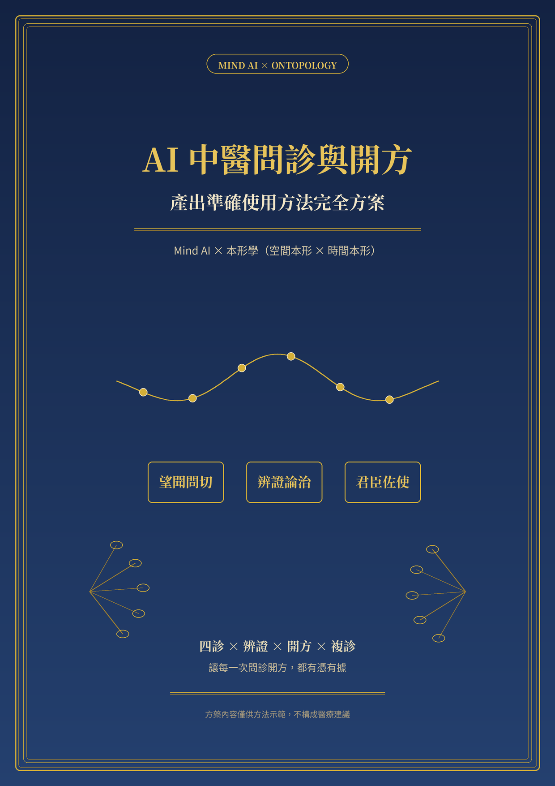

# 目　錄

- 寫在前面・三個約定
- 導讀・三種讀法
- 第一章　認識 AI 中醫問診與開方
  - 1.1　一個可推理的問診開方副本
  - 1.2　形與數，落在中醫
  - 1.3　雙本形如何用在問診開方
  - 1.4　Mind AI 為底層平台的分工
  - 1.5　準確，從哪裡來
- 第二章　六種產出形：問診開方要產出什麼
  - 2.1　四診形 ExamType：望聞問切的結構化
  - 2.2　證型形 SyndromeType：辨證的結論
  - 2.3　病機形 MechanismType：因果鏈的中段
  - 2.4　治法形 TreatmentType：從證到方的橋
  - 2.5　方劑形 FormulaType：君臣佐使的組成
  - 2.6　複診形 FollowType：療程的時間本形
- 第三章　四層準確性保證
  - 3.1　第一層：∩(T) 辨證判準
  - 3.2　第二層：演繹骨架——病機推演鏈
  - 3.3　第三層：醫理核方
  - 3.4　第四層：形證據鏈
  - 3.5　空間與時間的交叉驗收
- 第四章　六步驟：準確使用方法的操作流程
  - 4.1　先用框架四步驟認明需求
  - 4.2　六步驟走一次
  - 4.3　三層判斷：人體・方劑・證型
  - 4.4　挑招、組招、換招
- 第五章　S1–S7 提示詞流水線與不寐醫案
  - 5.1　S1–S7 總覽
  - 5.2　S1 四診採集提示詞
  - 5.3　S2 辨證分析與 S3 病機推演
  - 5.4　S4 治法立定與 S5 開方組方
  - 5.5　S6 核方驗收與 S7 複診調方
- 第六章　誤用、清單與成熟度
  - 6.1　誤用五種
  - 6.2　十問清單
  - 6.3　成熟度 L1 到 L4
- 回顧・收束
- 附錄 A　術語・招式・記號速查

# 寫在前面・三個約定

這是一本「怎麼用」的書。主題是 AI 中醫問診與開方：從望聞問切的四診開始，走到辨證、病機、治法、開方，再到複診調方——整條路要走得準。本書給你的不是中醫教科書，也不是系統操作手冊，而是一套產出準確使用方法的完全方案：每一次問診開方，都產出明確的「形」，每一個形都過得了判準，查得到證據。

理論基礎是本形學——空間本形與時間本形；底層平台是 Mind AI。動筆之前，先立三個約定，全書一體適用。

> **約定一：形，是 Type**
>
> 「形」的英文一律用 **Type**，不是 Form。四診形是 ExamType，證型形是 SyndromeType，方劑形是 FormulaType——全書譯名一致。

> **約定二：理論只用不教**
>
> 本書不重述本形學原理，直接拿工具來用：三括號 [ ] ( ) { }、交集判準 ∩(T)、身份錨 id(C)、remove 三級、框架四步驟、三層判斷、時間本形招式盤。工具的來龍去脈，請回空間本形與時間本形的原典；本書只負責把它們用在問診開方上。

> **約定三：平台只引不述**
>
> Mind AI 是底層平台，本書只引用其分工原則——LLM 管語言，Mind Model 管智慧——不重述平台本身的內容。你要知道的是：問診開方的每一次產出，都跑在這個平台的推理、記憶與學習能力之上。

> **重要聲明：**
>
> 本書出現的一切方藥內容（含藥味、劑量、加減），僅供方法示範，不構成醫療建議；臨床診療請由合格中醫師診斷處方。

最後，用一張任務地圖收攏全書：六個章節各管一段路，產出形與工具一路相伴。

**表 0-1　任務地圖：六段路與它的產出**

| 章 | 主題 | 你要學會的事 | 核心工具 |
| --- | --- | --- | --- |
| 第 1 章（認識） | AI 中醫問診與開方是什麼 | 看懂可推理副本與雙本形的落點 | 形＋數、招式盤 |
| 第 2 章（產出） | 六種產出形 | 把問診開方的產出全部結構化 | 三括號、remove 三級 |
| 第 3 章（準確） | 四層準確性保證 | 說得出「為什麼準」 | ∩(T)、id(C)、證據鏈 |
| 第 4 章（操作） | 六步驟流程 | 照步驟走完整條路 | 框架四步驟、三層判斷 |
| 第 5 章（演練） | 提示詞與醫案 | S1 到 S7 照做即用 | 七段提示詞 |
| 第 6 章（進階） | 誤用、清單、成熟度 | 避開陷阱、評估自己在哪一級 | 十問清單、L1–L4 |

# 導讀・三種讀法

中醫的語言與形＋數的語言，是兩套說法講同一件事。「心脾兩虛」是醫理的結論；證型形 SyndromeType 是同一個結論的結構化寫法。兩套語言之間的翻譯，就是本書要教會你的核心技能。

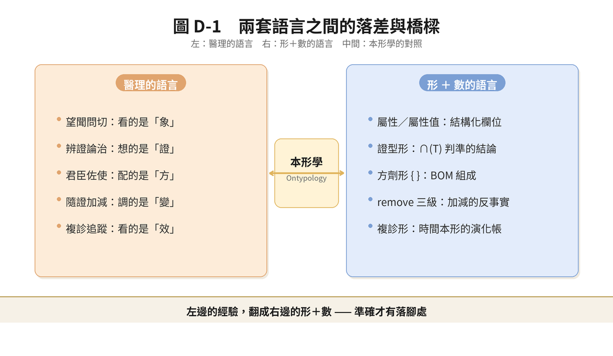

**圖 D-1　兩套語言之間的落差與橋樑**

**表 D-1　兩套語言對照表**

| 醫理的語言 | 形＋數的語言 | 翻譯的要點 |
| --- | --- | --- |
| 望聞問切 | 四診形 ExamType | 所見欄位化：有欄位，才查得到 |
| 辨證（心脾兩虛） | 證型形 SyndromeType | 特徵集合 F(T) 過 ∩(T) 判準 |
| 病因病機 | 病機形 MechanismType | 因 → 機 → 證的因果鏈 |
| 治則治法 | 治法形 TreatmentType | 一機一法，逐環對應 |
| 處方（君臣佐使） | 方劑形 FormulaType | BOM 組成：{君, 臣, 佐, 使} |
| 複診調方 | 複診形 FollowType | 療效對照＋版本記錄＋演化 |

本書有三種讀法，按你的需要挑一種，不必從頭啃到尾。

**表 D-2　三種讀法**

| 讀法 | 適合誰 | 路線 |
| --- | --- | --- |
| 直接用 | 要馬上開方者 | 第 5 章的 S1–S7 提示詞照抄，搭配醫案範例對照產出 |
| 理解用 | 要把方法講清楚者 | 第 2 章產出形 → 第 3 章四層準確性 → 第 5 章演練 |
| 導入用 | 要讓團隊持續變強者 | 第 1 章 → 第 4 章六步驟 → 第 6 章成熟度 L1–L4 |

全書用一個貫穿醫案示範：林小姐，三十二歲，失眠約兩個月。從四診採集一路走到複診調方，每一章都會回到她身上。你可以先翻到第 5 章看完整演練，再回頭補理論；也可以順著讀下來，看著同一個醫案一層層被解剖。

# 第一章　認識 AI 中醫問診與開方

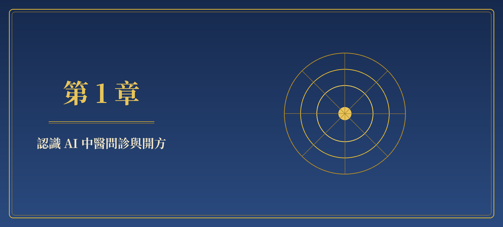

先把對象認清楚。這一章回答四件事：AI 中醫大腦到底是什麼、形與數落在中醫的哪裡、雙本形怎麼用在問診開方、以及「準確」兩個字從哪裡來。讀完本章，你應該能把這套方法一句話說給同行聽。

## 1.1　一個可推理的問診開方副本

一位老醫師看診時，腦中跑的是什麼？望一眼面色、切一下脈、聽幾句主訴，證型就浮出來了，方也跟著成形。這條思路存在他腦子裡，是隱性的、難以傳授的。AI 中醫問診與開方要做的事情只有一件：把這條思路做成一個可推理的副本——不只給答案，還保留推理的路。

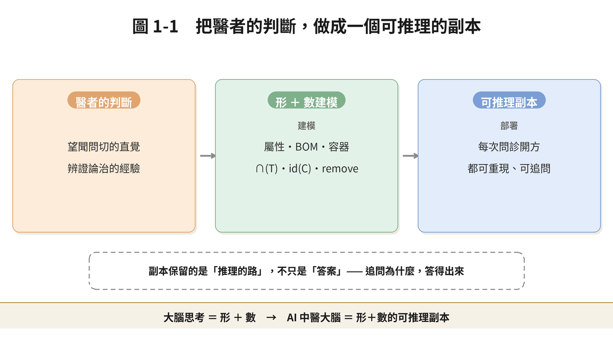

**圖 1-1　把醫者的判斷，做成一個可推理的副本**

副本的關鍵在「可推理」。你問它為什麼開歸脾湯，它答得出：因為證型是心脾兩虛，因為脈細弱、心悸健忘過得了這個證型的判準，因為治法是補益心脾、養血安神，所以方從法出。答案背後有一條可以追問的路，這條路用形與數鋪成。

## 1.2　形與數，落在中醫

大腦思考＝形＋數。數描述量——劑量、脈率、病程天數；形描述結構——證型長什麼樣、方劑由什麼組成、病機如何串聯。中醫兩樣都不缺：缺的是把「形」寫清楚的語言。

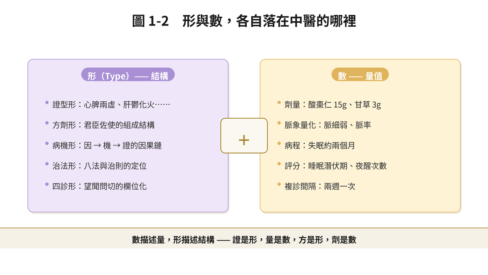

**圖 1-2　形與數，各自落在中醫的哪裡**

中醫傳統強調「象」與「悟」，結構化程度低，於是同一份四診資訊，兩位醫師可能開出兩張不同的方，誰也說不清差在哪一環。把形立起來，差異就被逼到檯面上：是 F(T) 收得不同？是病機鏈斷了一環？還是治法選了另一條？對得出來，才談得上準確。

**表 1-1　形＋數在中醫的落點**

| 層面 | 形（結構） | 數（量值） |
| --- | --- | --- |
| 四診 | 四診形：望聞問切四欄位 | 舌色、脈率、病程天數 |
| 辨證 | 證型形：F(T) 與 ∩(T) | 症狀程度評分 |
| 病機 | 病機形：因→機→證鏈 | 病程階段 |
| 治法 | 治法形：治則＋八法歸類 | 療程長度 |
| 方劑 | 方劑形：君臣佐使 BOM | 藥味劑量 |
| 複診 | 複診形：版本記錄 | 療效差值 |

## 1.3　雙本形如何用在問診開方

空間本形與時間本形，在問診開方裡各管一半。空間本形管「看清楚」：把人、證、方的結構立起來——屬性是 X 軸，組成是 Y 軸，容器是 Z 軸，三條軸把一個對象釘在座標上。時間本形管「做下去」：診、治、調是一連串動作，每個動作是一招——時間本形＝動詞＝函式＝招式。

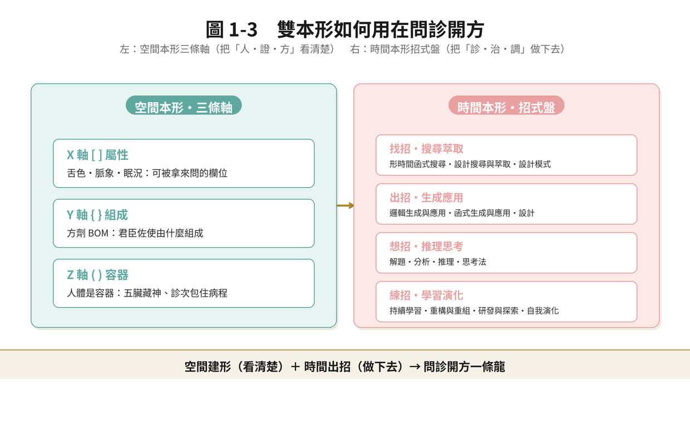

**圖 1-3　雙本形如何用在問診開方**

**表 1-2　空間本形三條軸 × 中醫**

| 軸 | 括號 | 中醫的落點 |
| --- | --- | --- |
| X 軸・屬性 | [ ] | 舌色、脈象、眠況、二便……可被拿來問的欄位；屬性值是欄位裡的選項 |
| Y 軸・組成 | { } | 方劑 BOM：君臣佐使由哪些藥味組成；remove 三級對應加減尺度 |
| Z 軸・容器 | ( ) | 人體是容器（五臟藏神、氣血津液）；診次包住病程；id(C) 錨定身份 |

時間本形的招式盤有四組十四招。本書只列綱目、直接取用；招式的定義與推導回到時間本形原典。

**表 1-3　時間本形招式盤 × 中醫落點（四組）**

| 組 | 招式 | 問診開方的用法 |
| --- | --- | --- |
| 找招 | 形時間函式搜尋・設計搜尋與萃取・設計模式 | 找相似醫案、萃取證型特徵、套用成方配伍模式 |
| 出招 | 邏輯生成與應用・函式生成與應用・設計 | 病機推演、治法生成、組方加減（開方就是設計） |
| 想招 | 解題・分析・推理・思考法 | 辨證分析、因果推理、逆向從方測證、鑑別診斷 |
| 練招 | 持續學習・重構與重組・研發與探索・自我演化 | 醫案歸檔、調方重構、探索新方、越開越準 |

把兩半合起來：空間建形讓「人・證・方」有結構，時間出招讓「診・治・調」有動作。六種產出形（第 2 章）是空間的結晶，六步驟（第 4 章）是時間的套路，S1 到 S7（第 5 章）是每一招的具體出手式。

## 1.4　Mind AI 為底層平台的分工

這套方法跑在 Mind AI 上。分工原則一句話：LLM 管語言，Mind Model 管智慧。LLM 負責聽懂主訴、寫出四診記錄、召回方劑文獻；Mind Model 負責統一知識、深度推理、長期記憶與持續學習。辨證論治的演繹由 Mind Model 承擔，語言的進出由 LLM 承擔。

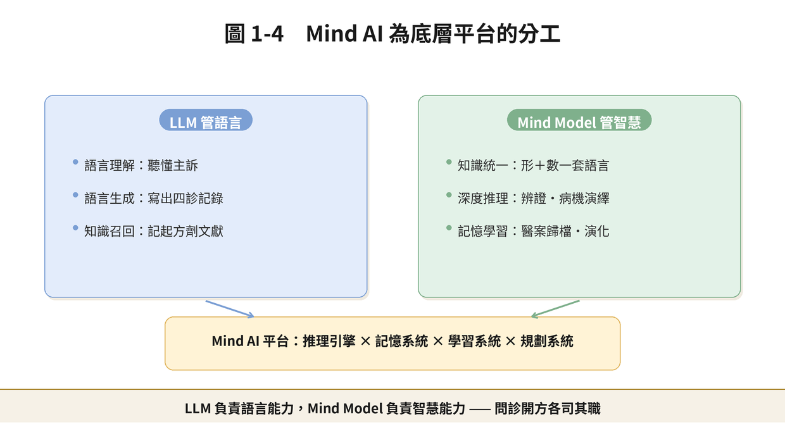

**圖 1-4　Mind AI 為底層平台的分工**

分工落到問診開方的每一站：S1 的四診記錄由 LLM 寫成，S2、S3 的辨證與病機演繹由 Mind Model 推理，S5 查文獻是兩者合力，S7 的醫案歸檔與經驗回寫則是 Mind Model 的記憶與學習能力在收束。語言進出不缺席，智慧推理不外包——這就是底層平台的意義。

## 1.5　準確，從哪裡來

「AI 開的方能信嗎？」這個問題必須有結構性的答案，而不是感覺。本書的答案是四層準確性保證，第 3 章逐層展開，這裡先一句話預告每一層：辨證有判準（∩(T) 過了才收進證型）、推理有骨架（病機鏈環環相扣）、配方有核驗（君臣佐使＋配伍禁忌）、全程有證據（每一步指得回四診）。四層都過，才准出方。

還有一半準確來自時間維度：複診讓每一次療效都變成下一診的經驗，醫案卷越來越厚，判準越來越精。空間的四層管「這一張方準不準」，時間的演化管「下一張方更不更準」。

> **本章重點**
>
> AI 中醫大腦＝問診開方思路的可推理副本：答案背後有可追問的路。
> 形描述結構、數描述量值；把形立起來，準確才有一致的語言。
> 空間本形三條軸看清楚「人・證・方」，時間本形招式盤做下去「診・治・調」。
> Mind AI 分工：LLM 管語言，Mind Model 管智慧；準確由四層保證＋時間演化。

# 第二章　六種產出形：問診開方要產出什麼

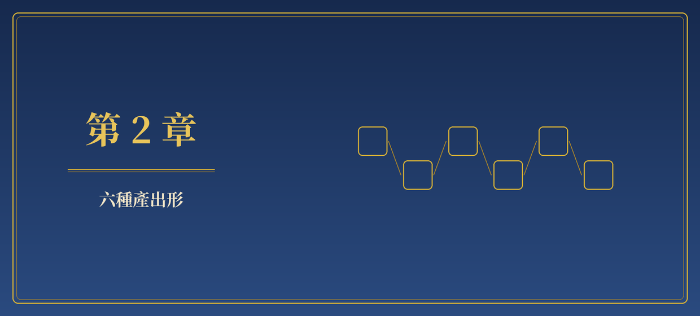

問診開方不是一次性的對話，而是六種產出物的接力：四診形、證型形、病機形、治法形、方劑形、複診形。每一種都是一種形 Type，都有明確的欄位與判準。形定下來，產出才可累積、可比較、可驗收。

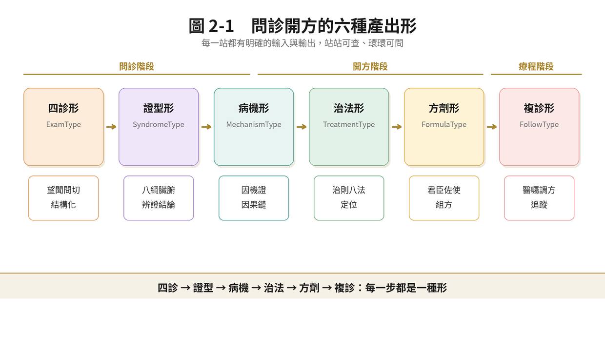

**圖 2-1　問診開方的六種產出形**

先記總表，後面六節逐一拆開。每一節都回答同樣的三件事：這個形的欄位是什麼（屬性 X 軸）、由什麼組成（組成 Y 軸）、住在什麼容器裡（容器 Z 軸）。

**表 2-1　六種產出形總表**

| 產出形 | 英文名 | 一句話 | 判準 |
| --- | --- | --- | --- |
| 四診形 | ExamType | 望聞問切的結構化記錄 | 所見齊全、不臆補 |
| 證型形 | SyndromeType | 辨證的結論 | ∩(T) 交集判準 |
| 病機形 | MechanismType | 因→機→證的因果鏈 | 環環有四診證據 |
| 治法形 | TreatmentType | 從證到方的橋 | 一機一法對應 |
| 方劑形 | FormulaType | 君臣佐使的組成 | 配伍核驗＋remove 三級 |
| 複診形 | FollowType | 療程的時間本形 | 前後對照＋版本記錄 |

## 2.1　四診形 ExamType：望聞問切的結構化

四診形是整條路的地基。它把「望、聞、問、切」四診變成四個欄位群，每個欄位群下是可填的屬性與屬性值——屬性是「可以被拿來問的問題」，屬性值是這個問題在本診的答案。欄位定死，資訊才不會漏；漏了欄位會顯示「未採集」，而不是被沉默地跳過。

**表 2-2　四診形 ExamType 欄位表**

| 欄位群 | 核心屬性 | 屬性值示例（林小姐） |
| --- | --- | --- |
| 望 | 面色、形體、舌色、舌苔、神態 | 面色少華；形體偏瘦；舌淡；苔薄白；神疲 |
| 聞 | 語聲、氣息、特殊氣味 | 語聲低微；無特殊氣味 |
| 問 | 眠況、心悸、食納、二便、月經、情志 | 難入睡多夢易醒；心悸健忘；食少納呆；二便調；經量少色淡；思慮多 |
| 切 | 脈象、腹診、壓痛 | 脈細弱；腹軟無壓痛 |

實務上有兩條鐵律。第一，客觀所見先行：舌象、脈象必填，缺了就標「未採集」並列入補問清單，絕不用猜的補上。第二，程度與時間要寫進屬性值：「失眠約兩個月」「夜醒二至三次」比「睡不好」有用得多——後續辨證的特徵集合 F(T) 是從這裡長出來的。

## 2.2　證型形 SyndromeType：辨證的結論

證型形是辨證的結論，寫法是「不寐・心脾兩虛證」這樣的雙層結構：病名（不寐）＋證型（心脾兩虛）。它不是一句話，而是一個集合的會員資格判定——[ 不寐 ] 是抽象集合，一個病人要進得來，特徵集合 F(T) 必須過得了這個證型的交集判準 ∩(T)。

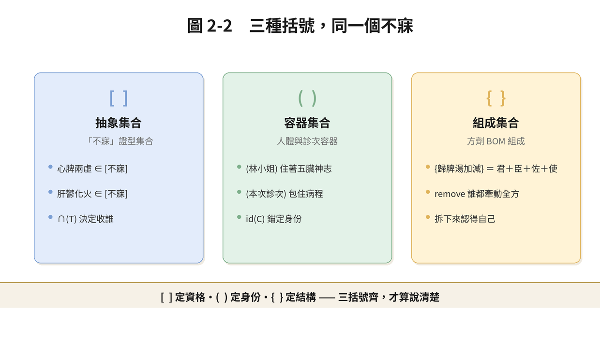

**圖 2-2　三種括號，同一個不寐**

三種括號在辨證現場各有職責：[ ] 定資格——這個表現歸不歸入不寐、是不是心脾兩虛；( ) 定身份——這位林小姐是一個容器，五臟神志氣血住在裡面，(本次診次) 包住這段病程，id(C) 把人與病程錨定；{ } 定結構——方劑由什麼組成，下一節與 2.5 會用到。

**表 2-3　證型形 SyndromeType：定位與判準**

| 步驟 | 內容 | 林小姐的判定 |
| --- | --- | --- |
| 病名定位 | 不寐：以不能獲得正常睡眠為主訴 | 主訴失眠約兩個月 → 病名不寐 |
| 八綱定位 | 陰陽、表裡、寒熱、虛實 | 裡、虛、寒象不顯 → 裡虛證 |
| 臟腑定位 | 心、脾、肝、膽何者受累 | 心悸健忘＋食少納呆 → 心脾 |
| F(T) 對照 | 特徵集合與候選證型逐一比對 | 面色少華、舌淡、脈細弱、經量少 |
| 排除鑑別 | 相似證型為何不取 | 非肝鬱化火（無急躁口苦脈弦） |

## 2.3　病機形 MechanismType：因果鏈的中段

證型形回答「是什麼」，病機形回答「為什麼」。它把病因、病機、證候串成因果鏈：思慮過度暗耗心血，脾失健運、氣血生化乏源，心神失養，於是不寐。這條鏈是演繹骨架的中段——前接四診證據，後接治法方藥（第 3 章詳述）。

病機形有兩個欄位規矩。其一，每一環都要指得回四診裡的證據：說「脾失健運」，就得有食少納呆、倦怠之類的所見撐著；指不回去的環，是臆測，砍掉。其二，鏈是有序的：因果順序亂了，治法就會抓錯重點——先補血還是先健脾，取決於哪一環是主機。

## 2.4　治法形 TreatmentType：從證到方的橋

治法形是病機與方劑之間的橋：病機說「心血不足、脾運不健、心神失養」，治法就立「補益心脾、養血安神」——一機一法，逐環對應，不多不少。治則是大方向（虛則補之），治法是具體落點（補心脾、養心神），再加上八法歸類（此例屬補法），三欄寫齊，治法形才完整。

治法形的判準只有一條：方開出來之後，每一味藥要指得回治法、每一句治法要指得回病機。橋若偷工減料，方就成了藥味的堆砌——這正是第 6 章誤用五種裡最常見的一種。

## 2.5　方劑形 FormulaType：君臣佐使的組成

方劑形是本書最重要的產出，它就是一張 BOM（組成集合 { }）：底方為根，君臣佐使四級為幹，藥味劑量為葉。君藥針對主證主機，臣藥助君為力，佐藥照顧兼證或防副作用，使藥調和諸藥、引經報使。每一味藥有名字、有劑量、有任務——三樣缺一，BOM 就不完整。

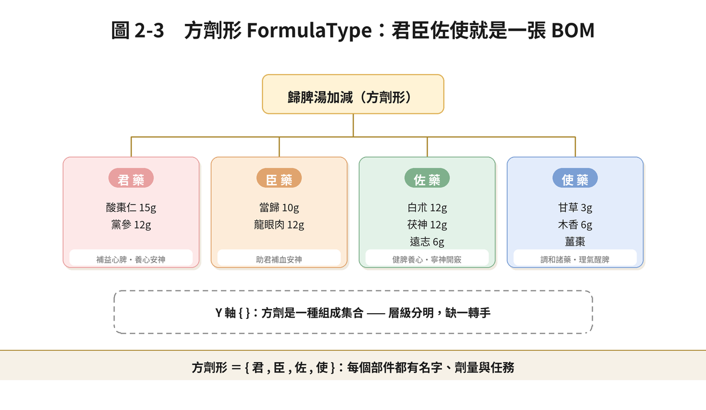

**圖 2-3　方劑形 FormulaType：君臣佐使就是一張 BOM**

**表 2-4　方劑形 BOM：歸脾湯加減（僅供示範）**

| 層級 | 藥味與劑量 | 任務 |
| --- | --- | --- |
| 君 | 黃耆 15g、黨參 12g、酸棗仁 15g | 補益心脾、養心安神，直指主機 |
| 臣 | 當歸 10g、龍眼肉 12g、茯神 12g | 養血安神，助君為力 |
| 佐 | 白朮 12g、遠志 6g | 健脾助運、寧神開竅，顧兼證 |
| 使 | 木香 6g（後下）、甘草 3g、生薑 3 片、大棗 5 枚 | 理氣醒脾使補而不滯、調和諸藥 |

加減是方劑形的動態欄位，尺度由 remove 三級決定：單味、藥對（角）、方根（底方）。動手加減之前，先做反事實問句——「拆下來，它還認得自己嗎？」單味被移除，問的是任務會不會落空；藥對被移除，問的是不是成對失守；方根被移除，問的是整張方的骨架還在不在。三問都過，才動這一級。

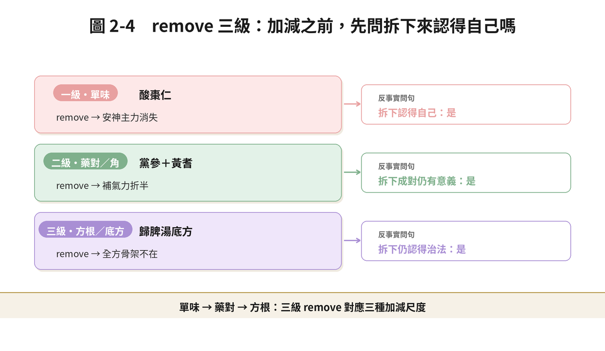

**圖 2-4　remove 三級：加減之前，先問拆下來認得自己嗎**

**表 2-5　remove 三級 × 加減尺度**

| 級 | 對象 | 反事實問句 | 加減示例（僅供示範） |
| --- | --- | --- | --- |
| 一級 | 單味 | 拿掉它，任務落空嗎 | 眠差多夢 → 加柏子仁 10g 強化安神任務 |
| 二級 | 藥對／角 | 拿掉它們，成對失守嗎 | 黨參＋黃耆一對補氣，除非改方否則不輕拆 |
| 三級 | 方根／底方 | 拿掉骨架，治法還站得住嗎 | 若證型轉變（如轉肝鬱化火），才換底方 |

## 2.6　複診形 FollowType：療程的時間本形

複診形是療程的時間本形：它把「診・治・調」拉成一條時間線。欄位有四組——療效對照（前後四診的差值）、證型轉變（守證還是轉證）、調方決定（守方、加減、換方，附理由）、演化紀錄（這次學到什麼，回寫醫案卷）。複診不是重來一次問診，而是帶著前診卷宗的比對。

id(C) 在這裡特別重要：容器的身份要錨定，「林小姐這一段病程」才追得蹤、比得了、積得累。每一次複診都是醫案卷的新版本，舊版本不覆蓋——這正是時間本形「持續學習、自我演化」兩招的落點。

> **本章重點**
>
> 六種產出形接力：四診 → 證型 → 病機 → 治法 → 方劑 → 複診，每種形都有欄位與判準。
> 三括號分工：[ ] 定資格、( ) 定身份、{ } 定結構；證型是集合會員的判定。
> 方劑形是一張 BOM：君臣佐使層級分明，每個藥味有名字、劑量、任務。
> 加減尺度由 remove 三級決定；複診形用 id(C) 錨定病程，讓經驗可以累積。

# 第三章　四層準確性保證

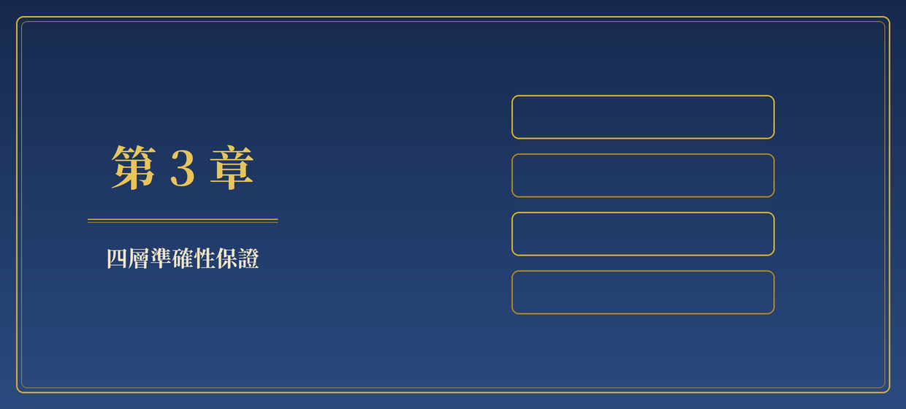

準確不能靠感覺。本章把「為什麼這張方可以信」拆成四層：辨證有判準、推理有骨架、配方有核驗、全程有證據。四層是四道關，每道關各有各的問法，也各有各的退件處理。

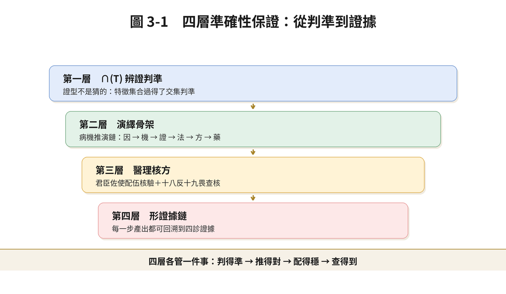

**圖 3-1　四層準確性保證：從判準到證據**

四層各有各的退件處理：∩(T) 不過，退回補問四診；病機鏈斷環，退回重推；配伍有疑，退回重新組方；證據斷鏈，退回補齊。退件路徑寫得明確，流水線才敢放行到下一關——第 5 章的 S1 到 S7 會把這些退件路徑一一落到提示詞裡。

## 3.1　第一層：∩(T) 辨證判準

第一層管辨證。證型形 T 由兩樣東西決定：特徵集合 F(T) 與交集判準 ∩(T)。病人的表現湊成一個特徵集合，候選證型各有各的判準——兩者相交，過得了關才收得進來。這不是查表比對單一症狀，而是整組特徵的集合判定，所以同一個主訴（失眠）會分流到四種不同證型、四張不同的方。

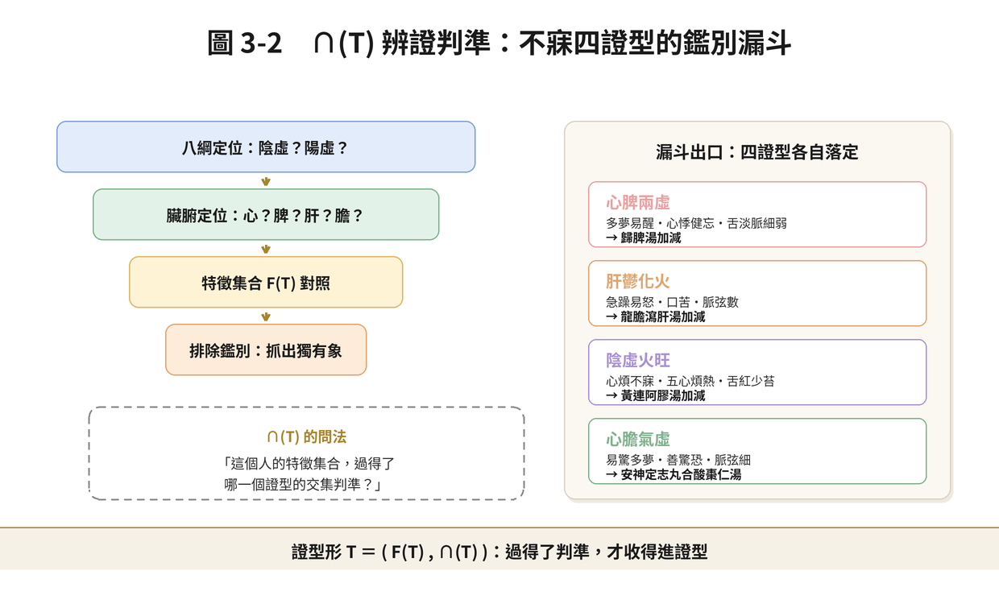

**圖 3-2　∩(T) 辨證判準：不寐四證型的鑑別漏斗**

**表 3-2　∩(T) 鑑別：不寐四證型（方劑僅供示範）**

| 證型 | F(T) 特徵要點 | ∩(T) 獨有象 | 底方 |
| --- | --- | --- | --- |
| 心脾兩虛 | 多夢易醒、心悸健忘、食少倦怠 | 面色少華、脈細弱 | 歸脾湯加減 |
| 肝鬱化火 | 急躁易怒、口苦、便秘溲赤 | 脈弦數、苔黃 | 龍膽瀉肝湯加減 |
| 陰虛火旺 | 心煩不寐、五心煩熱、盜汗 | 舌紅少苔、脈細數 | 黃連阿膠湯加減 |
| 心膽氣虛 | 易驚多夢、善驚恐、氣短 | 脈弦細、觸事易驚 | 安神定志丸合酸棗仁湯 |

漏斗的最後一關是排除鑑別：要寫得出「為何不是另一個證型」。林小姐沒有急躁口苦、脈不弦數，所以肝鬱化火出局；沒有五心煩熱、舌不紅，所以陰虛火旺出局。排除寫得出來，才代表 ∩(T) 真的跑過一遍，而不是背答案。

## 3.2　第二層：演繹骨架——病機推演鏈

第二層管推理。從病因到藥味，是一條六環的演繹鏈：因 → 機 → 證 → 法 → 方 → 藥。每一環都是一次演繹推理（時間本形・推理招），每一環都要有四診證據或上一環的支撐。鏈上任何一環斷了，後面全不作數——這就是「方從法出、法從證立」的結構化版本。

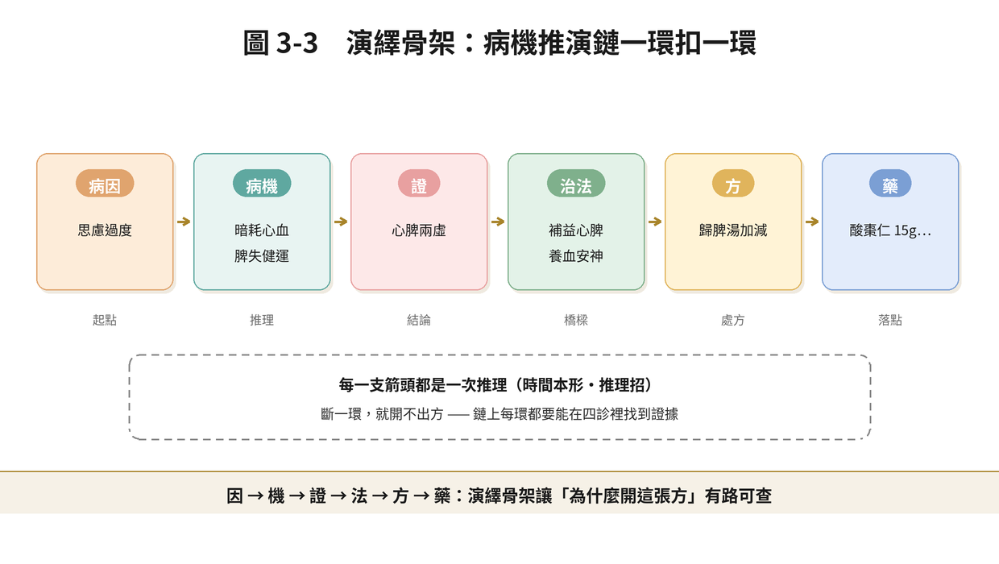

**圖 3-3　演繹骨架：病機推演鏈一環扣一環**

**表 3-3　病機推演鏈欄位（林小姐示例）**

| 環 | 內容 | 支撐證據 |
| --- | --- | --- |
| 因 | 思慮過度 | 問診：思慮多、文職 |
| 機 | 暗耗心血、脾失健運、氣血乏源 | 心悸健忘、食少納呆、倦怠乏力 |
| 證 | 心脾兩虛（不寐） | 面色少華、舌淡苔薄白、脈細弱 |
| 法 | 補益心脾、養血安神（補法） | 對應主機：心脾兩虛、心神失養 |
| 方 | 歸脾湯加減 | 底方主治與證型相合 |
| 藥 | 君臣佐使逐味指回治法 | 見表 2-4、表 5-4 |

## 3.3　第三層：醫理核方

第三層管配方。演繹鏈保證「方從法出」，但法對了方仍可能開歪——所以要核方。核方分兩大關：結構關與安全關。結構關查君臣佐使是否齊全、每味藥的任務是否明確、有沒有「說不出任務的藥」混進來；安全關查配伍禁忌（十八反、十九畏）、劑量是否在常用範圍、特殊人群提示（妊娠、經期、過敏史）。

核方的問法是反事實的——remove 三級再跑一次：這張方少任何一味，哪個任務會落空？答得出來，表示每味藥都在崗位上；答不出來，這味藥就可疑。核方不過的處置很明確：指出斷點，退回 S5 重新組方，絕不帶著疑點出方。

## 3.4　第四層：形證據鏈

第四層管查證。形證據鏈把六種產出形串成一條可回溯的路：處方指得回治法，治法指得回病機，病機指得回證型，證型指得回四診。追問「憑什麼」的時候，每一步都答得出上一步——像病歷，也像判決書的說理。

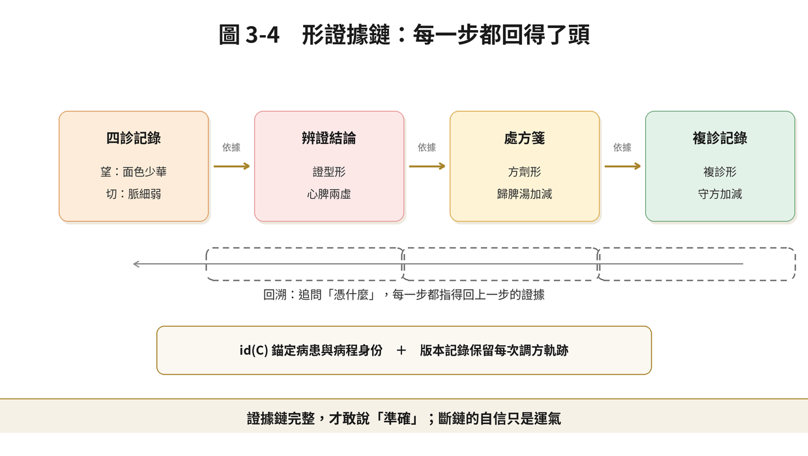

**圖 3-4　形證據鏈：每一步都回得了頭**

**表 3-4　形證據鏈欄位**

| 產出 | 要存什麼 | 回溯到 |
| --- | --- | --- |
| 四診形 | 原始所見＋未採集清單 | 問診當下（對話記錄） |
| 證型形 | F(T)＋∩(T) 對照＋排除鑑別 | 四診形 |
| 病機形 | 因果鏈逐環＋證據指涉 | 四診形、證型形 |
| 治法形 | 治則治法＋對應病機環 | 病機形 |
| 方劑形 | 君臣佐使＋加減理由＋核方報告 | 治法形 |
| 複診形 | 療效對照＋調方版本 | 前診卷宗（id(C) 串起） |

## 3.5　空間與時間的交叉驗收

四層是空間視角的把關——這一張方、這一刻的準確。別忘了時間視角：複診形帶來療效回饋，讓判準可以被驗證與修正。空間×時間的交叉驗收，做法是把複診結果倒回去比對當初的四層：當初判的心脾兩虛，用方之後眠況改善了嗎？改善了，四層的判定被強化；沒改善，就要重開卷——是 F(T) 收錯了象，還是病機鏈抓錯主機？

這套倒查就是時間本形「自我演化」的具體動作：每一次交叉驗收，醫案卷就多一頁結論，∩(T) 判準就多一分火候。四層管準確的下限，演化管準確的上限。

> **本章重點**
>
> 四層各管一件事：∩(T) 管辨證、演繹鏈管推理、醫理核方管配方、形證據鏈管查證。
> 排除鑑別寫得出來，才算真的跑過 ∩(T)；斷一環的病機鏈，後面全不作數。
> 核方走結構關與安全關，remove 反事實問句是最快的自查。
> 空間四層管這一張方，時間演化管下一張方；交叉驗收讓判準越用越精。

# 第四章　六步驟：準確使用方法的操作流程

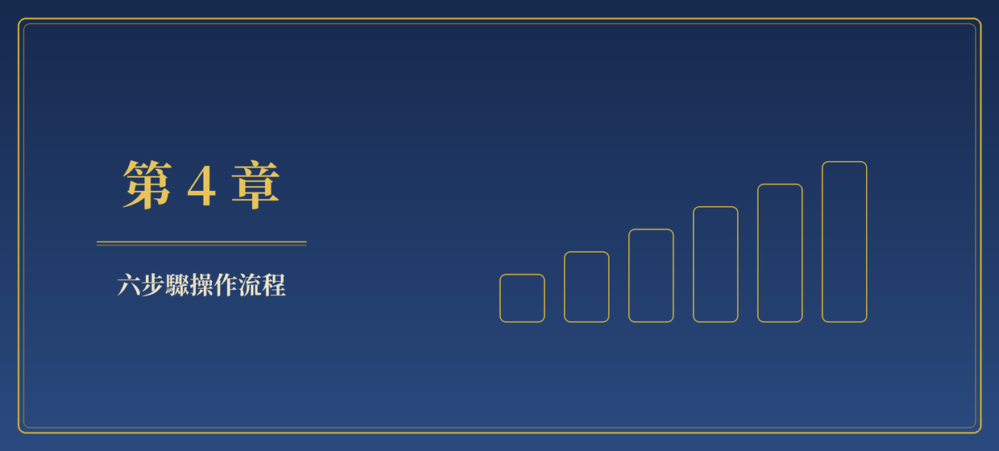

產出形是「東西」，這一章是「動作」。六步驟把前兩章的產出與判準排成一條可重複走的路：認明情境、分軸建形、挑選擴式、生成產出、判準驗收、歸檔演化。每一診走一遍，醫案卷就厚一頁。

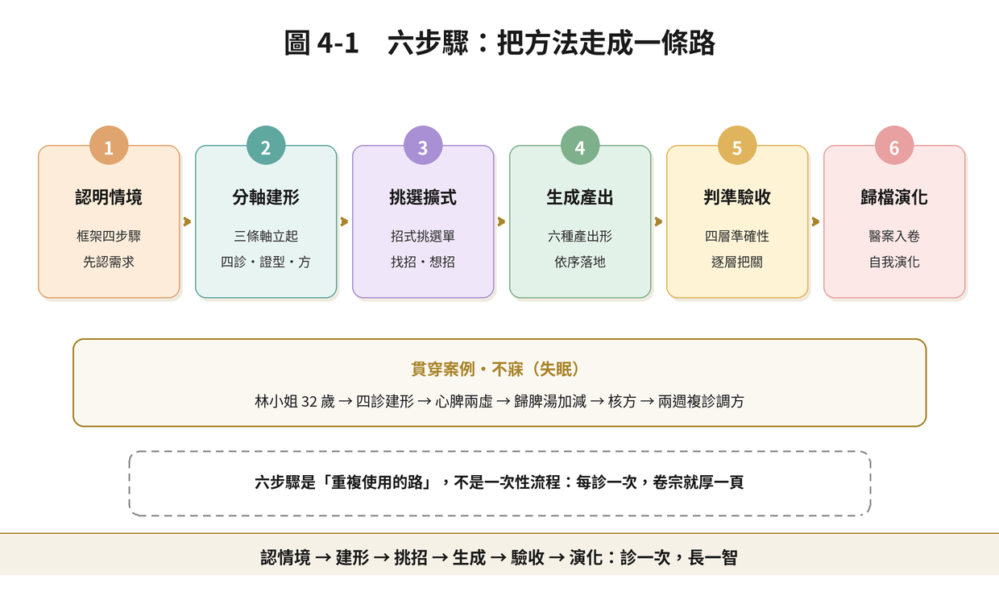

**圖 4-1　六步驟：把方法走成一條路**

## 4.1　先用框架四步驟認明需求

六步驟之前先做框架四步驟——這是空間本形的開場動作，用來把「這次看診的需求」認清楚，而不是一頭栽進症狀堆裡。四步依序是：定對象（這次的容器是誰、id(C) 是什麼）、定範圍（本次診次要處理什麼、不處理什麼）、定目標（療效指標是什麼）、定約束（體質、經期、藥物過敏、生活限制）。

**表 4-1　框架四步驟 × 問診開方**

| 步驟 | 要問的問題 | 林小姐示例 |
| --- | --- | --- |
| 定對象 | 容器是誰？id(C) 是什麼？ | 林小姐，32 歲，文職；本段病程＝失眠約兩個月 |
| 定範圍 | 本診處理什麼？不碰什麼？ | 處理失眠主訴；先不動月經調理，列入後續 |
| 定目標 | 療效指標是什麼？ | 入睡時間縮短、夜醒次數下降、心悸減輕 |
| 定約束 | 體質、禁忌、生活限制？ | 無妊娠；經期將至；忌濃茶咖啡；工作壓力大 |

## 4.2　六步驟走一次

框架認明之後，六步驟依序出手。注意它與產出形的對位：前三步是準備（情境、形、招），第四步生成六種產出形，第五步跑四層準確性，第六步把結果沉澱成時間本形的演化。

**表 4-2　六步驟總表**

| 步 | 動作 | 產出 | 對應章 |
| --- | --- | --- | --- |
| 1 | 認明情境（框架四步驟） | 情境說明：對象、範圍、目標、約束 | 本章 4.1 |
| 2 | 分軸建形（三條軸） | 四診形立欄位，辨證與方劑的骨架就位 | 第 2 章（產出形） |
| 3 | 挑選擴式（招式盤） | 招式挑選單：本診要用哪幾招 | 本章 4.4 |
| 4 | 生成產出 | 六種產出形依序落地 | 第 5 章（演練） |
| 5 | 判準驗收（四層） | 核方報告；不過就退件 | 第 3 章（準確） |
| 6 | 歸檔演化 | 醫案入卷、經驗回寫、判準精進 | 本章＋第 6 章 |

## 4.3　三層判斷：人體・方劑・證型

操作途中不斷回頭做判斷的時候，用形邏輯的三層判斷，由外而內三問：容器判斷——這個問題涉及的容器是誰？人體是容器，五臟神志住在裡面，診次也是容器，包住這段病程，身份由 id(C) 錨定。組成判斷——談的這個方由什麼組成？remove 三級的反事實問句在這裡跑。抽象判斷——這個表現歸得進 [ 證型 ] 嗎？∩(T) 說了算。

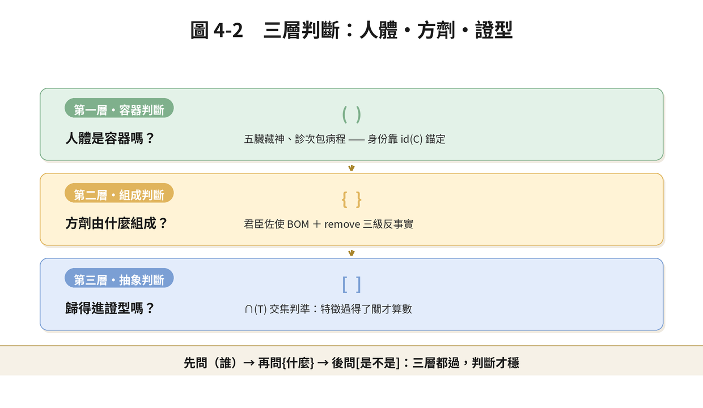

**圖 4-2　三層判斷：人體・方劑・證型**

三層的順序不能亂：先確認容器與身份，才不會張冠李戴（把別人的醫案套在這位病人身上）；再看組成，才不會脫離方劑結構談藥味；最後才做抽象歸類，判準才有所依附。遇到卡關的案例，多半是跳層——跳過容器直接談證型，是最常見的一種。

## 4.4　挑招、組招、換招

時間本形的招式盤不是每診全上，而是按情境挑選、按需要組合、按結果更換。挑招看情境的疑難點：證型難辨就上「分析＋推理」，方劑難組就上「設計搜尋與萃取＋設計模式」，療效不動就上「解題＋重構與重組」。組招是把前後招串成流水線——S1 到 S7 本身就是一條標準組招。換招是診斷性動作：這條路推不動，退回上一環換一招再推。

**表 4-3　招式挑選單（情境 → 招式）**

| 情境 | 首選招式 | 組合用法 |
| --- | --- | --- |
| 四診資訊雜亂 | 分析・形時間函式搜尋 | 先分析拆欄位，再以相似醫案補齊漏問 |
| 證型難辨、象不典型 | 推理・思考法 | 正向從象推證＋逆向從方測證交叉驗證 |
| 方劑難組、加減猶豫 | 設計搜尋與萃取・設計模式 | 先搜相似醫案的成方模式，再按 BOM 調整 |
| 療效不佳、要找原因 | 解題・逆向推理 | 從未效倒推：F(T) 錯？主機抓錯？劑量不足？ |
| 多診之後要精進 | 持續學習・自我演化 | 醫案卷複盤，把結論回寫判準 |

> **本章重點**
>
> 框架四步驟先認需求：定對象、定範圍、定目標、定約束，再進六步驟。
> 六步驟對位產出形與四層準確性：準備三步、生成一步、驗收一步、演化一步。
> 三層判斷由外而內：(容器) → {組成} → [抽象]，跳層是卡關最常見的原因。
> 招式要挑、要組、要換；S1–S7 就是標準組招，第 5 立即演練。

# 第五章　S1–S7 提示詞流水線與不寐醫案

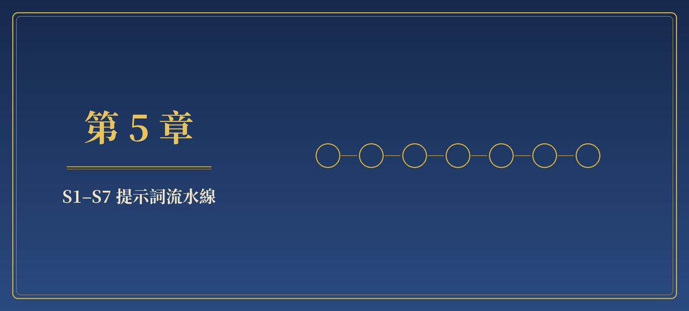

這一章是演練場。七段提示詞 S1–S7 對應六種產出形與核方報告，每段都是「任務 → 輸入形 → 輸出形 → 判準 → 禁止事項」的寫法：上一站的產出是下一站的輸入，形形相扣。全部用林小姐的不寐醫案實跑一遍——照抄提示詞，換上你的病人，就是可用的方法。

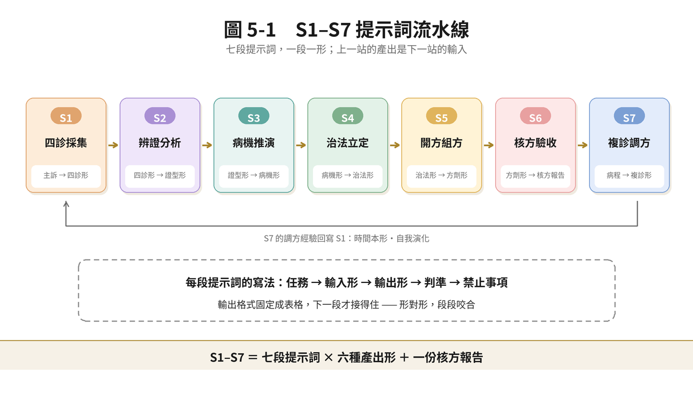

**圖 5-1　S1–S7 提示詞流水線**

## 5.1　S1–S7 總覽

先看全景：七段各管一段路，輸入輸出都是明確的形。中間任何一段被核方打回，就退回該段重做——退件路徑寫在表的最後一欄。

**表 5-1　S1–S7 總表**

| 段 | 任務 | 輸入形 | 輸出形 | 不過退件 |
| --- | --- | --- | --- | --- |
| S1 | 四診採集 | 主訴對話 | 四診形 ExamType | 缺欄位 → 補問 |
| S2 | 辨證分析 | 四診形 | 證型形 SyndromeType | ∩(T) 不過 → 退 S1 |
| S3 | 病機推演 | 證型形 | 病機形 MechanismType | 斷環 → 退 S2 |
| S4 | 治法立定 | 病機形 | 治法形 TreatmentType | 不對應 → 退 S3 |
| S5 | 開方組方 | 治法形 | 方劑形 FormulaType | 核方不過 → 退 S5 |
| S6 | 核方驗收 | S1–S5 全卷 | 核方報告 | 任一層不過 → 退該段 |
| S7 | 複診調方 | 前診卷宗＋新四診 | 複診形 FollowType | 療效存疑 → 重開卷 |

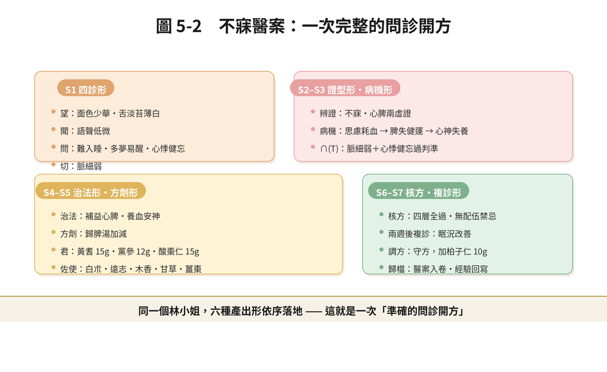

**圖 5-2　不寐醫案：一次完整的問診開方**

## 5.2　S1 四診採集提示詞

S1 的任務只有一個：把對話變成結構化四診記錄。最容易犯的錯是順手下判斷——所以提示詞明文禁止在本步驟寫證型。

> **提示詞 S1　四診採集**
>
> 【任務】你是中醫問診助理。把病患主訴與對話整理成結構化四診記錄（四診形 ExamType）。
> 【輸入】病患主訴與對話記錄。
> 【輸出格式】表格四欄：望、聞、問、切；每欄列出具體所見。
> 【判準】舌象、脈象必填；症狀須含程度與時間；缺漏欄位寫「未採集」並列補問清單。
> 【禁止】不得在本步驟寫出證型或處方；不得用推測補齊未採集欄位。

**表 5-2　S1 產出範例：林小姐四診形**

| 欄位 | 產出內容 |
| --- | --- |
| 望 | 面色少華、形體偏瘦、舌淡、苔薄白、神疲 |
| 聞 | 語聲低微，無特殊氣味 |
| 問 | 失眠約兩個月：難入睡、多夢易醒、夜醒二至三次；心悸健忘；食少納呆；倦怠乏力；思慮多；月經量少色淡；二便調 |
| 切 | 脈細弱，腹軟無壓痛 |
| 未採集 | （本例無；若有則列補問清單，如「近期用藥史待補」） |

## 5.3　S2 辨證分析與 S3 病機推演

S2 把四診形收斂成證型形，S3 把證型形展開成病機形。一收一放，收要過 ∩(T)，放要環環有據。

> **提示詞 S2　辨證分析**
>
> 【任務】把四診形整理成證型形 SyndromeType。
> 【步驟】①八綱定位 ②臟腑定位 ③列出特徵集合 F(T) ④以交集判準 ∩(T) 對照候選證型 ⑤寫出排除鑑別。
> 【輸出】病名・證型名稱＋F(T) 清單＋∩(T) 對照＋排除說明（至少一個相似證型為何不取）。
> 【禁止】特徵不足時輸出「證型未定」並列補問清單，不得硬猜。

> **提示詞 S3　病機推演**
>
> 【任務】把證型形展開成病機形 MechanismType：因 → 機 → 證的因果鏈。
> 【輸出】鏈式表格三欄：環節｜內容｜四診證據；每一環都要指得回四診所見。
> 【禁止】不得引入四診沒有的病因假設；指不回證據的環必須刪除。

**表 5-3　S2–S3 產出範例：證型形與病機形**

| 產出 | 內容 |
| --- | --- |
| S2・證型形 | 不寐・心脾兩虛證 |
| S2・F(T) | 難入睡多夢易醒、心悸健忘、食少納呆、倦怠乏力、面色少華、舌淡苔薄白、脈細弱、經量少色淡 |
| S2・∩(T) | 脈細弱＋面色少華＋心悸健忘過「心脾兩虛」判準；八綱裡虛、臟腑定位心脾 |
| S2・排除鑑別 | 非肝鬱化火（無急躁、口苦、脈弦數）；非陰虛火旺（無五心煩熱、舌紅少苔） |
| S3・因 | 思慮過度（問診：思慮多、文職） |
| S3・機 | 暗耗心血 → 脾失健運、氣血生化乏源 → 心神失養（證據：心悸健忘、食少納呆、倦怠） |
| S3・證 | 心脾兩虛而不寐（證據：面色少華、舌淡、脈細弱） |

## 5.4　S4 治法立定與 S5 開方組方

S4 立橋、S5 過橋。S4 的輸出是治法形：一機一法。S5 的輸出是完整處方箋——底方、君臣佐使、加減、煎服法與醫囑，一欄不缺。

> **提示詞 S4　治法立定**
>
> 【任務】由病機形立出治法形 TreatmentType。
> 【輸出】治則（如虛則補之）＋治法（如補益心脾、養血安神）＋八法歸類＋一句「為何是此法」。
> 【判準】治法逐環對應病機鏈；一機一法，不多不少。

> **提示詞 S5　開方組方**
>
> 【任務】由治法形開出方劑形 FormulaType（處方箋）。
> 【輸出格式】①底方名 ②君臣佐使四欄（藥味＋劑量＋任務）③加減（每項注明理由）④煎服法與醫囑。
> 【判準】每味藥指得回治法；劑量在常用範圍；先查配伍禁忌（十八反十九畏）與特殊人群提示。
> 【聲明】文末標註「僅供示範，臨床由合格中醫師診斷處方」。

S5 的產出範例就是下面這張處方箋。請對照 2.5 節的 BOM 讀：君臣佐使是結構欄，加減是動態欄，醫囑是囑咐欄——三欄齊全，方劑形才算落地。

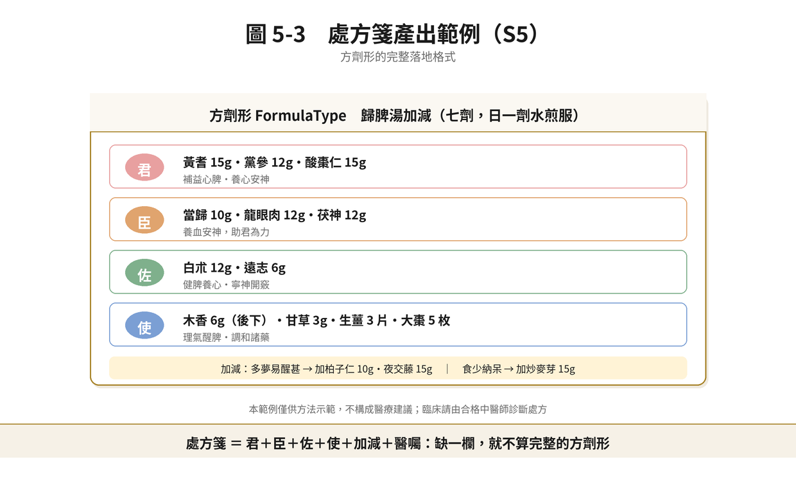

**圖 5-3　處方箋產出範例（S5）**

**表 5-4　S5 產出範例：處方箋（歸脾湯加減・僅供示範）**

| 欄 | 內容 |
| --- | --- |
| 底方 | 歸脾湯加減，七劑，日一劑水煎服 |
| 君 | 黃耆 15g、黨參 12g、酸棗仁 15g —— 補益心脾、養心安神 |
| 臣 | 當歸 10g、龍眼肉 12g、茯神 12g —— 養血安神，助君為力 |
| 佐 | 白朮 12g、遠志 6g —— 健脾助運、寧神開竅 |
| 使 | 木香 6g（後下）、甘草 3g、生薑 3 片、大棗 5 枚 —— 理氣醒脾、調和諸藥 |
| 加減 | 多夢易醒甚 → 加柏子仁 10g、夜交藤 15g（強化安神任務）；食少納呆 → 加炒麥芽 15g（助運開胃） |
| 煎服法 | 日一劑，水煎分溫二服，睡前溫服 |
| 醫囑 | 忌濃茶咖啡；定時就寢；睡前溫水泡腳；兩週後複診 |

> **範例聲明：**
>
> 表 5-4 的藥味劑量僅供方法示範，不構成醫療建議；臨床請由合格中醫師診斷處方，並依個別體質與法規調整。

## 5.5　S6 核方驗收與 S7 複診調方

S6 是出方前的最後一關：把四層準確性逐層跑一次，產出核方報告。任一層不過，指出斷點、退回對應段落重做——退件不是失敗，是這條流水線的自我保護。

> **提示詞 S6　核方驗收**
>
> 【任務】四層準確性核方報告。
> 【輸入】S1–S5 全部產出。
> 【輸出】四層清單：①∩(T) 對照複核 ②病機鏈逐環檢查 ③君臣佐使與配伍禁忌查核 ④證據鏈回溯。每層給「通過／不過＋原因」。
> 【處理】任一層不過：標明退件段落（S1–S5），不得帶疑點出方。

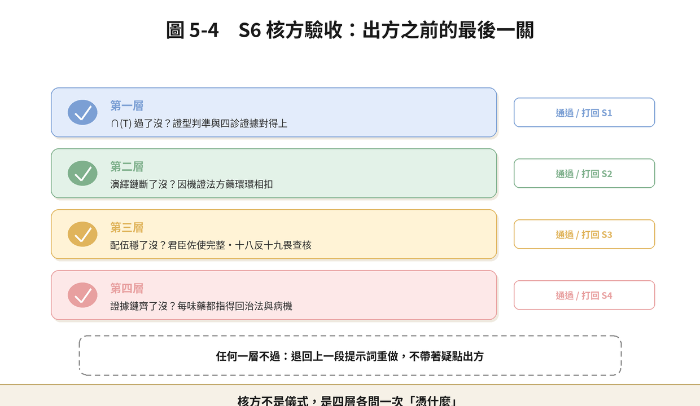

**圖 5-4　S6 核方驗收：出方之前的最後一關**

**表 5-5　S6 核方報告範例**

| 層 | 檢查 | 結果 |
| --- | --- | --- |
| 一 | F(T) 與 ∩(T) 對照複核 | 通過：八綱、臟腑、特徵集合全數相符 |
| 二 | 病機鏈逐環（因機證法方藥） | 通過：六環皆有四診證據支撐 |
| 三 | 君臣佐使＋十八反十九畏＋劑量 | 通過：結構齊全、無配伍禁忌、劑量在常用範圍 |
| 四 | 證據鏈回溯 | 通過：每味藥指得回治法，每句治法指得回病機 |

S7 把時間接上：兩週後複診，帶著前診卷宗做比對，決定守方、加減或換方，並把這一輪的結論回寫醫案卷。這是時間本形的收束動作——療效變成經驗，經驗變成判準。

> **提示詞 S7　複診調方**
>
> 【任務】複診調方並歸檔。
> 【輸入】前診卷宗（id(C) 串起）＋本次四診。
> 【輸出】①療效對照（前後四診差值）②證型是否轉變 ③調方決定（守方／加減／換方）與理由 ④演化紀錄（這次學到什麼）。
> 【判準】調方理由必須指得回療效對照；換方必須重跑 S2–S6。

**表 5-6　S7 複診調方範例（兩週後）**

| 欄 | 內容 |
| --- | --- |
| 療效對照 | 已能入睡（潛伏期縮短）；夜醒由二至三次減為一次；心悸減；食納稍回；舌脈同前 |
| 證型轉變 | 無：仍為心脾兩虛，F(T) 增強方向正確 |
| 調方決定 | 守方加減：加柏子仁 10g 強化安神（多夢仍在）；續七劑 |
| 演化紀錄 | 本例驗證「心脾兩虛→歸脾湯」判準有效；「食納未全復」提示下診可再顧脾——回寫醫案卷 |

> **本章重點**
>
> S1–S7＝七段提示詞×六種產出形＋核方報告；每段寫法固定：任務→輸入形→輸出形→判準→禁止。
> S1 只採集不下判斷；S2 收斂過 ∩(T)；S3 展開要有證據；S4 一機一法；S5 完整處方箋。
> S6 四層核方不過就退件；S7 複診比對、調方、歸檔——經驗回寫，越開越準。
> 方藥內容僅供示範；臨床由合格中醫師診斷處方。

# 第六章　誤用、清單與成熟度

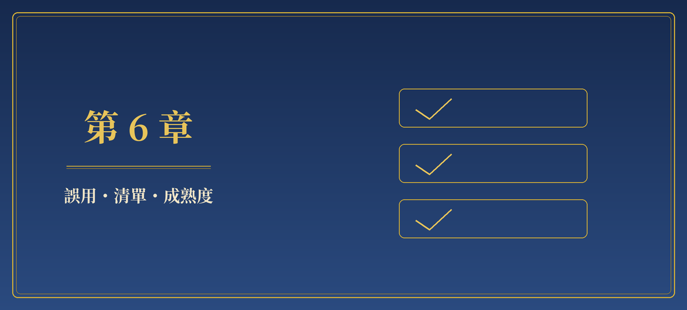

最後一章收束三樣防身物：誤用五種讓你避開最常見的坑、十問清單讓你出方前自查、成熟度 L1–L4 讓你知道自己在哪一級、往哪裡長。

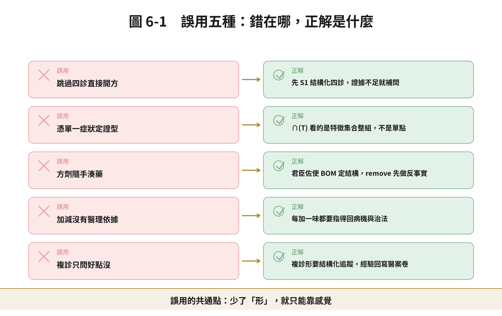

**圖 6-1　誤用五種：錯在哪，正解是什麼**

## 6.1　誤用五種

五種誤用有個共通點：少了形，就只能靠感覺。前四種發生在流程裡，第五種發生在流程外——以為複診只是問候。

**表 6-1　誤用五種對照**

| # | 誤用 | 為什麼錯 | 正解 |
| --- | --- | --- | --- |
| 1 | 跳過四診直接開方 | 沒有四診形，證據鏈第一步就斷 | S1 先結構化四診；缺欄就補問 |
| 2 | 憑單一症狀定證型 | ∩(T) 看的是特徵集合整組，不是單點 | F(T) 收齊再比對，寫排除鑑別 |
| 3 | 方劑隨手湊藥 | 無 BOM 結構，藥味說不出任務 | 君臣佐使定結構，remove 反事實自查 |
| 4 | 加減沒有醫理依據 | 加一味指不回病機，方就散了 | 每加一味注明理由，指得回治法 |
| 5 | 複診只問「好點沒」 | 療效不結構化，經驗就沉澱不下來 | 複診形四欄照填，回寫醫案卷 |

## 6.2　十問清單

出方之前，十個問題逐一過關。任何一問答不上來，退回對應步驟——這份清單就是四層準確性的隨身版。

**表 6-2　十問清單**

| # | 問題 | 對應層 |
| --- | --- | --- |
| 1 | 四診形齊了嗎？舌脈有欄位、缺漏有標示嗎？ | 證據鏈 |
| 2 | F(T) 收齊了嗎？程度與時間寫清楚了嗎？ | ∩(T) |
| 3 | ∩(T) 對照跑過了嗎？排除鑑別寫得出來嗎？ | ∩(T) |
| 4 | 病機鏈每一環都指得回四診嗎？ | 演繹骨架 |
| 5 | 治法一機一法對應病機嗎？ | 演繹骨架 |
| 6 | 每味藥說得出任務、指得回治法嗎？ | 醫理核方 |
| 7 | 君臣佐使齊全嗎？有說不出任務的藥嗎？ | 醫理核方 |
| 8 | 十八反十九畏查過了嗎？劑量在常用範圍嗎？ | 醫理核方 |
| 9 | 特殊人群提示檢查了嗎（妊娠、經期、過敏）？ | 醫理核方 |
| 10 | 從處方回溯到四診，每一步都答得出「憑什麼」嗎？ | 證據鏈 |

## 6.3　成熟度 L1 到 L4

成熟度分四級，衡量的不是模型多大，而是你的醫案卷多厚、判準多精。L1 會問：四診採集完整、欄位不漏。L2 會辨：辨證有判準，∩(T) 與排除鑑別說得出理由。L3 會開：方從法出，四層核方全過，加減有據。L4 會演化：醫案歸檔回寫，交叉驗收做得確實，越開越準。

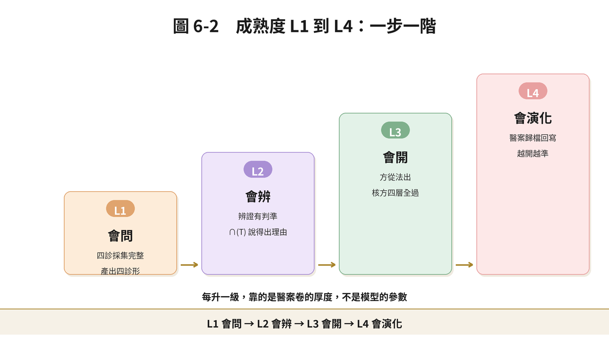

**圖 6-2　成熟度 L1 到 L4：一步一階**

**表 6-3　成熟度 L1–L4**

| 級 | 名字 | 達標指標 | 升級動作 |
| --- | --- | --- | --- |
| L1 | 會問 | 四診形完整；未採集有標示 | 把補問清單變成習慣 |
| L2 | 會辨 | ∩(T) 對照＋排除鑑別可出示 | 每次辨證留 F(T) 紀錄 |
| L3 | 會開 | 四層核方全過；加減有理由 | 核方報告入卷，退件率下降 |
| L4 | 會演化 | 交叉驗收常態化；判準持續精進 | 醫案卷複盤＋招式重構 |

> **本章重點**
>
> 誤用五種的共通點是少了形；十問清單是四層準確性的隨身版，出方前逐一過關。
> 成熟度看醫案卷的厚度：L1 會問 → L2 會辨 → L3 會開 → L4 會演化。
> 退件與複盤不是挫折，是判準變精的唯一路徑。

# 回顧・收束

把全書收成一張圖。六種產出形是東西，四層準確性是關卡，六步驟是路，S1–S7 是招式的手感；空間本形把「人・證・方」看清楚，時間本形把「診・治・調」做下去，Mind AI 承載全程。

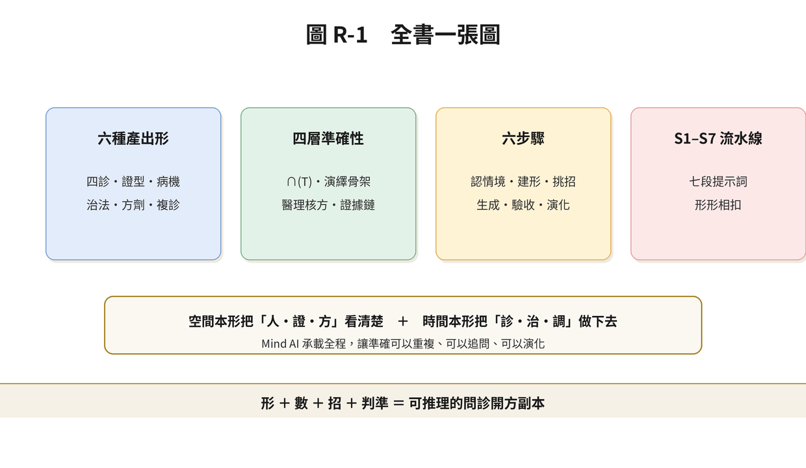

**圖 R-1　全書一張圖**

帶走三件事。第一，準確是有結構的：產出是形、判準是 ∩(T)、證據是鏈——三樣齊了，才敢說準確。第二，方法是可重複的：S1 到 S7 照做，每一診都在同一條路上，退件有路徑、演化有紀錄。第三，越用越準是真的：複診回寫醫案卷，交叉驗收磨利判準，L4 不是終點，是開始。

**表 R-1　全書檢查清單**

| 章 | 帶走什麼 | 自我檢查 |
| --- | --- | --- |
| 第 1 章（認識） | 可推理副本；形＋數；雙本形落點 | 能一句話向同行說明這套方法 |
| 第 2 章（產出） | 六種產出形與三括號 | 六種形的欄位與判準說得出來 |
| 第 3 章（準確） | 四層準確性保證 | 「為什麼準」有四層答案 |
| 第 4 章（操作） | 框架四步驟＋六步驟＋三層判斷 | 照步驟走一診不卡關 |
| 第 5 章（演練） | S1–S7 與不寐醫案 | 換上自己的病人也能跑完流水線 |
| 第 6 章（進階） | 誤用、十問、成熟度 | 知道自己現在 L 幾、下一步練什麼 |

# 附錄 A　術語・招式・記號速查

本書用到的術語、招式與記號，集中在三張表。理論細節回到本形學原典；這裡只求「用的時候查得到」。

**表 A-1　術語速查**

| 術語 | 英文／記號 | 在本書的意思 |
| --- | --- | --- |
| 形 | Type | 結構化的產出單位；英文一律用 Type，不用 Form |
| 四診形 | ExamType | 望聞問切的結構化記錄 |
| 證型形 | SyndromeType | 辨證結論：病名＋證型，F(T) 過 ∩(T) |
| 病機形 | MechanismType | 因→機→證因果鏈 |
| 治法形 | TreatmentType | 治則＋治法＋八法歸類 |
| 方劑形 | FormulaType | 君臣佐使 BOM＋加減＋醫囑 |
| 複診形 | FollowType | 療效對照＋調方決定＋演化紀錄 |
| 特徵集合 | F(T) | 證型形收的特徵總集 |
| 交集判準 | ∩(T) | 判定「歸不歸入這個形」的規則 |
| 身份錨 | id(C) | 容器（病患・病程）的身份錨定 |
| 組成集合 | { } | BOM：由什麼組成 |
| 容器集合 | ( ) | 住在哪裡、身份是誰 |
| 抽象集合 | [ ] | 歸入哪一類 |

**表 A-2　時間本形十四招 × 中醫落點**

| 組 | 招式 | 問診開方落點 |
| --- | --- | --- |
| 找招 | 形時間函式搜尋 | 以四診形檢索相似醫案 |
| 找招 | 設計搜尋與萃取 | 從醫案萃取證型特徵與成方模式 |
| 找招 | 設計模式 | 套用配伍模式（如君臣佐使結構） |
| 出招 | 邏輯生成與應用 | 辨證論治的推理生成 |
| 出招 | 函式生成與應用 | 治法與方劑的生成 |
| 出招 | 設計（創造與創新） | 組方加減——開方即設計 |
| 想招 | 解題 | 療效不佳的歸因與對策 |
| 想招 | 分析 | 四診資訊拆欄、證型鑑別 |
| 想招 | 推理（因果・果因・模擬・統計・逆向） | 病機因果鏈；從方測證的逆向驗證 |
| 想招 | 思考法（正向・逆向・水準・垂直・第一性原理） | 疑難案例的多角度辨證 |
| 練招 | 持續學習 | 醫案歸檔、經驗累積 |
| 練招 | 重構與重組 | 調方重構、方組重排 |
| 練招 | 研發與探索 | 新方探索、治法試探 |
| 練招 | 自我演化 | 交叉驗收回寫判準，越開越準 |

**表 A-3　記號速查**

| 記號 | 讀法 | 用途 |
| --- | --- | --- |
| [ ] | 方括號 | 抽象集合：歸不歸入 [不寐] |
| ( ) | 圓括號 | 容器集合：(林小姐)、(本次診次) |
| { } | 花括號 | 組成集合：{歸脾湯加減} 的 BOM |
| ∩(T) | 交集判準 | 形的會員判定規則 |
| F(T) | 特徵集合 | 證型形收的特徵總集 |
| id(C) | 身份錨 | 容器的身份錨定 |
| remove | 移除判準 | 三級反事實：單味／藥對／方根 |

> **全書聲明：**
>
> 本書方藥內容（含林小姐醫案之藥味、劑量、加減）僅供方法示範，不構成醫療建議；臨床診療請由合格中醫師診斷處方。
> 形＝Type，不是 Form。理論只用不教；平台只引不述。

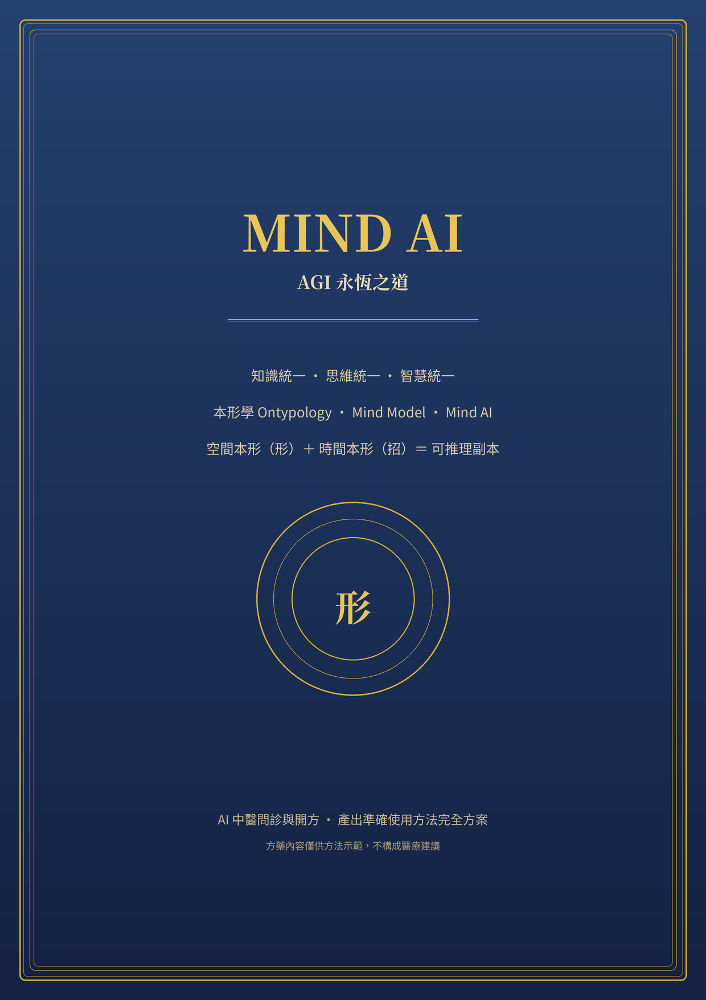
