# Mind AI 企業資訊系統整合

準確使用方法與架構　·　內容完整方案

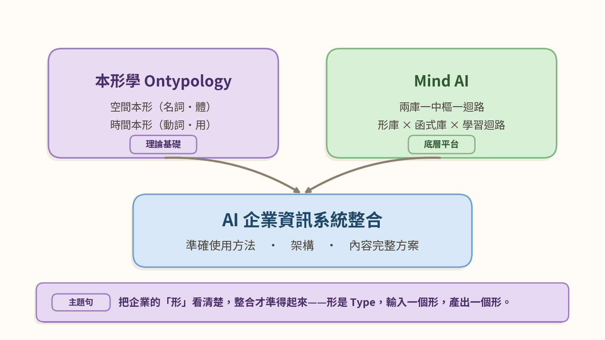

| **理論基礎** | 本形學 Ontypology：空間本形（名詞・體）＋ 時間本形（動詞・用） |
| --- | --- |
| **底層平台** | Mind AI：兩庫一中樞一迴路（形庫 × 函式庫 × 中樞 × 學習迴路） |
| **本書規格** | 準確使用方法與架構・內容完整方案；方法與架構為主，不涉及系統實作 |

# 目　錄

- 導讀　這本書怎麼用
  - 導-1　雙軌讀者：主文與專業專欄
  - 導-2　全書導航
  - 導-3　開卷暖身
- 第一篇　為什麼企業整合需要「形」
  - 1.1　整合的痛，是形的痛
  - 1.2　本體論是根，本形學是幹
  - 1.3　空間本形與時間本形：一形的兩面
  - 1.4　本書的任務
- 第二篇　骨幹速覽：兩面・一方法・一平台
  - 2.1　全書骨幹
  - 2.2　空間本形速覽：三軸・三括號
  - 2.3　時間本形速覽：六群・四問
  - 2.4　準確使用方法速覽
  - 2.5　底層平台：Mind AI 一頁交代
- 第三篇　空間本形：企業系統的形
  - 3.1　表頭是形，資料列是實體
  - 3.2　新增列與新增欄：兩種不對稱的變動
  - 3.3　欄位貫穿：可比較性的承諾
  - 3.4　主鍵：超越屬性的同一性
  - 3.5　企業系統寫成形集合
  - 3.6　組成判準：remove 三級
  - 3.7　容器與 id(C)：不變性公理
  - 3.8　抽象判準：F(T) 與 ∩(T)
  - 3.9　形邏輯三層判斷
- 第四篇　時間本形：整合的函式
  - 4.1　動詞也有形：形進形出
  - 4.2　函式四問：為動詞建立形的描述
  - 4.3　六大函式群 × 企業整合場景
  - 4.4　API 契約：形進形出的憑證
  - 4.5　事件驅動：把動詞釘上時間軸
  - 4.6　思考法選路：先認處境，再挑路徑
  - 4.7　飛輪：形與函式互相長大
- 第五篇　準確使用方法：整合版
  - 5.1　三種補足：把缺的資訊裝回該在的位置
  - 5.2　證明六步驟：把判斷寫到可複核
  - 5.3　完整示範：O2C 訂單到收款走一遍
  - 5.4　八問檢查清單
  - 5.5　誤用大對照：16 種
- 第六篇　總架構：哲學—方法—實踐
  - 6.1　三層總架構：哲學—方法—實踐
  - 6.2　Mind AI：兩庫一中樞一迴路
  - 6.3　Palantir Ontology 對讀
  - 6.4　數位孿生與寫回
  - 6.5　AGI 三階段：本形學的遠方
- 第七篇　內容完整方案
  - 7.1　學練用教建：五階養成
  - 7.2　M1–M8：八模組課程
  - 7.3　八週路線
  - 7.4　情境選路：什麼處境，用什麼招
  - 7.5　建庫四階段：把整合沉澱成企業資產
- 第八篇　總結
  - 8.1　總結地圖
  - 8.2　落地清單：明天就能做的四件事
  - 8.3　金句收束
- 附錄 A　術語與記號速查
  - A-1　記號速查
  - A-2　術語速查
- 附錄 B　準確使用方法速查卡
  - B-1　一頁速查卡
  - B-2　空白模板（可複印頁）
- 附錄 C　練習參考答案
  - C-1　導讀・第一、二篇
  - C-2　第三、四篇
  - C-3　第五篇
  - C-4　第六、七篇

# 導讀　這本書怎麼用

歡迎打開《AI 企業資訊系統整合——準確使用方法與架構・內容完整方案》。這不是一本講「怎麼拉線接系統」的書，而是一本講「怎麼把整合的對象看清楚」的書。無數整合專案失敗的現場，問題往往出在同一個地方：我們以為自己在整合「資料」，其實我們在整合「形」——而形，一直沒有被寫清楚。

本書以**本形學（Ontypology）**為理論基礎：空間本形告訴我們「系統的形是什麼」，時間本形告訴我們「整合的動作怎麼運作」；底層以 **Mind AI** 為實踐平台，把理論落到可教、可練、可複核、可累積的工程方法上。全書不涉及系統實作細節——我們談的是方法與架構，是任何技術棧都用得上的「準確使用方法」。

## 導-1　雙軌讀者：主文與專業專欄

本書採雙軌編排。**主文**寫給每一位要面對整合問題的人：主管、專案經理、業務分析師、工程師——不需要先懂資料庫理論，跟著「一概念・一圖・一例・一練習」的節奏走即可。**【專業專欄 C1–C8】** 則寫給資訊專業讀者：把書中的形學概念，與主數據管理、知識圖譜、API 契約、事件驅動、本體工程等業界主題對讀，補上專業語境裡的含義。兩軌互不干擾，讀者可先讀主文再回頭補專欄。

## 導-2　全書導航

| 篇章 | 主題 | 回答的問題 |
| --- | --- | --- |
| 第一篇 | 為什麼需要形 | 整合的痛，為什麼病根在形？ |
| 第二篇 | 骨幹速覽 | 兩面一方法一平台，一小時看懂地圖 |
| 第三篇 | 空間本形・系統的形 | 系統的形是什麼？怎麼立、怎麼判？ |
| 第四篇 | 時間本形・整合函式 | 整合的動作怎麼寫成可驗收的函式？ |
| 第五篇 | 準確使用方法整合版 | 怎麼把整合寫到可複核的準？ |
| 第六篇 | 總架構 | 哲學—方法—實踐怎麼三層扣合？ |
| 第七篇 | 內容完整方案 | 怎麼學、怎麼練、怎麼變成企業資產？ |
| 第八篇 | 總結 | 一句話收束與落地清單 |

閱讀建議：時間有限的讀者，讀完第二篇的骨幹速覽即可掌握全貌；要落地的讀者，第三篇到第五篇是方法核心；要規劃訓練與平台的讀者，第六、七篇給你完整的方案骨架。

## 導-3　開卷暖身

> **【練習 E00】暖身：一句話說出你的整合之痛**
>
> 請用一句話寫下你（或你的組織）正面臨的最大整合困擾，例如：「訂單在兩個系統裡對不上」。
>
> 然後試著回答：這個困擾裡，「同名異義」與「異名同義」各佔多少？
>
> *寫完檢查：這題沒有標準答案——第五篇結束後，你會拿到把這句話寫到「可複核」的全套工具。*

# 第一篇　為什麼企業整合需要「形」

## 1.1　整合的痛，是形的痛

先看一條再熟悉不過的認知鏈：先有「異同」的感受，才產生「分」與「合」的動作，最後才生出「形」——而形必有名。這條大腦走了億萬年的路，正是整合要重走一遍的路。當 ERP 裡的「客戶」與 CRM 裡的「客戶」長得不一樣，第一件事不是寫轉換程式，而是認出它們各自的形，再判斷是同一個形的兩種表記，還是根本兩個形。

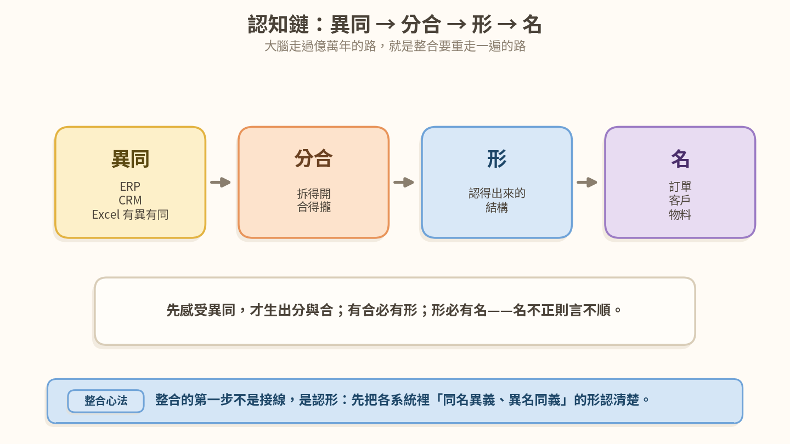

**圖 1-1　認知鏈：異同 → 分合 → 形 → 名**

把整合現場的抱怨攤開來看，會發現常見的痛只有六種：孤島、同名異義、異名同義、對不齊、改不動、查不到。它們表面上是資料問題，病根全是形的問題——形的層次沒寫清。

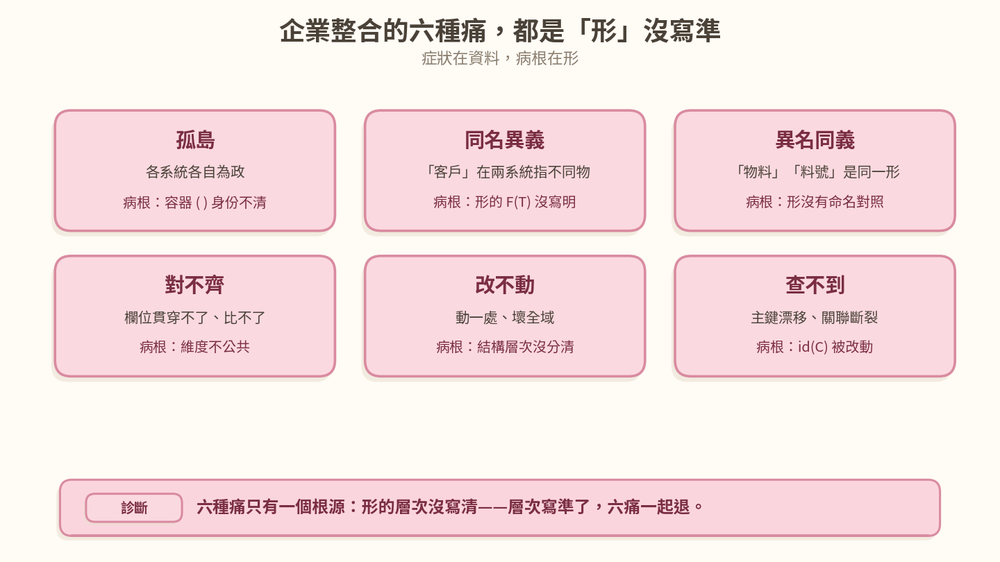

**圖 1-2　企業整合的六種痛，病根都在形**

> **【金句】本篇金句**
>
> 整合的第一步不是接線，是認形。
>
> 六種痛只有一個根源：形的層次沒寫清——層次寫準了，六痛一起退。

## 1.2　本體論是根，本形學是幹

本體論（Ontology）問的是「世界有什麼？」——把系統裡的東西一樣樣列出來：客戶、訂單、發票。這是根，是提問的起點。但清單只告訴你「有什麼」，沒有告訴你「它長什麼樣、由什麼組成、怎麼判斷、怎麼運作」。本形學（Ontypology）接著問：**形是什麼？怎麼辨識、命名、表記、判斷、運作？**——這是幹，把「有什麼」升級成「怎麼用得準」。

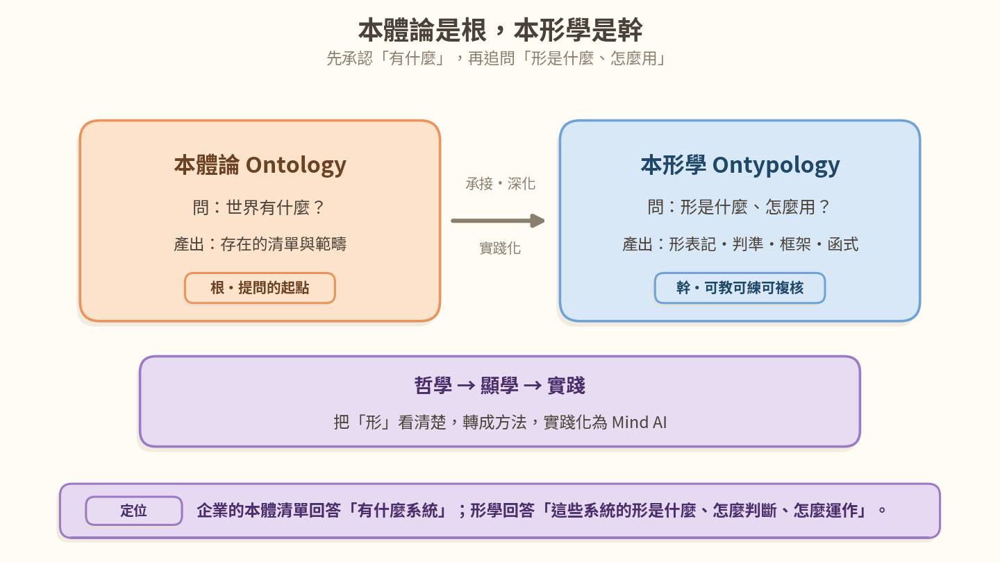

**圖 1-3　本體論是根，本形學是幹**

**重點對照**

| **本體論 Ontology** | 問「有什麼」，產出存在的清單與範疇——理解世界。 |
| --- | --- |
| **本形學 Ontypology** | 問「形是什麼、怎麼用」，產出形表記・判準・框架・函式——可教、可練、可複核、可實踐。 |
| **關係** | 承接：從「有什麼」出發；深化：把每個「有」變成可指認、可判斷的形；實踐化：轉成方法，實踐化為 Mind AI。 |

## 1.3　空間本形與時間本形：一形的兩面

一個完整的形，同時有「是什麼」和「會做什麼」兩面——就像語法裡的名詞與動詞。空間本形是名詞、是體：單位形、三軸、形集合、形邏輯，回答「它是什麼」。時間本形是動詞、是用：函式、方法、招式、服務，回答「它會做什麼、怎麼做」。體用合一，缺一不可；而且**先有形，才有動作**——時間本形依附在空間本形之上：輸入一個形，產出一個形。

> **【小劇場】杯子的一天**
>
> 早上，杯子（空間本形）靜靜立在桌上；「裝水 → 倒水 → 清洗」（時間本形）一一作用在它身上。
>
> 杯子不會因為裝水變成別的杯子——變的是內容物，不變的是形。每一次「裝、倒、洗」，都是某個動詞（函式）：輸入一個形，產出一個形。

對整合而言，這兩面的分工立刻可用：資料模型、介接規格、主數據，是空間本形的工作；ETL、審批、對帳、告警，是時間本形的工作。把兩面都寫成「形」，整合才有共同語言。

## 1.4　本書的任務

本書要完成三件事：第一，把企業整合的對象——系統、資料、流程——用本形學的語言**看清楚**；第二，給出一套**準確使用方法**，讓每一個整合決策可打勾、可重現、可複核；第三，給出一份**內容完整方案**，讓個人與組織能把這套方法學下來、用起來、存成資產。全程以 Mind AI 為底層平台，但不綁定任何具體產品——方法先於工具。

> **【專業專欄 C1】主數據管理 MDM：企業的「形」從哪裡來**
>
> 主數據管理（Master Data Management）處理的是企業裡「誰是權威定義」的問題：客戶、物料、供應商這些核心實體，在幾十個系統裡各有副本，誰說了算？MDM 的答案是：定一個黃金記錄（Golden Record），其他系統向它看齊。
>
> 用形學的語言重述：MDM 做的事，是為每一類核心實體**立形**——定義它的形集合（有哪些部件與欄位）、它的抽象判準（什麼樣的記錄算這一類）、它的身份（哪個欄位是 id）。黃金記錄之所以是黃金，不是因為它資料最全，而是因為它的**形最準**：id 不漂移、屬性維度貫穿、歸屬判準清楚。
>
> 所以本篇的結論對 MDM 直接成立：主數據之亂，是形沒寫清之亂；MDM 專案的第一份交付物，不該是匹配規則表，而是三份形表記——客戶形、物料形、供應商形。這正是第三篇要展開的主題。

> **【練習 E01】診斷你身邊的整合之痛**
>
> 挑選你熟悉的兩個系統（例如 ERP 與 CRM），寫出它們各自對「客戶」的定義。
>
> 對照六種痛，指出你觀察到的至少兩種，並寫出它們對應的病根（形的哪一層沒寫清）。
>
> *寫完檢查：兩個定義並列時，「同名異義」通常第一眼就現形。*

# 第二篇　骨幹速覽：兩面・一方法・一平台

本篇是全書的地圖。用一小時讀完這一篇，你就握住了全書的骨幹：空間本形與時間本形「兩面」，準確使用方法「一方法」，Mind AI「一平台」。之後每一篇，都是把這張地圖的一個角落放大。

## 2.1　全書骨幹

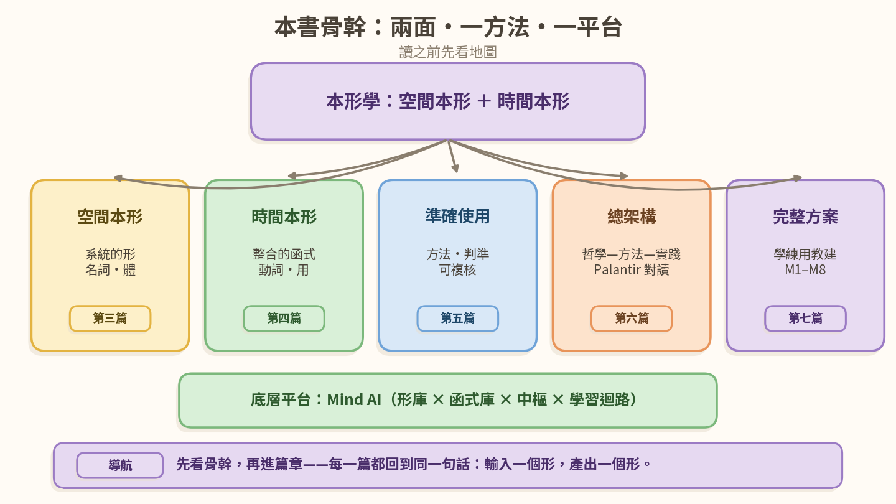

**圖 2-1　本書骨幹：兩面・一方法・一平台**

骨幹只有四句話：**立形**用空間本形，**動形**用時間本形，**驗形**用準確使用方法，**存形**用 Mind AI 的形庫與迴路。四句話背後是同一句話：輸入一個形，產出一個形。

## 2.2　空間本形速覽：三軸・三括號

空間本形用三條軸描述一個形：X 軸是**屬性**，記在方括號 [ ] 裡，是「維度 × 刻度」——顏色、材質、信用額度，都是被差異「逼」出來的維度；Y 軸是**組成**，記在大括號 { } 裡，是物料清單（BOM）——由哪些部件構成，用「拆下來認得自己嗎」判斷；Z 軸是**容器**，記在圓括號 ( ) 裡，是「內容空間」——身份 id(C) 與內容 S(C) 分開，內容變動不動搖身份。

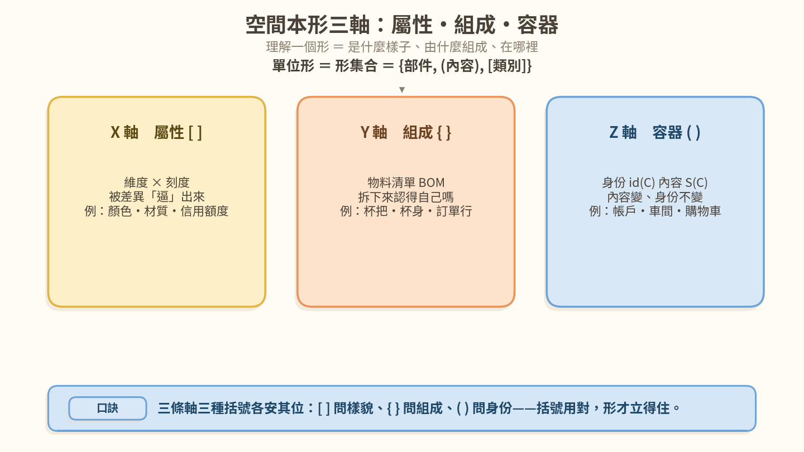

**圖 2-2　空間本形三軸：屬性・組成・容器**

三條軸收攏成一條公式，就是**單位形 ＝ 形集合 ＝ {部件, (內容), [類別]}**。一只咖啡杯寫成形集合：{ 杯把, 杯底, 杯蓋, 杯身, (咖啡), [白色] }——部件在 { } 裡、內容在 ( ) 裡、樣貌在 [ ] 裡，各安其位。

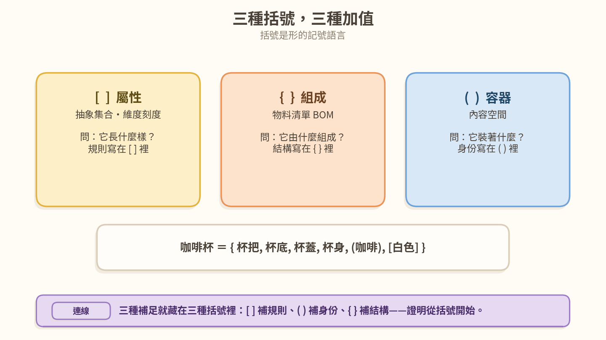

**圖 2-3　三種括號，三種加值**

> **【口訣】括號口訣**
>
> [ ] 問樣貌、{ } 問組成、( ) 問身份——括號用對，形才立得住。
>
> 三種補足就藏在三種括號裡：[ ] 補規則、( ) 補身份、{ } 補結構。

## 2.3　時間本形速覽：六群・四問

時間本形把「動詞」收攏成一座函式庫，分六大群：認知與萃取、生成與應用、解題與創造、推理與思考、成長與維護、探索。排列本身就是學習路徑——先在既有裡找現成，再學會生出新的，最後才往未知前進。

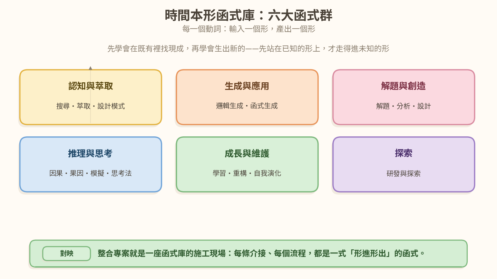

**圖 2-4　時間本形函式庫：六大函式群**

每個動詞上崗前，都要填一張**函式四問**卡：名稱、輸入形、輸出形、判準。四問寫全，動詞才成形；判準是四問的心臟——判準寫得可驗證，函式才算寫準。第四篇會把這套工具直接套在企業整合的動作上。

## 2.4　準確使用方法速覽

「準」不是感覺，是流程。準確使用方法三件套：**三種補足**（[ ] 補規則、( ) 補身份、{ } 補結構，把口頭默契升級成白紙黑字）、**證明六步驟**（認明整體 → 分軸描述 → 寫形集合 → 選定命題 → 判準推理 → 三層檢查，把判斷寫到可複核）、**八問檢查清單**（交件前逐條打勾）。再配上**誤用 16 種**的避坑對照，就是全書方法層的完整配備。

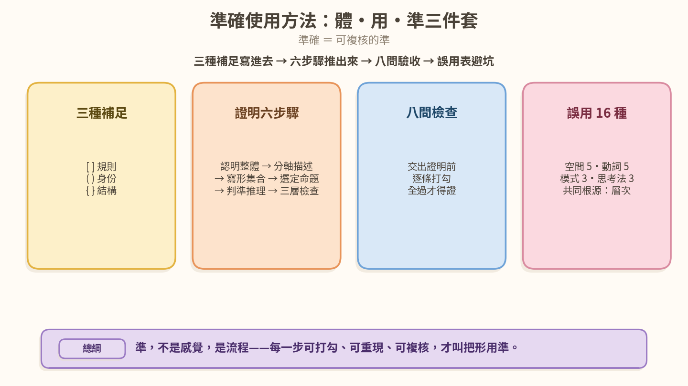

**圖 2-5　準確使用方法：體・用・準三件套**

## 2.5　底層平台：Mind AI 一頁交代

Mind AI 是本形學與 Mind Model 的實踐平台，目標是通往 AGI 的智慧架構。本書只需要記住它的骨幹——**兩庫一中樞一迴路**：形庫（空間本形入庫）、函式庫（時間本形入庫）、Mind Model 中樞（知識統一與推理）、學習迴路（產出形過三層檢查後回流入庫，越用越準）。第六篇會完整展開，並與業界的 Palantir Ontology 做對讀。

> **【定位】平台與方法的分際**
>
> 方法先於工具：本書的準確使用方法不綁定任何產品；Mind AI 提供的是「形庫＋迴路」的底座，讓方法沉澱成資產。
>
> 本書不談系統實作——談的是方法與架構，任何技術棧都用得上。

> **【專業專欄 C2】從 GraphRAG 到 Mind Model：為什麼知識圖譜不夠**
>
> 近兩年 GraphRAG 把「圖譜 + 檢索增強」帶進主流視野：把文件切成實體與關係，讓 LLM 沿著圖做問答。業界也早已用知識圖譜（Neo4j、Amazon Neptune、Stardog 等）管理實體關係。但以本形學的標準檢視，知識圖譜有幾個結構性的不足：表達能力有限（只有「實體—關係—實體」三元組，裝不下形集合的部件・內容・類別三重結構）、關係表達能力有限（關係本身沒有形，無法寫判準）、缺乏深層推理（路徑查詢≠判斷推理）、難以表示抽象概念（類別沒有 F(T) 判準）、缺乏思維結構（沒有思考法與函式的形）、難以持續演化學習（沒有迴路）。
>
> Mind Model 的定位不是又一個圖譜，而是**本形學的實踐架構**：空間本形負責知識的形（三軸、形集合、三層判斷），時間本形負責思維的形（六群函式、推理五式、思考法），兩者合體才是「知識統一 + 思維統一」。一句話收束：圖譜管連接，形庫管判斷——整合要的不只是連得上，是判得準。

> **【練習 E02】骨幹速覽自查：三句話複述全書**
>
> 不看書，用三句話向一位同事說明本書骨幹：一句講兩面，一句講方法，一句講平台。
>
> 再寫下：你目前的工作裡，哪一件事最急需「準確使用方法」？
>
> *寫完檢查：能三句話說清楚，才算真的看懂地圖。*

# 第三篇　空間本形：企業系統的形

本篇把空間本形放進企業資訊系統的現場。結論先行：**RDB 是形的邏輯被機械化之後的樣子**——表頭是形，資料列是實體，欄位是維度，主鍵是身份，外鍵是關聯。讀懂這五重對應，資料庫設計的每一個規矩，都變成形學原則的兌現。

## 3.1　表頭是形，資料列是實體

一張資料庫的表天生分兩部分：最上面那列欄位名稱（表頭），是一組「要問什麼」的共用問題清單——本身沒有答案，卻規定答案該長在哪裡，這正是**形**。底下每一列實際資料，是這套問題清單套在一個具體東西身上被填出來的答案——這是**實體**。對應得如此工整，以至於它不是比喻，是同一個結構在兩個領域的現身。

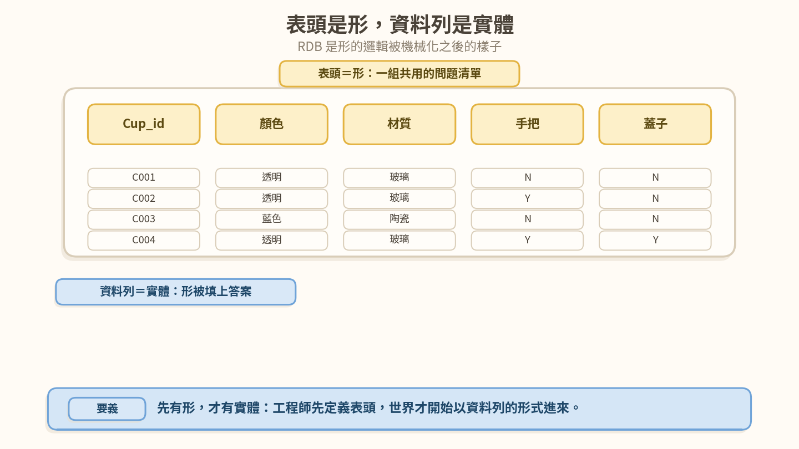

**圖 3-1　表頭是形，資料列是實體**

> **【形不是比喻】閱讀這一篇的鑰匙**
>
> 每當看到「表」，就把它讀成「形＋實體」的複合體：表頭是形，資料列是實體。
>
> 其餘所有概念——欄位、主鍵、外鍵、關聯——都是從這個基本對應長出來的。

值得留意對應的方向性：**先有形，才有實體**。工程師建表的第一步是定義表頭——先把「要問什麼」決定下來，世界才開始以資料列的形式進來。表頭一旦定案，就是這一類東西的「入場規格」：任何個體都必須用這套問題把自己描述一遍，才取得一列的位置。

## 3.2　新增列與新增欄：兩種不對稱的變動

「新增資料」在兩個層次上是完全不同的事情。新增一列：形不動、實體多一個——輕巧，隨時可以發生；新增一欄：形自己變大、所有實體都要補值——沉重，因為動的是框架本身。當既有維度解釋不了新的差異（例如出現「有沒有隔熱層」的杯子），才被迫開新維度——這就是「逼出新屬性」的那一刻。

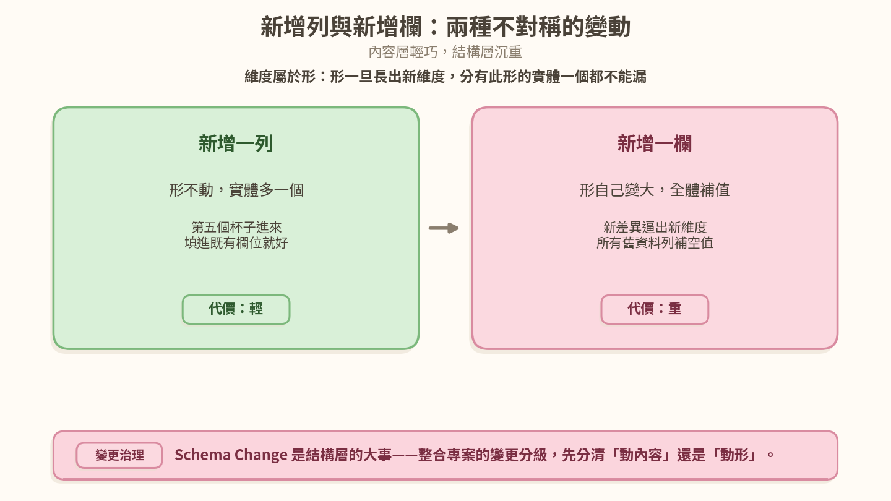

**圖 3-2　新增列與新增欄：兩種不對稱的變動**

| 動作 | 動到的層次 | 形論的對應 | 代價 |
| --- | --- | --- | --- |
| 新增資料列 | 內容層 | 形不動，實體多一個 | 輕：結構完全不動 |
| 新增欄位 | 結構層 | 形長出新維度 | 重：所有實體都要補值 |
| 更改主鍵 | 身分層 | 實體的同一性被破壞 | 極重：整個關聯網路斷裂 |

這就是整合專案「變更分級」的形學依據：動內容是一般變更、動形是結構變更、動身分是災難級變更。分級清楚，審批流程才有準則。

## 3.3　欄位貫穿：可比較性的承諾

同一張表，所有列共用同一套欄位——不能有的杯子多一欄、有的少一欄。因為維度的本質是公共的：一把尺要能量每一樣東西，就不能只對某些東西存在。「找出所有透明的杯子」能被執行成精確操作，是因為「顏色」這個維度向每一列開放，無一例外。欄位貫穿，是資料庫對**可比較性**的承諾。

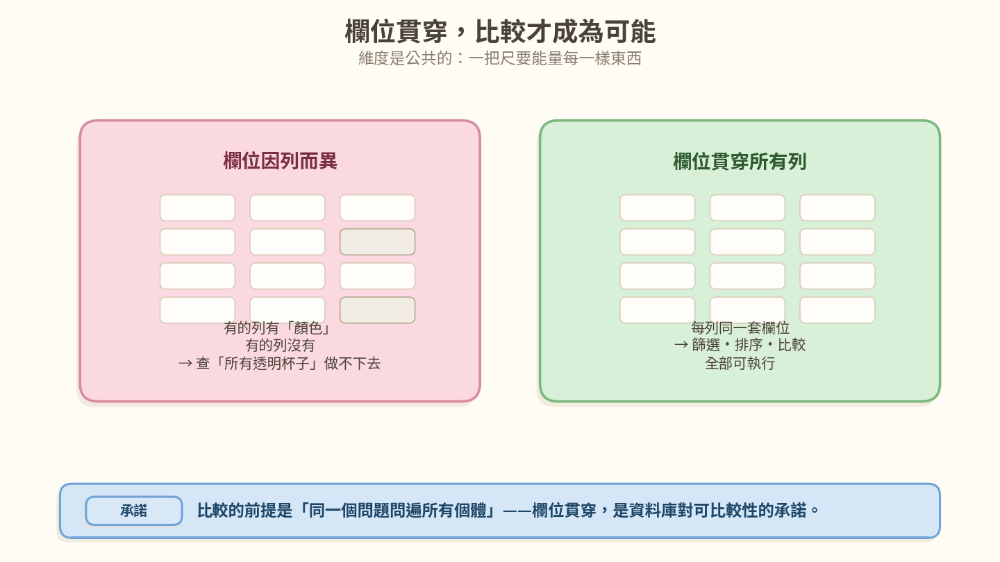

**圖 3-3　欄位貫穿，比較才成為可能**

整合現場的「對不齊」之痛，多半在這裡破功：兩個系統的同名欄位，一個允許空、一個強制填，維度沒有真正貫穿，比對自然做不下去。準確的做法是：把「欄位的開放性」寫進形的表記——這一個維度向哪些個體開放、以什麼刻度取值。

## 3.4　主鍵：超越屬性的同一性

一列資料要能被獨立指認，得先有一個只屬於這一列、跟任何屬性內容都無關的欄位——主鍵。就算兩個杯子長得完全一樣，只要 Cup_id 不同，就是兩個實體。屬性可以隨便換，主鍵不能換——換掉的是樣貌，不能換掉的是「是誰」。這正是哲學中「同一性」的資料庫版本：實體的同一性，是整個關聯網路唯一的錨點。

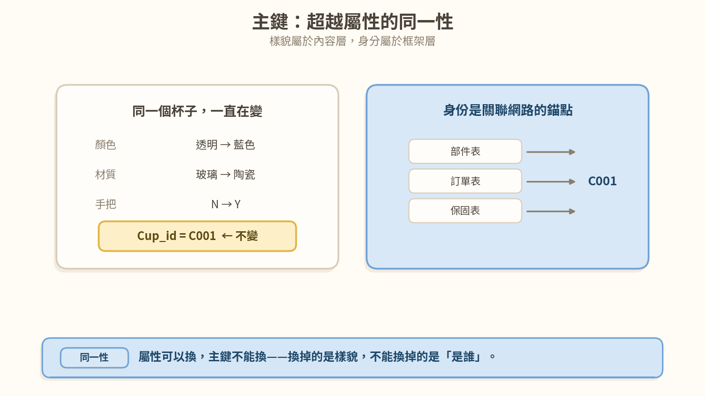

**圖 3-4　主鍵：超越屬性的同一性**

主鍵值一旦被指派就不應更改：C001 改名 C009，所有參考 C001 的從表都會指向不存在的東西，關聯網路整體斷裂。所以實務上主鍵用「永遠無意義」的流水號或 UUID——用無意義的代號承載不變的身分，是工程上對同一性最謹慎的守護。

有了主鍵，表與表才能互相指認：從表裡存一個指向主表主鍵的欄位（外鍵），就是**關聯**——指認，而不複製；需要細節時，再回頭去主表裡查。整個資料庫，就是一張由主鍵織成的網。

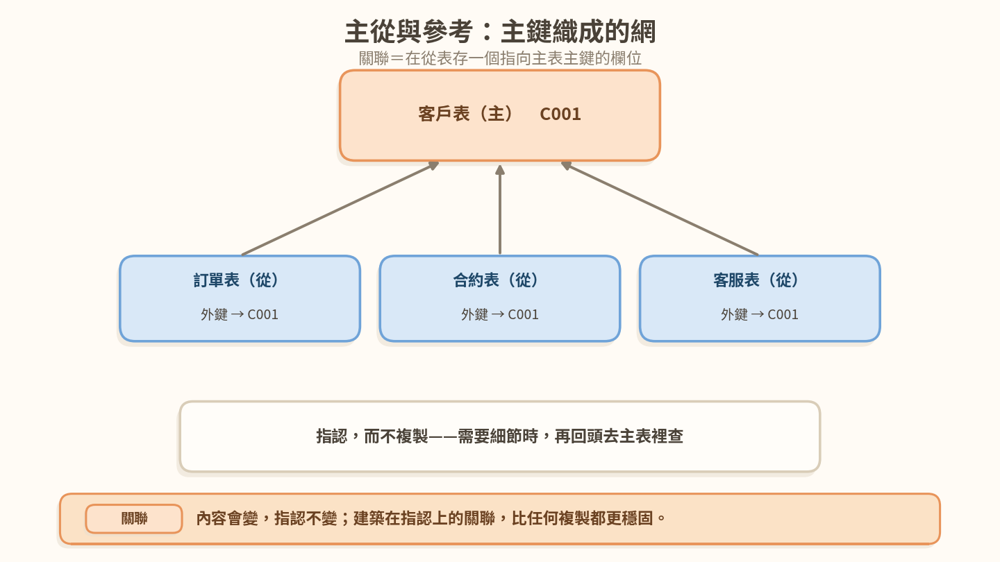

**圖 3-5　主從與參考：主鍵織成的網**

## 3.5　企業系統寫成形集合

現在把鏡頭拉遠：ERP 的訂單、CRM 的客戶、SCM 的倉庫、HRM 的員工——每個系統的核心實體，都可以用同一條公式寫成形集合：**單位形 ＝ {部件, (內容), [類別]}**。寫得出來，就立得住；寫不出來，就還不認識它。

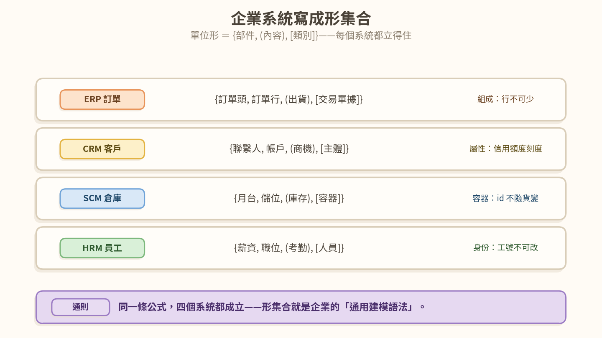

**圖 3-6　企業系統寫成形集合**

以 ERP 訂單為例：訂單 ＝ {訂單頭, 訂單行, (出貨), [交易單據]}。訂單行是**必要件**——拆掉就不成訂單；出貨是**內容**——批次來來去去，訂單還是那張訂單；交易單據是**類別**——要不要算交易單據，由抽象判準裁決。三種括號，回答三個問題，一個都省不了。

## 3.6　組成判準：remove 三級

「它由什麼組成」不能靠感覺回答。BOM 判準只問一句話：**拆下來之後，它還認得自己嗎？**依答案分三級：必要件（拆了就不成形，≢ M）、功能降級件（拆了降級但仍是自己，≡ M′ ⊂ M）、非必要件（拆了形完全不變，≡ M）。

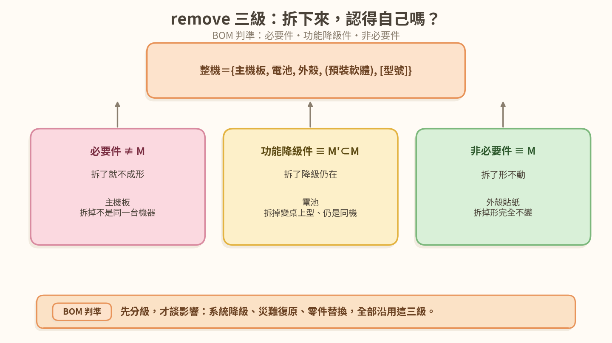

**圖 3-7　remove 三級：拆下來，認得自己嗎**

這三級在整合現場的用處大得很：災難復原要保哪些件？降級運轉允許拆到哪一級？零件替換的相容性怎麼判？全部沿用同一把尺。先分級，才談影響——影響分析寫到可複核，靠的就是 remove 三級。

## 3.7　容器與 id(C)：不變性公理

容器 ( ) 是形的第三條軸。容器 ＝ 集合 ＋ 一個不隨元素變動而改變的身份：C = ( id(C), S(C) )。帳戶 A-1001 餘額從 5,000 變 3,200——內容在動，帳戶沒有變成另一個帳戶。判斷一個東西是不是容器，問三句：有明確邊界嗎？有內部空間裝內容嗎？身份獨立於內容嗎？

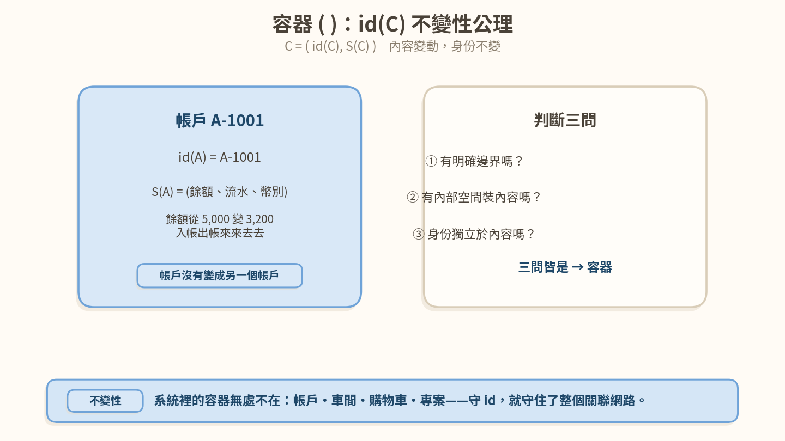

**圖 3-8　容器 ( )：id(C) 不變性公理**

企業裡的容器無處不在：帳戶、車間、購物車、專案、租戶。**守 id，就守住了整個關聯網路**——這也是主數據管理的形學基石，見專欄 C3。

## 3.8　抽象判準：F(T) 與 ∩(T)

「它屬於哪一類？」是整合決策裡最頻繁的判斷：這張單算不算異常？這個客戶算不算 VIP？這筆物料歸不歸這個類目？抽象層給出的工具是：把類別 T 定義成特徵集合 F(T) ＝ {f1, f2, …}，用交集判準 ∩(T) 逐項檢驗——全過才歸類。類別不是感覺，是一份可逐項打勾的特徵清單。

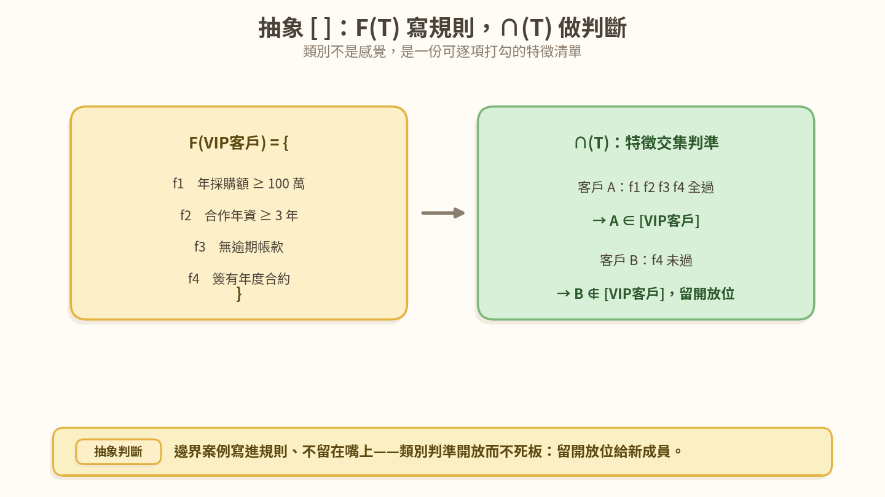

**圖 3-9　抽象判準：F(T) 寫規則，∩(T) 做判斷**

> **【開放而不死板】抽象判斷的開放性**
>
> F(T) 是開放模板：新特徵進來可以擴充，但每次擴充都要回頭套用到所有已歸類的個體——維度屬於形。
>
> 邊界案例寫進規則、不留在嘴上：判準的價值，全在邊界案例的判決裡。

## 3.9　形邏輯三層判斷

完整的判斷要過三層：**容器層**（id(C) 穩嗎？內容變了還是同一個嗎？）、**組成層**（remove 三級分清了嗎？必要件拆了會散嗎？）、**抽象層**（F(T) 逐項驗證、∩(T) 通過才歸類）。三層聯合，缺一不可——只做一層就下判斷，是誤用之首。

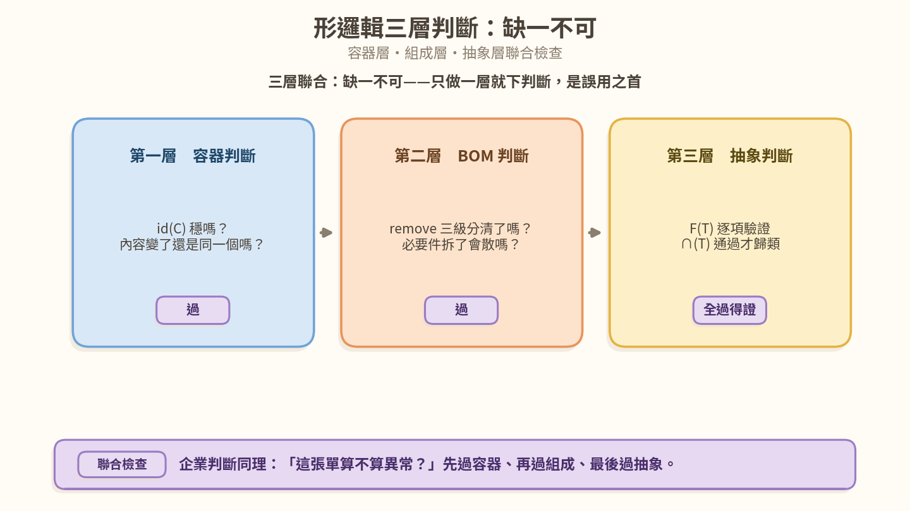

**圖 3-10　形邏輯三層判斷：缺一不可**

企業判斷同理。「這張單算不算異常？」先過容器（這張單的 id 穩嗎、是不是重複單？）、再過組成（必要欄位齊嗎、明細行完備嗎？）、最後過抽象（異常單的 F(T) 逐項比對）。三層都過，判決才立得住。

> **【專業專欄 C3】MDM × 形學：黃金記錄與 id(C)**
>
> 主數據管理最難的一步是匹配與合併（Match & Merge）：兩條記錄是不是同一個客戶？業界用規則加機率評分，機率閾值永遠要人來拍板。形學提供的是把拍板寫成判準的方法：先立形（客戶形的形集合與 F(T)），再分層判斷——容器層比 id 來源與身份鏈、組成層比必要欄位的依存、抽象層比 F(T) 的特徵交集。三層各有輸出，合併決策就從「感覺像」變成「逐項可複核」。
>
> 更關鍵的是 id(C) 不變性公理：合併兩條記錄時，存的是「同一個身份的兩次指認」，而不是把兩條揉成一條新的。survivorship（倖存者規則）決定**樣貌**歸誰，id 鏈決定**身份**是誰——樣貌與身份分離，正是主鍵一節講過的同一性原則在主數據上的投影。凡有人要「改主鍵」，用第三篇的話回應：那不是資料修復，是對整個關聯網路的身分層手術。

> **【練習 E03】把一個系統寫成形集合**
>
> 挑選你熟悉的一個系統（ERP、CRM、WMS 皆可），挑三個核心實體，各寫成形集合：{部件, (內容), [類別]}。
>
> 為每個實體標出：哪個欄位承擔 id？哪個部件是必要件？
>
> *寫完檢查：三條軸都填得出來，才算真的認識這個實體。*

> **【練習 E04】remove 三級分級練習**
>
> 以一台筆記型電腦為例，列出六個部件，並分入 remove 三級：必要件、功能降級件、非必要件。
>
> 寫出你的判斷依據：拆下來之後，它認不認得自己？
>
> *寫完檢查：同一個部件在不同「形的定義」下可能分級不同——把定義寫在前面，分級就有依據。*

> **【練習 E05】三層判斷走一遍**
>
> 選一個你日常做的判斷（例如「這張請款單要不要人工覆核？」），寫出三層檢查：容器層問什麼、組成層問什麼、抽象層的 F(T) 有哪些特徵。
>
> 用三筆真實案例（兩正一負）驗證你的判準。
>
> *寫完檢查：邊界案例至少要有一筆——判準的價值全在邊界上。*

# 第四篇　時間本形：整合的函式

空間本形立好之後，時間本形登場：整合的每一個動作——轉換、介接、審批、對帳、告警——都是**函式**：輸入一個形，產出一個形。本篇把整合動作寫成可驗收的函式，並給出六群工具箱、契約與事件的寫法、思考法選路，以及讓能力持續複利的飛輪。

## 4.1　動詞也有形：形進形出

時間本形有多個名字——函式、方法、招式、服務、法門——說的都是同一件事。每個動詞都作用在某個形上：ETL 把「原料表形」變成「目標表形」；審批把「申請形」變成「核准形」；對帳把「兩造明細形」變成「差異形」。**整合的介接清單，改寫成函式清單，立刻變成驗收清單。**

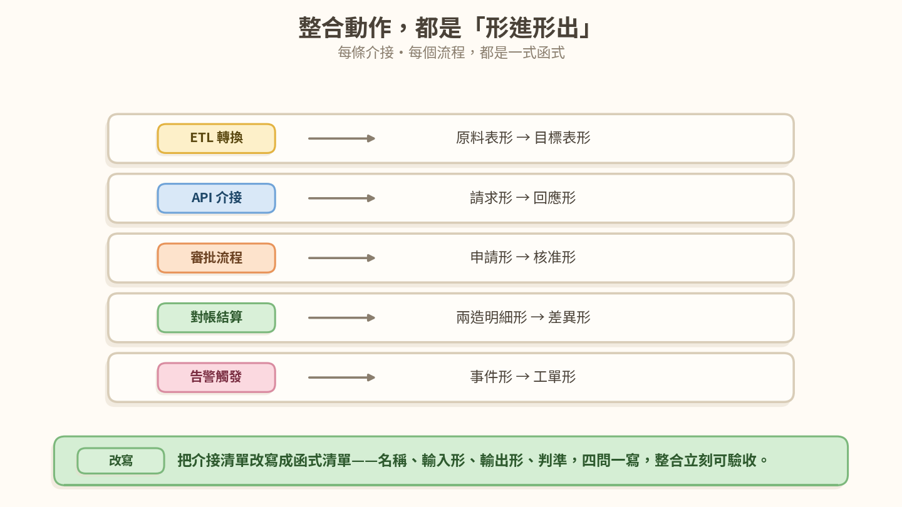

**圖 4-1　整合動作，都是「形進形出」**

> **【連線】一句話**
>
> 時間本形依附在空間本形之上：先有形，才有動作——輸入一個形，產出一個形。

## 4.2　函式四問：為動詞建立形的描述

動詞要「準」，就要有形的描述。每個時間本形上崗前回答四個問題：**名稱**（這個函式叫什麼，名字人人認得）、**輸入形**（作用在哪個形上，指認得出、交得出來）、**輸出形**（產出什麼形，可被辨識、被驗收）、**判準**（怎麼算成功，可逐句打勾、可複核）。

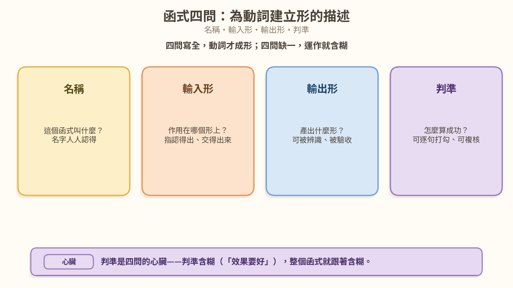

**圖 4-2　函式四問：名稱・輸入形・輸出形・判準**

判準是四問的心臟。名稱、輸入、輸出都還在「描述」；判準是唯一的「驗收」——判準寫「效果要好」，整個函式就跟著含糊；判準寫「金額・稅別・幣別三欄全等」，函式才算寫準。

| 問題 | 說明 | 檢查點 |
| --- | --- | --- |
| 名稱 | 這個函式叫什麼？ | 名字人人認得，語境不混淆 |
| 輸入形 | 作用在哪個形上？ | 輸入的形指認得出來、交得出來 |
| 輸出形 | 產出什麼形？ | 產出可被辨識、被驗收 |
| 判準 | 怎麼算成功？ | 可逐句打勾、可複核 |

## 4.3　六大函式群 × 企業整合場景

函式庫六大群與整合場景一一對得上：認知與萃取（盤點既有介接、萃取重用模式）、生成與應用（生成新對應規則、套用到新系統）、解題與創造（拆解斷點、設計補償方案）、推理與思考（根因分析、影響面推演）、成長與維護（介接重構、契約版本治理）、探索（新架構選型、POC 研發）。

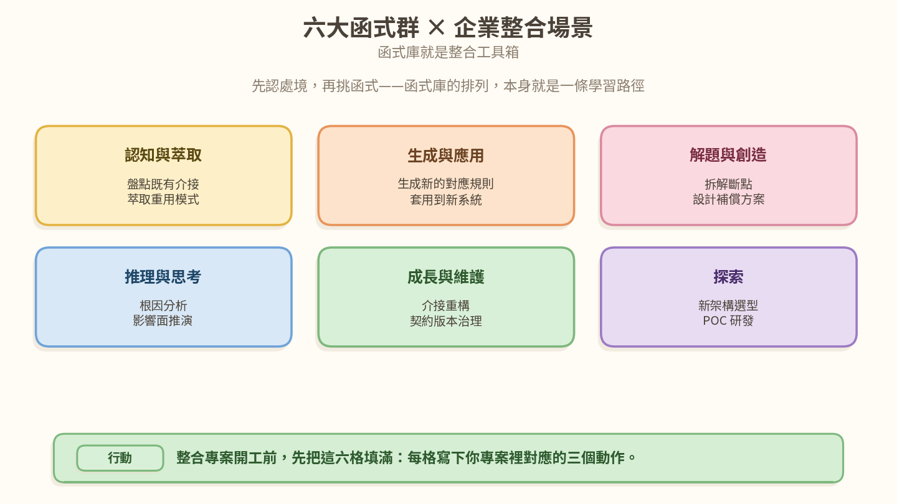

**圖 4-3　六大函式群 × 企業整合場景**

開工前把這六格填滿，是整合專案最好用的暖身動作：每格寫下專案裡對應的三個動作——寫不出來的那一格，往往就是風險藏身之處。

## 4.4　API 契約：形進形出的憑證

微服務之間只交換「形」，不交換猜測。API 契約的本質，就是把函式四問寫成白紙黑字：請求是輸入形、回應是輸出形、欄位與型別是形的表記、驗收條件是判準、版本號是形的變更治理。契約一改版，兩側一起升級——版本治理，就是形的變更治理。

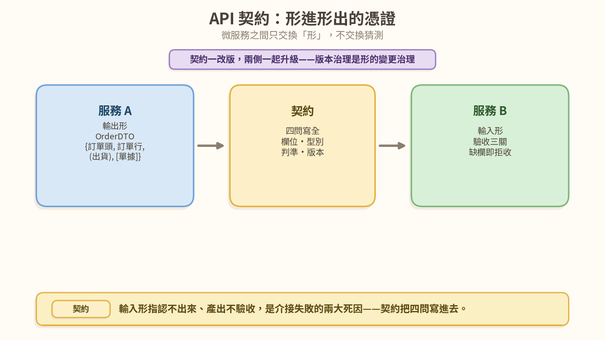

**圖 4-4　API 契約：形進形出的憑證**

介接失敗的兩大死因，正好是四問的兩問沒寫好：輸入形指認不出來（請求缺欄、型別含糊）、產出不驗收（回應不檢查、壞資料長驅直入）。契約把四問寫進去，兩大死因一起堵住。

## 4.5　事件驅動：把動詞釘上時間軸

事件驅動架構裡，每個事件都是「形的狀態轉移」的廣播：下單、扣庫、出貨、開票、收款——每個事件都是一個動詞的里程碑，把動詞的輸出形釘在時間軸上。串起來就是**因果鏈模式**：每一跳都可驗收、可回放、可補償。

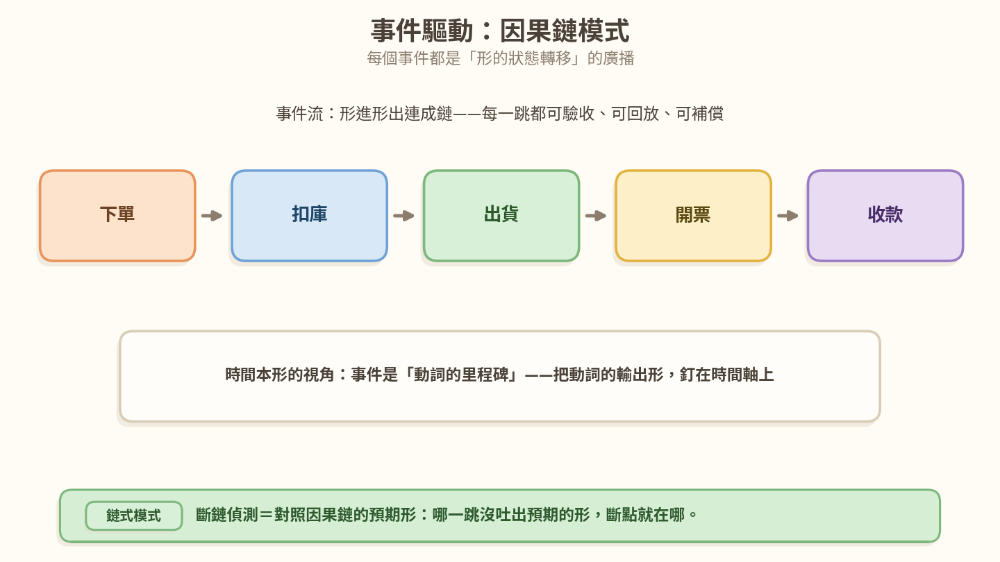

**圖 4-5　事件驅動：因果鏈模式**

斷鏈偵測直接變成機械動作：對照因果鏈的預期形——哪一跳沒吐出預期的形，斷點就在哪。補償設計同理：補償函式就是把該跳的輸出形「逆向歸零」的函式，也照四問寫清楚。

## 4.6　思考法選路：先認處境，再挑路徑

整合方案設計卡住時，先別硬推——選一條路。順向推：路徑清楚就照因果鏈走；逆向想：從目標形倒推入口形；換方向：死胡同就換個維度重畫；往下挖：表象之下挖到第一性原理。選路要說明理由——寫出入口的形：從什麼形出發，要走到什麼形。

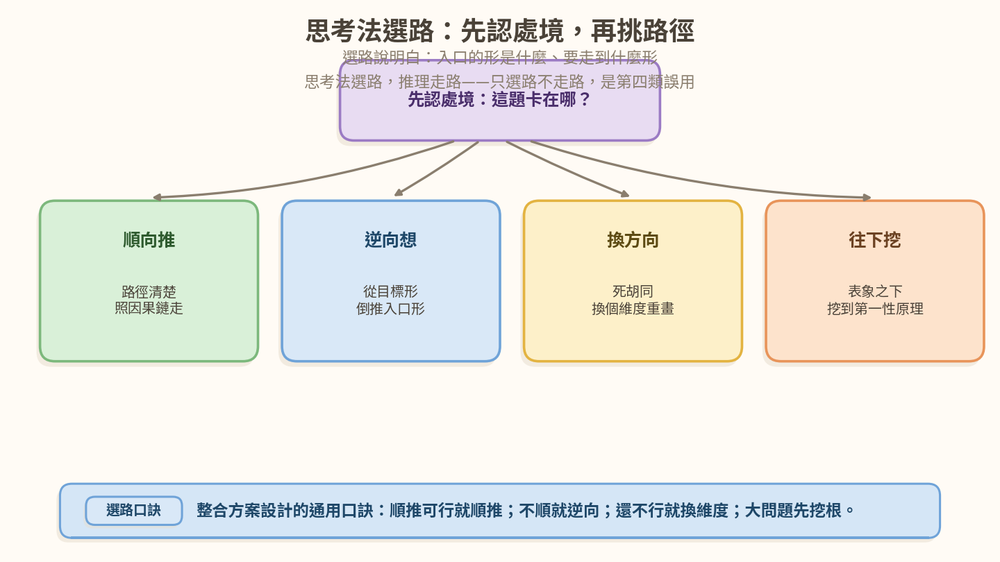

**圖 4-6　思考法選路：先認處境，再挑路徑**

> **【口訣】選路口訣**
>
> 順推可行就順推；不順就逆向；還不行就換維度；大問題先挖根。
>
> 思考法選路，推理走路——只選路不走路，是思考法側的誤用。

## 4.7　飛輪：形與函式互相長大

立形、動形、驗形是一個循環：動作（設計、生成、重構）會產出新的形，形支撐更豐富的動作——兩者互相長大。合起來是三條合奏規則：一、輸入一個形，產出一個形；二、產出形過三層檢查；三、新形回入形庫，長出新函式。

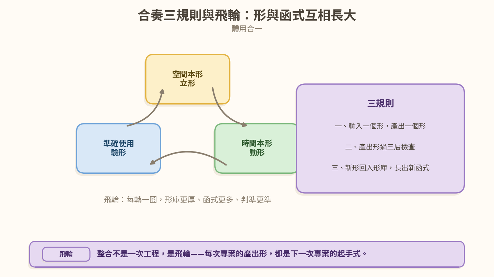

**圖 4-7　合奏三規則與飛輪**

整合不是一次工程，是飛輪——每次專案的產出形，都是下一次專案的起手式。飛輪轉起來，是第七篇「建庫四階段」的動力來源。

> **【專業專欄 C4】API 契約與微服務：四問就是契約**
>
> 業界講 API First、Contract Testing（Pact 之類的契約測試），都在解決同一件事：服務之間的約定要可驗證。把契約模板與函式四問對齊，會發現是同一張卡的兩種寫法：契約的 operation 名稱 ↔ 名稱；request schema ↔ 輸入形；response schema ↔ 輸出形；驗收條件與契約測試的斷言 ↔ 判準。
>
> 差別在深度：一般契約只寫資料形狀，不寫「形的層次」——哪些欄位是必要件（remove 三級）、哪些請求欄位決定回應的類別歸屬（抽象判準）、同一筆業務身份在哪個欄位（id(C)）。把這三層補進契約，契約測試就從「格式檢查」升級成「業務形狀檢查」。
>
> 實務建議：每個微服務的契約檔案開頭放一張四問卡；契約版本的 changelog 用「動到哪一層」分級——內容層、結構層、身分層，與 3.2 的變更分級完全一致。

> **【專業專欄 C5】事件驅動架構：把動詞釘上時間軸**
>
> 事件溯源（Event Sourcing）與 CQRS 把「狀態」換成「事件的因果鏈」：現在的世界，是事件流的積分。這與時間本形的因果鏈模式是同構的——每個事件是動詞的輸出形，事件流是函式輸出的時間序。
>
> 事件設計的三個形學檢查：一、事件的形寫清楚了嗎（每則事件就是一個形集合：{事件頭, 載荷, (上下文), [事件類別]}）；二、事件的因果前件寫清楚了嗎（哪個形的哪個狀態轉移觸發它）；三、補償函式寫清楚了嗎（逆向歸零的四問）。
>
> 常見反模式是「萬能事件」——一則事件塞進半個業務域，輸出形巨大而無判準。形學的處方是回歸四問：輸出形要「可被辨識、被驗收」，寧可多則小事件，不可一則糊事件。

> **【練習 E06】為兩條介接寫函式四問卡**
>
> 挑選你負責或熟悉的兩條系統介接，各填一張函式四問卡：名稱、輸入形、輸出形、判準。
>
> 檢查：兩張卡的判準都能逐句打勾嗎？若有「效果要好」「正常即可」，改寫成可驗證的條件。
>
> *寫完檢查：判準打不了勾的函式，驗收時只能靠感覺。*

> **【練習 E07】畫出你的事件因果鏈**
>
> 選一條你熟悉的業務鏈（例如「下單到收款」或「入職到轉正」），列出四到六個事件節點。
>
> 為每個節點寫出：輸入形、輸出形；再挑一個節點寫出它的補償函式四問。
>
> *寫完檢查：斷鏈偵測的檢查表，就是這條鏈的預期形清單。*

# 第五篇　準確使用方法：整合版

本篇是全書的方法核心：把三種補足、證明六步驟、八問、誤用 16 種，整套裝在一個真實的整合流程上——訂單到收款（O2C）。讀完這一篇，你手上的每一個整合決策，都能寫到「可複核的準」。

## 5.1　三種補足：把缺的資訊裝回該在的位置

數學證明的三處缺口，對應三種補足：規則不寫就靠猜——用 [ ] 把類別寫成規則；身份不標就靠想——用 ( ) 把不變寫成公理；結構不清就靠吵——用 { } 把依存寫成判準。補足不是格式，是把「口頭默契」升級成「白紙黑字的形」。

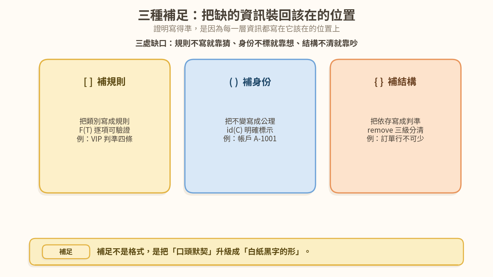

**圖 5-1　三種補足：[ ] 規則・( ) 身份・{ } 結構**

**重點對照**

| **[ ] 補規則** | 把類別寫成規則：F(T) 逐項可驗證。例：VIP 客戶的四條特徵寫進判準。 |
| --- | --- |
| **( ) 補身份** | 把不變寫成公理：id(C) 明確標示。例：帳戶 A-1001 的身份不隨餘額變動。 |
| **{ } 補結構** | 把依存寫成判準：remove 三級分清。例：訂單行是必要件，贈品貼紙是非必要件。 |

## 5.2　證明六步驟：把判斷寫到可複核

六步驟是一條固定流程：**認明整體**（我證的是哪個整體）→ **分軸描述**（X 屬性、Y 組成、Z 容器分開寫）→ **寫形集合**（{部件, (內容), [類別]} 完整表記）→ **選定命題**（證歸屬、證成功、還是證影響）→ **判準推理**（F(T) 逐項驗證、remove 逐件試拆、id 逐處核對）→ **三層檢查**（容器・組成・抽象都過，才寫得證）。

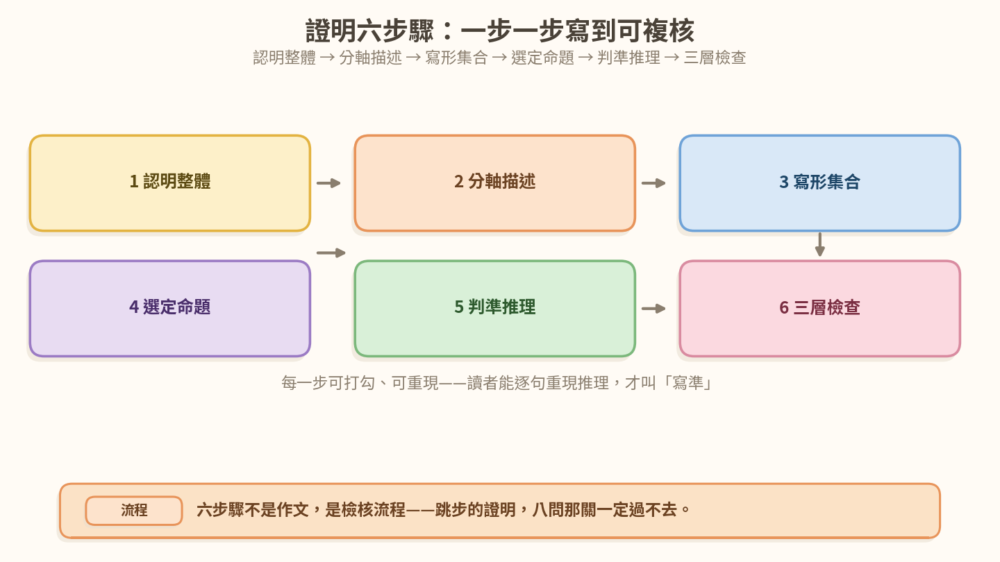

**圖 5-2　證明六步驟**

六步驟不是作文，是檢核流程——每一步可打勾、可重現，讀者能逐句重現推理，才叫「寫準」。跳步的證明，八問那關一定過不去。

## 5.3　完整示範：O2C 訂單到收款走一遍

示範選一個最有代表性的整合流程：訂單到收款（Order-to-Cash，O2C）——它橫跨訂單、倉儲、物流、財務四個域，是整合之痛的高發地。命題設定：證「出貨單 ∈ [交易單據]」，並證「收款回寫可驗收」。

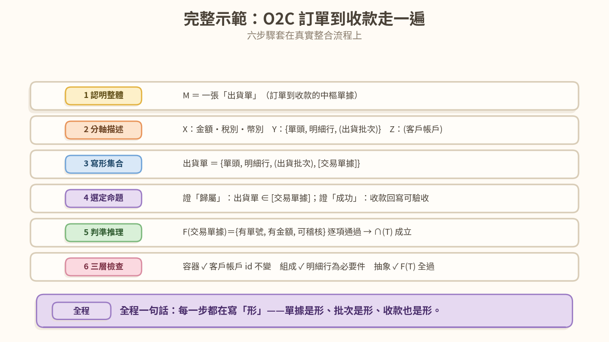

**圖 5-3　完整示範：O2C 六步驟全程**

> **【證明示範】O2C 六步驟**
>
> **（1）認明整體**：判斷對象是「出貨單」——訂單到收款的中樞單據。
>
> **（2）分軸描述**：X：金額・稅別・幣別；Y：{單頭, 明細行, (出貨批次)}；Z：(客戶帳戶)。
>
> **（3）寫形集合**：出貨單 ＝ {單頭, 明細行, (出貨批次), [交易單據]}。
>
> **（4）選定命題**：證歸屬——出貨單 ∈ [交易單據]；證成功——收款回寫可驗收。
>
> **（5）判準推理**：F(交易單據) ＝ {有單號, 有金額, 可稽核}——f1 通過（單號由 ERP 流水編成）、f2 通過（金額＝明細行加總）、f3 通過（每次狀態轉移留審計軌跡）。由 ∩(T)，出貨單 ∈ [交易單據]。
>
> **（6）三層檢查**：容器 ✓（客戶帳戶 id 不因收款變動）；組成 ✓（明細行為必要件、出貨批次為內容）；抽象 ✓（F(T) 全過）。三層全過——（得證）。

再看「寫到可複核」的前後對照。Before 是口頭默契：「出貨單大概就算交易單據吧」「系統會自動對帳」；After 是形的表記：形集合一條、判準三欄、id 一處。同一句話，寫成形就能驗收。

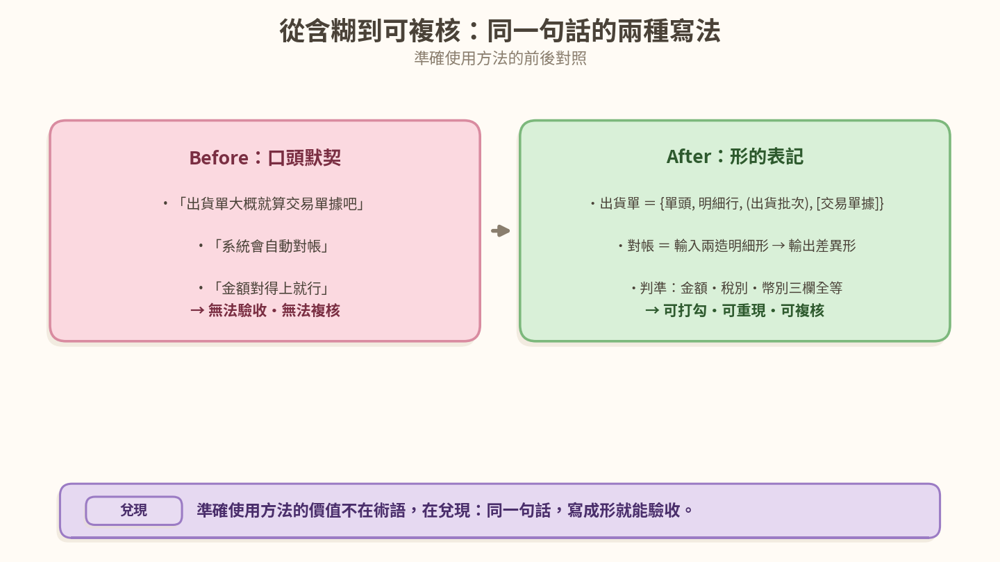

**圖 5-4　從含糊到可複核：同一句話的兩種寫法**

## 5.4　八問檢查清單

交件前逐條打勾，八問全過才交：對象認明了嗎？F(T) 寫明了嗎？括號用對了嗎？id(C) 標出來了嗎？remove 分級做了嗎？邊界案例想到了嗎？每一步可檢驗嗎？三層聯合檢查了嗎？八問就是三種補足的驗收標準。

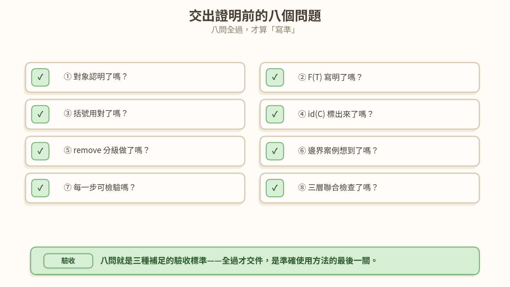

**圖 5-5　交出證明前的八個問題**

## 5.5　誤用大對照：16 種

誤用收成一張大表：空間側五種、動詞側五種、模式側三種、思考法側三種。共同的根源只有一個：**層次沒寫清**。讀法：先看側別定位自己可能踩的坑，再看正確寫法直接抄走。

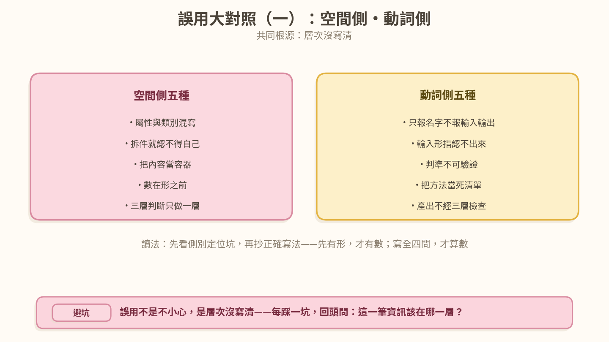

**圖 5-6　誤用大對照（一）：空間側・動詞側**

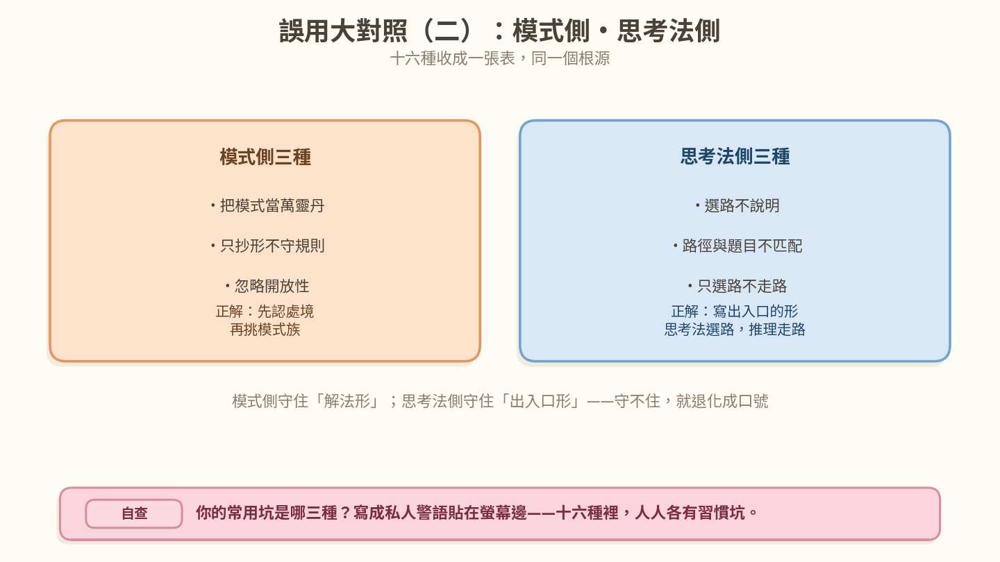

**圖 5-7　誤用大對照（二）：模式側・思考法側**

| 側別 | 常見誤用 | 問題所在 | 正確寫法 |
| --- | --- | --- | --- |
| 空間側 | 屬性與類別混寫 | [ ] 維度刻度 ≠ [類別] | 維度歸屬性、類別歸形集合 |
| 空間側 | 拆件就認不得自己 | 必要件拆了，形就散 | remove 三級逐件試拆 |
| 空間側 | 把內容當容器 | id(C) 與 S(C) 不分 | 身份與內容分離 |
| 空間側 | 數在形之前 | 還沒立形就數數量 | 先有形，才有數 |
| 空間側 | 三層判斷只做一層 | 缺一不可 | 容器・BOM・抽象聯合檢查 |
| 動詞側 | 只報名字不報輸入輸出 | 人人做不同的事 | 寫全四問 |
| 動詞側 | 輸入形指認不出來 | 作用對象含糊 | 輸入形要辨識、可交付 |
| 動詞側 | 判準不可驗證 | 「效果要好」打不了勾 | [ ] 規則補足寫到可打勾 |
| 動詞側 | 把方法當死清單 | 新情境套不上 | 方法是開放規則（F(T)、∩(T)） |
| 動詞側 | 產出不經三層檢查 | 成果來路不明 | 三層都過才算數 |
| 模式側 | 把模式當萬靈丹 | 什麼處境都套同一式 | 先認處境，再挑模式族 |
| 模式側 | 只抄形不守規則 | 抄外殼沒守解法形 | 解法形每條規則都要守 |
| 模式側 | 忽略開放性 | 模式當死清單 | 留開放位給新成員 |
| 思考法側 | 選路不說明 | 「我就想這樣想」 | 寫出入口的形 |
| 思考法側 | 路徑與題目不匹配 | 用正向解死胡同 | 對決策樹重選 |
| 思考法側 | 只選路不走路 | 想得很美沒有推理 | 思考法選路，推理走路 |

> **【練習 E08】誤用診斷＋六步驟複習**
>
> 回顧你最近一次「方法用得不順」的整合經驗，從 16 種誤用裡定位至少兩條，各寫出改正的一行。
>
> 再挑一個當下的整合判斷，用六步驟寫成一頁證明（可參照 5.3 的 O2C 示範）。
>
> *寫完檢查：你的「常用坑」是哪三種？把它們寫成私人警語。*

# 第六篇　總架構：哲學—方法—實踐

方法要落地，得有架構托著。本篇把全書收攏成三層總架構，展開 Mind AI 的「兩庫一中樞一迴路」，並與 Palantir 的 Ontology 做對讀——看看業界第一線的「本體工程」在做什麼，與本形學如何互相印證。

## 6.1　三層總架構：哲學—方法—實踐

一層托一層，缺一層就懸空：哲學層（本形學）問「為什麼」——把形看清楚；方法層（準確使用方法）問「怎麼準」——把形用準確；實踐層（Mind AI 與企業整合）問「怎麼落地」——把形兌現。

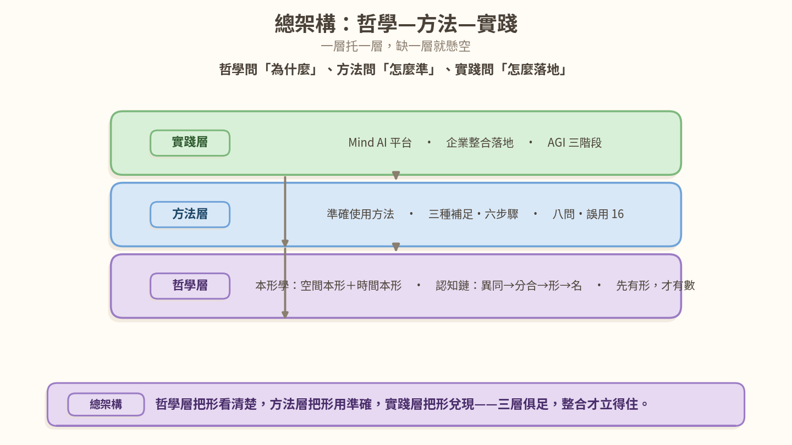

**圖 6-1　總架構：哲學—方法—實踐**

整合專案可以拿這三層做健康檢查：卡在哲學層，是形沒認清（同名異義沒解決）；卡在方法層，是判斷不可複核（爭論各執一詞）；卡在實踐層，是兌現沒落地（方案漂亮、上線走樣）。

## 6.2　Mind AI：兩庫一中樞一迴路

Mind AI 是本形學與 Mind Model 的實踐平台。本書需要的最小架構圖只有四件：**形庫**（空間本形入庫：單位形、三軸、形集合）、**函式庫**（時間本形入庫：六群、四問、模式）、**中樞**（Mind Model：知識統一、推理、思維管理）、**學習迴路**（產出形過三層檢查後回流入庫）。

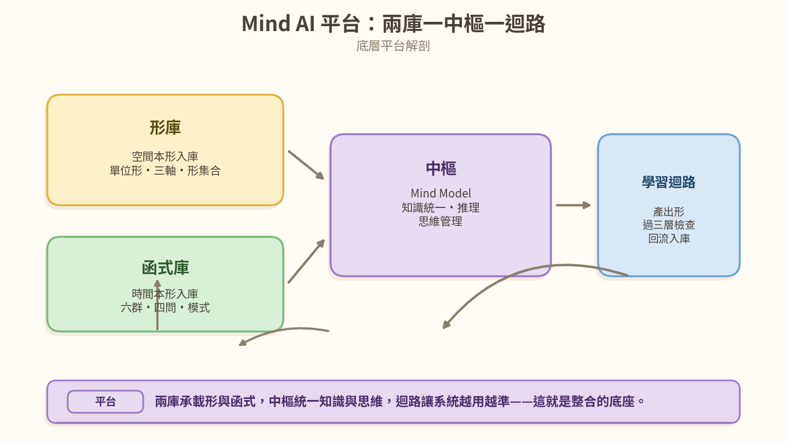

**圖 6-2　Mind AI 平台：兩庫一中樞一迴路**

兩庫承載形與函式，中樞統一知識與思維，迴路讓系統越用越準——這就是整合的底座。要注意的是本書的邊界：這裡給的是**方法與架構**，不是系統實作；底座可以現在就用「文件＋表格＋流程」模擬運轉，平台化是之後的事。

> **【邊界】本書不談實作**
>
> 兩庫一中樞一迴路是架構語言，不是產品規格——先用方法把形寫準，再談平台化。
>
> Mind AI 的完整研究願景（知識統一 → 思維統一 → 智慧統一）見 6.5；本書聚焦它在企業整合上的投影。

## 6.3　Palantir Ontology 對讀

在業界第一線，Palantir 的 Ontology 被定位為「組織的營運層」：坐在整合進平台的資料資產之上，把物件連回真實世界的對應物——從工廠設備到客戶訂單——常被稱為組織的**數位孿生（digital twin）**。它的構成分兩組：**語義元素（semantic elements）**——objects、properties、links（物件・屬性・連結）；**動能元素（kinetic elements）**——actions、functions（動作・函式）。

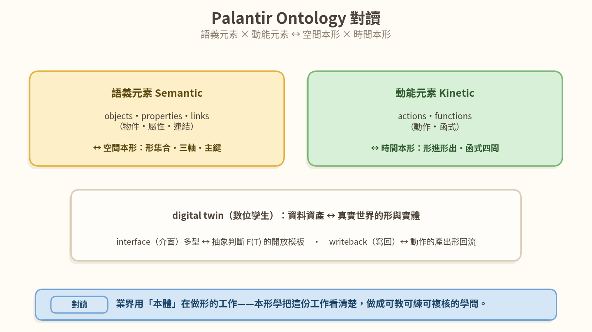

**圖 6-3　Palantir Ontology 對讀**

對讀非常直白：語義元素 ↔ 空間本形（物件與屬性是形集合與三軸，連結是主鍵織成的網）；動能元素 ↔ 時間本形（actions 與 functions 都是形進形出的函式，寫回 writeback 就是產出形的回流）。Palantir 的 interface（介面）提供物件型別的多型——「描述一個物件型別的形狀與能力」——正是抽象層 F(T) 開放模板的工程化身。

**重點對照**

| **objects・properties・links** | ↔ 空間本形：形集合 {部件,(內容),[類別]}、三軸、主鍵與關聯 |
| --- | --- |
| **actions・functions** | ↔ 時間本形：函式四問、形進形出、判準驗收 |
| **digital twin 數位孿生** | ↔ 形與實體：表頭是形、資料列是實體；系統 ↔ 真實世界的雙向映射 |
| **interface 介面多型** | ↔ 抽象判斷 F(T) 的開放模板：共享形狀的類別，留開放位給新成員 |
| **writeback 寫回** | ↔ 動作的產出形回流：過三層檢查後，成為新的事實 |

對讀的結論不是「我們比較像」，而是一句更重的話：**業界用「本體」在做形的工作——本形學把這份工作看清楚，做成可教、可練、可複核的學問。**Ontology 這條路證明了「把世界的形寫進軟體」是對的方向；本形學補上的是判準、層次與證明方法——正是整合現場最缺的那三塊。

## 6.4　數位孿生與寫回

數位孿生把「真實世界 ↔ 形的世界」的映射制度化：現場在動（工廠、訂單、帳戶的內容變化），形的世界裡是形的狀態轉移；決策要落地，透過 writeback 把動作的產出形寫回真實世界。兩頭都用形說話，映射才穩。

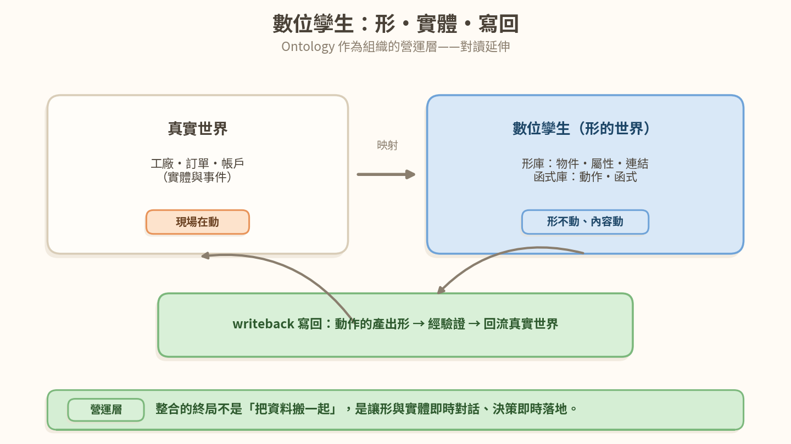

**圖 6-4　數位孿生：形・實體・寫回**

整合的終局不是「把資料搬一起」，是讓形與實體即時對話、決策即時落地。這也是企業資訊系統整合的成熟度標尺：從搬資料、到立形、到雙向寫回——每上一級，形的準確度都是前提。

> **【專業專欄 C6】兩庫一中樞一迴路：平台解剖**
>
> 把四件套翻成資料平台的語彙：形庫對應主數據與本體層（型別定義、屬性字典、身份規則），函式庫對應服務與規則層（API 契約、業務規則、流程定義），中樞對應知識與推理層（推論引擎、決策服務、思維管理），迴路對應治理與學習層（審計、回饋、版本、重構）。
>
> 與常見的「資料中台」藍圖對照，差異在兩處：一、形庫強制三軸表記（一般中台只有欄位字典，沒有組成與容器兩軸）；二、迴路強制三層檢查後才入庫（一般中台的入庫驗證只查格式，不查形）。這兩處差異，正是「整合之痛」最常藏身的地方。
>
> 落地順序建議：先以文件與表格運轉兩庫（形庫用形集合卡片、函式庫用四問卡），迴路用每週複盤手動轉；等卡片數量與複用率證明了價值，再平台化——方法驗證先於平台投資。

> **【專業專欄 C7】本體工程 × 形學：對讀的實務含義**
>
> 本體工程（Ontology Engineering）是把領域知識形式化的老牌學科，從哲學本體論一路走到資訊科學：語意網（RDF/OWL）、企業架構（Zachman、TOGAF 的資料架構域）、以及 Palantir 這類營運級本體。它們共同驗證了三件事：世界可以形式化、形式化後可支撐決策、決策可回寫世界。
>
> 本形學與之對讀時的三個增量：一、**判準的中心性**——F(T) 與 ∩(T) 把「類別歸屬」從推理機的專利，變成人人可打勾的表格；二、**層次的紀律**——容器／組成／抽象三層聯合檢查，讓本體建模的爭論（「這算類別還是算個體？」）有了裁決流程；三、**動詞的形**——函式四問把 actions 與 functions 寫到可驗收，補上本體工程長期偏「靜態」的一塊。
>
> 實務含義一句話：做本體工程的人，請把本書第五篇當成你的驗收指南——你的 OWL class 定義、object property、SWRL rule，都能翻譯成 F(T)、形集合與判準，然後用八問檢查。

> **【練習 E09】架構對讀練習**
>
> 拿你所在組織的資料架構圖（或任選一張資料中台藍圖），標出：哪裡是形庫的候選、哪裡是函式庫的候選、哪裡是迴路的缺口。
>
> 以 Palantir 的「語義元素／動能元素」二分法檢視：你的組織目前在哪一組上投入較多？平衡嗎？
>
> *寫完檢查：缺口寫成一句話：「我們缺的是 ____ 的形。」*

# 第七篇　內容完整方案

方法有了、架構有了，剩下的是「怎麼變成組織能力」。本篇給出完整方案：五階養成（學練用教建）、八模組課程（M1–M8）、八週路線、情境選路對照、建庫四階段。方案的設計原則只有一條：**每一步都留下看得見的交付物**。

## 7.1　學練用教建：五階養成

學一遍、練一遍、用一遍、教一遍、建一遍——五遍過後，形才是你的。每一階都有交付物：學（讀懂形，交筆記）、練（做習題，交六步驟演練）、用（套工作，交真實整合案）、教（講給人聽，交一圖一例）、建（建形庫，交企業資產）。

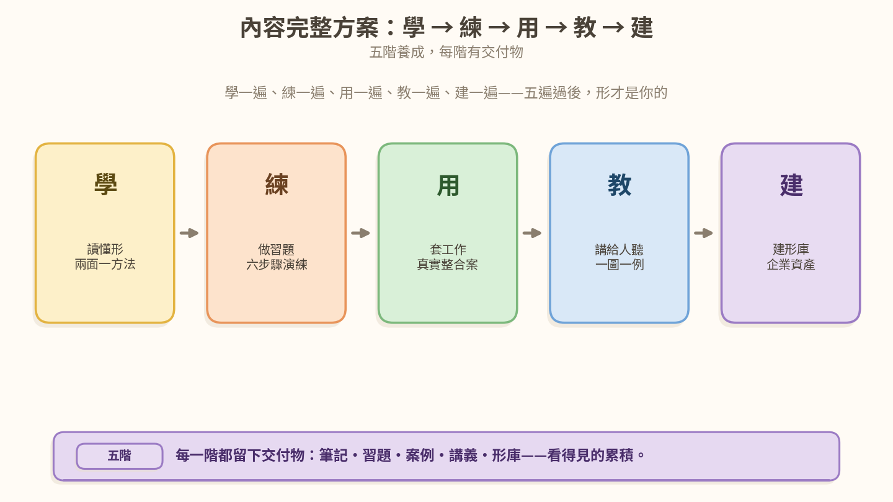

**圖 7-1　內容完整方案：學 → 練 → 用 → 教 → 建**

「教」這一階常被忽略，卻最有效：能把「三軸」用一張圖講給同事聽，才證明你真的懂。「建」是終點也是起點——交付物入了形庫，飛輪就開始轉。

## 7.2　M1–M8：八模組課程

完整方案的內容骨架是八個模組，可裁可組：M1–M6 打底（理論與方法），M7–M8 落地（工程與資產）。企業內訓取 M1–M6；整合專案加 M7；平台建設加 M8。

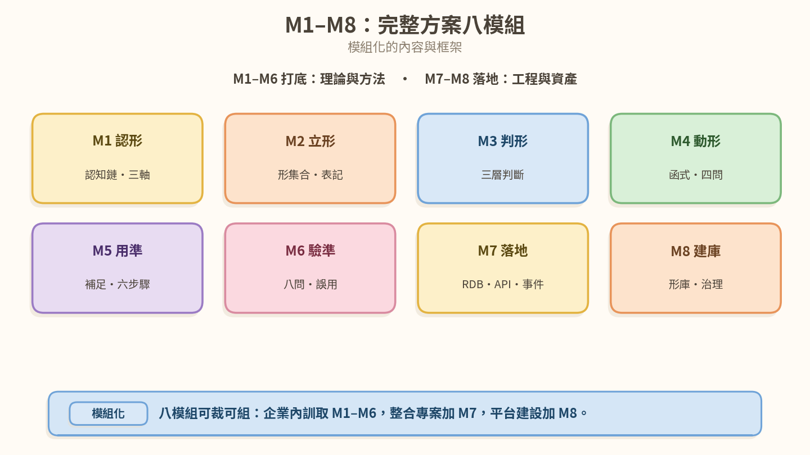

**圖 7-2　M1–M8：完整方案八模組**

| 模組 | 主題 | 核心內容 | 交付物 |
| --- | --- | --- | --- |
| M1 認形 | 認知鏈・三軸 | 異同分合形名；X/Y/Z 三軸與三括號 | 三軸筆記一份 |
| M2 立形 | 形集合・表記 | 單位形公式；企業系統形集合寫法 | 三個形集合卡片 |
| M3 判形 | 三層判斷 | 容器／BOM／抽象聯合檢查 | 一份三層判決書 |
| M4 動形 | 函式・四問 | 六群函式庫；函式四問卡 | 兩張四問卡 |
| M5 用準 | 補足・六步驟 | 三種補足；證明六步驟 | 一頁完整證明 |
| M6 驗準 | 八問・誤用 | 八問檢查；誤用 16 對照 | 誤用私人警語 |
| M7 落地 | RDB・API・事件 | 主鍵關聯；契約四問；事件因果鏈 | 一份整合案形規格 |
| M8 建庫 | 形庫・治理 | 建庫四階段；版本治理；飛輪 | 形庫雛形 |

## 7.3　八週路線

個人自學或團隊共學，推薦八週路線：W1 認形、W2 立形、W3 判形、W4 動形、W5 方法、W6 示範、W7 落地、W8 建庫。每週一主題・一圖・一練習・一交付——八週只是起跑線，真正的路線是飛輪。

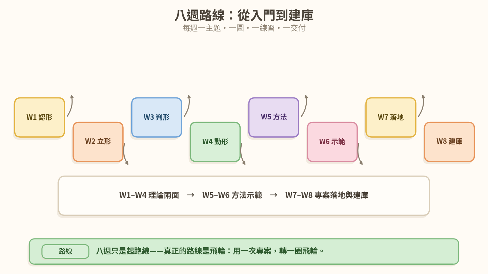

**圖 7-3　八週路線：從入門到建庫**

> **【節奏】八週的三個節拍**
>
> W1–W4 理論兩面：把形認得、立得、判得、動得。
>
> W5–W6 方法示範：六步驟與八問，用 O2C 之類的真實流程走全程。
>
> W7–W8 專案落地與建庫：挑一個真專案開工，把產出沉澱入庫。

## 7.4　情境選路：什麼處境，用什麼招

常見的五種整合情境，配上對應的方法組合。這張表的用法：先認處境——再挑方法——四步走完（認處境、挑函式、寫四問、過八問）。

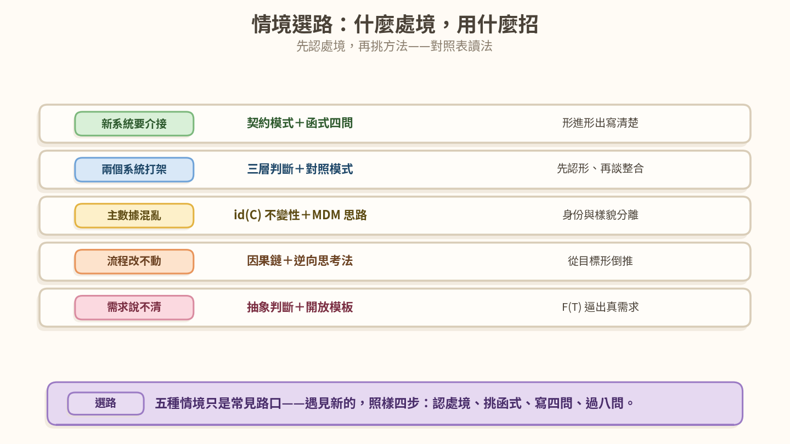

**圖 7-4　情境選路對照**

選路的本質是思考法 6.4 的應用：順推可行就順推，不順就逆向，還不行就換維度。五種情境只是常見路口——新的路口出現時，照樣四步。

## 7.5　建庫四階段：把整合沉澱成企業資產

形庫是整合的「複利資產」：收集（專案裡遇到的形先寫下來）→ 整形（三軸表記、四問卡入檔）→ 入庫（分群、命名、版本、權限）→ 演化（重構重組、迴路持續優化）。每專案存入一點，越用越準。

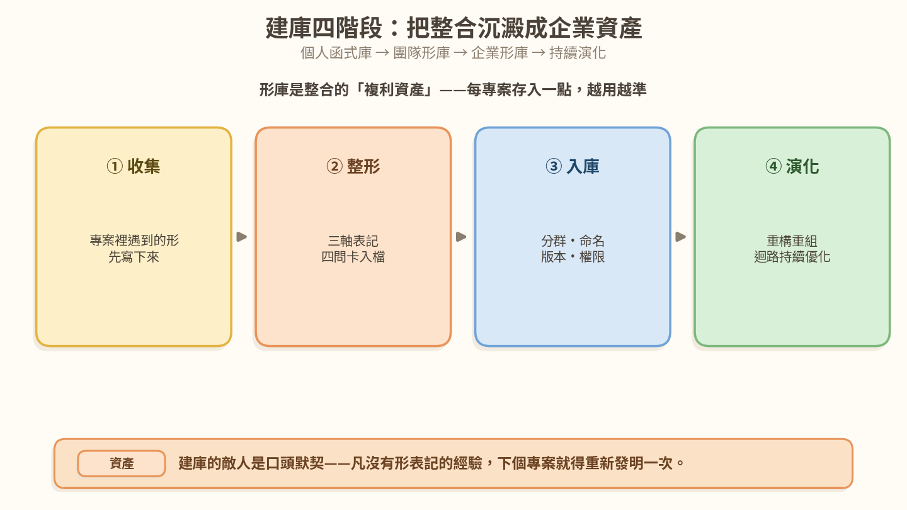

**圖 7-5　建庫四階段**

建庫的敵人是口頭默契——凡沒有形表記的經驗，下個專案就得重新發明一次。反過來說，形庫的每張卡片，都是未來某次爭論的裁決依據。

> **【專業專欄 C8】形庫治理：變更管理與版本**
>
> 形庫要活著，治理就得先行。四個治理主題：命名（一形一名，異名同義用「參照」不用「複製」）、版本（形的變更分三級——內容層、結構層、身分層，與 3.2 完全一致）、權限（誰能改形、誰只能提案）、稽核（每次形變更留審計軌跡，對應 id(C) 的不變性守護）。
>
> 與業界對讀：這套治理與資料治理（Data Governance）、本體變更管理（Ontology Change Management）同構。差異在於形庫以「三種括號」為最小治理單元——改 [ ] 是規則變更、改 ( ) 是身份變更、改 { } 是結構變更，審批層級一目了然。
>
> 實務起步很輕：一張試算表三個分頁（形集合卡、四問卡、變更日誌），加一條規矩——「未入卡的形，不得在正式方案裡引用」。規矩比工具重要。

> **【練習 E10】你的八週行動計畫**
>
> 依 7.3 的八週路線，寫出你自己的八週計畫：每週的主題、可撥出的時數、預定交付物。
>
> 再依 7.5 建庫四階段，選定你形庫的存放處（筆記本、試算表或任何工具），寫下第一張卡片的標題。
>
> *寫完檢查：計畫寫得下、交得出，才算數——寧可八週各一小步，不要第一週一大步。*

# 第八篇　總結

走到這裡，全書的地圖已經踏過一遍。收攏成一句話：**把形看清楚，把形用準確，把形變資產**——而衡量一切的標準只有一個：可複核的準。

## 8.1　總結地圖

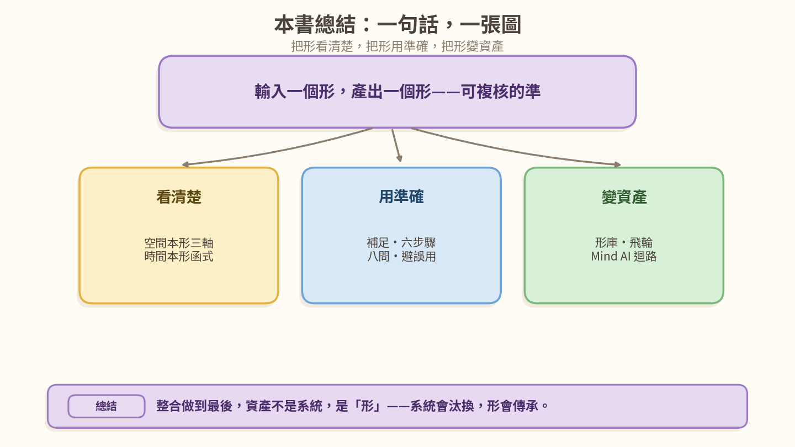

**圖 8-1　本書總結：一句話，一張圖**

看清楚，靠空間本形（三軸・形集合・三層判斷）與時間本形（函式・四問・六群）；用準確，靠三種補足・六步驟・八問・誤用 16 種；變資產，靠形庫・飛輪・Mind AI 的學習迴路。三件事首尾相連，就是整合的完整方法論。

## 8.2　落地清單：明天就能做的四件事

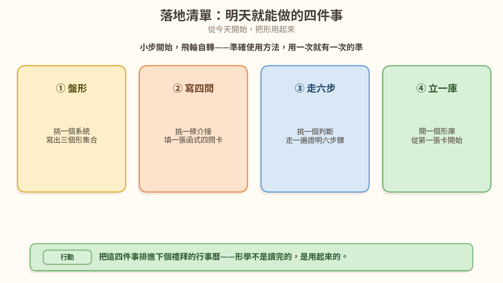

**圖 8-2　落地清單：明天就能做的四件事**

- 盤形——挑一個系統，寫出三個形集合：{部件, (內容), [類別]}。
- 寫四問——挑一條介接，填一張函式四問卡：名稱、輸入形、輸出形、判準。
- 走六步——挑一個整合判斷，走一遍證明六步驟，交給同事用八問挑戰。
- 立一庫——開一個形庫，從第一張卡片開始。

## 8.3　金句收束

**把形看清楚，轉成方法，實踐化為 Mind AI。**

**先有形，才有數；先立形，才整合。**

**輸入一個形，產出一個形——可複核的準。**

**系統會汰換，形會傳承。**

本體論回答「有什麼」，本形學回答「形是什麼、怎麼用」；本書回答的是它們在企業現場的同一道題：**AI 時代的企業資訊系統整合，先立形，後整合；形準，則整合準。**

# 附錄 A　術語與記號速查

## A-1　記號速查

| 記號 | 讀法 | 意義 |
| --- | --- | --- |
| [ ] | 方括號 | 屬性／抽象集合：維度 × 刻度；類別記在形集合第三位 |
| { } | 大括號 | 組成／物料清單（BOM）：部件結構 |
| ( ) | 圓括號 | 容器／內容空間：(咖啡)、(出貨批次) |
| C = ( id(C), S(C) ) | 容器表記 | 身份恆等、內容可變；不變性公理 |
| F(T) | 特徵集合 | 類別 T 的特徵清單，逐項可驗證 |
| ∩(T) | 交集判準 | 特徵交集全過才歸類 |
| ≢ M | 拆了不成形 | 必要件判準（remove 一級） |
| ≡ M′ ⊂ M | 降級仍在 | 功能降級件判準（remove 二級） |
| ≡ M | 拆了形不變 | 非必要件判準（remove 三級） |

## A-2　術語速查

| 術語 | 一句話定義 |
| --- | --- |
| 形 Type | 分合所畫出的邊界；認得出來、能命名、可判斷的東西 |
| 單位形 Unit Type | 形的基本單位：形集合 ＝ {部件, (內容), [類別]} |
| 空間本形 | 形的名詞面・體：它是什麼樣子、由什麼組成、在哪裡 |
| 時間本形 | 形的動詞面・用：輸入一個形，產出一個形 |
| 認知鏈 | 異同 → 分合 → 形 → 名；有合必有形；先有形，才有數 |
| 形邏輯三層判斷 | 容器層／BOM 層／抽象層聯合檢查，缺一不可 |
| 函式四問 | 名稱・輸入形・輸出形・判準 |
| 三種補足 | [ ] 補規則、( ) 補身份、{ } 補結構 |
| 證明六步驟 | 認明整體→分軸描述→寫形集合→選定命題→判準推理→三層檢查 |
| 八問 | 交件前的八個檢查問題，三種補足的驗收標準 |
| 形集合 | 單位形的完整表記；也是企業的通用建模語法 |
| Mind Model | 本形學的實踐架構：知識統一＋思維統一的中樞 |
| Mind AI | 本形學與 Mind Model 的實踐平台：兩庫一中樞一迴路 |
| 數位孿生 digital twin | 形的世界與真實世界的雙向映射，決策可寫回 writeback |

# 附錄 B　準確使用方法速查卡

## B-1　一頁速查卡

> **【速查卡】整合任務一頁卡（可複印貼工位）**
>
> **開工三問**：這次整合的對象，形寫出來了嗎？id 標出來了嗎？判準打得了勾嗎？
>
> **立形**：單位形 ＝ {部件, (內容), [類別]}——三軸分開寫，括號各安其位。
>
> **動形**：函式四問——名稱、輸入形、輸出形、判準；判準要可逐句打勾。
>
> **驗形**：六步驟走完（認明整體→分軸描述→寫形集合→選定命題→判準推理→三層檢查）。
>
> **交件**：八問全過——對象、F(T)、括號、id、remove、邊界、可檢驗、三層。
>
> **避坑**：16 種誤用的共同根源是「層次沒寫清」——先問：這一筆資訊該在哪一層？
>
> **變更分級**：動內容＝輕、動結構＝重、動身分＝災難級。
>
> **沉澱**：產出形過三層檢查後入形庫——飛輪轉一圈，下次起手式就有了。

## B-2　空白模板（可複印頁）

以下三張模板可單獨列印，貼工位或夾進專案卷宗。

### 模板一　函式四問卡

| 欄位 | 填寫內容 | 檢查點 |
| --- | --- | --- |
| 名稱 | ＿＿＿＿＿＿＿＿ | 名字人人認得，語境不混淆 |
| 輸入形 | ＿＿＿＿＿＿＿＿ | 指認得出來、交得出來 |
| 輸出形 | ＿＿＿＿＿＿＿＿ | 可被辨識、被驗收 |
| 判準 | ＿＿＿＿＿＿＿＿ | 可逐句打勾、可複核 |

### 模板二　形集合卡

| 欄位 | 填寫內容 |
| --- | --- |
| 形的名稱 | ＿＿＿＿＿＿＿＿＿＿＿＿＿＿ |
| 組成 { } | 部件：＿＿＿＿＿＿（必要件／降級件／非必要件） |
| 內容 ( ) | 裝著：＿＿＿＿＿＿　id(C)：＿＿＿＿＿＿ |
| 屬性 [ ] | 維度 × 刻度：＿＿＿＿＿＿ |
| 類別 [ ] | F(T) 特徵清單：＿＿＿＿＿＿ |

### 模板三　八問勾選清單

| # | 檢查問題 | 打勾 |
| --- | --- | --- |
| 1 | 對象認明了嗎？ | □ |
| 2 | F(T) 寫明了嗎？ | □ |
| 3 | 括號用對了嗎？ | □ |
| 4 | id(C) 標出來了嗎？ | □ |
| 5 | remove 分級做了嗎？ | □ |
| 6 | 邊界案例想到了嗎？ | □ |
| 7 | 每一步可檢驗嗎？ | □ |
| 8 | 三層聯合檢查了嗎？ | □ |

# 附錄 C　練習參考答案

以下為 E00–E10 的示範答案。答案不是唯一解——重點是每一步「可複核」：你的答案也該寫到別人能逐條打勾。

## C-1　導讀・第一、二篇

> **練習 E00　參考答案**
>
> 示範：「訂單出貨後，財務的應收與 ERP 的訂單金額總對不上。」同名異義：兩邊都叫「金額」，一邊含稅一邊未稅；異名同義：「出貨單」「發貨單」是同一形的兩種叫法。
>
> 自查：你的困擾若兩類都佔，先處理同名異義——那是形的 F(T) 沒寫明。

> **練習 E01　參考答案**
>
> 示範：ERP 的「客戶」＝{編碼, 名稱, 稅號}（收款主體）；CRM 的「客戶」＝{聯繫人, 商機, 互動紀錄}（商機主體）。同名異義坐實：一個是交易主體形，一個是關係主體形。
>
> 六痛定位：同名異義＋對不齊。病根：F(T) 沒寫明＋維度不貫穿（稅號只在 ERP 有）。改法：為兩個形各寫形集合，再用「參照」連接，不硬合併。

> **練習 E02　參考答案**
>
> 示範：一、空間本形管「形是什麼」，時間本形管「怎麼動」；二、準確使用方法把判斷寫到可複核；三、Mind AI 用兩庫一中樞一迴路把形存成資產。
>
> 自查：三句話若有一句卡住，回到第二篇對應小節重讀。

## C-2　第三、四篇

> **練習 E03　參考答案**
>
> 示範（WMS 訂單）：出庫單 ＝ {單頭, 明細行, (波次), [作業單據]}；id ＝ 出庫單號；必要件 ＝ 單頭與明細行。庫位 ＝ {儲位編碼, (托盤), [容器]}；id ＝ 儲位編碼；必要件 ＝ 編碼。叉車 ＝ {車體, 電池, (司機), [設備]}；降級件 ＝ 電池。
>
> 自查：三個形的 id 不能共用欄位規則；必要件拆了要真的不成形。

> **練習 E04　參考答案**
>
> 示範：筆電 ＝ {主機板, 螢幕, 鍵盤, 電池, 硬碟, (資料), [型號]}。必要件：主機板、螢幕（拆了不是筆電）；功能降級件：電池（拆了變桌上型、仍是同機）、鍵盤（可外接、功能降級）；非必要件：貼紙、外接滑鼠。
>
> 自查：「認得自己嗎」要先寫下「形的定義」——定義是「可攜運算裝置」時電池可能是必要件。

> **練習 E05　參考答案**
>
> 示範（請款單人工覆核）：容器層——請款單 id 穩定、非重複單；組成層——單頭與明細行為必要件，附件為非必要件；抽象層——F(需覆核) ＝ {金額 > 10 萬, 供應商為新戶, 帳期異常, 品類高風險}，任一特徵命中即覆核。
>
> 自查：兩正一負案例要含一筆邊界（如金額恰為 10 萬）——邊界判決寫進規則。

> **練習 E06　參考答案**
>
> 示範：名稱「訂單同步 ERP→WMS」；輸入形「訂單形 {單頭, 明細行}（狀態＝已核准）」；輸出形「回執形 {單號, 接收時間, 狀態}」；判準「回執狀態＝成功 且 明細行筆數相等 且 金額欄位全等」。
>
> 自查：判準出現「正常」「大概」就退回重寫；三欄全等之類的條件才打得了勾。

> **練習 E07　參考答案**
>
> 示範：下單→扣庫→出貨→開票→收款。節點「扣庫」：輸入形「已核准訂單形」、輸出形「庫存異動形 {SKU, 數量, 倉位}」；補償函式「回補」：輸入形「庫存異動形」、輸出形「回補形（異動歸零）」，判準「回補後可售數量 ＝ 原可售 ＋ 異動數」。
>
> 自查：補償函式也要四問齊全——補償寫不清楚的鏈，不能上生產。

## C-3　第五篇

> **練習 E08　參考答案**
>
> 示範誤用定位：「把模式當萬靈丹」＋「判準不可驗證」。改正各一行：先認處境（斷點在身分層，用容器模式不用通用對帳模式）；判準改寫（「對得上」→「三欄全等且差異表為空」）。
>
> 示範六步驟：認明整體（一張「退款單」）→ 分軸（X：金額、原因碼；Y：{單頭, (原單), (支付通道)}；Z：(客戶帳戶)）→ 形集合（退款單 ＝ {單頭, (原單), (支付通道), [交易單據]}）→ 命題（證成功：退款回寫可驗收）→ 判準（F(可驗收) ＝ {原單存在, 金額 ≤ 原單, 通道回執齊}）→ 三層（容器 ✓ 帳戶 id 不變；組成 ✓ 單頭必要；抽象 ✓ 全過）。

## C-4　第六、七篇

> **練習 E09　參考答案**
>
> 示範：資料中台藍圖上，主數據區標「形庫候選」、API 網關與規則引擎標「函式庫候選」、資料品質稽核標「迴路缺口」（只查格式不查形）。二分法檢視：多數組織語義元素投入 8 成、動能元素 2 成——失衡處就是「動作沒形」的病灶。
>
> 自查：缺口句子要寫成「我們缺的是 ____ 的形」——寫不出來，就還沒認清缺什麼。

> **練習 E10　參考答案**
>
> 示範八週：W1 每晚 2 小時讀第二篇＋筆記；W2 交三個形集合卡；W3 交一份三層判決書；W4 交兩張四問卡；W5 交一頁 O2C 證明；W6 用八問互評同事的證明；W7 挑真專案開工；W8 形庫入 20 張卡。
>
> 自查：每週時數要按你的日曆填實數；形庫第一張卡標題建議：「〈你最痛的那個實體〉形集合」。
