# AI 基因研發大腦 產出準確使用方法完全方案

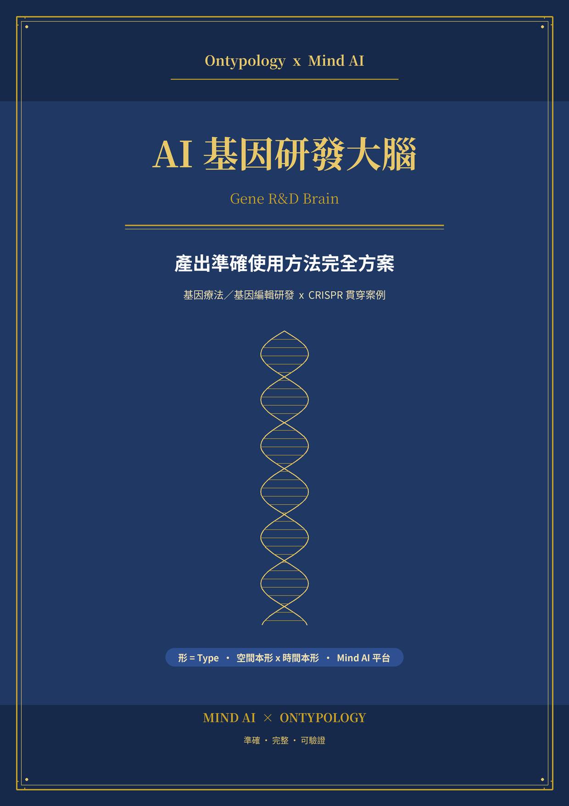

# 目　錄

- 寫在前面：三個約定
- 導讀：兩套語言與三種讀法
- 第一章　認識 AI 基因研發大腦
  - 1.1　可推理研發副本：形＋數怎麼裝下基因研發
  - 1.2　雙本形落點：空間三括號與時間十四招
  - 1.3　Mind AI 分工：LLM 歸納、Mind Model 演繹
  - 1.4　準確從哪裡來：四道關卡預告
  - 1.5　產出不準的四個現場
- 第二章　六種產出形「標導載評判演」
  - 2.1　六形總覽與產出鏈
  - 2.2　標的形 TargetType 與導引形 GuideType
  - 2.3　載體形 VectorType 與評估形 AssessType
  - 2.4　判決形 VerdictType 與演化形 EvolutionType
  - 2.5　三括號與 remove 三級的研發用法
- 第三章　四層準確性保證
  - 3.1　第一層：∩(T) 判準漏斗
  - 3.2　第二層：演繹骨架
  - 3.3　第三層：驗證三件套
  - 3.4　第四層：形證據鏈
  - 3.5　交叉驗收：空間 × 時間九格
- 第四章　六步驟：從研發需求到產出
  - 4.1　框架四步驟：認明研發需求
  - 4.2　六步驟操作卡
  - 4.3　三層判斷：是・有・對
  - 4.4　挑招・組招・換招
  - 4.5　誤用預警點
- 第五章　S1–S7 全程案例：GX-2610
  - 5.1　七段接力：S1–S7 流水線
  - 5.2　S1–S7 提示詞全文
  - 5.3　案例開場：標的卡與導引設計
  - 5.4　全程產出：載體、評估與判決
  - 5.5　演化帳與使用守則
- 第六章　誤用對照與成熟度
  - 6.1　誤用五種
  - 6.2　十問清單
  - 6.3　成熟度 L1–L4
  - 6.4　九十天導入藍圖
  - 6.5　合規與倫理紅線
- 回顧：三個帶走
- 附錄 A　工具箱（速查）

# 寫在前面：三個約定

這是一本「怎麼用」的書。AI 基因研發大腦把基因療法與基因編輯研發的每一份產出——標的卡、導引設計、載體方案、評估報告、研發判決、演化紀錄——都寫成有欄位、有判準、有身份的「形」，讓研發的每一步可推理、可驗收、可複核。動筆之前，先立三個約定。

> **約定一　形 = Type，不是 Form**
>
> 全書「形」字的英文一律用 Type——SpecType、GuideType、Type-Driven R&D。不是 Form。

> **約定二　理論只用不教**
>
> 空間本形與時間本形是本書的地基。書中只使用理論的工具——三括號 [ ] { } ( )、交集判準 ∩(T)、身份 id(C)、remove 三級、框架四步驟、三層判斷、時間十四招——不重述原理與論證。想讀理論本身，請回原典《本形學之空間本形》《本形學－時間本形篇》。

> **約定三　平台只引不述**
>
> Mind AI 是本書的底層平台：LLM 負責歸納統計，Mind Model 負責演繹推理，兩者在平台中合流。書中引用這份分工，不重述平台內容；想認識平台本身，請回《Mind AI 簡介》。

> **示範聲明：本書貫穿案例 GX-2610（鐮刀型貧血症 HBB 基因修正）之專案代號、序列參數、效率與脫靶數值均為示範數據，**
>
> 用以展示產出格式與判準運作，不構成醫療建議，亦非真實臨床試驗設計依據。真實基因編輯研發須依法規與倫理審查進行（見 6.5 節）。

**表 0-1　任務地圖：這本書怎麼帶你走**

| 章 | 主題 | 對應工具 | 你會得到 |
| --- | --- | --- | --- |
| 寫在前面 | 三個約定與示範聲明 | 形=Type・只用不教 | 全書讀法 |
| 導讀 | 兩套語言・三種讀法 | 雙本形座標 | 全景一張圖 |
| 第 1 章（認識系統） | 認識研發大腦・產出不準四現場 | 形＋數・招式盤 | 為什麼需要形 |
| 第 2 章（六形總覽） | 標導載評判演・六形欄位卡 | 三括號・remove 三級 | 產出的樣板 |
| 第 3 章（準確性四道關卡） | 判準・骨架・驗收・留痕 | ∩(T)・形證據鏈 | 準確的定義 |
| 第 4 章（操作六步驟） | 從研發需求到產出的操作 | 框架四步驟・三層判斷 | 操作卡 |
| 第 5 章（GX-2610 案例） | 七段接力全程產出範例 | S1–S7 提示詞全文 | 可抄的模板 |
| 第 6 章（誤用與成熟度） | 誤用對照・L1–L4・合規紅線 | 十問清單・導入藍圖 | 導入路線 |
| 回顧 | 三個帶走 | 工具箱 | 隨身卡 |
| 附錄 A（速查） | 術語・招式・記號 | 速查表 | 隨查隨用 |

# 導讀：兩套語言與三種讀法

基因研發現場有一套語言：標的、sgRNA、載體、脫靶、IND。本形學有另一套語言：形、三括號、判準、招式。兩套語言說的是同一件事——本書就是它們的翻譯手冊。

**表 D-1　兩套語言對照**

| 本形學語言 | 研發現場語言 | 一句話說清楚 |
| --- | --- | --- |
| 形 Type | 規格書、設計書、報告書 | 有欄位、有判準的產出 |
| [ ] 屬性・抽象 | 標的特徵、設計條件 | 可以被問的維度與刻度 |
| { } BOM・組成 | 系統組成、配方、模組清單 | 拆開來看由什麼組成 |
| ( ) 容器・身份 | 專案、批次、細胞株 | 內容會變、身份不變的框 |
| ∩(T) 交集判準 | 驗收門檻、放行標準 | 全數通過才算是 |
| remove 三級 | 部件影響分級 | 移除後同一性存不存在 |
| 招式 function | 研發作業方法 | 時間本形＝動詞＝函式 |
| 形證據鏈 | 研發紀錄與稽核軌跡 | 每一步都可複核 |

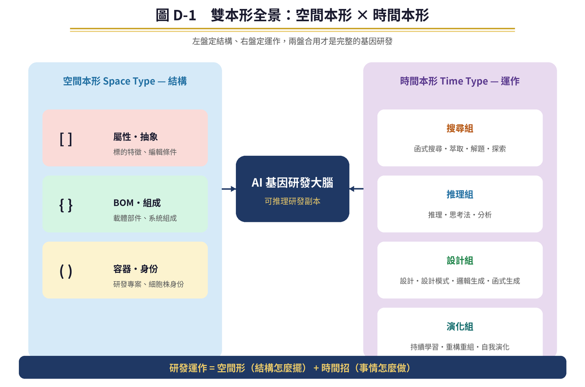

**圖 D-1　雙本形全景：空間本形定結構、時間本形定運作**

**表 D-2　三種讀法**

| 你是誰 | 建議路徑 | 預估時間 |
| --- | --- | --- |
| 主管・決策者 | 寫在前面 → 1.4 → 3.5 → 5.4 → 6.3 | 30 分鐘 |
| 研發工程師 | 導讀 → 2 → 4 → 5 全章 | 2 小時 |
| 導入推動者 | 1 → 2 → 4 → 6 | 90 分鐘 |

路徑讀法：數字指章節——主管線看決策、工程師線看產出、導入線看流程。

# 第一章　認識 AI 基因研發大腦

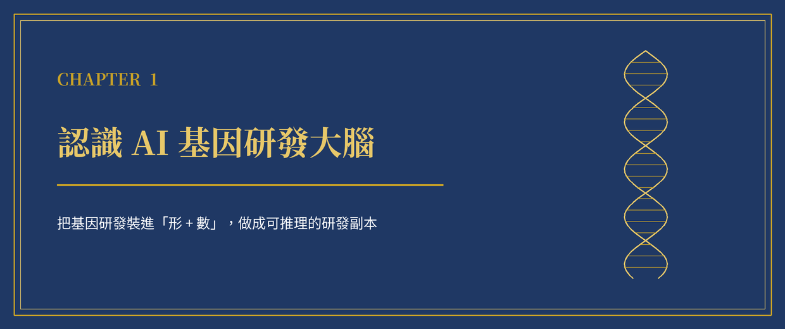

**AI 基因研發大腦不是一個聊天機器人，而是一個「可推理的研發副本」——把基因療法與基因編輯研發的知識、判準與決策，裝進形與數構成的架子裡。**

基因研發的難，不在於做不出資料，而在於資料與決策之間總是斷層：文獻在資料夾裡、參數在工程師腦中、判決在會議紀錄裡。等到要複核、要交接、要向法規單位說明時，誰也拼不回當時的推理過程。AI 基因研發大腦的解法，是把研發本身寫成形——每一份產出有欄位、每一道關卡有判準、每一個決策有據可查。

## 1.1　可推理研發副本：形＋數怎麼裝下基因研發

大腦思考 = 形 + 數。數回答「多少、多快、多準」——編輯效率 68%、脫靶率 0.3%、細胞存活 86%；形回答「是什麼、由什麼組成、怎麼變」——這條 pegRNA 屬不屬於導引形、這套遞送系統由什麼組成、這個專案換了一批細胞還是同一個專案。只用數做研發，得到一堆數字卻說不出推理；形數合一，才得到一個可以被質問、被複核、被傳承的研發副本。

這份副本的核心載體就是「形」（Type，不是 Form）。研發的每一份產出——標的卡、導引設計、載體方案、評估報告、判決書、演化帳——都是一個形：有欄位（屬性）、有判準（∩(T)）、有身份（id(C)）、有組成（BOM）。產出寫成形，AI 才有推理的骨架，人也才有驗收的標的。

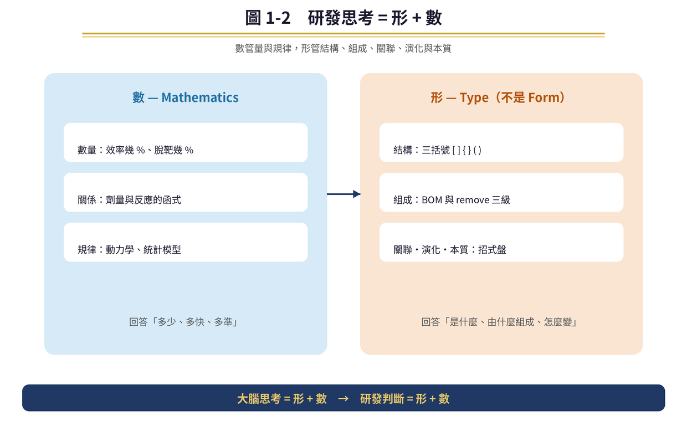

**圖 1-2　研發思考 = 形 + 數**

**研發副本 = 形（結構・組成・演化） + 數（數量・關係・規律）**

## 1.2　雙本形落點：空間三括號與時間十四招

空間本形管「結構怎麼擺」：三括號各寫一層——[ ] 寫類別規則、{ } 寫組成結構、( ) 寫身份容器。時間本形管「事情怎麼做」：時間本形就是動詞、函式、招式；研發的一舉一動，都是在十四招的招式盤上挑招、組招、換招。

**表 1-1　空間三括號落在基因研發上**

| 括號 | 本形學義 | 研發落點 | 實例 |
| --- | --- | --- | --- |
| [ ] | 屬性・抽象集合 | 標的特徵、設計條件、驗收門檻 | F(導引形)＝{ 互補靶序列, 合格 PAM, 編輯視窗覆蓋變異 } |
| { } | BOM・組成集合 | 系統組成、配方、模組清單 | BOM(LNP 載體)＝{ 脂質, mRNA, PEG 脂質, 靶向配體 } |
| ( ) | 容器・空間容器 | 專案、批次、細胞株的身份 | C = (id(C), S(C))：GX-2610 換批次細胞，id(C) 不變 |

時間本形十四招分四組：搜尋組找得到、推理組想得清、設計組做得出、演化組長得動。研發情境決定挑什麼招——設計 pegRNA 挑「設計＋生成」，效率上不來挑「重構」，假設不穩挑「第一性原理思考法」。十四招不是檢查表，是隨情境而動的招式盤。

**表 1-2　時間十四招 × 基因研發落點**

| 組 | 招式 | 研發落點 |
| --- | --- | --- |
| 搜尋組 | 形時間函式搜尋 | 在形庫裡找可複用的設計：過去的 pegRNA 參數、載體配方 |
| 搜尋組 | 設計搜尋與萃取 | 從文獻與專利萃取編輯策略與序列設計空間 |
| 搜尋組 | 解題 | 效率瓶頸、脫靶異常的排查路徑 |
| 搜尋組 | 研發與探索 | 新編輯器、新遞送路線的可行性探索 |
| 推理組 | 推理 | 因果・果因・模擬・統計・逆向：從數據推機轉、從表型推變異 |
| 推理組 | 思考法 | 正向・逆向・水準・垂直・第一性原理：策略發散與收斂 |
| 推理組 | 分析 | 序列分析、脫靶圖譜分析、SAR 式構效分析 |
| 設計組 | 設計（創造與創新） | pegRNA、載體、驗證方案的設計 |
| 設計組 | 設計模式 | 可複用的研發模式：篩選漏斗、對照組設計、劑量爬坡 |
| 設計組 | 邏輯生成與應用 | 把判準生成為可執行的驗收規則 |
| 設計組 | 函式生成與應用 | 把流程封成可重複呼叫的標準作業 |
| 演化組 | 持續學習 | 每輪實驗數據回灌形庫 |
| 演化組 | 重構與重組 | PBS/RTT 組合重排、策略重構再測 |
| 演化組 | 自我演化 | 判準門檻隨證據更新，形庫自我長大 |

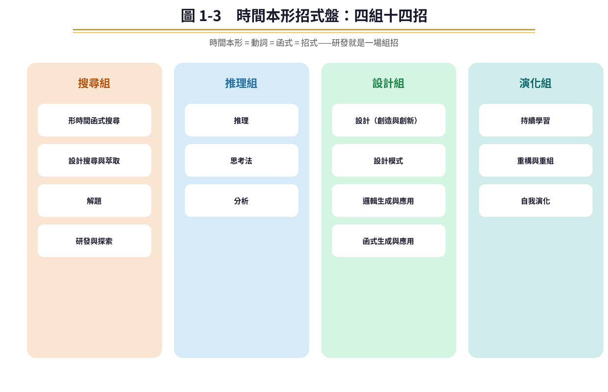

**圖 1-3　時間本形招式盤：四組十四招**

## 1.3　Mind AI 分工：LLM 歸納、Mind Model 演繹

底層平台是 Mind AI。分工一句話：LLM 負責語言能力，Mind Model 負責智慧能力。落到基因研發上——LLM 讀文獻、寫報告、召回答案（歸納統計）；Mind Model 推理、驗收、記憶、演化（演繹推理）。產出要準確，靠的不是模型更大，而是兩者各司其職、判準居中把關。

**表 1-3　Mind AI 在基因研發上的分工**

| 角色 | 擅長 | 在研發流程做的事 |
| --- | --- | --- |
| LLM（歸納統計） | 語言理解・語言生成・知識召回 | 讀文獻萃取、撰寫各形產出初稿、整理實驗紀錄 |
| Mind Model（演繹推理） | 知識統一・深度推理・長期記憶・自主學習 | 把初稿納入形骨架、跑 ∩(T) 判準、維護形證據鏈與演化帳 |
| 研發人員 | 情境判斷・價值權衡・最終簽核 | 給情境、審產出、下判決——人負責方向，形負責說清楚 |

## 1.4　準確從哪裡來：四道關卡預告

「產出準確」不是口號，是四道關卡關出來的：先立判準（∩(T) 漏斗），再演繹出骨架讓產出長在骨架上，接著用實驗資料三件套對帳，最後把每一步串成形證據鏈。四關全過才叫準確，任何一關不過就退回——退回也留痕。

**表 1-4　四道關卡預告**

| 關卡 | 一句話 | 產出什麼 | 詳細 |
| --- | --- | --- | --- |
| 第一關　判準漏斗 | 先立判準，再讓候選過關 | ∩(T) 驗收單 | 3.1 |
| 第二關　演繹骨架 | 產出長在骨架上，不長在感覺上 | 演繹骨架 | 3.2 |
| 第三關　驗證對帳 | 實驗資料回來逐項對帳 | 驗證三件套 | 3.3 |
| 第四關　留痕成鏈 | 每一步可複核、可回放 | 形證據鏈 | 3.4 |

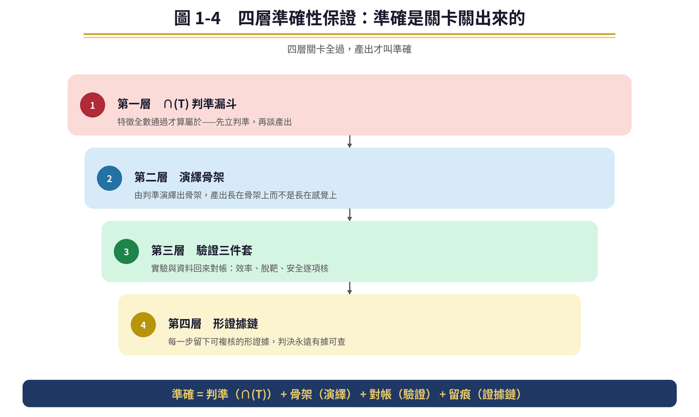

**圖 1-4　四層準確性保證**

## 1.5　產出不準的四個現場

反過來看最清楚。基因研發產出不準，幾乎都發生在四個現場：標的漂移、導引失準、脫靶漏判、判決無據。四個現場的共同根源只有一個——產出沒寫成形，層次沒寫清楚。

**表 1-5　產出不準的四個現場**

| 現場 | 症狀 | 根因 | 解法 |
| --- | --- | --- | --- |
| 標的漂移 | 靶基因、變異位點、設計目標各自表述，中途換標的無人察覺 | 標的沒有形、沒有 id(C) | 標的形 TargetType 立身份 |
| 導引失準 | 序列對了、PAM 錯了、編輯視窗沒蓋住變異位點 | 設計條件沒有寫成 ∩(T) | 導引形 GuideType 立判準 |
| 脫靶漏判 | 只報效率不報脫靶，安全評估缺整塊 | 評估欄位不完備 | 評估形 AssessType 五欄俱全 |
| 判決無據 | 進先導的決策寫在會議裡，隔季查無可查 | 無形證據鏈、無演化帳 | 判決形＋演化帳留痕 |

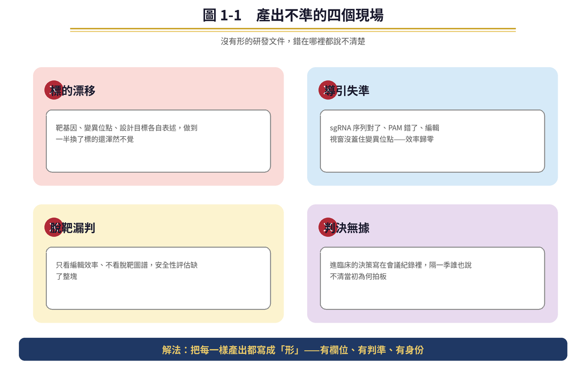

**圖 1-1　產出不準的四個現場**

> **本章重點**
>
> ◆　AI 基因研發大腦＝可推理研發副本：把研發裝進形 + 數，每一份產出有欄位、有判準、有身份。
>
> ◆　雙本形落點：空間三括號寫結構、時間十四招寫運作；Mind AI 分工＝LLM 歸納、Mind Model 演繹。
>
> ◆　準確是四道關卡關出來的：判準漏斗 → 演繹骨架 → 驗證對帳 → 留痕成鏈。

# 第二章　六種產出形「標導載評判演」

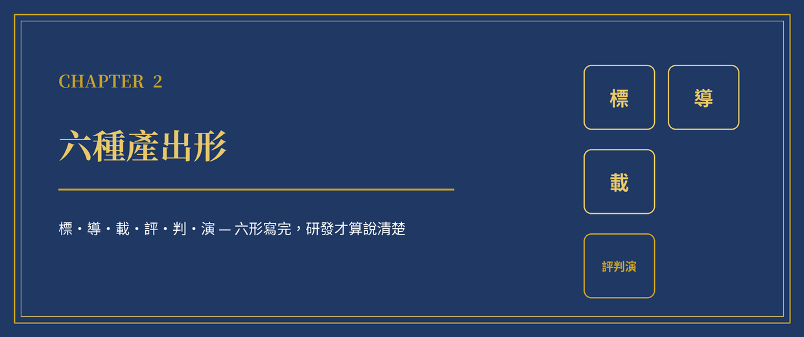

**研發要說清楚，靠的是產出；產出要說清楚，靠的是形。基因研發的產出鏈上有六種形：標的形、導引形、載體形、評估形、判決形、演化形——串記「標導載評判演」。**

## 2.1　六形總覽與產出鏈

六形不是六份文件的別名，而是六套「欄位 + 判準」的規格。標的形立靶、導引形設計、載體形遞送、評估形對帳、判決形裁決、演化形收束——一條鏈走完，一次研發才算說清楚。每個形都用同一組工具描述：[ ] 寫欄位規則、{ } 寫組成、( ) 寫身份、∩(T) 寫判準。

**表 2-1　六種產出形總覽**

| 形 | 英文 | 回答的問題 | 核心判準 |
| --- | --- | --- | --- |
| 標的形 | TargetType | 改什麼基因？治什麼病？ | 變異明確＋適應症對應 |
| 導引形 | GuideType | 用什麼序列、什麼編輯器改？ | PAM 合格＋視窗覆蓋變異 |
| 載體形 | VectorType | 怎麼送進目標細胞？ | 遞送效率＋安全性達標 |
| 評估形 | AssessType | 改得準不準、安不安全？ | 效率・脫靶・安全三件套 |
| 判決形 | VerdictType | 進先導還是淘汰？ | 四關全過＋九格填單 |
| 演化形 | EvolutionType | 下一輪怎麼更好？ | 迭代留痕＋判準更新 |

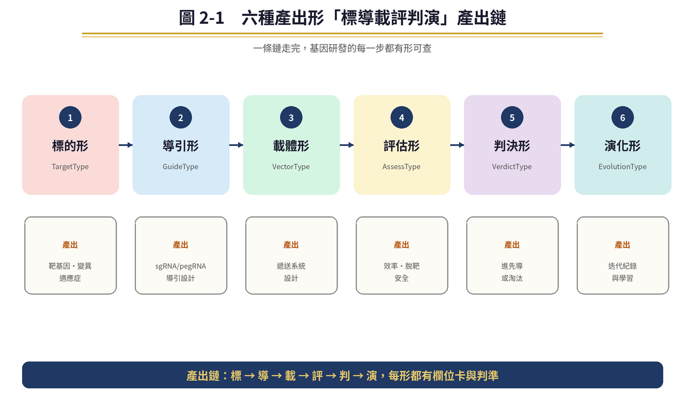

**圖 2-1　六種產出形「標導載評判演」產出鏈**

## 2.2　標的形 TargetType 與導引形 GuideType

標的形是整條鏈的錨。靶基因、變異位點、適應症、設計目標四欄寫定，id(C) 立穩，後面所有產出都掛在這個身份之下；中途要換標的？那就是開新的標的形，不是偷偷改欄位。導引形把「怎麼改」寫成可驗證的規格：互補靶序列、PAM、編輯視窗、編輯器選擇，四項特徵構成 F(GuideType)，交集判準 ∩(T) 全過才算合格導引。

**表 2-2　標的形 TargetType 欄位卡**

| 欄位 | 型別 | 判準（∩(T)） | 範例（GX-2610） |
| --- | --- | --- | --- |
| 專案身份 id(C) | 代號 | 唯一、不隨批次改變 | GX-2610 |
| 靶基因 | 基因符號 | OMIM/NCBI 有據可查 | HBB |
| 變異位點 | HGVS 表記 | c. 表記＋蛋白表記齊全 | HBB c.17A>T（p.Glu6Val） |
| 適應症 | 疾病分類 | 與變異因果關係有文獻支持 | 鐮刀型貧血症（SCD） |
| 設計目標 | 策略 | 修正/沉默/重啟三選一有據 | 直接修正點突變 |
| 可變內容 S(C) | 清單 | 明列哪些欄位可換、哪些不可動 | 批次細胞、試劑批號可動 |

**表 2-3　導引形 GuideType 欄位卡**

| 欄位 | 判準 | 檢驗方法 | 範例（PE-HBB-01） |
| --- | --- | --- | --- |
| 互補靶序列 | 與靶位點全長互補、錯配數為 0 | 比對 GRCh38 參考序列 | 20 nt 靶序列 |
| PAM | 編輯器所需的 PAM 存在且位置正確 | 序列掃描 | NGG（Cas9 nickase） |
| 編輯視窗 | 覆蓋變異位點 c.17 | 視窗位置比對 | 視窗 +4~+8 覆蓋 c.17 |
| 編輯器選擇 | 與變異類型匹配（轉換/顛換） | 策略比對表 | 先導編輯 PE3max（可修顛換） |
| PBS/RTT 參數 | 長度落在實證區間 | 文獻＋實測掃描 | PBS 13 nt／RTT 44 nt |

## 2.3　載體形 VectorType 與評估形 AssessType

載體形是 BOM 的主場：{ 載體部件 } 寫組成，remove 三級寫影響。評估形則是準確性的帳本：效率、脫靶、安全、細胞品質、表型回復五欄，每欄都要有方法、有門檻、有證據——少一欄，判決就缺一腿。

**表 2-4　載體形 VectorType 欄位卡**

| 欄位 | 判準 | 範例（GX-2610 採用） |
| --- | --- | --- |
| 遞送平台 | 與細胞類型匹配、有臨床先例 | 電穿孔（裸 RNP + mRNA + pegRNA） |
| BOM 組成 | 拆下來認得自己才進 BOM | { 電穿孔模組, Cas9 nickase mRNA, pegRNA, 緩衝液, 靶向配體(選配) } |
| remove 分級 | 每件標三級 | 靶向配體＝功能降級件（移除仍可遞送，靶向性降級） |
| 遞送效率 | 門檻：目標細胞 ≥ 70% | 82%（CD34+ 細胞，示範值） |
| 安全邊界 | 無插入突變風險、殘留可控 | 非病毒路線、無外源 DNA 整合 |

**表 2-5　評估形 AssessType 欄位卡**

| 欄位 | 方法 | 門檻 | 證據 |
| --- | --- | --- | --- |
| 編輯效率 | NGS 定序定量 | 精準修正 ≥ 40% | 定序原始檔＋分析報告 |
| 脫靶圖譜 | GUIDE-seq＋候選位點 amplicon | 各脫靶位點 < 1% | 脫靶位點清單與定量 |
| 安全評估 | 存活率・核型・大片段排查 | 存活 ≥ 80%・核型正常 | 檢驗報告簽章 |
| 細胞品質 | 分化能力・集落形成 | CFU 達標 | 集落計數紀錄 |
| 表型回復 | 紅系分化培養・Hb 表型 | HbS 顯著下降 | HPLC 電泳圖譜 |

## 2.4　判決形 VerdictType 與演化形 EvolutionType

判決形把「進先導還是淘汰」寫成可複核的裁決書：裁決、依據、條件、簽核四欄齊備——依據必須指回四關與九格，條件必須可驗收。演化形則是研發的記憶：每一輪學到什麼、重構什麼、探索什麼、判準怎麼更新，全部記進演化帳，下一輪從帳上接著長。

**表 2-6　判決形 VerdictType 欄位卡**

| 欄位 | 內容要求 | 常見誤用 |
| --- | --- | --- |
| 裁決 | 進先導／淘汰／補件，三選一 | 寫「原則同意」這種不可驗收的字眼 |
| 依據 | 指回 ∩(T) 四關結果與九格填單 | 只引會議結論、不引數據 |
| 條件 | 附條件可驗收、有期限、有負責人 | 條件寫成願望（如「盡快補齊」） |
| 簽核 | 研發・品保・生技安全三方會簽 | 單人簽核、無第二人複核 |

**表 2-7　演化形 EvolutionType 欄位卡**

| 欄位 | 內容要求 | 與招式對應 |
| --- | --- | --- |
| 學習 Learning | 本輪數據與文獻收進形庫 | 持續學習 |
| 重構 Restructure | 哪些組合重排再測 | 重構與重組 |
| 探索 Explore | 平行驗證的替代路線 | 研發與探索 |
| 演化 Evolve | 判準門檻與形定義的更新 | 自我演化 |
| 版本 | 形庫版本號＋變更摘要 | 留痕：誰改、為何改 |

## 2.5　三括號與 remove 三級的研發用法

三括號用錯，層次就亂：[ ] 是「該符合什麼」——寫規則；{ } 是「由什麼組成」——寫結構；( ) 是「身份在哪」——寫容器。談部件影響時先過 remove 三級：移除後同一性喪失是必要件，功能缺而身份存是功能降級件，移除後無感是非必要件。三級各安其位，BOM 才算寫完。

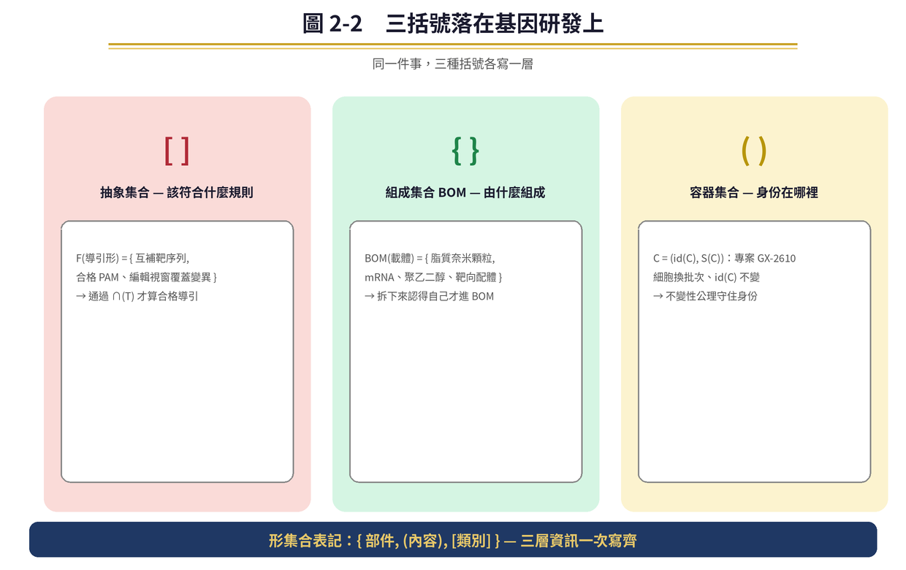

**圖 2-2　三括號落在基因研發上**

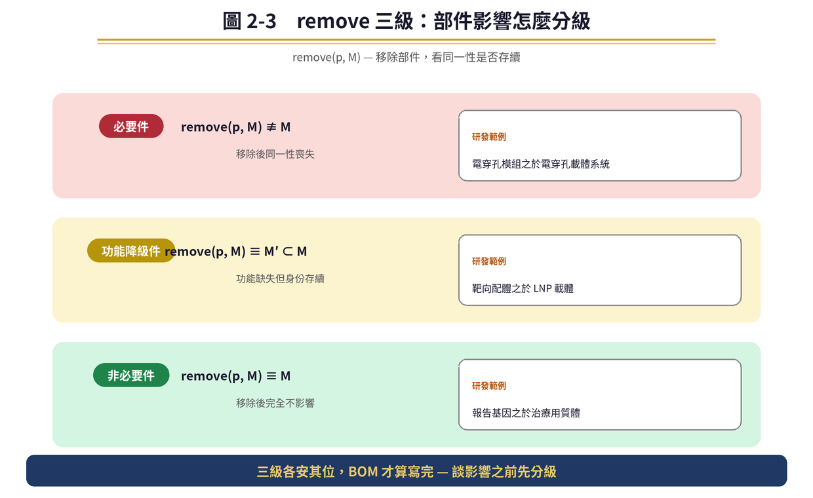

**圖 2-3　remove 三級：部件影響怎麼分級**

**表 2-8　BOM 判準與 remove 三級寫法速查**

| 判準 | 寫法 | 研發範例 |
| --- | --- | --- |
| BOM 判準 | 拆下來認得自己 → 進 BOM；拆下來就消失 → 進屬性 | 電穿孔模組進 BOM；「無菌」是條件不是部件 |
| 必要件 | remove(p, M) ≢ M | Cas9 nickase mRNA 之於編輯複合體 |
| 功能降級件 | remove(p, M) ≡ M′ ⊂ M | 靶向配體之於 LNP 載體 |
| 非必要件 | remove(p, M) ≡ M | 報告基因之於治療用構型 |

> **本章重點**
>
> ◆　六形「標導載評判演」各有欄位卡與判準；一條產出鏈走完，一次研發才算說清楚。
>
> ◆　標的形立身份、導引形立規格、載體形立組成、評估形立帳本、判決形立裁決、演化形立記憶。
>
> ◆　三括號各安其位（[ ] 規則、{ } 組成、( ) 身份），remove 三級分清部件影響。

# 第三章　四層準確性保證

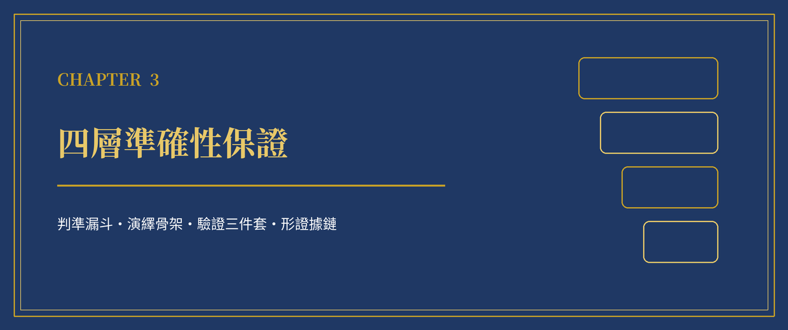

**準確不是態度，是結構。四層準確性保證——判準漏斗、演繹骨架、驗證三件套、形證據鏈——把「產出要準」翻譯成四道可操作、可驗收的關卡。**

## 3.1　第一層：∩(T) 判準漏斗

先立判準，再談產出。每一個形都先寫出它的必要特徵集合 F(T)，交集判準 ∩(T) 全數通過才算是。落到操作上就是漏斗：候選一批進來，一關一關濾下去，每一關都有判準、有數據、有處置——過關的往前，不過關的退回並留痕。漏斗的價值在於可重複：同樣的判準，換一個人跑，結果一樣。

**表 3-1　∩(T) 四關漏斗**

| 關卡 | 判準 | 證據 | 不過關的處置 |
| --- | --- | --- | --- |
| 第一關　特徵齊備 | F(T) 各欄位完備且可檢驗 | 欄位卡逐欄勾稽 | 退回補欄位 |
| 第二關　判準可測 | 每項判準有量測方法與門檻 | 方法文獻＋門檻依據 | 退回重立判準 |
| 第三關　數據對帳 | 實測數據逐項過門檻 | 原始數據＋分析報告 | 退回重設計或淘汰 |
| 第四關　鏈上留痕 | 前三關證據已入鏈 | 形證據鏈節點 | 補鏈後才准送判決 |

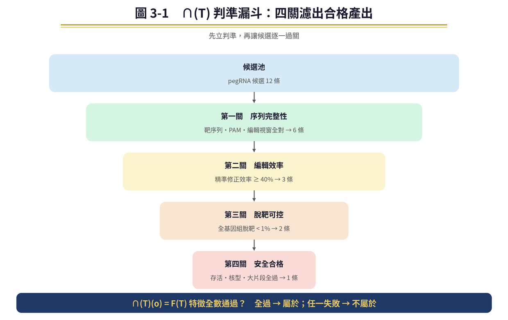

**圖 3-1　∩(T) 判準漏斗：四關濾出合格產出**

## 3.2　第二層：演繹骨架

通過判準的產出，還得長在骨架上。演繹骨架是「因→機→證→法→驗」的推理鏈：從病因與變異出發，推到致病機轉，定出證據要求，選擇編輯策略，最後設計驗證——一節扣一節，不許跳節。時間態則寫成 S(t+1) = g( S(t), 招式, 事件 )：每一次推進都由招式驅動，狀態改變留痕。

**表 3-2　演繹骨架（因機證法驗）**

| 節點 | 演繹內容 | GX-2610 示範 |
| --- | --- | --- |
| 因 | 病因與變異是什麼 | HBB c.17A>T 使 β-珠蛋白第 6 密碼子 GAG→GTG，聚合形成鐮刀狀紅血球 |
| 機 | 致病機轉怎麼走 | 脫氧態 HbS 聚合 → 紅血球變形 → 血管阻塞與溶血 |
| 證 | 要什麼證據才算數 | 精準修正率、HbS 表型下降、脫靶與安全三件套 |
| 法 | 選什麼策略達成 | 先導編輯直接修正顛換（鹼基編輯僅做轉換，不適用） |
| 驗 | 怎麼驗證策略成立 | 體外紅系分化培養＋HPLC Hb 表型＋GUIDE-seq 脫靶 |

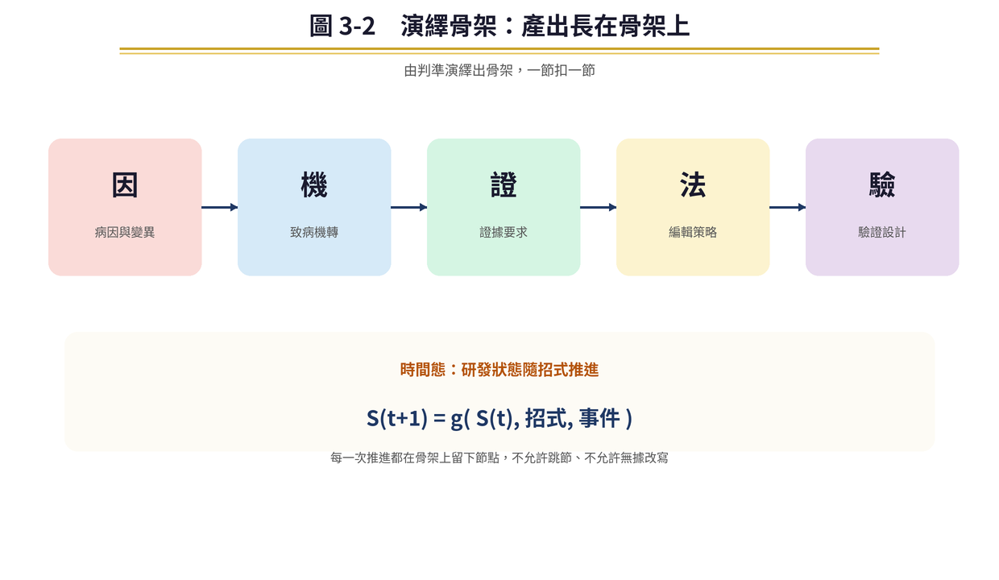

**圖 3-2　演繹骨架：產出長在骨架上**

## 3.3　第三層：驗證三件套

實驗不是流程的終點，是判準的對帳點。驗證三件套——體外效率、脫靶分析、安全評估——每一件都有方法、有門檻、有證據、有處置。三件套全過，形證據鏈才接得上；一件缺，鏈就斷，判決就沒有資格簽名。

**表 3-3　驗證三件套**

| 件 | 方法 | 門檻 | 對帳結果與處置 |
| --- | --- | --- | --- |
| 體外效率 | NGS 定序定量精準修正率與 indel | 修正 ≥ 40%・indel < 5% | 過：進下一關；不過：退回重設計 |
| 脫靶分析 | GUIDE-seq 全基因組＋候選位點 amplicon | 各脫靶位點 < 1% | 過：進下一關；不過：換導引或淘汰 |
| 安全評估 | 存活率・核型分析・大片段缺失排查 | 存活 ≥ 80%・核型正常 | 過：送判決；不過：補件或淘汰 |

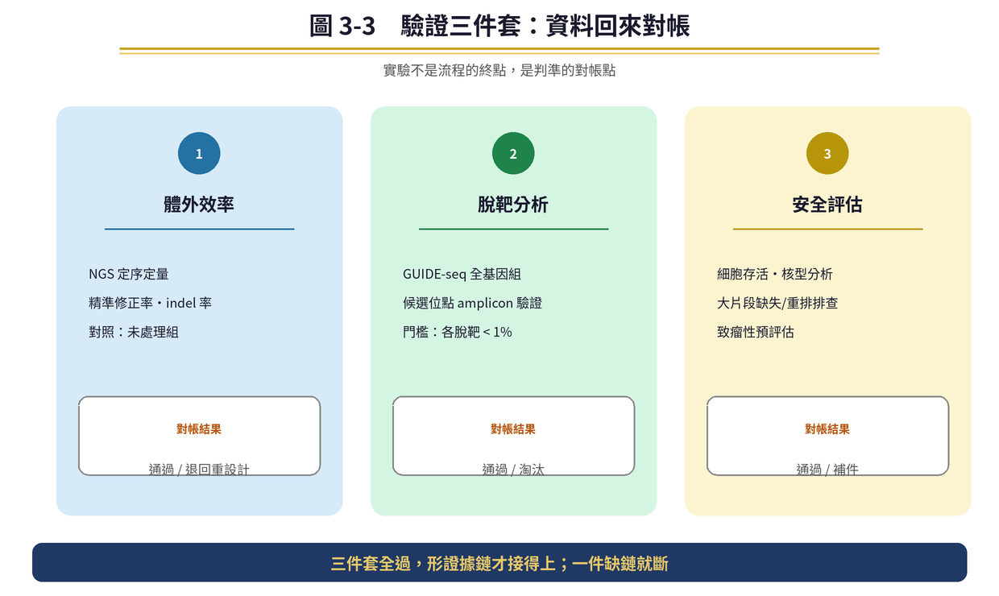

**圖 3-3　驗證三件套：資料回來對帳**

## 3.4　第四層：形證據鏈

判決不怕被問，只怕沒鏈。形證據鏈把一次研發串成六站：需求卡、形初稿、產出件、驗收單、判決書、演化帳——每站回答同樣三問：判準是什麼？通過了沒有？證據放在哪裡？任何一站斷鏈，下游產出一律退回；退回不是重做結論，是重接證據。

**表 3-4　形證據鏈六站**

| 站 | 產出 | 判準 | 證據 |
| --- | --- | --- | --- |
| 1 | 需求卡（S1） | 框架四步驟跑完、維度命名完成 | 情境描述＋維度清單 |
| 2 | 形初稿（S2） | 六形欄位開出、id(C) 立穩 | 欄位卡草稿 |
| 3 | 產出件（S4） | 各形欄位填滿且自檢通過 | 六形產出件 |
| 4 | 驗收單（S5） | ∩(T) 四關逐關勾稽 | 四關數據對帳表 |
| 5 | 判決書（S6） | 九格填單＋三方會簽 | 簽核紀錄 |
| 6 | 演化帳（S7） | 學習・重構・探索・演化四欄記齊 | 版本變更摘要 |

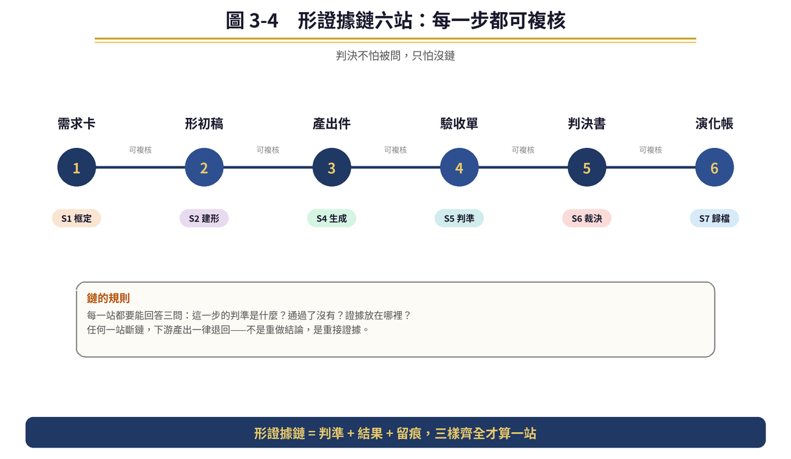

**圖 3-4　形證據鏈六站：每一步都可複核**

## 3.5　交叉驗收：空間 × 時間九格

最後一關是交叉驗收：把空間三括號（屬性、組成、容器）與時間三相（設計期、驗證期、決策期）鋪成九格，每格一問、每問填單。九格全數填單通過，判決書才有資格簽名——橫看是結構有沒有寫齊，直看是運作有沒有做實。

**表 3-5　交叉驗收九格**

|  | [ ] 屬性層 | { } 組成層 | ( ) 容器層 |
| --- | --- | --- | --- |
| 設計期 | 特徵寫齊了嗎？ | 部件列齊了嗎？ | 身份立穩了嗎？ |
| 驗證期 | 逐項測過了嗎？ | 逐件拆過了嗎？ | 換過內容 id 不變嗎？ |
| 決策期 | 判準全過了嗎？ | 影響分級了嗎？ | 判決留痕了嗎？ |

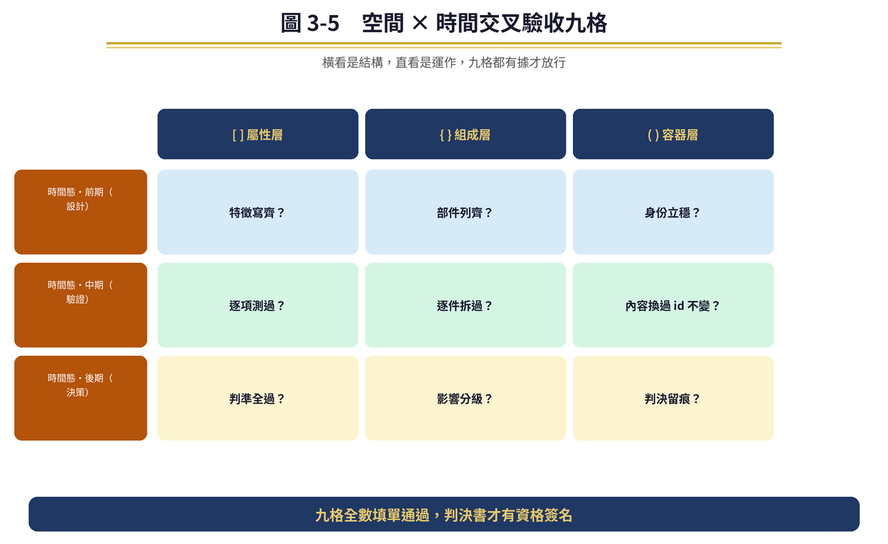

**圖 3-5　空間 × 時間交叉驗收九格**

> **本章重點**
>
> ◆　四層準確性：∩(T) 判準漏斗 → 演繹骨架（因機證法驗）→ 驗證三件套 → 形證據鏈六站。
>
> ◆　實驗是判準的對帳點：三件套全過才接鏈，一件缺鏈就斷。
>
> ◆　交叉驗收九格：空間三括號 × 時間三相，全數填單才准簽判決。

# 第四章　六步驟：從研發需求到產出

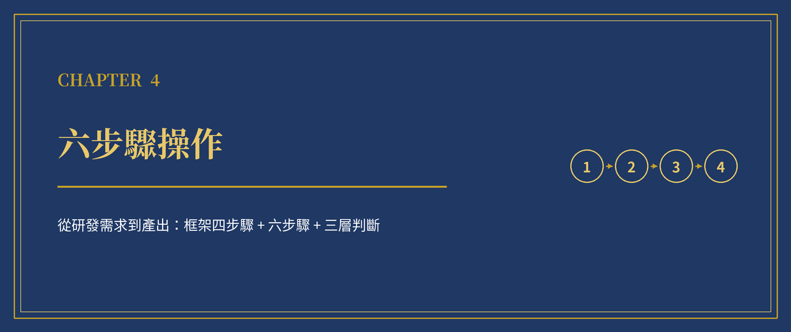

**知道了「形長什麼樣」與「準確怎麼保」，這一章把兩者串成可操作的流程：框架四步驟認明需求、六步驟走完全程、三層判斷現場把關、招式盤隨情境換招。**

## 4.1　框架四步驟：認明研發需求

研發需求不是收到就懂的，是被「對照失敗」逼出來的。框架四步驟——分辨異同、觸發抽象、命名維度、判斷歸屬——把這段推導固化成可重複的機制：先分辨「這個不是那個」，當新差異與舊維度對不上時觸發抽象，為維度命名立軸，最後把每項需求判斷歸屬。對得上就加刻度，對不上就開新軸——需求卡在這個循環裡長成形。

**表 4-1　框架四步驟 × 研發需求整理**

| 步驟 | 操作 | 研發範例 |
| --- | --- | --- |
| 壹・分辨異同 | 列出需求中的標的、疾病、約束，先分辨「這個不是那個」 | 「修正 HBB 點突變」不是「重啟 HbF」——兩條路線先分開 |
| 貳・觸發抽象 | 新差異對不上舊維度時，承認需要新維度 | 「可遺傳性」對不上任何設計維度 → 要開一軸 |
| 參・命名維度 | 為維度取名立軸：靶點、遞送、效率、安全、法規 | 立「法規」軸：生殖細胞禁用、體細胞走 IND |
| 肆・判斷歸屬 | 每項需求歸入維度；對不上就再開一軸 | 「長期追蹤」歸入法規軸，不混進安全軸 |

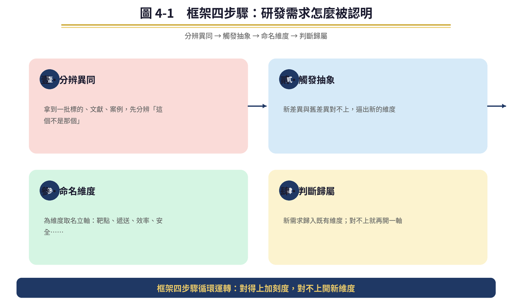

**圖 4-1　框架四步驟：研發需求怎麼被認明**

## 4.2　六步驟操作卡

需求認明之後，六步驟接力：認明情境、分軸建形、挑選擴式、生成產出、判準驗收、歸檔演化。每一步都有輸入與輸出——上一步的輸出就是下一步的輸入；任何一步可以退回，但退回要在演化帳留記錄，不許無痕回改。

**表 4-2　六步驟操作卡**

| 步驟 | 操作 | 產出 | 常用招式 |
| --- | --- | --- | --- |
| 1 認明情境 | 框架四步驟整理需求 | 需求卡 | 解題・分析 |
| 2 分軸建形 | 三括號開六形初稿 | 形初稿 | 設計模式 |
| 3 挑選擴式 | 招式盤挑招＋寫理由 | 招式選擇單 | 思考法 |
| 4 生成產出 | 逐形填欄位、生成產出件 | 六形產出件 | 設計・函式生成 |
| 5 判準驗收 | ∩(T) 四關＋九格填單 | 驗收單 | 推理・分析 |
| 6 歸檔演化 | 入鏈、記帳、更新形庫 | 演化帳 | 持續學習・自我演化 |

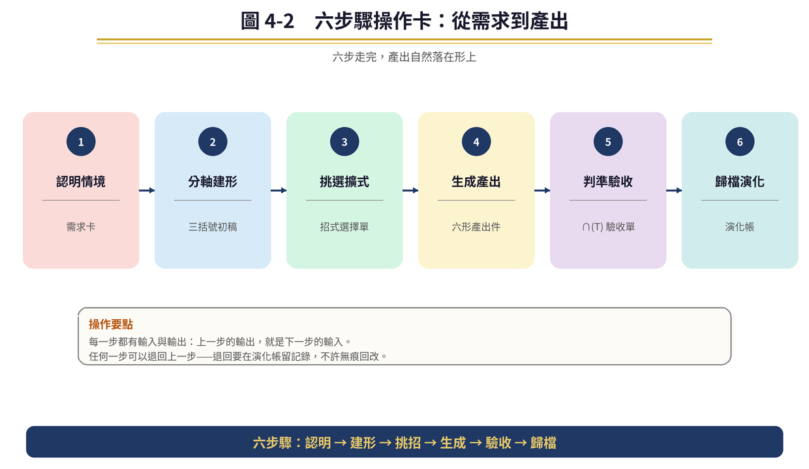

**圖 4-2　六步驟操作卡**

## 4.3　三層判斷：是・有・對

流程之中隨時停下來做三層判斷：是——身份對嗎？容器判斷問「身份獨立於內容物嗎」；有——結構全嗎？組成判斷用 remove 三級分清影響；對——規則過嗎？抽象判斷跑 ∩(T) 當場驗證。三層全過才下結論；一層不過，結論就不是結論，是猜測。

**表 4-3　三層判斷速查**

| 層 | 問句 | 判準 | 現場例句 |
| --- | --- | --- | --- |
| 是 | 身份獨立於內容物嗎？ | C = (id(C), S(C))、不變性公理 | 換一批 CD34+ 細胞，GX-2610 還是 GX-2610？ |
| 有 | 部件齊全、分級清楚嗎？ | BOM 判準＋remove 三級 | 靶向配體標成降級件了嗎？ |
| 對 | 通過 ∩(T) 了嗎？ | F(T) 逐項檢驗 | 這條 pegRNA 通過導引形全部特徵嗎？ |

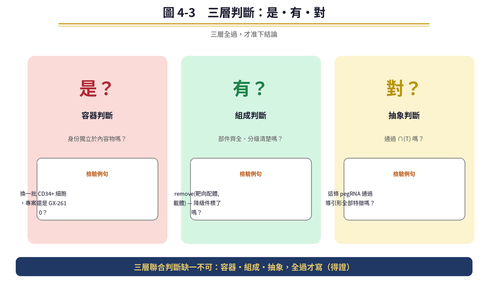

**圖 4-3　三層判斷：是・有・對**

## 4.4　挑招・組招・換招

十四招是招式盤，不是檢查表。依情境挑招：設計 pegRNA 挑「設計＋生成」、查文獻挑「搜尋＋萃取」、評估風險挑「分析＋推理」。多招組成流水線：前一招的輸出是後一招的輸入，組合寫進 S1–S7 段落。卡住就換招：效率上不來換「重構」、假設不穩換「第一性原理思考法」——換招理由與結果都要留痕在演化帳。

**表 4-4　挑招・組招・換招情境表**

| 動作 | 情境 | 招式組合 | 留痕 |
| --- | --- | --- | --- |
| 挑招 | 設計 pegRNA 與編輯器選型 | 設計＋邏輯生成 | 招式選擇單寫挑選理由 |
| 挑招 | 文獻與專利調研 | 搜尋＋萃取＋分析 | 來源清單入形庫 |
| 組招 | 一條完整的研發輪 | 搜尋→分析→設計→驗證→學習 | S1–S7 段落內嵌 |
| 換招 | 效率瓶頸突破不了 | 解題→重構與重組 | 演化帳記換招原因 |
| 換招 | 策略假設動搖 | 思考法（第一性原理） | 演化帳記新假設 |

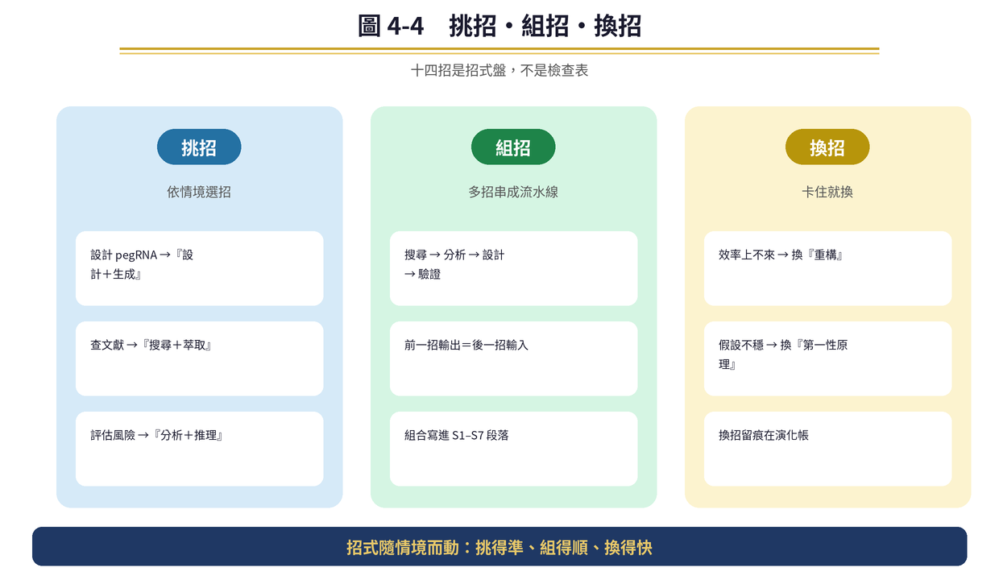

**圖 4-4　挑招・組招・換招**

## 4.5　誤用預警點

流程跑得動，還要避開暗礁。六步驟的每一站都有常見的誤用訊號——看到訊號就地處置，比事後補救省十倍力氣。

**表 4-5　操作誤用預警點**

| 步驟 | 預警訊號 | 立即處置 |
| --- | --- | --- |
| 認明情境 | 需求文件裡「這個不是那個」說不出三句 | 退回框架四步驟，先分辨異同 |
| 分軸建形 | 欄位卡開始寫散文、欄位越來越少 | 停筆回欄位卡，逐欄勾稽 |
| 挑選擴式 | 招式選擇單空白或照抄上次 | 重挑招並寫理由；理由寫不出＝挑錯 |
| 生成產出 | 產出互相引用對方的結論 | 拉回骨架：因機證法驗逐節檢查 |
| 判準驗收 | 門檻在數據出來之後才定 | 判準作廢重立；數據先鎖再驗 |
| 歸檔演化 | 演化帳連續兩輪空白 | 補記後才准開下一輪 |

> **本章重點**
>
> ◆　框架四步驟（分辨異同→觸發抽象→命名維度→判斷歸屬）認明需求，六步驟走完全程。
>
> ◆　三層判斷是・有・對隨時停檢：身份、結構、規則三層全過才下結論。
>
> ◆　招式隨情境而動：挑得準、組得順、換得快；誤用預警點就地處置，全部留痕。

# 第五章　S1–S7 全程案例：GX-2610

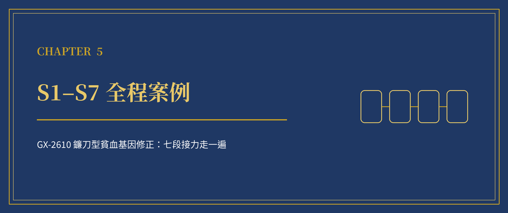

**這一章把前四章全部接起來：以貫穿案例 GX-2610（鐮刀型貧血症 HBB 基因修正）走一遍 S1–S7 七段接力，從需求卡一路走到演化帳——所有數值均為示範數據，示範的是產出格式與判準運作。**

## 5.1　七段接力：S1–S7 流水線

七段提示詞接力是本書的標準用法：S1 情境框定、S2 分軸建形、S3 挑選擴式、S4 生成產出、S5 判準驗收、S6 交叉裁決、S7 歸檔演化。每一段的輸出是下一段的輸入，段與段之間交棒要帶上形證據；任何一段失敗就地退回上一段，不許跨段跳接。

**表 5-1　七段接力總覽**

| 段 | 任務 | 輸入 | 輸出 |
| --- | --- | --- | --- |
| S1 | 情境框定 | 研發需求、文獻、約束 | 需求卡 |
| S2 | 分軸建形 | 需求卡 | 六形初稿（欄位卡） |
| S3 | 挑選擴式 | 六形初稿 | 招式選擇單 |
| S4 | 生成產出 | 招式選擇單 | 六形產出件 |
| S5 | 判準驗收 | 產出件＋實測數據 | 四關驗收單 |
| S6 | 交叉裁決 | 驗收單＋九格填單 | 判決書 |
| S7 | 歸檔演化 | 判決書＋全鏈 | 演化帳＋形庫版本 |

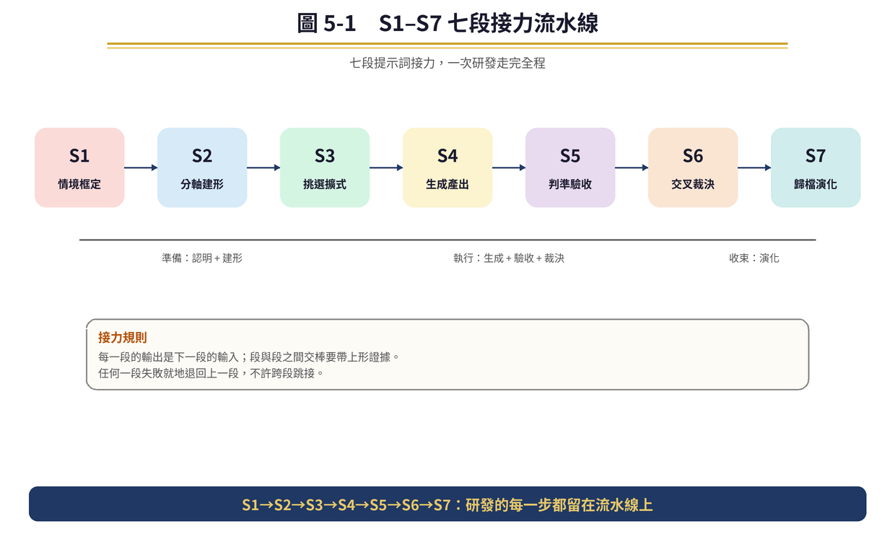

**圖 5-1　七段接力流水線**

## 5.2　S1–S7 提示詞全文

以下七段提示詞可直接貼入 Mind AI 平台使用；【】內是段名，「輸出格式」欄是驗收該段的依據——輸出不符合格式，就退回重跑，不要將就。

> **【S1 情境框定】輸出：需求卡**
>
> 你是 AI 基因研發大腦的研發企劃。請用框架四步驟整理本次研發情境，並輸出需求卡：
>
> （壹）分辨異同：列出標的、疾病、約束，寫出至少三句「這個不是那個」；
>
> （貳）觸發抽象：指認無法用現有維度解釋的新差異；
>
> （參）命名維度：為新維度命名（靶點／遞送／效率／安全／法規……）；
>
> （肆）判斷歸屬：把每項需求歸入維度，對不上就開新軸。
>
> 輸出格式：需求卡＝id(C) 專案代號＋S(C) 可變內容清單＋維度總表＋未決問題清單。

> **【S2 分軸建形】輸出：六形初稿**
>
> 接續需求卡。用空間三括號建六形初稿：
>
> [ ] 為每形寫必要特徵集合 F(T) 與交集判準 ∩(T)；
>
> { } 寫各系統的 BOM，逐件通過「拆下來認得自己」檢核；
>
> ( ) 寫容器 C = (id(C), S(C))，聲明不變性公理。
>
> 輸出格式：六形欄位卡初稿（標的形、導引形、載體形、評估形、判決形、演化形），每形一張卡，欄位留值可標「待驗」。

> **【S3 挑選擴式】輸出：招式選擇單**
>
> 接續六形初稿。從時間本形十四招招式盤挑選本次研發要的招式：
>
> 列出挑中的招式、組合順序（前招輸出＝後招輸入）、每招的挑選理由；
>
> 若情境改變要換招，寫明換招條件與替代招式。
>
> 輸出格式：招式選擇單（招式／用途／輸入／輸出／換招條件）。

> **【S4 生成產出】輸出：六形產出件**
>
> 接續招式選擇單。依序生成六形產出件：標的卡→導引卡→載體卡→評估單→判決書草稿→演化帳開卷。
>
> 要求：每件填滿欄位卡所有欄位；數值一律標示來源（實測／文獻／預測）；
>
> 未定數值標「待驗」不得留空；每件結尾附自檢行：F(T) 各項是否可檢驗。

> **【S5 判準驗收】輸出：四關驗收單**
>
> 接續產出件。執行 ∩(T) 四關漏斗驗收：
>
> 第一關特徵齊備｜第二關判準可測｜第三關數據對帳｜第四關鏈上留痕。
>
> 每關輸出「通過／退回」與證據指標；退回者寫退回原因與處置（補件／重設計／淘汰）。
>
> 輸出格式：四關驗收單（關卡／判準／數據／結果／證據位置）。

> **【S6 交叉裁決】輸出：判決書**
>
> 接續驗收單。執行空間 × 時間九格交叉驗收（[ ] { } ( ) × 設計／驗證／決策三相），逐格填單。
>
> 全數通過後輸出判決書：裁決（進先導／淘汰／補件三選一）、依據（引四關與九格結果）、
>
> 條件（可驗收、有期限、有負責人）、簽核欄（研發・品保・生技安全三方）。
>
> 任一格未過：退回相應步驟，不得直接下判決。

> **【S7 歸檔演化】輸出：演化帳**
>
> 接續判決書。輸出演化帳開卷：
>
> 學習（本輪數據與文獻收進形庫）｜重構（哪些組合重排）｜探索（替代路線）｜演化（判準門檻更新建議）。
>
> 為形庫寫版本號與變更摘要（誰改、為何改）。
>
> 輸出格式：演化帳四欄＋版本註記。下一輪從 S1 重啟，需求卡須引用演化帳。

## 5.3　案例開場：標的卡與導引設計

GX-2610 的情境：一位鐮刀型貧血症患者的自體 CD34+ 造血幹細胞，目標是直接修正 HBB 基因的致病點突變。S1 需求卡立了「法規」軸（生殖細胞禁用、體細胞走 IND 路線），S2 開出六形欄位卡，S3 挑定「搜尋＋分析＋設計＋驗證＋學習」的組合。以下示範 S4 產出件的實際欄位填寫。

**表 5-2　標的卡 TargetType（GX-2610 示範）**

| 欄位 | 值 | 判準檢查 |
| --- | --- | --- |
| id(C) | GX-2610 | 唯一、不隨批次改變 ✓ |
| 靶基因 | HBB（β-珠蛋白基因） | OMIM 603903 有據 ✓ |
| 變異位點 | HBB c.17A>T（p.Glu6Val, rs334） | HGVS 表記齊全 ✓ |
| 適應症 | 鐮刀型貧血症（SCD） | 變異因果文獻充分 ✓ |
| 設計目標 | 直接修正點突變（GTG→GAG） | 修正策略三選一有據 ✓ |
| S(C) 可變內容 | 批次細胞、試劑批號、培養條件 | 可動欄位明列 ✓ |

策略選擇先過一次「挑招」：鹼基編輯只做轉換（C↔T、A↔G），修正不了這個顛換（A↔T）；HDR 需要雙股斷裂且幹細胞效率低；先導編輯可安裝任意點突變——選 PE3max 為主線，另以「BCL11A 增強子破壞重啟胎兒血紅蛋白」為平行對照路線。這段推理寫在招式選擇單上，就是演繹骨架的「法」節點。

**表 5-3　導引卡 GuideType（pegRNA 候選，示範）**

| 代號 | PBS/RTT | nick 位點 | 精準修正 | indel | 去留 |
| --- | --- | --- | --- | --- | --- |
| PE-HBB-01 | 13 nt / 44 nt | +3 | 68% | 2.1% | 進評估 |
| PE-HBB-02 | 15 nt / 40 nt | +6 | 52% | 1.6% | 進評估 |
| PE-HBB-03 | 10 nt / 47 nt | −2 | 41% | 2.8% | 進評估 |
| PE-HBB-04 | 13 nt / 50 nt | +9 | 23% | 3.4% | 效率關退回 |

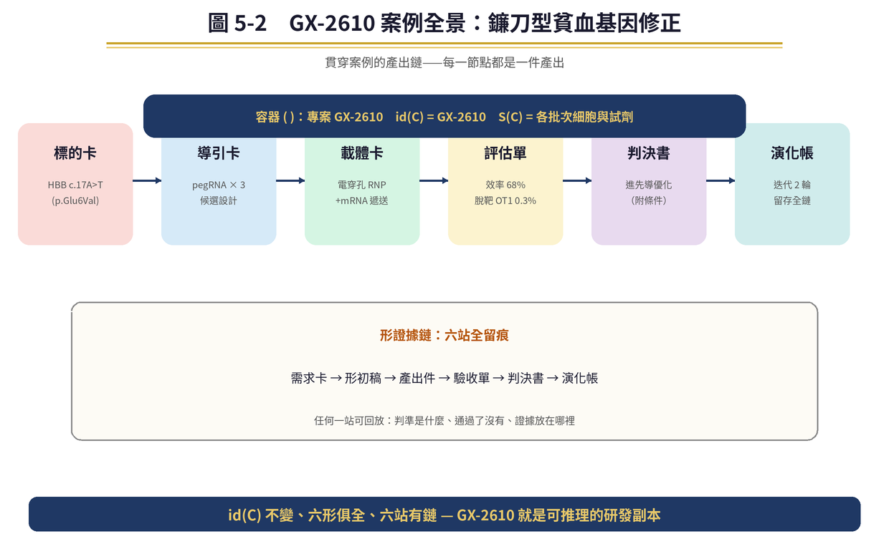

**圖 5-2　GX-2610 案例全景**

## 5.4　全程產出：載體、評估與判決

載體卡比較兩條遞送路線：電穿孔（非病毒）與 AAV6 供體模板。判定依據寫在欄位卡上——電穿孔遞送效率 82%、無外源 DNA 整合風險、HSC 臨床先例充分，選為主路線；靶向配體標記為功能降級件（remove 後仍可遞送、靶向性降級）。評估單則把三件套數據逐項入帳。

**表 5-4　載體卡 VectorType：路線比較（示範）**

| 欄位 | 電穿孔（採用） | AAV6 供體模板（對照） |
| --- | --- | --- |
| 遞送形式 | 裸 RNP + Cas9 nickase mRNA + pegRNA | AAV6 病毒載體攜帶供體模板 |
| 遞送效率 | 82%（CD34+，示範值） | 65–75%（文獻值） |
| 安全邊界 | 無外源 DNA 整合、殘留可控 | 殘留 DNA 需檢測、生產成本高 |
| BOM | { 電穿孔模組, nickase mRNA, pegRNA, 緩衝液, 靶向配體(選配) } | { AAV6 顆粒, 供體模板, 輔助質粒 } |
| remove 分級 | 靶向配體＝功能降級件 | 供體模板＝必要件 |

**表 5-5　評估單 AssessType：四關對帳（示範）**

| 關卡 | 判準 | 實測數據 | 結果 |
| --- | --- | --- | --- |
| 第一關　序列完整性 | pegRNA 體外活性全對 | 01/02/03 通過 | 通過 |
| 第二關　編輯效率 | 精準修正 ≥ 40% | 01：68%｜02：52%｜03：41% | 3 條過關 |
| 第三關　脫靶可控 | 各脫靶位點 < 1% | 01：OT1 0.3%、OT2 0.1%｜02：OT2 1.8% | 01/03 過關 |
| 第四關　安全合格 | 存活 ≥ 80%・核型正常 | 01：存活 86%、核型正常、大片段未檢出 | 01 出線 |
| 表型回復（紅系分化） | HbS 顯著下降 | HbS 41%→6%、HbA 0→76%、HbF 18% | 通過 |

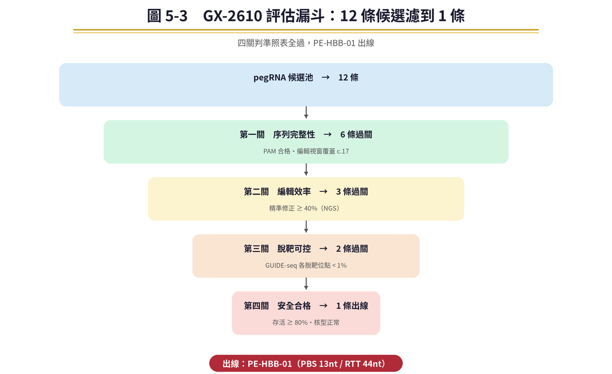

**圖 5-3　評估漏斗：12 條候選濾到 1 條**

六格九窗填完、四關全過，判決書進場。注意判決書的「條件」欄：附條件通過不是打折，是把下一輪的驗收標準先寫好。

**表 5-6　判決書 VerdictType（示範）**

| 欄位 | 內容 |
| --- | --- |
| 裁決 | 進先導優化（附條件通過） |
| 依據 | ∩(T) 四關全過（PE-HBB-01）；九格交叉驗收全數填單；形證據鏈六站無斷鏈 |
| 條件 | ① 體外脫靶補齊體內評估（期限 60 天，負責人：研發組）② 大型動物模型驗證排程 ③ 長期追蹤設計納入臨床方案 |
| 簽核 | 研發主管｜品保主管｜生技安全（三方會簽） |

> **免責聲明：表 5-2 至表 5-6 之序列參數、效率與脫靶數值均為示範數據，不構成醫療建議，**
>
> 亦非真實臨床試驗設計依據；真實基因編輯療法研發須依所在地法規與倫理審查進行。

## 5.5　演化帳與使用守則

判決之後，演化帳接手。GX-2610 在本示範中跑了兩輪迭代：第一輪用 PBS/RTT 長度掃描收斂參數，第二輪優化電穿孔條件把效率從 52% 推到 68%；每輪的學習、重構、探索、演化四欄都記在帳上，判準門檻也隨證據更新——這就是「自我演化」在研發現場的具體長相。

**表 5-7　演化帳 EvolutionType（兩輪迭代，示範）**

| 輪次 | 學習 | 重構 | 探索 | 演化（判準更新） |
| --- | --- | --- | --- | --- |
| 第 1 輪 | PBS 10–15 nt × RTT 40–50 nt 掃描：13/44 組合最優 | pegRNA 參數空間重排 | PE3max 對照 PE2 | 效率門檻由 30% 上修為 40% |
| 第 2 輪 | 電穿孔電壓與脈衝數影響存活與效率 | 電穿孔條件重構再測 | HbF 路線平行觀測 | 安全關新增「大片段缺失排查」必填 |

**表 5-8　提示詞使用守則**

| # | 守則 | 理由 |
| --- | --- | --- |
| 1 | 先立形再動手：欄位卡開完才生成內容 | 無形的產出無法驗收 |
| 2 | 判準先行：門檻在數據出來之前就寫死 | 後設門檻＝自欺欺人 |
| 3 | 每產出留鏈：證據位置寫進驗收單 | 斷鏈的結論不可複核 |
| 4 | 換招留痕：換招原因寫進演化帳 | 無痕換招＝無據決策 |
| 5 | 紅線即判準：合規條款進 ∩(T) | 過不了紅線就過不了關 |
| 6 | 示範數據標明：實測／文獻／預測三分清楚 | 混用來源＝數字失去意義 |

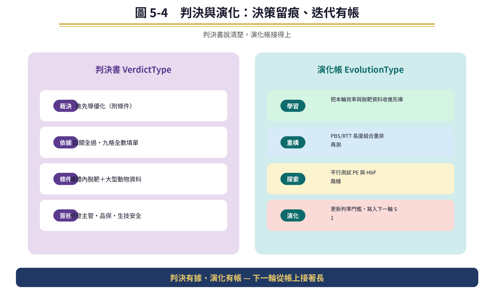

**圖 5-4　判決與演化：決策留痕、迭代有帳**

> **本章重點**
>
> ◆　七段接力 S1–S7：情境框定→分軸建形→挑選擴式→生成產出→判準驗收→交叉裁決→歸檔演化。
>
> ◆　GX-2610 全程示範：標的卡、導引卡、載體卡、評估單、判決書、演化帳六形俱全、四關全過。
>
> ◆　使用守則六條：先立形、判準先行、留鏈、留痕、紅線即判準、示範數據標明。

# 第六章　誤用對照與成熟度

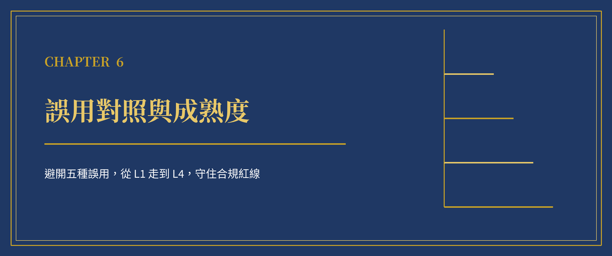

**最後一章收束：五種誤用先避開、十問清單隨身查、成熟度 L1–L4 定位自己、九十天藍圖排出行程，再把基因編輯的合規紅線畫清楚。**

## 6.1　誤用五種

誤用的共同根源只有一個：層次沒寫清。拿數代形、括號亂用、跳過分級、鏈上斷站、無痕改判——五個坑各有各的現場，但都能用同一句話自查：每一樣產出寫成形了嗎？每一層次用對括號了嗎？

**表 6-1　誤用五種**

| 誤用 | 現場症狀 | 根因 | 糾正 |
| --- | --- | --- | --- |
| 拿數代形 | 簡報滿是百分比，問「這是什麼的數字」沒人答得上 | 數字沒有掛在形上 | 回欄位卡：每個數字標明形與欄位 |
| 括號亂用 | [ ] { } ( ) 混著寫，讀者抓不到層次 | 三括號語義沒分工 | 規則用 [ ]、組成用 { }、身份用 ( ) |
| 跳過分級 | 談部件影響不做 remove 三級 | 影響憑感覺 | remove(p, M) 逐件分三級 |
| 鏈上斷站 | 驗收單找不到對應判準與證據 | 留痕沒入鏈 | 斷鏈一律退回，先接鏈再論結論 |
| 無痕改判 | 判決改了、演化帳沒記，事後查無可查 | 決策繞過留痕 | 改判必須開新版本並記原因 |

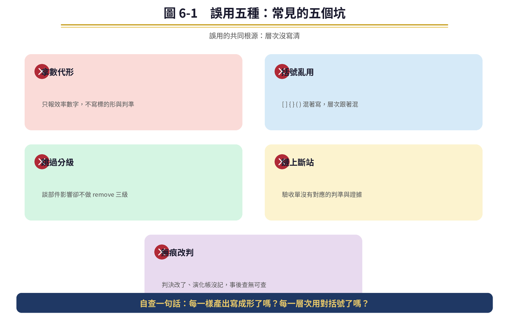

**圖 6-1　誤用五種**

## 6.2　十問清單

十問清單是隨身的驗收卡：送判決之前逐題回答，答不出的就是缺件。清單不取代四關，它是四關之外的自我體檢。

**表 6-2　十問清單**

| # | 檢查問題 | 通過標準 |
| --- | --- | --- |
| 1 | 標的形的身份 id(C) 立穩了嗎？ | 中途換標的開了新形，不是改欄位 |
| 2 | 每形的 F(T) 與 ∩(T) 寫明了嗎？ | 特徵可逐項檢驗，無「大概符合」 |
| 3 | 三括號用對位置了嗎？ | [ ] 規則、{ } 組成、( ) 身份各安其位 |
| 4 | BOM 每件通過「拆下來認得自己」嗎？ | 屬性與部件沒有混淆 |
| 5 | remove 三級分完嗎？ | 必要件・降級件・非必要件各有歸屬 |
| 6 | 門檻是數據出來之前定的嗎？ | 驗收單時間戳早於數據 |
| 7 | 三件套（效率・脫靶・安全）都有數據嗎？ | 無「待補」欄位進入判決 |
| 8 | 九格交叉驗收全數填單了嗎？ | 空白格＝不得簽判決 |
| 9 | 形證據鏈六站無斷嗎？ | 任一站可回放三問 |
| 10 | 合規紅線逐條核對了嗎？ | 紅線條款進了 ∩(T) |

> **簽核前的最後一句話**
>
> 十問全過，才把判決書推出去。任何一問答不出——退回的代價是幾天，錯簽的代價是一個專案。

## 6.3　成熟度 L1–L4

成熟度不是職位，是產出的可複核程度。L1 會寫形——六形欄位卡開得出來；L2 會驗收——四關跑得動、驗收單對得上；L3 會留鏈——六站齊備、判決可回放；L4 會演化——演化帳驅動迭代、判準門檻隨資料更新。多數團隊的合理目標是：一個季度內從 L1 走到 L2，半年走到 L3。

**表 6-3　成熟度 L1–L4**

| 等級 | 特徵 | 達標指標 |
| --- | --- | --- |
| L1　會寫形 | 產出有欄位、有判準 | 六形欄位卡全員會開；「這個不是那個」說得出三句 |
| L2　會驗收 | ∩(T) 四關跑得動 | 驗收單與產出件一對一；門檻皆先於數據 |
| L3　會留鏈 | 形證據鏈六站齊備 | 任一判決 24 小時內可回放完整推理 |
| L4　會演化 | 演化帳驅動迭代 | 連續三輪判準門檻隨證據更新；形庫版本化 |

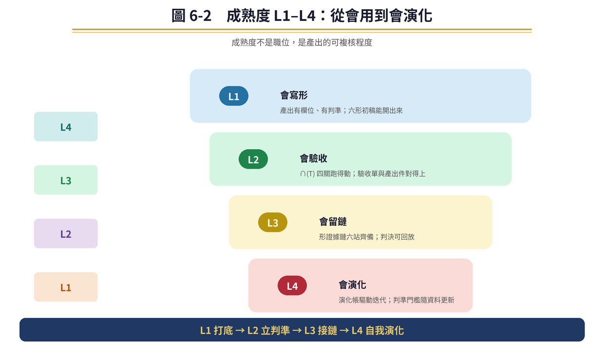

**圖 6-2　成熟度 L1–L4**

## 6.4　九十天導入藍圖

導入不需要一步到位。三個三十天：第一個月立形——六形欄位卡落地、選一個專案試跑；第二個月立判——四關驗收單與形證據鏈建檔；第三個月立鏈——演化帳例行運轉、成熟度自評。每階段都有可驗收的里程碑，踩空了就退階補課，不硬推。

**表 6-4　九十天導入藍圖**

| 階段 | 里程碑 | 產出 | 驗收 |
| --- | --- | --- | --- |
| 第 1–30 天　立形 | 六形欄位卡落地＋一專案試跑 | 欄位卡模板、S1–S7 試跑紀錄 | 每人開得出六形初稿 |
| 第 31–60 天　立判 | 四關驗收單＋六站建檔 | 驗收單範本、鏈編碼規則 | 一輪研發全鏈可回放 |
| 第 61–90 天　立鏈 | 演化帳例行＋成熟度自評 | 演化帳月報、L1→L2 自評表 | 十問清單納入簽核流程 |

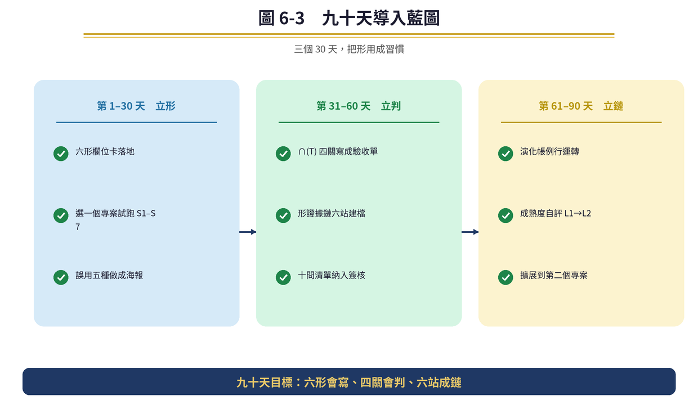

**圖 6-3　九十天導入藍圖**

## 6.5　合規與倫理紅線

基因編輯的「準確」，也包括對紅線的準確。紅線不是附件，是判準的一部分——寫進 ∩(T)，過不了紅線就過不了關。四條紅線人人要背：生殖細胞編輯禁止進入臨床研發流程；體細胞療法依規範走 IND 與倫理審查；長期追蹤納入形證據鏈成為判決附條件；知情同意列為標的形必要欄位。

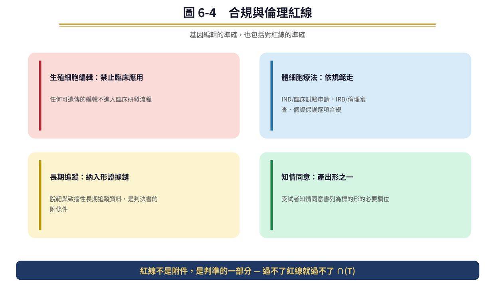

**圖 6-4　合規與倫理紅線**

> **聲明：本節為一般性合規架構示範，不構成法律意見；實際研發請依所在地法規（如人體試驗、**
>
> 基因治療產品管理規範）與機構倫理委員會審查結論辦理。

> **本章重點**
>
> ◆　誤用五種的共同根源＝層次沒寫清；自查一句話：每樣產出寫成形了嗎？
>
> ◆　十問清單隨身查、成熟度 L1–L4 定位自己、九十天藍圖排出行程。
>
> ◆　合規紅線是判準的一部分：生殖細胞禁用、體細胞合規、長期追蹤、知情同意。

# 回顧：三個帶走

這本書只做一件事：把基因研發的產出變得準確、可驗、可複核。合上書之前，手上應該有三樣東西。

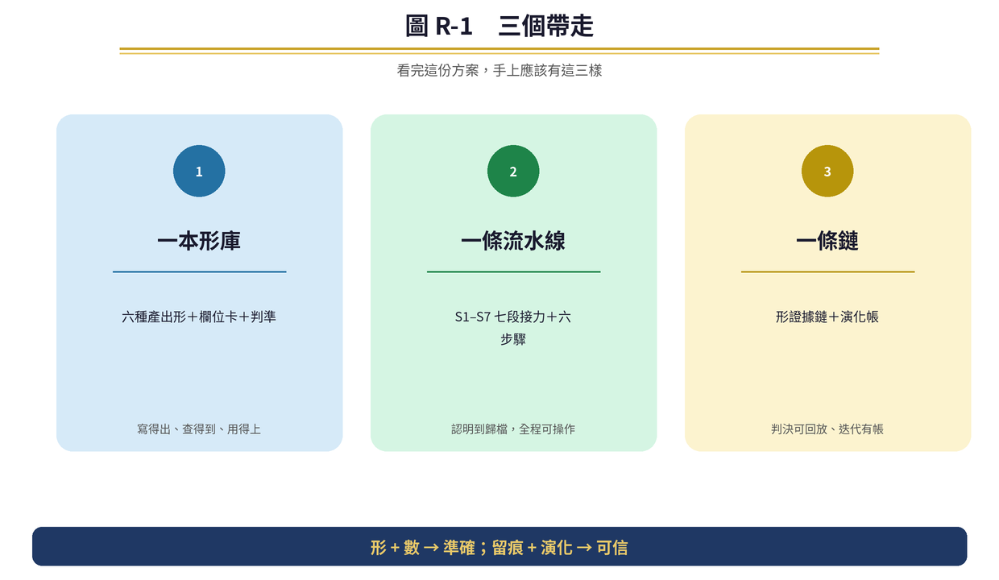

**圖 R-1　三個帶走**

**表 R-1　全書工具箱**

| 工具 | 用在哪 | 章節 |
| --- | --- | --- |
| 形＋數 | 把研發裝進可推理副本 | 1.1 |
| 三括號 [ ] { } ( ) | 寫規則、寫組成、寫身份 | 1.2・2.5 |
| 十四招招式盤 | 挑招・組招・換招 | 1.2・4.4 |
| 六形「標導載評判演」 | 產出鏈的標準樣板 | 第 2 章 |
| ∩(T) 四關漏斗 | 準確的第一道關 | 3.1 |
| 演繹骨架（因機證法驗） | 讓產出長在骨架上 | 3.2 |
| 驗證三件套 | 效率・脫靶・安全對帳 | 3.3 |
| 形證據鏈六站 | 每一步可複核 | 3.4 |
| 交叉驗收九格 | 簽判決前最後把關 | 3.5 |
| 框架四步驟＋六步驟 | 從需求到產出的流程 | 第 4 章 |
| 三層判斷（是・有・對） | 現場停檢 | 4.3 |
| S1–S7 提示詞 | 七段接力直接開工 | 5.2 |
| 十問清單・成熟度・藍圖 | 導入與自評 | 6.2–6.4 |

# 附錄 A　工具箱（速查）

**表 A-1　術語速查**

| 術語 | 英文／記號 | 一句話定義 |
| --- | --- | --- |
| 形 | Type | 一個被完整描述的產出（不是 Form） |
| 形集合 | Type Set | 單位形完整表記：{ 部件, (內容), [類別] } |
| 屬性・屬性值 | Property・Value | 維度與刻度 |
| 抽象類別 | T = (F(T), ∩(T)) | 由特徵與判準決定的開放類別 |
| 交集判準 | ∩(T) | 特徵全數通過才算是 |
| 容器 | C = (id(C), S(C)) | 集合＋不變的身份 |
| 身份識別 | id(C) | 不隨內容變動的標記 |
| 不變性公理 | 內容替換 id 不變 | 換批次細胞，專案還是同一個 |
| 物料清單 | BOM | 拆開來看的組成清單 |
| remove 判準 | remove(p, M) | 移除部件，看同一性存續 |
| 三層判斷 | 是・有・對 | 容器・組成・抽象聯合檢查 |
| 招式 | function | 時間本形＝動詞＝函式 |
| 形證據鏈 | Type Evidence Chain | 判準＋結果＋留痕的六站鏈 |

**表 A-2　六形 × 主用招式對應**

| 形 | 主用招式 | 輔助招式 |
| --- | --- | --- |
| 標的形 | 分析・解題 | 搜尋與萃取 |
| 導引形 | 設計（創造與創新）・設計模式 | 邏輯生成 |
| 載體形 | 設計・函式生成與應用 | 研發與探索 |
| 評估形 | 分析・推理 | 統計推理 |
| 判決形 | 推理（因果・模擬）・思考法 | 決策分析 |
| 演化形 | 持續學習・重構與重組・自我演化 | 第一性原理思考法 |

**表 A-3　記號速查**

| 記號 | 讀作 | 含義 |
| --- | --- | --- |
| T = (F(T), ∩(T)) | 形的定義 | 特徵集合＋交集判準 |
| C = (id(C), S(C)) | 容器的定義 | 身份＋內部空間 |
| { 部件, (內容), [類別] } | 形集合表記 | 三層資訊一次寫齊 |
| remove(p, M) ≢ M | 必要件 | 移除後同一性喪失 |
| remove(p, M) ≡ M′ ⊂ M | 功能降級件 | 功能缺、身份存 |
| remove(p, M) ≡ M | 非必要件 | 移除後不影響 |
| S(t+1) = g(S(t), 招, 事件) | 時間態推進 | 研發狀態由招式驅動 |
| ⇒ | 蘊含 | 由判準推向結論 |

> **本方案書為 Mind AI × 本形學應用示範；書中案例、數值與序列參數均為示範用途。**
>
> 基因編輯研發涉及法規與倫理審查，請依所在地法令與機構規範辦理。

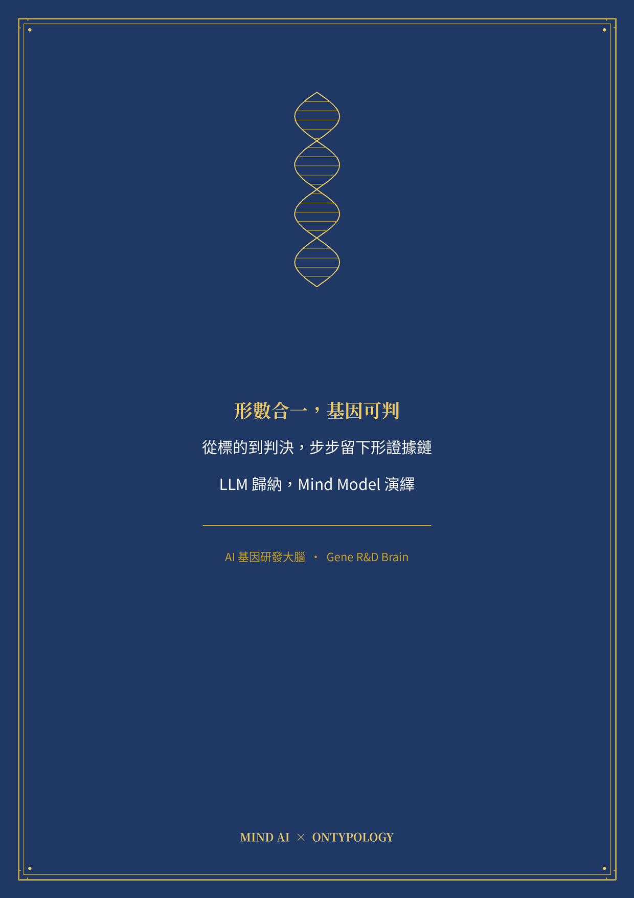
