# AI藥物研發大腦　產出準確使用方法完全方案

# 目　錄

- 寫在前面：三約定與示範聲明
- 導讀：兩套語言與三種讀法
- 第 1 章　認識 AI藥物研發大腦
  - 1.1　可推理的研發副本：形＋數
  - 1.2　雙本形落在藥物研發
  - 1.3　招式盤四組與十四招落點
  - 1.4　Mind AI 分工與四層關卡
  - 1.5　產出不準的四個現場
- 第 2 章　六種產出形：靶苗構優判演
  - 2.1　六形總覽：從靶點到 PCC 的產出鏈
  - 2.2　靶點形 TargetType
  - 2.3　苗頭形 HitType
  - 2.4　構效形 SARType
  - 2.5　優化形 OptimizeType
  - 2.6　判決形 VerdictType
  - 2.7　演化形 EvolutionType
- 第 3 章　四層準確性保證
  - 3.1　第一層：交集判準 ∩(T)
  - 3.2　第二層：演繹骨架推導
  - 3.3　第三層：實驗驗證三件套
  - 3.4　第四層：形證據鏈六站
  - 3.5　空間×時間交叉驗收
- 第 4 章　六步驟與招式挑選
  - 4.1　框架四步驟：認明研發情境
  - 4.2　六步驟操作卡
  - 4.3　三層判斷：是－有－對
  - 4.4　挑招、組招、換招與誤用預警
- 第 5 章　S1–S7 與全程產出範例
  - 5.1　七段接力：S1–S7 流水線
  - 5.2　S1–S7 提示詞全文
  - 5.3　案例上半：靶點形與苗頭形
  - 5.4　案例中段：構效形與優化形
  - 5.5　案例下半：判決形與演化形
- 第 6 章　誤用對照與成熟度
  - 6.1　誤用五種
  - 6.2　十問清單
  - 6.3　成熟度 L1–L4
  - 6.4　九十天導入藍圖
- 回顧：三個帶走
- 附錄 A　工具箱

# 寫在前面：三約定與示範聲明

這是一本「用得上」的書。它回答的問題只有一個：當團隊要把藥物研發交給 AI 藥物研發大腦時，怎麼做才能讓每一份產出——靶點卡、苗頭卡、構效表、優化方案、判決書、演化帳——都準確、可查、可複現。

本書以本形學（Ontypology）空間本形與時間本形為理論基礎，以 Mind AI 為底層平台，聚焦小分子標靶新藥、從靶點發現到先導優化的研發場景。理論本身不在本書重述、平台本身不在本書介紹——它們只被使用。開工前，先立三個約定。

> **約定一・形的英文是 Type**
>
> 「形」的英文一律用 Type，不用 Form：靶點形 TargetType、苗頭形 HitType 等都是 Type。文件、提示詞、欄位卡中見到 Type，指的就是本形學的「形」。

> **約定二・理論只用不教**
>
> 本書直接使用三括號 [ ] { } ( )、交集判準 ∩(T)、身份錨 id(C)、remove 三級、框架四步驟、三層判斷、十四招招式盤等工具，不再回頭論證它們為什麼成立。想讀原理，請回本形學原典；本書的責任是「用對」。

> **約定三・平台只引不述**
>
> 本書以 Mind AI 為底層平台：LLM 負責語言層的歸納與生成，Mind Model 負責判準、演繹與演化層的推理。平台的架構與實作不在本書範圍——本書只負責告訴你，站在平台上如何把產出做準。

> **示範聲明**
>
> 本書案例中的化合物代號（DX 系列）、活性與藥代數據、判準數值均為示範性質，用於說明方法，不指向任何真實藥物或臨床決策；任何真實研發請以實驗數據與法規要求為準。本書不涉及系統實作。

**表0-1　任務地圖：八站，各取所需**

| 站點 | 主題（用字刻意與章題錯開） | 你會得到 |
| --- | --- | --- |
| 第 1 章（認識系統） | 為什麼要一座藥物研發大腦 | 可推理研發副本的世界觀與分工 |
| 第 2 章（產出形） | 靶苗構優判演六形接力 | 六張產出形欄位卡與三括號拆解 |
| 第 3 章（準確四關） | 準確性四道關卡的運作 | 判準、推導、驗證、證據鏈 |
| 第 4 章（六步驟） | 動手流程與招式挑選 | 框架四步驟、操作卡、三層判斷 |
| 第 5 章（提示詞與案例） | S1 到 S7 七段接力與全程示範 | 提示詞全文＋DX 系列產出範例 |
| 第 6 章（誤用與升級） | 對照檢查與成熟度路徑 | 誤用表、十問、L1 至 L4 藍圖 |
| 回顧（收束） | 三個帶走 | 一頁回顧圖與重點總表 |
| 附錄 A（速查） | 術語・招式・記號 | 速查表三張 |

# 導讀：兩套語言與三種讀法

本書正文只有兩套語言在交會：一套是本形學的「形」語言，一套是藥物研發的「現場」語言。讀懂它們的對應關係，後面五章都只是展開。

**表D-1　兩套語言對照**

| 本形學語言（工具） | 藥物研發語言（現場） |
| --- | --- |
| 形 Type | 靶點、分子、系列、判決——萬物皆可立形 |
| 屬性 [ ]（抽象集合） | 活性、選擇性、成藥性、ADMET 的刻度 |
| 組成 { }（組成集合） | 分子骨架→官能基→原子的依存結構 |
| 容器 ( )（容器集合） | 研發專案→化合物系列→單一分子的空間 |
| 交集判準 ∩(T) | 四關通過線與否決線：合格產出的生成規則 |
| 身份錨 id(C) | 分子與系列的穩定身份：改名換代仍認得自己 |
| 招式（時間本形） | 搜尋、推理、設計、學習、演化的方法 |
| 演化帳 | 每一輪的紀錄、歸因與下一輪規劃 |

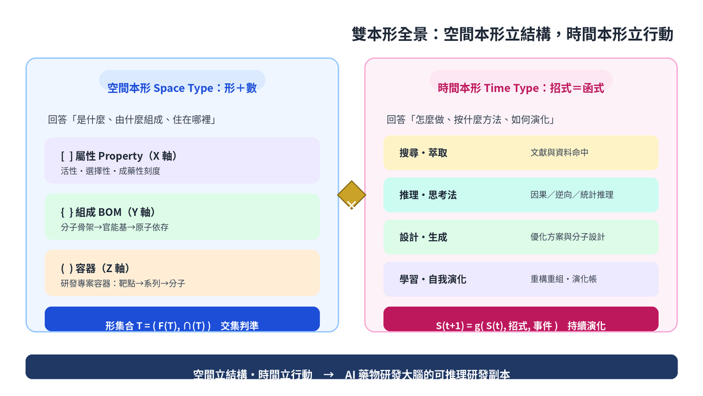

**圖D-1　雙本形全景：空間本形立結構，時間本形立行動**

**表D-2　三種讀法**

| 讀者 | 怎麼讀 | 讀到哪裡停 |
| --- | --- | --- |
| 決策者 | 導讀＋認識章＋誤用與成熟度章 | 知道這座大腦能給你什麼 |
| 研發主管 | 加讀產出形章與準確四關章 | 會立形、會驗收、會開檢討會 |
| 執行同仁 | 全書照讀，提示詞章照抄 | S1 到 S7 直接開工 |

# 第 1 章　認識 AI藥物研發大腦

**可推理的藥物研發副本：形＋數**

藥物研發最貴的東西不是化合物，是「不知道憑什麼」的決策：這個苗頭為什麼值得追？這個先導為什麼要這樣改？這個候選為什麼敢送下一關？AI 藥物研發大腦的存在理由，就是把研發現場立成一座可推理的副本，讓每個產出都說得出「是什麼、憑什麼、怎麼來」。

## 1.1　可推理的研發副本：形＋數

副本不是資料庫。資料庫回答「有多少」，副本還要回答「是什麼」——這就是形＋數：形（Type）寫結構、組成、容器與判準，數寫活性、性質與關係的數值。把一座研發專案立成形＋數，AI 才能在開口之前先問「是什麼」，在下結論之前先出示證據。

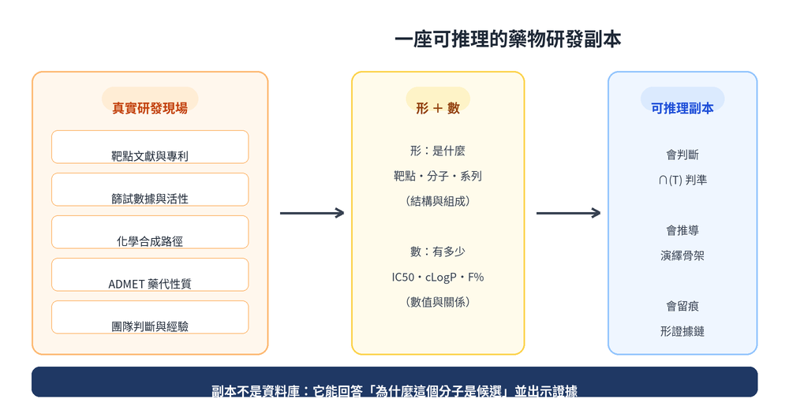

**圖1-1　一座可推理的藥物研發副本**

> **範例・DX-201 的形與數**
>
> 形：它是「EGFR 第四代抑制劑專案」容器下的「苯基嘧啶系列」成員，骨架是嘧啶-苯胺雙環。
>
> 數：EGFR T790M/C797S IC50 = 2.4 μM、LE = 0.31、cLogP = 2.8。
>
> 兩邊合起來，才叫「立了形」——只報數字，下一輪沒人接得住。

## 1.2　雙本形落在藥物研發

空間本形回答「是什麼、由什麼組成、住在哪裡」：屬性 [ ] 是活性與成藥性的刻度軸，組成 { } 是骨架到原子的依存軸，容器 ( ) 是專案到分子的空間軸。時間本形回答「怎麼做、如何演化」：搜尋、推理、設計、學習都是招式，一輪一輪寫進演化帳。兩本形交會的地方，就是研發決策發生的地方。

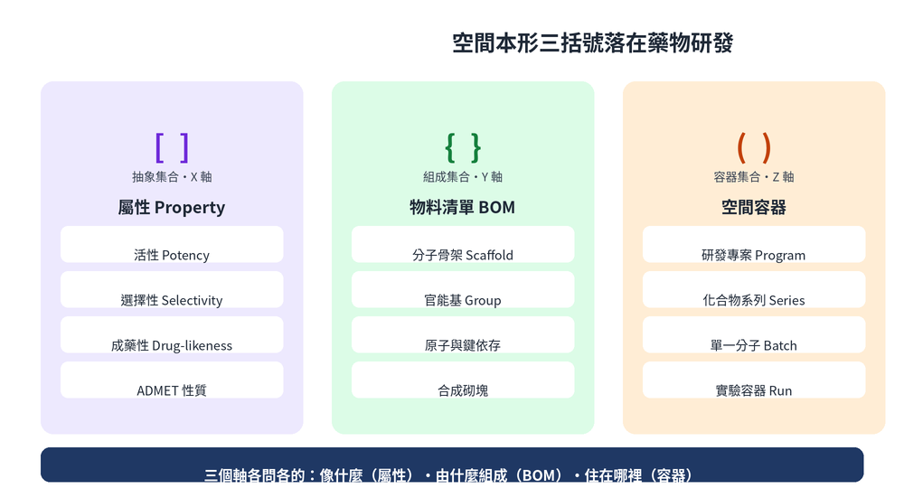

**圖1-2　空間本形三括號落在藥物研發**

**表1-2　空間三括號落點**

| 括號 | 本形學工具 | 藥物研發落點 |
| --- | --- | --- |
| [ ] 屬性 | 抽象集合・X 軸 | 活性・選擇性・成藥性・ADMET 的刻度卡 |
| { } 組成 | BOM 組成集合・Y 軸 | 分子骨架→官能基→原子與合成砌塊 |
| ( ) 容器 | 容器集合・Z 軸 | 研發專案→化合物系列→單一分子批次 |
| ∩(T) 判準 | 交集判準 | 四關通過線：活性/選擇性/成藥/ADME |
| id(C) 錨 | 身份錨定 | 分子代號改名、系列升級仍認得自己 |

## 1.3　招式盤四組與十四招落點

時間本形的十四招分四組：搜尋萃取、推理思考、設計生成、學習演化。研發的每一步都在挑招——靶點探索用搜尋萃取，SAR 解釋用因果推理，分子設計用設計模式，每輪收尾用自我演化。招式是動詞，產出是名詞；先挑對動詞，名詞才會準。

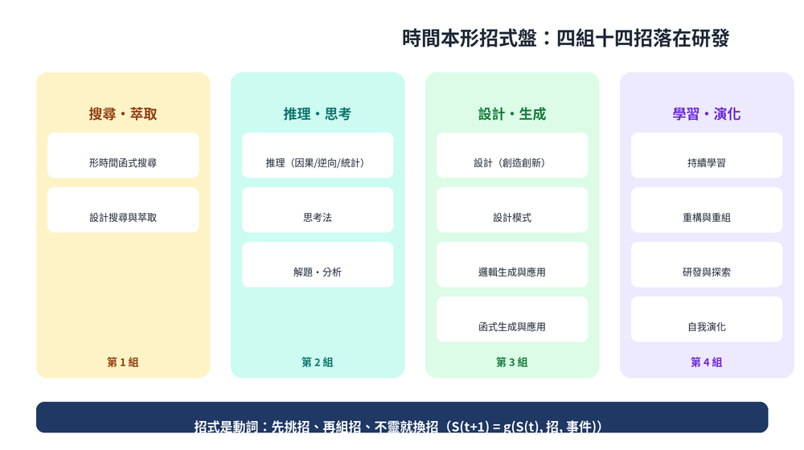

**圖1-3　時間本形招式盤四組十四招**

**表1-3　十四招在藥物研發的落點**

| 組 | 招式 | 研發落點 | 產出動詞 |
| --- | --- | --- | --- |
| 一 | 形時間函式搜尋 | 文獻・專利・資料庫命中 | 找：這問題誰解過 |
| 一 | 設計搜尋與萃取 | 虛擬庫篩選・分片篩選 | 篩：哪些分子有機會 |
| 二 | 推理（因果/逆向/統計） | SAR 歸因・代謝位點推斷 | 解：活性為什麼變 |
| 二 | 思考法 | 第一性原理看骨架、逆向看失敗 | 想：換一個角度看 |
| 二 | 解題 | 多參數互斥的拆解 | 拆：先解哪個結 |
| 二 | 分析 | 對接模式・ADMET 警訊分析 | 析：數據在說什麼 |
| 三 | 設計（創造與創新） | 全新骨架與修飾位點設計 | 造：下一輪分子長什麼樣 |
| 三 | 設計模式 | 生物電子等排・前藥策略套用 | 套：成熟打法直接用 |
| 三 | 邏輯生成與應用 | 合成逆推・路徑可行性 | 推：這分子做不做得出 |
| 三 | 函式生成與應用 | 生成式分子設計・性質優化 | 生：給我一批新候選 |
| 四 | 持續學習 | 每輪數據回灌判準 | 學：判準跟著數據長 |
| 四 | 重構與重組 | 骨架跳躍・片段重組 | 重：跳出局部最優 |
| 四 | 研發與探索 | 新靶點・新適應症探索 | 探：下一個戰場在哪 |
| 四 | 自我演化 | 演化帳→下一輪計畫 | 化：錯不過夜，下輪更準 |

## 1.4　Mind AI 分工與四層關卡

底層的分工很單純：LLM 擅長語言層的歸納統計——文獻萃取、假說生成、報告撰寫；Mind Model 擅長判準層的演繹推理——∩(T) 裁決、骨架推導、remove 反事實、id(C) 錨定。語言交給 LLM，判準交給 Mind Model；誰也不越界，準確才有底。

**表1-4　Mind AI 分工**

| 工作 | LLM（語言層） | Mind Model（判準層） |
| --- | --- | --- |
| 知識 | 文獻萃取・摘要・翻譯 | 形的欄位化・三括號建模 |
| 推理 | 歸納統計・假說生成 | 演繹推導・因果裁決 |
| 產出 | 描述・報告・提示詞 | 判準執行・證據鏈校驗 |
| 記憶 | 對話脈絡 | 演化帳・身份錨・判準版本 |

**表1-5　四層關卡預告**

| 關卡 | 一句話 | 誰把關 |
| --- | --- | --- |
| 第一層 | 合不合格，判準說了算 | 交集判準 ∩(T) 四關漏斗 |
| 第二層 | 推不推得出，骨架說了算 | 演繹骨架：前提→規則→預測 |
| 第三層 | 真不真實，實驗說了算 | 活性・ADMET・安全窗三件套 |
| 第四層 | 查不查得到，證據說了算 | 形證據鏈六站 |

## 1.5　產出不準的四個現場

準確的方法，是從不準的現場長出來的。研發產出之所以不可信，通常栽在四個現場——本書後面四層關卡，正是對這四個現場的逐一反制。

**表1-1　產出不準的四個現場**

| 現場 | 症狀 | 反制（本書章節） |
| --- | --- | --- |
| 形沒立住 | 分子與系列靠綽號認人，改名就失憶 | 六形欄位卡＋id(C)（第 2 章） |
| 推導斷裂 | 「憑化學直覺」跳到結論，無法複現 | 演繹骨架三件套（第 3 章） |
| 驗證走樣 | 只報最好的一次，原始數據失聯 | 實驗驗證三件套（第 3 章） |
| 檢討失憶 | 同一個坑每季摔一次 | 演化帳（第 5 章） |

> **本章重點**
>
> 可推理副本＝形＋數：形寫「是什麼」，數寫「有多少」，缺一不可。
>
> 雙本形落點：空間三括號立結構，十四招立行動，演化帳把錯誤變成資產。
>
> 分工鐵律：語言給 LLM，判準給 Mind Model；四層關卡是準確性的預告片。

# 第 2 章　六種產出形：靶苗構優判演

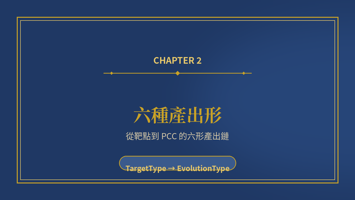

**從靶點到 PCC 的六形產出鏈**

研發團隊每天產出很多文件，但真正驅動決策的產出只有六種：靶點形、苗頭形、構效形、優化形、判決形、演化形——記法「靶苗構優判演」。六形接力，每一形都有欄位卡、有判準、有證據；少一形，鏈就斷。

## 2.1　六形總覽：從靶點到 PCC 的產出鏈

六形沿研發時序接力：靶點形回答「攻什麼」，苗頭形回答「找到什麼」，構效形回答「關係是什麼」，優化形回答「改什麼」，判決形回答「成不成」，演化形回答「下輪改什麼」。前三形屬於發現段，後三形屬於優化段——本書的邊界就在 PCC（藥物候選）判決為止。

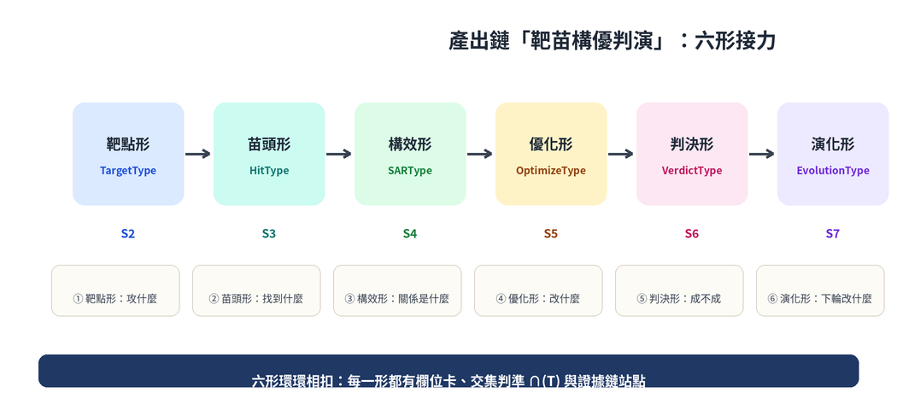

**圖2-1　產出鏈：六形接力**

**表2-1　六形總覽**

| 產出形 | 英文 | 一句話 | 判準焦點 |
| --- | --- | --- | --- |
| 靶點形 | （TargetType） | 攻什麼：靶點與適應症立卡 | 靶點證據・可成藥性 |
| 苗頭形 | （HitType） | 找到什麼：命中與篩選立卡 | 活性門檻・可複現性 |
| 構效形 | （SARType） | 關係是什麼：改動→後果立卡 | 規律成立・可推導性 |
| 優化形 | （OptimizeType） | 改什麼：多參數方案立卡 | 六軸不倒退・可合成 |
| 判決形 | （VerdictType） | 成不成：PCC 判決立卡 | 四關全過・鏈無斷點 |
| 演化形 | （EvolutionType） | 下輪改什麼：演化帳立卡 | 歸因成立・計畫可執行 |

**表2-8　remove 三級×化合物：拆下來認得自己**

| 級別 | 拆什麼 | 判斷與後果 |
| --- | --- | --- |
| 一級・關鍵部件 | 藥效團（氫鍵供受體） | 拆掉即活性歸零——remove(p1, DX-288) 不等於 DX-288 |
| 二級・骨架依存 | 母核 scaffold | 拆掉骨架，系列身份（id(C)）就變——是新系列不是新分子 |
| 三級・裝飾部件 | 溶解度修飾基 | 拆掉性質會掉，但身份不變——同系列新分子 |

## 2.2　靶點形 TargetType

靶點形是整條鏈的錨。它把「攻什麼」寫成形：靶點名稱、目標變異、適應症、機轉、判準與證據來源。靶點形沒立住，後面五形都在沙上蓋樓。

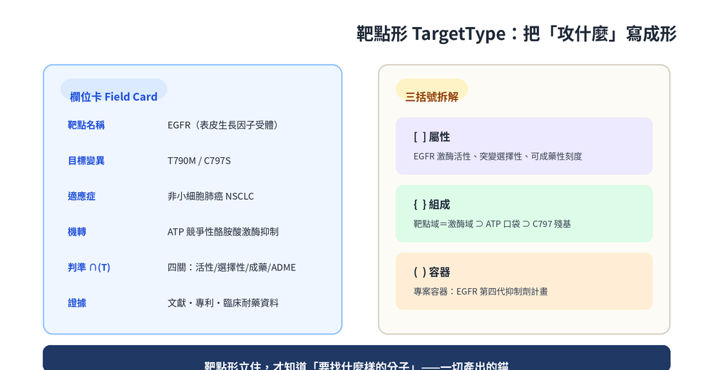

**圖2-2　靶點形欄位卡**

**表2-2　靶點形（TargetType）欄位卡**

| 欄位 | 填什麼 | 判準 |
| --- | --- | --- |
| 靶點名稱 | EGFR（表皮生長因子受體） | 標準命名・別名對照 |
| 目標變異 | T790M / C797S 順式雙突變 | 變異分佈有臨床證據 |
| 適應症 | 非小細胞肺癌（NSCLC） | 適應症與機轉相容 |
| 機轉 | ATP 競爭性酪胺酸激酶抑制 | 結合模式可結構驗證 |
| 判準 ∩(T) | 四關：活性/選擇性/成藥/ADME | 先立後用・改線留痕 |
| 證據來源 | 文獻・專利・臨床耐藥資料 | 可回溯・有時戳 |

## 2.3　苗頭形 HitType

苗頭形把「找到什麼」寫成形：命中分子的結構、活性、命中方式與複現記錄。苗頭形最忌「只報 IC50」——篩選路徑、對照與重複次數，決定了這個命中是線索還是噪音。

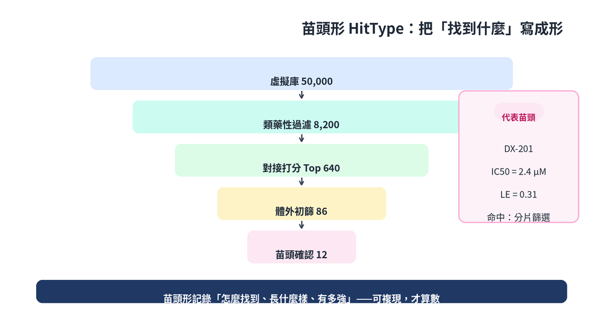

**圖2-3　苗頭篩選漏斗**

**表2-3　苗頭形（HitType）欄位卡**

| 欄位 | 填什麼 | 判準 |
| --- | --- | --- |
| 命中分子 | DX-201（苯基嘧啶雙環） | 結構確認・純度 ≥ 95% |
| 命中方式 | 分片篩選（fragment screen） | 篩選路徑可複現 |
| 初始活性 | IC50 = 2.4 μM（突變體） | n = 3・R² ≥ 0.9 |
| 配體效率 | LE = 0.31 | LE ≥ 0.3 方可入列 |
| 選擇性初值 | WT/突變 = 18 | 有趨勢即可，優化段補 |
| 排除雜訊 | PAINS 陰性・無聚集 | 雜訊排除齊全 |

## 2.4　構效形 SARType

構效形把「關係」寫成形：改了哪裡、動了多少、因為什麼。SAR 表不是成績單，是可推導的因果記錄——每一列要能回答「換回原樣會怎樣」（remove 反事實），每一行要能接上推導骨架。

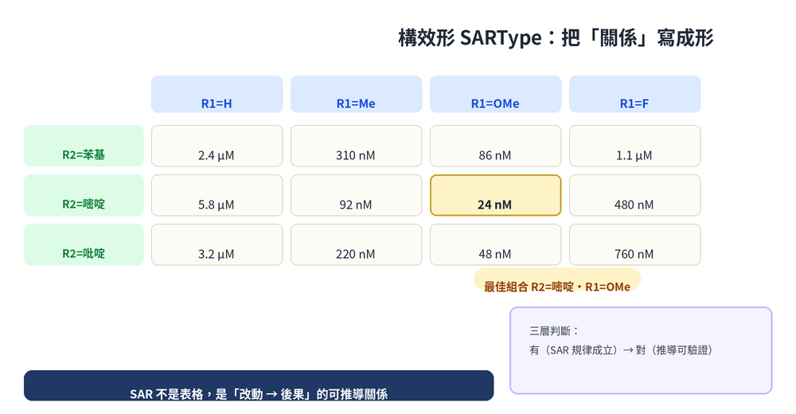

**圖2-4　構效矩陣：R1×R2 的活性對照**

**表2-4　構效形（SARType）欄位卡**

| 欄位 | 填什麼 | 判準 |
| --- | --- | --- |
| 對照軸 | R1 = H/Me/OMe/F　R2 = 苯基/嘧啶/吡啶 | 一次只動一處 |
| 效應描述 | R1=OMe 提電子↑親和力；R2=嘧啶 形成第二氫鍵 | 機轉解釋可驗證 |
| 反事實 | R1 換回 H：活性掉回 μM 級（remove 三級之一） | 拆掉認得自己 |
| 推導預測 | R2=嘧啶＋R1=OMe 預估 20–30 nM | 預測先行・實測後到 |
| 實測校正 | 實測 24 nM（DX-268） | 差異記錄入演化帳 |

## 2.5　優化形 OptimizeType

優化形把「改什麼」寫成形：圍繞多參數平衡（MPO）列出本輪要動的旋鈕、約束與預期。優化形的底線是六軸不倒退——活性進步不能拿代謝、安全或溶解度去換。

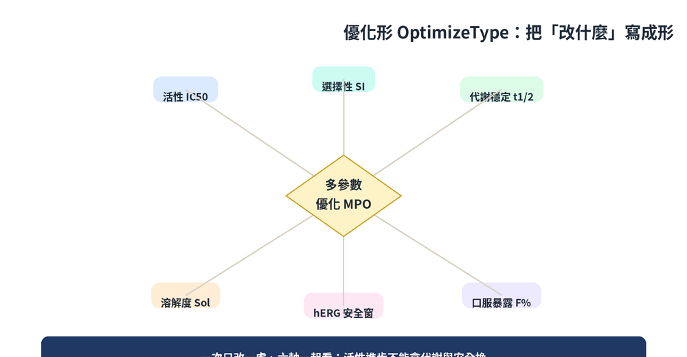

**圖2-5　多參數優化：六軸一起看**

**表2-5　優化形（OptimizeType）欄位卡**

| 欄位 | 填什麼 | 判準 |
| --- | --- | --- |
| 本輪目標 | 代謝穩定性：微粒體 t1/2 18→≥ 20 min | 目標可量化 |
| 約束不動 | 活性保持 ≤ 30 nM・SI ≥ 50 | 六軸不倒退 |
| 設計旋鈕 | 代謝位點封阻＋極性基團微調 | 可合成（≤ 5 步） |
| 預期區間 | IC50 10–25 nM・t1/2 25–45 min | 預測先行・有容許區間 |
| 退出條件 | 兩輪無進展→換骨架（重構招） | 換招條件預先寫好 |

## 2.6　判決形 VerdictType

判決形把「成不成」寫成形：四關逐項裁決、證據鏈核對、結論與簽核。判決形是對外文件——它只寫「過」與「不過」及證據，不寫心情。

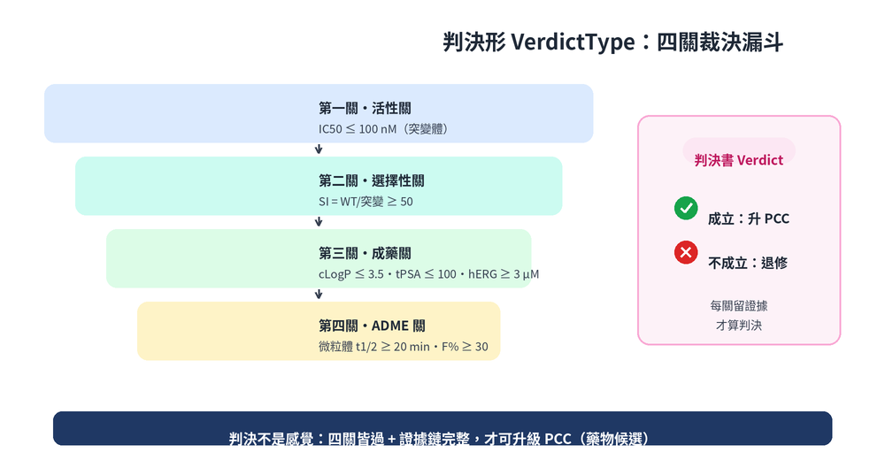

**圖2-6　四關裁決漏斗**

**表2-6　判決形（VerdictType）欄位卡**

| 欄位 | 填什麼 | 判準 |
| --- | --- | --- |
| 裁決對象 | DX-288（優化形第 3 輪產出） | 身份錨 id(C) 對上 |
| 四關結果 | 活性 ✓／選擇性 ✓／成藥 ✓／ADME ✓ | 逐項附數據・不許打包 |
| 證據鏈 | 六站全通（立形→歸檔） | 斷鏈即回退，不得判決 |
| 結論 | 成立：升級 PCC | 結論只能三選一：升/退/擱 |
| 簽核 | 研發負責人・日期・判準版本 | 人・時・版三要素齊 |

## 2.7　演化形 EvolutionType

演化形把「下輪改什麼」寫成形：這一輪改了什麼、結果差多少、歸因是什麼、下一輪做什麼。演化帳是寫給下一輪自己的信——不記帳，錯就會變成習慣；記了帳，錯就會變成判準。

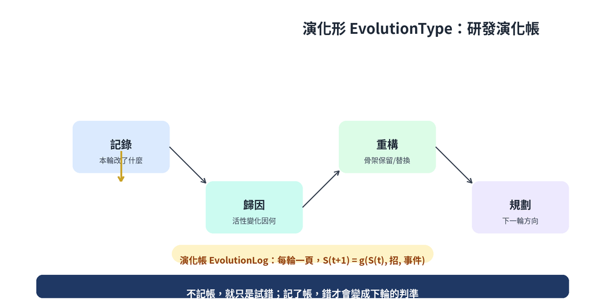

**圖2-7　演化帳循環：記錄→歸因→重構→規劃**

**表2-7　演化形（EvolutionType）欄位卡**

| 欄位 | 填什麼 | 判準 |
| --- | --- | --- |
| 本輪變更 | DX-268→DX-288：封阻 3 位代謝點 | 與優化形目標對得上 |
| 結果變化 | t1/2 18→42 min・IC50 24→12 nM | 用數據說話・不挑好看的 |
| 歸因假說 | 代謝軟點被封阻，清除率下降 | 歸因可被下一輪檢驗 |
| 判準更新 | 「3 位裸露＝代謝軟點」入判準庫 | 學習落到判準，不落在腦子 |
| 下一輪計畫 | 推進 IND 開發：毒理・製劑規劃 | 計畫可執行・有時程 |

> **本章重點**
>
> 六形「靶苗構優判演」是研發產出的最小完全集——每形一張欄位卡，卡上欄位就是判準的入口。
>
> remove 三級讓分子「拆下來認得自己」：關鍵部件定活性、骨架定身份、裝飾定性質。
>
> 判決形只寫證據，演化帳只寫事實與歸因——兩份收尾文件，決定了下一輪的起點。

# 第 3 章　四層準確性保證

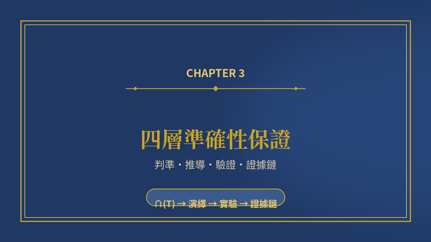

**判準・推導・驗證・證據鏈**

「準確」不能靠感覺，要靠關卡。四層關卡依序把關：交集判準管資格，演繹骨架管推理，實驗驗證管真實，形證據鏈管查核；最後再用空間×時間交叉驗收做總查。四層都過，產出才叫準確。

## 3.1　第一層：交集判準 ∩(T)

∩(T) 是形與形的交集：一個分子既是「這個系列的形」，又通過所有判準，才算合格產出。判準分四關——活性關、選擇性關、成藥關、ADME 關——先立後用；要改線，得留痕。

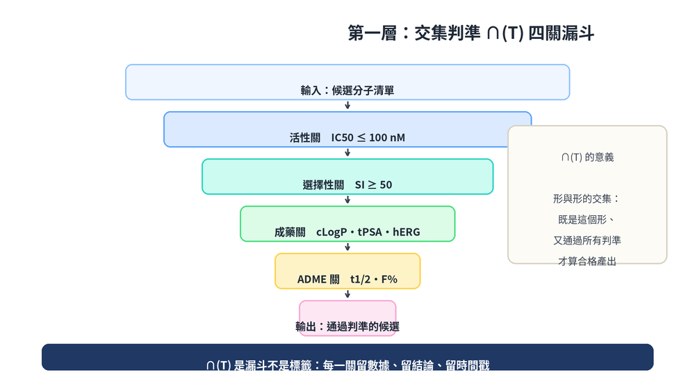

**圖3-1　交集判準四關漏斗**

**表3-1　四關判準（DX 案例版本）**

| 關卡 | 量測 | 通過線 | 否決線 |
| --- | --- | --- | --- |
| 活性關 | IC50（EGFR T790M/C797S） | ≤ 100 nM | > 300 nM 直接退 |
| 選擇性關 | SI = IC50(WT) / IC50(突變) | ≥ 50 | < 20 直接退 |
| 成藥關 | cLogP・tPSA・hERG | ≤ 3.5・≤ 100・≥ 3 μM | 任一紅線即退 |
| ADME 關 | 微粒體 t1/2・口服 F% | ≥ 20 min・≥ 30% | t1/2 < 10 min 退 |

## 3.2　第二層：演繹骨架推導

第二層管推理：每個預測都要走完「前提→規則→預測」三件套，才准落地成結論。LLM 歸納出假說，Mind Model 演繹出預測與容許區間；實測到手後做校正，差異寫進演化帳。跳步的結論，在這一層直接擋下。

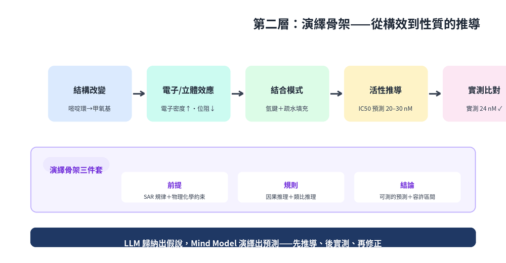

**圖3-2　演繹骨架：從結構改變到實測比對**

**表3-2　演繹骨架推導範例（DX-268→DX-288）**

| 步驟 | 內容 |
| --- | --- |
| 前提 | DX-268 活性 24 nM，但人肝微粒體 t1/2 僅 18 min——ADME 關未過 |
| 規則 | 因果推理：苯環 3 位裸露是代謝軟點；逆向推理：封阻軟點通常延長 t1/2 |
| 預測 | 封阻後 t1/2 預估 25–45 min，IC50 保持 10–30 nM 區間 |
| 實測 | DX-288：t1/2 = 42 min、IC50 = 12 nM（均落於預測區間） |
| 校正 | 活性優於預測下限——「封阻或提升親和力」假說入演化帳待驗 |

## 3.3　第三層：實驗驗證三件套

第三層管真實：活性、ADMET、安全窗三件套，每套都有對照、有重複、有統計。推導說「應該 24 nM」，實驗回答「真的是 24 nM」——差在哪裡，一樣要記下來。

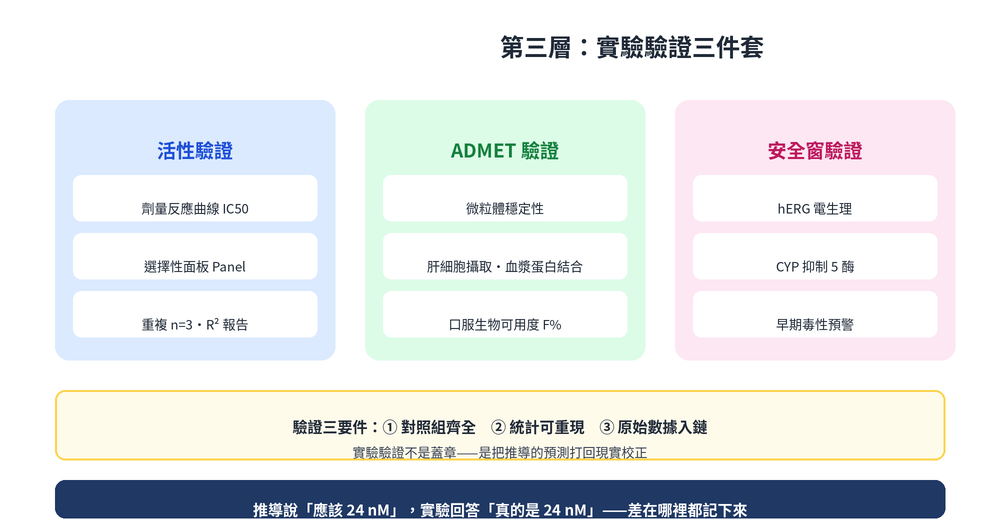

**圖3-3　實驗驗證三件套**

**表3-3　驗證三件套與 DX-288 實測**

| 套件 | 項目 | 標準 | DX-288 實測 |
| --- | --- | --- | --- |
| 活性 | 劑量反應 IC50（突變體） | ≤ 100 nM・n = 3・R² ≥ 0.9 | 12 nM（R² = 0.99） |
| 活性 | 選擇性面板（WT 對照） | SI ≥ 50 | SI = 118（WT 1.42 μM） |
| ADMET | 人肝微粒體 t1/2 | ≥ 20 min | 42 min |
| ADMET | 口服生物可用度（小鼠） | F ≥ 30% | 48% |
| 安全窗 | hERG IC50 | ≥ 3 μM | 8.6 μM |
| 安全窗 | CYP 抑制（五酶） | IC50 ≥ 10 μM | 五酶全數 ≥ 10 μM |

## 3.4　第四層：形證據鏈六站

第四層管查核：立形、產出、推導、驗證、判決、歸檔，六站各留三樣——欄位快照、數值證據、時間戳。任一站斷鏈，產出不得進入下一輪；鏈斷就回退補證，沒有例外。

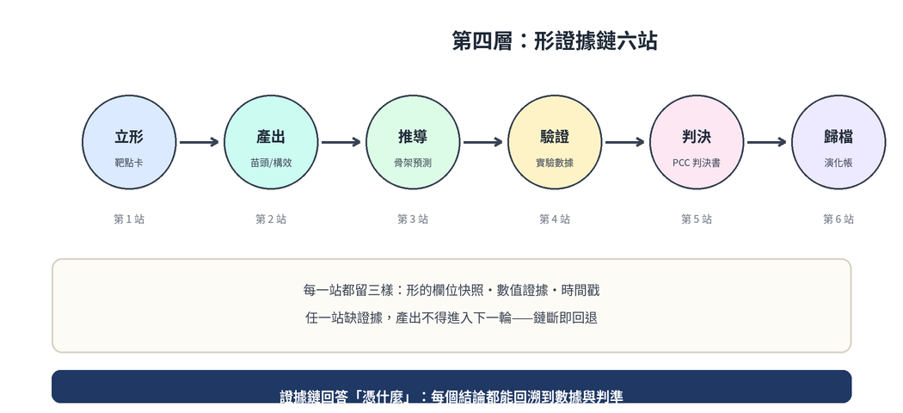

**圖3-4　形證據鏈六站**

**表3-4　六站職責與斷鏈後果**

| 站點 | 留什麼 | 斷鏈後果 |
| --- | --- | --- |
| 1 立形 | 靶點卡快照＋判準版本 | 產出無錨，退回情境重立 |
| 2 產出 | 欄位卡＋原始數據 | 不可複現，作廢重跑 |
| 3 推導 | 前提→規則→預測＋容許區間 | 跳步結論，退回補推導 |
| 4 驗證 | 原始曲線・譜圖・統計 | 無原始檔，不得判決 |
| 5 判決 | 四關結果＋簽核三要素 | 無簽核等於未判決 |
| 6 歸檔 | 演化帳頁＋判準異動 | 不歸檔等於本輪白做 |

## 3.5　空間×時間交叉驗收

最後一道總查：空間三問（形完整、數可信、鏈可溯）× 時間三問（招式對、推導全、演化留痕），六問全過才放行。空間說「是什麼」、時間說「怎麼來」——兩邊對得上，準確才立得住。

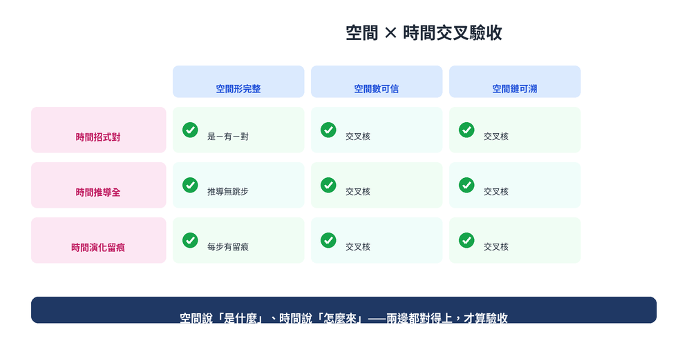

**圖3-5　空間×時間交叉驗收**

**表3-5　交叉驗收六問**

| 面向 | 驗收問 | 通過標準 |
| --- | --- | --- |
| 空間・形完整 | 六形欄位有沒有空缺？ | 欄位齊全、無「待補」字樣 |
| 空間・數可信 | 數值背後有原始檔嗎？ | n ≥ 3・統計合格・原始檔可取 |
| 空間・鏈可溯 | 結論回溯得到證據嗎？ | 六站逐站可點開 |
| 時間・招式對 | 用的招對得上情境嗎？ | 挑招記錄與情境相符 |
| 時間・推導全 | 有沒有跳步結論？ | 前提→規則→預測三件齊 |
| 時間・演化留痕 | 本輪進演化帳了嗎？ | 一輪一頁・歸因有名字 |

> **本章重點**
>
> 四層關卡各管一件事：判準管資格、骨架管推理、實驗管真實、證據鏈管查核——順序不可對調。
>
> 推導三件套「前提→規則→預測」是 Mind Model 的主場；預測必帶容許區間，實測必做校正。
>
> 交叉驗收六問是放行前的最後一次自問自答——六問全過，產出才離開這座大腦。

# 第 4 章　六步驟與招式挑選

**從認明情境到歸檔演化**

方法論要能開工才算數。本章給出可照做的流程：先用框架四步驟認明研發情境，再走六步驟從情境推到演化帳；中途用三層判斷把關，用挑招組招換招調度時間本形。

## 4.1　框架四步驟：認明研發情境

框架四步驟是開工前的四個問題：立容器、刻屬性、拆組成、定判準。四個問題沒答完就開跑，後面每一步都會問錯題。

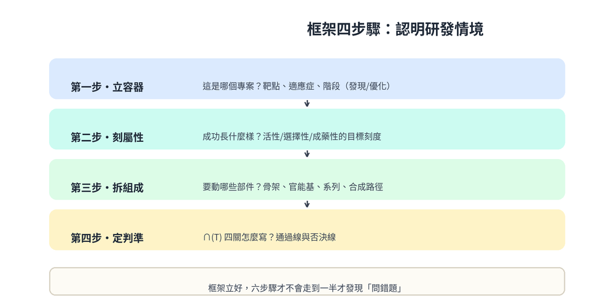

**圖4-1　框架四步驟**

**表4-1　框架四步驟×DX 案例**

| 步驟 | 問句 | DX 案例的答案 |
| --- | --- | --- |
| 立容器 | 這是哪個專案、哪個階段？ | EGFR 第四代抑制劑（NSCLC）・發現轉優化 |
| 刻屬性 | 成功長什麼樣？ | 四關通過線：活性/選擇性/成藥/ADME |
| 拆組成 | 要動哪些部件？ | R2 母核・R1 取代基・3 位代謝軟點 |
| 定判準 | 過與不過怎麼判？ | ∩(T) 四關＋否決線＋改線留痕規則 |

## 4.2　六步驟操作卡

框架立好，六步驟接力：認明情境、分軸建形、挑選擴式、生成產出、判準驗收、歸檔演化。每步一張操作卡——動作、產出、常用招式寫清楚，新人照卡就能上線。

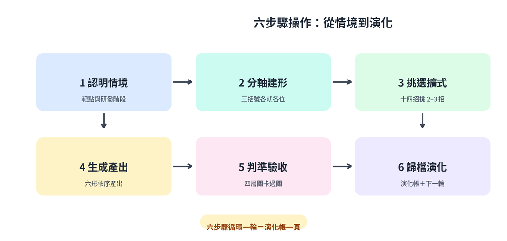

**圖4-2　六步驟：一輪一循環**

**表4-2　六步驟操作卡**

| 步驟 | 動作 | 產出 | 常用招式 |
| --- | --- | --- | --- |
| 1 認明情境 | 讀容器與階段、對齊成功樣貌 | 情境卡 | 解題・分析 |
| 2 分軸建形 | 三括號各就各位、六形上骨架 | 六形欄位卡骨架 | 設計模式 |
| 3 挑選擴式 | 十四招挑 2–3 招、寫退出條件 | 挑招單 | 思考法 |
| 4 生成產出 | 依欄位卡填產出、補數據 | 六形初稿 | 搜尋・推理・生成 |
| 5 判準驗收 | 四關裁決＋交叉驗收六問 | 判決書 | 因果/逆向推理 |
| 6 歸檔演化 | 一輪一頁、判準異動入庫 | 演化帳頁 | 持續學習・自我演化 |

## 4.3　三層判斷：是－有－對

每一份產出動筆前，先過三層判斷：第一層容器判斷問「是」——它屬於這個系列與專案嗎（id(C) 錨定）；第二層結構判斷問「有」——部件依存完整嗎（remove 三級）；第三層規則判斷問「對」——符合 ∩(T) 與類比規則嗎。順序不可顛倒：先「是」、再「有」、後「對」。

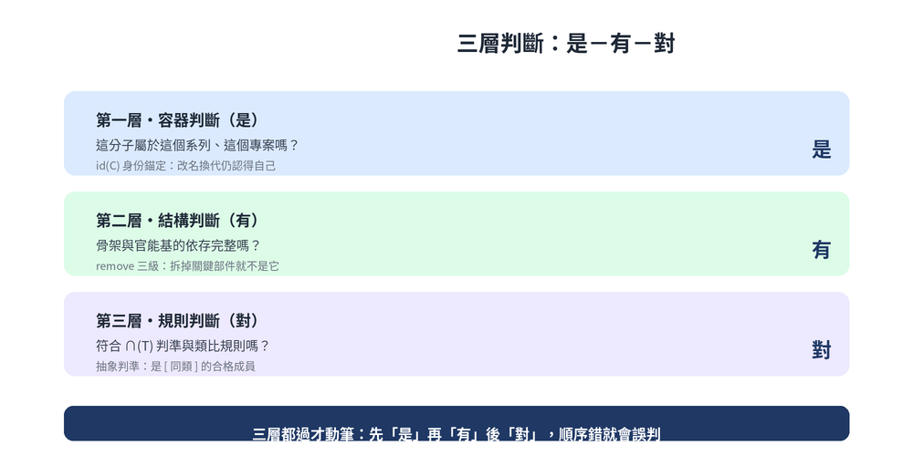

**圖4-3　三層判斷：是－有－對**

> **範例・對 DX-288 的三層判斷**
>
> 是：id(C) 對上 DX-268 系列（同容器、同骨架血緣）——身分成立。
>
> 有：藥效團與母核俱在，封阻基屬三級裝飾——結構成立。
>
> 對：四關全過＋類比規則「嘧啶 R1=OMe 優」被實測支持——規則成立。

## 4.4　挑招、組招、換招與誤用預警

十四招不用全用——挑對兩三招，比下十二招有效。挑招看情境，組招看接力，換招看訊號：數據與推導矛盾就換推理，兩輪無進展就換搜尋域，判準反覆不過就回框架。

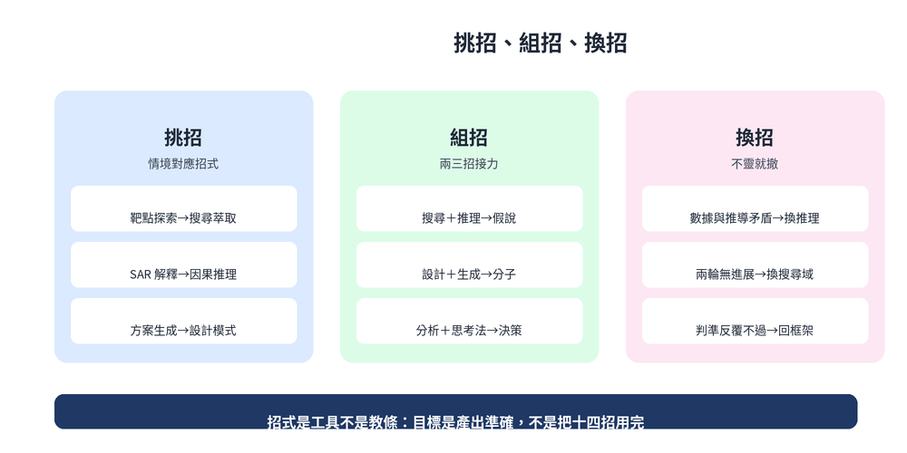

**圖4-4　挑招、組招、換招**

**表4-3　挑招・組招・換招**

| 情境 | 挑招 | 組招 | 換招條件 |
| --- | --- | --- | --- |
| 靶點初探 | 搜尋萃取 | ＋分析→靶點卡 | 命中太少→擴搜尋域 |
| SAR 排序 | 因果推理 | ＋統計推理→構效形 | 相關當因果→補反事實 |
| 活性卡關 | 設計（創造創新） | ＋生成→新一批分子 | 兩輪無進展→重構骨架 |
| ADME 不過 | 逆向推理 | ＋設計模式→修飾方案 | 三修失敗→換化學空間 |
| 判決爭議 | 第一性原理思考法 | ＋解題→重評判準 | 改判準線必留痕 |

**表4-4　六步驟誤用預警點**

| 步驟 | 預警點 | 警訊 |
| --- | --- | --- |
| 認明情境 | 容器沒立就開跑 | 六形各自為政、對不上號 |
| 分軸建形 | 三括號混寫一欄 | 判準找不到入口 |
| 挑選擴式 | 一次下十二招 | 產出雜訊大於訊號 |
| 生成產出 | 先結論後補推導 | 證據鏈倒著長 |
| 判準驗收 | 過不了就改線 | 判準版本頻繁變動 |
| 歸檔演化 | 檢討會靠印象 | 同一個坑重複摔 |

> **本章重點**
>
> 框架四步驟先答四個問題，六步驟才開跑——問對題，比跑得快重要。
>
> 三層判斷「是－有－對」是動筆前的最後一道自我檢查，順序不可顛倒。
>
> 招式是工具不是教條：挑兩三招、寫退出條件，不靈就換——目標是產出準確。

# 第 5 章　S1–S7 與全程產出範例

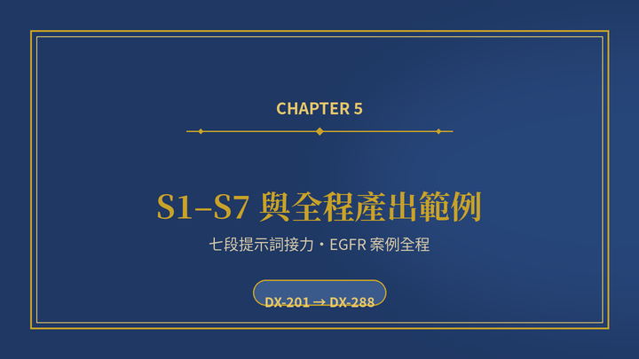

**七段接力・DX 系列全程示範**

本章給兩樣可以直接拿走的東西：七段提示詞的寫法，與一個小分子標靶新藥案例的全程產出。案例沿 DX 系列展開——從苗頭 DX-201 走到 PCC 候選 DX-288——每一形的產出都附範例數據，數據彼此自洽，可逐格核對。

## 5.1　七段接力：S1–S7 流水線

七段接力對應六步驟與六形：S1 認明情境產出情境卡，S2 到 S7 依序產出靶點形、苗頭形、構效形、優化形、判決形、演化形。每段的輸出是下段的輸入；上一段沒過關，下一段不開工。

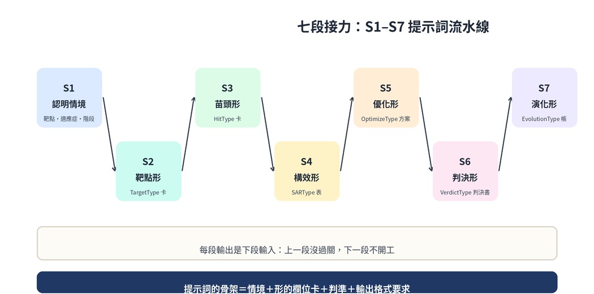

**圖5-1　S1–S7 七段流水線**

**表5-1　S1–S7 職責與過關條件**

| 段 | 輸入 | 產出 | 過關條件 |
| --- | --- | --- | --- |
| S1 | 專案背景 | 情境卡 | 容器、成功樣貌、不確定性三齊 |
| S2 | 情境卡 | 靶點形卡 | 六欄位齊・判準四關成形 |
| S3 | 靶點形 | 苗頭形卡 | 篩選路徑可複現・雜訊已排除 |
| S4 | 苗頭形 | 構效形表 | 因果鏈＋反事實＋預測區間 |
| S5 | 構效形 | 優化形方案 | 目標可量化・退出條件明確 |
| S6 | 優化產出 | 判決書 | 四關逐項・六站核對・簽核齊 |
| S7 | 判決書 | 演化帳頁 | 歸因有名字・計畫可執行 |

## 5.2　S1–S7 提示詞全文

以下七段提示詞可直接複製使用。共同骨架是四件套：角色、輸入、要求、輸出格式；共同紀律是「不寫未經證據支持的數字」。

> **S1・認明情境（情境卡）**
>
> 你是一位藥物研發規劃師。請依下列資訊產出『情境卡』。
>
> 輸入：靶點＝EGFR；適應症＝非小細胞肺癌；階段＝發現轉優化（PCC 前）。
>
> 要求：(1) 寫出容器定位：專案→系列→分子；
>
> (2) 寫出成功樣貌的四個維度（活性/選擇性/成藥/ADME）；
>
> (3) 列出本階段的三個不確定性。
>
> 輸出為條列；不寫未經證據支持的數字；未知項目明寫『待補』。

> **S2・靶點形（TargetType）**
>
> 延續情境卡，產出靶點形欄位卡。
>
> 欄位：靶點名稱／目標變異／適應症／機轉／判準 ∩(T)／證據來源。
>
> 要求：(1) 判準寫成四關（活性/選擇性/成藥/ADME），各附通過線與否決線；
>
> (2) 每欄附證據來源與時間戳；(3) 未知欄位明寫『待補』，不得留空。

> **S3・苗頭形（HitType）**
>
> 產出苗頭形欄位卡。
>
> (1) 篩選路徑：虛擬庫→類藥過濾→對接→體外初篩，各階段數量；
>
> (2) 代表苗頭：結構描述、IC50、LE、命中方式、雜訊排除記錄；
>
> (3) 用三括號拆解苗頭（屬性/組成/容器）；
>
> (4) 數據標註 n 與 R²；沒有原始檔的數字不得寫入。

> **S4・構效形（SARType）**
>
> 產出構效形。
>
> (1) 列出對照軸 R1/R2 與活性矩陣（一次只動一處）；
>
> (2) 對最佳組合寫『改動→後果』因果鏈：前提→規則→預測；
>
> (3) 寫一則 remove 反事實：拆掉關鍵部件會怎樣；
>
> (4) 預測下一輪數值區間，明寫『預測先行、實測後到』。

> **S5・優化形（OptimizeType）**
>
> 產出優化形本輪方案。
>
> (1) 本輪目標（可量化）；(2) 約束不動的軸（六軸不倒退）；
>
> (3) 設計旋鈕 2–3 個，附合成可行性（步數 ≤ 5）；
>
> (4) 預期區間與退出條件；
>
> (5) 挑招：從十四招挑 2–3 招並寫理由與換招條件。

> **S6・判決形（VerdictType）**
>
> 產出判決書。
>
> (1) 裁決對象與 id(C)；(2) 四關逐項裁決：過/不過＋數據，不許打包；
>
> (3) 證據鏈六站逐站核對；(4) 結論三選一：升 PCC／退修／擱置；
>
> (5) 簽核欄：人、時、判準版本。
>
> 全程只寫證據，不寫心情。

> **S7・演化形（EvolutionType）**
>
> 產出演化帳頁。
>
> (1) 本輪變更與結果變化（用數據）；(2) 歸因假說＋可檢驗方式；
>
> (3) 判準庫異動；(4) 下一輪計畫與換招條件；
>
> (5) 一句話寫給下一輪的自己。

## 5.3　案例上半：靶點形與苗頭形

案例背景：第四代 EGFR 抑制劑專案，目標是克服三代藥耐藥的 T790M/C797S 順式雙突變，同時放過野生型（WT）以降低皮疹與腹瀉毒性。以下數據均為示範性質，用於說明產出格式與自洽性。

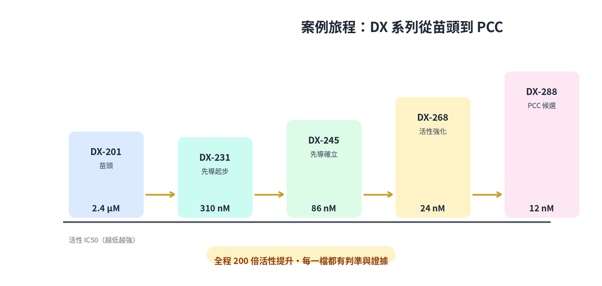

**圖5-2　案例旅程：DX 系列從苗頭到 PCC**

**表5-2　靶點卡產出範例（S2）**

| 欄位 | 內容 |
| --- | --- |
| 靶點名稱 | EGFR（HER1／ErbB1，酪胺酸激酶受體） |
| 目標變異 | T790M / C797S 順式雙突變（三代藥耐藥主因） |
| 適應症 | 非小細胞肺癌（NSCLC）耐藥人群 |
| 機轉 | ATP 競爭性抑制；要求突變選擇性、放過 WT |
| 判準 ∩(T) | 四關通過線與否決線（依表3-1，版本 v1.2） |
| 證據來源 | 文獻・專利・臨床耐藥資料（示範，含時戳） |

**表5-3　苗頭卡產出範例（S3）**

| 欄位 | 內容 |
| --- | --- |
| 篩選路徑 | 虛擬庫 50,000 → 類藥過濾 8,200 → 對接 640 → 體外 86 → 確認 12 |
| 代表苗頭 | DX-201：苯基嘧啶雙環醯胺（分片篩選命中） |
| 初始活性 | IC50 = 2.4 μM（n = 3，R² = 0.98）；pIC50 = 5.62 |
| 配體效率 | LE = 0.31（≥ 0.3 方可入列） |
| 雜訊排除 | PAINS 陰性・無聚集・無螢光干擾 |
| 三括號拆解 | [ ] μM 級活性・可溶；{ } 雙環＋醯胺鍵；( ) 第四代專案容器 |

## 5.4　案例中段：構效形與優化形

構效段以 R1×R2 雙軸對照推進：R1 供電子基提升親和力，R2 換嘧啶形成第二氫鍵。活性矩陣如表5-4——最佳組合 R2=嘧啶＋R1=OMe 實測 24 nM（DX-268），與預測區間 20–30 nM 相符。

**表5-4　SAR 矩陣（IC50，n = 3 平均）**

| R1＼R2 | 苯基 | 嘧啶 | 吡啶 |
| --- | --- | --- | --- |
| H | 2.4 μM（DX-201） | 5.8 μM | 3.2 μM |
| Me | 310 nM（DX-231） | 92 nM | 220 nM |
| OMe | 86 nM（DX-245） | 24 nM（DX-268） | 48 nM（DX-277） |
| F | 1.1 μM | 480 nM | 760 nM |

優化段接續：DX-268 活性漂亮但微粒體 t1/2 僅 18 min，ADME 關未過。依演繹骨架推導（表3-2），封阻苯環 3 位代謝軟點，得 DX-288——六軸全面達標。

**表5-5　優化里程碑（S5 產出摘要）**

| 分子 | 改了什麼 | IC50 | SI | 微粒體 t1/2 | 判定 |
| --- | --- | --- | --- | --- | --- |
| DX-245 | R1=OMe 親和力修飾 | 86 nM | 62 | 26 min | 先導確立 |
| DX-268 | R2=嘧啶第二氫鍵 | 24 nM | 85 | 18 min | ADME 不過 |
| DX-288 | 3 位封阻代謝軟點 | 12 nM | 118 | 42 min | 四關全過 |

## 5.5　案例下半：判決形與演化形

優化三輪後進入判決。判決書逐關列證據——不打包、不寫心情；演化帳記錄本輪的變更、歸因與判準異動，作為臨床前開發的起點。

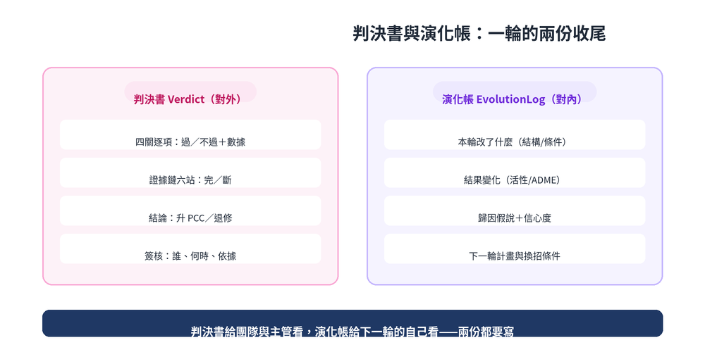

**圖5-3　判決書與演化帳：一輪的兩份收尾**

**表5-6　PCC 判決書產出範例（S6）**

| 項目 | 內容 |
| --- | --- |
| 裁決對象 | DX-288（id(C)：DX-268 系列升級） |
| 活性關 | IC50 = 12 nM ≤ 100 nM　通過（R² = 0.99） |
| 選擇性關 | SI = 118 ≥ 50　通過（WT IC50 = 1.42 μM） |
| 成藥關 | cLogP 3.1・tPSA 92・hERG 8.6 μM　通過 |
| ADME 關 | 微粒體 t1/2 = 42 min・小鼠 F = 48%　通過 |
| 藥效抽驗 | 小鼠腫瘤模型 TGI = 85%（30 mg/kg QD ×14 天，示範） |
| 證據鏈 | 六站全通：立形→產出→推導→驗證→判決→歸檔 |
| 結論 | 成立：升級 PCC（藥物候選） |
| 簽核 | 研發負責人・判準版本 v1.2・日期（示範） |

**表5-7　演化帳產出範例（S7）**

| 欄位 | 內容 |
| --- | --- |
| 本輪變更 | DX-268→DX-288：苯環 3 位導入甲基封阻（一次只動一處） |
| 結果變化 | t1/2 18→42 min・IC50 24→12 nM・hERG 4.1→8.6 μM |
| 歸因假說 | 代謝軟點封阻降低清除率（可由微粒體代謝產物鑑定驗證） |
| 判準更新 | 新增規則「3 位裸露＝代謝軟點」入判準庫（版本 v1.3） |
| 下一輪計畫 | 轉臨床前開發：毒理・製劑規劃；備用招：前藥策略 |
| 給下輪的自己 | 活性會騙人，代謝不會——六軸一起看。 |

**表5-8　提示詞使用守則**

| # | 守則 |
| --- | --- |
| 1 | 一次只跑一段：上一段過關才開下一段 |
| 2 | 數字必附 n 與 R²；沒有原始檔的數字不進產出 |
| 3 | 預測必帶區間，明寫『預測先行、實測後到』 |
| 4 | 判準線先立後用；改線必留痕（人・時・因） |
| 5 | 輸出『待補』是功能不是故障——待補不丟人，編造才丟人 |
| 6 | 每輪結束必寫演化帳頁，隔天再看才准開新輪 |

> **本章重點**
>
> 七段接力的骨架＝角色＋輸入＋要求＋輸出格式；紀律只有一條——不寫未經證據支持的數字。
>
> DX 系列全程數據自洽：2.4 μM 到 12 nM 共 200 倍，每一步都有判準、有推導、有證據。
>
> 判決書與演化帳是一輪的兩份收尾：一份對外交代「成不成」，一份對內交代「學到什麼」。

# 第 6 章　誤用對照與成熟度

**五種誤用・十問清單・L1 至 L4**

方法給了，最後一件事是防止用歪。本章給出五種常見誤用的對照、十問自檢清單、成熟度四級與九十天藍圖——從「會用」一路升級到「用活」。

## 6.1　誤用五種

五種誤用各有各的翻車法，但根因相同：想跳過關卡。關卡跳過去的，成本會在後面加倍討回來。

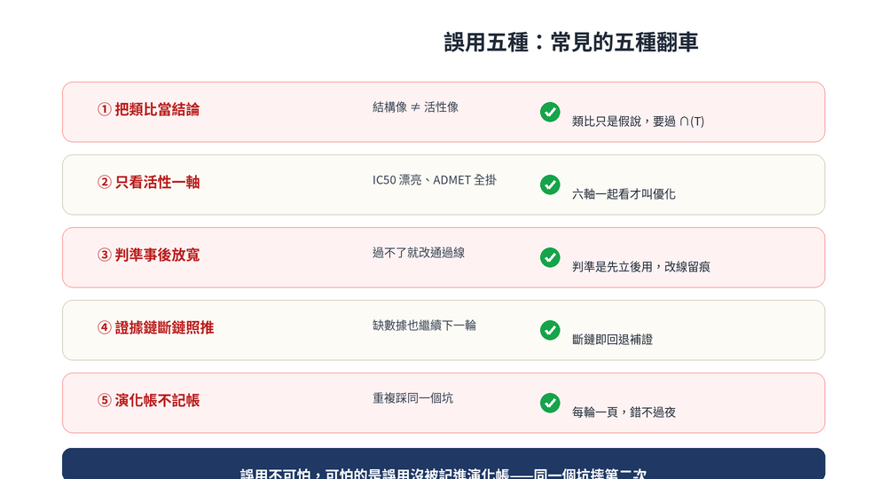

**圖6-1　五種常見誤用**

**表6-1　誤用對照表**

| 誤用 | 症狀 | 後果 | 解方 |
| --- | --- | --- | --- |
| 把類比當結論 | 「結構像」直接套用 | 系列全軍覆沒 | 類比只當假說，過 ∩(T) 才算數 |
| 只看活性一軸 | IC50 優化到底 | ADMET 與安全全掛 | 六軸同看，任何軸不倒退 |
| 判準事後放寬 | 過不了就改線 | 判準失去公信力 | 改線留痕＋版本升級 |
| 斷鏈照推 | 缺數據繼續跑 | 冤枉債一路累積 | 斷鏈即回退補證 |
| 演化帳不記帳 | 檢討會靠印象 | 同一個坑重複摔 | 一輪一頁，錯不過夜 |

## 6.2　十問清單

每份產出離開大腦之前，用十個問題自檢。十問全過再交件；有一問卡住，就回到對應關卡補課。

**表6-2　十問清單**

| # | 自檢問 |
| --- | --- |
| 1 | 這份產出屬於哪個容器？id(C) 對得上嗎？ |
| 2 | 六形欄位有沒有除『待補』以外的空白？ |
| 3 | 判準是先立的還是後補的？版本號是多少？ |
| 4 | 預測有沒有區間？實測有沒有做校正？ |
| 5 | 關鍵結論能不能一站一站點回原始數據？ |
| 6 | 這一輪動了幾處？有沒有一次動三處的偷跑？ |
| 7 | 六軸有沒有任何一軸倒退而沒記錄？ |
| 8 | 用的招式對得上情境嗎？退出條件寫了嗎？ |
| 9 | 這一輪的錯進演化帳了嗎？歸因有名字嗎？ |
| 10 | 把這份產出交給下一輪的自己，接得住嗎？ |

## 6.3　成熟度 L1–L4

成熟度不是榮譽，是穩定度。四級各有達標線與常見卡點——升級看證據，不看口號。

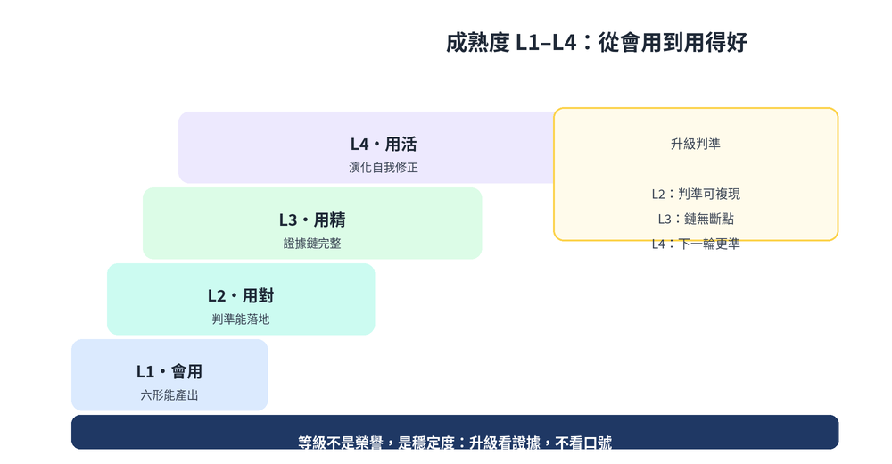

**圖6-2　成熟度階梯**

**表6-3　成熟度四級**

| 級 | 特徵 | 達標線 | 常見卡點 |
| --- | --- | --- | --- |
| L1・會用 | 六形能產出 | 每形都有欄位卡 | 欄位照抄、判準空轉 |
| L2・用對 | 判準能落地 | 四關有通過線與否決線 | 判準後補、改線不留痕 |
| L3・用精 | 證據鏈完整 | 六站零斷點 | 原始檔散落、推導跳步 |
| L4・用活 | 演化自我修正 | 判準庫每輪有異動 | 歸因寫不清、換招遲疑 |

## 6.4　九十天導入藍圖

導入不用一步到位：三十天立形、三十天立鏈、三十天立帳。Day 90 的驗收標準只有一個——開檢討會時拿得出演化帳，而不是拿印象。

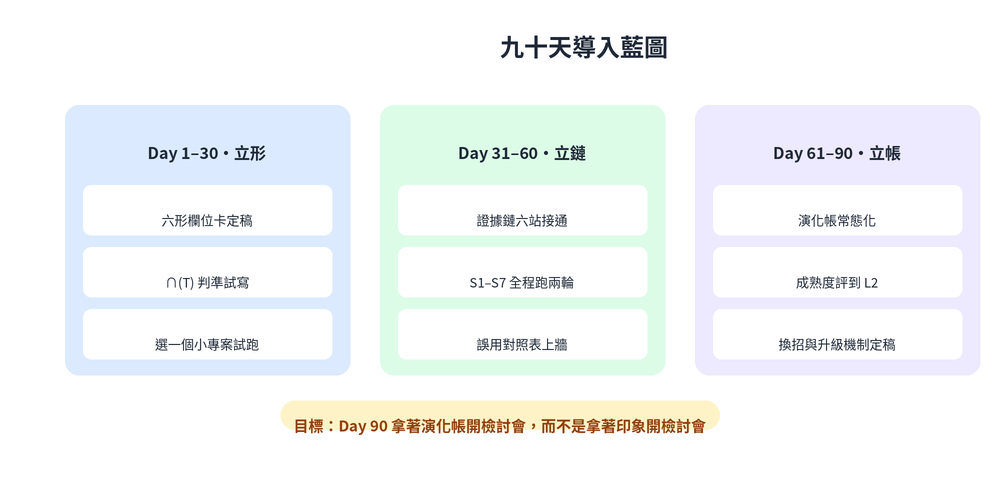

**圖6-3　九十天導入藍圖**

**表6-4　九十天藍圖**

| 時程 | 主題 | 里程碑 | 驗收 |
| --- | --- | --- | --- |
| Day 1–30 | 立形 | 六形欄位卡定稿・判準四關試寫 | 一個小專案跑完一輪 |
| Day 31–60 | 立鏈 | 證據鏈六站接通・接力跑兩輪 | 誤用表上牆・十問抽檢 |
| Day 61–90 | 立帳 | 演化帳常態化・判準庫啟用 | 成熟度評上 L2・換招機制定稿 |

> **本章重點**
>
> 五種誤用的根因都是「想跳關卡」——跳過去的成本會加倍討回來。
>
> 十問清單是交件前的最後防線；成熟度升級看證據：判準版本、鏈斷點數、演化帳頁數都會說話。
>
> 九十天分三段走：先立形、再立鏈、後立帳——Day 90 拿演化帳開檢討會。

# 回顧：三個帶走

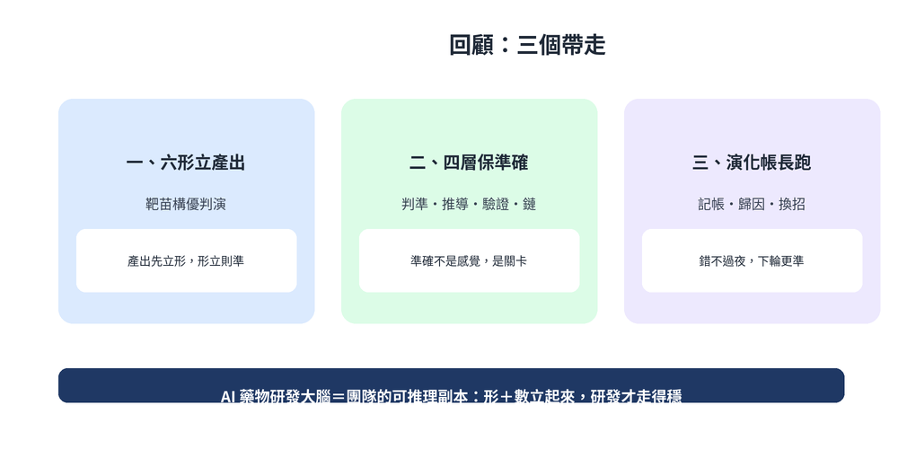

**圖R-1　三個帶走**

> **帶走一・六形立產出（靶苗構優判演）**
>
> 產出先立形，形立則準：靶點形、苗頭形、構效形、優化形、判決形、演化形——六形是研發產出的最小完全集。

> **帶走二・四層保準確（判準・推導・驗證・鏈）**
>
> 準確不是感覺，是關卡：∩(T) 管資格、演繹骨架管推理、三件套管真實、六站管查核——四層都過才算數。

> **帶走三・演化帳長跑（記帳・歸因・換招）**
>
> 一輪一頁、錯不過夜：記了帳，錯誤才會變成判準；換了招，停滯才會變成推進。

**表R-1　全書重點總表**

| 章 | 帶走什麼 | 關鍵工具 |
| --- | --- | --- |
| 第 1 章 | 可推理副本的世界觀 | 形＋數・雙本形・四層關卡預告 |
| 第 2 章 | 六形欄位卡與三括號拆解 | 靶苗構優判演・remove 三級・id(C) |
| 第 3 章 | 準確性四道關卡 | ∩(T)・演繹骨架・三件套・六站 |
| 第 4 章 | 可開工的流程 | 框架四步驟・六步驟・三層判斷 |
| 第 5 章 | 提示詞與全程案例 | 七段接力・DX 系列・使用守則 |
| 第 6 章 | 對照檢查與升級路徑 | 誤用對照・十問・L1 至 L4 |

> **最後提醒**
>
> 本書案例與數據均為示範性質，用於說明方法；真實研發請以實驗數據、法規要求與專業判斷為準。AI 藥物研發大腦是研發團隊的可推理副本——它放大專業，不取代專業。

# 附錄 A　工具箱

三張速查表：術語、招式、記號。讀書時當索引，開工時當桌面卡。

**表A-1　術語速查**

| 術語 | 英文 | 一句話 |
| --- | --- | --- |
| 形 | Type | 「是什麼」的完整表記——英文用 Type，不是 Form |
| 形集合 | Type Set | T = ( F(T), ∩(T) )：生成規則＋交集判準 |
| 交集判準 | ∩(T) | 合格產出的生成規則：既是這個形、又過所有判準 |
| 屬性 | Property | [ ] 抽象集合・刻度軸 |
| 組成 | BOM | { } 組成集合・部件依存軸 |
| 容器 | Container | ( ) 空間容器・專案到分子的空間軸 |
| 身份錨 | id(C) | 改名換代仍認得自己的穩定身份 |
| remove 三級 | remove | 拆下來認得自己：關鍵/骨架/裝飾三級 |
| 招式 | Motion / Function | 時間本形＝動詞＝函式＝方法 |
| 演化帳 | Evolution Log | 一輪一頁：變更・歸因・判準異動・計畫 |
| PCC | Preclinical Candidate | 藥物候選：判決形的升級對象 |
| MPO | Multi-Parameter Optimization | 多參數優化：六軸不倒退 |
| SAR | Structure-Activity Relationship | 構效關係：改動→後果的可推導關係 |

**表A-2　十四招速查（時間本形落點）**

| 組 | 招式 | 藥物研發一句話 |
| --- | --- | --- |
| 一・搜尋萃取 | 形時間函式搜尋 | 文獻・專利・資料庫找答案 |
| 一・搜尋萃取 | 設計搜尋與萃取 | 虛擬庫與分片篩選找分子 |
| 二・推理思考 | 推理 | 因果/逆向/統計：解開 SAR 與代謝之謎 |
| 二・推理思考 | 思考法 | 第一性原理看骨架，逆向看失敗 |
| 二・推理思考 | 解題 | 多參數互斥先拆哪個結 |
| 二・推理思考 | 分析 | 對接模式與警訊數據在說什麼 |
| 三・設計生成 | 設計（創造與創新） | 新骨架與修飾位點的創造 |
| 三・設計生成 | 設計模式 | 生物電子等排・前藥策略直接套 |
| 三・設計生成 | 邏輯生成與應用 | 合成逆推：做得出才進得了下一關 |
| 三・設計生成 | 函式生成與應用 | 生成式設計：給我一批新候選 |
| 四・學習演化 | 持續學習 | 每輪數據回灌，判準跟著長 |
| 四・學習演化 | 重構與重組 | 骨架跳躍，逃出局部最優 |
| 四・學習演化 | 研發與探索 | 新靶點・新適應症的探索 |
| 四・學習演化 | 自我演化 | 演化帳到下一輪計畫的閉環 |

**表A-3　記號速查**

| 記號 | 讀作 | 意義 |
| --- | --- | --- |
| [ ] | 方括號 | 抽象集合・屬性 Property（X 軸） |
| { } | 花括號 | 組成集合・BOM（Y 軸） |
| ( ) | 圓括號 | 容器集合・空間容器（Z 軸） |
| T = ( F(T), ∩(T) ) | 形集合 | 形＝生成規則＋交集判準 |
| C = ( id(C), S(C) ) | 容器 | 容器＝身份＋結構 |
| ∩(T) | 交集判準 | 合格產出的判準 |
| remove(p, M) ≠ M | remove | 拆掉關鍵部件 p 就不是 M |
| S(t+1) = g(S(t), 招, 事件) | 演化式 | 時間本形的推進式 |
| 空間 × 時間 | 交叉 | 交叉驗收：兩邊都對得上才算數 |

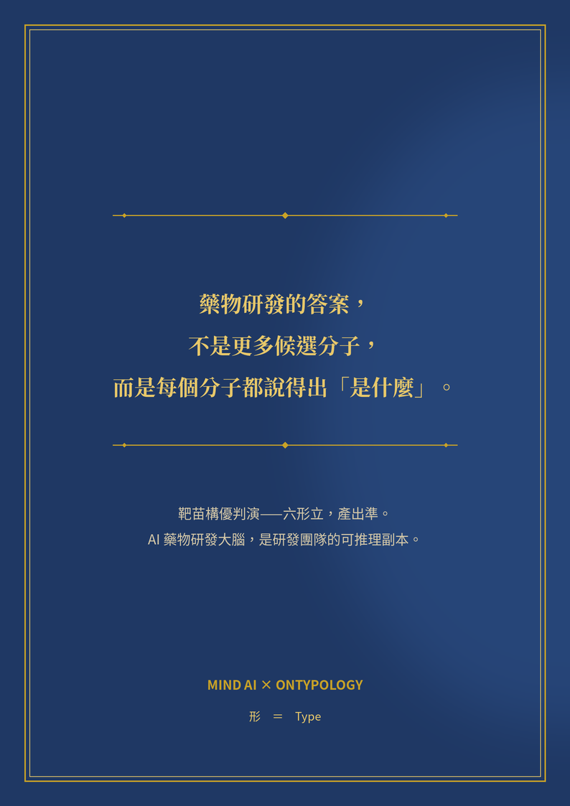
