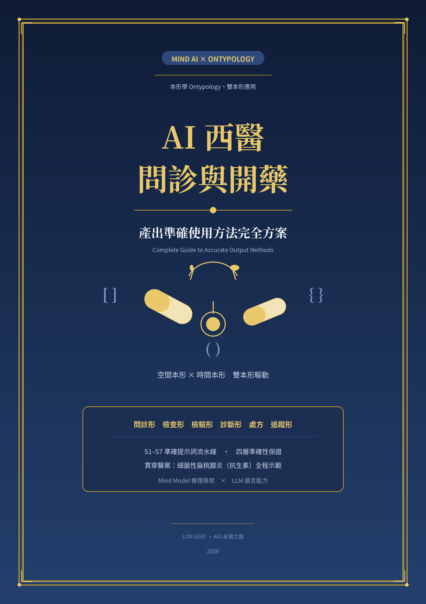

# 目　　錄

- 寫在前面：三個約定
- 導讀：兩套語言，一疊產出
- 第一章　認識 AI 西醫問診與開藥
  - 1.1　可推理的醫療副本
  - 1.2　形＋數：病歷的兩種材料
  - 1.3　雙本形怎麼落在問診與開藥
  - 1.4　Mind AI 在底層的分工
  - 1.5　「準確」從哪裡來
- 第二章　六種產出形
  - 2.1　六形總覽：一條診療流水線
  - 2.2　問診形・檢查形・檢驗形：把「聽到」變成「結構」
  - 2.3　診斷形：鑑別是漏斗，不是猜謎
  - 2.4　處方：一張處方箋就是一個 BOM
  - 2.5　追蹤形：療程是容器，複診是續頁
- 第三章　四層準確性保證
  - 3.1　第一層・判準漏斗 ∩(T)
  - 3.2　第二層・演繹骨架
  - 3.3　第三層・醫理核方
  - 3.4　第四層・形證據鏈
  - 3.5　空間 × 時間交叉驗收
- 第四章　準確使用方法・六步驟
  - 4.1　框架四步驟：先認明情境
  - 4.2　六步驟全程
  - 4.3　三層判斷：是・有・對
  - 4.4　挑招・組招・換招
- 第五章　S1–S7 提示詞與醫案全程
  - 5.1　流水線設計：七段接力
  - 5.2　七段提示詞全文
  - 5.3　醫案全程產出
  - 5.4　處方箋與核方報告
  - 5.5　複診調藥與常見錯誤
- 第六章　誤用・檢核・成熟度
  - 6.1　誤用五種
  - 6.2　十問清單
  - 6.3　成熟度 L1–L4
- 回顧・收束
- 附錄 A　術語・招式・記號速查
  - A.1　術語速查
  - A.2　時間本形招式盤 × 問診開藥落點
  - A.3　記號速查

# 寫在前面：三個約定

這是一本「怎麼用」的書。它要回答的問題只有一個：如何以本形學雙本形——空間本形與時間本形——為理論基礎，以 Mind AI 為底層平台，讓 AI 西醫問診與開藥的每一份產出都準確、可查、可追溯。

在進入正題之前，先立三個約定。這三條貫穿全書，任何一頁都適用。

> **全書三約定**
>
> 約定一・形 = Type。「形」的英文是 Type，不是 Form。書中 SpecType、DiagnosisType 等複合詞一律以 Type 收尾。
>
> 約定二・理論只用不教。本書不重述本形學（空間本形與時間本形）的原理內容，只示範如何「用」：三括號、交集判準、身份錨、remove 三級、框架四步驟、時間本形招式盤，都是拿來就用的工具。
>
> 約定三・平台只引不述。本書不重述 Mind AI 平台本身的介紹內容，只在需要處引用它：Mind Model 提供推理骨架，LLM 提供語言能力，兩者在底層承接所有產出。

> 免責聲明（一）：本書為 AI 輔助問診與開藥的方法論示範，所有醫案、藥物、劑量與用法均為產出格式示範，不構成醫療建議；實際診療與用藥請遵循合格醫師指示與當地藥證規範。

本書的寫法是「產出導向」：每一章都在回答「要產出什麼、怎麼產出、怎麼驗收」。讀者可以把每章的產出形、判準與提示詞直接搬進自己的診療流程，再依專科與法規調整。

**表0-1　任務地圖：你要的產出，去哪一章找**

| 你想做的事 | 去哪一章 | 你會拿到的產出 |
| --- | --- | --- |
| 理解系統怎麼定位 | 第 1 章（認識系統） | 可推理醫療副本、雙本形落點、準確四問 |
| 知道要產出什麼 | 第 2 章（產出形） | 六種產出形規格與處方 BOM |
| 知道怎麼保證準確 | 第 3 章（準確保證） | 四層準確性：判準、骨架、核方、證據鏈 |
| 照著做一次完整診療 | 第 4 章（六步驟） | 六步驟操作法與三層判斷 |
| 拿到提示詞與範例 | 第 5 章（提示詞醫案） | S1–S7 全文＋細菌性扁桃腺炎全程產出 |
| 避開常見錯誤、評估成熟度 | 第 6 章（誤用檢核） | 誤用對照、十問清單、L1–L4 |

# 導讀：兩套語言，一疊產出

在開始之前，用一張圖、兩張表把全書的地勢講清楚：本形學的兩套語言各管什麼、落到西醫問診與開藥上是什麼樣子、以及本書的三種讀法。

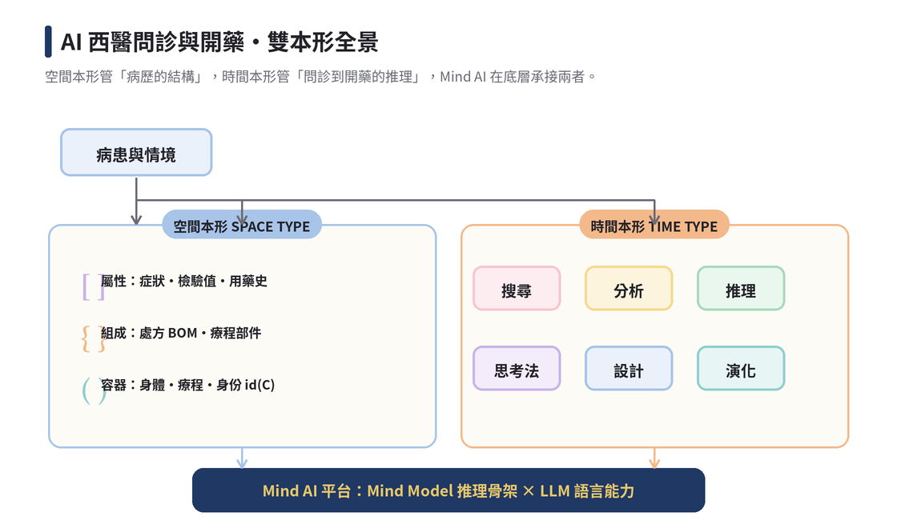

**圖D-1　雙本形全景：空間本形管結構、時間本形管推理，Mind AI 在底層承接**

**表D-1　兩套語言對照：本形學工具 × 問診開藥落點**

| 本形學工具 | 它回答的問題 | 在問診與開藥的落點 |
| --- | --- | --- |
| [ ] 屬性集合（抽象） | 這是什麼樣的東西 | 症狀、檢驗值、用藥史的欄位化 |
| { } 組成集合（BOM） | 它由什麼組成 | 處方 BOM：藥品・劑量・途徑・頻次・天數 |
| ( ) 容器集合（空間容器） | 它在什麼裡面 | 身體、療程時間、病患身份 id(C) |
| ∩(T) 交集判準 | 怎樣才算數 | 鑑別診斷漏斗、用藥條件判準 |
| remove 三級 | 拆掉哪件會怎樣 | 拆衛教／拆主藥／拆天數的三級後果 |
| 框架四步驟 | 情境怎麼認明 | 急診・門診・慢病的情境建形 |
| 時間本形招式盤 | 這一步用什麼招 | 搜尋・分析・推理・設計・演化招式 |
| 三層判斷 | 是・有・對 | 認病・組方・核藥的三層過關 |

**表D-2　三種讀法：依你的角色翻開本書**

| 讀法 | 適合誰 | 怎麼讀 |
| --- | --- | --- |
| 速讀法 | 想知道 AI 能做到什麼的決策者 | 讀第 1 章（認識系統）與第 6 章（誤用檢核）的成熟度節，約 15 分鐘 |
| 照做版 | 要實際導入的醫療團隊 | 依第 4 章（六步驟）操作，搭配第 5 章（提示詞醫案）的 S1–S7 全文照表操課 |
| 審查版 | 負責品質與法遵的把關者 | 以第 3 章（準確保證）四層＋第 6 章十問清單逐項驗收 |

> 讀到這裡先記一件事：本書所有產出都遵循同一條鐵律——先寫判準，再看資料；先有形，才有數。順序反了，後面所有準確性保證都會失效。

# 第一章　認識 AI 西醫問診與開藥

把「AI 看診開藥」當成一個聊天機器人問答，是大多數失敗案例的起點。本章先把它重新定位：AI 西醫問診與開藥不是問答，而是在維護一份可推理的醫療副本——所有準確性，都從這個定位長出來。

## 1.1　可推理的醫療副本

病歷的價值不在「寫下來」，而在「用得上」。紙本病歷思維把症狀寫成散文、把診斷存成印象、把處方散落在處方箋上；複診時重新問一遍，等於每次都在半空中重來。形結構副本則把每一項都放在可運算的位置上：症狀是屬性、診斷有判準、處方有組成、複診是續頁。

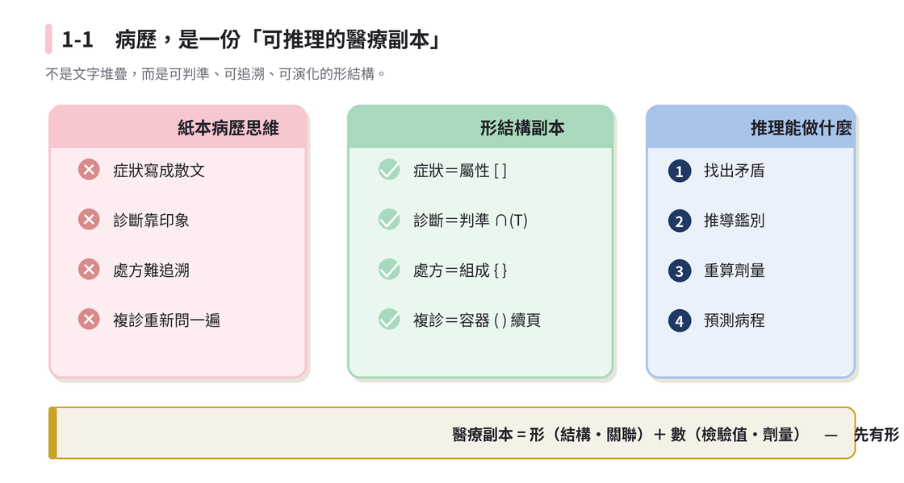

**圖1-1　從紙本病歷到可推理副本：左邊只能讀，右邊能推理**

這個副本要能回答四類問題：資料之間有沒有矛盾（例如自述無過敏卻在用抗過敏藥）、從現有證據能推導出什麼（鑑別診斷）、把某個部件拿掉會怎樣（停藥模擬）、下一次見面應該看什麼（追蹤設計）。能回答這四類問題，才叫「可推理」。

## 1.2　形＋數：病歷的兩種材料

大腦思考是形＋數；病歷也一樣。數回答「有多少」——體溫 38.4°C、白血球 12,600、劑量 500mg。形回答「是什麼、由什麼組成、在哪裡、算不算數」——這是感染而非過敏、這張處方含四個部件、這個療程還沒結束、這個數值超過判準。

先有形，才有數：體溫 38.4 這個數字，必須先被放進「發燒」這個形（以及它的判準）裡才有臨床意義。因此本書的所有流程都是先建形、後填數。

**表1-1　形與數在問診開藥中的分工**

| 材料 | 回答的問題 | 問診開藥的例子 |
| --- | --- | --- |
| 數 | 有多少 | T 38.4°C、HR 92、WBC 12,600、Penicillin V 500mg |
| 形 | 是什麼・由什麼組成 | 細菌性扁桃腺炎、處方 BOM 四部件、GAS 確立 |
| 形＋數 | 在形裡面的數 | Centor 3 分（形的評分）、10 天療程（容器內的數） |

## 1.3　雙本形怎麼落在問診與開藥

空間本形管結構面：把病歷拆成屬性 [ ]、組成 { }、容器 ( ) 三個軸。時間本形管推理面：問診、分析、推理、設計、演化，都是動詞、都是招式。一次完整診療＝一個空間結構＋一串時間招式。

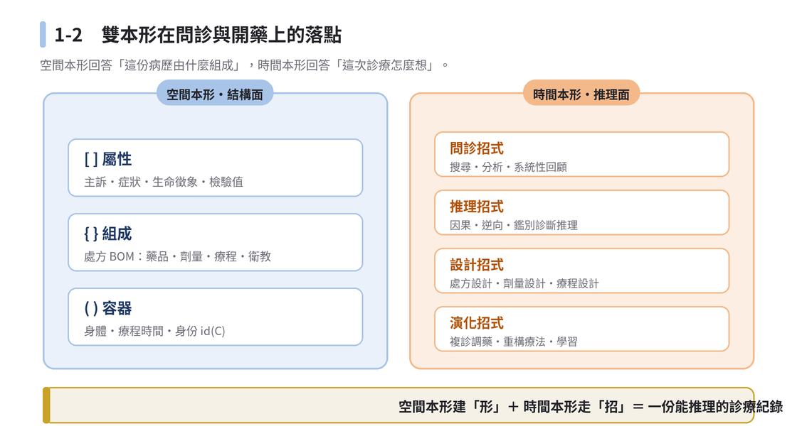

**圖1-2　雙本形落點：左邊建形、右邊出招**

**表1-2　空間本形落點：三括號 × 問診開藥**

| 軸 | 集合 | 問診開藥的落點 | 判準 |
| --- | --- | --- | --- |
| X 軸 | [ ] 屬性・抽象 | 主訴、症狀、生命徵象、檢驗值、用藥史 | 欄位齊全、數值有單位、異常有標記 |
| Y 軸 | { } 組成・BOM | 處方 BOM：藥品、劑量、途徑、頻次、天數、衛教 | 每件拆下來認得自己；主藥不可替換 |
| Z 軸 | ( ) 容器 | 身體、療程時間容器、病患身份 id(C) | 療程內身份不變；跨次診療同容器續頁 |

**表1-3　時間本形落點：招式盤四組 × 問診開藥**

| 招式組 | 代表招式 | 在問診開藥的用法 |
| --- | --- | --- |
| 搜尋組 | 形時間函式搜尋、設計搜尋與萃取 | 從病史庫找相似醫案、從指引萃取用藥規範 |
| 分析組 | 分析、解題 | 症狀拆解、檢驗判讀、矛盾辨識 |
| 推理組 | 因果推理、逆向推理、思考法 | 由症狀推病因（因果）；由檢驗回推感染源（逆向） |
| 設計組 | 設計、函式生成、自我演化 | 處方設計、追蹤函式生成、療法重構與演化 |

## 1.4　Mind AI 在底層的分工

本書只引用、不重述 Mind AI：LLM 負責語言能力——問診對話、病歷敘述、衛教文字；Mind Model 負責智慧能力——判準化推理、BOM 結構運算、禁忌交叉核對、長期記憶與演化。問診開藥要的不是「很會說話」或「很會查表」，而是兩者合一。

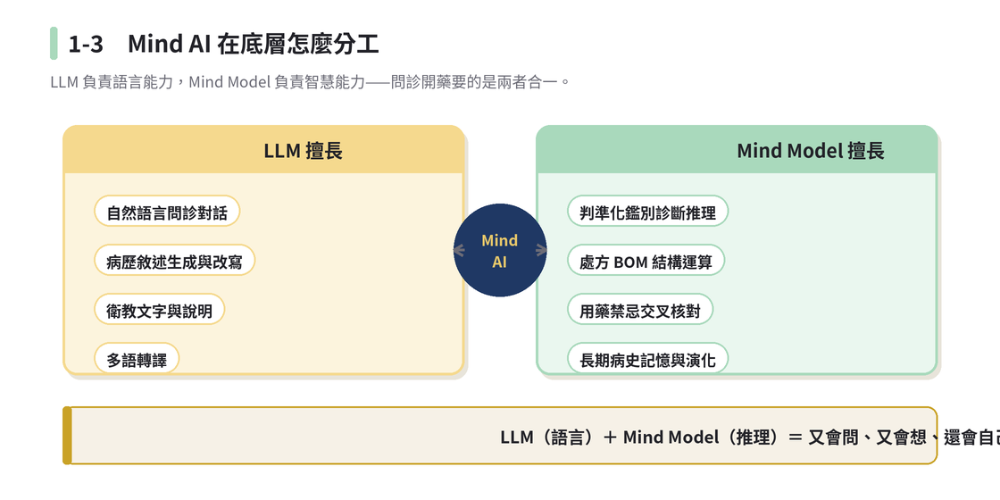

**圖1-3　Mind AI 分工：語言歸 LLM，智慧歸 Mind Model**

## 1.5　「準確」從哪裡來

準確不是模型的天賦，而是流程的紀律。本書把準確拆成四層保證，逐層設關：第一層判準漏斗（∩(T)）決定「怎樣才算數」；第二層演繹骨架決定「處方怎麼推導出來」；第三層醫理核方決定「這個藥對不對」；第四層形證據鏈決定「事後查不查得到」。四層全過的產出才准出門。

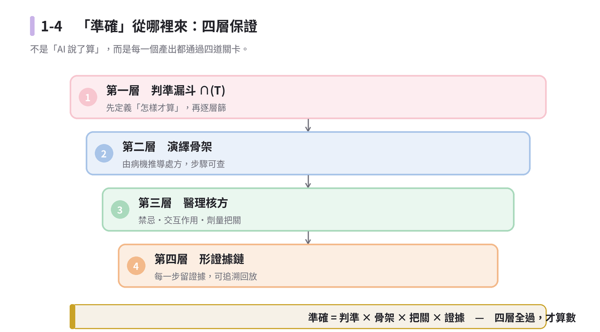

**圖1-4　四層準確性：每一份產出都要過四道關卡**

**表1-4　四層關卡 × 六形落點**

| 關卡 | 守什麼 | 落在哪些產出形 | 不合格動線 |
| --- | --- | --- | --- |
| 第一層　∩(T) | 怎樣才算數 | 診斷形・檢驗形 | 假設擋下，回挑候選集 |
| 第二層　演繹骨架 | 處方怎麼推導出來 | 處方・診斷形 | 反向走查斷點，退回 S5 |
| 第三層　醫理核方 | 這個藥對不對 | 處方 | 換藥或調量，退回 S6 |
| 第四層　形證據鏈 | 事後查不查得到 | 全部六形 | 補鏈或作廢重跑 |

> **本章重點**
>
> 本章重點：（一）AI 西醫問診與開藥＝維護一份可推理的醫療副本；（二）先有形，才有數，流程一律先建形後填數；（三）空間本形建結構、時間本形出招式；（四）準確來自四層關卡，不是模型自信。

# 第二章　六種產出形

診療過程的每一次交付物，都有自己的形、自己的欄位、自己的驗收標準。本章把從初診到追蹤的產出整理成六種形，並示範它們在細菌性扁桃腺炎醫案上的樣子。

## 2.1　六形總覽：一條診療流水線

六種形按診療順序接力：問診形收資料、檢查形收理學所見、檢驗形收數據判讀、診斷形收鑑別與確立、處方收開藥、追蹤形收後續。前一形是後一形的輸入，後一形是前一形的驗收。

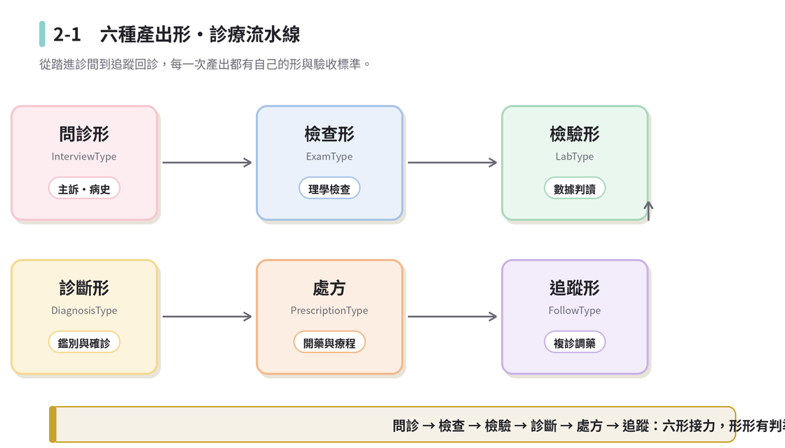

**圖2-1　六形接力：每一形都有產出物與驗收標準**

**表2-1　六種產出形規格總表**

| 產出形 | 英文 | 核心內容 | 驗收標準 |
| --- | --- | --- | --- |
| 問診形 | InterviewType | 主訴、現病史、過去史、用藥史、過敏史、系統性回顧 | 欄位齊全；病人原話有保留 |
| 檢查形 | ExamType | 生命徵象、理學檢查所見 | 陰性所見也要記錄 |
| 檢驗形 | LabType | 檢驗項目、數值、單位、判讀 | 先寫判準再判讀 |
| 診斷形 | DiagnosisType | 鑑別清單、判準評分、確立診斷 | 鑑別由 broad 到 narrow 漏斗收斂 |
| 處方 | PrescriptionType | 處方 BOM、療程、衛教 | 每件部件可追溯到病機 |
| 追蹤形 | FollowType | 追蹤節點、評估項目、調藥條件 | 同容器續頁；身份 id(C) 不變 |

## 2.2　問診形・檢查形・檢驗形：把「聽到」變成「結構」

初診的三形負責把非結構化的「不舒服」變成可運算的欄位。問診形留住病人的話，也把話拆進固定欄位；檢查形記錄理學所見，特別是「沒有發現什麼」——陰性證據在鑑別診斷裡價值極高；檢驗形則是「先寫判準、再看數據」，禁止看完數據再補判準。

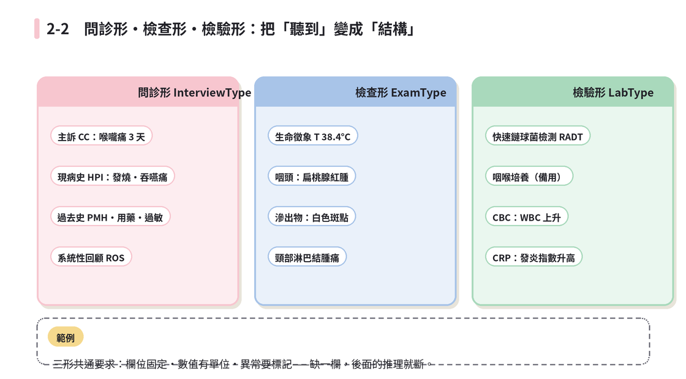

**圖2-2　前三形：問診・檢查・檢驗的欄位與要求**

**表2-2　問診形欄位卡（InterviewType）**

| 欄位 | 內容範例（陳小姐，32 歲） | 形上要求 |
| --- | --- | --- |
| 主訴 CC | 喉嚨痛 3 天 | 病人原話＋時間長度 |
| 現病史 HPI | 吞嚥加劇、發燒至 38.4°C、無咳嗽 | 加劇／緩解因子必填 |
| 過去史 PMH | 無慢性病；無反覆扁桃腺炎 | 陰性也要記 |
| 用藥史 Med | 偶服普拿疼；無長期處方藥 | 含 OTC 與保健品 |
| 過敏史 Allergy | 自述無藥物過敏 | 明確記載「有／無／不明」 |
| 系統性回顧 ROS | 無皮疹、無關節痛、無氣喘 | 與鑑別相關系統必問 |

## 2.3　診斷形：鑑別是漏斗，不是猜謎

診斷形的核心是漏斗：候選集要夠 broad，收斂要靠判準。以喉嚨痛為例，第一層先分感染與非感染，第二層在感染裡分病毒與細菌，第三層用 Centor 準則評分，第四層用 RADT（快速鏈球菌抗原檢測）確立。每一層都要寫下「憑什麼篩掉」。

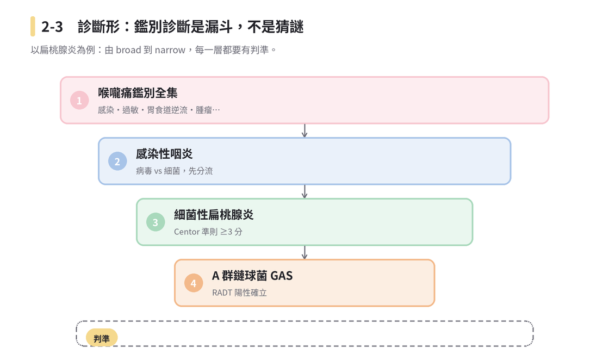

**圖2-3　診斷漏斗：每一層的收斂都有判準可查**

**表2-3　鑑別診斷對照表（喉嚨痛・節錄）**

| 候選診斷 | 支持證據 | 反對證據 | 判準結果 |
| --- | --- | --- | --- |
| 病毒性咽炎 | 喉痛、發燒 | 無咳嗽、RADT 陽性 | 排除 |
| 細菌性扁桃腺炎（GAS） | Centor 3 分、滲出物、RADT 陽性 | 無 | 確立 |
| 傳染性單核白血球症 | 年輕、咽痛 | 無淋巴結腫大、無脾腫 | 排除・留觀察 |
| 扁桃腺周圍膿瘍 | 單側劇痛 | 無張口困難、無聲音含糊 | 排除 |

## 2.4　處方：一張處方箋就是一個 BOM

處方是組成集合 { }：拆下來每一件都認得自己。以本次醫案為例，處方 BOM 含四個部件——主藥、症狀緩解、局部處置、衛教——每個部件都有自己的角色與不可替換性。

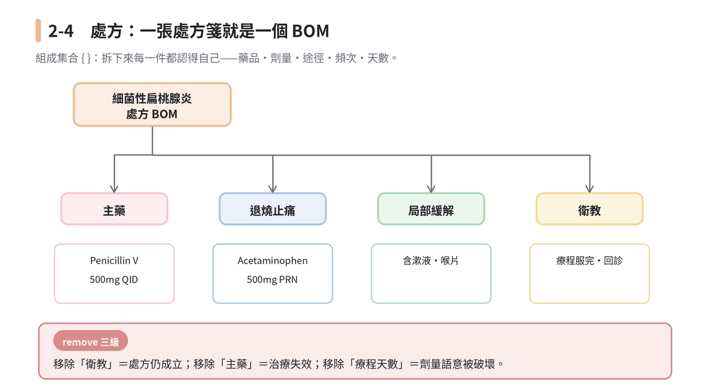

**圖2-4　處方 BOM：四個部件與 remove 三級後果**

**表2-4　處方 BOM 規格（細菌性扁桃腺炎・僅供示範）**

| 部件 | 藥品／內容 | 劑量・途徑・頻次 | 天數 | 角色 |
| --- | --- | --- | --- | --- |
| 主藥 | Penicillin V | 500mg・PO・QID | 10 天 | 殺菌・不可任意替換 |
| 症狀緩解 | Acetaminophen | 500mg・PO・PRN（≤QID） | 依需要 | 退燒止痛・輔助 |
| 局部處置 | 溫鹽水含漱 | 每 4–6 小時 | 10 天 | 緩解・輔助 |
| 衛教 | 服完療程・回診條件 | — | 10 天 | 保障療程完整 |

> **remove 三級 × 處方**
>
> remove 三級落在處方上：移除「衛教」部件，處方仍成立（一級：影響品質）；移除「主藥」部件，治療失效（二級：破壞功能）；移除「療程天數」欄位，劑量語意被破壞，處方不可執行（三級：破壞語意）。寫處方時，三級部件要加粗標注、不可省略。

## 2.5　追蹤形：療程是容器，複診是續頁

追蹤形掛在容器 ( ) 上：Day 0 到 Day 30 是同一個療程時間容器，病患身份 id(C) 在容器內不變——改名、換號、轉診都不換身份。複診不是重新開始，而是同一條鏈上的新時間切片：只追加差異，不重抄全文。

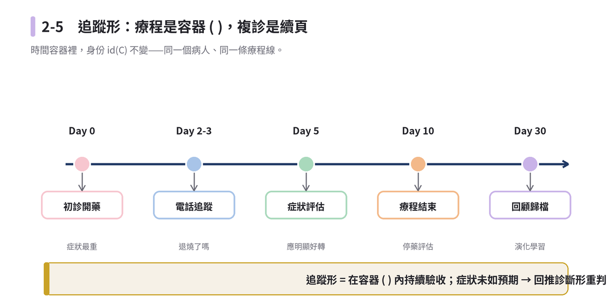

**圖2-5　追蹤時間軸：容器內的五個節點**

**表2-5　追蹤節點規格（FollowType）**

| 節點 | 評估項目 | 合格標準 | 不合格動線 |
| --- | --- | --- | --- |
| Day 2–3 電話追蹤 | 退燒與否、疼痛變化 | 已退燒・疼痛下降 | 回推診斷形重判 |
| Day 5 症狀評估 | 吞嚥、精神、食慾 | 明顯好轉 | 回診提前・考慮併發症 |
| Day 10 療程結束 | 完成療程與否 | 全程服藥・症狀緩解 | 未服完者再衛教 |
| Day 30 回顧 | 有無復發 | 無復發 | 反覆發作→轉耳鼻喉評估 |

> **本章重點**
>
> 本章重點：（一）六形接力，前形輸入後形驗收；（二）陰性證據與陽性證據同樣要記；（三）診斷是判準漏斗，不是直覺；（四）處方是 BOM，三級部件不可省；（五）追蹤在容器內續頁，身份 id(C) 不變。

# 第三章　四層準確性保證

「AI 開的藥能不能信」是這套系統的生死題。答案不取決於模型多大，取決於關卡多嚴。本章把準確性拆成四層，逐層說明它在扁桃腺炎醫案上怎麼運作。

## 3.1　第一層・判準漏斗 ∩(T)

交集判準 ∩(T) 的精神是：資料 ∩ 判準，過不了判準的假設不准往下走。實務順序絕對不能反——先寫下判準，再放資料進來；如果先看資料再湊判準，那是事後諸葛，不是推理。

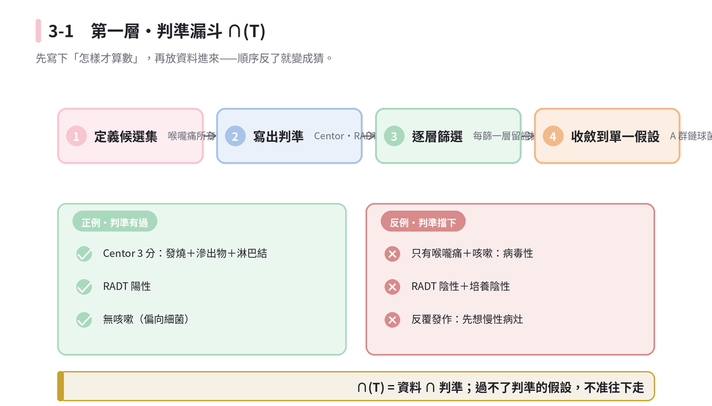

**圖3-1　判準漏斗：先立判準，再篩資料**

**表3-1　∩(T) 判準表・扁桃腺炎鑑別**

| 判準 | 量測方式 | 通過門檻 | 擋下什麼 |
| --- | --- | --- | --- |
| Centor 準則 | 發燒・無咳嗽・頸淋巴結・滲出物各 1 分 | ≥ 3 分進入細菌假設 | 病毒性咽炎 |
| RADT 快篩 | 咽喉拭子抗原檢測 | 陽性確立 GAS | 非鏈球菌感染 |
| 病程判準 | 症狀天數與趨勢 | &gt; 3 天且加重 | 輕微自限性喉痛 |
| 紅旗判準 | 呼吸困難・張口困難・流口水 | 任一出現即轉急 | 膿瘍・會厭炎 |

## 3.2　第二層・演繹骨架

處方必須沿著一條可見的推理鏈長出來：病因 → 病機 → 證據 → 治則 → 處方。這條鏈就是演繹骨架——它讓「開藥」從查表變成推導。檢查方法很簡單：反向走一遍，任一環對不上，產出退回。

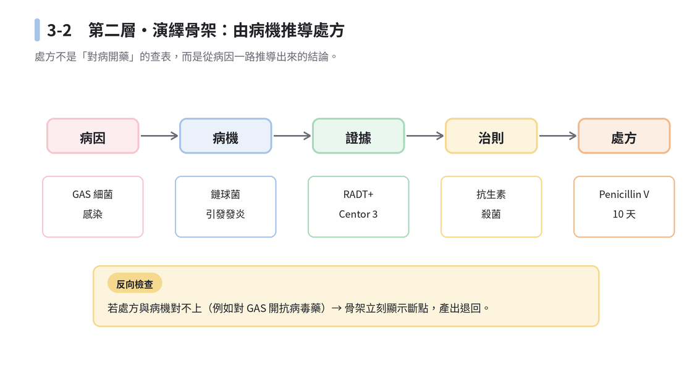

**圖3-2　演繹骨架：由病因推到處方，環環相扣**

**表3-2　演繹骨架・扁桃腺炎醫案**

| 骨架環 | 內容 | 對應產出形 |
| --- | --- | --- |
| 病因 | A 群鏈球菌（GAS）感染 | 診斷形 |
| 病機 | 細菌引發咽頭急性化膿性發炎 | 診斷形 |
| 證據 | Centor 3 分＋RADT 陽性＋WBC 升高 | 檢查形・檢驗形 |
| 治則 | 抗生素殺菌＋症狀緩解 | 診斷形 |
| 處方 | Penicillin V 500mg QID ×10d | 處方 |

## 3.3　第三層・醫理核方

就算診斷對、藥物對，處方在出門前還要過最後一道關：醫理核方三問——禁忌核對、交互作用核對、劑量核對。三問都要回答「可以」才放行；任何一問答「不行」，就換藥或退回重推。

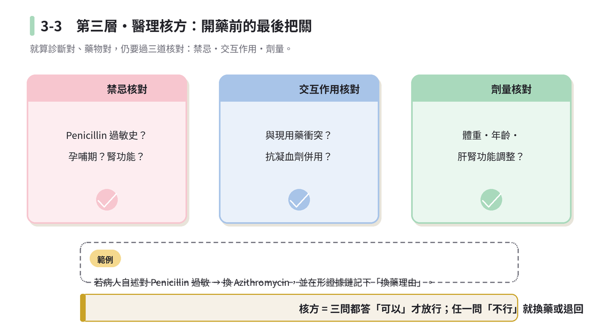

**圖3-3　醫理核方三問：開藥前的最後把關**

**表3-3　醫理核方清單・本醫案**

| 核對項 | 查什麼 | 本醫案結果 | 動線 |
| --- | --- | --- | --- |
| 禁忌 | Penicillin 過敏史、孕哺期、腎功能 | 過敏史陰性・非孕哺・腎功能正常 | 通過 |
| 交互作用 | 與現用藥衝突（如抗凝血劑） | 無長期用藥 | 通過 |
| 劑量 | 體重・年齡・肝腎功能調整 | 32 歲 56kg，成人標準劑量 | 通過 |
| 替代預案 | 過敏時的替代藥 | Azithromycin 5 天療程（預案） | 備援 |

> 免責聲明（二）：表 3-3 與本書所有藥物劑量僅為產出示範，不構成醫療建議；實際處方須由合格醫師依病人個別狀況、當地藥證與最新指引決定。

## 3.4　第四層・形證據鏈

形證據鏈要求：輸入有源、過程有據、輸出可審、時間可回放。空間上，每一份產出附著它的證據；時間上，每一次改動留有紀錄。兩者交叉驗收，構成完整的可追溯性。

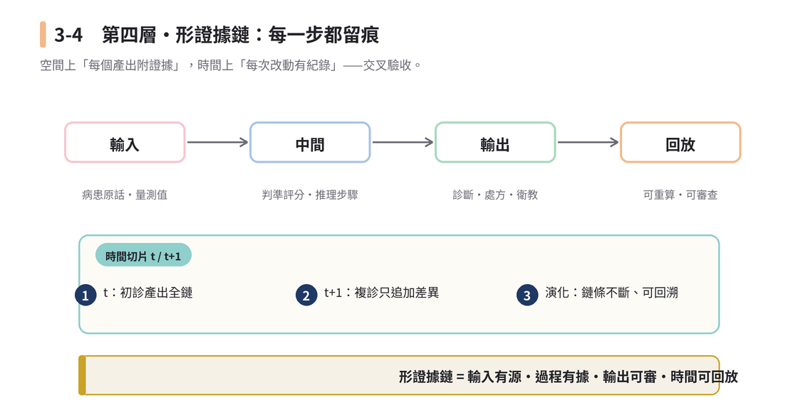

**圖3-4　形證據鏈：四段留痕＋時間切片**

**表3-4　形證據鏈・欄位規格**

| 鏈段 | 留什麼 | 保存位置 | 審查用途 |
| --- | --- | --- | --- |
| 輸入 | 病人原話、量測值、檢驗報告 | 問診形・檢查形・檢驗形 | 回放當時依據 |
| 中間 | 判準評分、推理步驟、被排除假設 | 診斷形 | 重算推理是否成立 |
| 輸出 | 診斷、處方、衛教、核方報告 | 處方 | 追溯處方來源 |
| 回放 | 複診差異、調藥理由、療效 | 追蹤形 | 療法演化與學習 |

## 3.5　空間 × 時間交叉驗收

四層關卡在空間與時間兩個方向同時生效：空間上驗收「這份產出結構完整嗎」，時間上驗收「這次改動有理由嗎」。任何一方向破線，整條鏈就不合格。

**表3-5　交叉驗收表**

| 驗收方向 | 驗收問題 | 不合格示例 |
| --- | --- | --- |
| 空間・結構 | 六形欄位齊全？BOM 部件可拆？證據有附著？ | 處方缺天數欄、檢驗無單位 |
| 空間・語意 | 三級部件在？命名一致？ | 主藥被寫成「藥物 A」無法追溯 |
| 時間・順序 | 先判準後資料？先骨架後處方？ | 先開藥再補診斷理由 |
| 時間・演化 | 調藥有理由？容器續頁？ | 複診另起爐灶、身份斷鏈 |

> **本章重點**
>
> 本章重點：（一）∩(T) 先立判準後篩資料；（二）處方要能沿演繹骨架反向走回病因；（三）醫理核方三問全過才放行；（四）形證據鏈保證事後可回放；（五）空間×時間交叉驗收，缺一不合格。

# 第四章　準確使用方法・六步驟

前三章給了定位、產出形與關卡；本章把它們串成一條可操作的動線：六步驟。每一步都有輸入、輸出與驗收，並示範在急性感染與慢性病兩種情境下怎麼挑招、組招、換招。

## 4.1　框架四步驟：先認明情境

框架四步驟是建形前的準備動作：先認情境、再定邊界、後立欄位、最後設判準。情境不對，後面全錯——急診情境與慢病調藥情境，招式完全不同。

**表4-1　框架四步驟 × 問診開藥**

| 步驟 | 動作 | 扁桃腺炎醫案示範 |
| --- | --- | --- |
| 認情境 | 急診／門診／慢病？急性或慢性？ | 門診・急性感染・單次發作 |
| 定邊界 | 本次診療的範圍與排除項 | 限 GAS 咽炎；排除膿瘍與全身性疾病 |
| 立欄位 | 六形欄位清單就位 | 問診六欄・檢查四項・檢驗三項 |
| 設判準 | ∩(T) 與紅旗判準先行 | Centor ≥3、RADT、紅旗即轉急 |

## 4.2　六步驟全程

六步驟依序是：認明情境、分軸建形、挑選擴式、生成產出、判準驗收、歸檔演化。前三步是準備，第四步是產出，第五步是關卡，第六步讓系統越來越準。

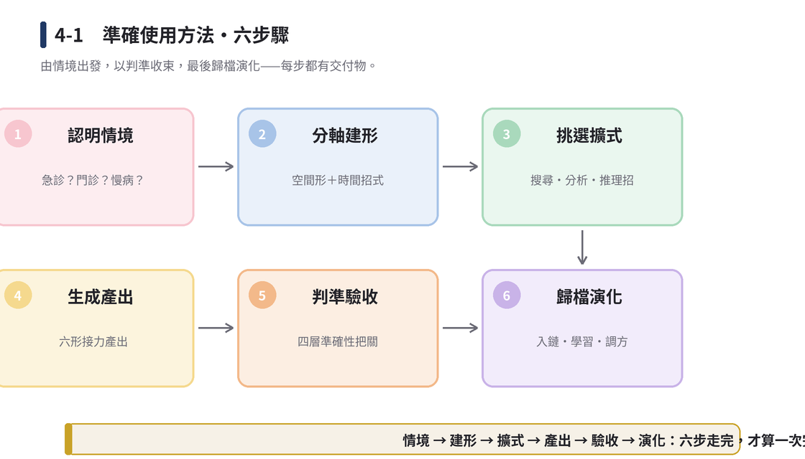

**圖4-1　六步驟：每一步都有交付物**

**表4-2　六步驟操作卡**

| 步驟 | 輸入 | 動作 | 輸出 | 驗收 |
| --- | --- | --- | --- | --- |
| 1 認明情境 | 主訴 | 框架四步驟 | 情境標籤 | 情境與主訴一致 |
| 2 分軸建形 | 情境標籤 | 三括號建形 | 六形骨架 | 欄位齊全 |
| 3 挑選擴式 | 六形骨架 | 招式盤挑招 | 招式清單 | 招式與情境匹配 |
| 4 生成產出 | 招式清單 | S1–S7 流水線 | 六形產出 | 格式合規 |
| 5 判準驗收 | 六形產出 | 四層準確性 | 合格產出 | 四層全過 |
| 6 歸檔演化 | 合格產出 | 入鏈・學習 | 時間切片 | 鏈條連續 |

## 4.3　三層判斷：是・有・對

形邏輯三層判斷落在問診開藥上就是三個問題：是什麼（異同判斷）、有什麼（組成判斷）、對不對（判準判斷）。三層由左到右過關，產出才成立。

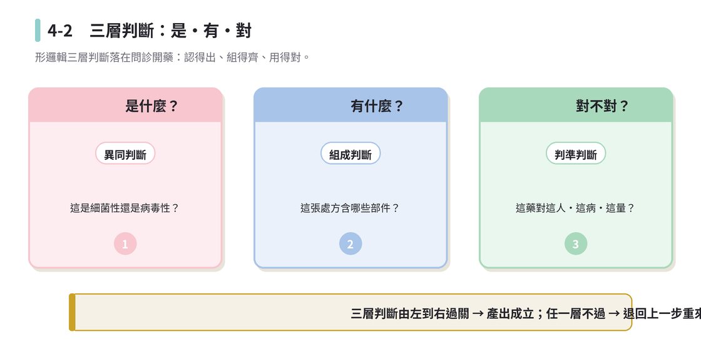

**圖4-2　三層判斷：認得出、組得齊、用得對**

**表4-3　三層判斷・醫案實作**

| 層 | 問題 | 本醫案答案 | 不過關時 |
| --- | --- | --- | --- |
| 是 | 細菌性還是病毒性？ | 細菌性（Centor 3＋RADT+） | 回 S4 重跑鑑別漏斗 |
| 有 | 處方含哪些部件？ | 主藥・緩解・局部・衛教四件 | 回 S5 補齊 BOM |
| 對 | 藥對人・對病・對量？ | Penicillin V 過三問 | 回 S6 換藥或調量 |

## 4.4　挑招・組招・換招

時間本形是動詞盤：同一個病人情境，急性感染用快招（搜尋＋因果推理＋處方設計），慢性調藥用長招（病史回放＋統計推理＋階梯調藥）。招式可以組合，也可以中途換——追蹤未如預期時，先停「設計招」，退回「推理招」重新鑑別。

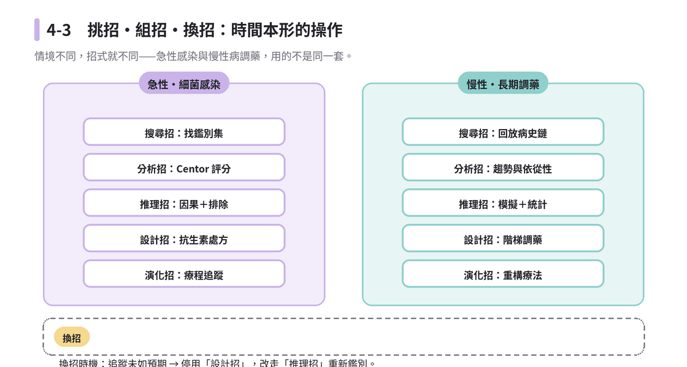

**圖4-3　兩種情境的招式編排**

**表4-4　挑招・組招・換招對照**

| 動作 | 急性感染情境 | 慢性病調藥情境 |
| --- | --- | --- |
| 挑招 | 搜尋招（找鑑別集）＋推理招（因果） | 搜尋招（回放病史鏈）＋推理招（統計） |
| 組招 | 分析＋推理＋設計：評分→確診→處方 | 分析＋設計＋演化：趨勢→階梯→調藥 |
| 換招 | 48–72h 未退燒→換推理招重鑑別 | 三月未達標→換設計招改二線藥 |

**表4-5　六步驟 × 誤用預警點**

| 步驟 | 最常見偷跑 | 預警訊號 |
| --- | --- | --- |
| 1 認明情境 | 沒分急性慢性就開跑 | 主訴含「反覆」「多年」卻用急性招式 |
| 2 分軸建形 | 欄位先空著後補 | 產出表出現「待填」超過兩欄 |
| 3 挑選擴式 | 只用自己熟的招 | 慢性病案卻完全沒有回放招 |
| 4 生成產出 | 直接跳 S5 要處方 | 處方沒有對應的診斷形輸入 |
| 5 判準驗收 | 核方報告只寫「通過」 | 三問沒有各自的理由欄 |
| 6 歸檔演化 | 結案不入鏈 | 下次初診又從零開始問 |

> **本章重點**
>
> 本章重點：（一）框架四步驟先行，情境錯全盤錯；（二）六步驟每步有輸入輸出與驗收；（三）三層判斷「是・有・對」逐層過關；（四）招式可挑可組可換，換招要有觸發條件。

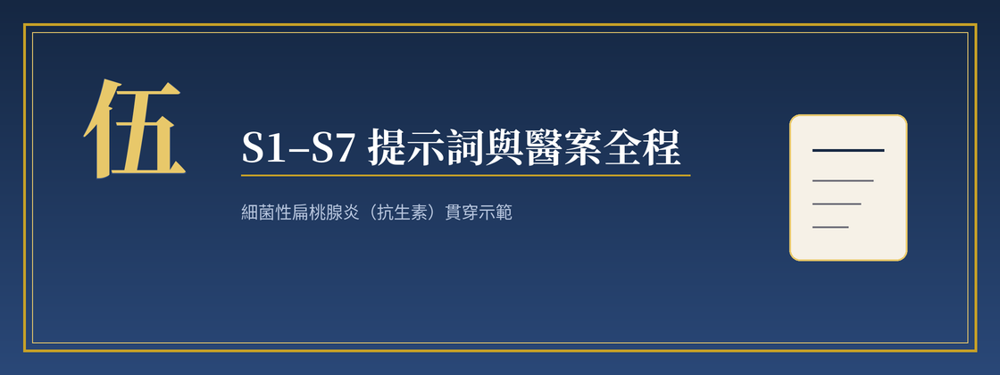

# 第五章　S1–S7 提示詞與醫案全程

本章交付兩樣可以直接使用的東西：七段提示詞的全文，以及一份從問診到追蹤的完整產出示範。醫案沿用貫穿全書的細菌性扁桃腺炎案例——陳小姐，32 歲，喉嚨痛 3 天伴發燒。

## 5.1　流水線設計：七段接力

七段提示詞各司其職：S1 病史採集、S2 檢查規劃、S3 檢驗判讀、S4 鑑別診斷、S5 處方生成、S6 醫理核方、S7 衛教追蹤。前一段的產出就是後一段的輸入，任何一段都可單獨審查、單獨重跑。

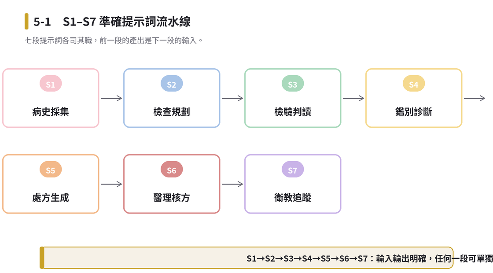

**圖5-1　七段接力：輸入輸出明確，可分段審查**

**表5-1　S1–S7 職掌表**

| 段 | 職掌 | 輸入 | 輸出產出形 |
| --- | --- | --- | --- |
| S1 | 病史採集 | 病人陳述 | 問診形 |
| S2 | 檢查規劃 | 問診形 | 檢查形（規劃） |
| S3 | 檢驗判讀 | 檢驗數據＋判準 | 檢驗形 |
| S4 | 鑑別診斷 | 問診形・檢查形・檢驗形 | 診斷形 |
| S5 | 處方生成 | 診斷形 | 處方 |
| S6 | 醫理核方 | 處方 | 核方報告 |
| S7 | 衛教追蹤 | 處方＋核方報告 | 追蹤形 |

## 5.2　七段提示詞全文

以下為可直接複製使用的提示詞。〔　〕內為使用時替換的變項；每段都內建格式約束與「不確定就說不確定」的誠實條款。

> **S1　病史採集**
>
> 你是西醫門診醫師。請對病人進行結構化問診，產出「問診形 InterviewType」。
>
> 欄位：主訴 CC（病人原話＋天數）、現病史 HPI（加劇／緩解因子）、過去史 PMH、用藥史 Med（含 OTC）、過敏史 Allergy、系統性回顧 ROS。
>
> 要求：（一）一次只問 1–3 個問題，禁止一次問完；（二）陰性證據也要記；（三）病人未提供的欄位填「未提供」，禁止推測補值。
>
> 輸出格式：Markdown 表格，欄位為「欄位｜內容｜資料來源（病人原話／醫師判斷）」。

> **S2　檢查規劃**
>
> 輸入：問診形〔貼上 S1 產出〕。
>
> 任務：規劃本次理學檢查，產出「檢查形 ExamType」規劃單。
>
> 要求：（一）列出必查項目與「查了要確認什麼」；（二）列出鑑別所需但本次不查的項目與理由；（三）紅旗項目（呼吸困難、張口困難、頸部腫塊）必列。
>
> 輸出格式：表格「檢查項｜目的｜對應鑑別假設｜紅旗關聯」。

> **S3　檢驗判讀**
>
> 輸入：檢查形〔貼上 S2 產出〕＋檢驗數據〔貼上報告〕。
>
> 任務：先寫判準、再看數據，產出「檢驗形 LabType」判讀單。
>
> 要求：（一）每項檢驗先寫「判準（門檻值與方向）」再填數值與結論；（二）數值必帶單位；（三）超出判準的項目標異常，並寫明它支持或反對哪個假設。
>
> 輸出格式：表格「項目｜判準｜數值｜結論｜支持／反對假設」。

> **S4　鑑別診斷**
>
> 輸入：問診形＋檢查形＋檢驗形〔貼上 S1–S3 產出〕。
>
> 任務：產出「診斷形 DiagnosisType」。
>
> 要求：（一）鑑別清單由 broad 到 narrow，至少列 3 個候選；（二）每個候選附支持與反對證據；（三）用判準漏斗逐層收斂，每層寫明憑什麼篩掉；（四）確立診斷附置信度；（五）紅旗陰性也要寫。
>
> 輸出格式：先漏斗表「層｜判準｜候選｜結果」，再結論「確立診斷｜置信度｜仍待確認」。

> **S5　處方生成**
>
> 輸入：診斷形〔貼上 S4 產出〕＋病人基本資料（年齡、體重、肝腎功能、過敏史、現用藥）。
>
> 任務：產出「處方 PrescriptionType」BOM。
>
> 要求：（一）BOM 部件：主藥、症狀緩解、局部處置、衛教；（二）每件標明劑量・途徑・頻次・天數・總量；（三）主藥標「不可任意替換」，天數標「三級部件」；（四）主藥附演繹骨架對照（病因→治則→藥物）；（五）預留替代方案（過敏時）。
>
> 輸出格式：處方箋表格＋骨架對照表；結尾附免責聲明。

> **S6　醫理核方**
>
> 輸入：處方〔貼上 S5 產出〕＋病人基本資料。
>
> 任務：執行醫理核方三問，產出核方報告。
>
> 三問：（一）禁忌核對（過敏史・孕哺・肝腎功能・疾病禁忌）；（二）交互作用核對（現用藥・食物・檢驗干擾）；（三）劑量核對（體重・年齡・肝腎功能調整）。
>
> 要求：每問給「通過／警示／阻擋」三態與理由；任一「阻擋」必須給替代藥與替代劑量；三問未全過禁止放行。
>
> 輸出格式：表格「核對項｜查什麼｜結果｜理由｜動線」。

> **S7　衛教追蹤**
>
> 輸入：處方＋核方報告〔貼上 S5–S6 產出〕。
>
> 任務：產出「追蹤形 FollowType」。
>
> 要求：（一）追蹤節點（Day 2–3／Day 5／Day 10／Day 30）各附評估項目與合格標準；（二）每個節點寫明「不合格動線」（回推哪一步重判）；（三）衛教文字給病人版（白話）與醫師版（簡短）兩份；（四）回診紅旗清單必附。
>
> 輸出格式：節點表格＋兩版衛教＋紅旗清單。

## 5.3　醫案全程產出

以下為陳小姐醫案依 S1–S7 產出的實際結果節錄。整條流水線的產出軌跡一覽如下圖，再逐段看細節：

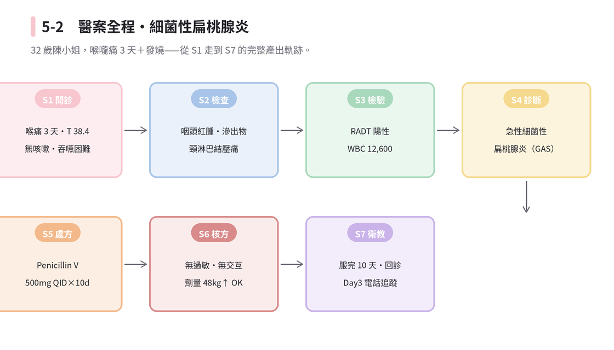

**圖5-2　醫案產出軌跡：從問診到衛教的七段接力**

先看問診形與檢查、檢驗兩形：

**表5-2　醫案產出節錄（一）：問診形**

| 欄位 | 內容 | 來源 |
| --- | --- | --- |
| 主訴 CC | 喉嚨痛 3 天 | 病人原話 |
| 現病史 HPI | 吞嚥加劇、發燒至 38.4°C、無咳嗽 | 病人原話 |
| 過去史 PMH | 無慢性病、無反覆扁桃腺炎 | 病人原話 |
| 用藥 Med | 偶服普拿疼 500mg | 病人原話 |
| 過敏 Allergy | 自述無藥物過敏 | 病人原話 |
| ROS | 無皮疹・無關節痛・無氣喘 | 問診確認 |

**表5-3　醫案產出節錄（二）：檢查形・檢驗形**

| 項目 | 判準 | 數值／所見 | 結論 |
| --- | --- | --- | --- |
| 體溫 | &gt; 37.8°C 為發燒 | 38.4°C | 異常・支持感染 |
| 咽頭所見 | 紅腫＋滲出物為細菌傾向 | 雙側紅腫・白色滲出物 | 異常・支持細菌 |
| 頸淋巴結 | 壓痛腫大計 1 分 | 雙側腫大壓痛 | 異常・Centor +1 |
| 咳嗽 | 有咳嗽偏向病毒 | 無 | 陰性・Centor +1 |
| RADT | 陽性確立 GAS | 陽性 | 確立 GAS |
| WBC | &gt; 10,000 支持細菌 | 12,600 /μL | 異常・支持細菌 |

接著是診斷形的漏斗收斂：第一層排除紅旗（無呼吸困難、無張口困難）；第二層分病毒與細菌（Centor 3 分）；第三層以 RADT 陽性確立 A 群鏈球菌。確立診斷：急性細菌性扁桃腺炎（GAS），置信度高。

## 5.4　處方箋與核方報告

處方依 S5 產出、核方依 S6 產出。處方箋樣式如下（示意）：

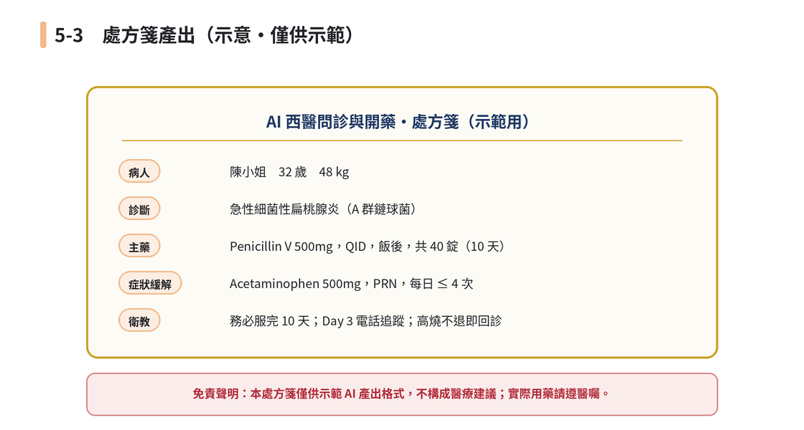

**圖5-3　處方箋產出樣式（僅供示範）**

**表5-4　處方箋（完整版・僅供示範）**

| 部件 | 藥品・內容 | 劑量・途徑・頻次 | 天數・總量 | 角色標記 |
| --- | --- | --- | --- | --- |
| 主藥 | Penicillin V | 500mg・PO・QID | 10 天・40 錠 | 不可任意替換 |
| 症狀緩解 | Acetaminophen | 500mg・PO・PRN（≤QID） | 依需要・≤40 錠 | 輔助 |
| 局部處置 | 溫鹽水含漱 | 每 4–6 小時 | 10 天 | 輔助 |
| 衛教 | 服完療程・紅旗回診 | — | 10 天 | 三級部件 |
| 替代預案 | Azithromycin（過敏時） | 500mg・PO・QD | 5 天・5 錠 | 預案 |

**表5-5　核方報告**

| 核對項 | 查什麼 | 結果 | 理由 |
| --- | --- | --- | --- |
| 禁忌 | Penicillin 過敏・孕哺・腎功能 | 通過 | 過敏史陰性・非孕哺・腎功能正常 |
| 交互作用 | 現用藥衝突 | 通過 | 無長期用藥；Acetaminophen 與主藥無衝突 |
| 劑量 | 體重・年齡調整 | 通過 | 32 歲 56kg，成人標準劑量 |
| 放行 | 三問全過 | 放行 | 可出藥 |

> 免責聲明（三）：表 5-4 處方與全書所有藥物劑量僅供示範產出格式，不構成醫療建議；實際用藥請遵醫囑，並以當地藥證與最新臨床指引為準。

## 5.5　複診調藥與常見錯誤

追蹤形依 S7 產出。本醫案 Day 3 電話追蹤：已退燒、疼痛下降，合格；Day 10 回診：完成 10 天療程、症狀緩解，療程結案。若 Day 3 未退燒，動線是回推 S4 重跑鑑別（併發症？抗藥性？診斷錯誤？），而不是直接換更強的藥——這正是演繹骨架的價值：退回有明確的站牌。

**表5-6　醫案常見產出錯誤對照**

| 錯誤產出 | 錯在哪 | 正確做法 |
| --- | --- | --- |
| 問診一次問 20 題 | 病人負荷大、答案品質差 | S1 限制 1–3 題逐輪問 |
| RADT 先看結果再補 Centor 分數 | 先資料後判準，推理失效 | S3 先寫判準再填數值 |
| 處方只開主藥 | BOM 缺件、衛教缺位 | S5 四部件齊出 |
| Day 3 未退燒直接升級抗生素 | 跳過重鑑別 | S7 動線回推 S4 |
| 複診另開新表 | 容器斷鏈、身份漂移 | 同容器續頁、id(C) 不變 |

**表5-7　S7 產出節錄：衛教文兩版＋紅旗清單**

| 版本 | 內容 |
| --- | --- |
| 病人版（白話） | 抗生素要每天吃四次、吃滿 10 天，就算好了也要吃完；沒吃完細菌可能捲土重來。喉嚨痛可以吃止痛藥、用溫鹽水漱口。 |
| 醫師版（簡短） | Penicillin V 500mg QID ×10d 完療程；Acetaminophen PRN；鹽水含漱 q4–6h。 |
| 紅旗清單（任一出現即回診） | 高燒超過 39.5°C 不退、吞嚥困難加劇、呼吸或張口困難、頸部腫塊變大、3 天後完全未好轉。 |

**表5-8　追蹤紀錄與調藥決策（時間切片 t → t+1）**

| 時間切片 | 所見 | 判準比對 | 決策 |
| --- | --- | --- | --- |
| Day 3 電話追蹤（t+1） | 已退燒、疼痛由 8 分降至 3 分 | 合格標準：已退燒・疼痛下降 | 維持原處方，不調藥 |
| （假設）Day 3 未退燒 | 仍 38.8°C、吞嚥更痛 | 不合格：動線回推 S4 | 重跑鑑別（併發症？抗藥性？）→ 併發症轉耳鼻喉 |
| Day 10 結案（t+2） | 完成 10 天療程、症狀緩解 | 合格標準：全程服藥・緩解 | 結案入鏈；標記「GAS 初發」供未來檢索 |

**表5-9　提示詞使用守則**

| 守則 | 說明 |
| --- | --- |
| 變項就位再啟動 | 〔　〕內變項（病史、數據、基本資料）未填齊就跑，產出必然含推測值 |
| 逐段驗收再接力 | S1 產出未過格式驗收前，不送進 S2；垃圾進、垃圾出的鐵律在流水線裡加倍有效 |
| 保留原始產出 | 每次重跑都另存版本，形證據鏈要能回放「當時看到什麼」 |
| 提示詞可調、骨架不可廢 | 可依專科調整欄位與判準，但先判準後資料、先骨架後處方的順序不動 |

> **本章重點**
>
> 本章重點：（一）S1–S7 七段接力，每段輸入輸出明確可審；（二）提示詞內建格式約束與誠實條款；（三）醫案產出一律先判準後資料；（四）處方箋與核方報告配套出場；（五）追蹤調藥要有判準與動線，時間切片只追加差異。

# 第六章　誤用・檢核・成熟度

最後一章交付三件治理工具：誤用對照表告訴你哪裡會翻車，十問清單給你驗收用的問答，成熟度模型告訴你現在在哪一級、下一級要補什麼。

## 6.1　誤用五種

五種誤用都有共同特徵：跳過關卡、事後補理由。對治方法不是「更小心」，而是把關卡寫進流程——不通過就出不了產出。

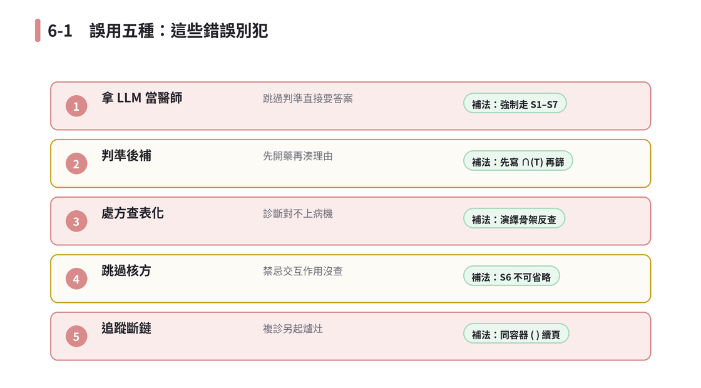

**圖6-1　五種誤用與補法**

**表6-1　誤用對照表**

| 誤用 | 典型表現 | 後果 | 補法 |
| --- | --- | --- | --- |
| 拿 LLM 當醫師 | 跳過 S1–S7 直接要答案 | 無判準、無證據 | 強制走完七段流水線 |
| 判準後補 | 先開藥再湊理由 | 推理偽裝成推理 | ∩(T) 先行、順序檢查 |
| 處方查表化 | 診斷與病機對不上 | 換個病名同樣的藥 | 演繹骨架反向走查 |
| 跳過核方 | 禁忌交互作用沒查 | 用藥安全事件 | S6 不可省、三問三態 |
| 追蹤斷鏈 | 複診另起爐灶 | 病史碎片化 | 容器續頁・id(C) 錨定 |

## 6.2　十問清單

交付或驗收任何一份 AI 西醫問診開藥產出前，用這十個問題逐一拷問；答不出來的，就是還沒合格。

**表6-2　十問清單**

| # | 問題 | 合格答案長什麼樣 |
| --- | --- | --- |
| 1 | 情境標籤是什麼？ | 急診／門診／慢病明確，與主訴一致 |
| 2 | 判準先寫了嗎？ | 判準時間戳早於資料填入 |
| 3 | 鑑別清單夠 broad 嗎？ | 至少 3 個候選、含紅旗排除 |
| 4 | 每層漏斗憑什麼篩？ | 每層有判準與被排除者的理由 |
| 5 | 處方的 BOM 齊嗎？ | 主藥・緩解・局部・衛教四件俱在 |
| 6 | 演繹骨架走得到底嗎？ | 病因→病機→證據→治則→處方環環相扣 |
| 7 | 核方三問都答了嗎？ | 三問各給通過／警示／阻擋＋理由 |
| 8 | 三級部件標了嗎？ | 天數・主藥標記在案 |
| 9 | 追蹤動線寫了嗎？ | 每節點有合格標準與不合格動線 |
| 10 | 證據鏈完整嗎？ | 輸入・中間・輸出・回放四段可查 |

## 6.3　成熟度 L1–L4

成熟度分四級：L1 會回答、L2 會把關、L3 會追蹤、L4 會演化。升級以形證據鏈作證，不接受「感覺已經可以了」。

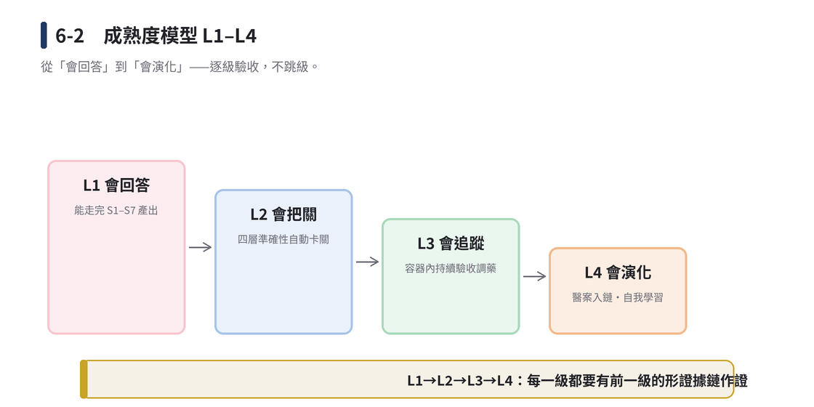

**圖6-2　成熟度階梯：每級都要有證據**

**表6-3　成熟度驗收表**

| 等級 | 能力 | 驗收條件 | 常見卡點 |
| --- | --- | --- | --- |
| L1 會回答 | 能走完七段產出六形 | 六形格式合規、欄位齊全 | 產出格式不穩 |
| L2 會把關 | 四層準確性自動卡關 | 誤用五種自動攔截 | 核方被跳過 |
| L3 會追蹤 | 容器內持續驗收調藥 | 追蹤節點全數執行 | 複診斷鏈 |
| L4 會演化 | 醫案入鏈・自我學習 | 調藥理由可回放、療法重構有據 | 演化無紀錄 |

**表6-4　導入藍圖：三個月節奏建議**

| 階段 | 週期 | 做什麼 | 完成判準 |
| --- | --- | --- | --- |
| 第 1 月・跑通 | W1–W4 | 以單一病種（如細菌性扁桃腺炎）照 S1–S7 跑通全流程 | 累計 20 份格式合規產出 |
| 第 2 月・把關 | W5–W8 | 啟用四層準確性驗收；每日抽查 3 份走查骨架 | 誤用五種攔截率 ≥ 90% |
| 第 3 月・追蹤 | W9–W12 | 啟用追蹤形節點與調藥動線；開始醫案入鏈 | 追蹤執行率 ≥ 80%、斷鏈率 = 0 |
| 之後・演化 | 持續 | 每月回顧調藥理由、重構療法模板 | 進入 L4 驗收循環 |

# 回顧・收束

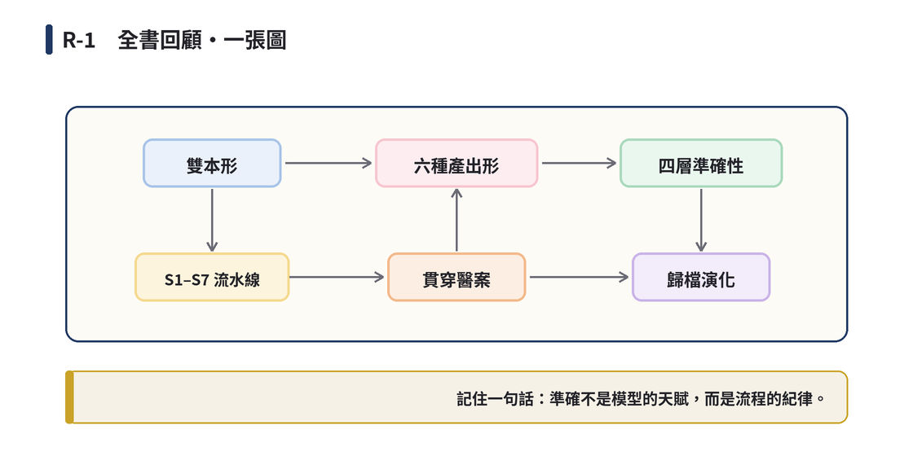

**圖R-1　全書一張圖**

> **三個帶走**
>
> R-1　如果只記一句話：準確不是模型的天賦，而是流程的紀律。
>
> R-2　如果只用一張表：表D-1 的兩套語言對照——空間本形建結構、時間本形出招式。
>
> R-3　如果只跑一次流程：第 4 章（六步驟）＋第 5 章（提示詞醫案）的 S1–S7，照表操課走完一份完整產出。

**表R-1　全書工具箱總表（各章交付物）**

| 章 | 交付物 | 拿來就用的東西 |
| --- | --- | --- |
| 第 1 章（認識系統） | 定位與雙本形落點 | 形＋數分工表、三括號落點表、四層關卡表 |
| 第 2 章（產出形） | 六種產出形規格 | 六形規格總表、問診欄位卡、處方 BOM 規格 |
| 第 3 章（準確保證） | 四層準確性 | ∩(T) 判準表、演繹骨架表、醫理核方清單 |
| 第 4 章（六步驟） | 操作動線 | 六步驟操作卡、三層判斷表、誤用預警點 |
| 第 5 章（提示詞醫案） | S1–S7 全文＋醫案 | 七段提示詞、處方箋範例、追蹤調藥決策表 |
| 第 6 章（誤用檢核） | 治理工具 | 誤用對照表、十問清單、成熟度驗收表 |

> 最後提醒：本書所有醫案、藥物、劑量均為產出格式示範，不構成醫療建議；AI 是把關工具，不是處方主體——處方權在合格醫師手上，責任也在。

# 附錄 A　術語・招式・記號速查

## A.1　術語速查

**表A-1　術語速查表**

| 術語 | 英文 | 一句話解釋 |
| --- | --- | --- |
| 形 | Type（不是 Form） | 回答「是什麼」的結構單位 |
| 問診形 | InterviewType | 病史與主訴的結構化產出 |
| 檢查形 | ExamType | 理學檢查所見的產出 |
| 檢驗形 | LabType | 檢驗數據判讀的產出 |
| 診斷形 | DiagnosisType | 鑑別漏斗與確立診斷的產出 |
| 處方 | PrescriptionType | 處方 BOM 與療程的產出 |
| 追蹤形 | FollowType | 療程容器內的節點與動線 |
| 交集判準 | ∩(T) | 資料 ∩ 判準，過不了就擋下 |
| 身份錨 | id(C) | 容器內身份不變的保證 |
| remove 三級 | remove L1/L2/L3 | 拆部件的三級後果分級 |
| 演繹骨架 | Deductive Skeleton | 病因→病機→證據→治則→處方 |
| 形證據鏈 | Type Evidence Chain | 輸入・中間・輸出・回放四段留痕 |

## A.2　時間本形招式盤 × 問診開藥落點

**表A-2　招式盤對照表**

| 招式 | 問診開藥落點 |
| --- | --- |
| 形時間函式搜尋 | 從病史庫檢索相似醫案 |
| 設計搜尋與萃取 | 從臨床指引萃取用藥規範 |
| 設計模式 | 處方模式庫（第一線用藥模板） |
| 邏輯生成與應用 | 鑑別漏斗的規則生成 |
| 函式生成與應用 | 追蹤函式（節點・評估・動線） |
| 持續學習 | 新醫案入鏈、指引更新 |
| 重構與重組 | 療法重構（二線用藥組合） |
| 解題 | 疑難醫案拆解 |
| 分析 | 症狀與檢驗判讀 |
| 設計（創造與創新） | 個人化療程設計 |
| 推理（因果・逆向等） | 由症狀推病因、由檢驗回推感染源 |
| 思考法 | 正向・逆向・垂直・第一性原理 |
| 研發與探索 | 新療法與新組合探索 |
| 自我演化 | 調藥理由回放、系統自我改進 |

## A.3　記號速查

**表A-3　記號表**

| 記號 | 讀法 | 用途 |
| --- | --- | --- |
| [ ] | 屬性集合・抽象集合 | X 軸：症狀・檢驗值欄位 |
| { } | 組成集合・BOM | Y 軸：處方部件組成 |
| ( ) | 容器集合 | Z 軸：身體・療程・身份 |
| ∩(T) | 交集判準 | 資料與判準的過濾關卡 |
| id(C) | 容器身份 | 療程內身份不變 |
| remove | 移除分級 | 部件拆解後果分級 |
| t / t+1 | 時間切片 | 初診與複診的差異追加 |

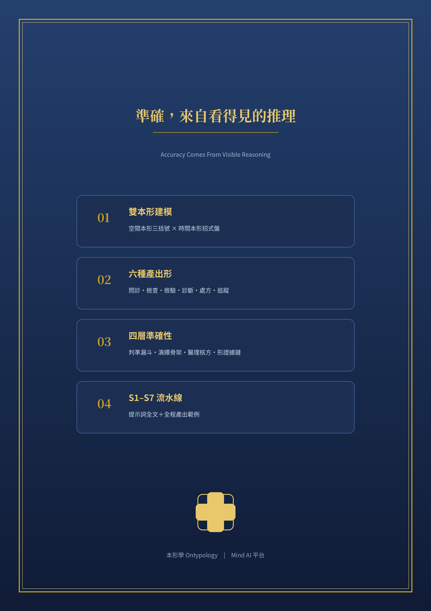
