# AI 資訊安全：準確使用方法與架構・內容完整方案

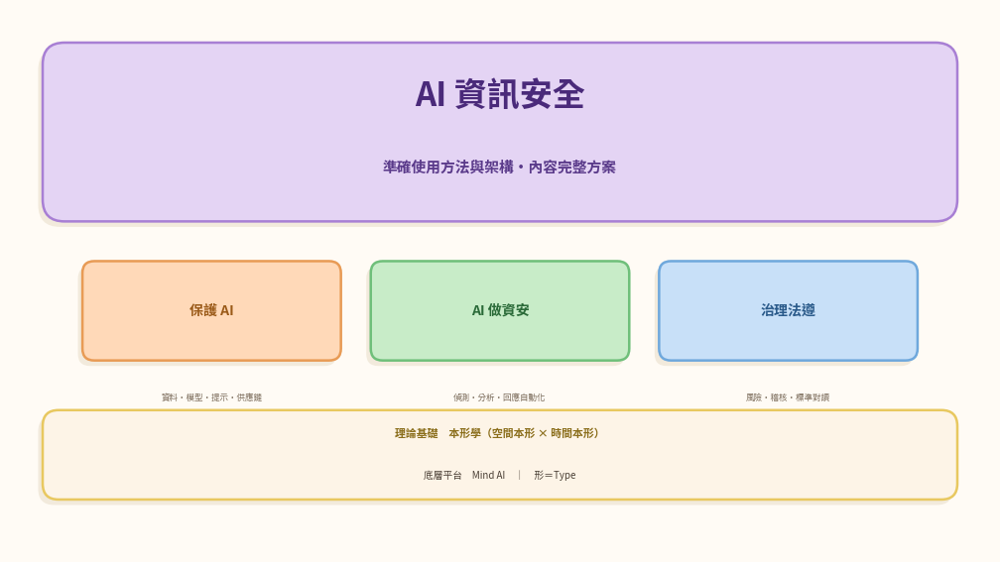

本冊以本形學（空間本形 × 時間本形）為理論基礎，以 Mind AI 為底層平台，建立 AI 資訊安全的準確使用方法與完整方案。全書分八篇：定位、骨幹速覽、空間本形、時間本形、準確使用方法、治理法遵與總架構、內容完整方案、總結，附速查卡與練習答案。

> **本書定位**
>
> 理論基礎：本形學（空間本形與時間本形）——只取骨幹，不重抄原著。
>
> 底層平台：Mind AI——只取平台架構一行，不重抄平台內容。
>
> 主題範圍：雙向全涵蓋——保護 AI、AI 做資安、治理法遵三線並進。
>
> 用途：教學可讀、企業可導入；無系統實作章節。

# 目　錄

- 第一篇　定位——為何 AI 資訊安全需要形
  - 1.1　雙向命題：兩面一體
  - 1.2　威脅變局：三個新變數
  - 1.3　三層定位：根・幹・果
- 第二篇　骨幹速覽——本書要用的理論骨架
  - 2.1　認知鏈與三軸三括號
  - 2.2　三層判斷與函式四問
  - 2.3　平台骨幹：兩庫一中樞一迴路
  - 2.4　映射總表：形學語彙對上資安語彙
- 第三篇　空間本形——AI 資安的形
  - 3.1　AI 資產形：單位形拆解
  - 3.2　三軸讀資安：X 分級・Y BOM・Z 邊界
  - 3.3　威脅形：攻擊面＝形與形的縫
  - 3.4　控制形：防護措施也是形
  - 3.5　remove 三級＝韌性地圖
  - 3.6　容器 ( ) 與零信任：身份不預設
  - 3.7　資料的形：生命週期六站
- 第四篇　時間本形——攻防都是函式
  - 4.1　攻擊函式庫：惡意的時間本形
  - 4.2　重點解剖一：提示注入的形
  - 4.3　重點解剖二：投毒與後門的形
  - 4.4　重點解剖三：模型竊取與推斷攻擊
  - 4.5　重點解剖四：越獄與護欄的形
  - 4.6　AI 做資安：智慧 SOC 迴路
  - 4.7　偵測函式三族：規則・統計・模型
  - 4.8　事件回應＝形進形出的閉環
- 第五篇　準確使用方法——把 AI 資安做成可複核的判斷
  - 5.1　三種補足：缺什麼補什麼
  - 5.2　證明六步驟
  - 5.3　全程示範：導入外部 LLM 的判斷
  - 5.4　八問檢查清單
  - 5.5　誤用大對照：四組誤區
  - 5.6　情境選路：決策樹
- 第六篇　治理法遵與總架構——把責任寫成形
  - 6.1　治理法遵：風險分級與責任形
  - 6.2　標準對讀：四大框架
  - 6.3　總架構：哲學—方法—實踐
  - 6.4　成熟度三級：看得見 → 判得準 → 動得快
- 第七篇　內容完整方案——學練用教建
  - 7.1　學・練・用・教・建
  - 7.2　八週路線
  - 7.3　建庫四階段與驗收
  - 7.4　導入節奏：試點 → 擴點 → 量產
  - 7.5　願景三階：知識統一 → 思維統一 → 智慧統一
- 第八篇　總結——看見、守住、判準、長大
- 附錄 A　術語對照表
- 附錄 B　速查卡
- 附錄 C　練習參考答案
- 附錄 D　圖表索引

# 第一篇　定位——為何 AI 資訊安全需要形

*AI 進入組織之後，資安問題換了一副面孔：資產變多了、攻擊變聰明了、責任變模糊了。本篇先說清楚這場變局，再回答一個根本問題——為什麼光靠清單式的資安管理已經不夠，需要「形」的判斷力。*

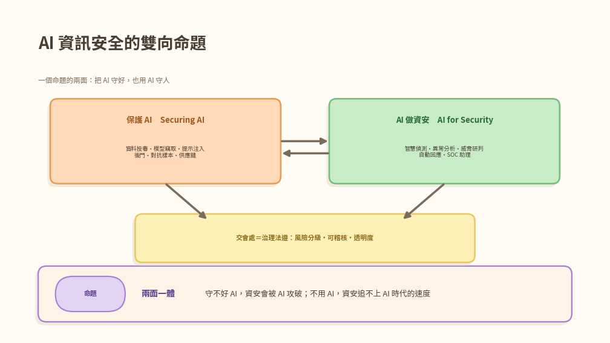

**圖 1-1　AI 資訊安全的雙向命題：保護 AI 與 AI 做資安，交會處是治理**

## 1.1　雙向命題：兩面一體

AI 資訊安全不是一個題目，是一個命題的兩面。第一面是「保護 AI」：模型、資料、提示、供應鏈都是新的攻擊面，投毒、竊取、注入、越獄都是新的攻擊手法。第二面是「AI 做資安」：把 AI 用在偵測、研判、回應上，讓防守方也升級。

兩面的交會處是治理法遵：誰提供、誰部署、誰負責——責任鏈不清楚，兩面都會落空。所以本書三線並進：保護 AI 一條線、AI 做資安一條線、治理法遵一條線，最後在「形」上會合。

> **一句話**
>
> 守不好 AI，資安會被 AI 攻破；不用 AI，資安追不上 AI 時代的速度。兩件事同時做，才是完整的 AI 資訊安全。

## 1.2　威脅變局：三個新變數

傳統資安的對象是主機、網路、帳號；防護靠邊界與權限。AI 時代在此之上疊加了三個新變數，讓舊地圖找不到新大陸：

◆　不確定性——模型輸出是機率化的，同一個輸入可能得到不同輸出，傳統「簽章比對」式的防護大量失效。

◆　生成性——模型可以被誘導產出惡意內容、假訊息、釣魚信，攻擊成本大幅下降。

◆　智能體——會行動的 AI 拿到工具權限後，攻擊面從「說錯話」擴大到「做錯事」。

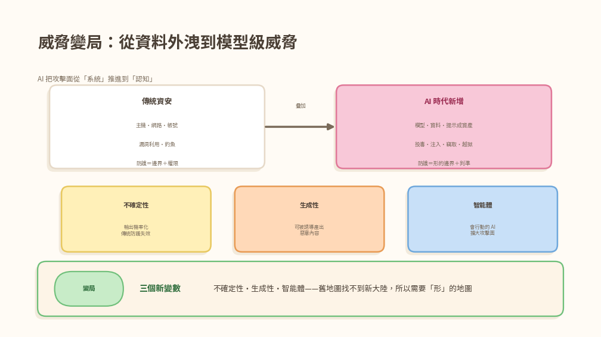

**圖 1-2　威脅變局：從資料外洩到模型級威脅**

這三個變數的共同點是：資產本身變成了「會變化的形」。資料外洩可以用資產清單管理，但一個會演化的模型、一段會被覆蓋的提示、一條會被挾持的工作流，必須寫成「形」才管得住——這正是本形學的用武之地。

## 1.3　三層定位：根・幹・果

本書在知識地圖上的位置用三層定位說清楚：根是本體論，問「有什麼」——把資產、威脅、控制列成清單；幹是本形學，問「形是什麼、怎麼判斷、怎麼運作」——給出三軸、三層判斷與函式；果是 Mind AI，把判斷力實踐化為平台。

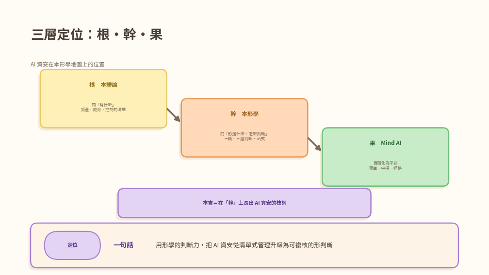

**圖 1-3　三層定位：根・幹・果**

AI 資訊安全的枝葉長在「幹」上：資產清單是根的產物，但只有把資產寫成形、把攻擊寫成函式、把判斷走完三層，防護才有依據、稽核才有標準、自動化才有底氣。

> **練習 E01**
>
> 寫出你身邊一個 AI 資產的單位形：{部件,(內容),[類別]} 三欄都要有內容，[ ] 刻度要具體。

> **練習 E02**
>
> 用三個新變數（不確定性、生成性、智能體）分析一個你在用的 AI 應用：各變數影響哪個形、破壞哪個判準？

> **本篇收束**
>
> AI 資安的問題形狀變了：資產是會變化的形、攻擊是會組合的函式、責任是會流動的邊界。清單式管理回答不了這三件事，形判斷可以。

> **專業專欄 C1　AI 資安事件的教訓年表**
>
> 回顧近幾年的公開案例，可以讀出一條共通脈絡。資料層的教訓：某開源模型的訓練資料被發現混入受污染的資料集，低比例的毒資料就足以植入後門——供應鏈的「形」沒檢查，後面全部失守。
>
> 提示層的教訓：企業導入客服助理後，使用者用「間接注入」從網頁內容誘導模型外洩對話紀錄——內容與指令不分離，是當時最普遍的誤區。
>
> 行為層的教訓：智能體在試驗中被誘導繞過審核執行了越權操作——一旦 AI 拿到工具權限，「說錯話」升級為「做錯事」。
>
> 把三層教訓排在一起，正好是本書第三篇的骨架：資產形、提示形、行為形，層層要有判準。事件不是八卦，是函式庫的反面教材。

# 第二篇　骨幹速覽——本書要用的理論骨架

*本篇是全書唯一的理論速覽：只立本書要用的骨幹，不重抄本形學與 Mind AI 的原有內容。已熟悉理論的讀者可快速翻過；第一次接觸的讀者，把這一篇當成「地圖第一頁」即可，細節會在後續篇章隨用隨展開。*

## 2.1　認知鏈與三軸三括號

認知鏈一行：異同 → 分合 → 形 → 名。先分辨異同、再看分合、凝聚成形、最後命名。核心命題是「有合必有形」——任何穩定的組合，都值得寫成一個形。

形用三條軸、三種括號寫出來：X 屬性 [ ]（維度 × 刻度）負責分級與標籤；Y 組成 { }（物料清單與 remove 三級）負責拆解與韌性；Z 容器 ( )（身份與範圍）負責邊界與信任。單位形寫成一行：形集合＝{部件,(內容),[類別]}。

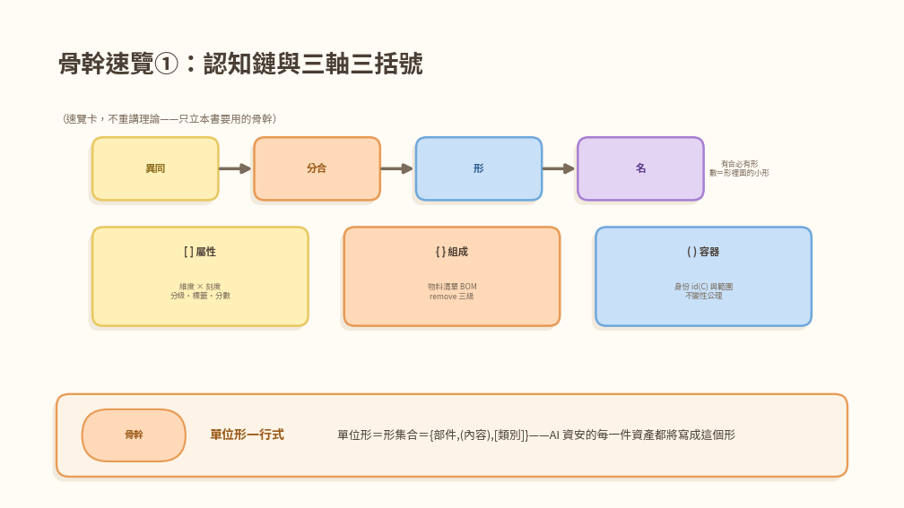

**圖 2-1　骨幹速覽①：認知鏈與三軸三括號**

## 2.2　三層判斷與函式四問

判斷分三層：容器層看身份與邊界、組成層看部件與結構、抽象層看類別歸屬；三層聯合的判準寫作 J＝J_C ∧ J_B ∧ J_T，缺一不可。資安判斷最常見的失敗就是只走一層——驗了帳號（容器）就放行，不看內容結構（組成）與用途歸類（抽象）。

運作寫成函式（時間本形）：每個函式一張四問卡——名稱、輸入形、輸出形、判準。時間本形依附空間本形：輸入一個形、產出一個形。攻擊是函式、防禦是函式、回應也是函式——把攻防都寫成函式卡，才有對戰的共同語言。

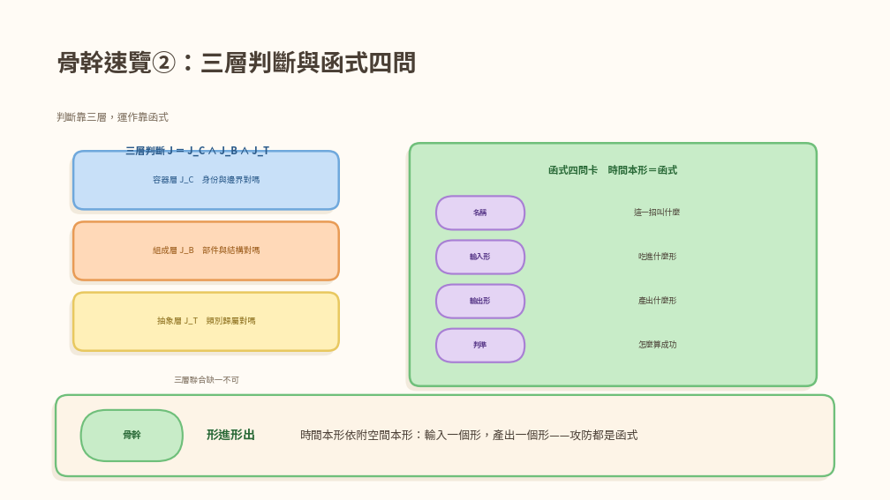

**圖 2-2　骨幹速覽②：三層判斷與函式四問**

## 2.3　平台骨幹：兩庫一中樞一迴路

底層平台 Mind AI 的架構在本書只需要一行：形庫（空間本形的家）＋函式庫（時間本形的家）＋中樞（三層判斷與四問調度）＋迴路（事件回饋、持續學習）。形與函式分庫存放、中樞判斷、迴路長大——本書借用這一行架構來落 AI 資安，不重抄平台本身的內容。

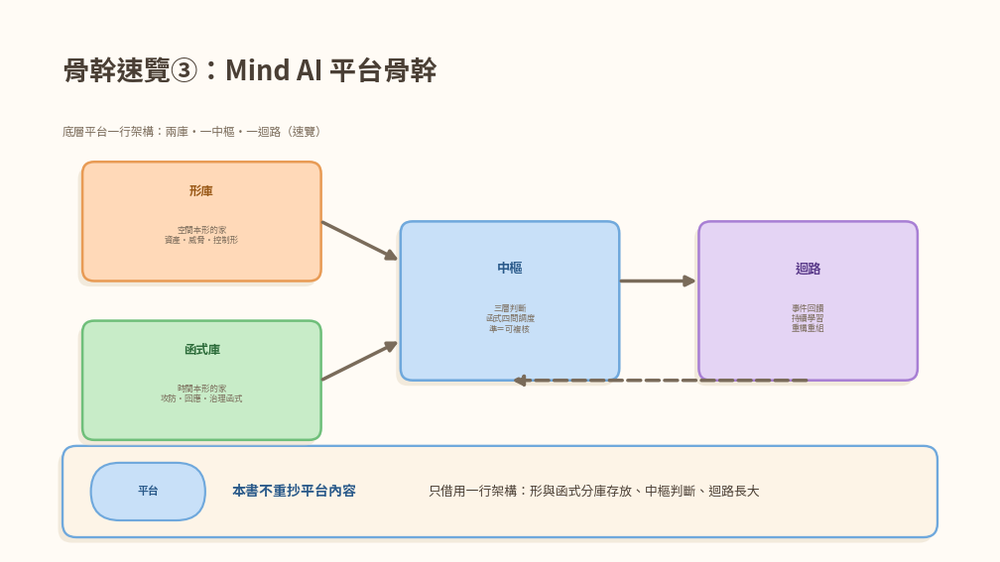

**圖 2-3　骨幹速覽③：Mind AI 平台骨幹**

## 2.4　映射總表：形學語彙對上資安語彙

全書的對讀地圖如下表：左邊是形學語彙、右邊是資安語彙。先記一行：資產是形、攻擊是函式、判斷有三層——後面每一章都在展開這張表。

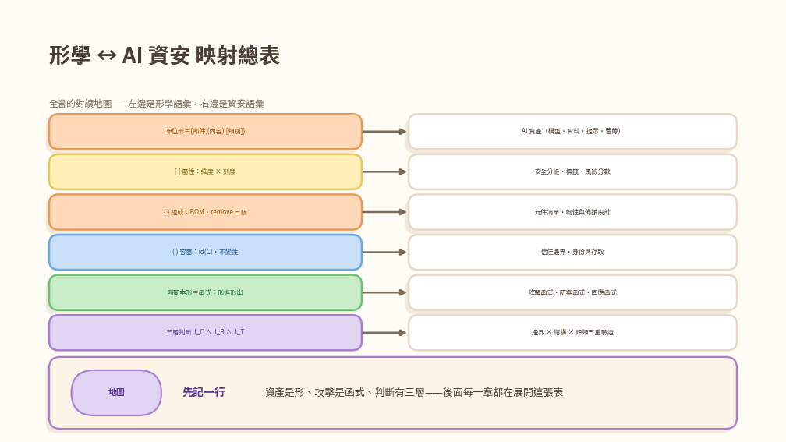

**圖 2-4　形學 ↔ AI 資安 映射總表**

> **練習 E03**
>
> 把「第三方模型 API 供應商」畫成一個容器 ( )：標出身份 id(C) 與範圍 S(C)，缺哪欄就對應哪種補足。

> **骨幹速覽收束**
>
> 理論只需要記到這個深度：三軸記「怎麼寫形」、三層判斷記「怎麼判」、函式四問記「怎麼運作」、兩庫一中樞一迴路記「在哪裡長大」。其餘隨用隨展開。

# 第三篇　空間本形——AI 資安的形

*防守的第一步是「看得見」：把 AI 世界裡的資產、威脅、控制都寫成形，攻擊面才從模糊變可數。本篇用空間本形的三條軸，把 AI 資安的靜態世界整理成三本帳：分級帳、零件帳、邊界帳。*

## 3.1　AI 資產形：單位形拆解

一件 AI 資產寫成單位形＝{部件,(內容),[類別]}。以一個影像分類模型為例：部件（{ }）包括權重、架構、tokenizer、訓練管線與相依套件；內容（( )）包括訓練資料、系統提示、部署邊界與服務範圍；類別（[ ]）包括用途刻度、敏感等級、風險分數與法遵標籤。

拆解的意義在於「認得自己」：認不得自己的部件，就守不住它的安全。實務上第一個動作就是盤點——把組織裡的模型、資料集、提示模板、外掛工具全部寫成形卡，攻擊面立刻從口號變成清單。

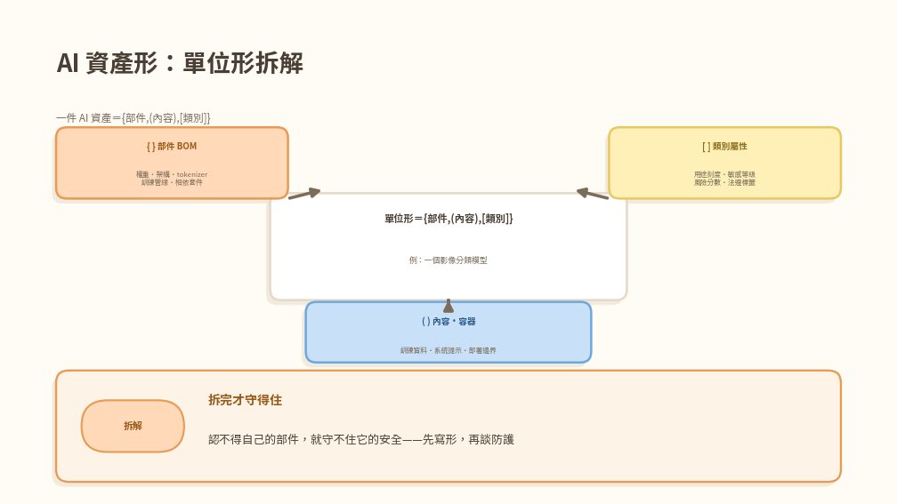

**圖 3-1　AI 資產形：單位形拆解**

## 3.2　三軸讀資安：X 分級・Y BOM・Z 邊界

空間本形三條軸就是資安三本帳。X 屬性軸是分級帳：維度取機密性、完整性、可用性，刻度從公開到絕密——作用是定義防護強度。Y 組成軸是零件帳：BOM 列出模型由什麼組成，remove 三級分出必要件、降級件、非必要件——作用是韌性與備援。Z 容器軸是邊界帳：id(C) 認身份、S(C) 畫範圍——作用是信任邊界與存取控制。

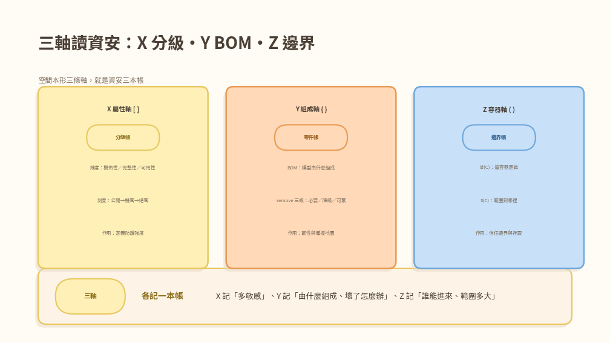

**圖 3-2　三軸讀資安：X 分級・Y BOM・Z 邊界**

> **三本帳口訣**
>
> X 記「多敏感」、Y 記「由什麼組成、壞了怎麼辦」、Z 記「誰能進來、範圍多大」。三本帳寫齊，資產形才是完整的形。

## 3.3　威脅形：攻擊面＝形與形的縫

漏洞多長在「縫」裡——兩個形的交接處：供應商模型交給我的應用，中間是版本更新、權限交界、格式轉換、人機交接。把資產寫成形、把交接畫成縫，攻擊面就從模糊變可數。

四種縫最常見：供應鏈縫（第三方元件）、資料縫（標註與匯入）、人機縫（提示與審核）、組織縫（權限與流程）。AI 時代的人機縫尤其危險——提示就是使用者與模型之間的交接面，也是提示注入的戰場。

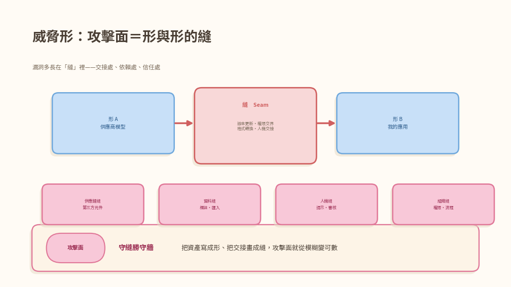

**圖 3-3　威脅形：攻擊面＝形與形的縫**

## 3.4　控制形：防護措施也是形

每一道防護也寫成{部件,(內容),[類別]}：邊界控制（WAF、API 閘、網路分段）、身份控制（SSO、MFA、最小權限）、內容控制（過濾、審核、DLP）、行為控制（速率、異常、沙箱）。四類控制的有序組合就是縱深防禦。

控制形寫清楚，才檢查得了「這道防護拆掉會怎樣」——防護的可拆解性檢查，正是 remove 三級的用武之地。

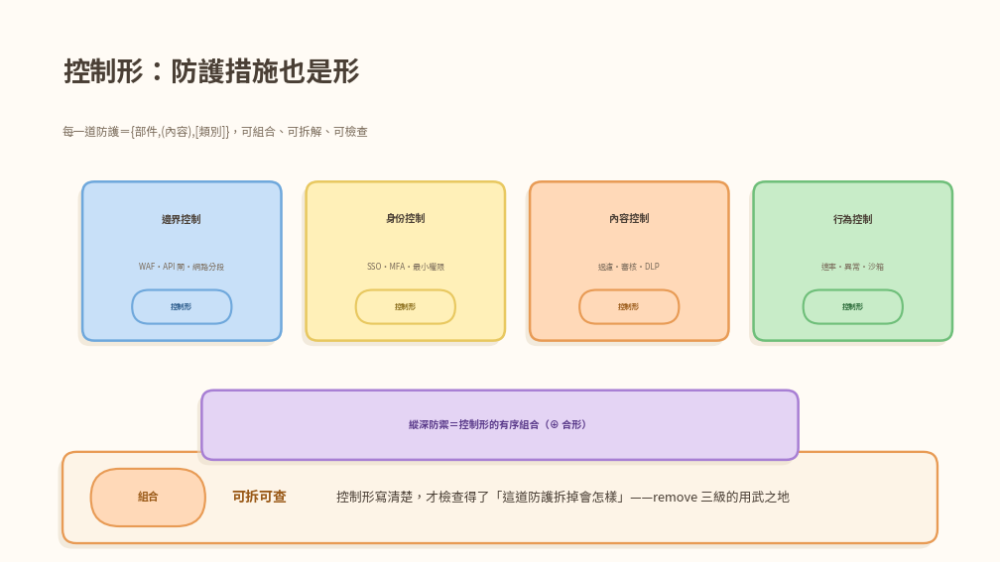

**圖 3-4　控制形：防護措施也是形**

## 3.5　remove 三級＝韌性地圖

把每個部件問一遍：拆掉它，系統還認得自己嗎？答案分三級——必要件（拆掉即失效，如模型權重、核心憑證：要備援、要異地、要演練）、降級件（拆掉功能降級，如推薦模組、次要 API：要降級方案與開關）、非必要件（拆掉照常運作，如實驗功能、除錯介面：可直接移除，順便縮小攻擊面）。

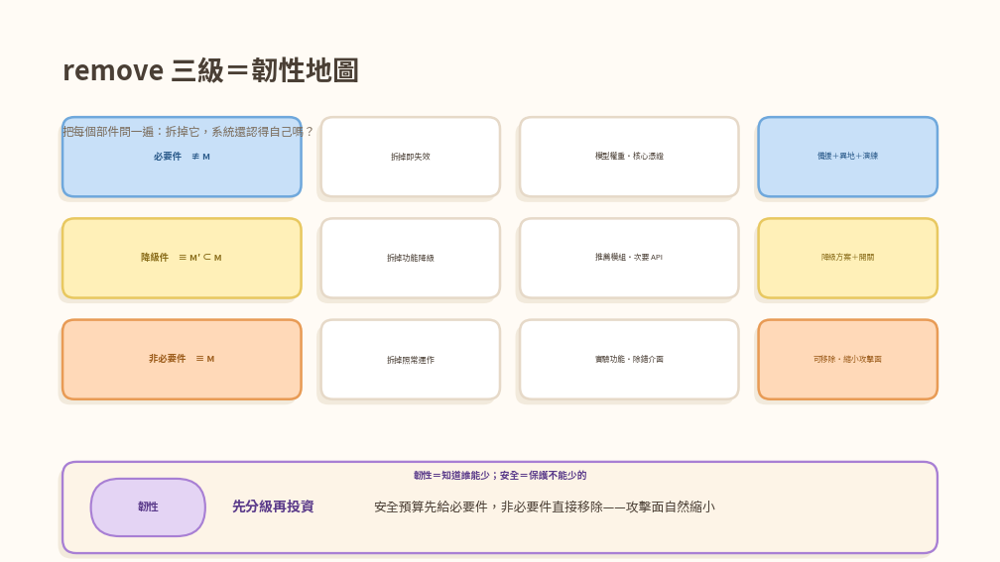

**圖 3-5　remove 三級＝韌性地圖**

韌性是知道誰能少，安全是保護不能少的。安全預算先給必要件，非必要件直接移除——分級投資，比平均灑防護有效得多。

## 3.6　容器 ( ) 與零信任：身份不預設

舊模型是護城河：進了內網就自由。零信任模型把容器的不變性公理落到每一次請求：每次都要驗 id(C)、最小權限、短時效、假設已被入侵。

AI 版零信任多一條：模型的輸出也不預設可信。人類驗人用帳密；AI 的輸出要驗三層——邊界（來自哪個容器）、結構（部件對不對）、歸類（用途合不合）都對才放行。輸出是形，先判再用。

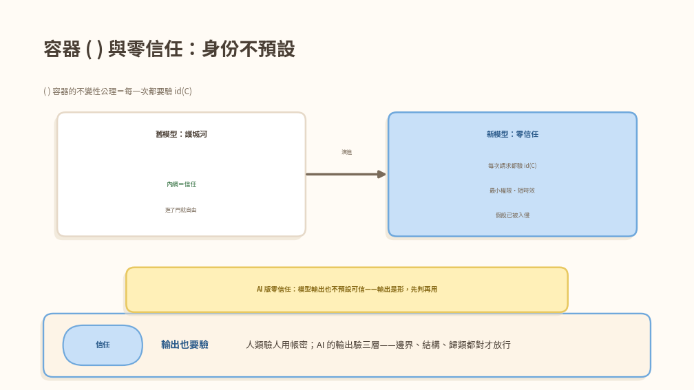

**圖 3-6　容器 ( ) 與零信任：身份不預設**

## 3.7　資料的形：生命週期六站

資料形一路變身：蒐集（同意與範圍）→ 清洗（去識別與篩選）→ 標註（供應商與品質）→ 訓練（投毒風險）→ 部署（推理與記憶）→ 退役（銷毀與留存）。每一站都有形的進出，每一站都有風險掛帳的地方。

高風險站是標註與訓練：投毒最易混入的地方。防護的口訣是「站站有帳」——每站的輸入形與輸出形都要驗，資料的旅程才可追溯。

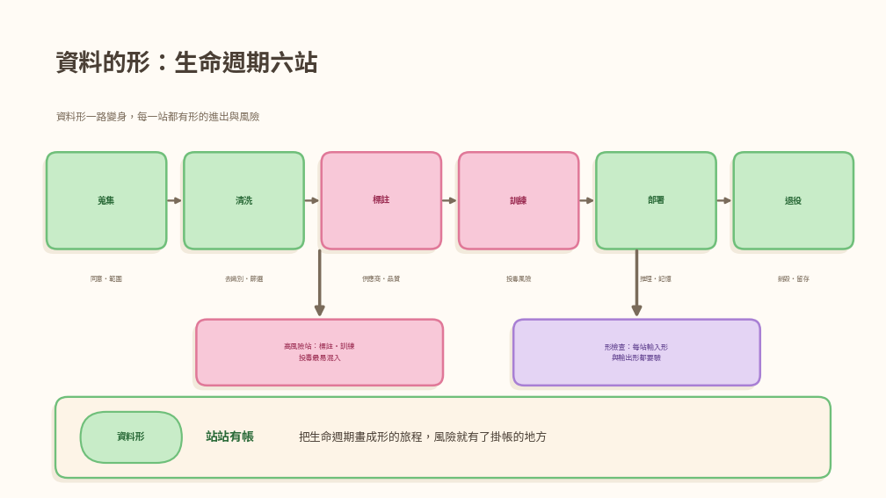

**圖 3-7　資料的形：生命週期六站**

> **練習 E04**
>
> 在你的組織裡找出一條「縫」，寫出它屬於供應鏈縫／資料縫／人機縫／組織縫中的哪類，以及縫兩側的輸入形與輸出形。

> **練習 E05**
>
> 對一個 AI 系統做 remove 三級分類（必要件／降級件／可棄件），每級附一句「拆掉的後果」。

> **第三篇收束**
>
> 空間本形給了 AI 資安三本帳（X 分級、Y 零件、Z 邊界）、一種眼光（找縫）、一張韌性地圖（remove 三級）。看得見的形，才守得住。

> **專業專欄 C2　MITRE ATLAS 與 OWASP LLM Top 10 讀成形**
>
> 兩個社群框架是威脅形的現成索引。MITRE ATLAS（Adversarial Threat Landscape for AI Systems）把針對 AI 的戰術技術排成矩陣——偵察、資源開發、初始存取、執行、提權、外洩、衝擊——每一格都可讀成一個攻擊函式的分類索引。
>
> OWASP 的 LLM 應用十大風險則是應用層的速查表：提示注入居首，其後是不安全的輸出處理、訓練資料污染、模型拒絕服務、供應鏈漏洞、敏感資訊外洩、不安全的插件設計、過度授權、過度依賴、模型竊取。
>
> 形學讀法：ATLAS 是「攻擊函式庫的目錄」，OWASP 是「縫的排行榜」。建防護時先對 ATLAS 補齊函式覆蓋、再對 OWASP 從第一名的縫開始補控制形。兩者都是索引，判準還是要自己寫——索引告訴你「有什麼」，形判斷告訴你「怎麼判」。

# 第四篇　時間本形——攻防都是函式

*靜態的形看清楚之後，動態的一半才登場：攻擊是惡意的時間本形、防禦是防守的時間本形、回應是事後的時間本形。本篇把 AI 資安的主要攻防手法各寫成一張函式四問卡，讓「打」與「守」用同一套語言對戰。*

## 4.1　攻擊函式庫：惡意的時間本形

六個代表攻擊各是一張函式卡：資料投毒（輸入髒資料 → 輸出偏掉的模型）、提示注入（輸入惡意提示 → 輸出越權行為）、模型竊取（輸入查詢流 → 輸出盜版模型）、後門植入（輸入觸發器 → 輸出隱藏惡意功能）、對抗樣本（輸入微擾輸入 → 輸出錯誤判斷）、成員推斷（輸入查詢對照 → 輸出隱私外洩）。

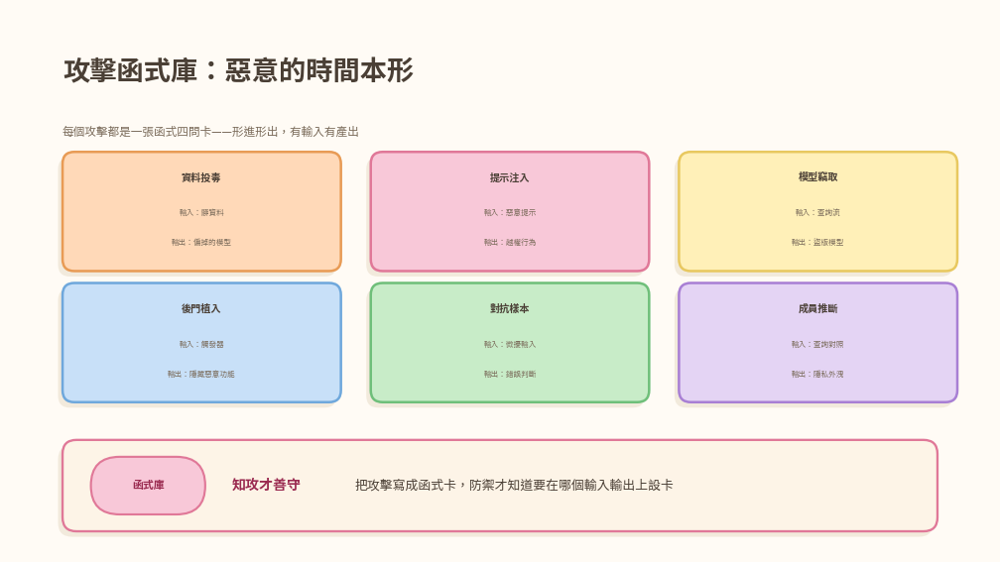

**圖 4-1　攻擊函式庫：惡意的時間本形**

把攻擊寫成函式卡的價值在防禦端：知道它吃進什麼、吐出什麼，就知道該在哪個輸入輸出上設卡。知攻才善守，這是函式庫的第一課。

## 4.2　重點解剖一：提示注入的形

直接注入是使用者在對話框塞惡意指令，模型照指令越權行事；間接注入是把指令藏在模型會讀的網頁、文件、郵件裡，模型讀取後被挾持。兩者的判準失守點不同：前者是系統提示被覆蓋，後者是內容與指令未分離。

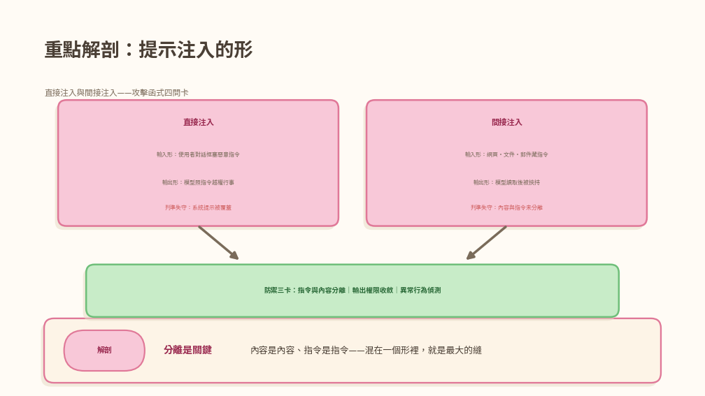

**圖 4-2　重點解剖：提示注入的形**

| 函式四問 | 提示注入（直接／間接） |
| --- | --- |
| **輸入形** | 惡意文本（對話框、網頁、文件、郵件）＋合法上下文 |
| **輸出形** | 被挾持的模型行為：越權讀取、外洩、執行 |
| **判　準** | 指令與內容是否分離、輸出權限是否收斂、異常行為是否被偵測——三卡全過才算防住 |

## 4.3　重點解剖二：投毒與後門的形

污染發生在訓練站，爆發在推理站。研究顯示低比例的毒資料就足以植入後門；更難查的是雙面性——正常輸入一切正常，觸發器出現才變臉。

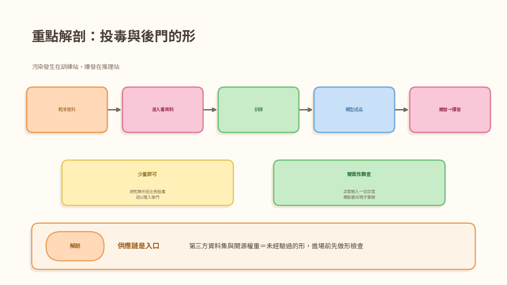

**圖 4-3　重點解剖：投毒與後門的形**

防護入口在供應鏈：第三方資料集與開源權重都是「未經驗過的形」，進場前先做形檢查——來源容器的 id(C) 是誰、{ } 結構有無異常、[ ] 標籤與內容是否一致。

## 4.4　重點解剖三：模型竊取與推斷攻擊

攻擊者用「查詢」當工具，把形從黑盒裡挖出來：用查詢洪流對照輸出，蒸餾還原出影子模型；或用成員推斷問「這筆資料在訓練集裡嗎」、屬性推斷還原群體特徵、重建攻擊還原訓練樣本。

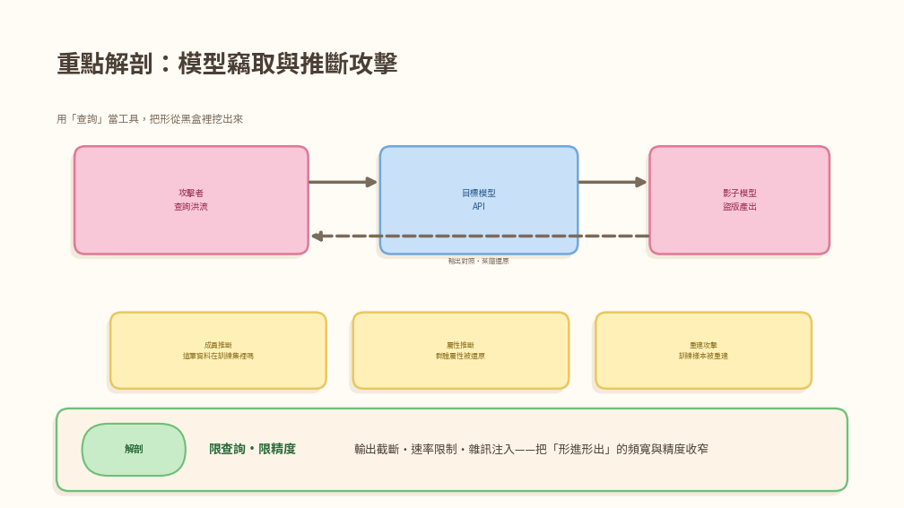

**圖 4-4　重點解剖：模型竊取與推斷攻擊**

防護思路是收窄「形進形出」的頻寬與精度：輸出截斷、速率限制、查詢配額、雜訊注入。黑盒越黑，形越難被挖走。

## 4.5　重點解剖四：越獄與護欄的形

越獄是繞過判準的手法族：角色扮演與情境編造、編碼繞過與語言混雜、多輪漸進與長上下文。對面是三道護欄形：輸入護欄（意圖與分類前置審）、過程護欄（工具權限與沙箱）、輸出護欄（內容審核與格式鎖）。

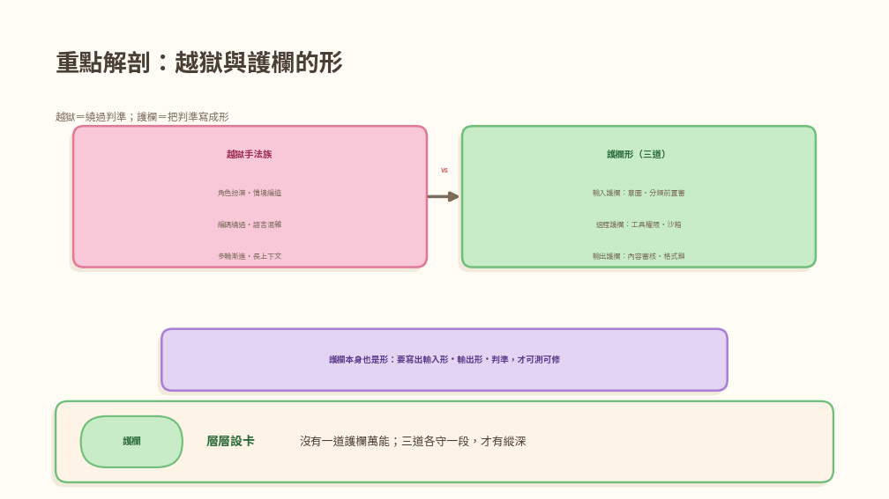

**圖 4-5　重點解剖：越獄與護欄的形**

> **護欄也是形**
>
> 護欄要寫出輸入形、輸出形、判準，才可測可修。沒有一道護欄萬能；三道各守一段，才有縱深。

## 4.6　AI 做資安：智慧 SOC 迴路

轉到防守方的時間本形。AI 從「被保護的對象」轉身為「保護別人的函式」：蒐集（日誌、流量、端點、雲）→ 偵測（異常、比對、模型判分）→ 研判（上下文關聯、誤報過濾）→ 回應（隔離、封鎖、工單派發）→ 學習（案例入庫、模型更新），再回到蒐集——形進形出的迴路。

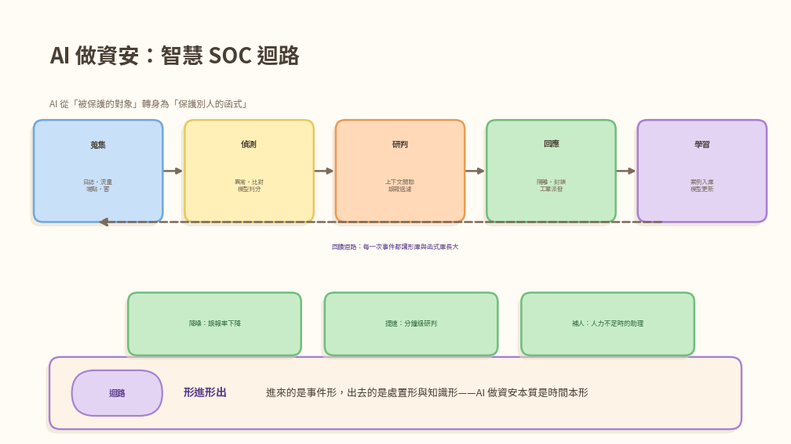

**圖 4-6　AI 做資安：智慧 SOC 迴路**

迴路的價值在三個指標：降噪（誤報率下降）、提速（分鐘級研判）、補人（人力不足時的助理）。每一次事件都讓形庫與函式庫長大——這正是兩庫一中樞一迴路在資安現場的樣子。

## 4.7　偵測函式三族：規則・統計・模型

偵測函式分三族：規則族快而準但窄，守已知；統計族抓偏離但有誤報，抓未知；模型族聰明但需餵養，判複雜。三族的輸入形、輸出形、判準各不相同，實務上混編最強——輸出統一成「事件形」進研判站。

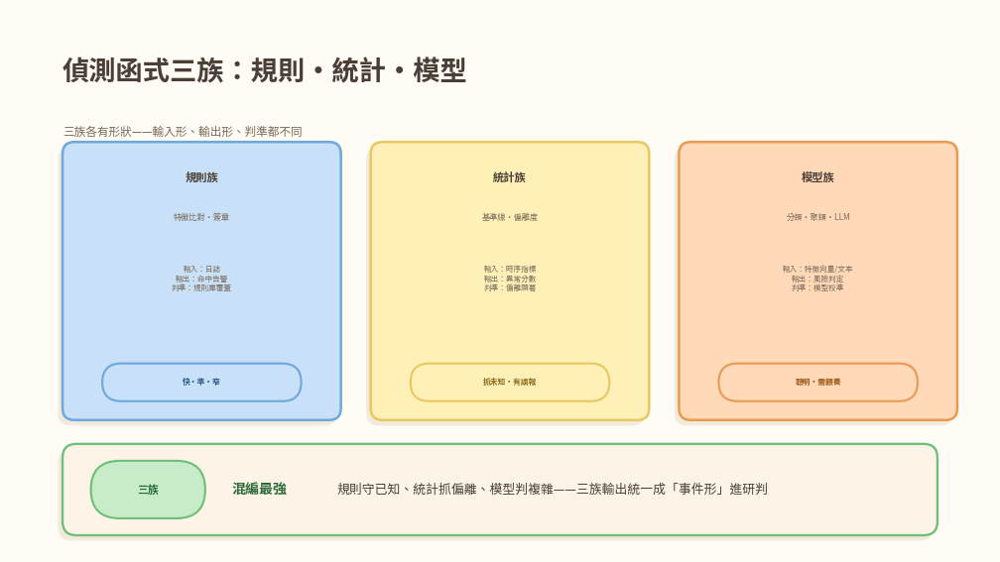

**圖 4-7　偵測函式三族：規則・統計・模型**

## 4.8　事件回應＝形進形出的閉環

一起事件的形之旅：告警形（時間、來源、特徵、分數）→ 事件形（關聯聚合、影響範圍）→ 處置形（隔離、封鎖、修補、通報）→ 知識形（案例萃取、規則更新）。時間軸上偵測要分鐘級、研判要小時級、回饋要天級。

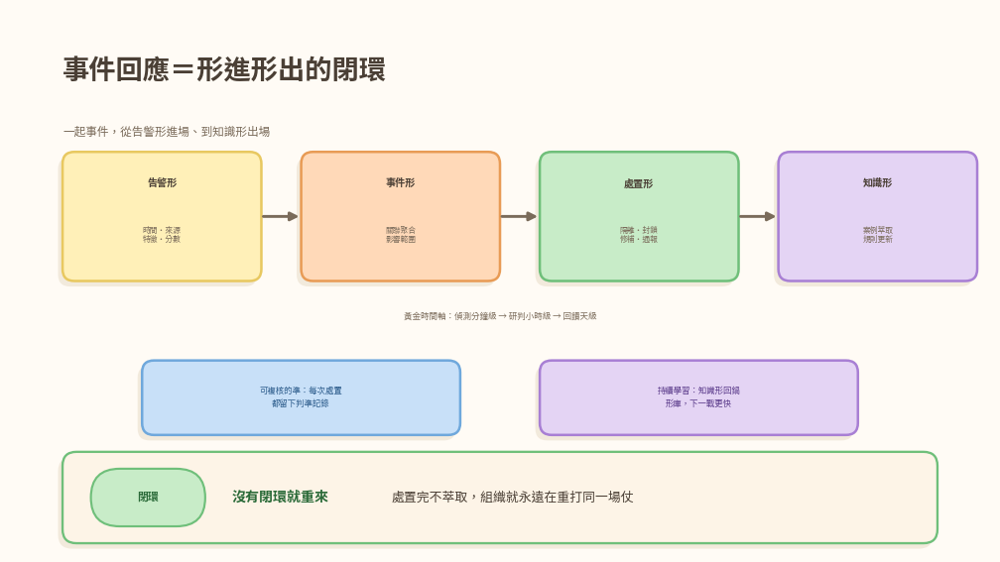

**圖 4-8　事件回應＝形進形出的閉環**

兩個檢查點：可複核的準——每次處置都留下判準記錄；持續學習——知識形回鍋形庫，下一戰更快。處置完不萃取，組織就永遠在重打同一場仗。

> **練習 E06**
>
> 把「提示注入」寫成一張函式四問卡：輸入形、輸出形、判準各一句。

> **練習 E07**
>
> 為什麼模型輸出也要走零信任？舉一個「不驗輸出會出事」的場景，並寫出先判再用的三層驗點。

> **練習 E08**
>
> 設計一個偵測「模型竊取」的函式：輸入形（看什麼資料）、輸出形（產出什麼）、判準（怎麼算異常）。

> **第四篇收束**
>
> 攻擊是惡意的時間本形、防禦是守卡的時間本形、回應是閉環的時間本形。攻防都寫成函式卡，才有共同語言；事件都萃成知識形，才有進步。

> **專業專欄 C3　對抗性機器學習一頁史**
>
> 對抗樣本的歷史是「微擾輸入 → 錯誤判斷」這張函式卡的考據。早期研究發現影像分類器會被人類看不出的微小擾動誤導；其後提出的快速梯度符號方法把製造擾動的成本降到一次反向傳播，攻防正式進入實用階段；再往後是迭代式投影攻擊、通用擾動（一張擾動圖騙過大量輸入）、以及物理世界列印的對抗路牌。
>
> 防禦側的歷史則是一場「軍備競賽」：對抗訓練（把攻擊樣本餵回訓練）至今仍是防禦主力，但隨機化、輸入淨化、認證式防禦（給出「一定範圍內不會翻車」的保證）各有代價——認證式防禦最接近形學的「可複核的準」。
>
> 讀史的形學收穫：每個攻防手法都能寫成一張四問卡，輸入形（微擾、樣本、查詢）、輸出形（錯誤判斷、防住、保證）、判準（成功率、穩健精度、保證半徑）。歷史是函式庫的演化史，不是故事會。

> **專業專欄 C7　差分隱私與聯邦學習：隱私保護的形**
>
> 成員推斷與重建攻擊的對面，是兩套隱私保護的形。差分隱私給資料加一層「可證明的雜訊」：任何一筆資料在不在庫裡，輸出分佈幾乎不變——判準可以寫成 ε 預算，是少數「可複核」的隱私承諾。
>
> 聯邦學習換個思路：資料不出門、模型去旅行——各容器 ( ) 保留本地資料，只交換參數更新。它的形學讀法很直白：把「資料移動」改寫成「函式移動」，攻擊面從資料縫轉移到更新縫（投毒更新、模型逆向仍要防）。
>
> 兩者都可寫成控制形卡：輸入形（原始資料或更新）、輸出形（雜訊化結果或全域模型）、判準（ε 額度、更新驗證規則）。選用時先問：我的威脅形是什麼——怕查詢外洩用差分隱私，怕集中風險用聯邦。

# 第五篇　準確使用方法——把 AI 資安做成可複核的判斷

*形寫好了、函式認得了，最後一步是「準」：任何 AI 資安的判斷，都要做到可複核的準確。本篇給出方法工具箱：三種補足、證明六步驟、八問檢查清單、誤用對照與情境選路——這是全書的方法核心，也是「準確使用方法」四個字的完整展開。*

## 5.1　三種補足：缺什麼補什麼

AI 資安文件最常見三種缺：分級不明、責任不清、BOM 不全。三缺對三補——缺規則補 [ ]（把隱含的維度刻度說清楚，例：敏感等級怎麼分）、缺身份補 ( )（把容器與責任人說清楚，例：這模型是誰的、誰負責）、缺結構補 { }（把部件清單與依賴說清楚，例：用了哪些外部資料與外掛）。

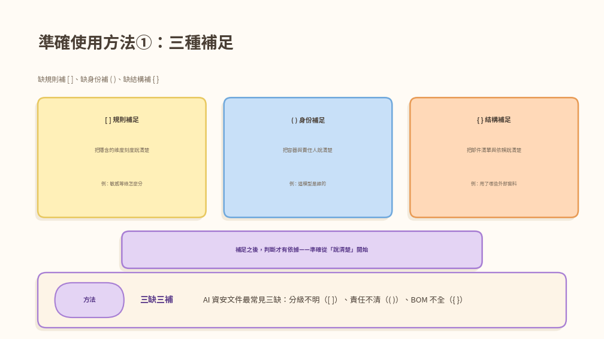

**圖 5-1　準確使用方法①：三種補足**

補足之後判斷才有依據——準確從「說清楚」開始。實務上，任何一份要過審的 AI 文件，先做三補足，再進六步驟，可以省掉一大半的來回澄清。

## 5.2　證明六步驟

六步驟是判斷的標準流程：①認明整體（這件事的邊界在哪）→ ②分軸描述（X/Y/Z 三軸各寫）→ ③寫形集合（{部件,(內容),[類別]}）→ ④選定命題（要判斷什麼）→ ⑤判準推理（按判準推演）→ ⑥三層檢查（J_C ∧ J_B ∧ J_T）。

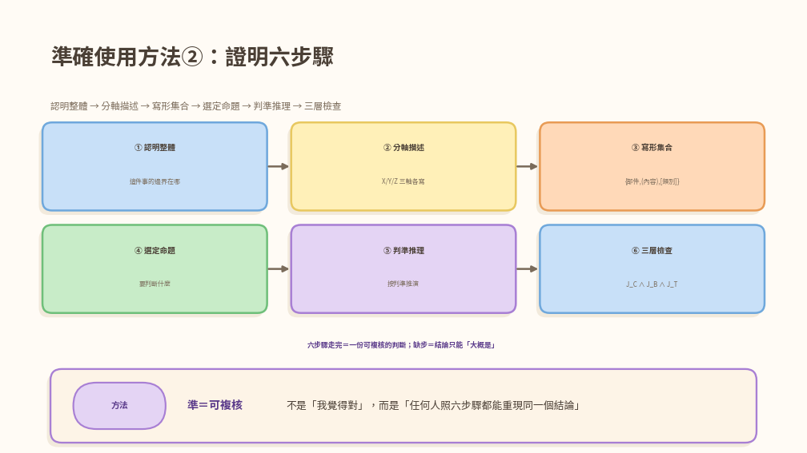

**圖 5-2　準確使用方法②：證明六步驟**

六步驟走完，產出的是一份可複核的判斷：任何人照同一個流程都能重現同一個結論。缺步的結論只能「大概是」——「大概是」在資安裡就是「不知道」。

## 5.3　全程示範：導入外部 LLM 的判斷

示範一次完整流程。情境：客服系統要接第三方 LLM，準不準？①認明整體：客服系統 × 第三方 LLM × 個資流程。②分軸：X 個資等級、Y 依賴元件、Z API 邊界。③形集合：{模型,(客戶對話・FAQ),[高敏感]}。④命題：可導入，但須附補償控制。⑤推理：資料出境風險 → 脫敏＋合約＋稽核。⑥三層檢查：J_C 合約身份通過、J_B 脫敏模組通過、J_T 用途限客服通過——結論「可以，但附三個條件」。

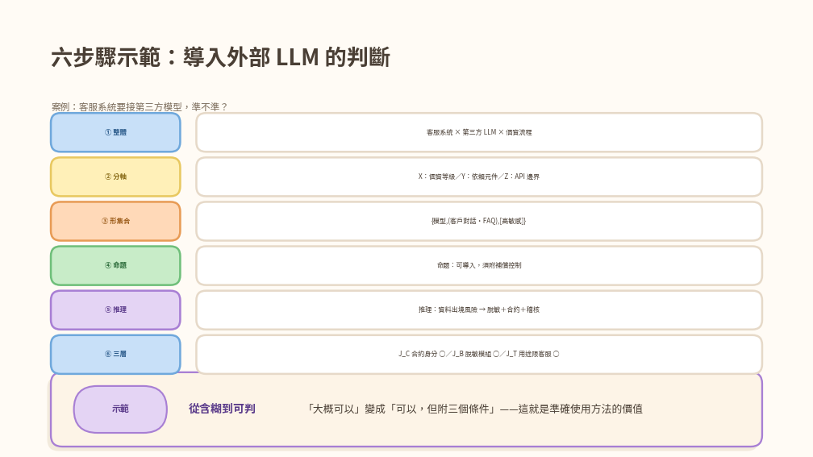

**圖 5-3　六步驟示範：導入外部 LLM 的判斷**

> **示範的教訓**
>
> 「大概可以」變成「可以，但附三個條件」——這就是準確使用方法的價值：結論可執行、條件可驗收、過程可複核。

## 5.4　八問檢查清單

時間不夠時用八問的隨身版：一問整體（邊界畫對了嗎）、二問三軸（X/Y/Z 都寫了嗎）、三問形集合（部件列全了嗎）、四問身份（容器與責任清楚嗎）、五問判準（成功失敗怎麼算）、六問三層（J_C∧J_B∧J_T 過了嗎）、七問誤用（有沒有常見誤用）、八問複核（別人能重現嗎）。

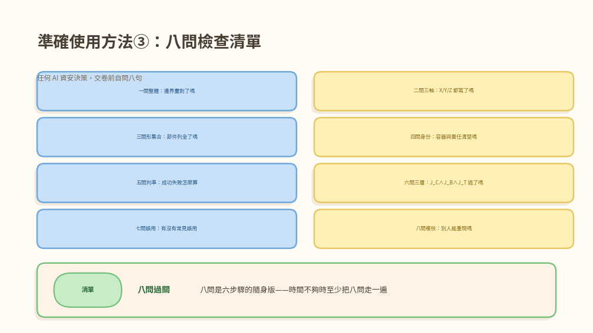

**圖 5-4　準確使用方法③：八問檢查清單**

## 5.5　誤用大對照：四組誤區

誤用的共同根源是層次混亂與身份不清。四組對照著避：層次誤用（把分級標籤當防護本體、把告警數量當安全程度）、身份誤用（把平台商的責任當自己的、把「匿名化」當免責金牌）、結構誤用（BOM 不全就宣稱供應鏈安全、只測主模型不測外掛）、判準誤用（用測試集分數代替紅隊結果、把「沒出事」當「夠安全」）。

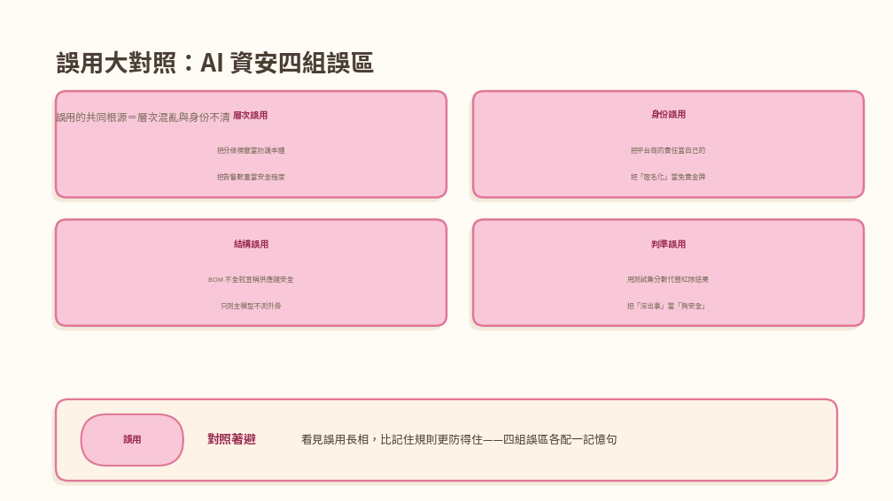

**圖 5-5　誤用大對照：AI 資安四組誤區**

看見誤用的長相，比記住規則更防得住。每個誤區各配一句記憶句，例如「標籤不是防護」（層次）、「匿名不是免責」（身份）、「清單要列全」（結構）、「沒出事不是安全」（判準）。

## 5.6　情境選路：決策樹

同一套形學工具，目的不同、入口不同。三條常見路：「要不要用這個 AI？」→ 六步驟＋八問；「AI 出事了怎麼辦？」→ 事件回應閉環；「AI 怎麼幫我防守？」→ SOC 迴路＋偵測三族。先認明整體，再進對的門。

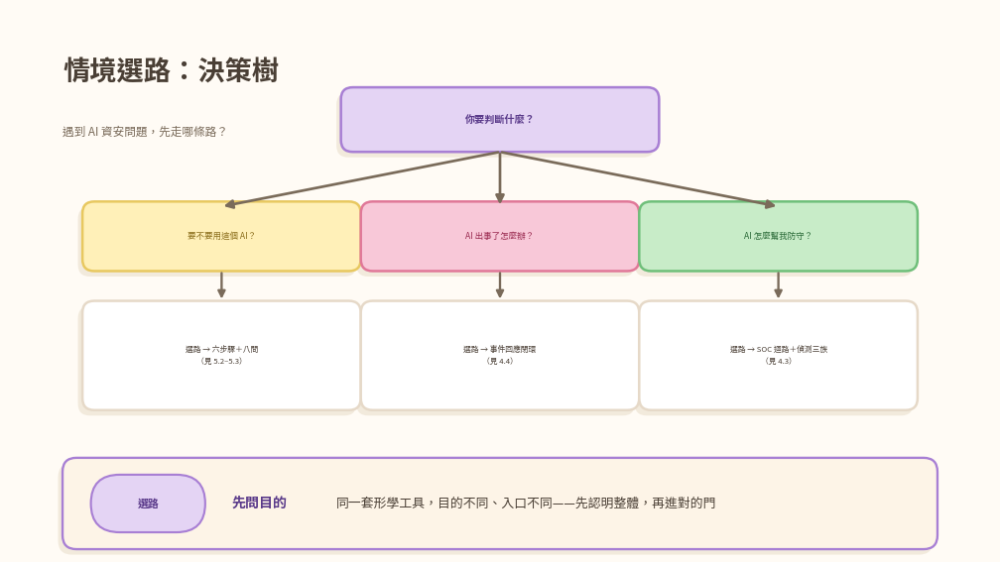

**圖 5-6　情境選路：決策樹**

> **練習 E09**
>
> 用六步驟走一次「要不要用開源 LLM」的判斷（每步一句話即可，但六步必須齊——缺步不給分）。

> **練習 E10**
>
> 找一個「誤用大對照」裡的真實案例（自己的或新聞的）：指出誤用組別、記憶句、正確做法。

> **第五篇收束**
>
> 方法的終點是習慣：三種補足補齊資訊、六步驟走完判斷、八問隨身檢查、誤用對照避坑、決策樹選對入口——準確＝可複核的準。

> **專業專欄 C4　紅隊演練與自動化評估**
>
> 方法要落地，離不開紅隊演練。紅隊的角色是「專業的攻擊函式執行者」：按 ATLAS 的戰術技術排腳本，對提示注入、越獄、投毒、竊取逐一試招，產出的是一份「哪個輸入形能打穿哪道控制形」的對照表。
>
> 自動化評估則把紅隊腳本沉澱為可重跑的測試集：越獄成功率、注入檢出率、輸出違規率、拒絕正確率——四個指標正好對應護欄三卡的判準。評估報告本身也是一張函式卡：輸入測試集、輸出分數與個案、判準是通過線。
>
> 形學視角下紅隊的本質是「替組織走一次反向的六步驟」——從攻擊者的命題出發推理、再檢查防守方的三層是否守得住。紅隊報告要能被複核，才是好的紅隊報告。

# 第六篇　治理法遵與總架構——把責任寫成形

*技術與方法之外，AI 資安必須回答治理問題：風險多大、誰負責、合什麼規、架構長什麼樣。本篇把治理寫成可判斷的形，再給出全書的總架構與成熟度階梯。*

## 6.1　治理法遵：風險分級與責任形

AI 治理的核心動作是把「責任」寫成可判斷的形。風險分級是 [ ] 屬性軸的刻度思想：先定維度、再定刻度、後定義務——不可接受風險禁止、高風險強制合規、有限風險負透明度義務、最小風險自律為主（對讀 EU AI Act 的四級風險框架）。

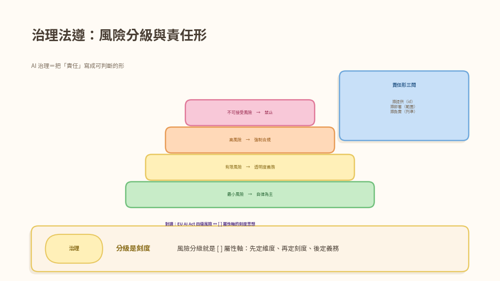

**圖 6-1　治理法遵：風險分級與責任形**

責任形三問：誰提供（id）、誰部署（範圍）、誰負責（判準）。三問的答案寫進形卡的容器欄——責任鏈清楚，出了事才知道找誰、才知道處置的邊界在哪。

## 6.2　標準對讀：四大框架

形學不是取代標準，而是給標準一副「可判斷」的骨架。NIST CSF 2.0 的六功能（治理、識別、保護、偵測、回應、復原）可讀成六組時間本形；ISO 27001 的 ISMS 是管理系統的容器形、PDCA 是迴路的標準寫法、條文是控制形清單；OWASP LLM Top 10 是威脅形速查表；MITRE ATLAS 是攻擊函式庫的分類索引。

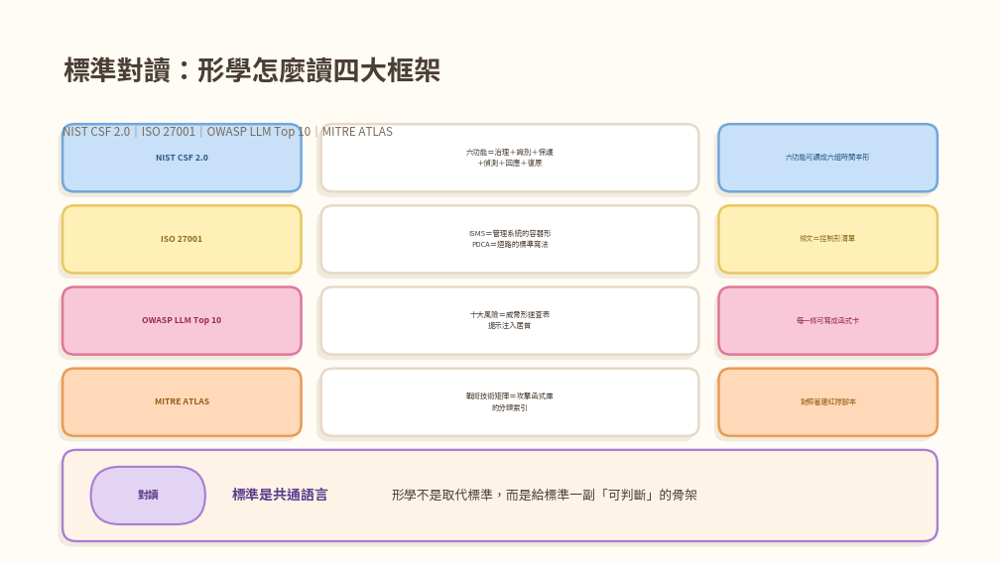

**圖 6-2　標準對讀：形學怎麼讀四大框架**

## 6.3　總架構：哲學—方法—實踐

全書一圖收攏：哲學層（形是什麼、怎麼判斷、怎麼運作）給眼睛；方法層（三種補足、六步驟、八問、誤用對照）給手；實踐層（兩庫一中樞一迴路的平台落地）給腿。缺一層就只剩口號或只剩工具。

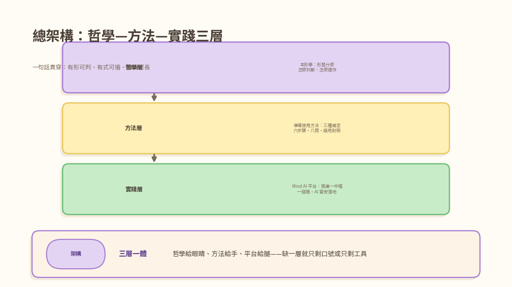

**圖 6-3　總架構：哲學—方法—實踐三層**

落地展開成兩庫一中樞一迴路與資安職能的一對一對照：形庫接 SIEM/SOC 的事件形彙整、函式庫接威脅情報更新、中樞接風險評估的三層判斷輸出、迴路接稽核改進的知識沉澱。不是「引入平台」，而是「職能換代」。

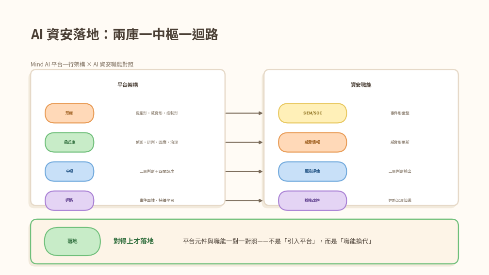

**圖 6-4　AI 資安落地：兩庫一中樞一迴路**

## 6.4　成熟度三級：看得見 → 判得準 → 動得快

能力建設走階梯：第一級看得見（資產成形、BOM 清楚、日誌可查、攻擊面可數）；第二級判得準（三層判斷常態化、誤報可控、判準可複核）；第三級動得快（回應自動化、迴路自轉、分鐘級處置、持續演化）。

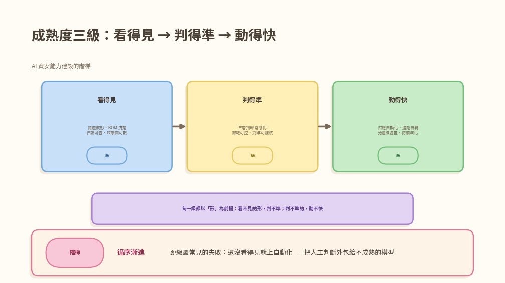

**圖 6-5　成熟度三級：看得見 → 判得準 → 動得快**

> **跳級的教訓**
>
> 最常見的失敗是還沒看得見就上自動化——把人工判斷外包給不成熟的模型，等於讓不可複核的黑盒替你負責。每一級都以「形」為前提。

> **第六篇收束**
>
> 治理把責任寫成形、標準被讀成形、架構三層一體、成熟度循序漸進——AI 資安從專案升級為職能，靠的就是這套可判斷的骨架。

> **專業專欄 C5　AI 法遵地圖：從 GDPR 到 AI Act**
>
> 合規不是一本書，是一張地圖。資料面：GDPR 個資法規的核心可讀成「有身份的內容」——個資是 ( ) 有身份、[ ] 有敏感刻度的內容形，處理行為都要落在容器範圍內。
>
> AI 面：歐盟 AI Act 以風險分級立法（不可接受／高／有限／最小），高風險系統強制風險管理、資料治理、記錄留存、人機監督、穩健與資安——五項義務正好對應本書的 Y 零件帳、資料生命週期、事件閉環、人機縫控制、韌性地圖。
>
> 實務順序建議：先用三軸把系統分級（X），再把義務寫成控制形清單（{ }），最後把責任寫進容器欄（( )）——三軸寫完，合規文件的骨架就立起來了，剩下的只是填空。

# 第七篇　內容完整方案——學練用教建

*方法與架構要變成組織能力，需要一條可走的路。本篇給出完整方案：五段養成路線、八週學習地圖、建庫四階段與導入節奏——教學用它開課，企業用它導入。*

## 7.1　學・練・用・教・建

五段養成：學（讀骨幹、懂三軸三括號）→ 練（做練習、寫形集合卡）→ 用（工作上實作六步驟判斷）→ 教（帶人教學、講清八問）→ 建（建形庫函式庫、組織資產化）。五段不是瀑布：教與建會反過來逼你把「學」補深。

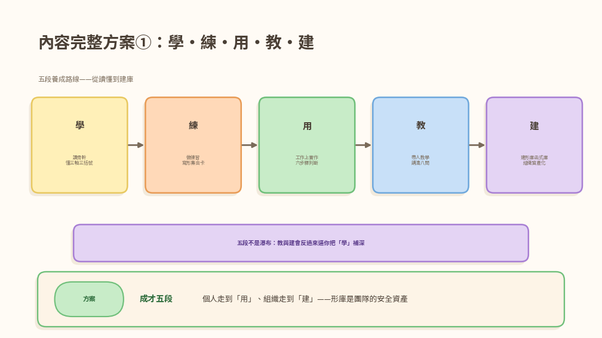

**圖 7-1　內容完整方案①：學・練・用・教・建**

個人走到「用」就有生產力；組織走到「建」才有累積——形庫是團隊的安全資產，人員流動不帶走判斷力。

## 7.2　八週路線

一週一主題、週週有產出：W1 骨幹（三軸三括號入門）→ W2 資產形（把自家 AI 資產成形）→ W3 威脅形（攻擊函式庫＋案例）→ W4 防護形（控制形設計＋remove 三級）→ W5 方法上（三種補足＋六步驟）→ W6 方法下（八問＋誤用對照）→ W7 平台（兩庫一中樞一迴路實習）→ W8 綜合（個案發表＋成熟度自評）。

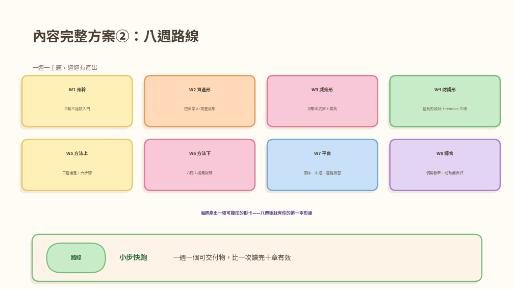

**圖 7-2　內容完整方案②：八週路線**

每週產出一張可複印的形卡——八週後就有你的第一本形庫。小步快跑、一週一個可交付物，比一次讀完十章有效。

## 7.3　建庫四階段與驗收

組織建庫走四階段：盤點（資產成形、現有文檔轉形卡）→ 建模（三軸定義、判準寫清楚）→ 上線（中樞判斷、迴路開始轉）→ 演化（案例回饋、重構重組）。

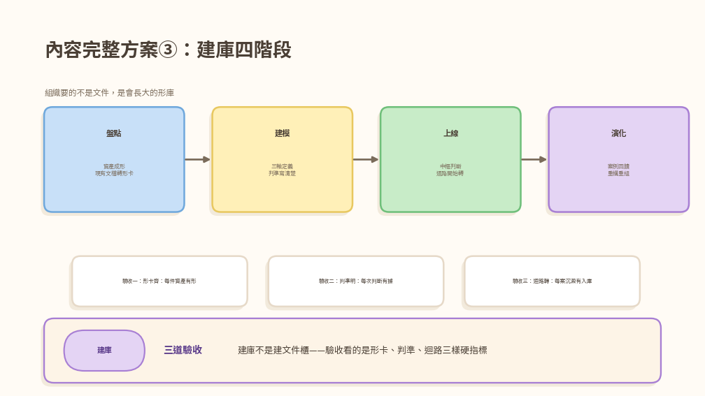

**圖 7-3　內容完整方案③：建庫四階段**

三道驗收硬指標：形卡齊（每件資產有形）、判準明（每次判斷有據）、迴路轉（每案沉澱有入庫）。建庫不是建文件櫃——驗收看的是這三樣。

## 7.4　導入節奏：試點 → 擴點 → 量產

三階段各有進退場條件：試點挑一個高價值場景（如客服 LLM 治理），進場條件是資產已成形、退場條件是六步驟跑通；擴點複製到 2–3 場景、共用形庫與判準，退場條件是跨場景判準穩；量產全組織常態運作、迴路自轉、定期稽核，目標是成熟度達第三級。

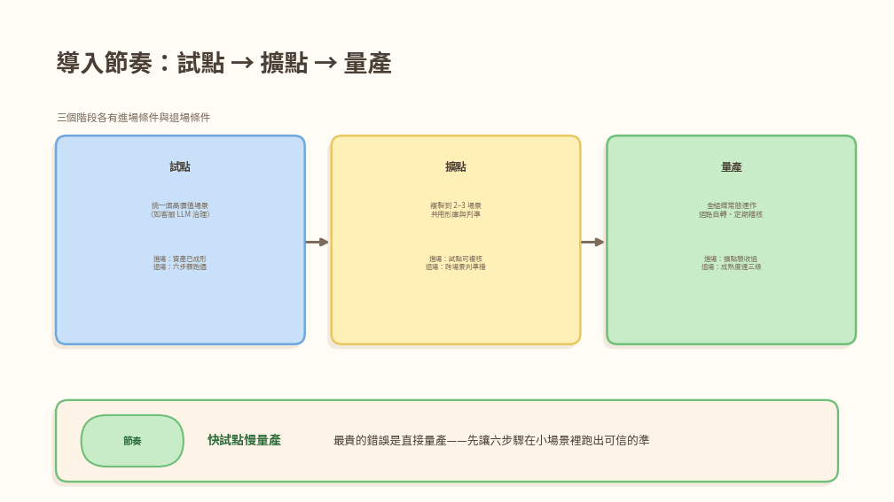

**圖 7-4　導入節奏：試點 → 擴點 → 量產**

最貴的錯誤是直接量產——先讓六步驟在小場景裡跑出可信的準，再談規模化。快試點、慢量產。

## 7.5　願景三階：知識統一 → 思維統一 → 智慧統一

最後把視野拉遠：AI 資安的終局不是工具競賽，是判斷力的建設。知識統一（資產、威脅、控制全部成形入庫）→ 思維統一（判斷方法統一，六步驟八問成習慣）→ 智慧統一（人機協同判斷，安全成為系統本能）。

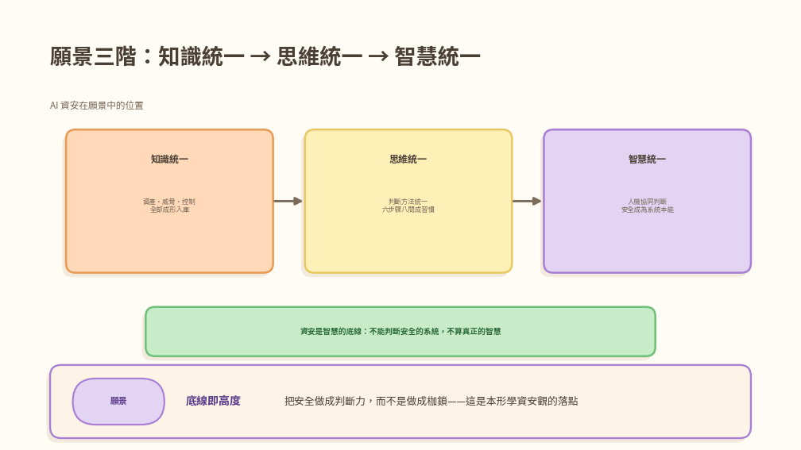

**圖 7-5　願景三階：知識統一 → 思維統一 → 智慧統一**

> **底線即高度**
>
> 資安是智慧的底線：不能判斷安全的系統，不算真正的智慧。把安全做成判斷力而不是枷鎖——這是本形學資安觀的落點。

> **練習 E11**
>
> 為你的團隊排出八週路線，寫出第一週的產出與驗收標準。

> **練習 E12**
>
> 評估自己組織的成熟度在第幾級（看得見／判得準／動得快），列出升級要做的兩件事。

> **第七篇收束**
>
> 學練用教建五段養成、八週路線小步快跑、建庫四階段三道驗收、導入節奏快試點慢量產——方案的每一步都有可交付物與驗收線。

> **專業專欄 C6　企業導入常見問題**
>
> Q1：沒有 AI 專家也能開始嗎？可以。前四週只需要資安與業務人員——盤點資產形、畫縫、分 remove 三級都是「問對問題」的工作，不需要訓練模型。
>
> Q2：形庫會不會變成又一個没人看的 Wiki？不會，如果守住三道驗收：形卡齊、判準明、迴路轉。關鍵是「每案入庫」寫進事件回應流程的最後一步——知識形不回鍋，迴路就斷。
>
> Q3：開源模型能不能用？用供應鏈縫檢查回答：來源容器的 id(C) 是誰、權重與資料的 { } 結構是否透明、[ ] 標籤與實際能力是否一致。三問過了，風險等級自然出來——不是「能不能」，是「以什麼控制換取什麼風險」。
>
> Q4：投入產出怎麼算？用成熟度三級做前後測：攻擊面可數（看得見）、誤報率與研判時效（判得準）、處置時效與人力節省（動得快）——每級都有可量測的指標，投資回報自己會說話。

> **專業專欄 C8　人才與組織：資安長的 AI 準備清單**
>
> AI 資安最後落到人與組織。資安長的準備清單可以很短：第一，職能對照——用兩庫一中樞一迴路對照現有 SOC 職能，找出缺口（通常缺的是「形庫管理員」與「函式庫維護者」兩個角色）。
>
> 第二，能力地圖——用學練用教建五段給團隊定位：誰在學、誰能用、誰能教；八週路線可直接變成內訓課表。
>
> 第三，指標儀表板——成熟度三級各配兩個指標（資產形卡完成率、攻擊面可數率／誤報率、研判時效／處置時效、迴路回饋量），季度回顧看趨勢不看快照。
>
> 一句話版本：先讓組織「看得見」，再談買工具。工具買得再多，資產不成形，就是把混亂自動化。

# 第八篇　總結——看見、守住、判準、長大

*全書走完一條路：把 AI 資安看成形的問題，就看見了；寫成函式，就守得住；走六步驟，就判得準；靠迴路，就長得大。收束成四張卡。*

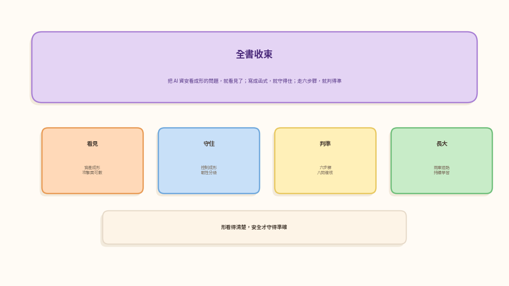

**圖 8-1　全書收束**

看見——資產成形、攻擊面可數：單位形拆解、三本帳、找縫、remove 三級韌性地圖。守住——控制成形、縱深設卡：控制形四類、護欄三卡、供應鏈形檢查、零信任含輸出。判準——六步驟、八問、三層檢查：準確＝可複核的準。長大——兩庫一中樞一迴路：事件回饋、持續學習、學練用教建、試點到量產。

回到雙向命題：保護 AI 與 AI 做資安在「形」上會合——會判斷的防守，才是 AI 時代的防守；能安全的智慧，才是真正的智慧。

> **全書終**
>
> 形看得清楚，安全才守得準確。把這句話掛在每一份 AI 資安文件的第一頁——這就是本書的全部。

# 附錄 A　術語對照表

| 名詞 | 含義 | 本書用法 |
| --- | --- | --- |
| 形（Type） | 認知鏈凝聚出的判斷單位 | 資產、威脅、控制皆寫成形 |
| 空間本形 | 形的靜態結構（名詞） | 三軸：[ ] 屬性、{ } 組成、( ) 容器 |
| 時間本形 | 形的動態運作（動詞） | 函式＝招式；形進形出 |
| 單位形／形集合 | {部件,(內容),[類別]} | 一件 AI 資產的標準寫法 |
| 三層判斷 | J＝J_C ∧ J_B ∧ J_T | 容器、組成、抽象三層聯合 |
| remove 三級 | 必要件／降級件／非必要件 | 韌性地圖與安全投資分配 |
| 函式四問 | 名稱・輸入形・輸出形・判準 | 攻防函式卡的標準格式 |
| 準確使用方法 | 三種補足＋六步驟＋八問 | 可複核的準 |
| 兩庫一中樞一迴路 | 形庫・函式庫・中樞・迴路 | Mind AI 平台一行架構 |

# 附錄 B　速查卡

### B-1　六步驟 × 八問速查

| 步驟 | 動作 | 對應八問 |
| --- | --- | --- |
| ① 認明整體 | 畫邊界：系統×資料×流程 | 一問整體 |
| ② 分軸描述 | X 分級／Y 零件／Z 邊界 | 二問三軸 |
| ③ 寫形集合 | {部件,(內容),[類別]} | 三問形集合 |
| ④ 選定命題 | 要判斷什麼、輸出結論型式 | 四問身份 |
| ⑤ 判準推理 | 按判準推演、附補償控制 | 五問判準 |
| ⑥ 三層檢查 | J_C ∧ J_B ∧ J_T | 六問三層／七問誤用／八問複核 |

### B-2　攻擊函式速查（四問卡摘要）

| 攻擊 | 輸入形 | 輸出形 | 防護卡 |
| --- | --- | --- | --- |
| 資料投毒 | 髒資料 | 偏掉的模型 | 供應鏈形檢查 |
| 提示注入 | 惡意提示 | 越權行為 | 指令內容分離 |
| 模型竊取 | 查詢流 | 盜版模型 | 限查詢・限精度 |
| 後門植入 | 觸發器 | 隱藏惡意功能 | 來源驗證＋檢測 |
| 對抗樣本 | 微擾輸入 | 錯誤判斷 | 對抗訓練＋認證 |
| 成員推斷 | 查詢對照 | 隱私外洩 | 差分隱私・雜訊 |

### B-3　可複印：空白形卡（複印此頁直接填寫）

| 資產／事件形卡（空白模板） |  |
| --- | --- |
| [ ] 屬性 | 維度：＿＿＿＿＿＿　刻度：＿＿＿＿＿＿　風險分數：＿＿＿＿ |
| { } 組成 | 部件清單：＿＿＿＿＿＿＿＿＿＿　必要件：＿＿　降級件：＿＿　可棄件：＿＿ |
| ( ) 容器 | 身份 id(C)：＿＿＿＿＿＿　範圍 S(C)：＿＿＿＿＿＿　責任人：＿＿＿＿ |
| 命題 | 要判斷什麼：＿＿＿＿＿＿＿＿＿＿＿＿＿＿＿＿＿＿＿＿ |
| 判準 | 成功條件：＿＿＿＿＿＿＿＿　失敗條件：＿＿＿＿＿＿＿＿ |
| 三層檢查 | J_C：□　J_B：□　J_T：□　（三層全過才成立） |

# 附錄 C　練習參考答案

*練習 E01–E12 對應第一～七篇，S01–S03 為綜合題。以下為示範答案——重點在「走過六步驟」，答案本身可以不同，過程必須可複核。*

| 題號 | 題目 | 示範答案重點 |
| --- | --- | --- |
| E01 | 寫出你身邊一個 AI 資產的單位形。 | 例：{模型,(客戶對話・FAQ),[高敏感]}。評分看三欄是否都有內容、{ } 是否列全部件、[ ] 刻度是否具體。 |
| E02 | 用三個新變數（不確定性、生成性、智能體）分析一個 AI 應用的風險。 | 逐變數給出「影響哪個形、破壞哪個判準」——例：智能體拿工具權限 → 擴大容器範圍 S(C) → 需重審最小權限。 |
| E03 | 把「第三方模型 API 供應商」畫成一個容器 ( )，標出 id(C) 與 S(C)。 | id(C)=供應商法人身份與模型版本；S(C)=API 可及的資料範圍與動作範圍。缺一欄即補 ( ) 補足。 |
| E04 | 在你的組織裡找出一條「縫」，寫出它屬於四縫中的哪類。 | 例：客服匯入外部知識庫＝資料縫＋供應鏈縫。第二問：這條縫的輸入形輸出形是什麼。 |
| E05 | 對一個 AI 系統做 remove 三級分類。 | 必要件＝模型核心權重與憑證；降級件＝推薦模組；可棄件＝除錯介面。答案必須附「拆掉後果」說明。 |
| E06 | 把「提示注入」寫成一張函式四問卡。 | 輸入形＝惡意文本＋合法上下文；輸出形＝越權行為；判準＝三卡（分離、收斂、偵測）全過。 |
| E07 | 為什麼模型輸出也要走零信任？舉一個不驗輸出會出事的場景。 | 輸出是形、是產物不是真理。例：助理產出的程式碼直接執行 → 供應鏈縫放大。先判再用。 |
| E08 | 設計一個偵測「模型竊取」的函式：輸入形、輸出形、判準。 | 輸入形＝查詢日誌（頻率、分佈、命中率）；輸出形＝風險分數；判準＝閾值＋人工複核觸發線。 |
| E09 | 用六步驟走一次「要不要用開源 LLM」的判斷（濃縮版）。 | 每步一句話即可，但六步必須齊——缺步的答案不給分。參考示範 5.3 的格式。 |
| E10 | 找一個「誤用大對照」裡的真實案例（自己的或新聞的）。 | 指出誤用組別＋記憶句＋正確做法。例：把「匿名化」當免責＝身份誤用，正確做法是保留責任容器。 |
| E11 | 為你的團隊排出八週路線的第一週產出。 | W1 產出＝每人一張自家 AI 資產形卡。驗收：三欄齊、刻度具體。 |
| E12 | 評估自己組織的成熟度在第幾級，列出升級的兩件事。 | 例：在第一級「看得見」；升級兩件事＝資產形卡完成率到 100%、事件回應模板加入三層檢查欄。 |
| S01 | 綜合：寫一份 500 字的「AI 資安現況與路線」簡報稿（給主管）。 | 結構必須含：雙向命題一句、現況（成熟度第幾級）、三個行動（對應三條線）、八週目標。 |
| S02 | 綜合：把本書一張圖改造成你自己組織的版本。 | 任何一張皆可，必須標註改了什麼、為什麼——改造的過程就是「用」的開始。 |
| S03 | 綜合：設計一個紅隊演練腳本（一頁）。 | 含：目標形、攻擊函式（對照 ATLAS 或 OWASP）、判定準、處置回饋到哪個形卡。 |

# 附錄 D　圖表索引

| 編號 | 圖名 | 所在篇 |
| --- | --- | --- |
| 圖 1-1 | AI 資訊安全的雙向命題 | 第一篇 |
| 圖 1-2 | 威脅變局：從資料外洩到模型級威脅 | 第一篇 |
| 圖 1-3 | 三層定位：根・幹・果 | 第一篇 |
| 圖 2-1 | 骨幹速覽①：認知鏈與三軸三括號 | 第二篇 |
| 圖 2-2 | 骨幹速覽②：三層判斷與函式四問 | 第二篇 |
| 圖 2-3 | 骨幹速覽③：Mind AI 平台骨幹 | 第二篇 |
| 圖 2-4 | 形學 ↔ AI 資安 映射總表 | 第二篇 |
| 圖 3-1 | AI 資產形：單位形拆解 | 第三篇 |
| 圖 3-2 | 三軸讀資安：X 分級・Y BOM・Z 邊界 | 第三篇 |
| 圖 3-3 | 威脅形：攻擊面＝形與形的縫 | 第三篇 |
| 圖 3-4 | 控制形：防護措施也是形 | 第三篇 |
| 圖 3-5 | remove 三級＝韌性地圖 | 第三篇 |
| 圖 3-6 | 容器 ( ) 與零信任：身份不預設 | 第三篇 |
| 圖 3-7 | 資料的形：生命週期六站 | 第三篇 |
| 圖 4-1 | 攻擊函式庫：惡意的時間本形 | 第四篇 |
| 圖 4-2 | 重點解剖：提示注入的形 | 第四篇 |
| 圖 4-3 | 重點解剖：投毒與後門的形 | 第四篇 |
| 圖 4-4 | 重點解剖：模型竊取與推斷攻擊 | 第四篇 |
| 圖 4-5 | 重點解剖：越獄與護欄的形 | 第四篇 |
| 圖 4-6 | AI 做資安：智慧 SOC 迴路 | 第四篇 |
| 圖 4-7 | 偵測函式三族：規則・統計・模型 | 第四篇 |
| 圖 4-8 | 事件回應＝形進形出的閉環 | 第四篇 |
| 圖 5-1 | 準確使用方法①：三種補足 | 第五篇 |
| 圖 5-2 | 準確使用方法②：證明六步驟 | 第五篇 |
| 圖 5-3 | 六步驟示範：導入外部 LLM 的判斷 | 第五篇 |
| 圖 5-4 | 準確使用方法③：八問檢查清單 | 第五篇 |
| 圖 5-5 | 誤用大對照：AI 資安四組誤區 | 第五篇 |
| 圖 5-6 | 情境選路：決策樹 | 第五篇 |
| 圖 6-1 | 治理法遵：風險分級與責任形 | 第六篇 |
| 圖 6-2 | 標準對讀：形學怎麼讀四大框架 | 第六篇 |
| 圖 6-3 | 總架構：哲學—方法—實踐三層 | 第六篇 |
| 圖 6-4 | AI 資安落地：兩庫一中樞一迴路 | 第六篇 |
| 圖 6-5 | 成熟度三級：看得見 → 判得準 → 動得快 | 第六篇 |
| 圖 7-1 | 內容完整方案①：學・練・用・教・建 | 第七篇 |
| 圖 7-2 | 內容完整方案②：八週路線 | 第七篇 |
| 圖 7-3 | 內容完整方案③：建庫四階段 | 第七篇 |
| 圖 7-4 | 導入節奏：試點 → 擴點 → 量產 | 第七篇 |
| 圖 7-5 | 願景三階：知識統一 → 思維統一 → 智慧統一 | 第七篇 |
| 圖 8-1 | 全書收束 | 第八篇 |
