# 全基因組關聯分析 GWAS × Mind AI

**準確使用方法與架構・內容完整方案**

> **理論基礎　本形學（空間本形・時間本形）**
>
> **底層平台　Mind AI**
>
> 以形（Type）為最小描述單位　準確＝可複核的準

# 目　錄

- 導讀　把 GWAS 看清楚，用得準確
  - 導-1　四個學習之問
  - 導-2　雙軌讀者與全書路線
- 第一篇　定位：GWAS 為什麼需要形
  - 1-1　GWAS 是什麼：一台全基因組的篩檢機
  - 1-2　五個痛點：結果總是被用錯
  - 1-3　三層定位：根、幹、果
- 第二篇　骨幹速覽：一章立起形的骨架
  - 2-1　認知鏈與核心命題
  - 2-2　三軸三括號：空間本形的描述語言
  - 2-3　時間本形與函式四問
  - 2-4　Mind AI：底層平台的位置
  - 2-5　GWAS ↔ 形學映射總表
- 第三篇　空間本形：GWAS 的形
  - 3-1　研究對象的單位形
  - 3-2　X 軸屬性 [ ]：表型形與變異形
  - 3-3　Y 軸組成 { }：BOM 與 remove 三級
  - 3-4　Z 軸容器 ( )：隊列與族群
  - 3-5　數＝形裡的小形：基因型計數 0/1/2
  - 3-6　三層判斷的 GWAS 版
- 第四篇　時間本形：GWAS 的函式
  - 4-1　函式鏈總圖：形進形出
  - 4-2　七張函式四問卡
  - 4-3　六群映射：GWAS 函式屬於哪一群
  - 4-4　推理五族在 GWAS
- 第五篇　準確使用方法：GWAS 版
  - 5-1　體—用—準：總架構
  - 5-2　三種補足：GWAS 版
  - 5-3　證明六步驟：完整示範
  - 5-4　八問：交出去之前的檢查清單
  - 5-5　誤用大對照：16 種 GWAS 誤用
  - 5-6　選路決策樹：這個 GWAS 該怎麼走
- 第六篇　總架構：GWAS × Mind AI
  - 6-1　兩庫一中樞一迴路 × GWAS
  - 6-2　對讀：GWAS 生態系的既有框架
  - 6-3　可複核的準：四條驗收線
  - 6-4　AGI 三階段與 GWAS 的位置
- 第七篇　內容完整方案：學・練・用・教・建
  - 7-1　學練用教建：五段路
  - 7-2　八週路線
  - 7-3　四讀者情境選路
  - 7-4　建庫四階段
- 第八篇　總結：把 GWAS 看清楚，用得準確
  - 8-1　全書回顧：五句話
  - 8-2　五領域案例並列：形的方法不只屬於 GWAS
  - 8-3　願景：從 GWAS 到知識統一
- 附錄 A　術語對照表
- 附錄 B　速查卡
  - B-3　可複印空白模板（整頁）
- 附錄 C　練習參考答案
- 附錄 D　圖表索引

# 導讀　把 GWAS 看清楚，用得準確

全基因組關聯分析（Genome-Wide Association Study，GWAS）是當代生物醫學最強大的發現引擎之一：它在全基因組尺度上，逐一檢查數十萬到數百萬個遺傳變異與表型之間的關聯，把「基因與疾病」的線索從海量數據裡撈出來。十幾年來，GWAS 為身高、糖尿病、心血管疾病、精神疾病等數千個表型找到了數以萬計的關聯位點，也催生了多基因風險評分、孟德爾隨機化、精細定位等一整個後續產業鏈。

但這個引擎有一個公認的痛點：它的結果很容易被用錯。假關聯混進結論、效應量被高估、關聯被當成因果、跨族群結果被直接搬用——每一種誤用，都會讓後續的機制研究、藥物開發、臨床決策走上彎路。問題不在統計學不夠嚴謹，而在於「研究對象與流程本身，缺少一套把層次寫清楚的描述語言」。

本形學（Ontypology）給出的正是這套語言：空間本形回答「研究對象是什麼形」，時間本形回答「分析流程怎麼運作」，準確使用方法回答「怎麼判斷、怎麼複核」。底層以 Mind AI 為平台，讓知識、推理與學習收攏在同一套架構裡。本書要做的事情只有一件——把 GWAS 看清楚，轉成可教、可練、可複核的準確使用方法與架構。

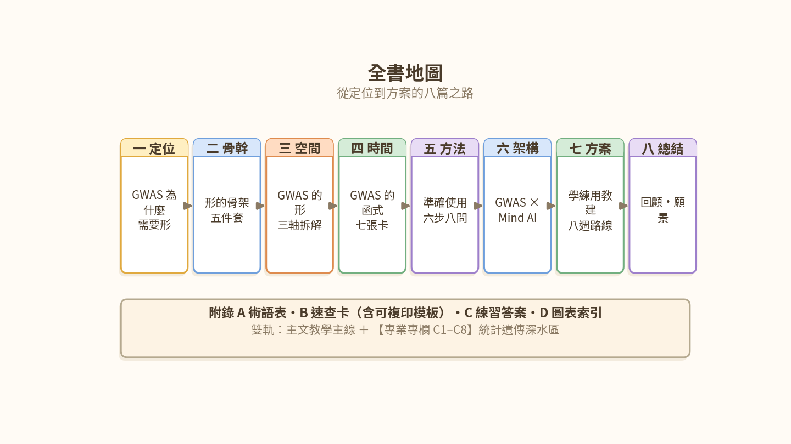

**圖 0-1　全書地圖：從定位到方案的八篇之路**

> **本書的約定**
>
> 一、理論基礎為本形學（空間本形與時間本形），底層平台為 Mind AI；兩者的原有理論內容不在本書重複鋪陳，僅以架構圖與圖文摘要立起骨幹（第二篇）。
>
> 二、全書以形（Type）為最小描述單位；形集合 { 部件, (內容), [類別] }、三軸、三層判斷、函式四問等記號沿用本形學原著。
>
> 三、本書聚焦方法與架構，不做系統實作；所有 GWAS 內容以真實領域方法與慣例為據。
>
> 四、雙軌閱讀：主文是教學主線；【專業專欄】補上統計遺傳學的深水區，給研究者與工程師。

## 導-1　四個學習之問

拿起任何一個領域，先問四個問題：它是什麼？它由什麼組成？它放在哪裡？它怎麼運作？前三問由空間本形回答，第四問由時間本形回答。GWAS 的答案，就是本書第三、四篇的全部內容。

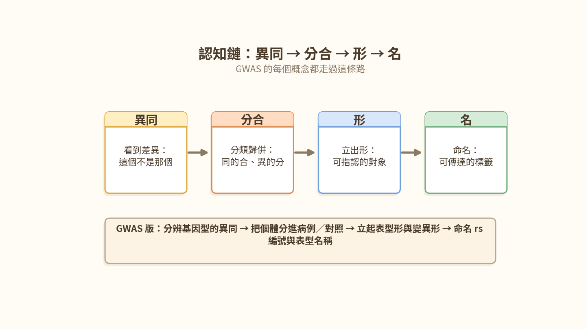

**圖 0-2　認知鏈：從異同到名字——GWAS 的每個概念都走過這條路**

| 學習之問 | 形學的問法 | GWAS 的回答所在 |
| --- | --- | --- |
| 它是什麼？ | X 屬性 [ ]：維度×刻度 | 第三篇 3-2：表型形與變異形 |
| 它由什麼組成？ | Y 組成 { }：BOM 與 remove 三級 | 第三篇 3-3：研究對象的部件清單 |
| 它放在哪裡？ | Z 容器 ( )：C = (id(C), S(C)) | 第三篇 3-4：隊列與族群容器 |
| 它怎麼運作？ | 時間本形：函式＝形進形出 | 第四篇：GWAS 流程的七張函式卡 |

## 導-2　雙軌讀者與全書路線

主文寫給「要把 GWAS 用準的人」：生醫研究者、資料分析師、生技與臨床團隊。不需要先學過本形學——第二篇會用一章的篇幅把骨幹立起來。【專業專欄】C1 至 C8 則寫給需要深水區的讀者：統計遺傳的核心概念、混合模型、精細定位、多基因風險評分、孟德爾隨機化與研究倫理，一欄一個主題。

| 讀者 | 建議路線 | 重點篇 |
| --- | --- | --- |
| 生醫研究者 | 導讀 → 一 → 二 → 三 → 五 → 附錄 B | 空間本形與準確使用方法 |
| 資料分析師 | 導讀 → 二 → 四 → 五 → 七 | 時間本形與流程函式 |
| 生技／臨床團隊 | 導讀 → 一 → 五 → 六 → 七 | 驗收、架構與導入方案 |
| 學生與教師 | 順讀全書＋每篇練習 → 附錄 C 對答案 | 一概念・一圖・一例・一練習 |

> **【練習 S00】**
>
> 開始之前，先寫下你對 GWAS 的第四問：「它怎麼運作？」用你自己的話寫三句話，讀完第四篇之後回來重寫一次——兩次的差距，就是這本書要帶你走的路。

# 第一篇　定位：GWAS 為什麼需要形

這一篇先把 GWAS 放回它該在的位置：它做什麼、它做得多好、它的結果為什麼總是被用錯。看清痛點，才知道形的語言要補上什麼。

## 1-1　GWAS 是什麼：一台全基因組的篩檢機

GWAS 的基本動作非常樸素：找一群人，量他們的表型（身高、是否患病、血液指標），再讀他們全基因組的變異（通常是數十萬到數百萬個單核苷酸多型性，SNP），然後對每一個 SNP 問同一個問題——「帶不同基因型的人，表型有沒有系統性的差異？」把全基因組每個位點都問過一遍，把答案畫成曼哈頓圖，顯著的峰就是候選關聯位點。

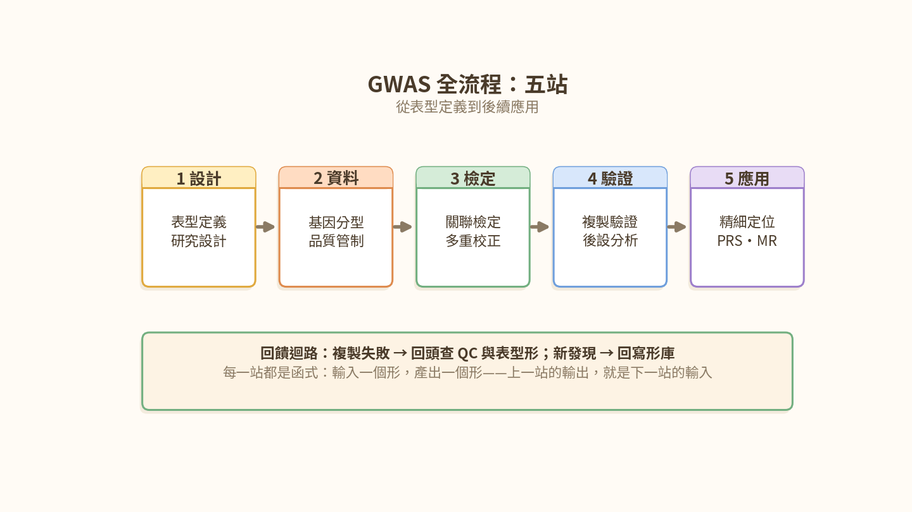

**圖 1-1　GWAS 全流程：從表型定義到後續應用的五站**

這台篩檢機的威力來自「不預設立場」：不需要先猜候選基因，全基因組掃描一次到位。自 2005 年第一個 GWAS（年齡相關性黃斑變性）以來，這個方法已經為數千個表型找出數以萬計的關聯位點，成為流行病學、遺傳學、藥物開發的公共基礎設施。

> **一句話定義**
>
> GWAS＝在全基因組尺度上，對每個變異逐一檢定其與表型的關聯，並把「關聯的證據」管理到可複核的發現流程。

## 1-2　五個痛點：結果總是被用錯

GWAS 的方法學社群非常嚴謹，但 GWAS 的「下游使用者」遍布機制研究、臨床、農業、法醫、消費級基因檢測——每一個環節都可能把結果用歪。最常見的五個痛點是：

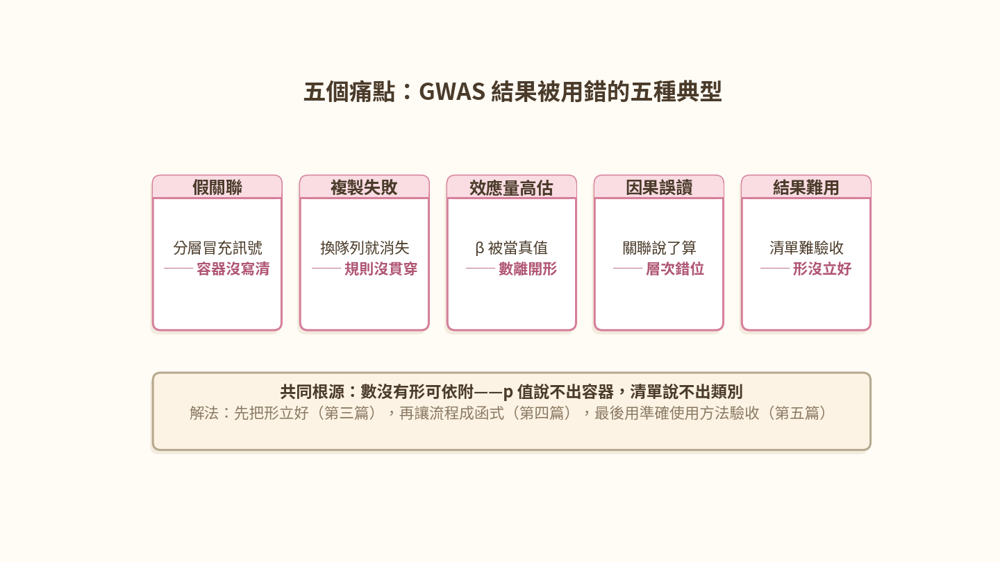

**圖 1-2　五個痛點：GWAS 結果被用錯的五種典型**

| # | 痛點 | 現場樣子 | 形學診斷 |
| --- | --- | --- | --- |
| 1 | 假關聯 | 族群分層、樣本品質、批次效應冒充訊號 | 容器 ( ) 沒寫清：身份與層次混了 |
| 2 | 複製失敗 | 同一位點換個隊列就消失 | 判準不完整：[ ] 規則沒貫穿所有樣本 |
| 3 | 效應量高估 | 發現隊列的 effect size 被當真值 | 數離開了形：勝利者詛咒 |
| 4 | 因果誤讀 | 「這個基因導致疾病」隨口就來 | 層次錯位：關聯≠因果，時間本形沒走 |
| 5 | 結果難用 | 數百個位點堆在清單裡，無法驗收 | 形沒立好：沒有形集合，無法判斷與傳承 |

這五個痛點有共同的根源：GWAS 產出的是「數」——p 值、效應量、位點清單——但支撐這些數的「形」（研究對象是什麼、由什麼組成、放在哪裡、怎麼被分析）從來沒有被完整寫下來。沒有形，數就沒有依附：p 值說不出它是在哪個容器裡算的，位點清單說不出它屬於哪個類別。這正是「先有形，才有數」要補的課。

> **【專業專欄】C1　GWAS 簡史：從候選基因到百萬人研究**
>
> 1990 年代：候選基因時代——先猜一個基因，再驗它與疾病的關聯。命中率低、複製失敗率高，因為「猜」本身就是偏誤的來源。
>
> 2005 年：第一個 GWAS 問世（Klein 等，年齡相關性黃斑變性，CFH 基因）——不預設立場的全基因組篩檢登場。
>
> 2007 年：WTCCC（英國病例對照聯盟）以 14,000 人、17 個表型立下 GWAS 慣例：統一 QC、統一判準、公開資料。
>
> 2008 年起：國際聯盟化——GIANT（身高）、DIAGRAM（糖尿病）等 meta 分析把樣本推到數十萬；GWAS Catalog 成為公共登記簿。
>
> 2018 年起：Biobank 時代——UK Biobank 50 萬人、FinnGen、BioBank Japan、台灣生物資料庫（Taiwan Biobank）把 GWAS 變成常態化基礎設施；混合模型（SAIGE、REGENIE）解決大樣本與不平衡病例比。
>
> 2020 年代：百萬人研究與多祖源 GWAS 興起，重心移向精細定位、功能註解、多基因風險評分與跨族群可轉移性。
>
> 形學讀法：GWAS 的歷史，就是一部「把形立得越來越準」的歷史——從猜測到普查、從單打獨鬥到聯盟、從發現到可複核的應用。

## 1-3　三層定位：根、幹、果

用形學的三層定位看 GWAS，位置一目了然。本體論是根——它問「基因組這個世界裡有什麼」：個體、變異、表型、族群，這些「有什麼」是 GWAS 立足的前提。本形學是幹——它問「這些東西是什麼形、怎麼判斷、怎麼運作」：把研究對象寫成形集合，把流程寫成函式，把判斷寫成可複核的推理。GWAS 的準確使用是果——當形立好了，流程的每一步都有判準，結果才可驗收、可傳承、可應用。

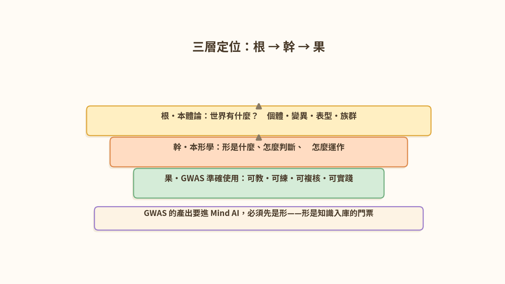

**圖 1-3　三層定位：根（本體論）→ 幹（本形學）→ 果（GWAS 準確使用）**

把 GWAS 納入這個定位，還得到一個實務紅利：當 GWAS 的產出要進到 Mind AI 平台——被儲存、被推理、被學習——它必須先是「形」。形是知識入庫的門票。

> **【練習 E01】**
>
> 用五個痛點檢查一份你熟悉的 GWAS 報告（或論文的結果段）：它踩中了幾個痛點？每個痛點，試著指出是「容器沒寫清、規則沒貫穿、數離開形、層次錯位」中的哪一種。

> **【練習 E02】**
>
> 為什麼說「先有形，才有數」恰好解釋了 GWAS 的複製失敗問題？用兩句話說明：如果一個關聯的「形」（研究對象與規則）沒有寫清楚，換一個隊列時哪些東西會悄悄改變？

# 第二篇　骨幹速覽：一章立起形的骨架

本書不重講本形學與 Mind AI 的原有理論——那有各自的專書。但要把 GWAS 用形寫清楚，先把骨幹立起來：認知鏈、三軸三括號、三層判斷、函式四問、Mind AI 的位置，以及 GWAS 與形學的映射總表。這一章是全書的地基，之後每一篇都會回到這裡取用。

## 2-1　認知鏈與核心命題

形的誕生有一條固定的認知鏈：先有「異同」的感受，才產生「分」與「合」的動作，最後才生出「形」，而形必有名。兩個核心命題貫穿全書：有合必有形——只要把東西合起來當成一個整體，就有一個形在那裡；數＝形裡面的小形・次比較——數永遠依附在已被辨識出來的形之上，在同一個形之下數它的子形出現了幾次。結論只有一句：先有形，才有數。

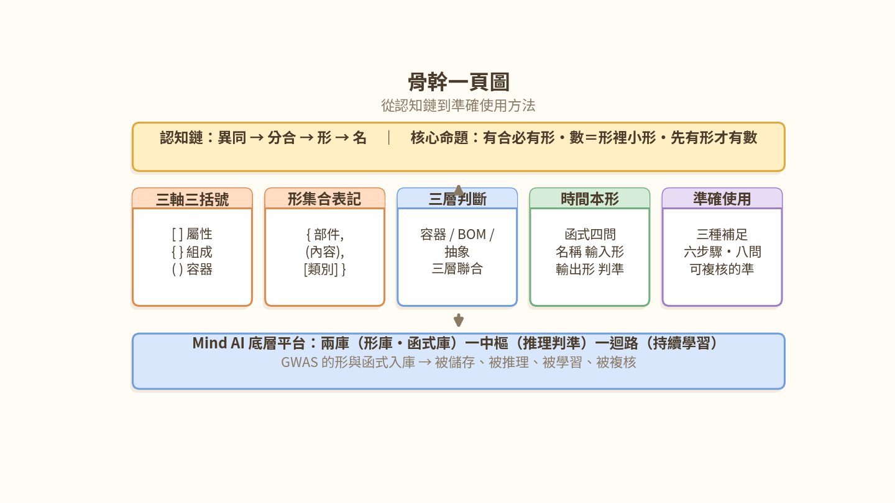

**圖 2-1　骨幹一頁圖：從認知鏈到準確使用方法**

## 2-2　三軸三括號：空間本形的描述語言

空間本形用三條軸、三種括號把一個對象描述完整：X 軸屬性 [ ] 回答「它長什麼樣」——維度與刻度，屬性是一個可以被拿來問的問題，屬性值是具體答案；Y 軸組成 { } 回答「它由什麼組成」——物料清單（BOM）與 remove 三級；Z 軸容器 ( ) 回答「它放在哪裡」——C = (id(C), S(C))，身份識別與內部空間，不變性公理：換內容，id(C) 不變。單位形把三者收攏成完整表記：形集合 = { 部件, (內容), [類別] }。

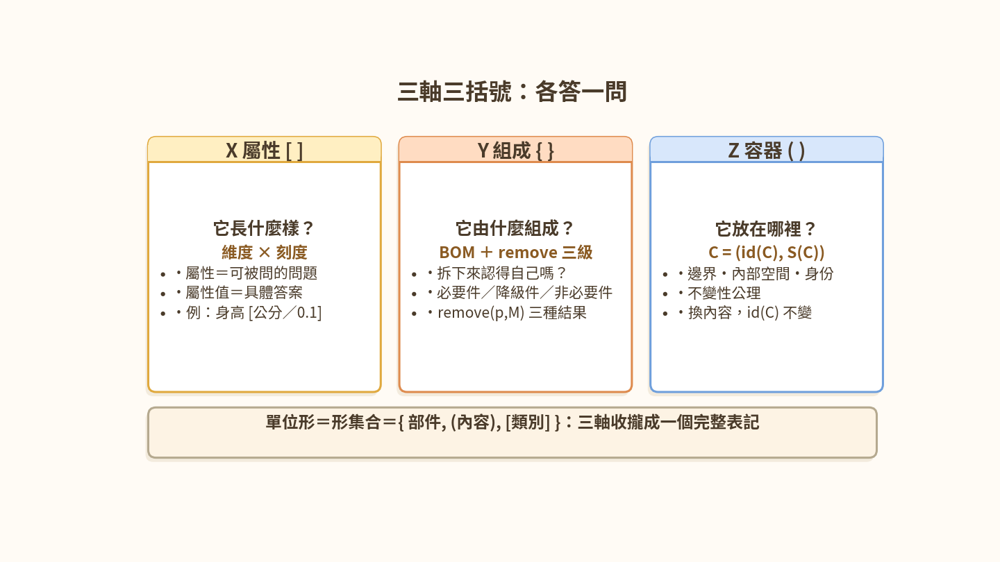

**圖 2-2　三軸三括號：X 屬性、Y 組成、Z 容器各答一問**

remove 三級回答「部件有多要緊」：把部件從整體移除——必要件移除後同一性喪失（remove(p,M) ≢ M）；功能降級件功能缺失但身份存續（remove(p,M) ≡ M′ ⊂ M）；非必要件移除後完全不影響（remove(p,M) ≡ M）。三層判斷則把判斷分成三層：容器層驗 id(C)、組成層驗 remove 分級、抽象層驗類別判準 T = (F(T), ∩(T))——三層聯合，缺一不可。

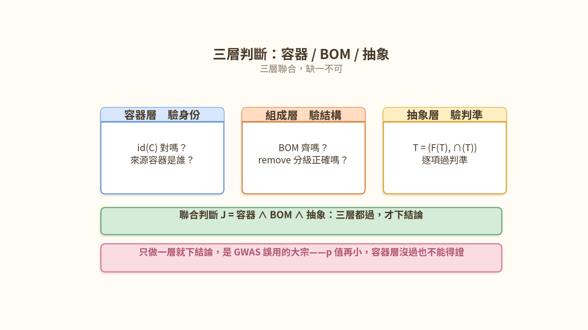

**圖 2-3　三層判斷：容器／BOM／抽象，三層聯合缺一不可**

## 2-3　時間本形與函式四問

時間本形是動詞的形：函式＝方法＝招式＝服務＝法門。一個動詞要成形，寫全函式四問——名稱、輸入形、輸出形、判準。時間本形依附空間本形：輸入一個形，產出一個形。挑函式固定四步：問目的、對函式群、填函式四問、上崗複核。準確使用方法收攏為：三種補足（[ ] 補規則、( ) 補身份、{ } 補結構）、證明六步驟（認明整體→分軸描述→寫形集合→選定命題→判準推理→三層檢查）、八問檢查清單與誤用對照。準確＝可複核的準。

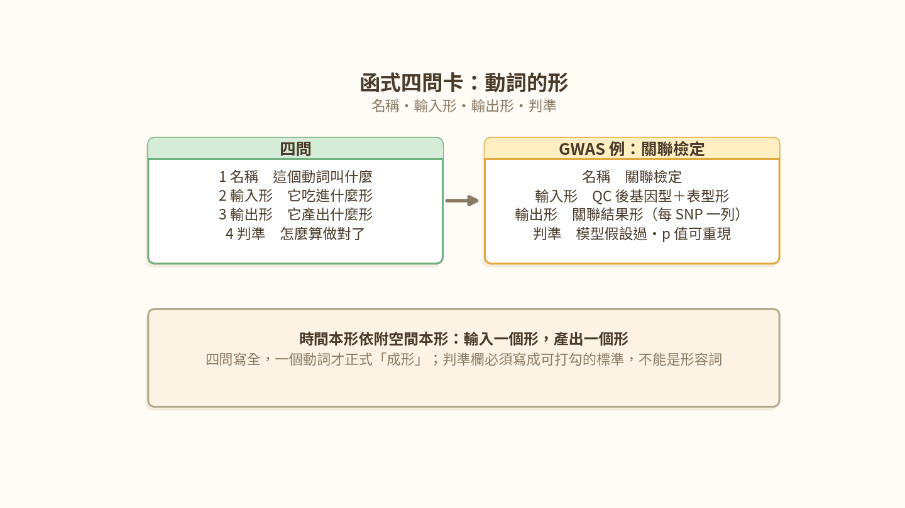

**圖 2-4　函式四問卡：名稱、輸入形、輸出形、判準**

## 2-4　Mind AI：底層平台的位置

Mind AI 是本形學與 Mind Model 的實踐平台，目標是通往 AGI 的智慧架構：以兩庫（形庫、函式庫）一中樞（推理與判準中樞）一迴路（持續學習迴路）運作，讓 LLM 負責語言能力、Mind Model 負責智慧能力。本書把 GWAS 的知識與流程收攏為形與函式，正是為了讓它可以進入這個平台——被儲存、被推理、被學習、被複核。

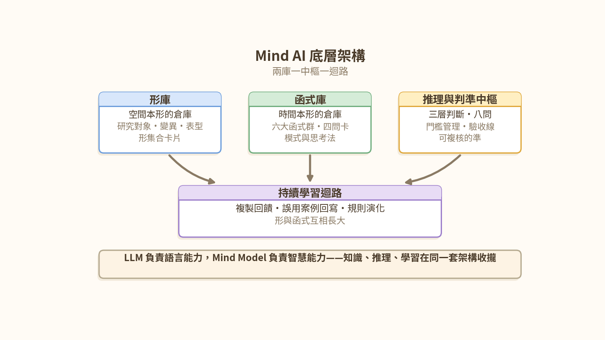

**圖 2-5　Mind AI 底層架構：兩庫一中樞一迴路**

## 2-5　GWAS ↔ 形學映射總表

最後把兩邊對上。這張映射總表是全書的轉換器：往後每一篇，都只是把這張表的某一列展開成方法。

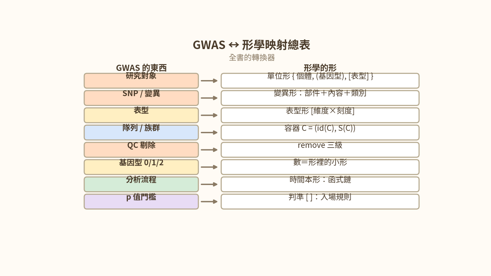

**圖 2-6　GWAS ↔ 形學映射總表：全書的轉換器**

| GWAS 的東西 | 形學的形 | 落在哪一軸／哪一問 |
| --- | --- | --- |
| 研究對象（隊列中的個體） | 單位形 { 個體, (基因型), [表型] } | 形集合整體表記 |
| SNP／變異 | 變異形：部件＋內容＋類別 | Y 組成 { }：基因組的部件 |
| 表型（身高、患病與否） | 表型形 [維度×刻度] | X 屬性 [ ] |
| 隊列／族群 | 容器 C = (id(C), S(C)) | Z 容器 ( ) |
| QC 剔除規則 | remove 三級 | Y 組成：必要件判準 |
| 基因型計數 0/1/2 | 數＝形裡的小形・次比較 | 形先於數 |
| 分析流程（QC→檢定→複製） | 時間本形：函式鏈 | 函式四問 |
| p 值與判準（5×10⁻⁸ 等） | 判準 [ ]：入場規則 | 三層判斷的抽象層 |

> **【練習 E03】**
>
> 不看書，畫出骨幹一頁圖（圖 2-1）的簡化版：認知鏈、三軸、三層判斷、函式四問、準確使用方法五塊，各寫一句話定義。畫完再對照 2-1 至 2-4 補齊缺口。

> **【練習 E04】**
>
> 從映射總表挑三列，用你自己的 GWAS 實務經驗各補一個具體例子（例：『表型形 [維度×刻度]』→『身高，單位公分，刻度到 0.1』）。

# 第三篇　空間本形：GWAS 的形

這一篇把 GWAS 的研究對象拆開看：個體、變異、表型、隊列，各自是什麼形？用三軸三括號寫完，你會發現 GWAS 流程裡最難纏的問題——族群分層、樣本品質、表型異質性——其實都是「形沒立好」的不同樣子。

## 3-1　研究對象的單位形

GWAS 的判斷對象是「隊列裡的一個個體」。用形集合表記：單位形 = { 個體（部件）, (基因型內容), [表型類別] }。部件是這個形裡拆得出來的東西——樣本、DNA、基因型、表型記錄、協變量；內容是可替換而身份不變的部分——基因型讀數會因分型平台更新而重讀，個體還是那個個體；類別是判斷它歸屬哪一類的開放規則——病例／對照／數量性狀個體。

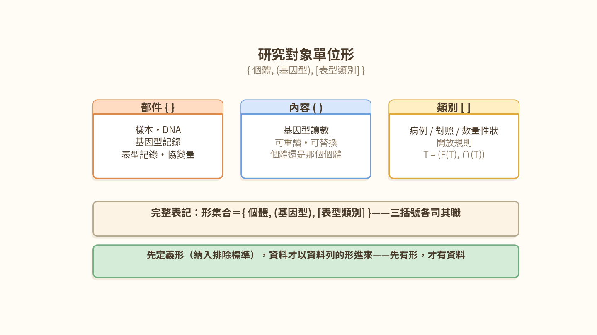

**圖 3-1　研究對象單位形：{ 個體, (基因型), [表型類別] }**

先有形，才有資料。很多人以為 GWAS 是「先有資料表，再做分析」；形學的看法剛好相反：先定義好個體的形（入場規格），資料才以資料列的形式進來。這就是為什麼研究設計書裡的「納入排除標準」如此關鍵——它就是這個形的 [ ] 入場規則。

> **形不是比喻**
>
> GWAS 資料表的表頭天生就是形：一組共用的問題清單（ID、性別、年齡、PC1..PCk、表型、基因型欄位），本身沒有答案，卻規定答案長在哪裡。每一個受試者就是一列實體。這與 RDB 的「表頭是形、資料列是實體」是同一個結構。

## 3-2　X 軸屬性 [ ]：表型形與變異形

屬性是一個維度，由「維度×刻度」組成。表型形的維度回答「量什麼」，刻度回答「量到多細」：身高（公分，刻度 0.1）、患病狀態（二值：病例／對照）、血脂（mmol/L，刻度 0.01）、發病年齡（年）。刻度不是小事——表型定義的刻度不同，同一個 GWAS 會得出不同的結論：「第 2 型糖尿病」用醫師診斷編碼定義、用空腹血糖切點定義、用自報定義，是三個不同的表型形。

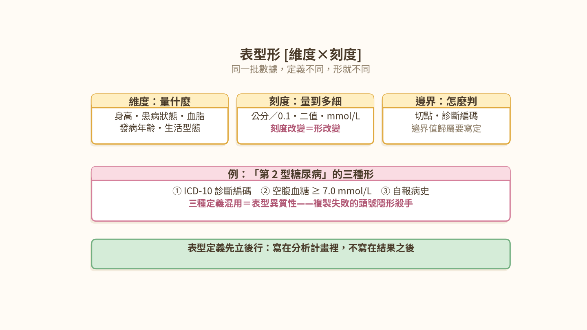

**圖 3-2　表型形 [維度×刻度]：同一批數據，定義不同，形就不同**

變異形同樣落在 X 軸：一個 SNP 的屬性包括染色體位置、參考／替代等位基因、變異類別（SNP／indel／CNV）、次等位基因頻率（MAF）、功能註解（內含子／外顯子／調控區）。這些屬性是「拿來問的問題」，每個具體位點在每個問題下交出自己的答案。

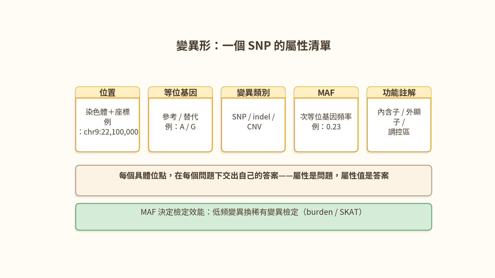

**圖 3-3　變異形：一個 SNP 的屬性清單與刻度**

## 3-3　Y 軸組成 { }：BOM 與 remove 三級

一個 GWAS 研究的 BOM（物料清單）拆開是：研究方案、受試者、生物樣本、基因型資料、表型資料、協變量、分析腳本、產出報告。用 remove 判準給每個部件分級——把部件拿掉，研究還成不成立？

| remove 三級 | 定義 | GWAS 部件例子 | 拿掉的後果 |
| --- | --- | --- | --- |
| 必要件 | 移除後同一性喪失 | 基因型資料、表型資料、樣本身份 | 研究不再是 GWAS |
| 功能降級件 | 功能缺失但身份存續 | 協變量（年齡、性別、PC）、複製隊列、精細定位 | 只剩初階發現，可信度降級 |
| 非必要件 | 移除後完全不影響 | 美觀排版、次要註解、附帶問卷 | 無影響 |

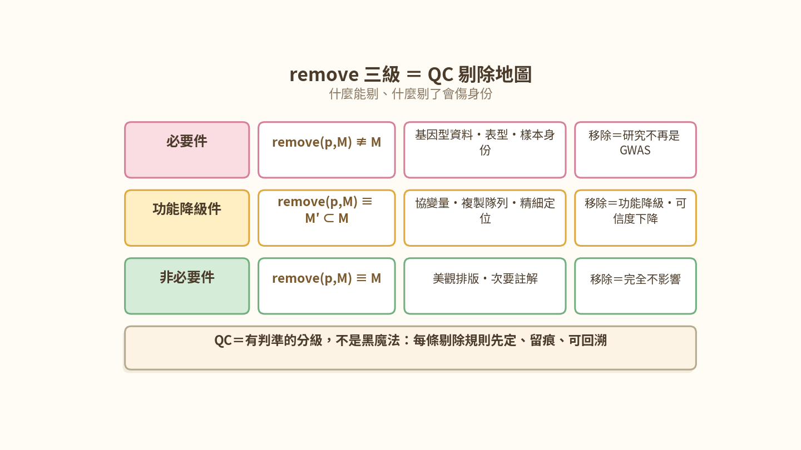

**圖 3-4　remove 三級＝QC 剔除地圖：什麼能剔、什麼剔了會傷身份**

QC 剔除規則正是 remove 判準的應用現場：樣本缺失率過高、性別不一致、近親未處理、雜合度異常——每一條剔除規則都在回答「這個樣本／位點是必要件出問題，還是非必要件的雜訊？」把 QC 想成 remove 三級，剔除就不再是黑魔法，而是有判準的分級。

## 3-4　Z 軸容器 ( )：隊列與族群

容器 C = (id(C), S(C))：身份識別 id(C) 與內部空間 S(C)。不變性公理：∀ e₁, e₂ ∈ S(C)，替換 e₁ 為 e₂ 不改變 id(C)。GWAS 的容器層層嵌套：生物樣本庫（UK Biobank、Taiwan Biobank）是最外層容器，隊列（cohort）是研究層的容器，族群（population）是遺傳結構層的容器，家系（pedigree）是最內層容器。

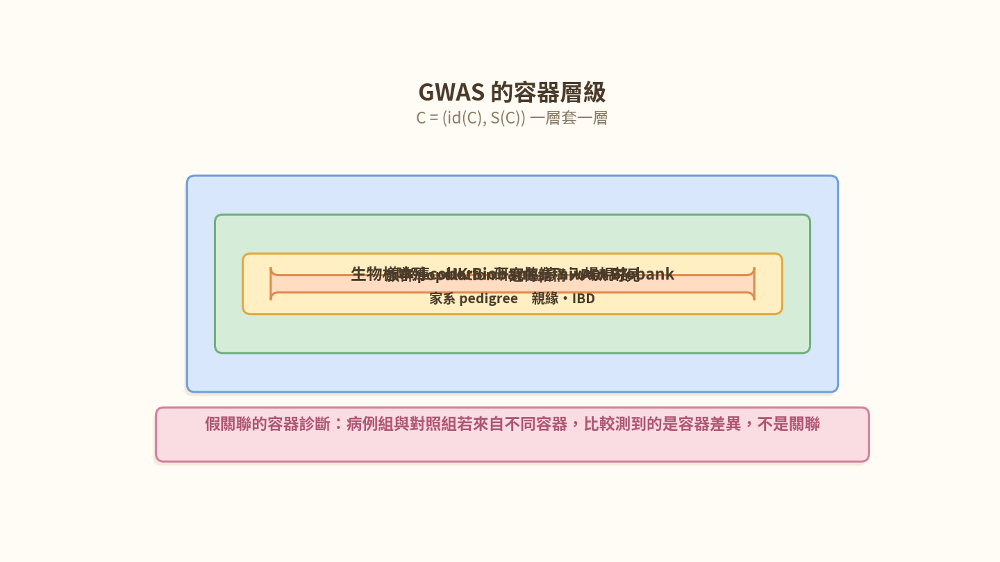

**圖 3-5　GWAS 的容器層級：樣本庫→隊列→族群→家系**

容器的形解決 GWAS 第一大痛點——族群分層。所謂假關聯，最典型的來源是「病例組與對照組來自不同的族群容器」：等位基因頻率的族群差異冒充了疾病關聯。用容器語言說：你比的其實是兩個容器的差異，不是容器內內容物與表型的關聯。主成分分析（PCA）校正、基因組控制、混合模型，都是在做同一件事——把容器效應從比較中扣除。

> **身份與樣貌**
>
> id(C) 是隊列的身份：樣本可以換、資料可以重讀，隊列的協議與入場規格不變。做 meta 分析時「這個隊列是哪個 id」必須明確——樣本重疊（同一個 id 被兩個研究各算一次）是 meta 分析最隱蔽的誤用來源。

## 3-5　數＝形裡的小形：基因型計數 0/1/2

基因型編碼 0/1/2 是「數＝形裡面的小形・次比較」的教科書例子：先立形（這個位點有兩個等位基因 A 與 a），才能數（這個個體帶幾個次等位基因 a——0 個、1 個、2 個）。等位基因頻率、MAF、哈迪-溫伯格平衡的檢定，全都是「在同一個形之下數子形」。這就是為什麼「先有形，才有數」在 GWAS 特別好驗證：連基因型這種最基本的數字，都依附在變異形之上。

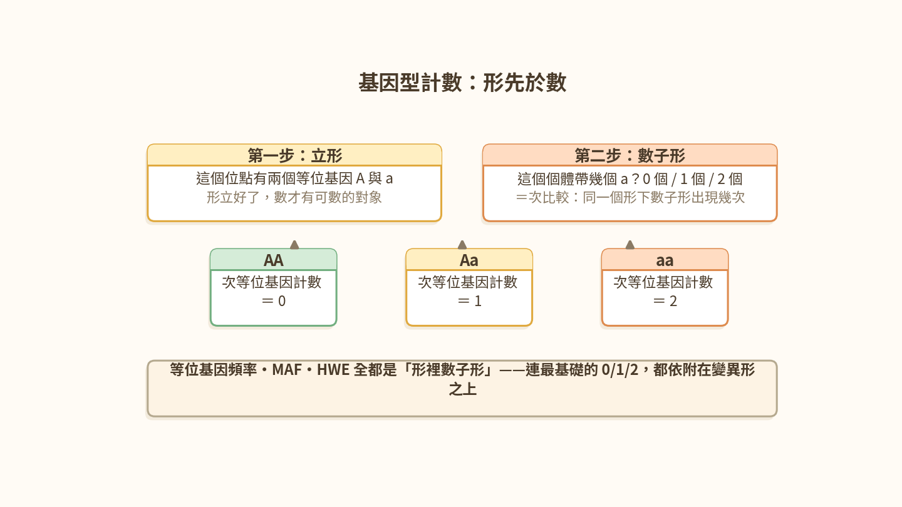

**圖 3-6　基因型計數：形先於數的 GWAS 版**

> **【專業專欄】C2　統計遺傳核心四件套：HWE・MAF・LD・PCA**
>
> 哈迪-溫伯格平衡（HWE）：隨機交配族群中，基因型頻率 p²/2pq/q² 由等位基因頻率決定。偏離 HWE 通常是品質問題（分型錯誤）或演化力量（選擇、混合）的訊號——對照組的 HWE 檢定是 GWAS QC 的標準動作。
>
> 次等位基因頻率（MAF）：較不常見等位基因的頻率。MAF 決定檢定效能——低頻變異需要更大樣本；MAF < 1% 的稀有變異要換稀有變異檢定（burden test、SKAT）。
>
> 連鎖不平衡（LD）：鄰近位點的等位基因非隨機組合（r²、D′）。LD 讓 GWAS 的顯著訊號「一出就是一片」——同一個 LD block 內的 SNP 同進同出，這是精細定位（fine-mapping）要解決的問題。
>
> 主成分分析（PCA）：把全基因組的變異壓縮成少數幾個主成分，捕捉族群遺傳結構。把前幾個 PC 當協變量放進迴歸模型，就是族群分層校正的標準做法——容器效應的數學化。

## 3-6　三層判斷的 GWAS 版

把三層判斷套進 GWAS 的日常問題：「這個關聯結果可不可信？」容器層驗身份——資料來自哪個隊列？樣本通過 QC 嗎？族群分層處理了嗎？組成層驗結構——必要件齊全嗎（基因型＋表型＋協變量）？remove 分級正確嗎（哪些剔除、哪些保留降級）？抽象層驗判準——通過 ∩(T) 嗎？（p 值過門檻、效應量合理、方向可複製、生物學可解釋）。三層聯合，缺一不可——只看 p 值就下結論，就是只做一層判斷的典型誤用。

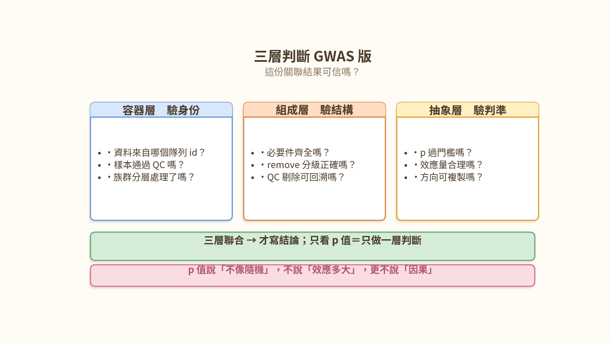

**圖 3-7　三層判斷 GWAS 版：這份關聯結果可信嗎？**

> **【練習 E05】**
>
> 把你的研究（或一篇 GWAS 論文）的表型寫成表型形 [維度×刻度]：量什麼？單位？刻度？邊界值怎麼判？再回答：如果刻度改成另一種定義，研究結論會變嗎？

> **【練習 E06】**
>
> 列出一份 GWAS 研究的 BOM（至少 8 個部件），並用 remove 三級分級。哪個部件被多數人誤當「非必要件」，其實是必要件或降級件？

> **【練習 E07】**
>
> 為什麼說「病例組與對照組來自不同族群」是容器層的錯誤，而不是抽象層的錯誤？用 C = (id(C), S(C)) 的語言解釋：比較發生在哪裡，偏誤藏在哪裡。

# 第四篇　時間本形：GWAS 的函式

空間本形立好之後，動詞才能上場。GWAS 的分析流程是一條函式鏈：每一步輸入一個形、產出一個形，上一步的輸出形正是下一步的輸入形。這一篇把流程的七個核心步驟寫成七張函式四問卡——名稱、輸入形、輸出形、判準——每張卡都能直接拿去檢查你的分析腳本。

## 4-1　函式鏈總圖：形進形出

整條 GWAS 流程讀成形進形出：原始資料形（質控前的基因型＋表型）→ QC 後資料形 → 校正後檢定形 → 關聯結果形 → 顯著發現形 → 複製驗證形 → 後續應用形（精細定位、PRS、機制研究）。函式鏈的每一環都不可跳過——跳過 QC 直接檢定，等於把沒驗過身份的形塞進函式。

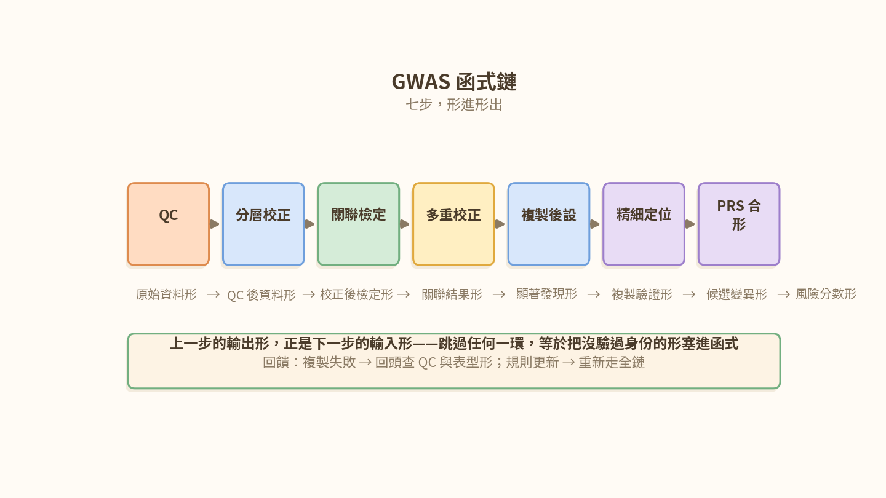

**圖 4-1　GWAS 函式鏈：七步，形進形出**

## 4-2　七張函式四問卡

以下七張卡是本篇核心。每張卡一圖一例：左半是函式四問（名稱／輸入形／輸出形／判準），右半是這一步最常見的誤用提醒。

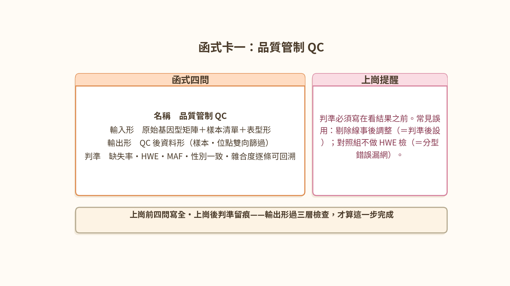

**圖 4-2　函式卡一：品質管制 QC**

例：一個 10 萬人的隊列，樣本缺失率 > 5% 者剔除（必要件受損——基因型讀數不可信）、位點缺失率 > 5% 者剔除、對照組 HWE p < 10⁻⁶ 者剔除（分型錯誤嫌疑）。QC 的判準要寫在分析計畫裡、在看結果之前——判準後設就是把 [ ] 規則偷改成 [ ] 結果。

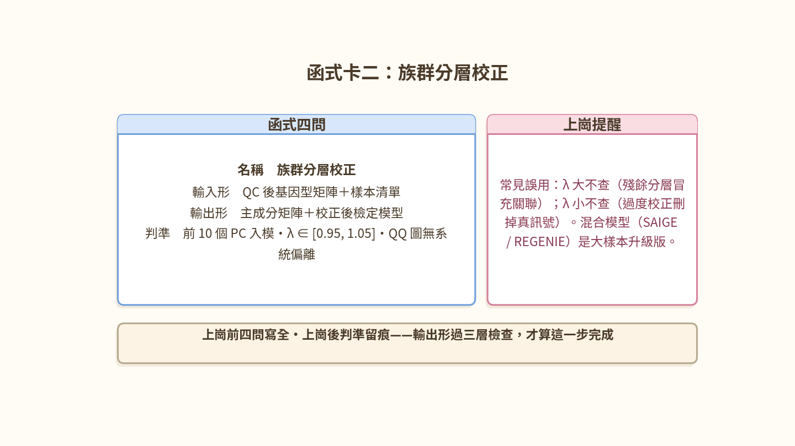

**圖 4-3　函式卡二：族群分層校正**

例：對基因型矩陣做 PCA，取前 10 個主成分作為協變量放入迴歸模型；畫 QQ 圖檢查基因組膨脹因子 λ 是否接近 1。λ 遠大於 1 代表殘餘分層或品質問題，λ 小於 1 代表過度校正——容器效應要扣，但不能連真訊號一起扣掉。

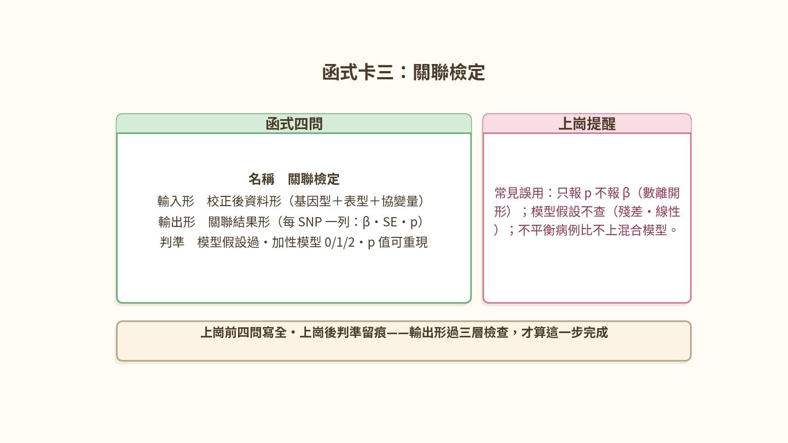

**圖 4-4　函式卡三：關聯檢定**

例：對每個 SNP 做邏輯迴歸（病例／對照）或線性迴歸（數量表型），基因型用加性模型 0/1/2 編碼，協變量含年齡、性別、前 10 個 PC。大樣本或親緣結構複雜時改用混合模型（BOLT-LMM、SAIGE、REGENIE）。這一步的輸出是「每個位點一列」的關聯結果形。

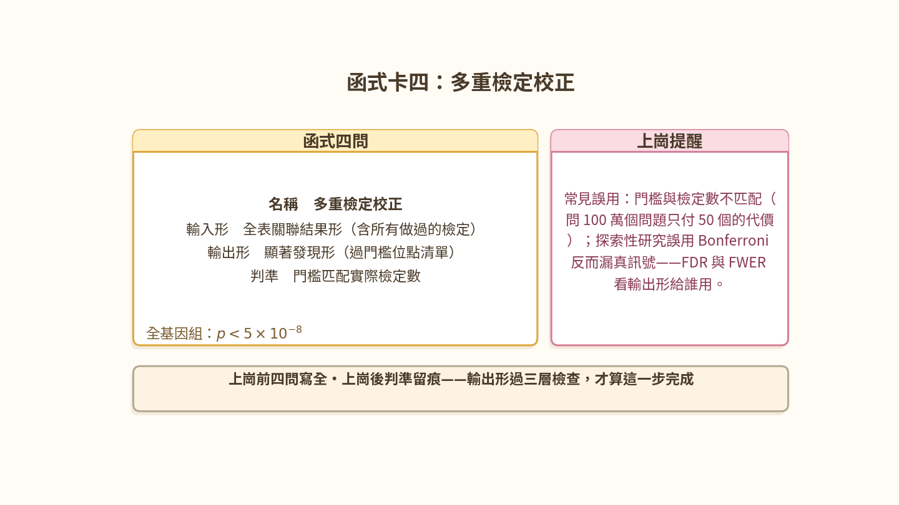

**圖 4-5　函式卡四：多重檢定校正**

例：100 萬個獨立檢定，Bonferroni 門檻 0.05/100 萬 = 5×10⁻⁸——這是全基因組顯著性的公認來源。若只關心 50 個預設假說，門檻可以放寬到 0.05/50。多重檢定校正的本質：判準 [ ] 必須匹配「你實際問了幾個問題」。

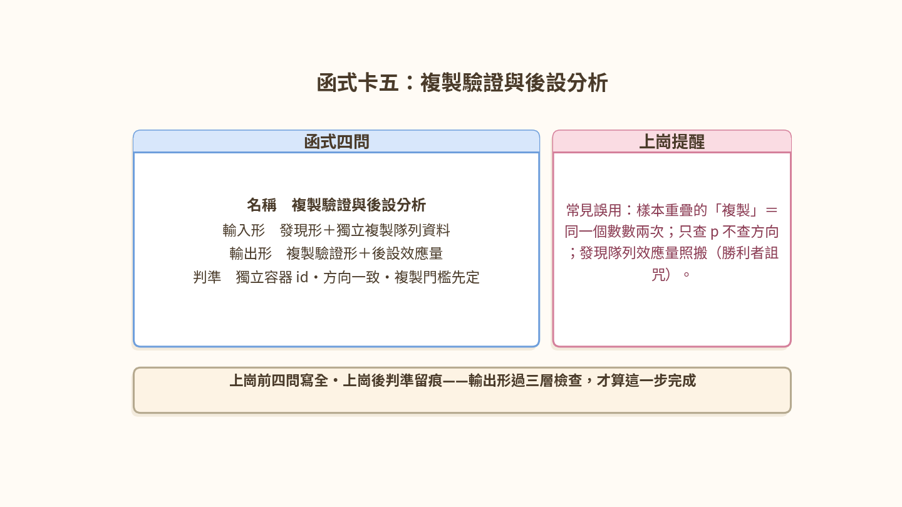

**圖 4-6　函式卡五：複製驗證與後設分析**

例：在發現隊列得到 rs12345 與第 2 型糖尿病的關聯（OR = 1.15），在獨立複製隊列驗證方向一致且 p < 0.05，再用固定效應或隨機效應模型做後設分析。複製隊列必須是不同的容器 id——樣本重疊的「複製」不是複製，是把同一個數數了兩次。

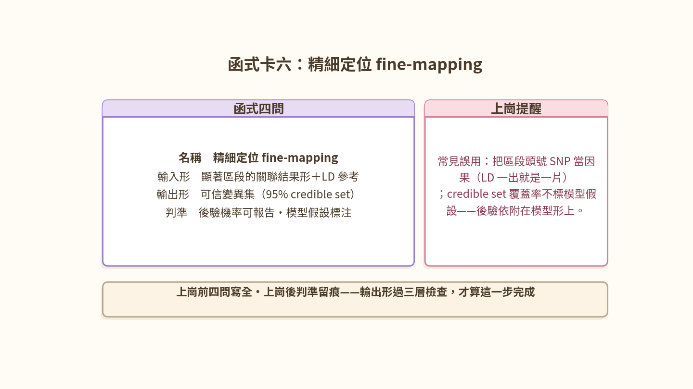

**圖 4-7　函式卡六：精細定位 fine-mapping**

例：一個顯著區段內有 30 個 SNP 高度連鎖，用精細定位（SuSiE、FINEMAP 等）計算每個變異的後驗機率，選出覆蓋 95% 信賴度的可信變異集（credible set）。輸出形從「區段」精化為「候選因果變異清單」——這是把關聯推向機制研究的橋。

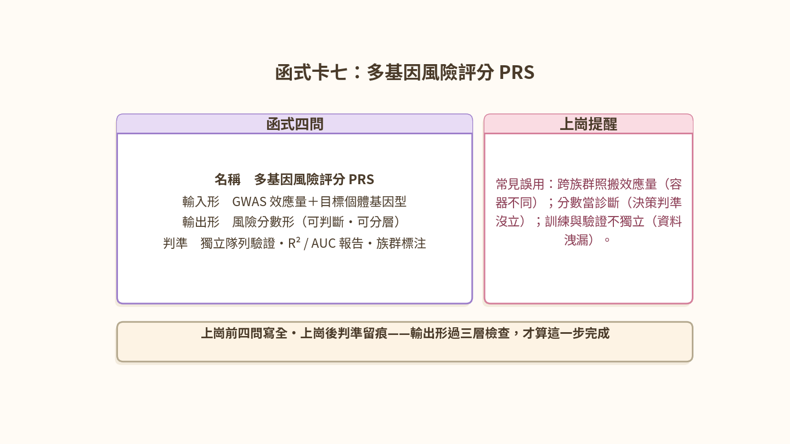

**圖 4-8　函式卡七：多基因風險評分 PRS**

例：把 GWAS 的效應量加權合成一個分數 PRS = Σ βᵢ × 基因型ᵢ，在獨立隊列評估它對疾病的解釋力（Nagelkerke R²、AUC）。PRS 是「數千個形的小效應合形」——每個位點貢獻一點，合起來成為一個新的可判斷形。跨族群應用前必須重新校準：效應量來自哪個容器，就只對那個容器可直接轉移。

## 4-3　六群映射：GWAS 函式屬於哪一群

時間本形函式庫分六大函式群。把 GWAS 七卡放進去：QC 與校正屬於「分析・解題群」（把問題拆開逐個解決）；關聯檢定與多重校正屬於「推理群」的統計推理；複製與後設分析屬於「認知與萃取群」（在既有發現裡找穩固的形）；精細定位與 PRS 屬於「設計・生成群」（把發現生成可用的新形）；而整個流程的持續優化——回頭改 QC 規則、更新表型定義——屬於「成長與維護群」的持續學習。研發探索群則開啟下一輪：新表型、新族群、新方法。

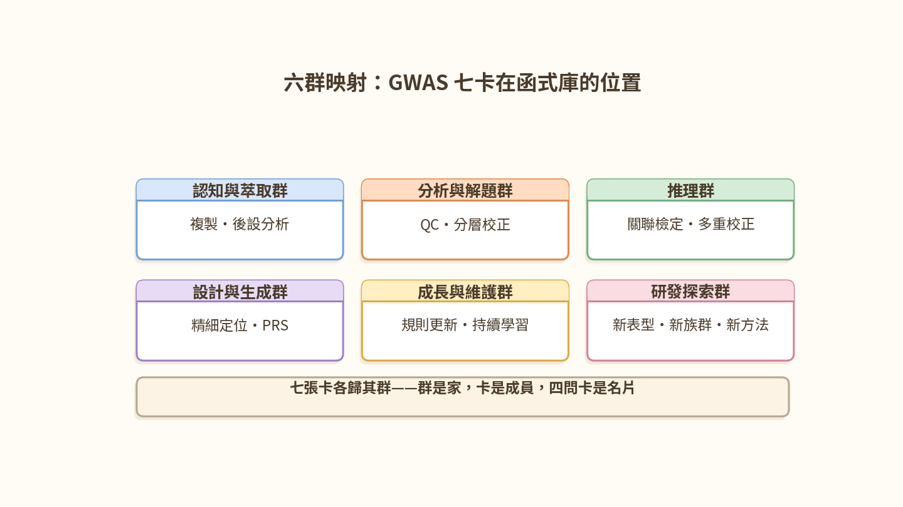

**圖 4-9　六群映射：GWAS 七卡在函式庫中的位置**

## 4-4　推理五族在 GWAS

時間本形的推理五族，在 GWAS 各有現場：統計推理是 GWAS 的主引擎（p 值、信賴區間、後驗機率）；因果推理是後設層的追問（這個關聯是因果嗎？——MR 與實驗驗證）；果因推理是回溯（看到表型差異，回推哪個變異在起作用）；模擬推理是反事實（如果這個基因型改變，風險會怎樣？——TWAS、基因網路模擬）；逆向推理是從失敗學習（複製失敗回推 QC 缺口）。挑推理族的四步與挑函式相同：問目的、對族群、填四問、上崗複核。

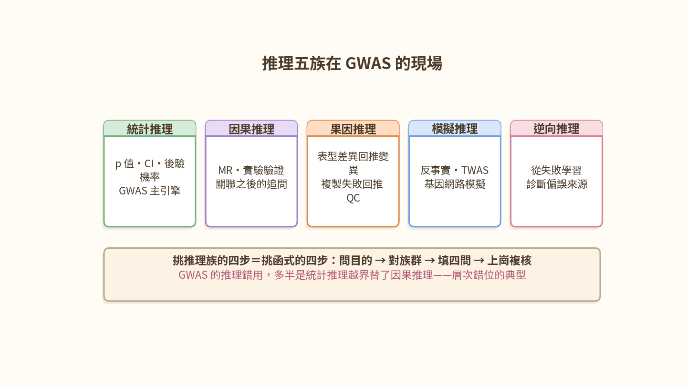

**圖 4-10　推理五族在 GWAS 的現場**

> **【專業專欄】C3　5×10⁻⁸ 從哪裡來：多重檢定的形學讀法**
>
> 全基因組顯著性門檻 p < 5×10⁻⁸ 不是拍腦袋定的：歐洲人群中約 100 萬個「獨立」檢定（LD 把 600 萬個 SNP 壓縮成約 100 萬個有效檢定），Bonferroni 0.05/100 萬 = 5×10⁻⁸。
>
> 形學讀法：門檻就是抽象層的判準 ∩(T)，而它的值取決於「你問了幾個問題」——問題的數目屬於形，不屬於數。
>
> 多祖源研究的門檻會不同：非洲人群 LD 更短、有效檢定更多，門檻需更嚴；東亞人群反之。搬用門檻前先問：我的容器，有效檢定數是多少？
>
> 替代路線：錯誤發現率（FDR）控制的是「發現清單裡假陽性的比例」，適合探索性研究；Bonferroni 控制的是「至少一個假陽性」的機率，適合確認性研究。選哪個判準，取決於輸出形要給誰用。

> **【練習 E08】**
>
> 為你最熟悉的一個分析步驟（不限 GWAS）寫一張函式四問卡：名稱、輸入形、輸出形、判準。判準一欄必須寫成「可以打勾的標準」，不能寫「品質良好」這種形容詞。

> **【練習 E09】**
>
> 假設你在兩個隊列做 GWAS 後做 meta 分析，後來發現兩個隊列有 5% 的樣本重疊。用「容器 id 與內容物」的語言說明：這為什麼讓複製失效？該怎麼補救？

> **【練習 E10】**
>
> 為什麼說 PRS = Σ βᵢ × 基因型ᵢ 是「合形」而不是簡單加總？用「數依附在形上」回答：每個 βᵢ 離開它所屬的變異形與容器，還有意義嗎？

# 第五篇　準確使用方法：GWAS 版

工具都齊了。這一篇把它們收攏成方法：面對一個 GWAS 專案或一份 GWAS 結果，怎麼一步步用準它，並在交出去之前自己驗收。準確，是可複核的準——別人能逐句打勾重現你的推理。

## 5-1　體—用—準：總架構

準確使用方法的總架構是三個字：體、用、準。體是空間本形——研究對象的形立好了嗎（第三篇）；用是時間本形——流程的每個函式寫好四問了嗎（第四篇）；準是判準與複核——三層判斷、八問檢查、誤用對照（本篇）。三者缺一，GWAS 結果就停留在「數」的層次，無法變成可驗收的「發現」。

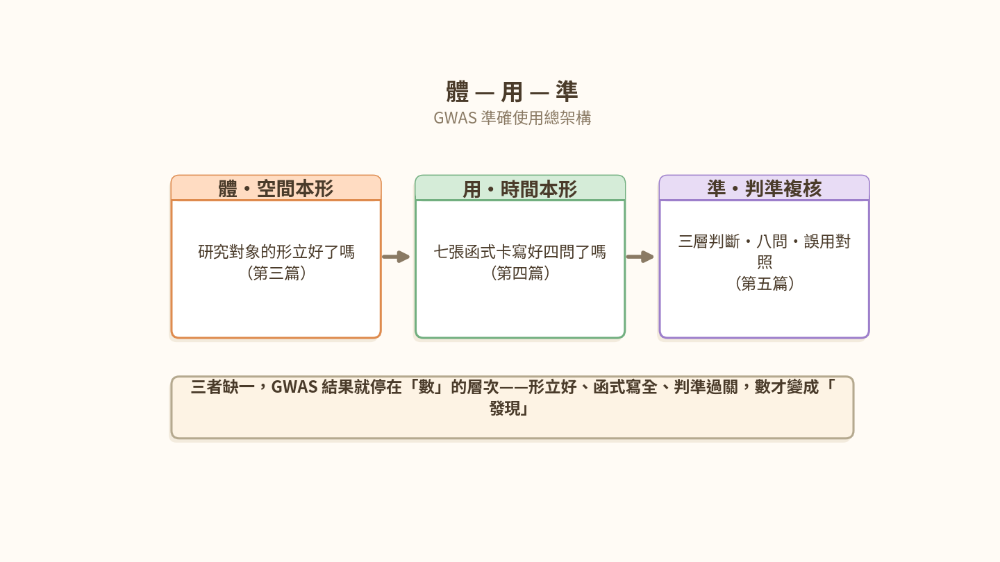

**圖 5-1　體—用—準：GWAS 準確使用總架構**

## 5-2　三種補足：GWAS 版

準確使用方法的三個補足，在 GWAS 各有落點：用 [ ] 補規則——分析計畫裡的每條判準（納入排除、QC 門檻、顯著性門檻、複製標準）都是開放規則，不是寫死的清單，新樣本來了能被同一套規則判斷；用 ( ) 補身份——每個樣本、每個隊列、每個資料集都有不變的身份標記（sample id、cohort id、資料庫存取號），內容可重讀、身份不可混淆；用 { } 補結構——研究的 BOM 與 remove 三級寫清楚，缺了什麼、降級了什麼，一目了然。

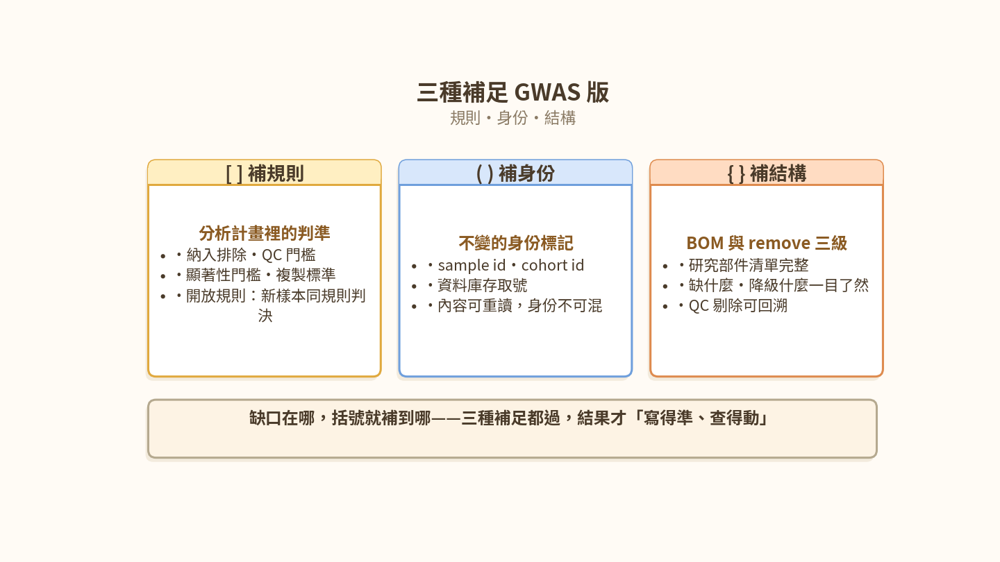

**圖 5-2　三種補足 GWAS 版：規則・身份・結構**

> **三種補足的驗收線**
>
> [ ] 規則：判準都在看結果之前寫定（分析計畫／登錄），新樣本可被同一規則判決。
>
> ( ) 身份：每份資料可指認來源容器；跨研究合併時無樣本重疊，或重疊已量化處理。
>
> { } 結構：BOM 完整、remove 三級分明；QC 剔除記錄可回溯到每一條規則。

## 5-3　證明六步驟：完整示範

用一個真實形態的命題走完六步驟：「在 X 隊列中，rs12345 的次等位基因與身高相關。」

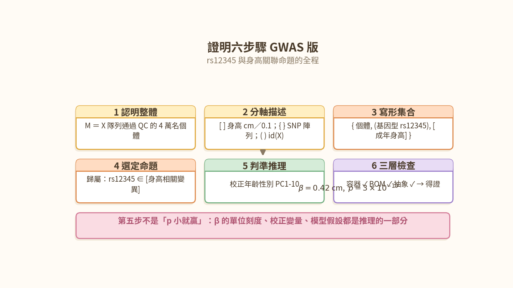

**圖 5-3　證明六步驟 GWAS 版：一個關聯命題的全程**

| 步驟 | 操作 | 本例的產出 |
| --- | --- | --- |
| 1 認明整體 | 判斷對象是哪個整體 | M = X 隊列中通過 QC 的 4 萬名個體 |
| 2 分軸描述 | 三軸各描述一次 | [ ] 身高 cm／0.1；{ } SNP 陣列＋imputation；( ) X 隊列 id(X) |
| 3 寫形集合 | 完整表記 | { 個體, (基因型 rs12345), [成年身高數量性狀] } |
| 4 選定命題 | 選歸屬／不變／分級 | 歸屬：rs12345 ∈ [身高相關變異] |
| 5 判準推理 | 用對判準逐步推理 | 線性迴歸 β = 0.42 cm、p = 3×10⁻¹⁰ < 5×10⁻⁸；校正年齡性別 PC1-10 |
| 6 三層檢查 | 三層聯合後收結論 | 容器 ✓（同隊列同校正）／BOM ✓（QC 完整）／抽象 ✓（過門檻・方向複製）→ 得證 |

注意第五步的推理不是「p 小就贏」：效應量 β 的單位與刻度、校正的協變量、模型假設（殘差常態、線性）都是推理的一部分。第六步的三層檢查更關鍵——容器層沒過（族群分層殘留），抽象層的 p 值再小也不能得證。

## 5-4　八問：交出去之前的檢查清單

任何 GWAS 報告、分析腳本、下游應用，在交出去之前過八問。八問就是三種補足的驗收標準。

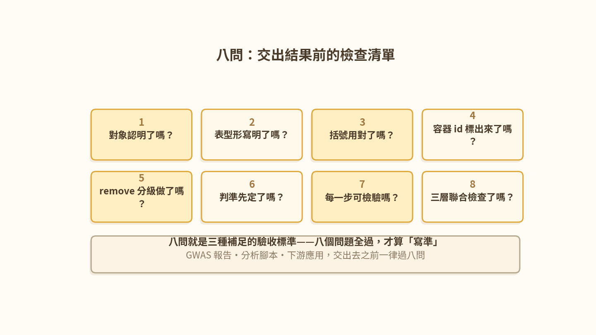

**圖 5-4　八問 GWAS 版：交出結果前的檢查清單**

| # | 檢查問題 | 通過標準 |
| --- | --- | --- |
| 1 | 對象認明了嗎？ | 「我分析的是哪個整體」一句話說得出來（隊列＋表型＋世代） |
| 2 | 表型形寫明了嗎？ | 維度、刻度、邊界值、測量方式，定義在分析之前 |
| 3 | 括號用對了嗎？ | { } 部件、( ) 內容、[ ] 判準各安其位 |
| 4 | 容器 id 標出來了嗎？ | 每個資料來源可指認；樣本重疊已檢查 |
| 5 | remove 分級做了嗎？ | QC 剔除逐條記錄，三級各有歸屬 |
| 6 | 判準先定了嗎？ | 門檻與規則寫在看結果之前（分析計畫／登錄） |
| 7 | 每一步可檢驗嗎？ | 腳本可重現、數字可逐項對上 |
| 8 | 三層聯合檢查了嗎？ | 容器・組成・抽象三層都過，才寫結論 |

## 5-5　誤用大對照：16 種 GWAS 誤用

誤用的共同根源是「層次沒寫清」。16 種常見誤用分四組：形的誤用、數的誤用、容器的誤用、推理的誤用。

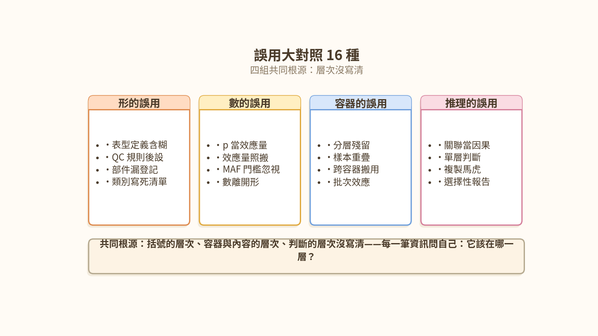

**圖 5-5　誤用大對照 16 種：四組共同根源**

| 組 | 誤用 | 問題所在 | 正確寫法 |
| --- | --- | --- | --- |
| 形 | 表型定義含糊 | 維度刻度沒寫清，病例邊界漂移 | 表型形 [維度×刻度] 先立後行 |
| 形 | QC 規則後設 | 看完結果才定剔除線＝判準偷改 | 規則先定，登錄備查 |
| 形 | 部件漏登記 | BOM 缺項目，降級件混充必要件 | BOM＋remove 三級寫全 |
| 形 | 類別寫死清單 | 新變異類別無法歸類 | 用 T = (F(T), ∩(T)) 開放規則 |
| 數 | p 值當效應量 | 把「不為零」讀成「很重要」 | p 與 β 分開報告，附信賴區間 |
| 數 | 效應量照搬 | 發現隊列的 β 被當真值（勝利者詛咒） | 以複製隊列或收縮估計為準 |
| 數 | MAF 門檻忽視 | 低頻變異用錯檢定，效能崩壞 | MAF 分層選檢定 |
| 數 | 數離開形 | 數字不附形（單位、刻度、容器） | 每個數標注所屬的形 |
| 容器 | 族群分層殘留 | 容器效應冒充關聯 | PCA＋混合模型＋λ 檢查 |
| 容器 | 樣本重疊 | meta 分析把同一 id 數兩次 | 跨研究查重，重疊量化處理 |
| 容器 | 跨容器搬用 | PRS／門檻直接套到異質族群 | 重新校準，或換容器判準 |
| 容器 | 批次效應 | 技術批次與表型混雜 | 批次平衡設計＋批次協變量 |
| 推理 | 關聯當因果 | 層次錯位：相關性說了算 | MR／實驗／時間先後補因果鏈 |
| 推理 | 單層判斷 | 只看 p 值就下結論 | 三層聯合檢查 |
| 推理 | 複製馬虎 | 同容器重算、方向不查 | 獨立容器＋方向一致＋門檻 |
| 推理 | 選擇性報告 | 只報顯著的，報表不完整 | 全結果表公開，顯著性分層標注 |

## 5-6　選路決策樹：這個 GWAS 該怎麼走

不同情境走不同路。決策樹從「表型形」開始分叉：數量性狀走線性迴歸、二值性狀走邏輯迴歸；再問「樣本結構」：有親緣或不平衡就上混合模型；再問「變異頻譜」：稀有變異走 burden/SKAT；最後問「輸出形要給誰用」：給機制研究走精細定位、給臨床風險走 PRS、給因果推論走 MR。

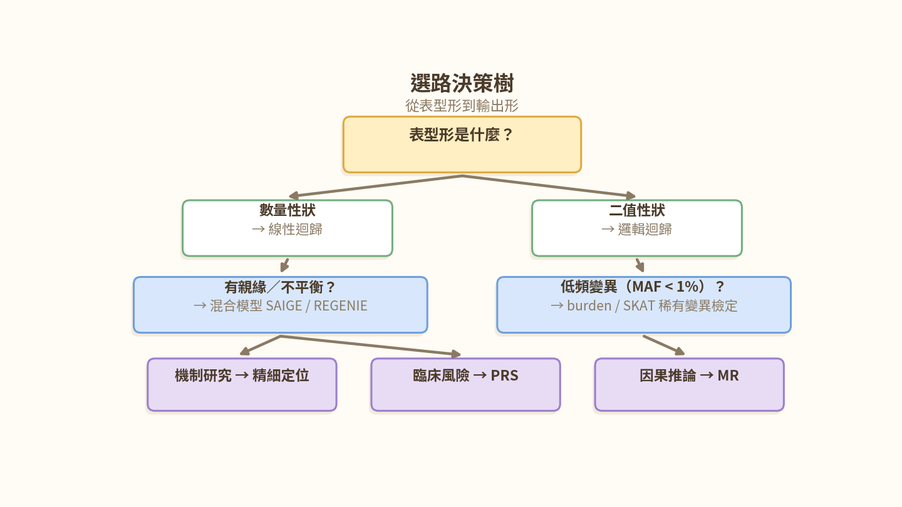

**圖 5-6　選路決策樹：從表型形到輸出形**

> **【專業專欄】C4　混合模型與 Biobank 時代**
>
> 當樣本推到十萬級、病例比高度不平衡（1:100）、個體間有親緣關係時，傳統迴歸會產生假陽性洪水。混合模型把「遺傳背景相似度」放進模型：BOLT-LMM（大樣本數量性狀）、SAIGE（不平衡病例對照）、REGENIE（兩階段、快、支援稀有變異）成為 Biobank 時代三件套。
>
> 形學讀法：混合模型做的正是容器層的精細化——把「遺傳結構」從粗糙的幾個 PC 升級為全基因組的相似度矩陣，容器效應扣得更乾淨。輸入形多了一個「相似度矩陣」部件，判準多了收斂與模型假設檢查。
>
> 實務提醒：用混合模型不等於免做 QC。樣本缺失率、HWE、MAF 這些基礎 remove 判準仍然先行——模型再強，也不能消化沒驗過身份的形。

> **【練習 E11】**
>
> 用證明六步驟，把一個你關心的關聯命題（不限 GWAS 也可以）寫成完整推理：六步各一小段，第五步的判準要寫出數字門檻。

> **【練習 E12】**
>
> 16 種誤用中，挑出你認為最常見的三種，各寫一個「現場情境＋正確寫法」的對照卡（格式：情境一句、誤用標籤一句、修正動作兩句）。

> **【練習 E13】**
>
> 一位同事說：「我這個 SNP 的 p 值是 10⁻²⁰，一定是重要的基因。」用八問與誤用表診斷這句話踩了哪幾條，並寫出正確的回覆（三句以內）。

# 第六篇　總架構：GWAS × Mind AI

方法收攏完成，這一篇把它放進更大的架構：GWAS 的形與函式如何在 Mind AI 平台上運作、可複核的準如何落成驗收線，以及這條路與 AGI 三階段的關係。

## 6-1　兩庫一中樞一迴路 × GWAS

Mind AI 的運作骨架是兩庫一中樞一迴路：形庫存形、函式庫存函式、推理與判準中樞做三層判斷、持續學習迴路讓系統長大。GWAS 放進去之後，每一格都有明確的落點。

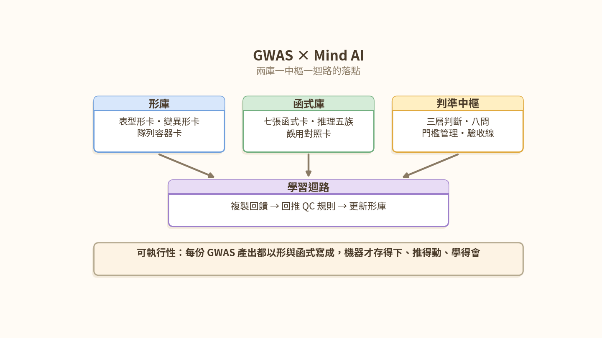

**圖 6-1　GWAS × Mind AI：兩庫一中樞一迴路的落點**

| 組件 | GWAS 的落點 | 具體例子 |
| --- | --- | --- |
| 形庫 | 研究對象、變異、表型、隊列的形 | 表型形卡、變異形卡、隊列容器卡 |
| 函式庫 | 七張函式卡＋推理五族 | QC 函式、檢定函式、精細定位函式 |
| 判準中樞 | 三層判斷＋八問＋門檻管理 | 5×10⁻⁸ 判準、QC 門檻、複製標準 |
| 學習迴路 | 複製回饋、誤用案例、規則演化 | 複製失敗→回推 QC 規則→更新形庫 |

這個落點圖回答了「為什麼 GWAS 需要形」的最後一問：可執行性。當每份 GWAS 產出都以形與函式寫成，機器才存得下、推得動、學得會——這正是 Mind AI 與傳統「結果報告」的分野。

## 6-2　對讀：GWAS 生態系的既有框架

GWAS 社群並非沒有規範——恰恰相反，它有一套成熟的守則。形學與它們不是競爭關係，而是把散落的守則收攏成一門「看得見層次」的語言。

| 既有框架 | 它管什麼 | 形學的讀法 |
| --- | --- | --- |
| STREGA 報告規範 | GWAS 論文必須報告什麼 | 輸出形的完整表記——就是 { } 結構補足 |
| GWAS Catalog | 全球發現登記簿 | 形庫的公共版：發現形的標準化入庫 |
| UK Biobank／FinnGen／Taiwan Biobank | 標準化容器 | id(C) 明確的大容器，S(C) 開放給審核研究 |
| GWAS QC 慣例（Anderson 等） | 樣本與位點 QC 規則 | remove 三級的既有實踐——判準先定 |
| 後設分析規範（樣本重疊檢查） | 跨研究合併紀律 | ( ) 身份補足：跨容器必查 id |

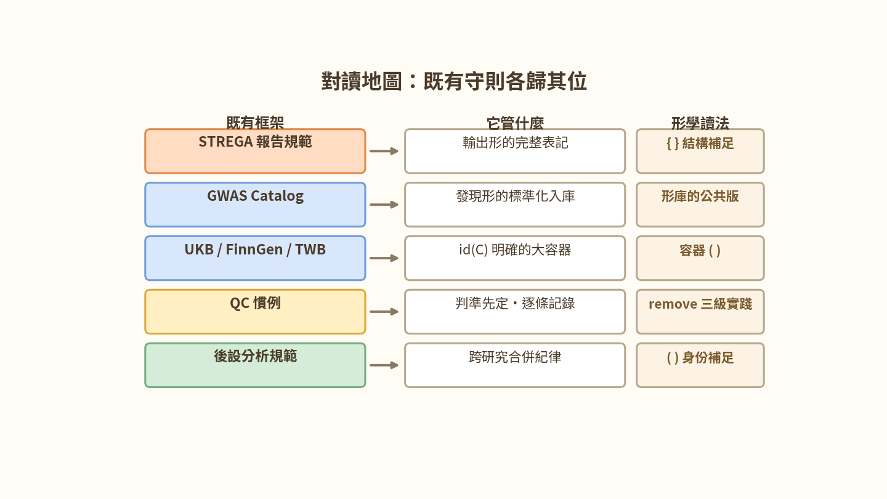

**圖 6-2　對讀地圖：既有守則各歸其位**

## 6-3　可複核的準：四條驗收線

「準確＝可複核的準」在 GWAS 落成四條驗收線，一條比一條高：可重現（同一份資料、同一腳本、同一結果）、可移植（換一台機器、換一個人跑，結果一致）、可審核（判準與決策點全部留痕，八問逐條可查）、可傳承（形庫與函式卡完整，新人能接手並正確複用）。四條線全過，GWAS 的產出才從「一篇論文」升級為「一項資產」。

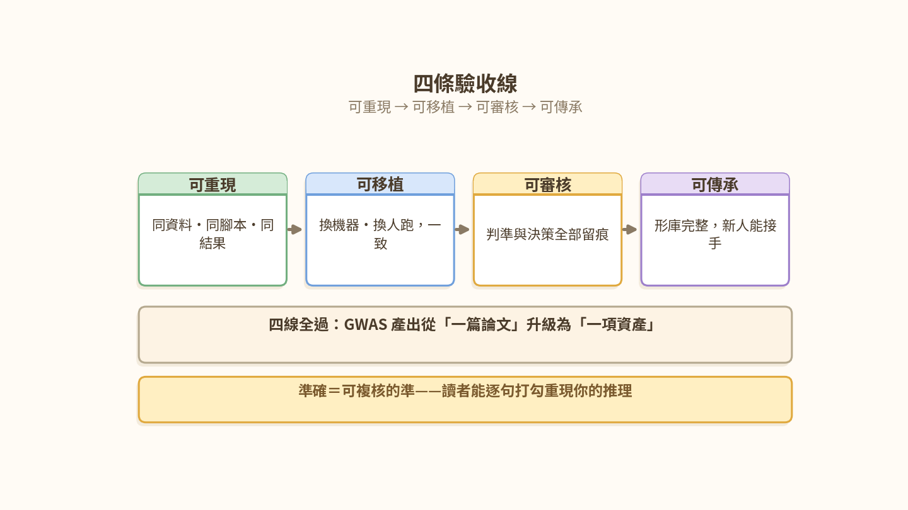

**圖 6-3　四條驗收線：可重現→可移植→可審核→可傳承**

## 6-4　AGI 三階段與 GWAS 的位置

Mind AI 的願景沿 AGI 三階段前進：知識統一、思維統一、智慧統一。GWAS 在每一階段各有角色：知識統一階段，把 GWAS 的發現形化入庫，與中醫、企業、世界模型等領域的形共處一個形庫；思維統一階段，GWAS 的推理五族與其他領域共用同一套推理與判準中樞；智慧統一階段，系統能在形庫之上自主提出假說、設計研究、發現跨域橋樑——例如把遺傳關聯的因果推理與藥物機制、環境暴露的形放在一起推理。

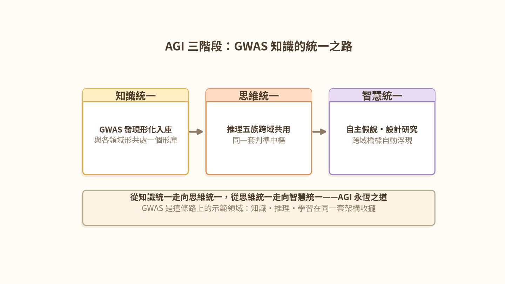

**圖 6-4　AGI 三階段：GWAS 知識的統一之路**

> **【專業專欄】C5　精細定位與功能註解：從峰到機制**
>
> GWAS 的一個顯著峰，背後往往是一整段連鎖不平衡區塊——數十到數百個 SNP「同進同出」，誰是真正的因果變異？精細定位（fine-mapping）用貝氏方法（SuSiE、FINEMAP、CAVIAR）給每個變異算後驗機率，輸出 95% 可信變異集（credible set）。
>
> 功能註解把候選變異接上分子層：eQTL（變異影響基因表現）、染色質可及性（影響調控元件）、蛋白質結構預測（影響胺基酸）。TWAS 與共定位分析（colocalization）進一步問：這個 GWAS 訊號與這個 eQTL 訊號，是同一個因果變異嗎？
>
> 形學讀法：精細定位是「把一個模糊的形精化成一組候選形」——σ 替換的反向動作：不是換內容，是把內容的解析度調高。功能註解則是把變異形放進更大的形網路（基因形、調控形、通路形），用 ι 嵌套與形關係接起來。
>
> 可複核提醒：credible set 的覆蓋率取決於模型假設（因果變異數上限、先驗），報告時必須標注——數依附在形上，後驗機率依附在模型形上。

> **【專業專欄】C7　孟德爾隨機化：把關聯推向因果**
>
> 孟德爾隨機化（Mendelian Randomization, MR）用遺傳變異當工具變數：基因型在受精時隨機分配，近似天然隨機對照試驗，因此可以從「變異→暴露→結果」的鏈條估計因果效應。三項基本假設：相關性（工具與暴露相關）、獨立性（工具不與混雜因素相關）、排他性（工具只透過暴露影響結果）。
>
> GWAS 是 MR 的原料工廠：暴露與結果各自的 GWAS 統計量（β、SE）供應兩樣本 MR。多效性（一個變異影響多條路徑）是最大的違反假設來源——MR-Egger、加權中位數、MR-PRESSO 等敏感性分析逐一檢驗。
>
> 形學讀法：MR 是時間本形的因果推理函式——輸入形＝兩個 GWAS 的關聯結果形＋工具變異形，輸出形＝因果效應形，判準＝三項假設逐條可驗。假設寫不全，就是函式四問的判準欄空著——上崗必然出事。

> **【練習 E14】**
>
> 畫一張你所在領域（不限 GWAS）的「兩庫一中樞一迴路」落點圖：形庫放什麼形、函式庫放什麼函式、判準中樞管什麼門檻、學習迴路從哪裡回饋。

> **【練習 S01】**
>
> 四條驗收線中，你的研究目前過了哪幾條？選一條沒過的，寫出三個具體補強動作（要可驗收，不能寫「加強管理」）。

# 第七篇　內容完整方案：學・練・用・教・建

這一篇給出可執行的落地方案：怎麼學這套方法、怎麼練到手上、怎麼用在專案裡、怎麼教給團隊、怎麼建起自己的形庫與函式庫。方案不是進度表——每週都有可複核的產出。

## 7-1　學練用教建：五段路

學——把骨幹讀順：第二篇一頁圖、第三篇的形、第四篇的七張卡，各用自己的話重述一遍。練——每篇練習動筆，尤其證明六步驟與八問，至少完整走過兩輪。用——挑一個真實專案或公開 GWAS 資料集，從表型形定義到八問驗收走完全程。教——把七張函式卡講給同事聽，講不清楚的就是你還沒懂的。建——把本專案的形與函式整理成自己的形庫與函式庫初版。

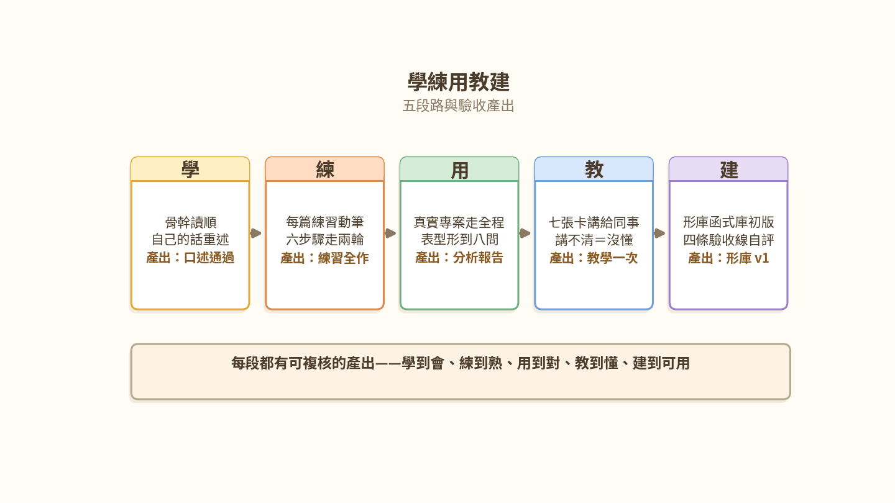

**圖 7-1　學練用教建：五段路與驗收產出**

## 7-2　八週路線

八週不是進度表，是產出累積表：每週交付一張卡、一組練習、一次八問自檢。前兩週立形（空間本形＋表型形），三四週走函式鏈（七張卡），第五週準確使用方法（六步驟＋八問），第六週誤用與選路，第七週完整示範（一個公開資料集全程），第八週建庫與複核（四條驗收線）。

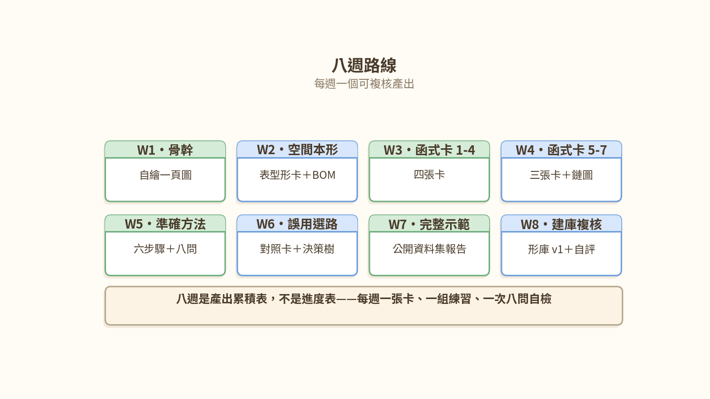

**圖 7-2　八週路線：每週一個可複核產出**

| 週 | 主題 | 產出 |
| --- | --- | --- |
| 1 | 骨幹＋認知鏈 | 骨幹一頁圖（自繪）＋術語卡 |
| 2 | 空間本形 | 表型形卡＋BOM＋remove 分級表 |
| 3 | 函式卡 1–4 | QC／校正／檢定／多重校正四張卡 |
| 4 | 函式卡 5–7 | 複製／精細定位／PRS 三張卡＋鏈圖 |
| 5 | 準確使用方法 | 六步驟示範一份＋八問勾選表 |
| 6 | 誤用與選路 | 誤用對照卡三張＋選路決策樹填空 |
| 7 | 完整示範 | 公開資料集全程報告（八問全過） |
| 8 | 建庫與複核 | 形庫初版＋四條驗收線自評 |

## 7-3　四讀者情境選路

不同讀者上手的路不一樣。研究者先攻表型形與判準、分析師先攻函式鏈與重現、臨床與法規先攻驗收線與誤用、學生按主線順讀。選路不是縮水——是把力氣先花在你最先用到的那一段。

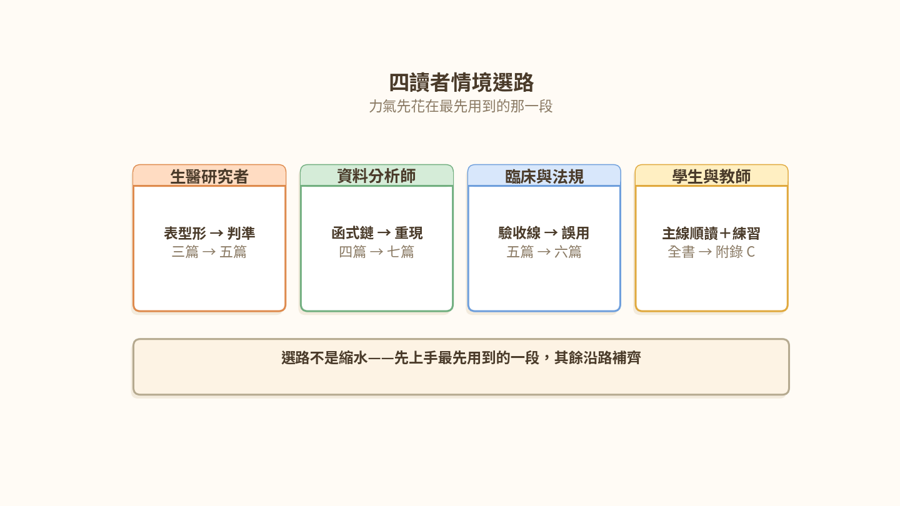

**圖 7-3　四讀者情境選路**

## 7-4　建庫四階段

形庫與函式庫的養成走四階段：單張卡（一個專案一張形卡或函式卡）、成組卡（同類形收攏成組，卡與卡之間建立關係）、可判斷（判準中樞能對卡做三層判斷與八問檢查）、可演化（學習迴路把複製結果與誤用案例回寫成新規則）。四階段的分界線都是「可複核的產出」——卡數不是目標，能判斷、能複用才是。

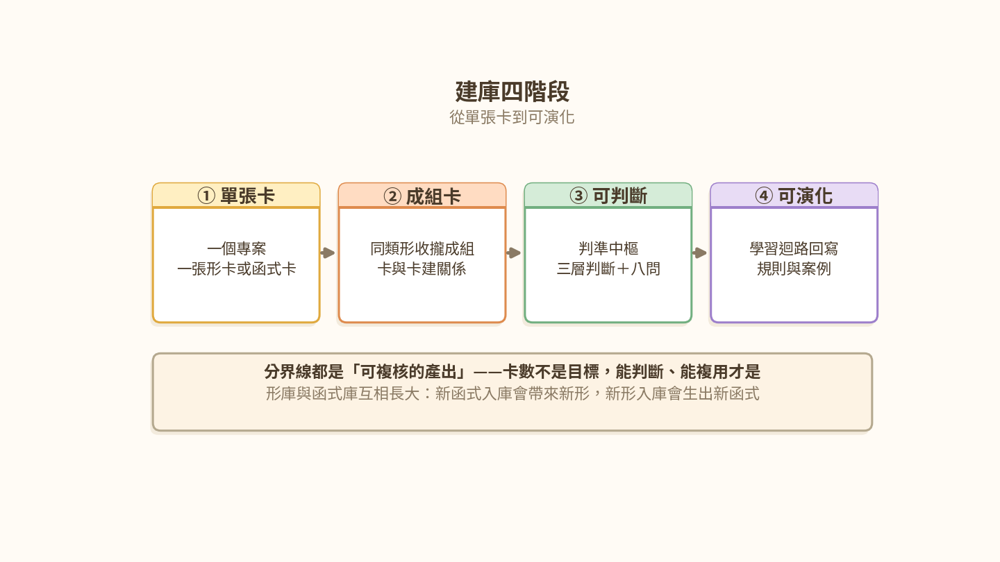

**圖 7-4　建庫四階段：從單張卡到可演化**

> **【專業專欄】C6　PRS 的臨床轉譯：分數之後是決策**
>
> 多基因風險評分從研究走向臨床，中間隔著三道門：效能門（R²、AUC 達到臨床可用水平）、可轉移門（跨族群效應衰減——歐洲人群訓練的 PRS 在東亞人群效力下降，需在地隊列重新估計）、決策門（分數改變了醫療決策嗎？隨機對照試驗與臨床效益評估證明「用 PRS 比不用好」）。
>
> 現況：血脂、乳腺癌、冠心病等 PRS 已進入部分臨床試點；多數指南仍建議僅供風險分層參考，不作獨立診斷依據。
>
> 形學讀法：PRS 是合成形——數千個變異形的效應合形。臨床轉譯就是在問三層判斷：容器層（對哪個人群有效？）、組成層（缺了環境與家族史會降級多少？）、抽象層（決策判準是什麼？cut-off 劃在哪裡、誰定的？）。

> **【專業專欄】C8　倫理與多祖源：容器的正義**
>
> 截至 2020 年代初，GWAS 參與者約八成具歐洲血統——一個嚴重的容器失衡。後果直接：PRS 跨族群效力衰減、藥物標的發現偏向歐洲人群常見變異、健康差距被放大。
>
> 多祖源 GWAS 是解方的一部分：跨族群 meta 分析（MR-MEGA、MANTRA）能利用不同人群的 LD 差異提升精細定位解析度；在地生物資料庫（Taiwan Biobank、BioBank Japan、H3Africa）讓容器多元化。
>
> 倫理面向：知情同意的範圍（能不能做 GWAS？能不能商業使用？）、結果回饋（顯著的偶然發現要不要告訴受試者？）、隱私（基因型可被再識別，需存取管制與資料使用協議）、遺傳歧視風險（保險與就業的界線）。
>
> 形學讀法：容器 ( ) 有 id，也有邊界責任。id(C) 的管理者對 S(C) 裡的內容物有受託責任——容器不是中立的殼，是承諾的結構化殘留。

> **【練習 S02】**
>
> 為你的團隊設計一份八週路線的裁剪版（八週壓成四週）：保留哪四週的產出？砍掉的四週用什麼替代驗收？寫出取捨理由（各一句）。

# 第八篇　總結：把 GWAS 看清楚，用得準確

回顧整本書，一句話可以收束：GWAS 的每一個痛點，都是形沒立好的樣子；把形立好，數才有依附，結果才可複核。

## 8-1　全書回顧：五句話

| 篇 | 一句話 |
| --- | --- |
| 第一篇 | GWAS 是全基因組的篩檢機，但結果常被用錯——五個痛點的根源都是形沒立好。 |
| 第二篇 | 骨幹五件套：認知鏈、三軸三括號、三層判斷、函式四問、兩庫一中樞一迴路。 |
| 第三篇 | 空間本形：研究對象 { 個體, (基因型), [表型] }、表型形、變異形、容器與 remove 三級。 |
| 第四篇 | 時間本形：GWAS 流程＝七張函式四問卡的鏈，形進形出，推理五族各有現場。 |
| 第五篇至七篇 | 體—用—準、三種補足、六步驟、八問、誤用 16 種、選路決策樹、學練用教建與八週路線。 |

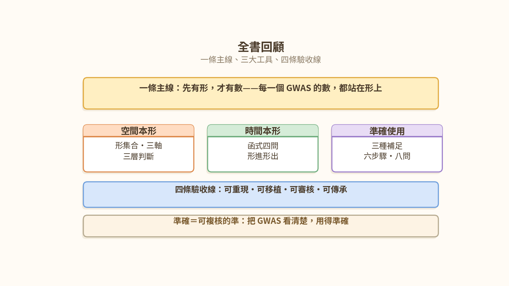

**圖 8-1　全書回顧：一條主線、三大工具、四條驗收線**

## 8-2　五領域案例並列：形的方法不只屬於 GWAS

最後把鏡頭拉遠。本書的方法——立形、寫函式、立判準、三層檢查——在五個領域同時有效：哲學（本體論是根、本形學是幹）、生物（GWAS 的形與函式）、語言（表型定義如同詞義界定，刻度即語義場）、程式（分析腳本即函式四問的實作、測試即判準）、組織（隊列容器的治理如同企業資料治理）。一門方法跨五域仍成立，正是「形」是顯學的證據。

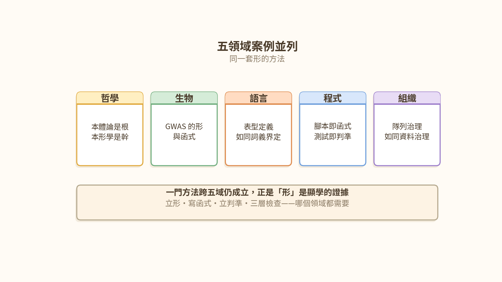

**圖 8-2　五領域案例並列：同一套形的方法**

## 8-3　願景：從 GWAS 到知識統一

GWAS 只是起點。當每一個領域——醫學、工程、語言、組織——都把它的知識寫成形與函式，知識統一就有了地基；當推理與判準中樞跨域共用，思維統一就有了骨架；當學習迴路讓形庫自主長大，智慧統一就有了引擎。把形看清楚，轉成顯學，實踐化為 Mind AI——這是本形學的路，也是 GWAS 從發現引擎走向智慧資產的路。

> **全書終句**
>
> 先有形，才有數；先立形，GWAS 的每一個數才站得穩。準確＝可複核的準——把 GWAS 看清楚，用得準確。

> **【練習 S03】**
>
> 寫給三個月後的自己：用五句話總結這本書你最想留下的五件事（每句對應一篇）。三個月後回來對照——形留住了嗎？

# 附錄 A　術語對照表

| 術語 | 英文 | 一句話定義 |
| --- | --- | --- |
| 形 | Type | 一個被完整描述的對象（形集合表記） |
| 單位形 | Unit Type | { 部件, (內容), [類別] } 三種集合的合體 |
| 形集合 | Type Set | 單位形的完整表記 |
| 空間本形 | Spatial Type | 形的靜態面（名詞）：三軸・三括號・三層判斷 |
| 時間本形 | Temporal Type | 形的動態面（動詞）：函式＝形進形出 |
| 屬性・屬性值 | Property・Value | 維度×刻度的問題，與具體答案 |
| 容器 | Container | C = (id(C), S(C))；不變性公理：換內容 id 不變 |
| remove 三級 | Remove Grading | 必要件／功能降級件／非必要件 |
| 三層判斷 | Three-Layer Judgment | 容器／BOM／抽象三層聯合判斷 |
| 函式四問 | Function Card | 名稱・輸入形・輸出形・判準 |
| 準確 | Verifiable Accuracy | 可複核的準：讀者能逐句打勾重現推理 |
| GWAS | Genome-Wide Association Study | 全基因組關聯分析 |
| SNP | Single Nucleotide Polymorphism | 單核苷酸多型性：最常見的遺傳變異形 |
| MAF | Minor Allele Frequency | 次等位基因頻率 |
| HWE | Hardy-Weinberg Equilibrium | 哈迪-溫伯格平衡：基因型頻率的基準形 |
| LD | Linkage Disequilibrium | 連鎖不平衡：鄰近位點的非隨機組合 |
| PCA | Principal Component Analysis | 主成分分析：族群結構的數學化 |
| QC | Quality Control | 品質管制：remove 判準的應用現場 |
| fine-mapping | Fine-Mapping | 精細定位：從區段到候選因果變異 |
| credible set | Credible Set | 可信變異集：覆蓋指定後驗機率的變異清單 |
| PRS | Polygenic Risk Score | 多基因風險評分：效應量的合形 |
| MR | Mendelian Randomization | 孟德爾隨機化：用遺傳變異推因果 |
| meta-analysis | Meta-Analysis | 後設分析：跨隊列結果的合形 |
| Mind AI | Mind AI | 本形學實踐平台：兩庫一中樞一迴路 |
| 形庫 | Type Library | 形的倉庫：空間本形的歸檔處 |
| 函式庫 | Function Library | 函式的倉庫：時間本形的歸檔處 |

# 附錄 B　速查卡

本附錄收三張速查卡：B-1 形集合卡、B-2 函式四問卡、B-3 可複印空白模板。B-3 獨立成整頁，可直接影印使用。

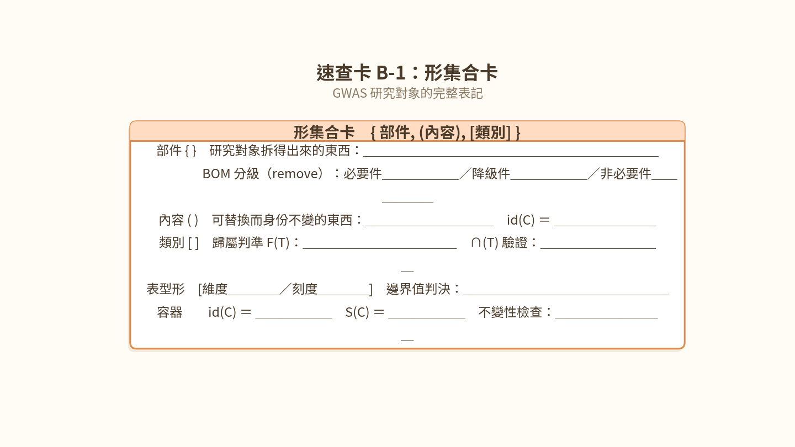

**圖 B-1　速查卡 B-1：形集合卡——GWAS 研究對象的完整表記**

**圖 B-2　速查卡 B-2：函式四問卡——分析步驟的上崗格式**

## B-3　可複印空白模板（整頁）

以下模板整頁排版，可直接影印：左欄為形集合卡，中欄為函式四問卡，右欄為八問勾選。每一張 GWAS 專案啟動時各印一張，填完釘在計畫書首頁。

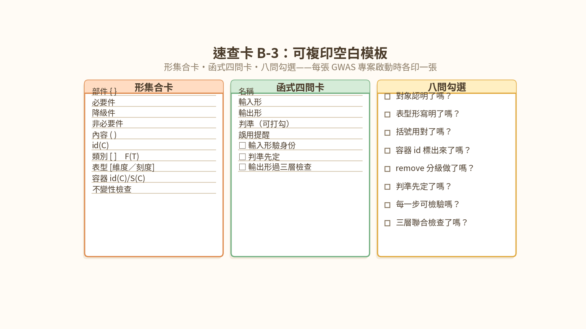

**圖 B-3　可複印空白模板：形集合卡・函式四問卡・八問勾選（影印版）**

# 附錄 C　練習參考答案

以下為 E01 至 E14、S01 至 S03 的示範答案。答案不是唯一寫法——重點是「先辨識形，再談數」的思路走穩了沒有。

| 題 | 示範答案 |
| --- | --- |
| E01 | 示範：某報告只報 p 值不報效應量（數離開形），且病例與對照的年齡分布未校正（容器沒寫清）。診斷：痛點 3＋1；修法：補 β 與 95% CI、把年齡放入協變量重跑並報告 λ。 |
| E02 | 複製失敗常因為原研究的「形」沒寫清：表型定義（刻度）、QC 門檻（規則）、樣本來源（容器）在新隊列悄悄不同。形不同，數不可比——同一位點自然顯不出來。 |
| E03 | 示範：認知鏈＝異同→分合→形→名；三軸＝它長什麼樣／由什麼組成／放在哪裡；三層判斷＝容器・BOM・抽象聯合；函式四問＝名稱・輸入形・輸出形・判準；準確＝可複核的準。 |
| E04 | 示範三列：表型形→「第 2 型糖尿病，二值刻度，依 ICD-10 診斷」；容器→「Taiwan Biobank，id = TWB，2012–2020 年招募」；數→「rs12345 次等位基因計數 0/1/2，MAF = 0.23」。 |
| E05 | 示範：身高 [公分／0.1]，測量方式為站立身高儀。若刻度改為「自報身高」，系統性偏差（約 +1.5 cm）與變異增加會稀釋效應量——形變了，結論的數跟著變。 |
| E06 | 示範：研究方案（必要）、受試者與樣本身份（必要）、基因型（必要）、表型（必要）、協變量（降級件——缺了不致命但可信度下降）、複製隊列（降級件）、美觀排版（非必要）。常被誤當非必要件的是「協變量」——缺了它，族群分層假關聯就會冒充發現。 |
| E07 | 比較的對象應是同一容器內「基因型 ↔ 表型」的關聯（S(C) 內部的結構），但病例組與對照組分屬不同容器（不同 id(C)），比較實際上測到的是「兩個容器的等位基因頻率差」——容器層的差異冒充了抽象層的關聯。校正法＝把容器效應（PC、混合模型）從比較中扣除。 |
| E08 | 示範卡（族群分層校正）：名稱＝族群分層校正；輸入形＝基因型矩陣＋樣本清單；輸出形＝主成分矩陣＋校正後模型；判準＝前 10 個 PC、λ ∈ [0.95, 1.05]、QQ 圖無系統性偏離。 |
| E09 | 樣本重疊＝同一個 id(C) 的內容物被兩個研究各當獨立內容物數了一次，等於把同一個形的數重複計入——meta 分析的標準誤被低估、顯著性被高估。補救：量化重疊（依賴 LD score 回歸或重疊矩陣）改用校正公式，或移除重疊樣本重算。 |
| E10 | 每個 βᵢ 是「在發現隊列的特定容器中、特定表型形下」估計的效應——它依附在變異形與容器形之上。離開容器（跨族群）、離開表型定義（換刻度），βᵢ 的數就失準。所以 PRS 是把帶形的效應合形，不是裸數字加總。 |
| E11 | 示範見 5-3 完整示範（rs12345 與身高）；自擬題目時檢查：六步齊全、第五步有數字門檻、第六步三層各有結論。 |
| E12 | 示範卡：情境＝「p = 10⁻²⁰ 所以這基因很重要」；誤用＝數的誤用（p 當效應量）；修正＝補報 β 與 CI；用複製隊列校準效應量。另兩張建議選：族群分層殘留、樣本重疊。 |
| E13 | 踩三條：p 當效應量（數）、單層判斷（推理）、關聯當因果（推理）。回覆：「p 值只說這個關聯不像隨機，不說效應多大、更不說因果——請補效應量與信賴區間，並在獨立隊列複製後再談重要性。」 |
| S01 | 示範：未過「可移植」線。動作：①容器化腳本（Docker 映像檔＋依賴鎖定）；②固定隨機種子與輸出雜湊值；③新機器跑一次並比對雜湊——三步後可移植線可打勾。 |
| S02 | 示範：保留第 1、5、7、8 週（骨幹、準確方法、完整示範、建庫）；砍掉的函式卡週以「七張卡抽考」替代驗收——理由：方法是主幹，卡可自學；完整示範與建庫無法替代，是可複核產出的底線。 |
| S03 | 示範五句：①五個痛點都是形沒立好；②三軸三括號是描述的最小完備集；③GWAS 流程是七張函式卡的鏈；④準確＝可複核的準，八問是驗收線；⑤先有形，才有數——每個數字都要標注它依附的形。 |

# 附錄 D　圖表索引

| 編號 | 圖名 | 所在篇 |
| --- | --- | --- |
| 圖 0-1 | 全書地圖 | 導讀 |
| 圖 0-2 | 認知鏈 | 導讀 |
| 圖 1-1 | GWAS 全流程五站 | 1-1 |
| 圖 1-2 | 五個痛點 | 1-2 |
| 圖 1-3 | 三層定位 | 1-3 |
| 圖 2-1 | 骨幹一頁圖 | 2-1 |
| 圖 2-2 | 三軸三括號 | 2-2 |
| 圖 2-3 | 三層判斷 | 2-2 |
| 圖 2-4 | 函式四問卡 | 2-3 |
| 圖 2-5 | 兩庫一中樞一迴路 | 2-4 |
| 圖 2-6 | 映射總表 | 2-5 |
| 圖 3-1 | 研究對象單位形 | 3-1 |
| 圖 3-2 | 表型形 | 3-2 |
| 圖 3-3 | 變異形 | 3-2 |
| 圖 3-4 | remove 三級＝QC 地圖 | 3-3 |
| 圖 3-5 | 容器層級 | 3-4 |
| 圖 3-6 | 基因型計數 | 3-5 |
| 圖 3-7 | 三層判斷 GWAS 版 | 3-6 |
| 圖 4-1 | 函式鏈 | 4-1 |
| 圖 4-2 | 函式卡一 QC | 4-2 |
| 圖 4-3 | 函式卡二 分層校正 | 4-2 |
| 圖 4-4 | 函式卡三 關聯檢定 | 4-2 |
| 圖 4-5 | 函式卡四 多重校正 | 4-2 |
| 圖 4-6 | 函式卡五 複製後設 | 4-2 |
| 圖 4-7 | 函式卡六 精細定位 | 4-2 |
| 圖 4-8 | 函式卡七 PRS | 4-2 |
| 圖 4-9 | 六群映射 | 4-3 |
| 圖 4-10 | 推理五族 | 4-4 |
| 圖 5-1 | 體—用—準 | 5-1 |
| 圖 5-2 | 三種補足 | 5-2 |
| 圖 5-3 | 證明六步驟 | 5-3 |
| 圖 5-4 | 八問 | 5-4 |
| 圖 5-5 | 誤用 16 種 | 5-5 |
| 圖 5-6 | 選路決策樹 | 5-6 |
| 圖 6-1 | 兩庫一中樞一迴路×GWAS | 6-1 |
| 圖 6-2 | 對讀地圖 | 6-2 |
| 圖 6-3 | 四條驗收線 | 6-3 |
| 圖 6-4 | AGI 三階段 | 6-4 |
| 圖 7-1 | 學練用教建 | 7-1 |
| 圖 7-2 | 八週路線 | 7-2 |
| 圖 7-3 | 四讀者選路 | 7-3 |
| 圖 7-4 | 建庫四階段 | 7-4 |
| 圖 8-1 | 全書回顧 | 8-1 |
| 圖 8-2 | 五領域並列 | 8-2 |
| 圖 B-1 | 形集合卡 | 附錄 B |
| 圖 B-2 | 函式四問卡 | 附錄 B |
| 圖 B-3 | 可複印空白模板 | 附錄 B |

> **全書終**
>
> 把形看清楚，轉成顯學，實踐化為 Mind AI。
>
> GWAS 的每一個數，都站在形上；形立穩了，發現才可複核、可傳承、可長大。
