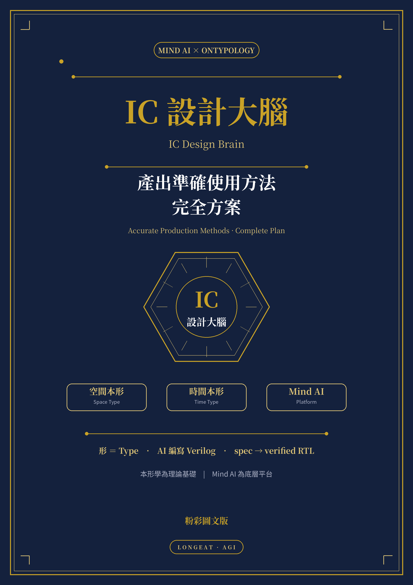

# 目　錄
- 寫在前面：三約定
- 導讀：兩套語言、三種讀法
- 第一章　認識 IC 設計大腦
  - 1.1　大腦 ＝ 可推理的設計副本
  - 1.2　設計 ＝ 形 ＋ 數
  - 1.3　雙本形 × IC 設計
  - 1.4　Mind AI：底層平台的分工
  - 1.5　AI 編寫 Verilog：準確從何而來
- 第二章　六種產出形
  - 2.1　為什麼先定產出形
  - 2.2　規格形 SpecType 與介面形 InterfaceType
  - 2.3　模組形 ModuleType：BOM 與 remove 三級
  - 2.4　時序形 TimingType
  - 2.5　驗證形 VerifyType 與模式形 PatternType
  - 2.6　六形總表
- 第三章　四層準確性保證
  - 3.1　第一層・∩(T) 判準先行，第二層・演繹骨架約束
  - 3.2　第三層・形式驗證與模擬驗證
  - 3.3　第四層・形證據鏈
  - 3.4　空間 × 時間交叉驗收
- 第四章　準確使用方法・六步驟
  - 4.1　步一・認明情境：框架四步驟拿來認需求
  - 4.2　步二・分軸建形，步三・挑選擴式
  - 4.3　步四・生成產出：把形交給 AI
  - 4.4　步五・判準驗收，步六・歸檔演化
  - 4.5　三層判斷：收件前的最後防線
- 第五章　AI 編寫 Verilog：準確用法手冊
  - 5.1　七段提示詞流水線 S1–S7
  - 5.2　規格形到介面形：UART 的形
  - 5.3　模組形：uart_tx 與 uart_rx
  - 5.4　時序形與驗證形：波形、testbench 與 assertion
  - 5.5　常見錯誤與修正對照
- 第六章　誤用對照・檢查清單・成熟度
  - 6.1　誤用對照五種
  - 6.2　十問檢查清單
  - 6.3　成熟度 L1–L4
- 回顧：一句話帶走整本書
- 附錄 A　速查表
  - A.1　術語・記號速查
  - A.2　時間本形招式盤 × IC 產線用途

# 寫在前面：三約定

這是一本「怎麼用」的手冊。IC 設計大腦把設計團隊腦中的規格、架構、時序、驗證與教訓，變成一口口可以推理、可以判斷、可以長大的形（Type）。本形學的空間本形與時間本形是它的理論底座，Mind AI 是承載它的平台——但本書不重述理論、也不介紹平台；你只需要知道怎麼下指令、怎麼驗收、怎麼讓產出準確。翻開之前，先立三條約定。

> **約定一・形 ＝ Type**
>
> 「形」的英文一律是 Type，不是 Form。SpecType、ModuleType、Type-Driven Design——全書如此。
>
> 形不是目錄、不是分類標籤；形是一口立得出判準、撐得起推理的結構。

> **約定二・理論只用不教**
>
> 空間本形的三括號、∩(T)、id(C)、remove 判準、框架四步驟，時間本形的招式盤（十四招）——
>
> 本書只拿來用，不重述它們的論證。需要原理時，回《本形學之空間本形》《本形學-時間本形篇》查。

> **約定三・平台只引不述**
>
> Mind AI 在本書只以「底層平台」出場：LLM 負責語言與歸納統計，Mind Model 負責智慧與演繹推理。
>
> 本書講的是在它之上「怎麼把 IC 設計做準」，而不是平台本身長什麼樣子。

**表 0-1　任務地圖：你想解決的問題，翻到哪一章**

| 你的處境 | 你真正需要的 | 本書對應 |
| --- | --- | --- |
| AI 幫我寫 Verilog，但寫出來不敢用 | 準確性要能說出憑什麼 | 第3章（四層準確性） |
| 規格寫完了，AI 還是問答式擠牙膏 | 把產出立成六種形，分段生成 | 第2章（產出形語彙） |
| 每次提示都要從頭教一遍 | 六步驟＋提示詞流水線 S1–S7 | 第4、5 章 |
| 驗證報告很漂亮，出事找不到原因 | 形證據鏈：產出要回溯得到需求 | 第3、5 章 |
| 團隊各自解讀規格，RTL 版本互撞 | 共用形語彙與交集判準 ∩(T) | 第2、6 章 |
| 想知道團隊現在用得對不對 | 誤用對照、十問清單、成熟度 L1–L4 | 第6章（用對與升級） |

# 導讀：兩套語言、三種讀法

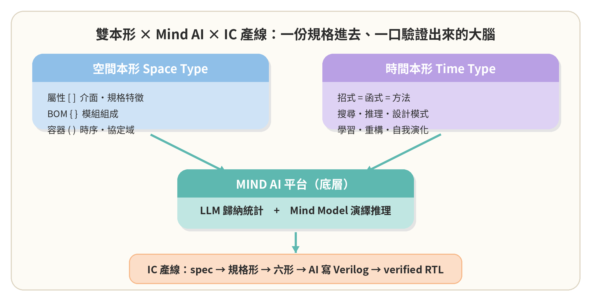

**圖 D-1　雙本形 × Mind AI × IC 產線：本書的全景**

本書同時說兩套語言：一套是形的語言——規格形、介面形、模組形，講結構與判準；一套是晶片的語言——Verilog、testbench、時序圖，講實現與驗證。兩套語言的接點只有一句話：每一份 RTL 產出，都掛在某一口形上；每一口形，都立著一條判準。

**表 D-1　兩套語言的對照**

| 面向 | 形的語言（空間本形） | 晶片的語言（IC 設計） |
| --- | --- | --- |
| 基本單位 | 形 Type | 模組／訊號／時序 |
| 描述工具 | [ ] 屬性、{ } BOM、( ) 容器 | parameter、port、時鐘域 |
| 判斷工具 | ∩(T) 判準、remove 三級、id(C) | assertion、覆蓋率、簽收 |
| 動態方法 | 招式盤十四招（時間本形） | 設計流程、重構、驗證策略 |
| 產出 | 立得判準的形 | verified RTL |

三種讀法，按你的時間選。第一種「半小時讀法」：只讀寫在前面、導讀、各章的本章重點框與回顧——先建立語彙，用到再回來查。第二種「一週讀法」：照章序讀完，每章末尾做一遍檢查清單，把團隊最近一份 RTL 拿來對照。第三種「專案讀法」：開新專案時把第四章六步驟當 SOP 走，第五章 S1–S7 提示詞直接複製使用——這是最實戰的一種。

> **例　本書貫穿案例・UART 收發器**
>
> 一顆小到可以一次看完、大到躲不掉時序與驗證問題的模組：uart_top。
>
> 從規格句到 verified RTL，六種產出形、六步驟、S1–S7 全部用同一家案例演練到底。

# 第一章　認識 IC 設計大腦


**章節意象・可推理的設計副本**

「IC 設計大腦」不是一套 EDA 工具，也不是一份雲端文件夾。它是把 IC 設計的知識、思維與演化能力，用形組織起來、放在 Mind AI 上持續運作的設計副本——你問它「為什麼這裡要插一級暫存器」，它答得出理由；你改了規格，它知道哪些 RTL 與驗證要跟著動。

## 1.1　大腦 ＝ 可推理的設計副本

多數設計團隊的「知識庫」是死的：規格書躺在雲端硬碟、時序圖沒有人記得版本、驗證報告與設計脫節。文件找得到，答案問不出。設計大腦的門檻只有一條——三件事必須活著：知識（形倉庫可推理）、思維（招式盤可調用）、演化（證據鏈可累積）。

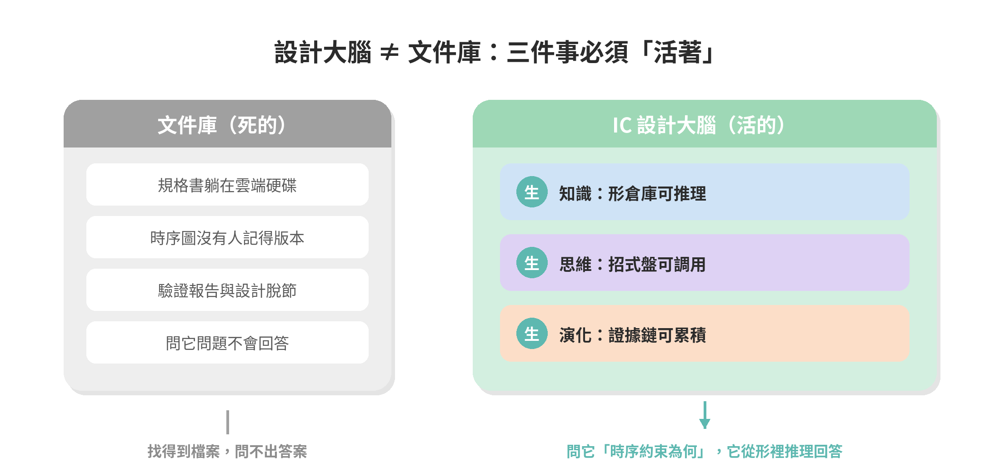

**圖 1-1　設計大腦 ≠ 文件庫：三件事必須活著**

活著的意思很具體。當新工程師問「baud_gen 為什麼除的是 434」，大腦從時序形（TimingType）與規格形（SpecType）推理出答案，而不是叫他去翻半年前的 mail。當規格從 8N1 改成 7E2，大腦列出受影響的介面形、模組形與驗證形，而不是等驗證掛掉才發現。

## 1.2　設計 ＝ 形 ＋ 數

晶片當然充滿數字：位元、頻率、延遲、面積、良率。但支撐這些數字的是形——模組怎麼組成、訊號怎麼連結、介面怎麼對接、版本怎麼延續。數描述量與律，形描述結構、組成、關聯與演化；思考一份設計時兩者缺一不可，而且有先後：先立形、後填數。形錯了，數再對也沒有用——位寬算得再精，掛錯了介面就是整批重來。

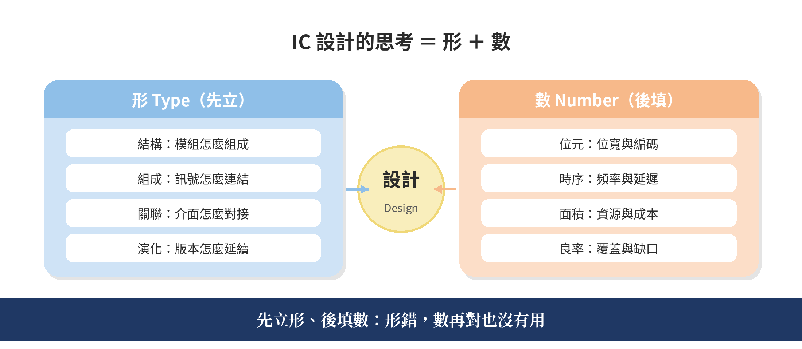

**圖 1-2　設計 ＝ 形 ＋ 數：先立形、後填數**

## 1.3　雙本形 × IC 設計

空間本形負責「靜態的形」：用三條軸描述一個設計物——[ ] 屬性軸收規格特徵與介面參數、{ } BOM 軸收模組組成與子單元、( ) 容器軸收時鐘域、協定域與驗證域；再用 ∩(T) 判準立出「怎樣才算合格」，用 id(C) 錨住模組身份，用 remove 三級標記部件的輕重。時間本形負責「動態的招」：設計模式、推理、思考法、搜尋萃取、重構重組、自我演化——一套可以調用、可以組合的招式盤。

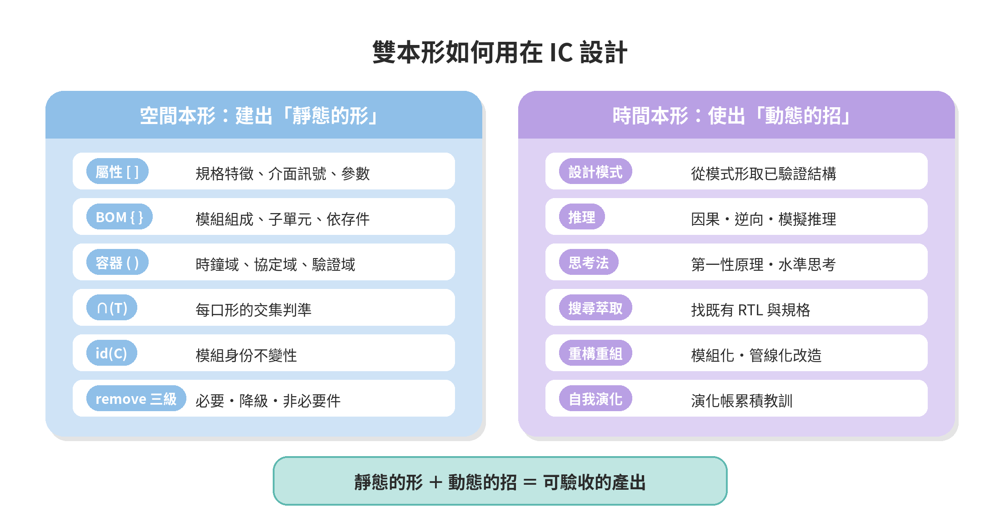

**圖 1-3　雙本形如何用在 IC 設計：靜態的形＋動態的招**

**表 1-1　雙本形在 IC 設計的職責分工**

| 工具（只用不教） | 空間本形・用法 | 時間本形・用法 |
| --- | --- | --- |
| 三括號 | [ ] 規格與參數、{ } 模組組成、( ) 時鐘/協定域 | 在流程的每一階段選擇展開哪個括號 |
| ∩(T) 判準 | 每口形的交集判準：何謂過、何謂不過 | 推理招式以判準為前提做演繹 |
| id(C) | 模組身份錨：重構後仍是同一個模組 | 重構與重組招式的安全性依據 |
| remove 三級 | 必要件／功能降級件／非必要件 | 砍成本、做精簡時的反事實推理 |
| 框架四步驟 | 從需求雜訊認明規格維度 | 解題・分析招式的標準起手式 |

## 1.4　Mind AI：底層平台的分工

IC 設計大腦長在 Mind AI 上。平台的分工一句話講完：LLM 負責語言能力，Mind Model 負責智慧能力。LLM 擅長語言理解、生成與知識召回——把形翻成 Verilog 文字的是它；Mind Model 擅長知識統一、深度推理、長期記憶與思維管理——約束生成、檢查判準、追蹤證據的是它。兩者合體，才談得上準確。

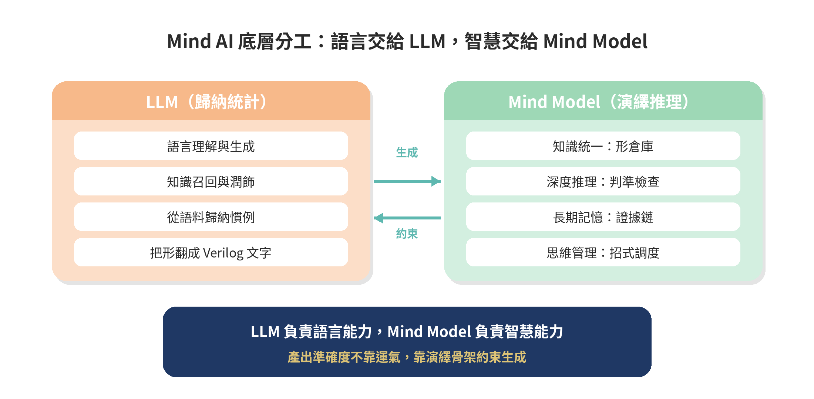

**圖 1-4　Mind AI 底層分工：語言交給 LLM，智慧交給 Mind Model**

這個分工直接決定了本書的使用姿勢：不要把「準確」寄託在換一個更會寫 Verilog 的模型上；準確來自把形立好、把判準寫明、讓演繹骨架約束生成。模型會換代，形與判準留在大腦裡，這才是可累積的資產。

## 1.5　AI 編寫 Verilog：準確從何而來

AI 編寫 Verilog Code 是這顆大腦的核心產線：spec 進去、verified RTL 出來。常見的迷思是「prompt 寫得越長越準」——實際上剛好相反：一次要 AI 寫完整晶片，是最大的不準確來源。準確的來源是三個約束：分段生成（每段只做一件事）、逐段驗收（每段都有判準）、證據成鏈（每段產出可回溯）。這三件事分別落在第二章的產出形、第三章的準確性保證、第五章的提示詞流水線。

> **本章重點**
>
> 設計大腦 ＝ 可推理的設計副本：知識、思維、演化三件事都要活著。
>
> 設計 ＝ 形 ＋ 數，且先立形、後填數；空間本形管靜態結構，時間本形管動態方法。
>
> Mind AI 分工：LLM 出語言，Mind Model 出智慧；準確不靠運氣，靠約束。

# 第二章　六種產出形


**章節意象・六口立得判準的形**

「產出準確」的前提是「產出被定義過」。把 IC 設計的產出立成六種形（Type），每口形都有括號表記、有交集判準、有驗收問題——之後每一次生成、每一份交件，都只是把東西放進對應的形裡。本章把六口形一次立齊，後面幾章都靠它吃飯。

## 2.1　為什麼先定產出形

沒有形的流程，產出是散裝的：一封 email、一份 Word、一個 commit、一張波形截圖——彼此沒有判準、沒有來歷、沒有版本。立了形，產出才有三樣東西：身份（這是哪一口形）、判準（合格長什麼樣）、關聯（它掛在哪個上位形之下）。六種產出形覆蓋 IC 設計從頭到尾的產線：規格→介面→模組→時序→驗證→模式。

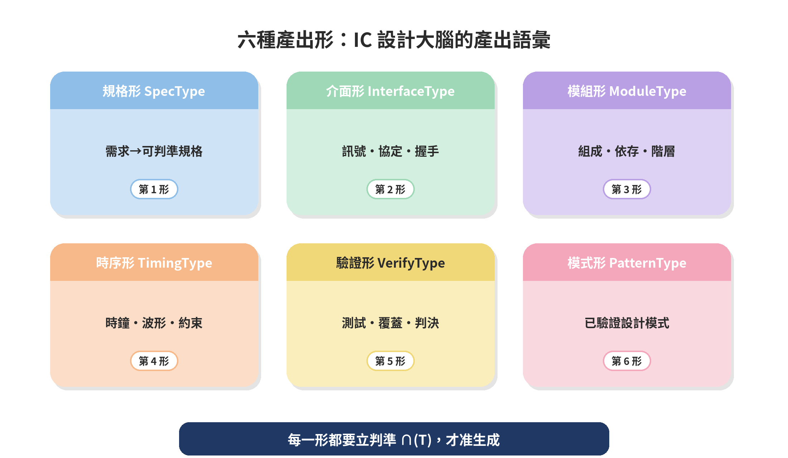

**圖 2-1　六種產出形：IC 設計大腦的產出語彙**

## 2.2　規格形 SpecType 與介面形 InterfaceType

規格形（SpecType）是產線的第一口形：把需求句立成可判準的規格。一條合格的規格句永遠寫得出「驗收時拿什麼量它」——傳輸速度 115200 bps、資料格式 8N1、錯誤率低於 10⁻⁶，這些是屬性 [ ]；「要有 FIFO 緩衝」是組成 { } 的需求；「單一 50 MHz 時鐘域」是容器 ( ) 的宣告。需求句裡量不出來的形容詞（高效能、優雅、穩健）一律退回重寫。

**表 2-1　SpecType 判準：規格句的體檢表**

| 檢查項 | ∩(SpecType) 問句 | 不合格例 |
| --- | --- | --- |
| 可度量 | 驗收時拿什麼數字量它？ | 「快速的傳輸」 |
| 可歸屬 | 掛得進 [ ]／{ }／( ) 哪個括號？ | 「要有未來感」 |
| 可裁決 | 兩個工程師讀完會得到同一結論嗎？ | 「盡量少用資源」 |
| 可追溯 | 說得出它來自哪一條需求句嗎？ | 工程師自己加的規格 |

介面形（InterfaceType）是模組與外界的契約：port 清單、位寬、方向、握手協定、時鐘域歸屬。介面形最重視的是「對得起來」——上模組的輸出位寬與下模組的輸入位寬、valid/ready 的語義、reset 的極性，全部在介面形層級一次講定。改介面 = 改契約，必須回溯到規格形重開版本。

> **例　UART 的規格形與介面形**
>
> SpecType：115200 bps、8N1、單一時鐘域、誤幀率低於 10⁻⁶、內建 16-byte FIFO。
>
> InterfaceType：clk, rst_n（容器）；tx_data[7:0], tx_start, tx, tx_busy（傳送面）；
>
> rx, rx_data[7:0], rx_valid（接收面）——每個訊號都有方向、位寬與時鐘域歸屬。

## 2.3　模組形 ModuleType：BOM 與 remove 三級

模組形（ModuleType）用 { } BOM 記組成：uart_top = { uart_tx, uart_rx, baud_gen, fifo }。判準沿用「拆下來認得自己」——baud_gen 拿掉仍是個「東西」（一個除頻器），所以進 BOM；「工作頻率」拿掉什麼都不是，所以進 [ ] 屬性。三括號的完整表記如圖 2-2。

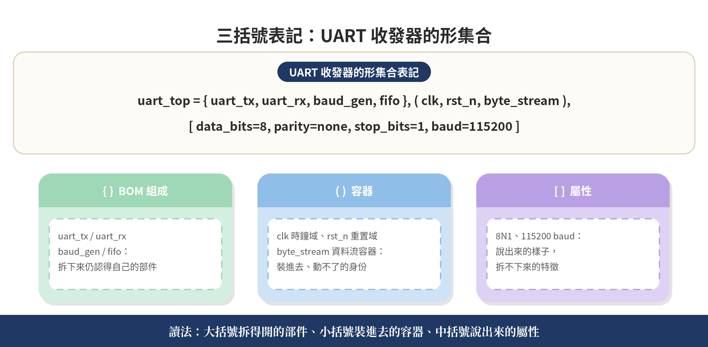

**圖 2-2　三括號表記：UART 收發器的形集合**

接著用 remove 判準給 BOM 裡每個部件定級：移除後同一性喪失的是必要件，功能降級但身份存續的是功能降級件，完全不影響的是非必要件。這個分級在砍成本、做精簡、談 ECN 時是唯一的共同語言——「拿掉 fifo 會怎樣」不該靠吵的，remove 判準早就寫好了。


**圖 2-3　remove 判準：模組部件的三級分類**

**表 2-2　uart_top 的 BOM 與 remove 分級**

| 部件 | remove 判準 | 分級 | 拿掉的後果 |
| --- | --- | --- | --- |
| baud_gen | remove(p, M) ≢ M | 必要件 | 不再是 UART：連位元邊界都沒有 |
| uart_tx | remove(p, M) ≢ M | 必要件 | 同一性喪失：只剩接收器 |
| uart_rx | remove(p, M) ≢ M | 必要件 | 同一性喪失：只剩傳送器 |
| fifo | remove(p, M) ≡ M' ⊂ M | 功能降級件 | 仍是 UART，但易溢位、CPU 必須即時服務 |
| debug_uart 標誌 | remove(p, M) ≡ M | 非必要件 | 量產版可直接移除 |

## 2.4　時序形 TimingType

時序形（TimingType）收所有的「動」：時鐘頻率、位元週期、建立/保持時間、復位序列、跨域同步。它是空間本形裡容器 ( ) 的動態投影——每個時鐘域是一個容器，容器邊界上的每一次穿越都要有橋（同步器）。時序形的判準永遠是可示波的：任何一條時序聲明都要畫得出波形、寫得出 assertion。

**表 2-3　TimingType 要件：一份合格的時序形清單**

| 要件 | 內容 | 驗收方式 |
| --- | --- | --- |
| 時鐘規格 | 頻率、佔空比、抖動容忍 | SDC 約束＋量測點 |
| 幀時序 | 起始位元、資料位元、停止位元的邊界 | 波形圖＋baud_tick 對齊 |
| 復位序列 | 同步／非同步、極性、釋放時機 | 復位波形＋reset assertion |
| 跨域 | 哪些訊號跨時鐘域、用什麼橋 | CDC 報告＋同步器清單 |

## 2.5　驗證形 VerifyType 與模式形 PatternType

驗證形（VerifyType）把「怎麼證明它是對的」立成形：testbench 結構、激勵策略、自我檢查（self-checking）、覆蓋率目標、判準簽收單。驗證形的 ∩(T) 尤其嚴格——「跑過模擬」不算數，「覆蓋率達標＋判準逐條簽收」才算數。模式形（PatternType）則是把時間本形落到 IC 領域的成果倉庫：每一個被驗證過的設計模式（握手協定、跨域 FIFO、除頻器、邊緣檢測……）都收編成形，帶著自己的判準與已知坑，供招式盤直接調用——這就是「設計搜尋與萃取」與「設計模式」兩招在 IC 產線的實體。

**表 2-4　VerifyType 與 PatternType 的判準**

| 形 | ∩(T) 判準（合格線） | 常見不合格 |
| --- | --- | --- |
| VerifyType | self-checking＋覆蓋率達標＋判準逐條簽收 | 只有波形截圖的「目視驗證」 |
| PatternType | 可重用＋判準隨附＋坑位記錄 | 貼在 wiki 沒人維護的 code snippet |

## 2.6　六形總表

**表 2-5　六種產出形總表：一頁收齊**

| 產出形 | 回答的問題 | 三括號重心 | 交件判準 |
| --- | --- | --- | --- |
| 規格形 SpecType | 要做什麼？ | [ ] 屬性為主 | 每句可度量、可裁決 |
| 介面形 InterfaceType | 怎麼對外？ | [ ]＋( ) | 對得起來、講得清楚 |
| 模組形 ModuleType | 由什麼組成？ | { } BOM 為主 | BOM 判準＋remove 分級 |
| 時序形 TimingType | 什麼時候動？ | ( ) 容器為主 | 可示波、可 assertion |
| 驗證形 VerifyType | 怎麼算對？ | 三括號全用 | 覆蓋達標＋逐條簽收 |
| 模式形 PatternType | 重用什麼？ | { }＋[ ] | 判準隨附＋坑位記錄 |

> **本章重點**
>
> 先定產出形，才有準確可言：形給身份、給判準、給關聯。
>
> 六形貫穿產線：SpecType→InterfaceType→ModuleType→TimingType→VerifyType→PatternType。
>
> 每口形都要立 ∩(T)；BOM 用「拆下來認得自己」判準，部件用 remove 三級定輕重。

# 第三章　四層準確性保證


**章節意象・準確是長出來的**

「產出準確使用方法」的核心問題：準確到底從哪裡來？答案不是「挑一個更強的模型」，也不是「多檢查幾遍」——準確是結構性的，它由四層保證一層層長出來：∩(T) 判準、演繹骨架、形式驗證、形證據鏈。四層各自攔住一種不準確，缺一層就漏一種錯。

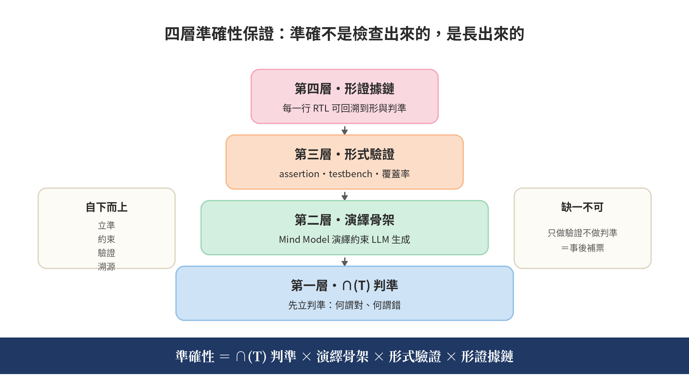

**圖 3-1　四層準確性保證：自下而上，缺一不可**

## 3.1　第一層・∩(T) 判準先行，第二層・演繹骨架約束

第一層是 ∩(T) 判準先行：任何產出在生成之前，先寫出「何謂對、何謂錯」。規格形的判準是可度量句；介面形的判準是對接檢查表；模組形的判準是 BOM 判準與 remove 分級。判準後補是最陰險的不準確——RTL 寫完才想驗收標準，等於讓考生自己出改考題。

第二層是演繹骨架：由 Mind Model 依形與判準演繹出產出的骨架結構，LLM 只在骨架內填肉。以 Verilog 為例：骨架決定了模組有幾個 always 區塊、狀態機有幾個狀態、每個輸出由誰驅動——這些是推理的結論；LLM 負責把骨架寫成語句通順的程式碼。骨架錯了會被第一層的判準抓住，語句錯了會被第三層的驗證抓住；LLM 的自由度被限制在「寫對話」而不是「想對結構」，準確度才可控。

> **兩層的分工口訣**
>
> 判準說「何謂對」，骨架說「怎麼長」；先立判準、後生成，先長骨架、後填肉。
>
> 把順序倒過來（先生成後補判準、讓 LLM 自由發揮架構），四層就塌成一層。

## 3.2　第三層・形式驗證與模擬驗證

第三層是驗證：lint、模擬、assertion、覆蓋率。這一層的關鍵認知是「驗證對象是判準，不是程式碼」——testbench 的每一個 self-checking 都要指回 ∩(T) 的某一條；覆蓋率報表上每一個洞都要有處置（補測試或開缺口單）。只跑模擬不看覆蓋率，等於只考試不改考卷。

**表 3-1　驗證手段與它攔住的不準確**

| 手段 | 攔住什麼 | 證據產出 |
| --- | --- | --- |
| Lint／語法檢查 | 位寬不匹配、鎖存推論、未驅動訊號 | lint log（零警告收件） |
| 定向模擬 | 規格裡每條功能點逐一對照 | self-checking 通過記錄 |
| 隨機＋覆蓋率 | 角落案例與組合爆炸 | 覆蓋率報表＋缺口清單 |
| assertion | 時序與協定違規（如起始位元過寬） | 違規波形＋屬性清單 |

## 3.3　第四層・形證據鏈

第四層是形證據鏈：每一個輸出都問得到來歷。任何一段 RTL 要能回溯到「掛在哪一口形、用了哪幾招、通過哪條判準、落在演化帳哪一筆」。鏈上任何一環斷掉，產出不收。這一層攔住的是「對了但講不出為什麼對」——這種產出在事發時等於沒有驗證過。

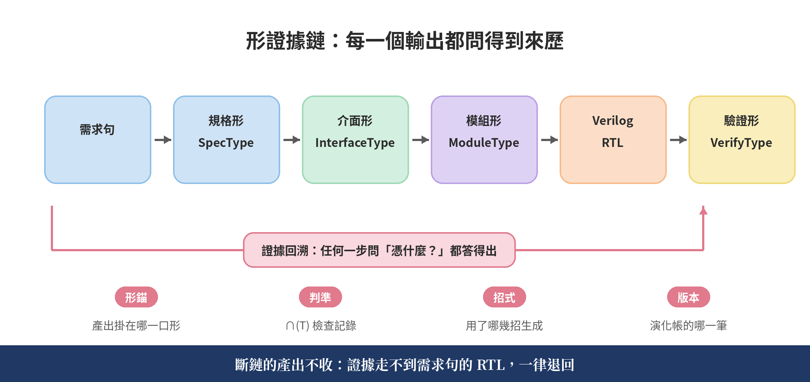

**圖 3-2　形證據鏈：需求句一路走到驗證形，環環可回溯**

> **例　UART 的證據鏈長這樣**
>
> 「rx 模組的 stop bit 檢查」→ 掛在 VerifyType → 判準 V-3「誤幀率 < 10⁻⁶」
>
> → 由推理招「因果推理」從規格形推導 → 版本 v1.2（演化帳：7/19 修復 stop bit 漏檢）。

## 3.4　空間 × 時間交叉驗收

四層保證怎麼驗收？空間本形與時間本形交叉檢查：靜態看形是否完備——六形齊備、判準全立、表記完整；動態看招是否到位——招式調用有據、推理步驟完整、演化記錄歸檔。雙軸都過才收件；靜態過而動態不過給提醒（可修）；任一缺席直接阻擋（不可收）。

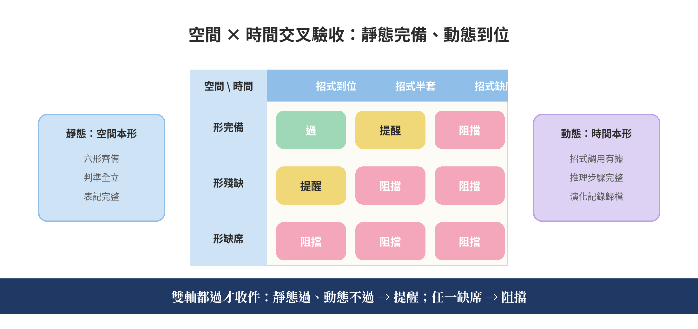

**圖 3-3　空間 × 時間交叉驗收矩陣**

**表 3-2　四層準確性的驗收對照**

| 層 | 驗收問題 | 通過證據 | 不過處置 |
| --- | --- | --- | --- |
| ∩(T) 判準 | 判準是在生成之前立的嗎？ | 判準簽收單（有日期） | 退回重立 |
| 演繹骨架 | 骨架是推理出來的嗎？ | 推理步驟記錄 | 退回 S4 |
| 形式驗證 | 覆蓋率達標了嗎？ | 覆蓋率報表 | 補測試 |
| 形證據鏈 | 每行都回溯得回去嗎？ | 證據鏈抽查 | 斷者不收 |

> **本章重點**
>
> 準確是結構性的：∩(T) 判準 → 演繹骨架 → 形式驗證 → 形證據鏈，四層缺一不可。
>
> 驗證的對象是判準不是程式碼；證據斷鏈的產出，對了也不收。
>
> 交叉驗收：空間看形完備、時間看招到位，雙軸都過才出門。

# 第四章　準確使用方法・六步驟


**章節意象・六步驟一輪迴**

理論到此為止，接下來是操作手冊。六步驟是把前兩章落到每一次設計任務的 SOP：認明情境、分軸建形、挑選擴式、生成產出、判準驗收、歸檔演化。六步是一輪迴——驗收不過不是從頭重來，而是回到對應的那一步補課。貫穿案例 UART 收發器全程陪跑。

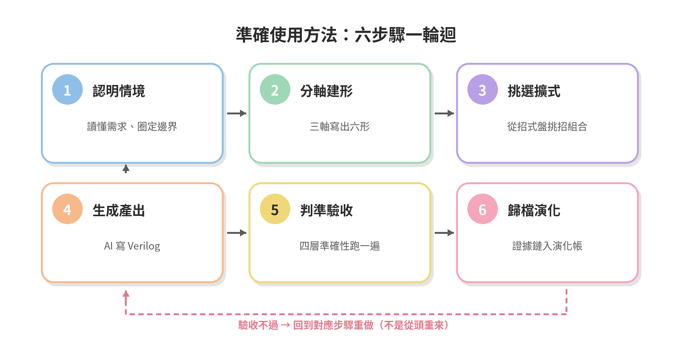

**圖 4-1　六步驟一輪迴：驗收不過，回到對應步驟**

## 4.1　步一・認明情境：框架四步驟拿來認需求

拿到需求的第一件事不是寫 code，是認明情境——用框架四步驟把需求雜訊整理成維度。分辨異同：需求句兩兩對照，先分得出「這個不是那個」；觸發抽象：當新的差異跟既有維度對不上（對照失敗），才動抽象；命名維度：把同性質的差異圈起來取名；判斷歸屬：每條需求掛進對得上的維度，對不上才開新維度。

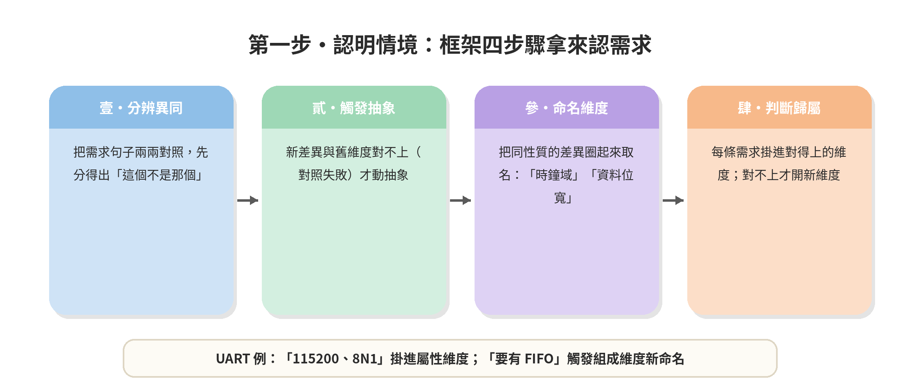

**圖 4-2　認明情境：框架四步驟的 UART 演練**

> **例　UART 需求句的認明結果**
>
> 「115200 bps、8N1」→ 對照失敗於資料格式維度 → 命名維度「幀格式」，掛進 [ ] 屬性。
>
> 「要有 FIFO 緩衝」→ 組成性差異 → 命名「緩衝深度」，掛進 { } BOM 的 fifo 部件需求。
>
> 「單一 50 MHz 時鐘域」→ 容器宣告 → 掛進 ( )，同時立下「不跨域」的反向判準。

## 4.2　步二・分軸建形，步三・挑選擴式

步二把認明的結果寫成六形初稿：三軸各就各位——[ ] 屬性軸收規格參數、{ } BOM 軸收模組組成、( ) 容器軸收時鐘與協定域，每口形附上 ∩(T)。步三從招式盤挑招：這不是玄學，是對著任務清單選函式——要拆解就用「解題」、要對照就用「分析」、要重用就用「設計模式」、要說理由就用「推理」、要突破框架就用「思考法」。挑完的招記進工作單，之後證據鏈要查。

**表 4-1　UART 專案的招式挑選單（節錄）**

| 任務 | 挑的招（時間本形） | 產出形 | 留下什麼證據 |
| --- | --- | --- | --- |
| 拆解功能需求 | 解題・分析 | SpecType | 需求維度表 |
| 決定模組邊界 | 設計模式（分而治之） | ModuleType | BOM 判準記錄 |
| 推導 baud 除數 | 推理・因果推理 | TimingType | 除數算式＋餘數取捨理由 |
| 選擇 FIFO 深度 | 推理・模擬推理 | ModuleType | 溢位模擬數據 |
| 跨域處理決策 | 思考法・第一性原理 | TimingType | 跨域清單＋同步器選型 |
| debug 電路取捨 | 分析＋remove 判準 | ModuleType | 非必要件清單 |

## 4.3　步四・生成產出：把形交給 AI

步四才輪到 AI 出場。生成的順序沿著形的依賴走：規格形→介面形→模組形→時序形→驗證形；每一口形用對應的提示詞段落交付（第五章 S1–S7）。生成時的鐵律有三條：一次只生成一口形、生成物必須自帶判準檢查、任何「AI 自己加的功能」必須標記待裁決——最後這條攔的是 LLM 的歸納慣例悄悄混進設計裡。

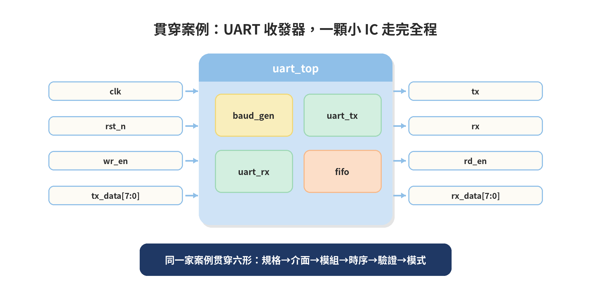

**圖 4-3　貫穿案例：uart_top 的模組形與介面形**

**表 4-2　六步驟 × UART 的產出對照**

| 步驟 | UART 的動作 | 產出 | 驗收點 |
| --- | --- | --- | --- |
| 一・認明情境 | 整理七條需求、立三個維度 | 需求維度表 | 無對照失敗殘留 |
| 二・分軸建形 | 寫出六形初稿＋∩(T) | 六形工作單 | 每形有判準 |
| 三・挑選擴式 | 挑六招、記工作單 | 招式清單 | 每招有任務對應 |
| 四・生成產出 | S1–S7 分段生成 | uart_tx／uart_rx RTL | 一次只生一口形 |
| 五・判準驗收 | 四層跑一遍 | 簽收單＋覆蓋率 | 交叉驗收雙軸過 |
| 六・歸檔演化 | 入演化帳、開缺口單 | 演化記錄 | 證據鏈無斷點 |

## 4.4　步五・判準驗收，步六・歸檔演化

步五把第三章的四層準確性完整跑一遍，並執行交叉驗收：靜態查形完備（六形齊、判準立、表記全），動態查招到位（調用有據、推理完整、記錄歸檔）。不過的處置只有三種：修 RTL、修 testbench、修判準——注意第三種：判準本身也會錯，但改判準必須回溯規格形重開版本，不能現場放水。

步六是大腦長大的關鍵：把這輪的判準簽收單、覆蓋率缺口、教訓與重構決議記入演化帳。時間本形的「持續學習、重構與重組、自我演化」三招全靠這本帳吃飯——下一個 UART 專案開工時，大腦先翻上一次的帳，坑不用踩第二次。

## 4.5　三層判斷：收件前的最後防線

每一份產出收件前，用形邏輯的三層判斷掃一遍：第一層容器判斷——它待在對的 ( ) 裡嗎？（時鐘域、協定域對不對）；第二層 BOM 結構依存判斷——它與 { } 裡的部件關係對不對？（remove 分級與依存鏈一致嗎）；第三層抽象規則判斷——它符合 ∩(T) 的開放規則嗎？（新需求掛對了維度嗎）。三層全過，才准進演化帳。

> **本章重點**
>
> 六步驟是 SOP：認明情境→分軸建形→挑選擴式→生成產出→判準驗收→歸檔演化。
>
> 框架四步驟認需求、招式盤挑方法、形依賴定生成順序；AI 一次只生一口形。
>
> 驗收不過回對應步驟；收件前跑三層判斷：容器、BOM、抽象。

# 第五章　AI 編寫 Verilog：準確用法手冊


**章節意象・波形與招式**

本章是整條產線的實作章：AI 編寫 Verilog Code 的準確用法。原則在第三章已立好——分段生成、逐段驗收、證據成鏈；這裡把它變成可以直接複製的操作：S1–S7 七段提示詞流水線、UART 的完整模組、testbench 與常見錯誤對照。全部程式碼以 Verilog/SystemVerilog 撰寫，可直接送模擬器。

## 5.1　七段提示詞流水線 S1–S7

S1–S7 是六步驟在提示詞層的投影：每段只做一件事、每段都有交件判準。要 AI「直接寫出完整的 UART」多半得到一份不敢用的 code；用七段流水線，每段的輸出都是下一段的輸入，也都是可驗收的中間產出。

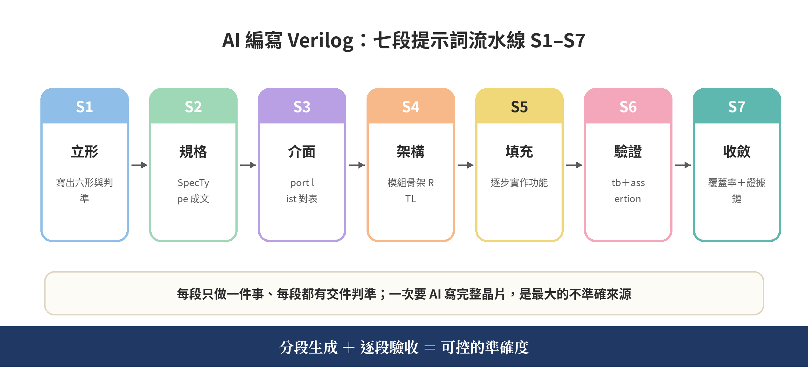

**圖 5-1　S1–S7 七段流水線：每段一形、每段一判準**

**表 5-1　S1–S7 提示詞要點與產出形**

| 段 | 名稱 | 提示詞要點（下給 AI 的指令） | 產出形 |
| --- | --- | --- | --- |
| S1 | 立形 | 「列出本案六形與每口形的交集判準，不要寫程式碼」 | 六形工作單 |
| S2 | 規格 | 「依需求句寫出 SpecType，每句附驗收度量」 | 規格形 |
| S3 | 介面 | 「依規格形定 port 清單：名稱、位寬、方向、時鐘域」 | InterfaceType |
| S4 | 架構 | 「依介面形給模組骨架：區塊劃分、狀態機、驅動關係，先不填功能」 | ModuleType 骨架 |
| S5 | 填充 | 「逐區塊實作功能，一次一個 always 區塊，保留骨架結構」 | 完整 RTL |
| S6 | 驗證 | 「依 ∩(T) 寫 self-checking testbench 與 assertion」 | VerifyType |
| S7 | 收斂 | 「跑覆蓋率、列出缺口、整理證據鏈摘要」 | 簽收包 |

> **例　S1 的實際提示詞（直接可用）**
>
> 「以下是一個 UART 收發器的需求：115200 bps、8N1、50 MHz 單時鐘域、16-byte FIFO。
>
> 請先不要寫程式碼。用本形學的六種產出形列出本案的工作單：每口形寫出括號表記與
>
> 交集判準 ∩(T)，並用 remove 判準為 BOM 部件定級。輸出為 Markdown 表格。」

## 5.2　規格形到介面形：UART 的形

S2–S3 的產出先立形再寫碼。規格形在第四章已認明；這裡把它落成介面形的 port 契約表——這張表是 S4 骨架的唯一依據，AI 不准自己增減訊號。

**表 5-2　uart_top 介面形：port 契約表**

| 訊號 | 方向 | 位寬 | 容器歸屬 | 語義 |
| --- | --- | --- | --- | --- |
| clk | in | 1 | 50 MHz 時鐘域 | 全域時鐘 |
| rst_n | in | 1 | 重置域 | 低態有效、非同步釋放 |
| tx_data | in | 8 | 50 MHz 時鐘域 | 傳送資料（tx_busy=0 時有效） |
| tx_start | in | 1 | 50 MHz 時鐘域 | 傳送啟動脈波 |
| tx | out | 1 | 序列埠 | 序列輸出（閒置高） |
| tx_busy | out | 1 | 50 MHz 時鐘域 | 傳送中旗標 |
| rx | in | 1 | 序列埠 | 序列輸入（閒置高） |
| rx_data | out | 8 | 50 MHz 時鐘域 | 接收資料 |
| rx_valid | out | 1 | 50 MHz 時鐘域 | 接收完成脈波 |

## 5.3　模組形：uart_tx 與 uart_rx

S4–S5 的成果：兩份可直接模擬的 Verilog。骨架先立（baud 產生器、移位暫存器、位元計數器三個區塊），再逐區塊填充——你看到的 code 就是照這個順序生成的。注意每個 always 區塊只做一件事、每個暫存器只有一處驅動：這是骨架層就鎖死的紀律，不靠 AI 自覺。

**程式 5-1　uart_tx.v——傳送器（8N1，完整模組）**

```verilog
// uart_tx.v — UART 傳送器：1 起始位元 ＋ 8 資料位元 ＋ 1 停止位元
module uart_tx #(
    parameter CLK_FREQ = 50_000_000,
    parameter BAUD     = 115_200
)(
    input  wire       clk,
    input  wire       rst_n,
    input  wire [7:0] tx_data,
    input  wire       tx_start,
    output reg        tx,
    output reg        tx_busy
);
    localparam integer DIV = CLK_FREQ / BAUD; // 50e6/115200 = 434
 
    reg [15:0] baud_cnt;
    reg        baud_tick;
    reg [3:0]  bit_idx;
    reg [9:0]  shift_reg;   // {stop, data[7:0], start}
 
    // 除頻器：每一位元一個 baud_tick（時序形的動態投影）
    always @(posedge clk or negedge rst_n) begin
        if (!rst_n) begin
            baud_cnt  <= 16'd0;
            baud_tick <= 1'b0;
        end else if (baud_cnt == DIV - 1) begin
            baud_cnt  <= 16'd0;
            baud_tick <= 1'b1;
        end else begin
            baud_cnt  <= baud_cnt + 16'd1;
            baud_tick <= 1'b0;
        end
    end
 
    // 傳送控制：載入後依 baud_tick 逐位元移出
    always @(posedge clk or negedge rst_n) begin
        if (!rst_n) begin
            tx        <= 1'b1;
            tx_busy   <= 1'b0;
            bit_idx   <= 4'd0;
            shift_reg <= 10'd0;
        end else if (!tx_busy) begin
            if (tx_start) begin
                shift_reg <= {1'b1, tx_data, 1'b0}; // stop＋data＋start
                tx_busy   <= 1'b1;
                bit_idx   <= 4'd0;
            end
        end else if (baud_tick) begin
            tx        <= shift_reg[0];
            shift_reg <= {1'b1, shift_reg[9:1]};
            if (bit_idx == 4'd9) tx_busy <= 1'b0; // stop 送完
            else                 bit_idx <= bit_idx + 4'd1;
        end
    end
endmodule
```

**程式 5-2　uart_rx.v——接收器（中點取樣，完整模組）**

```verilog
// uart_rx.v — UART 接收器：偵測起始位元後，於每位元中點取樣
module uart_rx #(
    parameter CLK_FREQ = 50_000_000,
    parameter BAUD     = 115_200
)(
    input  wire       clk,
    input  wire       rst_n,
    input  wire       rx,
    output reg  [7:0] rx_data,
    output reg        rx_valid
);
    localparam integer DIV = CLK_FREQ / BAUD;
 
    // 雙正反器同步（容器 ( ) 的邊界橋）
    reg rx_ff1, rx_ff2, rx_sync;
    always @(posedge clk or negedge rst_n) begin
        if (!rst_n) begin
            rx_ff1 <= 1'b1; rx_ff2 <= 1'b1; rx_sync <= 1'b1;
        end else begin
            rx_ff1 <= rx; rx_ff2 <= rx_ff1; rx_sync <= rx_ff2;
        end
    end
 
    reg [15:0] baud_cnt;
    reg [3:0]  bit_idx;
    reg        busy;
    reg [7:0]  shift_reg;
 
    always @(posedge clk or negedge rst_n) begin
        if (!rst_n) begin
            baud_cnt <= 16'd0; bit_idx <= 4'd0; busy <= 1'b0;
            rx_data  <= 8'd0; rx_valid <= 1'b0; shift_reg <= 8'd0;
        end else begin
            rx_valid <= 1'b0;
            if (!busy) begin
                if (rx_sync == 1'b0) begin // 偵測起始位元
                    busy     <= 1'b1;
                    bit_idx  <= 4'd0;
                    baud_cnt <= DIV / 2;   // 半位元後抵中點
                end
            end else if (baud_cnt == DIV - 1) begin
                baud_cnt <= 16'd0;
                if (bit_idx == 4'd0) begin
                    if (rx_sync == 1'b1) busy <= 1'b0; // 假起始，棄
                    else                 bit_idx <= 4'd1;
                end else if (bit_idx <= 4'd8) begin
                    shift_reg <= {rx_sync, shift_reg[7:1]};
                    bit_idx   <= bit_idx + 4'd1;
                end else begin // stop bit 中點
                    busy <= 1'b0;
                    if (rx_sync == 1'b1) begin
                        rx_data  <= shift_reg;
                        rx_valid <= 1'b1;
                    end
                end
            end else begin
                baud_cnt <= baud_cnt + 16'd1;
            end
        end
    end
endmodule
```

## 5.4　時序形與驗證形：波形、testbench 與 assertion

有了 RTL，時序形把「動」寫死：一幀 ＝ 1 起始位元 ＋ 8 資料位元 ＋ 1 停止位元，baud_tick 定義每位元邊界，取樣點落在位元中點。驗證形則把判準變成可執行的東西——self-checking testbench 逐條對照 ∩(T)，assertion 把時序契約寫在 code 裡。

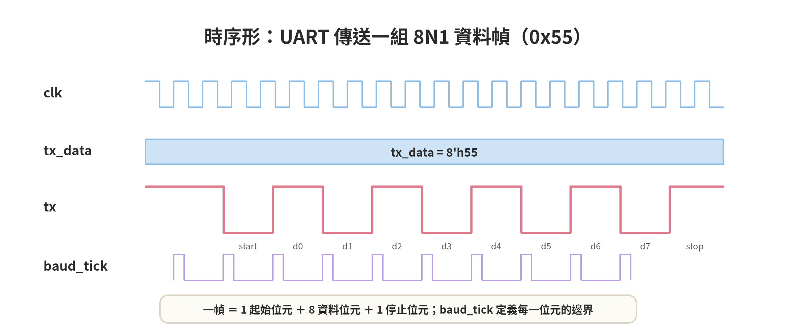

**圖 5-2　時序形：傳送 0x55 的一幀波形（8N1）**

**程式 5-3　tb_uart_tx.sv——self-checking testbench（節錄）**

```verilog
`timescale 1ns/1ps
module tb_uart_tx;
    reg        clk = 1'b0, rst_n = 1'b0, tx_start = 1'b0;
    reg  [7:0] tx_data = 8'h00;
    wire       tx, tx_busy;
 
    // 除數縮小加速模擬：DIV = 10
    uart_tx #(.CLK_FREQ(1_000_000), .BAUD(100_000)) dut (
        .clk(clk), .rst_n(rst_n), .tx_data(tx_data),
        .tx_start(tx_start), .tx(tx), .tx_busy(tx_busy));
 
    always #500 clk = ~clk; // 1 MHz
 
    // 檢查器：依 ∩(TimingType) 逐位元對照
    task check_byte(input [7:0] exp);
        integer i;
        begin
            @(negedge tx);              // 起始位元
            #(5 * 10_000);              // 對齊位元中點
            for (i = 0; i < 8; i = i + 1) begin
                if (tx !== exp[i]) $fatal(1, "data bit %0d mismatch", i);
                #10_000;
            end
            if (tx !== 1'b1) $fatal(1, "stop bit mismatch");
        end
    endtask
 
    initial begin
        #20_000 rst_n = 1'b1;
        @(posedge clk); tx_data <= 8'h55; tx_start <= 1'b1;
        @(posedge clk); tx_start <= 1'b0;
        check_byte(8'h55);
        $display("PASS: 0x55 transmitted correctly");
        $finish;
    end
endmodule
```

**程式 5-4　時序契約的 assertion 範例（SystemVerilog）**

```verilog
// 驗證形：把 ∩(TimingType) 寫成可執行的契約
property p_idle_high;
    @(posedge clk) disable iff (!rst_n)
        !tx_busy |-> tx == 1'b1;          // 閒置時 tx 必為高
endproperty
a_idle_high: assert property (p_idle_high)
    else $error("tx idle level violation");
 
property p_busy_stable;
    @(posedge clk) disable iff (!rst_n)
        tx_busy && !tx_start |=> tx_busy || !tx_busy; // 僅由狀態機改變
endproperty
```

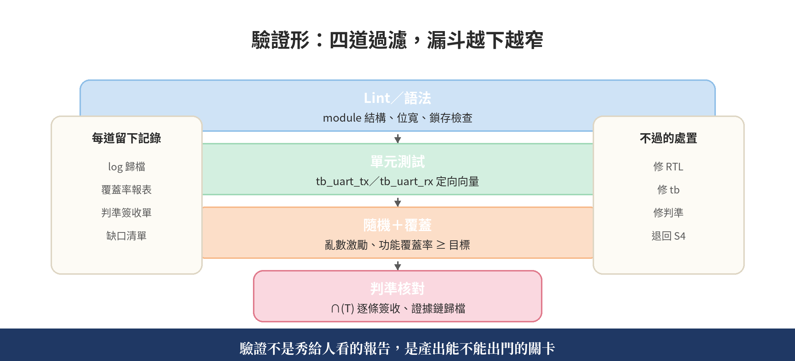

**圖 5-3　驗證形：四道過濾的驗證漏斗**

## 5.5　常見錯誤與修正對照

最後把 AI 寫 Verilog 最常見的五種不準確攤開來對照。它們全部是「形的錯」——介面形沒鎖、時序形沒立、判準後補——而不是語法錯；語法錯 compiler 會抓，形的錯只有四層準確性抓得住。

**表 5-3　AI 編寫 Verilog 常見錯誤對照**

| 症狀 | 形的診斷 | 修正 |
| --- | --- | --- |
| AI 自己加了沒人要的訊號 | 介面形沒鎖：port 契約未先行 | S3 先立契約表，生成時不准增減 |
| 位寬 7:0 寫成 8:0 | ∩(T) 未檢查：介面判準缺位 | 契約表自動比對＋lint 零警告收件 |
| always 區塊驅動同一暫存器兩次 | 骨架層失守：讓 LLM 自由發揮結構 | S4 骨架先行，逐區塊填充 |
| 非同步訊號直接進了比較器 | 容器 ( ) 沒立：跨域未宣告 | 跨域清單＋雙正反器同步器 |
| 跑過模擬就交件 | 驗證形缺 ∩(T)：目視驗證 | self-checking＋覆蓋率＋逐條簽收 |

> **本章重點**
>
> S1–S7 七段流水線：一次只生一口形、每段有判準、AI 不准自己加功能。
>
> uart_tx／uart_rx 完整模組＋self-checking testbench＋assertion 全部可直接模擬。
>
> AI 的不準確多半是形的錯不是語法錯；鎖介面、立骨架、前置判準。

# 第六章　誤用對照・檢查清單・成熟度


**章節意象・驗收的姿態**

方法交給你了，最後一章管「用對」。先看五種誤用——都是看起來有在用、其實沒有；再給一張十問清單，收件前逐條自問；最後是成熟度 L1–L4，讓團隊知道自己長到哪裡、下一步長哪裡。

## 6.1　誤用對照五種

誤用的共同特徵是「形變成了儀式」：括號有畫、判準有寫，但沒有人拿它做事。對照圖與下表把五種誤用一次講破。

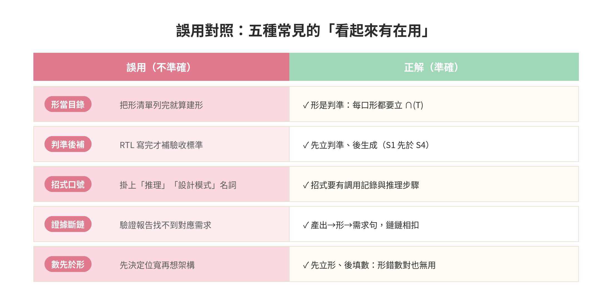

**圖 6-1　誤用對照：五種常見的「看起來有在用」**

**表 6-1　誤用對照與修正動作**

| 誤用 | 典型現場 | 修正動作 |
| --- | --- | --- |
| 形當目錄 | 六形列完就收工，判準欄空白 | 每口形強制填 ∩(T)，空白不准進流程 |
| 判準後補 | RTL 寫完才叫 AI「幫我想測試」 | S1 順序鎖死：判準產出在生成之前 |
| 招式口號 | 會議裡說「我們用第一性原理」，沒有推理記錄 | 招式調用必須留工作單與推理步驟 |
| 證據斷鏈 | 驗證報告漂亮，回溯不到需求 | 抽查證據鏈；斷者不收件 |
| 數先於形 | 先吵位寬 8 還是 16，再想架構 | 先立形後填數；數值爭議回 [ ] 屬性裁決 |

## 6.2　十問檢查清單

**表 6-2　收件前十問（任一「否」＝退回）**

| # | 收件前問自己 | 證據在哪 |
| --- | --- | --- |
| 1 | 每口產出形都立了 ∩(T) 嗎？ | 六形工作單 |
| 2 | 判準是在生成之前立的嗎？ | 簽收單日期 |
| 3 | 介面契約表鎖定了嗎？ | port 契約表 |
| 4 | BOM 判準與 remove 分級寫了嗎？ | BOM 清單 |
| 5 | 跨域訊號都有同步橋嗎？ | 跨域清單 |
| 6 | 每個 always 區塊只做一件事嗎？ | 骨架文件 |
| 7 | testbench 是 self-checking 嗎？ | tb 原始碼 |
| 8 | 覆蓋率達標、缺口有處置嗎？ | 覆蓋率報表 |
| 9 | 招式調用與推理步驟有記錄嗎？ | 工作單 |
| 10 | 證據鏈回溯得到需求句嗎？ | 鏈上抽查 |

## 6.3　成熟度 L1–L4

成熟度不是考評，是導航。L1 形語彙：全組說同一套形語言，六形會寫不會判；L2 形判準：每口形立得出 ∩(T)，判準會立不會追；L3 形證據鏈：產出可回溯、可審計，但靠人推；L4 自我演化：演化帳驅動重構與探索，大腦自己長大。L1→L2 是方法問題，L2→L3 是紀律問題，L3→L4 才是真正的設計大腦。

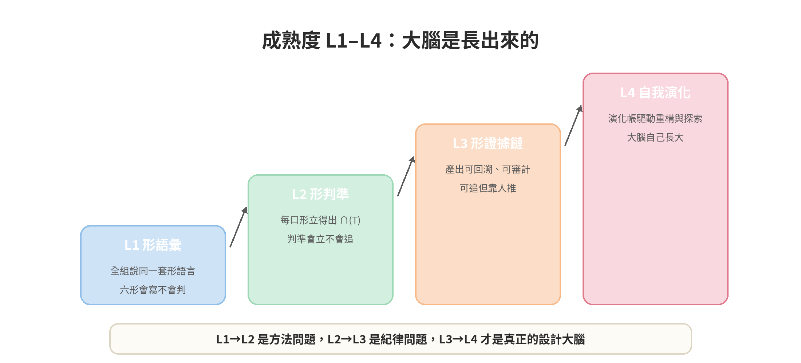

**圖 6-2　成熟度階梯：L1 形語彙 → L4 自我演化**

**表 6-3　成熟度 L1–L4 與升級動作**

| 等級 | 達標樣子 | 卡關警訊 | 升級動作 |
| --- | --- | --- | --- |
| L1 形語彙 | 文件裡六形名稱統一 | 同一名詞三種解讀 | 辦一次形語彙對齊工作坊 |
| L2 形判準 | 每口形有 ∩(T) 且有人簽收 | 判準寫了沒人用 | 判準簽收制：無簽收不生成 |
| L3 形證據鏈 | 抽查三段 RTL 全部可回溯 | 回溯靠打電話問人 | 演化帳＋鏈上抽查例行化 |
| L4 自我演化 | 新專案自動帶出舊教訓 | 坑踩第二次 | 招式盤×演化帳閉環 |

> **本章重點**
>
> 五種誤用都是形變儀式：形當目錄、判準後補、招式口號、證據斷鏈、數先於形。
>
> 十問清單任一「否」即退回；成熟度 L1→L4 是方法、紀律、閉環三場升級。

# 回顧：一句話帶走整本書

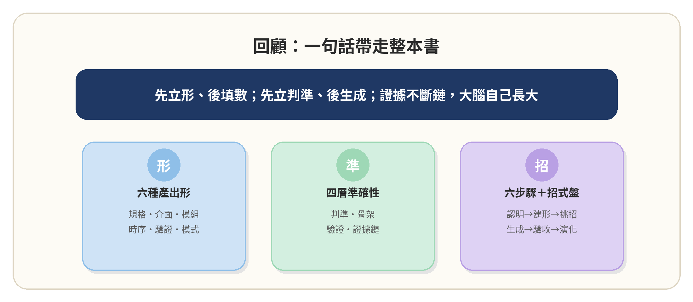

**圖 R-1　回顧一頁圖**

R-1　形是這套方法的原子。六種產出形——規格、介面、模組、時序、驗證、模式——把 IC 設計的產出立成有身份、有判準、有關聯的形；三括號表記與 ∩(T) 判準讓「準確」變成可以寫在紙上的東西。

R-2　準確性是四層長出來的。∩(T) 判準先行、演繹骨架約束生成、形式驗證把關、形證據鏈溯源——四層缺一層就漏一種錯。驗收看雙軸：空間看形完備、時間看招到位。

R-3　用法是六步驟＋S1–S7。認明情境、分軸建形、挑選擴式、生成產出、判準驗收、歸檔演化；AI 一次只生一口形，證據不斷鏈。長到 L4，大腦自己會長大。

> **先立形、後填數；先立判準、後生成；證據不斷鏈，大腦自己長大**

# 附錄 A　速查表

## A.1　術語・記號速查

**表 A-1　術語速查（形 ＝ Type）**

| 術語 | 英文 | 一句話定義 |
| --- | --- | --- |
| 形 | Type | 立得判準、撐得起推理的結構 |
| 規格形 | SpecType | 可度量、可裁決的規格結構 |
| 介面形 | InterfaceType | 模組對外的 port 契約 |
| 模組形 | ModuleType | 以 BOM 結構描述的組成形 |
| 時序形 | TimingType | 時鐘、幀時序與跨域的動態形 |
| 驗證形 | VerifyType | 把判準變成可執行檢查的形 |
| 模式形 | PatternType | 帶判準與坑位的可重用設計模式 |
| 交集判準 | ∩(T) | 判斷新成員屬不屬於的開放規則 |
| 身份錨 | id(C) | 容器身份的不變性依據 |
| remove 判準 | remove(p, M) | 移除部件看同一性，分三級 |
| 招式盤 | Motion Set | 時間本形十四招：函式＝方法＝招式 |
| 演化帳 | EvolutionLog | 教訓、重構與缺口的累積帳 |
| 形證據鏈 | Type Trace | 產出回溯到形與需求的證據鏈 |

## A.2　時間本形招式盤 × IC 產線用途

**表 A-2　十四招一覽：本書用到的招式與落點**

| 招式（時間本形） | IC 產線的落點 | 本書章節 |
| --- | --- | --- |
| 形時間函式搜尋 | 在形倉庫搜尋既有規格與 RTL | 4.3、5.1 |
| 設計搜尋與萃取 | 從舊案萃取可重用模式 | 2.5 |
| 設計模式 | 握手、跨域 FIFO、除頻器等模式調用 | 2.5、4.2 |
| 邏輯生成與應用 | 判準的演繹與裁決 | 3.1 |
| 函式生成與應用 | 把重複流程封成提示詞函式 | 5.1 |
| 持續學習 | 演化帳的日常記帳 | 4.4 |
| 重構與重組 | 模組化、管線化改造（id(C) 保障） | 4.4 |
| 解題 | 需求拆解與問題分析 | 4.1 |
| 分析 | 對照比較、remove 反事實分析 | 4.2、5.5 |
| 設計（創造與創新） | 架構設計與取捨 | 4.3 |
| 推理 | 因果・果因・模擬・統計・逆向推理 | 3.1、4.2 |
| 思考法 | 正向・逆向・水準・垂直・第一性原理 | 4.2 |
| 研發與探索 | 新架構 PoC 與替代方案評估 | 3.4 |
| 自我演化 | 成熟度 L4：演化帳驅動大腦長大 | 6.3 |

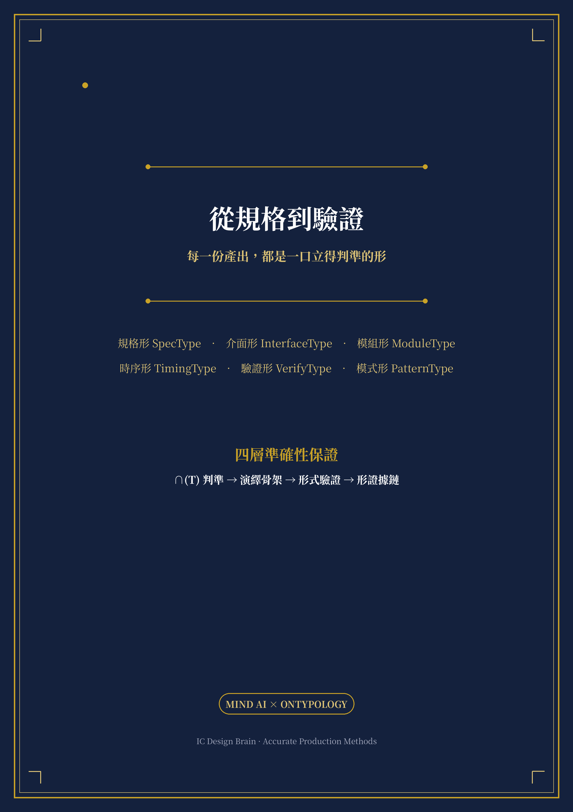
