# IC設計大腦

Type-Driven Design Flow ｜ SpecType · InterfaceType · ModuleType · TimingType · VerifyType · PatternType

文 件 定 位

《IC 設計大腦》：它不解釋理論本身，而是給出一套可照做的準確使用方法——如何在 Mind AI 平台上，把空間本形與時間本形完整運用在 IC 設計流程，從規格一路走到通過驗證的 Verilog RTL。

> 本書的四條使用契約 契約一｜理論不重述　本形學（空間本形、時間本形）與 Mind AI 的理論本體不在本書範圍；書中所有術語皆作為「已知的操作語彙」直接使用。 契約二｜產出以 RTL 為準　本書交付物為 Verilog/SystemVerilog 程式碼與型化證據；系統實作（平台程式、工具鏈開發）不在範圍。 契約三｜譯名規約　「形」的英文一律用 Type，不用 Form：SpecType／InterfaceType／ModuleType／TimingType／VerifyType／PatternType。 契約四｜全程以形說話　任何產出都必須能命名為某個形、附上 ∩(T) 判準、並留下形證據；說不出形的產出視為未完成。

> 「準確」的定義 本書所稱的準確使用，同時滿足四個條件： ① 判準可判定　每個形都有 ∩(T) 交集判準，新設計可被「判入／判出」，不靠感覺。 ② 過程可回溯　從規格到 RTL 的每個決策都能沿演繹骨架回溯到源頭判準。 ③ 產出可驗證　每份 RTL 皆有對應驗證形與形覆蓋率 TypeCov，證據可重現。 ④ 經驗可沉澱　每次專案的模式與誤用都回填形庫，下一次從形庫出發而非從零開始。

目　錄

第一章　文件定位與使用契約	6

1.1　本書的角色：使用手冊＋完整方案	6

1.2　閱讀路徑：四種角色，四條路	6

1.3　範圍邊界：不說什麼、不寫什麼	7

1.4　術語規約：形 = Type	7

第二章　雙本形驅動的準確使用總覽	9

2.1　架構總覽：兩本形一支點	9

2.2　空間本形的七條運用準則	10

2.3　時間本形的七條運用準則	12

2.4　四層準確性保證	13

2.5　形驅動設計七步驟總覽	14

第三章　空間本形的運用準則：結構正確	16

3.1　形萃取：在規格文本中畫出邊界	16

3.2　屬性／屬性值與「表頭即形」	16

3.3　BOM／SOM 分解準則	17

3.4　X 軸抽象 × Y 軸分解	19

3.5　三括號形集合的運用	20

3.6　∩(T) 交集判準撰寫法	21

3.7　形庫 Type Library 的資料結構	22

第四章　時間本形的運用準則：過程正確	24

4.1　模式與節拍：時間本形在流程上的對位	24

4.2　形時間函式搜尋：設計的第一拍	24

4.3　設計模式 PatternType：模式先於程式碼	25

4.4　邏輯生成與應用：判準 → 骨架 → RTL	25

4.5　推理與思考法的設計決策對照	26

4.6　重構與重組：外在形不變的契約	26

4.7　持續學習與自我演化	27

第五章　七步驟準確使用手冊（S1–S7）	28

5.0　範本的使用總則	28

5.1　S1 規格形萃取（SpecType Extraction）	29

5.2　S2 介面形定義（InterfaceType Definition）	32

5.3　S3 模組形分解（ModuleType Decomposition）	35

5.4　S4 演繹骨架（Deductive Skeleton）	38

5.5　S5 時序形與 RTL 生成（TimingType & RTL Generation）	41

5.6　S6 驗證形建構（VerifyType Construction）	44

5.7　S7 形證據鏈與自我演化（Evidence & Evolution）	47

第六章　Verilog 產出範例：六模組 × 六形	50

6.1　程式碼與形的對應總覽	50

6.2　sync_fifo：ModuleType 的 BOM/SOM 樣板	52

6.3　uart_tx：TimingType 的狀態形切分	54

6.4　uart_rx：取樣的統計推理	56

6.5　spi_master：相位契約即介面形	59

6.6　i2c_master：開漏匯流排的四相位	62

6.7　timer：可程式化時間容器	66

6.8　驗證平台：VerifyType 的兩個樣板	68

第七章　準確性驗證與檢核體系	74

7.1　四層保證的操作化	74

7.2　形覆蓋率 TypeCov	75

7.3　形證據鏈的稽核要件	76

7.4　誤用對照總表	77

第八章　導入與運作	78

8.1　角色分工與協作節奏	78

8.2　提示詞範本的治理	78

8.3　形庫治理	79

8.4　成熟度演進：四級路線	79

附錄 A　提示詞範本總表（S1–S7）	80

附錄 B　檔案清單	81

附錄 C　術語對照表	82

附錄 D　檢核表總表	84

## 第一章　文件定位與使用契約

本章確立本書的角色、讀者與規則。它的功能類似一份契約書：先講清楚什麼在範圍內、什麼不在範圍內、以及「準確」兩個字的驗收標準，之後的每一章都在這份契約下運作。

### 1.1　本書的角色：使用手冊＋完整方案

本書同時承擔兩個角色。作為使用手冊，它給出可照做的程序：七個步驟各有操作程序、提示詞範本與檢核表，任何人拿到規格文件，都能沿著 S1–S7 走完一趟形驅動設計流程。作為完整方案，它說明這套方法的結構原理與治理機制：形庫如何建置、準確性如何保證、團隊如何協作、能力如何隨專案演化。

| 面向 | 使用手冊部分 | 方案部分 |

| --- | --- | --- |

| 給誰 | 第一線設計／驗證工程師 | 架構師、計畫主持人、平台管理者 |

| 讀法 | 隨查隨用：直接抄範本、照檢核表打勾 | 通讀：理解雙本形驅動的完整結構 |

| 章節 | 第五章（S1–S7）、第六章（Verilog）、附錄 A/D | 第二～四章、第七～八章 |

| 產出 | 提示詞輸出、RTL、驗證報告 | 形庫、檢核體系、成熟度路線 |

### 1.2　閱讀路徑：四種角色，四條路

| 角色 | 起點 | 必讀 | 主要產出 |

| --- | --- | --- | --- |

| 系統架構師 | 第二章 | 第三章、第四章、5.1–5.4 | SpecType／ModuleType／演繹骨架 |

| RTL 設計工程師 | 第五章 | 4.3、5.5、第六章 | Verilog RTL 與時序契約 |

| 驗證工程師 | 5.6 | 第七章、6.8 | testbench、TypeCov 報告、反例清單 |

| 計畫／平台管理者 | 第一章 | 第七章、第八章、附錄 | 形庫治理、檢核體系、成熟度計畫 |

### 1.3　範圍邊界：不說什麼、不寫什麼

▸ 不重述理論本體。空間本形的異同→分合→形、屬性/屬性值、BOM/SOM、框架四步驟、三括號與 ∩(T)，以及時間本形的搜尋、推理、設計模式、自我演化等學理內容，屬於理論文獻；本書只給「在 IC 設計裡怎麼用」。

▸ 不寫系統實作。Mind AI 平台的程式實作、工具鏈開發、介面整合程式碼不在本書範圍；本書的程式產出一律為 Verilog/SystemVerilog。

▸ 不以任何其他設計方法學為主軸。本書自成體系，以本形學為唯一理論基礎、以 Mind AI 為唯一平台底座，所有方法皆由此推導。

### 1.4　術語規約：形 = Type

本書的核心譯名規約只有一條，但必須被嚴格執行：「形」的英文是 Type，不是 Form。所有衍生術語依此展開，IC 領域的六種形如下表——這是全書的共同語言，後續章節不再另行定義。

| 形 | 英文 | 一句話職責 | 典型產出 |

| --- | --- | --- | --- |

| 規格形 | SpecType | 把需求收容成可判定的形 | SpecType 清單、屬性—屬性值表 |

| 介面形 | InterfaceType | 定義模組對外的訊號契約 | 訊號表（表頭即形） |

| 模組形 | ModuleType | 定義內部組成與依存 | BOM/SOM 結構表 |

| 時序形 | TimingType | 定義時間上的行為契約 | 狀態形、波形契約 |

| 驗證形 | VerifyType | 定義如何取證與判定 | testbench、TypeCov 覆蓋表 |

| 模式形 | PatternType | 沉澱可重複套用的編碼模式 | 形庫中的模式卡 |

> 譯名稽核 任何文件、提示詞、程式註解出現「Form 代指形」的用法，皆視為錯誤並須當場更正。類別、型別、類型等口語說法可以使用，但書面產出一律回歸 Type 術語體系。

## 第二章　雙本形驅動的準確使用總覽

本章給出全域地圖：空間本形與時間本形各自負責什麼、在哪裡交會、七個步驟如何串起全流程、以及「準確」由哪四層保證。之後的第三、四章把兩本形的運用拆細，第五章把七步驟做成手冊。

### 2.1　架構總覽：兩本形一支點

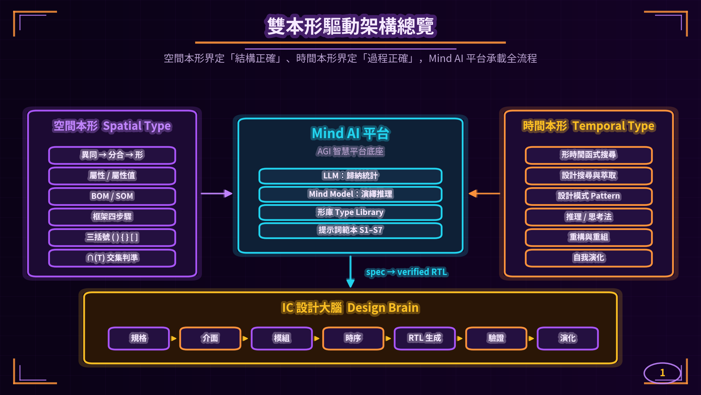

圖 2-1　雙本形驅動架構總覽：空間本形定義結構正確、時間本形定義過程正確、Mind AI 承載全流程

這張圖是全書的總骨架。左翼的空間本形負責「結構正確」：一個設計是不是由正確的部件組成、介面是不是完整、判準是不是可判定。右翼的時間本形負責「過程正確」：設計的每一步是不是走對的思維模式、推理是不是有來源、經驗是不是有沉澱。中央的 Mind AI 平台承載雙翼——LLM 承擔歸納統計的語言能力，Mind Model 承擔演繹推理的智慧能力，形庫保存兩翼共用的形。

| 維度 | 空間本形的貢獻 | 時間本形的貢獻 |

| --- | --- | --- |

| 回答的問題 | 「這個設計的結構對不對？」 | 「產生這個設計的過程對不對？」 |

| 錯誤的型態 | 部件遺漏、介面破洞、判準不可判定 | 跳步、無來源推理、經驗流失 |

| IC 操作語彙 | 屬性表、BOM/SOM、表頭即形、∩(T) | 搜尋萃取、設計模式、推理、重構、自我演化 |

| 對應的形 | SpecType／InterfaceType／ModuleType | TimingType／VerifyType／PatternType |

| 準確性層 | 第一層 ∩(T) 判準、第二層演繹骨架 | 第三層形式驗證、第四層形證據鏈 |

### 2.2　空間本形的七條運用準則

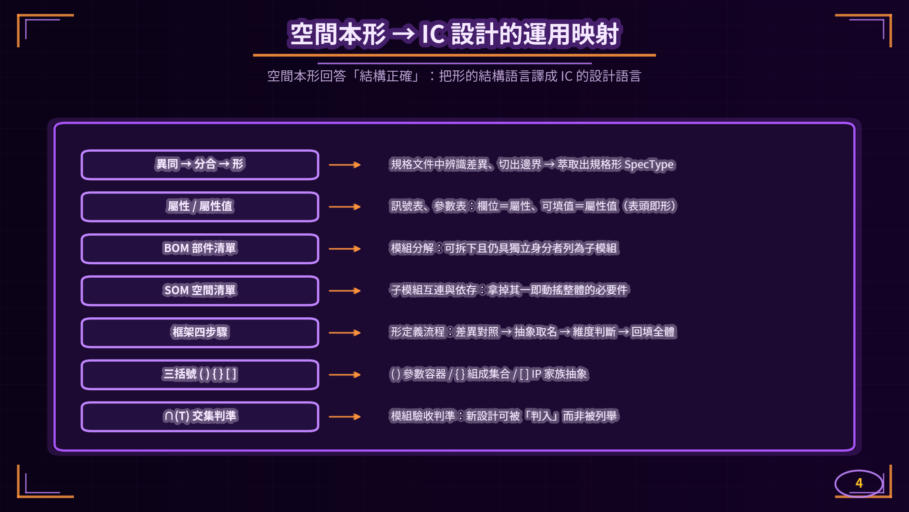

圖 2-2　空間本形 → IC 設計的運用映射

空間本形在 IC 設計裡的運用，可以收斂成七條準則。準則不是理論的重述，而是「當你做 X 時，照這樣做」的操作律：

| # | 準則 | 操作律 |

| --- | --- | --- |

| 1 | 異同→分合→形 | 拿規格逐句比對找差異（異同），把同性質的差異合為一組（合）、不同性質的切開（分），每組取名即得一個 SpecType（形必有名、有 ID）。 |

| 2 | 屬性／屬性值 | 訊號表的欄位＝屬性、可填的值＝屬性值；屬性一經抽出必須貫穿全部個體——任何一列有空白欄位，就是萃取未完成。 |

| 3 | BOM 部件清單 | 只列「拆下來之後還認得自己」的東西：能獨立辨識的子模組進 BOM；拆不下來的（時脈頻率、資料寬度）進屬性。 |

| 4 | SOM 空間清單 | BOM 加上依存與位置：標註哪些部件互相依存、拿掉哪個會動搖整體。必要件與選配件必須明示。 |

| 5 | 框架四步驟 | 形定義走完「分辨差異→對照失敗觸發抽象→取名分維度→新個體判維度」四步；開新維度時回頭為所有既有個體補值。 |

| 6 | 三括號形集合 | ( ) 給參數容器——身份不因參數值改變；{ } 給 SOM 組成——部件位置固定；[ ] 給抽象家族——由 ∩(T) 生成成員。 |

| 7 | ∩(T) 交集判準 | 每個形都附特徵集合 F(T) 與判準式：x 屬於 T ⟺ F(T) 的每個特徵都成立。成員由判準動態生成，不靠列舉。 |

### 2.3　時間本形的七條運用準則

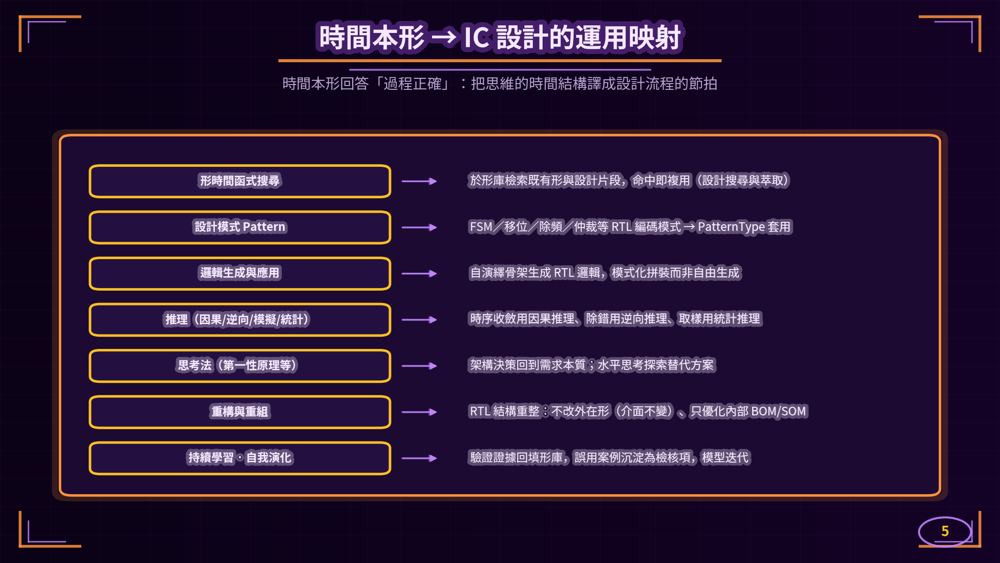

圖 2-3　時間本形 → IC 設計的運用映射

| # | 準則 | 操作律 |

| --- | --- | --- |

| 1 | 形時間函式搜尋 | 任何設計先搜尋形庫：以 ∩(T) 判準為查詢條件，命中即複用並記錄出處；未命中才允許新建——搜尋是設計的第一拍。 |

| 2 | 設計搜尋與萃取 | 從既有 RTL、波形、驗證報告萃取模式時，萃取的是「模式形 PatternType」而非程式碼片段——片段無判準，模式有。 |

| 3 | 設計模式 | RTL 生成一律以模式拼裝：FSM、移位、除頻、FIFO、仲裁、邊緣偵測等模式先於程式碼被選定，程式碼是模式的實體。 |

| 4 | 邏輯生成與應用 | 生成的順序固定為：判準→演繹骨架→RTL。禁止由規格直接跳到 RTL 的「自由生成」——那是無骨架的推理，無法回溯。 |

| 5 | 推理與思考法 | 時序收斂用因果推理、除錯用逆向推理、效能評估用模擬推理、取樣與覆蓋用統計推理、架構決策用第一性原理、替代方案用水平思考。 |

| 6 | 重構與重組 | 重構的契約是「外在形不變」：介面形與 ∩(T) 凍結，只動內部 BOM/SOM；動到外在形的，一律升級為形變更流程。 |

| 7 | 持續學習與自我演化 | 每個專案結案必做三件事：模式入庫、誤用入檢核表、判準修訂——形庫的版本就是團隊智慧的版本。 |

### 2.4　四層準確性保證

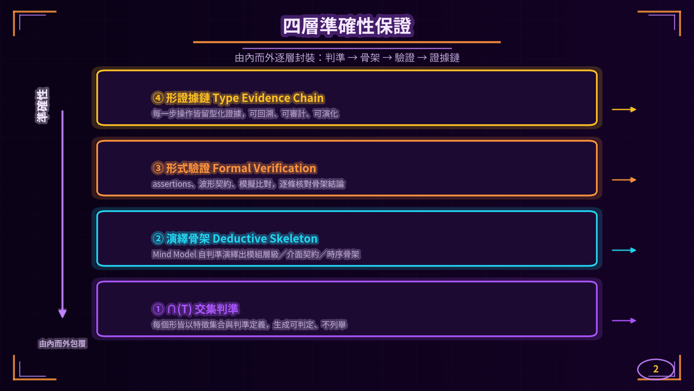

圖 2-4　四層準確性保證：由內而外逐層封裝

「準確」不是一種願望，而是四層可稽核的機制。每層各有把關的問題、對應的工具與失敗的處置：

| 層 | 把關問題 | 機制 | 失敗處置 |

| --- | --- | --- | --- |

| ① ∩(T) 判準 | 這個設計算不算這個形？ | 特徵集合逐項判定，可判入也可判出 | 判出即拒收，退回重做形定義 |

| ② 演繹骨架 | 這個結論從哪裡來？ | 自判準演繹出結構，每步附推導鏈 | 無來源的結論一律刪除 |

| ③ 形式驗證 | 波形真的符合契約嗎？ | assertion、模擬比對、契約波形核對 | 反例入清單，修到反例清空 |

| ④ 形證據鏈 | 這件事做過了嗎？做得可信嗎？ | 每步操作留型化證據，可回溯審計 | 證據斷裂＝未完成，不得入庫 |

> 四層的使用順序 四層不是事後檢查清單，而是嵌在流程裡的順序：寫需求時先寫判準（一），推導結構時留下來源（二），生成 RTL 後做驗證（三），全程留證（四）。越早的層越便宜——第一層的一句判準，勝過第三層的三天除錯。

### 2.5　形驅動設計七步驟總覽

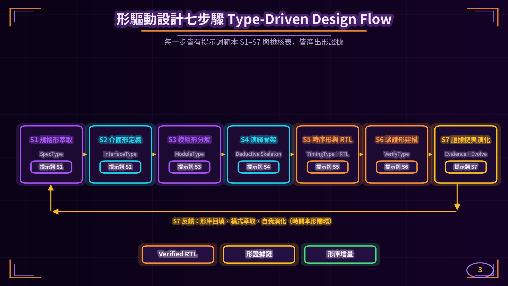

圖 2-5　Type-Driven Design Flow 七步驟與 S7 反饋閉環

七步驟是本書的主線。每一步都具備五個要素：輸入、動作、輸出、提示詞範本（S1–S7）、檢核表。步驟之間以「形」交接——上一步的輸出形就是下一步的輸入形，因此任何一步都可以獨立驗收、獨立重跑。

| 步驟 | 名稱 | 主要的形 | 提示詞 | 核心輸出 |

| --- | --- | --- | --- | --- |

| S1 | 規格形萃取 | SpecType | S1 | SpecType 清單、屬性—屬性值表 |

| S2 | 介面形定義 | InterfaceType | S2 | 訊號表、介面 ∩(T) |

| S3 | 模組形分解 | ModuleType | S3 | BOM/SOM 結構表 |

| S4 | 演繹骨架 | （骨架文件） | S4 | 演繹骨架、契約表 |

| S5 | 時序形與 RTL 生成 | TimingType、PatternType | S5 | Verilog RTL、波形契約 |

| S6 | 驗證形建構 | VerifyType | S6 | testbench、TypeCov 報告 |

| S7 | 證據鏈與自我演化 | （形庫增量） | S7 | 形證據鏈、形庫版本 |

注意七步驟的閉環：S7 的輸出回填形庫後，成為下一輪 S1 的「既有形庫索引」與 S5 的模式來源。這正是時間本形的自我演化在流程上的樣子——設計一次專案，形庫長大一輪。

## 第三章　空間本形的運用準則：結構正確

本章把空間本形的每一項工具，翻譯成 IC 設計現場的操作法。每節都採同一格式：運用要點、操作程序、判斷對照。讀者不需要回頭查理論——需要的語彙都在這裡被「用」出來。

### 3.1　形萃取：在規格文本中畫出邊界

運用要點：規格書不是形，規格書裡的「差異」才是形的原料。

萃取的動作序列固定為四拍。第一拍辨異同：逐句比對規格文字，把「不一樣的地方」標記出來——兩個介面協定不同、兩種操作模式不同、兩個時脈域不同，都是異同。第二拍做分合：把同性質的差異合為一組（合），不同性質的切開（分）——寬度的差異跟協定的差異不是同一回事，必須分組。第三拍命名成形：每組差異取一個形名、編一個形 ID，寫下它的 ∩(T)。第四拍回填全體：形一旦成立，回頭為所有已出現的個體在這個形上補值——這是最多人偷懶的一步，也是結構完整的關鍵。

| 判斷對照 | 錯誤做法 | 正確做法 |

| --- | --- | --- |

| 差異分組 | 把所有差異堆成一張大清單 | 按差異性質分組；對照失敗才開新組 |

| 命名 | 形名含糊（「那個模式」） | 形必有名有 ID，名可讀、ID 可索引 |

| 回填 | 只有新規格有值、舊個體留白 | 新形一經成立，全體回填 |

| 收斂 | 無限開新形 | 差異能對上既有維度就只加屬性值 |

### 3.2　屬性／屬性值與「表頭即形」

運用要點：訊號表不是文件格式，訊號表就是介面的形本身——表頭是形，資料列是實體。

這條對應帶來兩個直接的設計規則。第一，欄位必須貫穿全部個體：同一張表所有列共用同一套欄位，不允許某些案例多一欄、某些少一欄——維度能貫穿，才能互相比較。第二，兩種變動不對稱：新增一列（新增一個案例）輕巧，形不動；新增一欄（開新維度）沉重，形變大、所有既有列都要補值。設計評審時，看到「順手加一欄」的提案要停下來問：這是新個體，還是新維度？

| 信號表欄位（形） | 屬性值範圍（實體填值） | 說明 |

| --- | --- | --- |

| signal_name | clk / rst_n / data_in … | 屬性「名稱」的值 |

| direction | input / output / inout | 屬性「方向」的值 |

| width | 1 / 8 / [DATA_WIDTH-1:0] | 屬性「寬度」的值 |

| domain | sys_clk / spi_clk / async | 屬性「時脈域」的值 |

| reset_value | 0 / 1 / X | 屬性「復位值」的值 |

### 3.3　BOM／SOM 分解準則

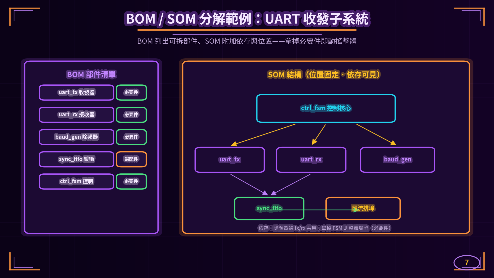

圖 3-1　BOM/SOM 分解範例：UART 收發子系統

運用要點：一條判準分三類——「拆下來之後，它還認得自己嗎？」

這條判準把模組的元素精確切成三類。拆下來仍具獨立身分、可被辨識者，進 BOM 當子模組。拆不下來、只能描述「這個東西是什麼樣子」者，進屬性（時脈頻率、資料寬度、FIFO 深度都是屬性，不是部件）。既非部件又非屬性的第三類——可以被替換而不改變模組身份的內容物——放進 ( ) 參數容器。BOM 只列清單，SOM 再疊上依存：標註哪些部件互相依存、哪些是必要件（拿掉整體塌陷）、哪些是選配件（拿掉只損功能不失身份）。

| 元素 | 三類判定 | 歸屬 | 例 |

| --- | --- | --- | --- |

| uart_tx 收發器 | 拆下來仍認得自己 | BOM 部件（必要件） | 可獨立實例化、可獨立驗證 |

| sync_fifo 緩衝 | 拆下來仍認得自己 | BOM 部件（選配件） | 拿掉後模組仍在，功能降級 |

| 時脈頻率 50MHz | 拆不下來 | 屬性 | 描述模組的樣子 |

| CLKS_PER_BIT 參數 | 可替換內容物 | ( ) 參數容器 | 換值不換身份 |

### 3.4　X 軸抽象 × Y 軸分解

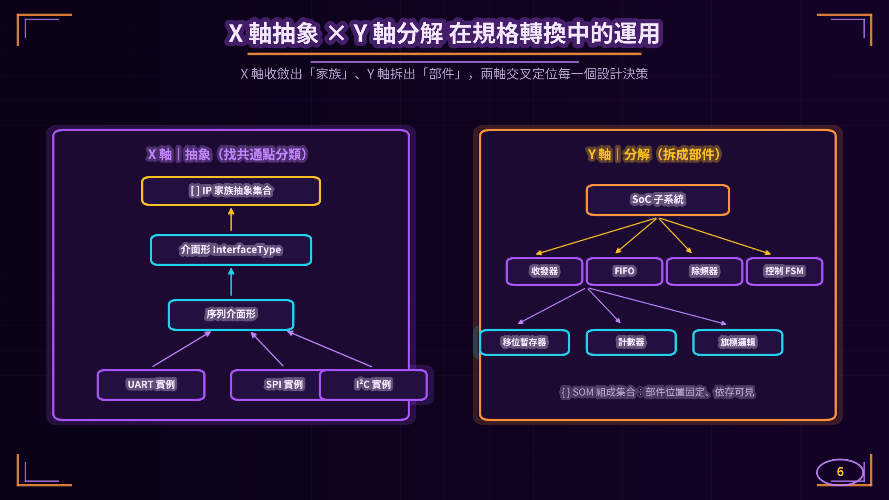

圖 3-2　X 軸抽象與 Y 軸分解在規格轉換中的運用

兩軸回答兩個不同的問題。X 軸問「它跟什麼是同一類」——往上收斂成家族，最後形成 [ ] 抽象集合：例如 UART、SPI、I²C 同屬序列介面形家族。Y 軸問「它由什麼組成」——往下拆成部件，最後形成 { } 組成集合。兩軸交叉才能定位每一個設計決策：只用 X 軸，知道它「是什麼」但不知道「怎麼長的」；只用 Y 軸，知道「怎麼長的」但不知道「跟誰同類」。設計評審的標準提問因此是雙軸的：「它的家族判準是什麼？（X）它的必要件是什麼？（Y）」

> 雙軸檢查的時機 S2 介面形定義時以 X 軸為主——把新介面掛進既有家族，家族判準比對不上時才立新家族；S3 模組形分解時以 Y 軸為主——把模組拆到可獨立驗證的最小部件。任何一個只做了單軸的設計，檢核表直接不通過。

### 3.5　三括號形集合的運用

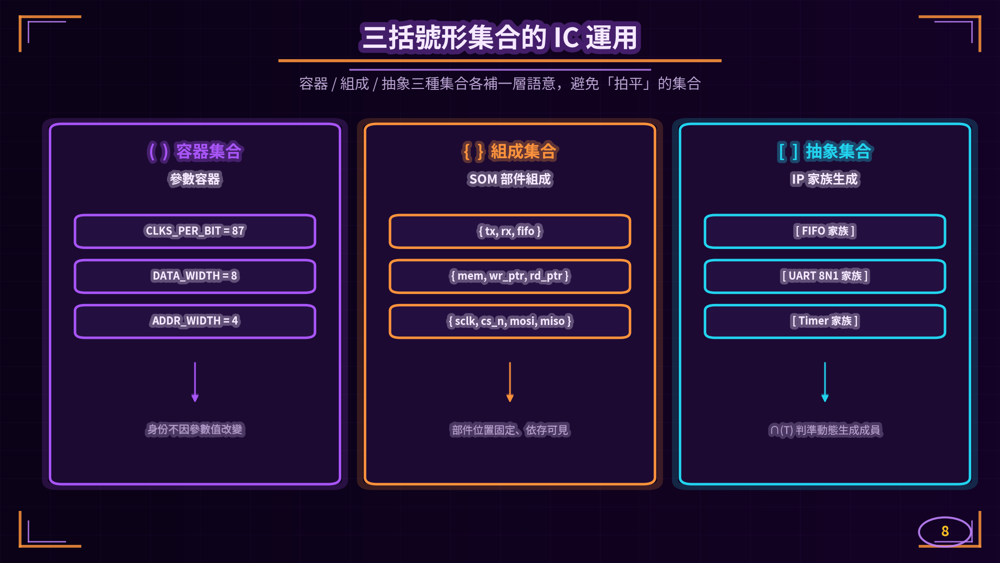

圖 3-3　三括號形集合在 IC 設計中的運用

三括號不是記號裝飾，而是三種不同的集合語意，混用會把層次拍平。( ) 容器集合用在參數與配置：模組換了一組參數值仍然是同一個形——容器的身份不因內容物改變。{ } 組成集合用在 SOM：部件的位置固定、依存可見，寫法上連順序都有意義。[ ] 抽象集合用在 IP 家族：成員不由列舉決定，而是由 ∩(T) 判準動態生成——未來的新成員只要通過判準就自動屬於家族。

| 括號 | 補上的語意 | IC 用法 | 錯誤混用 |

| --- | --- | --- | --- |

| ( ) | 身份獨立性 | 參數容器、可替換配置 | 把參數值不同當成不同模組 |

| { } | 元素間組成結構 | BOM/SOM、介面集合 | 把 {a,b,c} 當無序清單隨意增刪 |

| [ ] | 特徵交集生成規則 | IP 家族、模式庫 | 用清單列舉家族成員、寫死數量 |

### 3.6　∩(T) 交集判準撰寫法

運用要點：判準是一條可以「判出」的規則；只能判入的清單不是判準。

一條合格的 ∩(T) 由三件東西組成：特徵集合 F(T)——列出構成這個形的特徵 f1…fn；判準式——x 屬於 T 若且唯若 F(T) 的每個特徵在 x 上都成立；開放性聲明——成員由判準生成，歡迎新成員。撰寫時的實務格式建議寫成可勾選的特徵表，每條特徵必須可觀察或可推導，不得寫「設計良好」這種不可判定的形容詞。

| 項目 | 壞判準 | 好判準 |

| --- | --- | --- |

| 可判定性 | 「一個高效的 FIFO」 | 「深度≥4、同時讀寫計數不偏移、full 時拒寫」 |

| 完備性 | 只列功能、漏掉時序 | 特徵覆蓋功能＋介面＋時序＋復位行為 |

| 開放性 | 「必須是以下三者之一」 | 「通過全部特徵者即為成員」 |

| 反例 | 從不思考判出的情況 | 明寫：同拍滿載寫入被拒——判出反例 |

### 3.7　形庫 Type Library 的資料結構

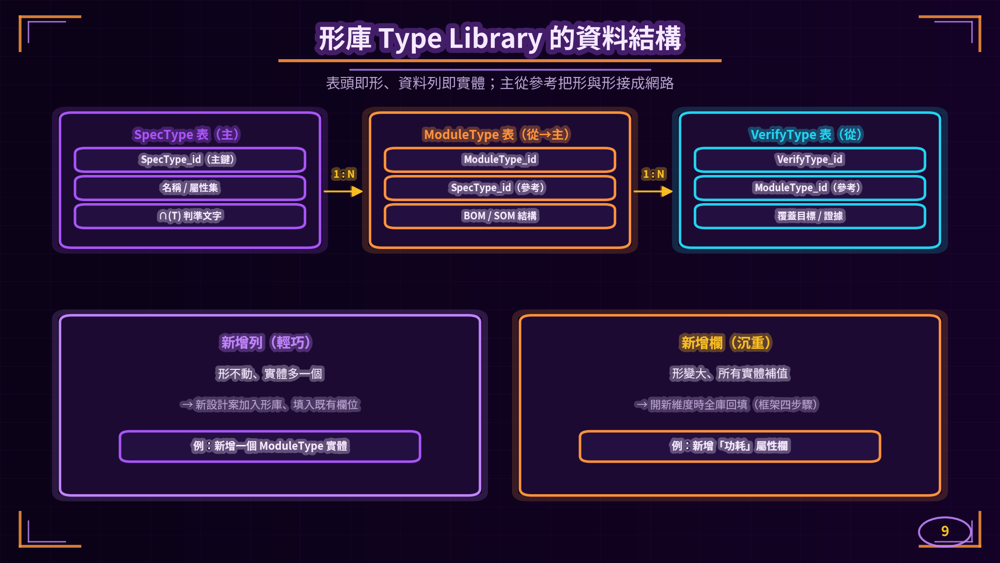

圖 3-4　形庫的資料結構：表頭即形、主從參考連網

形庫以「表頭即形」的方式建置：每張表的表頭就是一個形（欄位＝屬性），每一列就是一個被指認的實體（有自己的主鍵）。主鍵是實體身分的憑證——屬性可以修改，主鍵不能換，否則所有參考它的從表都會斷鏈。表與表之間以主從參考相連：ModuleType 表的 SpecType_id 欄位只做一件事——指向 SpecType 表的某個形，這就是「關聯」在形庫裡的樣子。

| 形庫四表 | 主鍵 | 關鍵從屬欄位 | 內容 |

| --- | --- | --- | --- |

| SpecType 表 | SpecType_id | — | 名稱、F(T) 特徵集、∩(T) 判準、來源規格 |

| ModuleType 表 | ModuleType_id | SpecType_id | BOM、SOM 依存、參數容器、必要/選配 |

| VerifyType 表 | VerifyType_id | ModuleType_id | 覆蓋目標、反例清單、證據連結 |

| PatternType 表 | PatternType_id | — | 模式卡、適用判準、已知誤用 |

> 新增列 vs 新增欄（形庫變更的不對稱） 新增一列＝形不動、實體多一個：某個新專案的 ModuleType 入庫，填入既有欄位即可，隨時可做。新增一欄＝形自己變大、所有實體都要補值：例如為所有 SpecType 增加「功耗預算」欄位，必須回填整個形庫。評審形庫變更提案時，先問是哪一種——把新增欄當新增列做，是形庫腐化的頭號原因。

## 第四章　時間本形的運用準則：過程正確

空間本形保證「長對結構」，時間本形保證「走對過程」。本章處理後者：設計的每一拍該做什麼思維動作、用什麼推理、什麼時候重構、怎麼讓經驗活下來。

### 4.1　模式與節拍：時間本形在流程上的對位

| 流程節拍 | 時間本形模式 | 思維動作 | 產出痕跡 |

| --- | --- | --- | --- |

| 立項／進案 | 形時間函式搜尋 | 在形庫檢索可複用的形 | 搜尋紀錄（查詢判準、命中/未命中） |

| 規格分析 | 解題·分析 | 因果推理拆解需求依存 | SpecType 萃取記錄 |

| 架構設計 | 設計·研發探索 | 第一性原理＋水平思考 | 方案比較表、選型紀錄 |

| 詳細設計 | 設計模式·邏輯生成 | 模式選定→骨架拼裝 | 模式卡引用、演繹骨架 |

| 驗證除錯 | 推理（逆向·模擬·統計） | 反例回溯、波形診斷 | 反例清單、診斷報告 |

| 結案 | 重構重組·持續學習·自我演化 | 模式萃取、檢核項沉淀 | 形庫新版本、檢核表更新 |

### 4.2　形時間函式搜尋：設計的第一拍

運用要點：以 ∩(T) 為查詢、不以名稱為查詢——找「長得像」而不是「名字像」。

搜尋的正確用法是帶著判準進形庫：把需求轉成特徵條件，逐條比對候選形的 ∩(T)。命中率不滿時有兩種處置——部分命中時複用並標註差異（記為「形的特化」），完全未命中時才允許新建，且新建紀錄必須附上「為何既有形不可用」的理由。搜尋與萃取是雙向的：進案時搜尋、結案時萃取，一來一往構成形庫的呼吸。

### 4.3　設計模式 PatternType：模式先於程式碼

時間本形的「設計模式」在 IC 落地為 RTL 編碼模式庫。生成任何一段 RTL 之前，先選模式；程式碼只是模式的實體化。下表是形庫中應當預置的最小模式集：

| 模式卡 | 適用判準 | 已知誤用 |

| --- | --- | --- |

| FSM 二段式 | 狀態少、輸出純組合 | 輸出含暫存路徑時誤用→輸出毛刺 |

| FSM 三段式 | 輸出需暫存、時序收斂 | 狀態少時過度使用→面積浪費 |

| 除頻器 | 由高頻生成低頻節拍 | 直接以計數器輸出當時脈→時脈偏斜 |

| 移位暫存器 | 序列化／反序列化 | 移位與計數分離失控→位元錯位 |

| 同步 FIFO | 跨模組緩衝、速率匹配 | 深度不覆蓋突發→溢位 |

| CDC 雙正反器 | 跨時脈域單訊號 | 多訊號分別同步→拜占庭失敗 |

| 邊緣偵測 | 脈波化、事件捕捉 | 用在非同步訊號→漏觸發 |

| 仲裁器 | 多請求單資源 | 無固定優先→飢餓 |

### 4.4　邏輯生成與應用：判準 → 骨架 → RTL

生成的順序是時間本形最強的紀律：先有 ∩(T)（空間本形的判準），由 Mind Model 演繹出骨架（模組層級、介面契約、時序骨架），骨架才准許生成 RTL。LLM 在此扮演歸納統計的角色——它負責把骨架與模式翻譯成程式碼的「語言表面」，而不負責決定「結構是什麼」。這個分工是準確性的核心：語言能力交給 LLM，智慧能力交給 Mind Model。

> 禁止自由生成 任何跳過骨架、由規格文本直接生成的 RTL，不論看起來多完整，都不得進入 S6——它無法回溯、無法驗收，出錯時也無法定位是規格錯、骨架錯還是程式錯。

### 4.5　推理與思考法的設計決策對照

| 推理／思考法 | IC 設計中的用途 | 實例 |

| --- | --- | --- |

| 因果推理 | 時序收斂、根因分析 | setup 違例→定位組合路徑的因 |

| 果因推理 | 由失敗波形倒推設計缺陷 | ACK 錯誤→倒推相位契約破口 |

| 逆向推理 | 除錯、驗證收斂 | 由 assertion 失敗回溯到骨架結論 |

| 模擬推理 | 效能/功耗預估 | 以代理指標預估吞吐上界 |

| 統計推理 | 取樣、覆蓋率、良率 | 三點多數決、隨機激勵覆蓋 |

| 第一性原理思考 | 架構決策 | 回到「為何需要此介面」重推方案 |

| 水平思考 | 替代方案探索 | 同功能換架構：串列 vs 並列 |

| 垂直思考 | 層級細化 | 系統→模組→RTL 逐層下鑽 |

### 4.6　重構與重組：外在形不變的契約

重構的定義在本書中是純粹的：介面形、∩(T)、時序契約全部凍結，只動內部的 BOM/SOM——合併狀態、重排管線、替換模式。契約的邊界很清楚：一旦發現「不動介面就改不下去」，就停止重構、啟動形變更流程（回 S2 重走）。這個規則讓重構永遠安全：驗證形不作廢，只是重新跑一次確認。

### 4.7　持續學習與自我演化

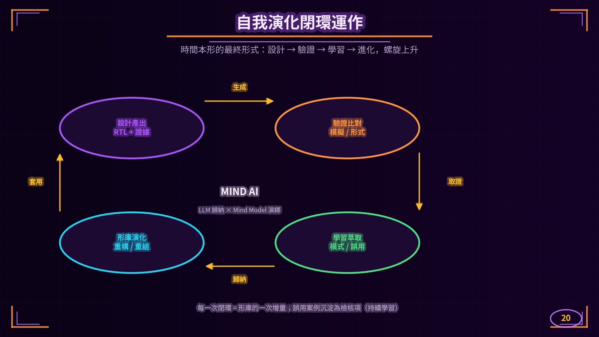

圖 4-1　自我演化閉環：設計 → 驗證 → 學習 → 形庫演化

自我演化不是神秘學，而是三件結案必做、且寫進檢核表的事。第一，模式萃取：本專案中重複出現兩次以上的程式結構，萃取成 PatternType 模式卡入庫。第二，誤用沉淀：本專案踩過的坑，寫成「已知誤用」欄位與檢核項——下次別人不必再踩。第三，判準修訂：驗證中發現判準不可判定或不完備的，修訂 ∩(T) 並記錄版本。三件事做完，才允許結案——這是時間本形「持續學習」在專案管理上的最小實踐。

## 第五章　七步驟準確使用手冊（S1–S7）

本章是全書的操作核心。七個步驟各分五個區塊：定位與本形運用、輸入/輸出/判準、操作程序、提示詞範本、檢核表與常見誤用。提示詞範本可直接貼入 Mind AI 平台使用；範本中的【】欄位依專案替換，其餘結構不建議更動——範本的結構本身就是準確性的一部分。

### 5.0　範本的使用總則

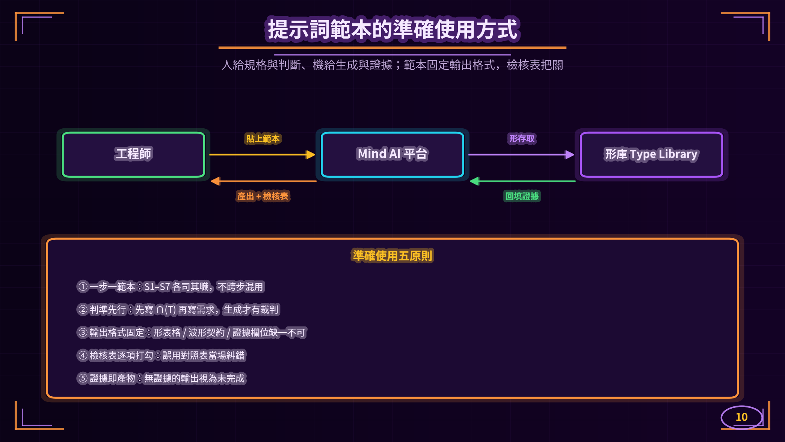

圖 5-1　提示詞範本的準確使用方式與人機分工

| 原則 | 內容 |

| --- | --- |

| 一步一範本 | S1–S7 各司其職；禁止把兩步的任務塞進同一則提示詞——混步的輸出無法驗收。 |

| 判準先行 | 任何範本都先要求輸出 ∩(T) 判準再談其他——生成有裁判，才有準確。 |

| 格式即契約 | 範本規定了輸出格式（形表格、證據欄位）；格式缺欄＝輸出不合格，退回重跑。 |

| 檢核表收尾 | 每次範本輸出後接續跑檢核表；打勾不是形式，是 S 驗收的證據。 |

| 證據即產物 | 無證據欄位的輸出視為未完成；證據欄位留空＝這一步還沒做。 |

### 5.1　S1 規格形萃取（SpecType Extraction）

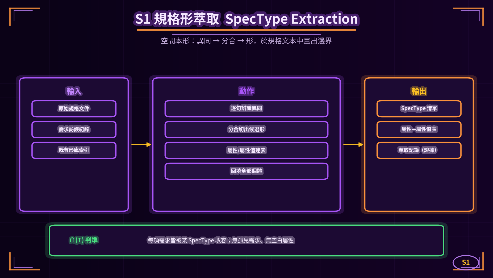

圖 5-2　S1 規格形萃取：輸入、動作、輸出與 ∩(T) 判準

定位與本形運用：空間本形的「異同→分合→形」在此落地——把規格文本的差異畫成形的邊界。

| 輸入 | 動作 | 輸出 | ∩(T) 判準 |

| --- | --- | --- | --- |

| 原始規格文件、需求訪談紀錄、既有形庫索引 | 逐句辨識異同 → 分合切出候選形 → 屬性/屬性值建表 → 回填全體個體 | SpecType 清單、屬性—屬性值表、萃取記錄 | 每項需求皆被某 SpecType 收容；無孤兒需求、無空白屬性 |

操作程序

▸ ① 將規格依「功能段落」切段，逐段標記所有可比較的差異點（異同）。

▸ ② 將差異點分組：同性質的合、不同性質的分；對照失敗才開新組（分合）。

▸ ③ 每組取形名、編形 ID，撰寫 F(T) 特徵集與 ∩(T) 判準（形必有名）。

▸ ④ 建立屬性—屬性值表：欄位＝屬性，逐個體填值；新屬性出現即回填全體。

▸ ⑤ 與形庫比對：已有同 ∩(T) 者標記複用，僅記差異；全新者標記新建。

▸ ⑥ 萃取記錄入證據欄：差異→組→形的推導鏈可回溯。

提示詞範本 S1

> S1 ．可直接貼入 Mind AI 使用 【角色】你是 IC 規格形萃取器，依據空間本形的「異同→分合→形」程序作業。 【輸入】 - 規格文件：【貼上規格全文或段落】 - 既有形庫索引（可空）：【貼上形名與 ∩(T) 摘要】 【任務】 1. 逐句辨識規格中的差異點，列出「異同清單」。 2. 將差異點按性質分組（同性質合、不同性質分；對照失敗才開新組）。 3. 每組命名為一個 SpecType，編號 ST-001 起，撰寫：    - F(T) 特徵集（每條特徵須可觀察或可推導）    - ∩(T) 判準式：x ∈ T ⟺ 所有特徵成立 4. 建立屬性—屬性值表：欄位為屬性，每一個體逐欄填值，禁止留白。 5. 對照形庫：∩(T) 相同者標記「複用」並記差異；否則標記「新建」並說明既有形不可用的理由。 【輸出格式】 A. 異同清單（差異點、性質、分組） B. SpecType 清單表（形ID、形名、F(T)、∩(T)、複用/新建） C. 屬性—屬性值表（全個體×全屬性） D. 萃取記錄：每條形的「差異→組→形」推導鏈 E. 證據欄：每項輸出皆填寫來源規格段落編號 【禁止事項】不得解釋理論；不得輸出無 ∩(T) 的形；不得留空白屬性；不得使用 Form 一詞代指形。

檢核表（S 驗收前逐項打勾）

| ✓ | 檢核項 | 不通過時的處置 |

| --- | --- | --- |

| □ | 異同清單涵蓋規格全部功能段落 | 補萃取，重跑 S1 |

| □ | 每個 SpecType 皆有 F(T) 與 ∩(T) 判準式 | 補判準，缺判準的形作廢 |

| □ | 屬性—屬性值表無任何空白欄位 | 回填；填不出＝萃取有漏 |

| □ | 與形庫比對完成（複用/新建皆有理由） | 補理由；無理由不得新建 |

| □ | 萃取記錄可回溯到規格段落編號 | 補來源標記 |

常見誤用與糾正

| 誤用 | 後果 | 糾正 |

| --- | --- | --- |

| 把規格章節直接當形 | 章節是文件結構不是認知邊界 | 回到差異點重新分組 |

| 一開始就追求形數量最少 | 過早合併把不同性質差異拍平 | 先分後合；對照失敗才合 |

| 屬性留白「之後再填」 | 結構漏洞長大後無法回填 | 當場回填全體個體 |

### 5.2　S2 介面形定義（InterfaceType Definition）

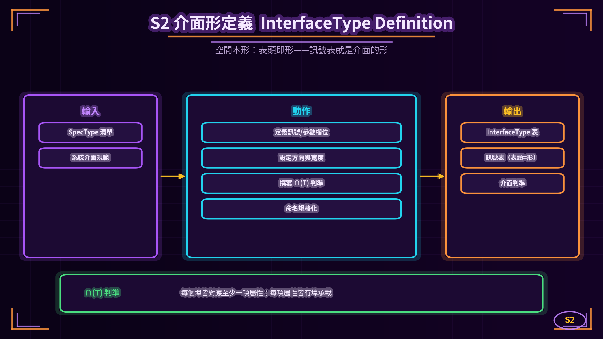

圖 5-3　S2 介面形定義：訊號表即介面的形

定位與本形運用：「表頭即形」——訊號表的欄位是屬性、每一列是具體介面實體；X 軸在此把新介面掛進家族。

| 輸入 | 動作 | 輸出 | ∩(T) 判準 |

| --- | --- | --- | --- |

| SpecType 清單、系統介面規範、既有介面家族 | 定義訊號/參數欄位 → 設定方向與寬度 → 撰寫介面判準 → 家族比對命名 | InterfaceType 訊號表、介面 ∩(T)、家族歸屬 | 每個埠皆對應至少一項 SpecType 屬性；每項對外屬性皆有埠承載 |

操作程序

▸ ① 由 SpecType 屬性表萃取「對外可見」的屬性，逐項決定承載它的訊號。

▸ ② 建立訊號表：signal_name / direction / width / domain / reset_value 五欄必填。

▸ ③ 撰寫介面 ∩(T)：協定型態、位元序、復位態、時脈域歸屬皆列為特徵。

▸ ④ X 軸家族比對：與既有介面家族判準比對，吻合則歸入並沿用命名慣例；不吻合才立新家族。

▸ ⑤ 參數進 ( ) 容器：寬度、深度等可替換值一律參數化，不寫死。

提示詞範本 S2

> S2 ．可直接貼入 Mind AI 使用 【角色】你是 IC 介面形定義器，依據「表頭即形」與 X 軸家族抽象作業。 【輸入】 - SpecType 清單（含屬性表）：【貼上 S1 產出】 - 系統介面規範摘要：【貼上】 - 既有介面家族（可空）：【家族名＋∩(T) 摘要】 【任務】 1. 萃取全部「對外可見」屬性，逐項決定承載訊號（每項屬性都要有埠，每個埠都要有來源屬性）。 2. 產出訊號表，欄位固定：signal_name / direction / width / domain / reset_value / 來源屬性ID。 3. 撰寫本介面的 ∩(T)：協定型態、位元序、復位態、時脈域、握手行為逐項列為特徵。 4. 與既有家族比對：吻合歸入家族（沿用命名慣例）；不吻合則立新家族並寫出分家理由。 5. 可替換值（寬度、深度、分頻比）一律進參數容器，標記為 ( ) 參數。 【輸出格式】 A. 訊號表（六欄全填） B. InterfaceType ∩(T) 判準表 C. 家族歸屬判定記錄（比對了誰、為何歸入/分家） D. 證據欄：每列訊號標註來源屬性 ID 【禁止事項】不得出現無來源屬性的埠；不得把參數寫死；不得使用 Form 一詞代指形。

檢核表（S 驗收前逐項打勾）

| ✓ | 檢核項 | 不通過時的處置 |

| --- | --- | --- |

| □ | 每個埠都標註來源 SpecType 屬性 ID | 補映射；無來源的埠刪除 |

| □ | 每項對外屬性都有埠承載 | 補埠或宣告該屬性為內部屬性 |

| □ | 訊號表五欄＋來源欄全填 | 補欄 |

| □ | 家族歸屬有比對記錄與理由 | 補比對記錄 |

| □ | 可替換值已參數化為 ( ) 容器 | 改參數化 |

常見誤用與糾正

| 誤用 | 後果 | 糾正 |

| --- | --- | --- |

| 把 reset_value、時脈頻率當部件 | 屬性與 BOM 混淆 | 用「拆得下來嗎」重判三類 |

| 為每個案例各定義一套訊號表 | 破壞「欄位貫穿全部個體」 | 合併為一張形表＋多列實體 |

| 以名稱相似認家族 | X 軸判準被名稱取代 | 以 ∩(T) 特徵比對認家族 |

### 5.3　S3 模組形分解（ModuleType Decomposition）

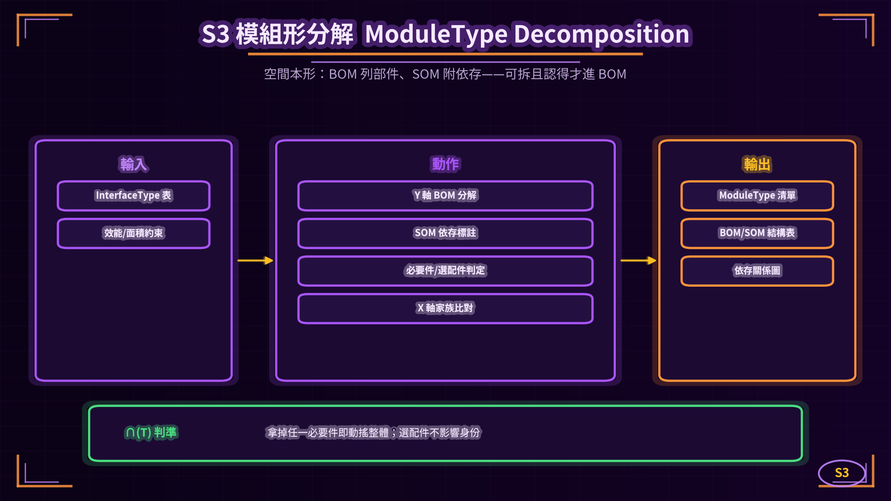

圖 5-4　S3 模組形分解：BOM 列部件、SOM 附依存

定位與本形運用：Y 軸分解＋BOM/SOM——「拆下來之後它還認得自己嗎」是唯一判準。

| 輸入 | 動作 | 輸出 | ∩(T) 判準 |

| --- | --- | --- | --- |

| InterfaceType 訊號表、效能/面積/功耗約束 | Y 軸 BOM 分解 → SOM 依存標註 → 必要/選配判定 → X 軸家族比對 | ModuleType 清單、BOM/SOM 結構表、依存關係圖 | 拿掉任一必要件即動搖整體；選配件不影響模組身份 |

操作程序

▸ ① 對整體模組做 Y 軸分解：逐層拆到「可獨立驗證的最小部件」為止。

▸ ② 三類判定：可拆且認得→BOM；拆不下→屬性；可替換→( ) 參數容器。

▸ ③ SOM 標註：部件間依存箭頭、拿掉後果、必要件/選配件。

▸ ④ X 軸比對：子模組優先複用形庫既有 ModuleType；相同 ∩(T) 直接實例化。

▸ ⑤ 產出 ModuleType 清單：每列一個模組形，主鍵 ModuleType_id，從屬 SpecType_id。

提示詞範本 S3

> S3 ．可直接貼入 Mind AI 使用 【角色】你是 IC 模組形分解器，依據 Y 軸分解與 BOM/SOM 判準作業。 【輸入】 - InterfaceType 訊號表與 ∩(T)：【貼上 S2 產出】 - 約束（效能/面積/功耗/時脈）：【貼上】 - 形庫既有 ModuleType（可空）：【形名＋∩(T) 摘要】 【任務】 1. Y 軸分解：把整體模組拆到「可獨立驗證的最小部件」，逐層列出。 2. 逐元素三類判定（拆下來還認得自己→BOM；拆不下來→屬性；可替換內容物→( ) 參數）。 3. SOM 標註：部件依存箭頭、拿掉後果、必要件/選配件。 4. X 軸比對：與形庫既有 ModuleType 比對 ∩(T)，可複用者標記並記差異。 5. 撰寫整體 ModuleType 的 ∩(T) 判準（含功能、介面、時序、復位特徵）。 【輸出格式】 A. 分解樹（層級＋三類判定） B. BOM 清單表（部件、必要/選配、判定理由） C. SOM 依存表（部件A、部件B、依存型態、拿掉後果） D. ModuleType 清單（模組ID、名稱、SpecType_id、∩(T)、複用/新建） E. 證據欄：每項判定對應「拆得下來嗎」的推論 【禁止事項】不得把屬性/參數列入 BOM；不得遺漏必要件判定；不得使用 Form 一詞代指形。

檢核表（S 驗收前逐項打勾）

| ✓ | 檢核項 | 不通過時的處置 |

| --- | --- | --- |

| □ | 分解終點皆達「可獨立驗證」粒度 | 續拆或說明為何停止 |

| □ | 三類判定全員覆蓋（無元素未分類） | 補判定 |

| □ | SOM 依存表含拿掉後果 | 補後果描述 |

| □ | 必要件/選配件判定與 ∩(T) 一致 | 修正判定 |

| □ | 子模組複用比對完成 | 補比對記錄 |

常見誤用與糾正

| 誤用 | 後果 | 糾正 |

| --- | --- | --- |

| 把參數值當成不同模組 | ( ) 容器身份獨立性被破壞 | 參數化，同一形多實體 |

| BOM 列到電晶體級 | 粒度失去「可獨立驗證」 | 回升到可驗證部件級 |

| SOM 只列清單不標依存 | 必要件風險不可見 | 補依存箭頭與後果 |

### 5.4　S4 演繹骨架（Deductive Skeleton）

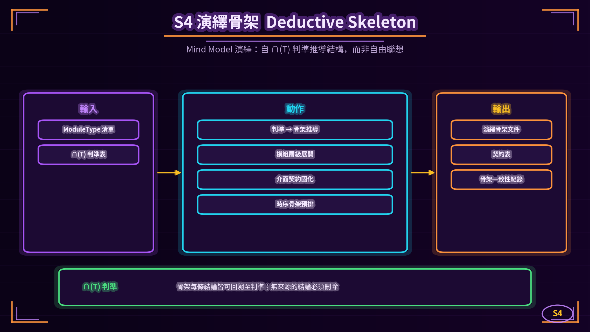

圖 5-5　S4 演繹骨架：自判準演繹，禁止自由聯想

定位與本形運用：Mind Model 演繹推理在此成形——骨架的每條結論都必須能回溯到 ∩(T) 判準。

| 輸入 | 動作 | 輸出 | ∩(T) 判準 |

| --- | --- | --- | --- |

| ModuleType 清單、各形 ∩(T) 判準表 | 判準→骨架推導 → 模組層級展開 → 介面契約固化 → 時序骨架預排 | 演繹骨架文件、契約表、骨架一致性紀錄 | 骨架每條結論皆可回溯至判準；無來源的結論必須刪除 |

操作程序

▸ ① 逐條取 ∩(T) 特徵，推導「要滿足它，結構上必須存在什麼」。

▸ ② 把推導結論組織為模組層級圖：每個節點對應一個 ModuleType，每條邊對應一份契約。

▸ ③ 固化介面契約：訊號、時序、復位、例外行為四項齊備。

▸ ④ 預排時序骨架：狀態形清單、時脈域劃分、關鍵時序路徑。

▸ ⑤ 一致性稽核：逐結論標註來源判準；標不出來源的當場刪除。

提示詞範本 S4

> S4 ．可直接貼入 Mind AI 使用 【角色】你是演繹骨架建構器，使用 Mind Model 演繹推理；每個結論都必須附來源判準。 【輸入】 - ModuleType 清單（含 BOM/SOM）：【貼上 S3 產出】 - 全部 ∩(T) 判準表：【貼上】 - 約束條件：【貼上】 【任務】 1. 對每條 ∩(T) 特徵執行演繹：「要滿足此特徵，結構上必須存在什麼？」列出必要結構結論。 2. 將全部結構結論整理為模組層級圖（節點＝ModuleType，邊＝契約）。 3. 固化每份契約的四要素：訊號、時序、復位、例外行為。 4. 預排時序骨架：狀態形清單、時脈域劃分、關鍵時序路徑。 5. 一致性稽核：逐結論標註來源判準編號；無來源結論直接刪除並列於「已刪除」清單。 【輸出格式】 A. 演繹紀錄表（判準ID → 推導 → 結論ID） B. 模組層級圖（文字描述：節點、邊、契約ID） C. 契約表（契約ID、訊號、時序、復位、例外） D. 時序骨架（狀態形、時脈域、關鍵路徑） E. 已刪除清單（無來源結論） 【禁止事項】不得自由生成未經演繹的結構；不得省略來源標註；不得使用 Form 一詞代指形。

檢核表（S 驗收前逐項打勾）

| ✓ | 檢核項 | 不通過時的處置 |

| --- | --- | --- |

| □ | 每條結論都有判準來源編號 | 補標註或刪除 |

| □ | 契約四要素齊備（訊號/時序/復位/例外） | 補契約 |

| □ | 模組層級圖與 BOM/SOM 一致 | 修正圖或分解 |

| □ | 已刪除清單存在且被審視 | 補稽核記錄 |

| □ | 時序骨架覆蓋全部時脈域 | 補劃分 |

常見誤用與糾正

| 誤用 | 後果 | 糾正 |

| --- | --- | --- |

| 跳過骨架直接寫 RTL | 無來源、無法回溯 | 停筆，回 S4 補骨架 |

| 骨架結論寫「依經驗」 | 經驗不是判準 | 改寫為可判定特徵或刪 |

| 契約只有訊號沒有時序 | 時序形缺位 | 補時序/復位/例外三項 |

### 5.5　S5 時序形與 RTL 生成（TimingType & RTL Generation）

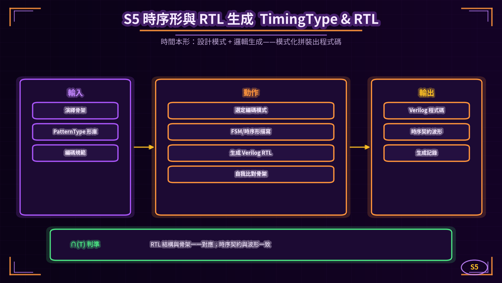

圖 5-6　S5 時序形與 RTL 生成：模式化拼裝

定位與本形運用：時間本形的「設計模式＋邏輯生成」——先選 PatternType 模式，再把骨架翻譯成 Verilog；LLM 負責語言表面，結構由骨架決定。

| 輸入 | 動作 | 輸出 | ∩(T) 判準 |

| --- | --- | --- | --- |

| 演繹骨架、契約表、PatternType 模式庫、編碼規範 | 選定編碼模式 → FSM/時序形描寫 → 生成 Verilog RTL → 自我比對骨架 | Verilog 程式碼、波形契約、生成記錄 | RTL 結構與骨架一一對應；時序契約與波形一致 |

操作程序

▸ ① 為每個 ModuleType 選定 PatternType 模式卡（FSM 型態、移位、除頻、FIFO…），記引用。

▸ ② 依時序骨架描寫狀態形：狀態名、轉移條件、輸出契約逐一列出。

▸ ③ 生成 Verilog RTL：埠與訊號表逐欄對應、註解標註形 ID 與模式 ID。

▸ ④ 自我比對：RTL 的模組層級 vs 骨架節點、RTL 契約 vs 契約表，逐項對齊。

▸ ⑤ 產出波形契約：關鍵訊號的期望波形文字化，交 S6 做驗證依據。

提示詞範本 S5

> S5 ．可直接貼入 Mind AI 使用 【角色】你是 RTL 生成器，依據「模式先於程式碼、骨架決定結構」的紀律作業。 【輸入】 - 演繹骨架與契約表：【貼上 S4 產出】 - PatternType 模式庫摘要：【貼上模式卡名稱＋適用判準】 - 編碼規範：【命名/復位極性/慣例】 【任務】 1. 為每個 ModuleType 選定 PatternType 模式（附模式ID與適用判準比對），禁止無模式生成。 2. 依時序骨架描寫全部狀態形：狀態名、轉移條件、每狀態輸出契約。 3. 生成 Verilog RTL（Verilog-2001 風格）：    - 埠與 InterfaceType 訊號表逐欄一致    - 註解標註形 ID（SpecType/ModuleType/TimingType）與模式 ID    - 參數一律 ( ) 參數化 4. 自我比對表：RTL 結構 vs 骨架節點逐一勾稽，差異逐項說明。 5. 產出波形契約：關鍵訊號的期望時序（邊界、間隔、相位）文字化。 【輸出格式】 A. 模式選定表（模組、模式ID、判準比對） B. 狀態形描寫表（狀態、轉移、輸出） C. Verilog 程式碼（完整可編譯） D. 骨架比對表 E. 波形契約 【禁止事項】不得跳過模式選定；不得產生與骨架不一致的結構；不得使用 Form 一詞代指形。

檢核表（S 驗收前逐項打勾）

| ✓ | 檢核項 | 不通過時的處置 |

| --- | --- | --- |

| □ | 每個模組都有模式選定記錄 | 補選定或回 S5 |

| □ | RTL 埠與訊號表逐欄一致 | 修正 |

| □ | 註解標齊形 ID 與模式 ID | 補註解 |

| □ | 骨架比對表全數勾稽 | 補比對 |

| □ | 波形契約已文字化 | 補契約 |

常見誤用與糾正

| 誤用 | 後果 | 糾正 |

| --- | --- | --- |

| 由規格直接生成 RTL | 自由生成、無骨架 | 回 S4 補骨架再生成 |

| 模式可有可無、憑手感寫 | 結構不可預測 | 先查模式庫選卡 |

| 參數寫死在程式碼 | ( ) 容器被拍平 | 參數化 |

### 5.6　S6 驗證形建構（VerifyType Construction）

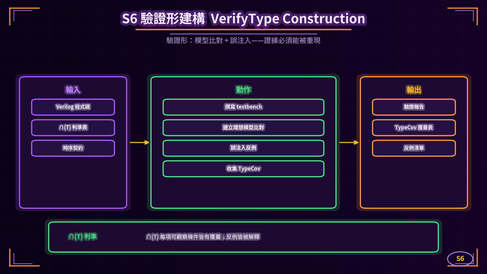

圖 5-7　S6 驗證形建構：模型比對、誤注入、覆蓋收集

定位與本形運用：驗證形以「理想模型比對＋誤注入」取證——TypeCov 的覆蓋目標直接對應 ∩(T) 的可觀察條件。

| 輸入 | 動作 | 輸出 | ∩(T) 判準 |

| --- | --- | --- | --- |

| Verilog RTL、∩(T) 判準表、波形契約 | 撰寫 testbench → 建立理想模型比對 → 誤注入反例 → 收集 TypeCov | 驗證報告、TypeCov 覆蓋表、反例清單 | ∩(T) 每項可觀察條件皆有覆蓋；反例皆被解釋 |

操作程序

▸ ① 把 ∩(T) 的可觀察條件逐條改寫為覆蓋目標——這是 TypeCov 的分子分母。

▸ ② 建立理想模型（scoreboard）：以行為級模型作為「形的影子」，逐筆比對。

▸ ③ 誤注入：至少覆蓋每條錯誤路徑一個反例（滿載、空載、break、NACK…）。

▸ ④ 收集 TypeCov：已驗證可觀察條件 ÷ 全部可觀察條件，未覆蓋項列明細。

▸ ⑤ 反例處置：每條反例標註根因（規格錯/骨架錯/RTL錯），修完重跑回歸。

提示詞範本 S6

> S6 ．可直接貼入 Mind AI 使用 【角色】你是驗證形建構器，依據「覆蓋目標＝∩(T) 可觀察條件」作業。 【輸入】 - Verilog RTL：【貼上 S5 產出】 - ∩(T) 判準表與波形契約：【貼上】 - 模擬環境參數（時脈、參數值）：【貼上】 【任務】 1. 將 ∩(T) 每條可觀察條件改寫為覆蓋目標，列成 TypeCov 清單（分子分母明確）。 2. 撰寫 SystemVerilog testbench：    - 建立理想模型（scoreboard/佇列）做逐筆比對    - 邊界值＋交替位元＋隨機激勵    - 誤注入：每條錯誤路徑至少一個反例 3. 自檢輸出：PASS/FAIL 統計、反例清單、TypeCov 覆蓋率。 4. 對每條 FAIL 標註根因分類（規格錯/骨架錯/RTL錯），並給修復建議。 【輸出格式】 A. TypeCov 清單（條件、可觀察點、覆蓋狀態） B. SystemVerilog testbench 程式碼（完整可編譯） C. 驗證報告（PASS/FAIL 統計） D. 反例清單（激勵、期望、實際、根因分類） 【禁止事項】不得只驗 happy path；不得省略理想模型比對；不得使用 Form 一詞代指形。

檢核表（S 驗收前逐項打勾）

| ✓ | 檢核項 | 不通過時的處置 |

| --- | --- | --- |

| □ | TypeCov 分母＝∩(T) 全部可觀察條件 | 重列覆蓋目標 |

| □ | 理想模型比對存在且逐筆運作 | 補 scoreboard |

| □ | 每條錯誤路徑都有誤注入反例 | 補反例 |

| □ | FAIL 項皆有根因分類 | 補根因分析 |

| □ | 回歸重跑全綠 | 修到全綠才進 S7 |

常見誤用與糾正

| 誤用 | 後果 | 糾正 |

| --- | --- | --- |

| 只跑 happy path | 錯誤路徑全是盲區 | 補誤注入 |

| testbench 直接抄 RTL 寫法 | 同構盲點，驗不出結構錯 | 用獨立行為模型比對 |

| 覆蓋率高就收工 | 覆蓋≠正確 | TypeCov＋反例解釋雙條件 |

### 5.7　S7 形證據鏈與自我演化（Evidence & Evolution）

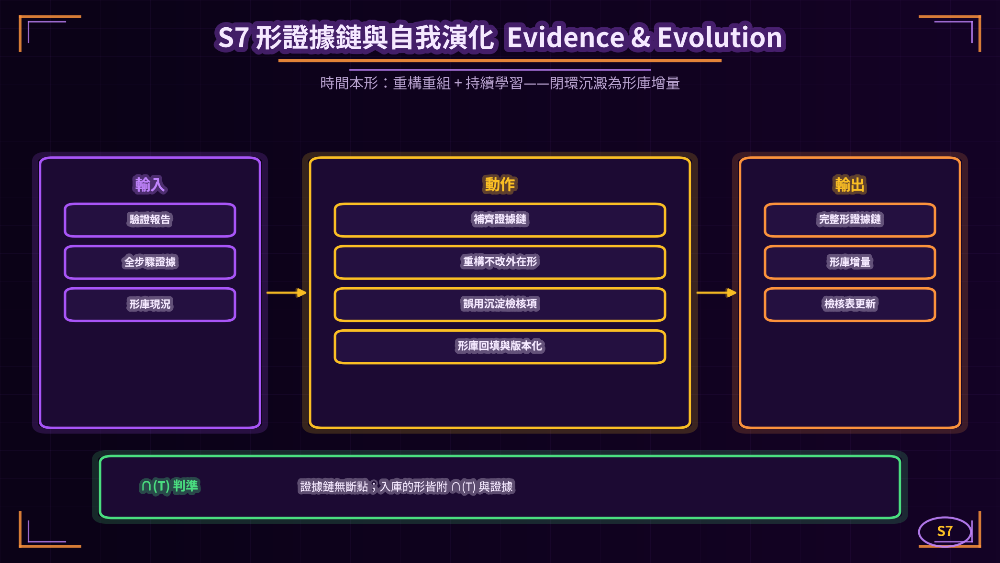

圖 5-8　S7 形證據鏈與自我演化：閉環沉澱

定位與本形運用：時間本形的「重構重組＋持續學習＋自我演化」——證據鏈補齊、形庫回填，本輪專案成為下一輪的起點。

| 輸入 | 動作 | 輸出 | ∩(T) 判準 |

| --- | --- | --- | --- |

| 驗證報告、全步驟證據、形庫現況 | 補齊證據鏈 → 重構不改外在形 → 誤用沉淀檢核項 → 形庫回填版本化 | 完整形證據鏈、形庫增量、檢核表更新 | 證據鏈無斷點；入庫的形皆附 ∩(T) 與證據 |

操作程序

▸ ① 串鏈：S1 萃取記錄→S2 訊號表→S3 BOM/SOM→S4 骨架→S5 RTL→S6 報告，逐環點名。

▸ ② 斷點處置：哪一環缺證據就補做哪一環，補不回的標記「經驗缺口」。

▸ ③ 重構檢查：若本專案有重構，確認介面形與 ∩(T) 未變動（變動者回 S2）。

▸ ④ 沉淀三件套：模式入 PatternType、誤用入檢核表、判準修訂入版本紀錄。

▸ ⑤ 形庫版本化：新版本號、變更摘要、入庫審核簽名，開放給下一輪 S1 搜尋。

提示詞範本 S7

> S7 ．可直接貼入 Mind AI 使用 【角色】你是形證據鏈稽核員與形庫管理員，依據「無證據＝未完成」作業。 【輸入】 - S1–S6 全部產出與證據：【貼上清單】 - 形庫現況（版本、四表摘要）：【貼上】 【任務】 1. 串鏈稽核：S1→S2→S3→S4→S5→S6 逐環列出證據要件，標記齊備/斷點。 2. 斷點處置建議：缺哪環補哪環；補不回者標記「經驗缺口」並列入風險。 3. 重構稽核：若曾重構，核對介面形與 ∩(T) 是否保持不變；變動者列回 S2 清單。 4. 沉淀三件套：    - 重複兩次以上的結構 → PatternType 模式卡草案    - 踩過的坑 → 檢核項（誤用→後果→糾正三欄）    - 判準修訂 → 版本紀錄（修了什麼、為何） 5. 形庫回填提案：入庫清單（含 ∩(T) 與證據連結）、新版本號、變更摘要。 【輸出格式】 A. 證據鏈稽核表（環、要件、狀態、處置） B. 經驗缺口清單 C. 重構稽核結果 D. 沉淀三件套草案 E. 形庫回填提案 【禁止事項】證據鏈斷點不得勾「完成」；入庫提案不得無 ∩(T)；不得使用 Form 一詞代指形。

檢核表（S 驗收前逐項打勾）

| ✓ | 檢核項 | 不通過時的處置 |

| --- | --- | --- |

| □ | 六環證據逐環點名完成 | 補稽核 |

| □ | 斷點全部處置或列缺口 | 補處置 |

| □ | 重構稽核確認外在形未變 | 變動者回 S2 |

| □ | 沉淀三件套齊備 | 補沉淀 |

| □ | 形庫回填提案含版本號與 ∩(T) | 補提案 |

常見誤用與糾正

| 誤用 | 後果 | 糾正 |

| --- | --- | --- |

| 證據散落各處不串鏈 | 回溯成本高、審計困難 | 建集中證據索引 |

| 把沒把握的產出照樣入庫 | 形庫污染 | 缺證據標缺口不入庫 |

| 沉淀只寫心得不寫檢核項 | 經驗無法被下一代執行 | 一律寫成可打勾檢核項 |

## 第六章　Verilog 產出範例：六模組 × 六形

本章是「產出以 RTL 為準」契約的兌現：六個可綜合的 Verilog 模組與兩份 SystemVerilog 驗證平台，全文收錄、另附壓縮檔。每支程式都標註它示範的形——閱讀時請把它當「形的實體」而非單純程式碼：註解中的形 ID、模式 ID 對應第五章的步驟產出，對照閱讀效益最高。

### 6.1　程式碼與形的對應總覽

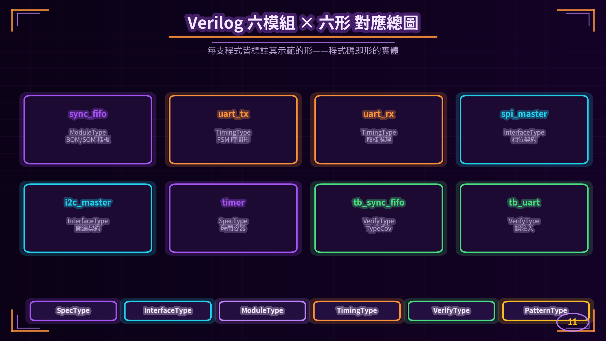

圖 6-1　Verilog 六模組 × 六形 對應總圖

| 檔案 | 形示範重點 | 對應步驟 | 驗收要點 |

| --- | --- | --- | --- |

| sync_fifo.v | ModuleType：BOM/SOM 樣板、( ) 參數容器 | S3/S5 | 同時讀寫計數不偏移、full 拒寫、empty 拒讀 |

| uart_tx.v | TimingType：FSM 四狀態形切分位元週期 | S5 | 8N1 幀格式、busy 契約 |

| uart_rx.v | TimingType：位元中點取樣＋三點多數決 | S5 | 假起始拒絕、幀誤碼旗標 |

| spi_master.v | InterfaceType：Mode 0 相位契約 | S5 | 上升緣取樣、下降緣驅動、8 時脈收束 |

| i2c_master.v | InterfaceType：開漏契約＋四相位 | S5 | SDA 僅於 SCL 低變動、ACK 取樣 |

| timer.v | SpecType：可程式化時間容器 | S5 | 單次不重複觸發、模式鎖存 |

| tb_sync_fifo.sv | VerifyType：理想模型比對＋TypeCov | S6 | 四類覆蓋目標全綠 |

| tb_uart.sv | VerifyType：環回＋誤注入反例 | S6 | break 反例、錯誤恢復 |

### 6.2　sync_fifo：ModuleType 的 BOM/SOM 樣板

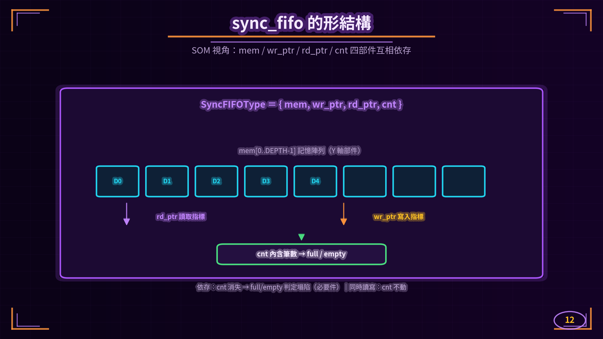

圖 6-2　sync_fifo 的形結構：四部件 SOM 依存

這支 FIFO 是 ModuleType 的教學樣板：BOM 是 mem / wr_ptr / rd_ptr / cnt 四個可拆部件；SOM 的依存表現在 cnt 支撐 full/empty 判定——拿掉它，整個模組的「身分行為」塌陷，這就是必要件的定義。DATA_WIDTH 與 ADDR_WIDTH 是 ( ) 參數容器：換值不換身份。

> sync_fifo.v //============================================================================ // 檔案：sync_fifo.v // 模組形（ModuleType）示範：BOM（部件清單）＋ SOM（部件依存結構） //   BOM：記憶陣列 mem、寫入指標 wr_ptr、讀取指標 rd_ptr、計數器 cnt //   SOM：cnt 與 wr_ptr/rd_ptr 互相依存；拿掉 cnt 則 full/empty 判定塌陷 // 空間容器視角：參數（DATA_WIDTH / ADDR_WIDTH）為容器內可替換內容物， //   模組身份（SyncFIFOType）不因參數值不同而改變。 // 交集判準 ∩(T)：可同步讀寫、先進先出、full/empty 旗標正確之物件， //   方可判入 SyncFIFOType。 //============================================================================ module sync_fifo #(     parameter DATA_WIDTH = 8,     parameter ADDR_WIDTH = 4            // 深度 = 2^ADDR_WIDTH )(     input  wire                    clk,     input  wire                    rst_n,     // 寫入埠     input  wire                    wr_en,     input  wire [DATA_WIDTH-1:0]   wr_data,     // 讀取埠     input  wire                    rd_en,     output wire [DATA_WIDTH-1:0]   rd_data,     // 狀態     output wire                    full,     output wire                    empty,     output wire [ADDR_WIDTH:0]     count );      localparam DEPTH = (1 << ADDR_WIDTH);      // ---- BOM 部件宣告 ----     reg [DATA_WIDTH-1:0] mem [0:DEPTH-1];   // 記憶陣列     reg [ADDR_WIDTH-1:0] wr_ptr;            // 寫入指標     reg [ADDR_WIDTH-1:0] rd_ptr;            // 讀取指標     reg [ADDR_WIDTH:0]   cnt;               // 內含筆數      // ---- 狀態連線（SOM 依存關係：cnt 支撐 full/empty 判定）----     assign count = cnt;     assign full  = (cnt == DEPTH);     assign empty = (cnt == 0);     assign rd_data = mem[rd_ptr];      // ---- 讀寫行為：同時讀寫時指標各自前進、cnt 不變 ----     wire do_wr = wr_en & ~full;     wire do_rd = rd_en & ~empty;      always @(posedge clk or negedge rst_n) begin         if (!rst_n) begin             wr_ptr <= {ADDR_WIDTH{1'b0}};             rd_ptr <= {ADDR_WIDTH{1'b0}};             cnt    <= {(ADDR_WIDTH+1){1'b0}};         end else begin             if (do_wr) begin                 mem[wr_ptr] <= wr_data;                 wr_ptr      <= wr_ptr + 1'b1;             end             if (do_rd) begin                 rd_ptr      <= rd_ptr + 1'b1;             end             // 計數更新（讀寫同時發生時相互抵銷）             case ({do_wr, do_rd})                 2'b10:   cnt <= cnt + 1'b1;                 2'b01:   cnt <= cnt - 1'b1;                 default: cnt <= cnt;             endcase         end     end  endmodule

### 6.3　uart_tx：TimingType 的狀態形切分

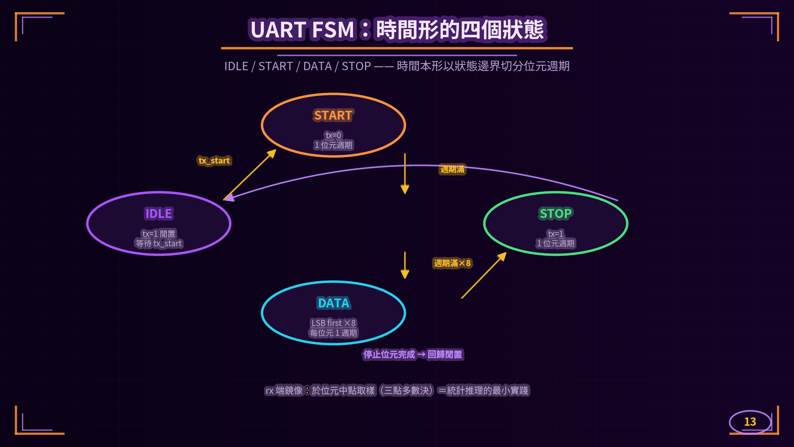

圖 6-3　UART FSM：IDLE / START / DATA / STOP 四個時間形

uart_tx 示範時間本形的最小實踐：時間被四個狀態形（IDLE/START/DATA/STOP）切分，每一位元週期是同一個「時間容器」的重複刻度（CLKS_PER_BIT），資料鎖存體現「身份不因外部變動而漂移」。模式上它是「FSM＋位元計數＋資料鎖存」三件套——形庫 PatternType 的標準卡。

> uart_tx.v //============================================================================ // 檔案：uart_tx.v // 時序形（TimingType）示範：以狀態機把「時間」切成位元週期 //   狀態（時間本形的「形」）：IDLE / START / DATA / STOP //   時間屬性：CLKS_PER_BIT（每位元的時脈週期數）＝ 時間容器的刻度 // 模式形（PatternType）：FSM + 位元計數器 + 資料鎖存 三件套編碼模式 // 介面形（InterfaceType）：UART 8N1（8 資料位元、無同位、1 停止位元） //============================================================================ module uart_tx #(     parameter CLKS_PER_BIT = 87     // 系統時脈 / 鮑率（例：10MHz/115200 ≈ 87） )(     input  wire       clk,     input  wire       rst_n,     input  wire       tx_start,     // 送入一個位元組的啟動脈波     input  wire [7:0] tx_data,      // 待送資料     output reg        tx_serial,    // 序列輸出（閒置為高）     output reg        tx_busy       // 傳送中旗標 );      // ---- 狀態形宣告（時間本形：四個可辨識的「時間形」）----     localparam [1:0] S_IDLE  = 2'd0,                      S_START = 2'd1,                      S_DATA  = 2'd2,                      S_STOP  = 2'd3;      reg [1:0]  state;     reg [15:0] clk_cnt;      // 位元週期計數     reg [2:0]  bit_idx;      // 資料位元索引（LSB first）     reg [7:0]  data_latch;   // 資料鎖存（身分不因 tx_data 變動而漂移）      always @(posedge clk or negedge rst_n) begin         if (!rst_n) begin             state      <= S_IDLE;             tx_serial  <= 1'b1;             tx_busy    <= 1'b0;             clk_cnt    <= 16'd0;             bit_idx    <= 3'd0;             data_latch <= 8'd0;         end else begin             case (state)                 // 閒置：偵測啟動，鎖存資料（新增「實體」，形不動）                 S_IDLE: begin                     tx_serial <= 1'b1;                     if (tx_start) begin                         data_latch <= tx_data;                         tx_busy    <= 1'b1;                         clk_cnt    <= 16'd0;                         state      <= S_START;                     end else begin                         tx_busy <= 1'b0;                     end                 end                  // 起始位元：拉低一個位元週期                 S_START: begin                     tx_serial <= 1'b0;                     if (clk_cnt == CLKS_PER_BIT - 1) begin                         clk_cnt <= 16'd0;                         bit_idx <= 3'd0;                         state   <= S_DATA;                     end else begin                         clk_cnt <= clk_cnt + 16'd1;                     end                 end                  // 資料位元：LSB first，每位元維持一個位元週期                 S_DATA: begin                     tx_serial <= data_latch[bit_idx];                     if (clk_cnt == CLKS_PER_BIT - 1) begin                         clk_cnt <= 16'd0;                         if (bit_idx == 3'd7)                             state <= S_STOP;                         else                             bit_idx <= bit_idx + 3'd1;                     end else begin                         clk_cnt <= clk_cnt + 16'd1;                     end                 end                  // 停止位元：拉高一個位元週期後回到閒置                 S_STOP: begin                     tx_serial <= 1'b1;                     if (clk_cnt == CLKS_PER_BIT - 1) begin                         clk_cnt <= 16'd0;                         tx_busy <= 1'b0;                         state   <= S_IDLE;                     end else begin                         clk_cnt <= clk_cnt + 16'd1;                     end                 end                  default: state <= S_IDLE;             endcase         end     end  endmodule

### 6.4　uart_rx：取樣的統計推理

uart_rx 把「統計推理」寫進硬體：三點過取樣多數決是多數決濾波的最小形態，位元中點取樣是對齊時間軸到訊號形的動作。雙正反器同步器則是跨時域訊號「先畫邊界再辨形」的 CDC 紀律。rx_valid 單週期脈波是驗證形的證據輸出點。

> uart_rx.v //============================================================================ // 檔案：uart_rx.v // 時序形（TimingType）示範：位元中點取樣——把時間軸對齊到訊號的「形」上 //   三點多數決（majority vote）＝ 統計推理在取樣層的最小實踐 // 模式形（PatternType）：雙正反器同步器 + 過取樣投票 + FSM // 介面形（InterfaceType）：UART 8N1 接收端 // 驗證形（VerifyType）：rx_valid 單週期脈波（證據輸出點）／rx_error 幀誤碼旗標 //============================================================================ module uart_rx #(     parameter CLKS_PER_BIT = 87     // 須與發送端一致 )(     input  wire       clk,     input  wire       rst_n,     input  wire       rx_serial,    // 序列輸入     output reg  [7:0] rx_data,      // 接收資料     output reg        rx_valid,     // 資料有效脈波（單週期）     output reg        rx_error      // 停止位元錯誤旗標 );      localparam [1:0] S_IDLE  = 2'd0,                      S_START = 2'd1,                      S_DATA  = 2'd2,                      S_STOP  = 2'd3;      // ---- 雙正反器同步器（跨時域訊號先「畫邊界」再辨形）----     reg [1:0] sync_r;     wire      rx_s = sync_r[1];      // ---- 三點過取樣多數決 ----     reg [2:0] vote_r;     wire      rx_maj = (vote_r[2] & vote_r[1]) \|                        (vote_r[1] & vote_r[0]) \|                        (vote_r[2] & vote_r[0]);      reg [1:0]  state;     reg [15:0] clk_cnt;     reg [2:0]  bit_idx;     reg [7:0]  data_latch;      always @(posedge clk or negedge rst_n) begin         if (!rst_n) begin             sync_r  <= 2'b11;             vote_r  <= 3'b111;         end else begin             sync_r  <= {sync_r[0], rx_serial};             vote_r  <= {vote_r[1:0], rx_s};         end     end      always @(posedge clk or negedge rst_n) begin         if (!rst_n) begin             state      <= S_IDLE;             rx_data    <= 8'd0;             rx_valid   <= 1'b0;             rx_error   <= 1'b0;             clk_cnt    <= 16'd0;             bit_idx    <= 3'd0;             data_latch <= 8'd0;         end else begin             rx_valid <= 1'b0;   // 預設：脈波僅一週期              case (state)                 // 閒置：等待起始位元下降緣（異同偵測）                 S_IDLE: begin                     if (rx_maj == 1'b0) begin                         clk_cnt <= 16'd0;                         state   <= S_START;                     end                 end                  // 起始位元驗證：於位元中點確認仍為低（分合：真起始 vs 雜訊）                 S_START: begin                     if (clk_cnt == (CLKS_PER_BIT / 2) - 1) begin                         clk_cnt <= 16'd0;                         if (rx_maj == 1'b0)                             state <= S_DATA;                         else                             state <= S_IDLE;    // 假起始，回歸閒置                     end else begin                         clk_cnt <= clk_cnt + 16'd1;                     end                 end                  // 資料位元：每位元中點取樣（LSB first）                 S_DATA: begin                     if (clk_cnt == CLKS_PER_BIT - 1) begin                         clk_cnt            <= 16'd0;                         data_latch[bit_idx] <= rx_maj;                         if (bit_idx == 3'd7)                             state <= S_STOP;                         else                             bit_idx <= bit_idx + 3'd1;                     end else begin                         clk_cnt <= clk_cnt + 16'd1;                     end                 end                  // 停止位元：中點應為高，輸出證據（rx_valid / rx_error）                 S_STOP: begin                     if (clk_cnt == CLKS_PER_BIT - 1) begin                         clk_cnt <= 16'd0;                         state   <= S_IDLE;                         if (rx_maj == 1'b1) begin                             rx_data  <= data_latch;                             rx_valid <= 1'b1;                             rx_error <= 1'b0;                         end else begin                             rx_error <= 1'b1;                         end                     end else begin                         clk_cnt <= clk_cnt + 16'd1;                     end                 end                  default: state <= S_IDLE;             endcase         end     end  endmodule

### 6.5　spi_master：相位契約即介面形

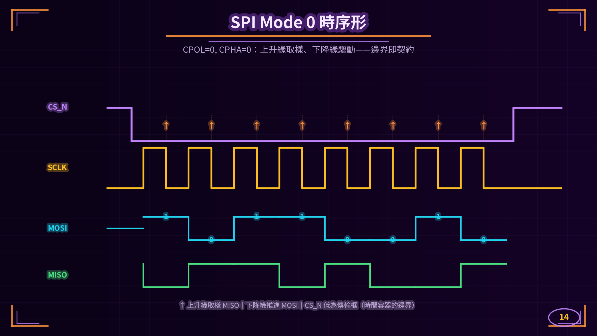

圖 6-4　SPI Mode 0 時序形：上升緣取樣、下降緣驅動

SPI 的介面形本質上是一份「邊界契約」：CS_N 的升降是傳輸框的邊界、SCLK 的邊緣是資料的刻度。Mode 0 的 ∩(T) 可寫成三條特徵：CPOL=0、CPHA=0、MSB first。實作上以除頻器＋雙向移位暫存器的 PatternType 拼裝，bit_cnt 與移位時序的自洽性是驗收重點。

> spi_master.v //============================================================================ // 檔案：spi_master.v // 時序形（TimingType）示範：SPI Mode 0（CPOL=0, CPHA=0）的相位契約 //   上升緣取樣（sample on rising）／下降緣驅動（shift on falling） // 介面形（InterfaceType）：SPI 四線（SCLK / CS_N / MOSI / MISO） //   時序形契約以「邊界」寫成：CS_N 下降為框、SCLK 邊緣為刻度 // 模式形（PatternType）：除頻器 + 雙向移位暫存器 + 前後導延遲 // 參數契約：DATA_BITS ≥ 2（移位運算使用 [DATA_BITS-2:0] 位元選擇） //============================================================================ module spi_master #(     parameter CLK_DIV   = 4,      // sclk = clk / (2 * CLK_DIV)     parameter DATA_BITS = 8 )(     input  wire                  clk,     input  wire                  rst_n,     input  wire                  start,      // 啟動一次傳輸（脈波）     input  wire [DATA_BITS-1:0]  tx_data,    // 待送資料（MSB first）     output reg  [DATA_BITS-1:0]  rx_data,    // 取得資料     output reg                   busy,     output reg                   done,       // 傳輸完成脈波     output reg                   sclk,     output reg                   cs_n,     output reg                   mosi,     input  wire                  miso );      localparam [1:0] S_IDLE  = 2'd0,                      S_XFER  = 2'd1,                      S_DONE  = 2'd2;      reg [1:0]            state;     reg [15:0]           div_cnt;     reg [15:0]           bit_cnt;          // 已取樣位元數     reg [DATA_BITS-1:0]  tx_shift;     reg [DATA_BITS-1:0]  rx_shift;      always @(posedge clk or negedge rst_n) begin         if (!rst_n) begin             state    <= S_IDLE;             div_cnt  <= 16'd0;             bit_cnt  <= 16'd0;             tx_shift <= {DATA_BITS{1'b0}};             rx_shift <= {DATA_BITS{1'b0}};             rx_data  <= {DATA_BITS{1'b0}};             busy     <= 1'b0;             done     <= 1'b0;             sclk     <= 1'b0;             cs_n     <= 1'b1;             mosi     <= 1'b0;         end else begin             done <= 1'b0;   // 脈波僅一週期              case (state)                 // 閒置：匯流排釋放（身份獨立性——內容物清空不改模組身份）                 S_IDLE: begin                     sclk <= 1'b0;                     cs_n <= 1'b1;                     if (start) begin                         tx_shift <= tx_data;                         bit_cnt  <= 0;                         div_cnt  <= 16'd0;                         busy     <= 1'b1;                         cs_n     <= 1'b0;          // 框架邊界：選中                         mosi     <= tx_data[DATA_BITS-1];  // MSB 先行                         state    <= S_XFER;                     end                 end                  // 傳輸：半週期除頻，上升緣取樣、下降緣推進                 S_XFER: begin                     if (div_cnt == CLK_DIV - 1) begin                         div_cnt <= 16'd0;                         if (sclk == 1'b0) begin                             // ---- 上升緣：取樣 MISO（TimeType 取樣刻度）----                             sclk     <= 1'b1;                             rx_shift <= {rx_shift[DATA_BITS-2:0], miso};                             bit_cnt  <= bit_cnt + 1;                         end else begin                             // ---- 下降緣：推進下一位元 ----                             sclk <= 1'b0;                             if (bit_cnt == DATA_BITS) begin                                 state <= S_DONE;                             end else begin                                 tx_shift <= {tx_shift[DATA_BITS-2:0], 1'b0};                                 mosi     <= tx_shift[DATA_BITS-2];                             end                         end                     end else begin                         div_cnt <= div_cnt + 16'd1;                     end                 end                  // 完成：釋放 CS、交出證據（rx_data + done 脈波）                 S_DONE: begin                     cs_n   <= 1'b1;                     busy   <= 1'b0;                     done   <= 1'b1;                     rx_data <= rx_shift;                     state  <= S_IDLE;                 end                  default: state <= S_IDLE;             endcase         end     end  endmodule

### 6.6　i2c_master：開漏匯流排的四相位

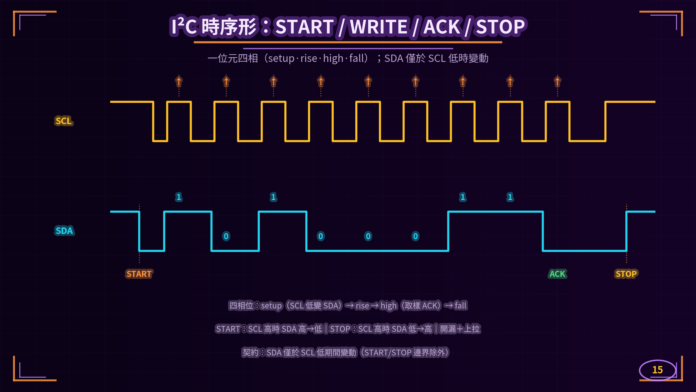

圖 6-5　I²C 時序形：START / WRITE / ACK / STOP

I²C 示範最細的時間形切分：一位元切成 setup / rise / high / fall 四相，SDA 只允許在 SCL 低期間變動——START/STOP 是唯一被允許的例外邊界。指令層以 START/WRITE/READ/STOP 四種原子操作組成，正是「形的組合語意」：複雜交易由原子形拼裝。開漏模型（sda_oe 控制拉低或釋放）體現容器語意：誰都可以拉低，沒有人可以強拉高。

> i2c_master.v //============================================================================ // 檔案：i2c_master.v // 時序形（TimingType）示範：I²C 一位元四相（setup / rise / high / fall） //   把 SCL 一個週期切成四個「時間形」，SDA 僅在 SCL 低期間變動（契約邊界） // 介面形（InterfaceType）：I²C 兩線（SCL / SDA，開漏＋上拉模型） // 指令形（SpecType 實例）：op = START / WRITE / READ / STOP 四種原子操作 //   讀取時 ack_nack 決定是否續讀（生成規則 ∩(T) 的輸入） //============================================================================ module i2c_master #(     parameter CLK_DIV = 128      // 相位計數上限；SCL ≈ clk / (4 * CLK_DIV) )(     input  wire       clk,     input  wire       rst_n,     input  wire       start,      // 脈波：執行一項原子操作     input  wire [1:0] op,         // 00:START 01:WRITE 10:READ 11:STOP     input  wire [7:0] tx_byte,    // 寫入位元組     input  wire       ack_nack,   // 讀取後回應：0=ACK（續讀）1=NACK（結束）     output reg  [7:0] rx_byte,    // 讀取位元組     output reg        busy,     output reg        done,       // 原子操作完成脈波     output reg        ack_error,  // 寫入時從端 NACK     output reg        scl,     inout  wire       sda );      localparam [1:0] OP_START = 2'b00,                      OP_WRITE = 2'b01,                      OP_READ  = 2'b10,                      OP_STOP  = 2'b11;      localparam [2:0] S_IDLE  = 3'd0,                      S_START = 3'd1,                      S_WRITE = 3'd2,                      S_READ  = 3'd3,                      S_STOP  = 3'd4,                      S_DONE  = 3'd5;      // 開漏模型：sda_oe=1 時拉低，否則釋放（外部上拉回高）     reg sda_oe;     assign sda = sda_oe ? 1'b0 : 1'bz;      reg [2:0]  state;     reg [15:0] div_cnt;     reg [1:0]  phase;        // 0:setup 1:rise 2:high 3:fall     reg [3:0]  bit_idx;      // 0..7 資料位元；8 = ACK 位元     reg [7:0]  shreg;     reg        ack_bit;      always @(posedge clk or negedge rst_n) begin         if (!rst_n) begin             state     <= S_IDLE;             div_cnt   <= 16'd0;             phase     <= 2'd0;             bit_idx   <= 4'd0;             shreg     <= 8'd0;             ack_bit   <= 1'b1;             rx_byte   <= 8'd0;             busy      <= 1'b0;             done      <= 1'b0;             ack_error <= 1'b0;             scl       <= 1'b1;             sda_oe    <= 1'b0;         end else begin             done <= 1'b0;              case (state)                 // 注意：操作間不強制拉高 SCL（維持前一操作結束時的相位），                 // 以保證「SDA 僅於 SCL 低期間變動」的契約不被破壞                 S_IDLE: begin                     if (start) begin                         busy     <= 1'b1;                         div_cnt  <= 16'd0;                         phase    <= 2'd0;                         bit_idx  <= 4'd0;                         case (op)                             OP_START: begin sda_oe <= 1'b0; state <= S_START; end                             OP_WRITE: begin shreg <= tx_byte; state <= S_WRITE; end                             OP_READ:  begin shreg <= 8'd0;   state <= S_READ;  end                             OP_STOP:  begin sda_oe <= 1'b1;  state <= S_STOP;  end                             default:  state <= S_IDLE;                         endcase                     end                 end                  // START 條件：SCL 高期間 SDA 由高→低（畫下傳輸框的邊界）                 S_START: begin                     if (div_cnt == CLK_DIV - 1) begin                         div_cnt <= 16'd0;                         case (phase)                             2'd0: begin sda_oe <= 1'b0; phase <= 2'd1; end  // SDA 釋放（高）                             2'd1: begin scl    <= 1'b1;  phase <= 2'd2; end  // SCL 確認高                             2'd2: begin sda_oe <= 1'b1;  phase <= 2'd3; end  // SDA 拉低（START）                             2'd3: begin scl    <= 1'b0;  state <= S_DONE; end // SCL 拉低，進入操作                         endcase                     end else div_cnt <= div_cnt + 16'd1;                 end                  // 寫入位元組：MSB first，第 9 位元讀取 ACK                 S_WRITE: begin                     if (div_cnt == CLK_DIV - 1) begin                         div_cnt <= 16'd0;                         case (phase)                             2'd0: begin                        // setup：SCL 低，變更 SDA                                 if (bit_idx < 8) sda_oe <= ~shreg[7];                                 else             sda_oe <= 1'b0;   // ACK 位元釋放 SDA                                 phase <= 2'd1;                             end                             2'd1: begin scl <= 1'b1; phase <= 2'd2; end  // rise                             2'd2: begin                              // high：取樣 ACK                                 if (bit_idx == 8) ack_bit <= sda;                                 phase <= 2'd3;                             end                             2'd3: begin                              // fall                                 scl <= 1'b0;                                 if (bit_idx == 8) begin                                     ack_error <= ack_bit;           // 1 = NACK                                     state <= S_DONE;                                 end else begin                                     shreg   <= {shreg[6:0], 1'b0};                                     bit_idx <= bit_idx + 4'd1;                                     phase   <= 2'd0;                                 end                             end                         endcase                     end else div_cnt <= div_cnt + 16'd1;                 end                  // 讀取位元組：MSB first，第 9 位元由本端驅動 ACK/NACK                 S_READ: begin                     if (div_cnt == CLK_DIV - 1) begin                         div_cnt <= 16'd0;                         case (phase)                             2'd0: begin                                 if (bit_idx < 8) sda_oe <= 1'b0;          // 釋放給從端                                 else             sda_oe <= ~ack_nack;     // 0=ACK拉低                                 phase <= 2'd1;                             end                             2'd1: begin scl <= 1'b1; phase <= 2'd2; end                             2'd2: begin                                 if (bit_idx < 8) shreg <= {shreg[6:0], sda}; // 中點取樣                                 phase <= 2'd3;                             end                             2'd3: begin                                 scl <= 1'b0;                                 if (bit_idx == 8) begin                                     rx_byte <= shreg;                                     state   <= S_DONE;                                 end else begin                                     bit_idx <= bit_idx + 4'd1;                                     phase   <= 2'd0;                                 end                             end                         endcase                     end else div_cnt <= div_cnt + 16'd1;                 end                  // STOP 條件：SCL 高期間 SDA 由低→高（關閉傳輸框）                 S_STOP: begin                     if (div_cnt == CLK_DIV - 1) begin                         div_cnt <= 16'd0;                         case (phase)                             2'd0: begin sda_oe <= 1'b1; phase <= 2'd1; end  // SDA 低                             2'd1: begin scl    <= 1'b1;  phase <= 2'd2; end  // SCL 拉高                             2'd2: begin sda_oe <= 1'b0; phase <= 2'd3; end  // SDA 釋放（STOP）                             2'd3: begin state <= S_DONE; end                         endcase                     end else div_cnt <= div_cnt + 16'd1;                 end                  S_DONE: begin                     busy  <= 1'b0;                     done  <= 1'b1;                     state <= S_IDLE;                 end                  default: state <= S_IDLE;             endcase         end     end  endmodule

### 6.7　timer：可程式化時間容器

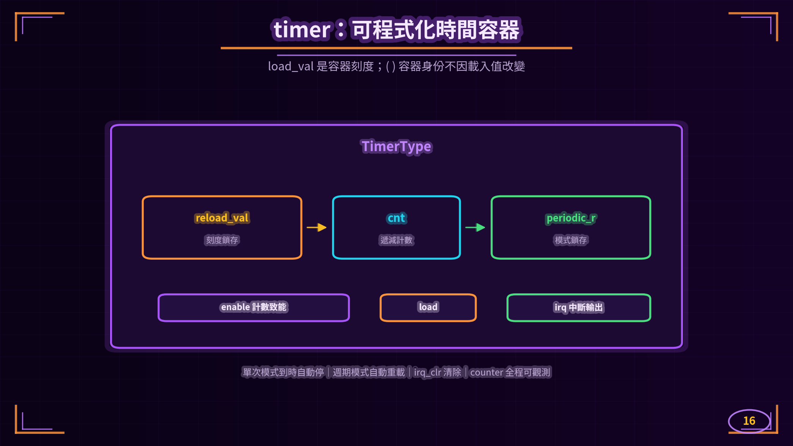

圖 6-6　timer：load_val 是容器刻度，身份不隨載入值改變

timer 是 ( ) 容器集合的活教材：load_val 是裝進時間容器的內容物，換一個值不換身份。periodic 模式於載入時鎖存（periodic_r），保證單次模式不因輸入毛刺而重複觸發——「模式即身份的一部分，於形成立時定案」。

> timer.v //============================================================================ // 檔案：timer.v // 時序形（TimingType）示範：可程式化時間容器 //   load_val 為容器刻度（裝什麼由使用者決定）、計數器身份不因載入值而變 //   one-shot / periodic 兩種模式＝同一「計時形」下的兩個抽象子形（X 軸） // 介面形（InterfaceType）：載入 / 啟停 / 中斷三組埠 // 驗證形（VerifyType）：irq 為可觀測證據點；periodic 模式自帶重複證據流 // 使用契約：load 脈波載入 load_val 並鎖存 periodic 模式； //          load 與 enable 同拍為高即啟動；執行中 enable 為計數致能（可暫停）； //          單次模式到時自動停（running=0），週期模式自動重載； //          載入 N 後第 N+1 個計數致能時脈於 cnt==0 觸發 irq。 //============================================================================ module timer #(     parameter DATA_WIDTH = 32 )(     input  wire                    clk,     input  wire                    rst_n,     input  wire                    load,          // 脈波：載入 load_val     input  wire [DATA_WIDTH-1:0]   load_val,      // 起始計數值     input  wire                    enable,        // 計數致能（載入時兼啟動）     input  wire                    periodic,      // 0:單次  1:週期重載（load 時鎖存）     input  wire                    irq_clr,       // 清除中斷     output reg                     irq,           // 中斷輸出     output wire [DATA_WIDTH-1:0]   counter,       // 現值（觀測點）     output reg                     running );      reg [DATA_WIDTH-1:0] cnt;     reg [DATA_WIDTH-1:0] reload_val;    // 鎖存：身份獨立於外部 load_val 變動     reg                  periodic_r;    // 鎖存：模式於載入時定案，雜訊不致重複觸發      assign counter = cnt;      always @(posedge clk or negedge rst_n) begin         if (!rst_n) begin             cnt        <= {DATA_WIDTH{1'b0}};             reload_val <= {DATA_WIDTH{1'b0}};             periodic_r <= 1'b0;             irq        <= 1'b0;             running    <= 1'b0;         end else begin             if (irq_clr)                 irq <= 1'b0;              if (load) begin                 // 載入：把新的「內容物」放進時間容器，形（TimerType）不變                 reload_val <= load_val;                 periodic_r <= periodic;                 cnt        <= load_val;                 running    <= enable;                // 載入即視 enable 啟動             end else if (enable && running) begin                 if (cnt == {DATA_WIDTH{1'b0}}) begin                     irq <= 1'b1;                     // 到時：產生證據                     if (periodic_r) begin                         cnt <= reload_val;           // 週期模式：自動重載                     end else begin                         running <= 1'b0;             // 單次模式：自動停                     end                 end else begin                     cnt <= cnt - 1'b1;                 end             end         end     end  endmodule

### 6.8　驗證平台：VerifyType 的兩個樣板

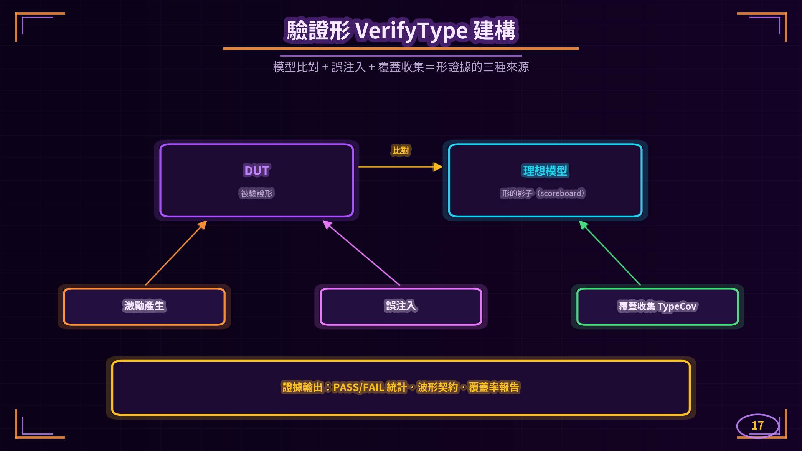

圖 6-7　驗證形建構：理想模型比對＋誤注入＋覆蓋收集

兩份 testbench 示範驗證形的兩大支柱。tb_sync_fifo 以佇列理想模型做逐筆比對（scoreboard），四類覆蓋目標直接翻譯自 ∩(T)：FIFO 序、滿載拒寫、空載拒讀、同時讀寫計數不變。tb_uart 以環回閉環取證，並以 break 誤注入驗證錯誤路徑——誤碼黏著旗幟（err_seen）是「證據必須能被重現」的實作細節。

> tb_sync_fifo.sv //============================================================================ // 檔案：tb_sync_fifo.sv // 驗證形（VerifyType）示範：形覆蓋率 TypeCov 的最小實踐 //   覆蓋目標 = 交集判準 ∩(SyncFIFOType) 的每一項可觀察條件： //   ① 寫入後可讀出（FIFO 序）② 滿載拒寫 ③ 空載拒讀 ④ 同時讀寫計數不變 // 形證據鏈（Type Evidence Chain）：scoreboard 比對 → PASS/FAIL 統計輸出 //============================================================================ `timescale 1ns / 1ps  module tb_sync_fifo;      localparam DW = 8;     localparam AW = 4;      reg              clk = 1'b0;     reg              rst_n = 1'b0;     reg              wr_en = 1'b0;     reg  [DW-1:0]    wr_data = 8'd0;     reg              rd_en = 1'b0;     wire [DW-1:0]    rd_data;     wire             full, empty;     wire [AW:0]      count;      // DUT     sync_fifo #(.DATA_WIDTH(DW), .ADDR_WIDTH(AW)) dut (         .clk(clk), .rst_n(rst_n),         .wr_en(wr_en), .wr_data(wr_data),         .rd_en(rd_en), .rd_data(rd_data),         .full(full), .empty(empty), .count(count)     );      always #5 clk = ~clk;      // ---- Scoreboard：佇列模型（形的「理想影子」）----     reg [DW-1:0] model_q [$];     integer pass_cnt = 0;     integer fail_cnt = 0;      task automatic check(input bit cond, input string desc);         if (cond) begin             pass_cnt = pass_cnt + 1;             $display("[PASS] %s", desc);         end else begin             fail_cnt = fail_cnt + 1;             $display("[FAIL] %s", desc);         end     endtask      task automatic do_write(input [DW-1:0] d);         @(negedge clk);         wr_en = 1'b1; wr_data = d;         if (!full) model_q.push_back(d);         @(negedge clk);         wr_en = 1'b0;     endtask      task automatic do_read();         reg [DW-1:0] exp;         @(negedge clk);         rd_en = 1'b1;         // FWFT：此刻 rd_data 已呈現串列前端，於指標前進前取證         if (model_q.size() > 0) begin             exp = model_q.pop_front();             check(rd_data === exp,                   $sformatf("read data exp=0x%02h got=0x%02h", exp, rd_data));         end         @(negedge clk);         rd_en = 1'b0;     endtask      integer i;     initial begin         $display("==== tb_sync_fifo : TypeCov evidence collection ====");         rst_n = 1'b0;         repeat (3) @(negedge clk);         rst_n = 1'b1;         @(negedge clk);          // ① 基本 FIFO 序（16 筆寫滿再讀空）         for (i = 0; i < 16; i = i + 1) do_write(i[7:0] ^ 8'hA5);         check(full,  "full asserted after 16 writes");         for (i = 0; i < 16; i = i + 1) do_read();         check(empty, "empty asserted after 16 reads");          // ② 滿載拒寫：滿時寫入應被忽略         for (i = 0; i < 16; i = i + 1) do_write(8'h10 + i[7:0]);         do_write(8'hFF);                      // 應被拒         check(model_q.size() == 16, "write rejected when full");          // ③ 空載拒讀：空時讀出應被忽略（值不檢查、模型不動）         for (i = 0; i < 16; i = i + 1) do_read();         do_read();                            // 應被拒         check(empty, "read rejected when empty");          // ④ 同時讀寫：count 保持不變（SOM 依存：cnt 不偏移）         for (i = 0; i < 4; i = i + 1) do_write(8'hC0 + i[7:0]);         @(negedge clk);         wr_en = 1'b1; wr_data = 8'h5A;         rd_en = 1'b1;         model_q.push_back(8'h5A);         void'(model_q.pop_front());         @(negedge clk);         wr_en = 1'b0; rd_en = 1'b0;         check(count == 4, "count stable across simultaneous rd/wr");          $display("==== RESULT: PASS=%0d FAIL=%0d ====", pass_cnt, fail_cnt);         if (fail_cnt == 0) $display("==== ALL TESTS PASSED ====");         $finish;     end  endmodule

> tb_uart.sv //============================================================================ // 檔案：tb_uart.sv // 驗證形（VerifyType）示範：uart_tx → uart_rx 環回（loopback）閉環取證 //   每一位元組 = 一個「實體」；比對 tx_data 與 rx_data = 異同判定 //   誤注入（break 條件）驗證 rx_error = 交集判準的反例檢查 // 形覆蓋率 TypeCov：資料位元組 × 錯誤路徑 兩類覆蓋目標 //============================================================================ `timescale 1ns / 1ps  module tb_uart;      localparam CPB = 8;              // 加速模擬：每位元 8 個時脈      reg        clk = 1'b0;     reg        rst_n = 1'b0;     reg        tx_start = 1'b0;     reg  [7:0] tx_data = 8'd0;     wire       serial_line;     wire       tx_busy;     wire [7:0] rx_data;     wire       rx_valid, rx_error;      uart_tx #(.CLKS_PER_BIT(CPB)) u_tx (         .clk(clk), .rst_n(rst_n),         .tx_start(tx_start), .tx_data(tx_data),         .tx_serial(serial_line), .tx_busy(tx_busy)     );      // 誤注入開關：強制接收線為低（break）以觸發幀誤碼     reg inject_break = 1'b0;     wire rx_line = inject_break ? 1'b0 : serial_line;      uart_rx #(.CLKS_PER_BIT(CPB)) u_rx (         .clk(clk), .rst_n(rst_n),         .rx_serial(rx_line),         .rx_data(rx_data), .rx_valid(rx_valid), .rx_error(rx_error)     );      always #5 clk = ~clk;      integer pass_cnt = 0;     integer fail_cnt = 0;      // 誤碼黏著旗幟：即使後續幻影幀清掉 rx_error 亦能取證     reg err_seen = 1'b0;     always @(posedge clk) if (rx_error) err_seen <= 1'b1;      task automatic check(input bit cond, input string desc);         if (cond) begin             pass_cnt = pass_cnt + 1;             $display("[PASS] %s", desc);         end else begin             fail_cnt = fail_cnt + 1;             $display("[FAIL] %s", desc);         end     endtask      task automatic send_byte(input [7:0] d);         integer tmo;         @(negedge clk);         tx_data = d; tx_start = 1'b1;         @(negedge clk);         tx_start = 1'b0;         // 等待有效接收（含逾時防呆）         tmo = 0;         while (rx_valid !== 1'b1 && tmo < CPB * 30) begin             @(negedge clk);             tmo = tmo + 1;         end         check(rx_valid === 1'b1,               $sformatf("rx_valid asserted for 0x%02h", d));         check(rx_data === d,               $sformatf("loopback byte exp=0x%02h got=0x%02h", d, rx_data));     endtask      integer i;     reg [7:0] pattern [0:7];      initial begin         pattern[0]=8'h00; pattern[1]=8'hFF; pattern[2]=8'h55; pattern[3]=8'hAA;         pattern[4]=8'h01; pattern[5]=8'h80; pattern[6]=8'h7E; pattern[7]=8'h81;          $display("==== tb_uart : TypeCov evidence collection ====");         rst_n = 1'b0;         repeat (4) @(negedge clk);         rst_n = 1'b1;         repeat (4) @(negedge clk);          // ① 樣式資料環回（邊界值 + 交替位元）         for (i = 0; i < 8; i = i + 1) send_byte(pattern[i]);          // ② 錯誤路徑：break（長時間低電位）→ rx_error 應置位         //    低電位須覆蓋幻影幀的停止位元取樣點（約 9.5 位元時間）         @(negedge clk);         inject_break = 1'b1;         repeat (CPB * 12) @(negedge clk);         inject_break = 1'b0;         // 等待接收 FSM 走完幻影幀並回閒置         repeat (CPB * 16) @(negedge clk);         check(err_seen === 1'b1, "break condition raises rx_error");          // ③ 錯誤恢復：誤碼後仍可正常收送（自我演化：重構後回歸）         send_byte(8'h3C);          $display("==== RESULT: PASS=%0d FAIL=%0d ====", pass_cnt, fail_cnt);         if (fail_cnt == 0) $display("==== ALL TESTS PASSED ====");         $finish;     end  endmodule

> 程式碼交付 全部八支檔案另附《IC設計大腦_Verilog程式碼.zip》，可直接投入模擬環境使用。建議驗證順序：先跑 tb_sync_fifo（快、建立信心），再跑 tb_uart（涵蓋錯誤路徑）。

## 第七章　準確性驗證與檢核體系

第二章給了四層準確性保證的結構，本章把它操作化：誰在什麼時點、用什麼工具、檢查什麼、不通過怎麼辦。

### 7.1　四層保證的操作化

| 層 | 檢查時點 | 工具/載體 | 通過標準 | 不通過 |

| --- | --- | --- | --- | --- |

| ∩(T) 判準 | S1–S5 每步產出時 | 判準表逐條勾稽 | 全部特徵可判定成立 | 判出即退回該步 |

| 演繹骨架 | S4 稽核、S5 比對 | 來源標註、骨架比對表 | 結論 100% 有來源 | 無來源結論刪除 |

| 形式驗證 | S6 | testbench、assertion、波形 | 回歸全綠、反例全解釋 | 反例入清單循環修 |

| 形證據鏈 | S7 | 證據索引、版本紀錄 | 六環無斷點 | 缺哪環補哪環 |

### 7.2　形覆蓋率 TypeCov

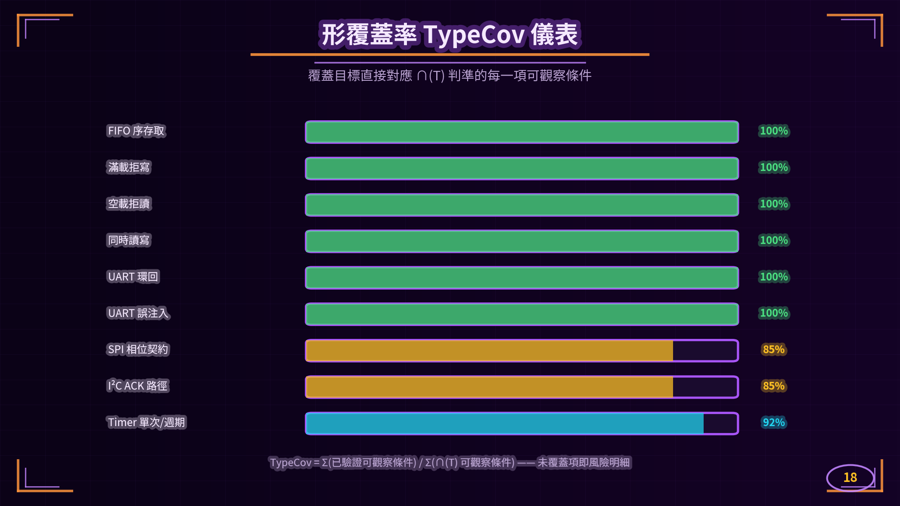

圖 7-1　形覆蓋率 TypeCov 儀表：覆蓋目標對應 ∩(T) 可觀察條件

TypeCov 的定義刻意簡單：已驗證的可觀察條件數 ÷ 全部可觀察條件數。分母來自 ∩(T)——這保證覆蓋率永遠對著判準收斂，而不是對著「跑過的測試數」虛胖。使用規則三條：未覆蓋項必須列明細且有風險評估；TypeCov 100% 只代表「判準全被驗過」，不代表判準本身正確（那是第一層的責任）；反例數量與覆蓋率同為報表必填欄位。

### 7.3　形證據鏈的稽核要件

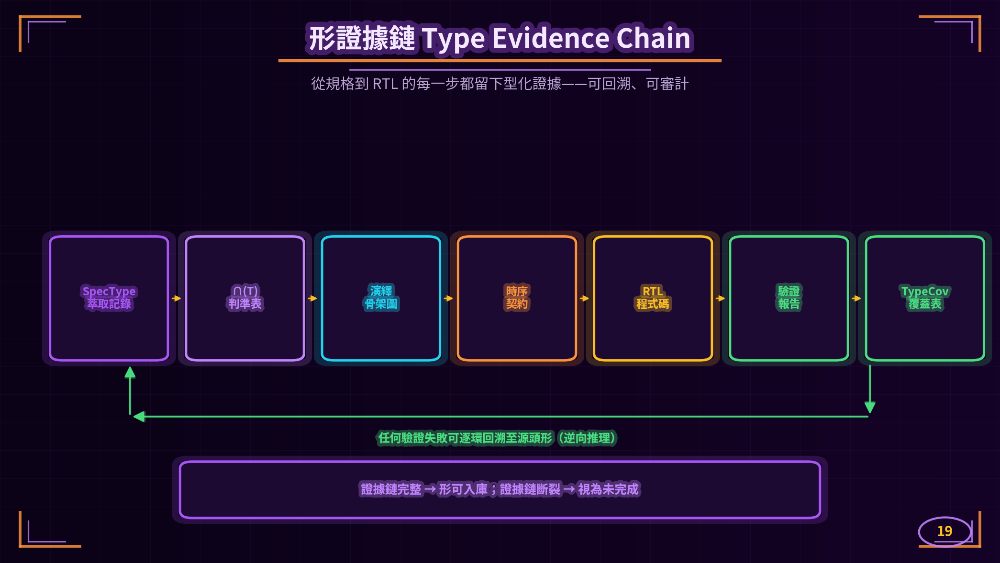

圖 7-2　形證據鏈：可回溯、可審計

| 環 | 證據要件 | 載體 |

| --- | --- | --- |

| S1 萃取 | 異同清單、差異→組→形推導鏈 | 萃取記錄 |

| S2 介面 | 訊號—屬性映射、家族比對記錄 | 訊號表＋比對表 |

| S3 分解 | 三類判定、必要件後果 | BOM/SOM 表 |

| S4 骨架 | 判準→結論推導、已刪除清單 | 演繹紀錄表 |

| S5 生成 | 模式引用、骨架比對表、波形契約 | 生成記錄 |

| S6 驗證 | TypeCov 报告、反例清單含根因 | 驗證報告 |

| S7 串鏈 | 六環點名、形庫版本 | 證據索引 |

### 7.4　誤用對照總表

下表彙整全書高頻誤用，屬檢核體系的「負面清單」——每次評審可直接以此表掃描。

| # | 誤用 | 後果 | 糾正 |

| --- | --- | --- | --- |

| 1 | 叫 LLM 直接寫 RTL、不給判準 | 生成漂移、無驗收標準 | S4 骨架先行，判準先行 |

| 2 | 把列舉清單當形 | 封閉、無法判入新成員 | 改用 ∩(T) 生成規則 |

| 3 | Form 代指形 | 術語體系污染 | 一律 Type，當場更正 |

| 4 | 參數寫死、把參數當部件 | ( ) 容器拍平、形膨脹 | 參數化＋三類判定重來 |

| 5 | 只驗 happy path | 錯誤路徑盲區 | 誤注入強制進檢核表 |

| 6 | testbench 抄 RTL 寫法 | 同構盲點 | 獨立理想模型比對 |

| 7 | 重構時順手改介面 | 驗證作廢、回歸斷裂 | 外在形凍結，動介面回 S2 |

| 8 | 無證據入庫 | 形庫污染、下輪踩坑 | 缺證據標缺口，不入庫 |

| 9 | 混步下提示詞 | 輸出無法驗收 | 一步一範本 |

| 10 | 以名稱認家族/複用 | 錯複用、形同實異 | 以 ∩(T) 比對認形 |

## 第八章　導入與運作

方法再好，落不了地就沒有意義。本章給出導入的最短路徑：角色怎麼分、節奏怎麼排、提示詞與形庫怎麼管、能力怎麼分級演進。

### 8.1　角色分工與協作節奏

| 角色 | 主責步驟 | 協作點 | 交付責任 |

| --- | --- | --- | --- |

| 形主 Type Owner | S1、S7 | 裁決 ∩(T) 爭議、審核入庫 | 形庫品質、判準版本 |

| 設計工程師 | S2–S5 | 向形主申請形變更 | 訊號表、骨架、RTL |

| 驗證工程師 | S6 | 回報反例根因分類 | testbench、TypeCov、反例清單 |

| 平台管理員 | （跨步） | 維護提示詞範本與形庫環境 | 範本版本、存取稽核 |

節奏上建議以「形驅動衝刺」為單位：一輪 S1–S7 即一個衝刺。每日站會以形為單位報進度（「ST-003 已過 S4」比「做了 80%」有效）；衝刺檢視的必備三件套是 TypeCov 報告、反例清單、證據鏈稽核表。

### 8.2　提示詞範本的治理

▸ 版本化：範本與程式碼同級管理——S1 v1.2 這樣的版本號，修改必留紀錄與理由。

▸ 凍結區／活區：範本的【角色】【任務】【輸出格式】【禁止事項】是凍結區（改動需形主核准）；【輸入】是活區（每專案替換）。

▸ 誤用反饋：每次被糾正的提示詞用法，回寫為範本的禁止事項——範本隨誤用進化。

### 8.3　形庫治理

▸ 入庫門檻：∩(T) 齊備＋證據鏈無斷點＋形主簽核，三者缺一不可。

▸ 出庫機制：連續兩輪未被複用且判準被修訂推翻的形，標記「休眠」；休眠不刪除，保留演化軌跡。

▸ 版本節奏：每輪衝刺結案出一個形庫版本；版本摘要就是團隊的知識增量聲明。

▸ 變更不對稱：新增列隨時可做、新增欄必須評審——守護「表頭即形」的穩定。

### 8.4　成熟度演進：四級路線

| 級 | 名稱 | 特徵 | 升級條件 |

| --- | --- | --- | --- |

| L1 | 手動形驅動 | 人肉執行七步驟、形庫為試算表 | 七步驟走通一個完整專案 |

| L2 | 範本化 | S1–S7 範本全員使用、檢核表強制 | 連續兩輪零混步、零 Form 誤用 |

| L3 | 證據化 | TypeCov 成常規、證據鏈可稽核 | 形庫版本化運行滿三輪 |

| L4 | 自演化 | 模式自動萃取建議、誤用自動沉淀檢核項 | 形庫增量中機器貢獻占比過半 |

> 導入建議 不要追求一次到位。第一個專案選一個中等複雜度的介面型 IP（如本書的 UART 子系統規模），完整走通 S1–S7 一遍，比三個專案各走半遍有價值得多——走通的那一遍，會產出屬於你們自己的形庫雛形、檢核表初版與第一批模式卡。

## 附錄 A　提示詞範本總表（S1–S7）

完整範本全文見第五章各節；本表為速查索引，列出每則範本的任務焦點、核心輸出與最主要的禁止事項。

| 範本 | 任務焦點 | 核心輸出 | 頭號禁止 |

| --- | --- | --- | --- |

| S1 | 規格差異→形萃取 | SpecType 清單、屬性表 | 無 ∩(T) 的形 |

| S2 | 表頭即形定義介面 | 訊號表、家族歸屬 | 無來源屬性的埠 |

| S3 | BOM/SOM 模組分解 | 分解樹、依存表 | 屬性/參數混入 BOM |

| S4 | 判準→骨架演繹 | 演繹紀錄、契約表 | 無來源結論 |

| S5 | 模式化 RTL 生成 | Verilog、波形契約 | 跳過模式選定 |

| S6 | 覆蓋對應判準驗證 | testbench、TypeCov | 只驗 happy path |

| S7 | 串鏈、沉淀、入庫 | 證據鏈、形庫提案 | 斷點勾完成 |

## 附錄 B　檔案清單

本書交付之全部程式檔案如下；行數為概數，以隨附壓縮檔為準。

| 檔案 | 語言 | 行數 | 說明 |

| --- | --- | --- | --- |

| sync_fifo.v | Verilog | 約 80 | 參數化同步 FIFO，ModuleType 樣板 |

| uart_tx.v | Verilog | 約 100 | UART 8N1 發送器，FSM 時間形 |

| uart_rx.v | Verilog | 約 115 | UART 接收器，多數決取樣 |

| spi_master.v | Verilog | 約 115 | SPI Mode 0 主控 |

| i2c_master.v | Verilog | 約 185 | I²C 主控（原子操作指令層） |

| timer.v | Verilog | 約 75 | 可程式化計時器，單次/週期 |

| tb_sync_fifo.sv | SystemVerilog | 約 105 | FIFO 驗證平台（scoreboard） |

| tb_uart.sv | SystemVerilog | 約 105 | UART 環回驗證平台（誤注入） |

| IC設計大腦_Verilog程式碼.zip | — | — | 上述八檔打包 |

## 附錄 C　術語對照表

「形」一律 Type。本表為全書術語的唯一權威版本，文件、提示詞、程式註解以此為準。

| 中文 | 英文 | 備註 |

| --- | --- | --- |

| 本形學 | Ontypology | 理論體系名；理論本體不在本書範圍 |

| 形 | Type | 嚴禁用 Form |

| 規格形 | SpecType | IC 六形之一 |

| 介面形 | InterfaceType | IC 六形之一 |

| 模組形 | ModuleType | IC 六形之一 |

| 時序形 | TimingType | IC 六形之一 |

| 驗證形 | VerifyType | IC 六形之一 |

| 模式形 | PatternType | IC 六形之一 |

| 形驅動設計七步驟 | Type-Driven Design Flow | S1–S7 |

| 形庫 | Type Library | 四表結構：SpecType/ModuleType/VerifyType/PatternType |

| 形證據鏈 | Type Evidence Chain | 六環可回溯 |

| 形覆蓋率 | Type Coverage (TypeCov) | 可觀察條件覆蓋比 |

| 演繹骨架 | Deductive Skeleton | S4 產出 |

| 交集判準 | Intersection Criterion ∩(T) | x ∈ T ⟺ F(T) 全成立 |

| 屬性／屬性值 | Attribute / Attribute Value | 表頭欄位／欄位值 |

| 部件清單 | BOM (Bill of Materials) | 可拆且認得的部件 |

| 空間清單 | SOM (Space of Materials) | BOM＋空間容器 |

| 空間容器 | Space Collections (Container) | ( ) 參數容器 |

| 組成集合 | Composition Set | { } |

| 抽象集合 | Abstraction Set | [ ]，∩(T) 生成成員 |

## 附錄 D　檢核表總表

七步驟檢核表的合一版，供列印隨身使用。逐項打勾即為 S 驗收證據；任一項不通過，該步不得宣告完成。

| 步驟 | 檢核項（逐項打勾） |

| --- | --- |

| S1 | □ 異同清單覆蓋全段落 □ 每形有 F(T)+∩(T) □ 屬性表無空白 □ 形庫比對有理由 □ 推導鏈可回溯 |

| S2 | □ 埠皆有來源屬性ID □ 對外屬性有埠 □ 訊號表全欄填滿 □ 家族比對有記錄 □ 參數已 ( ) 化 |

| S3 | □ 分解達可驗證粒度 □ 三類判定全覆蓋 □ SOM 有拿掉後果 □ 必要件與判準一致 □ 複用比對完成 |

| S4 | □ 結論皆有來源編號 □ 契約四要素齊備 □ 層級圖與 BOM/SOM 一致 □ 已刪除清單受檢 □ 時脈域全覆蓋 |

| S5 | □ 模式選定記錄 □ 埠表一致 □ 形ID註解齊 □ 骨架比對勾稽 □ 波形契約文字化 |

| S6 | □ 分母＝∩(T) 可觀察條件 □ 理想模型存在 □ 錯誤路徑誤注入 □ FAIL 有根因 □ 回歸全綠 |

| S7 | □ 六環點名 □ 斷點處置 □ 重構外在形未變 □ 沉淀三件套 □ 入庫提案含版本與 ∩(T) |

> — 全書完 —

