# 本體論與FDE

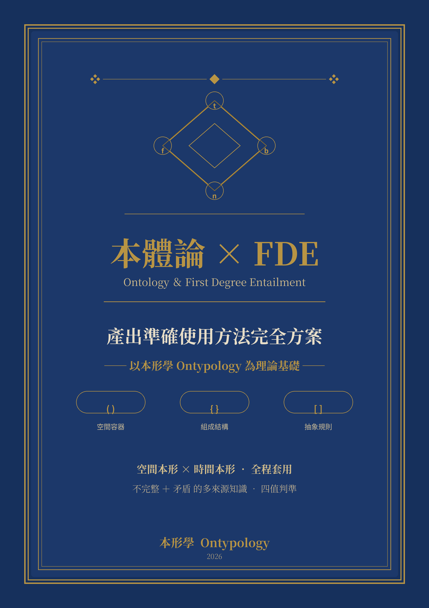

# 目　錄

- 寫在前面——三個約定
- 導讀——這份方案怎麼用
- 第一章　認識本體論與 FDE
  - 1.1　本體論：為知識立一個可推理的副本
  - 1.2　FDE：不完整與矛盾的四個座位
  - 1.3　雙本形落點：空間立結構・時間走流程
  - 1.4　產出不準的四個現場
- 第二章　六種產出形「概關公斷查演」
  - 2.1　概念形 ConceptType：把類別寫成規則
  - 2.2　關係形 RelationType：把連接寫成結構
  - 2.3　公理形 AxiomType：把不變寫成約束
  - 2.4　斷言形 AssertionType：四值斷言卡
  - 2.5　查證形 QueryType：答案與處置一起出
  - 2.6　演化形 EvolutionType：值的流轉記在帳上
- 第三章　四層準確性保證
  - 3.1　第一層・交集判準 ∩(T)
  - 3.2　第二層・演繹骨架與 FDE 推理
  - 3.3　第三層・形式驗證與反例檢查
  - 3.4　第四層・形證據鏈
  - 3.5　空間 × 時間交叉驗收
- 第四章　準確使用方法六步驟
  - 4.1　框架四步驟：從資料長出本體
  - 4.2　六步驟操作卡
  - 4.3　三層判斷：是・有・對
  - 4.4　挑招・組招・換招
- 第五章　S1–S7 與全程產出範例
  - 5.1　七段接力：S1–S7 流水線
  - 5.2　S1–S7 提示詞全文
  - 5.3　案例全程：泵浦 P-101 維修知識本體
  - 5.4　四值斷言與查證產出
  - 5.5　演化與總驗收產出
- 第六章　誤用・檢核・成熟度
  - 6.1　誤用五種
  - 6.2　十問清單
  - 6.3　成熟度 L1–L4
  - 6.4　導入藍圖
- 回顧——三個帶走
- 附錄 A　術語・記號・招式速查

# 寫在前面——三個約定

這是一份「怎麼用」的方案書。主題是本體論（Ontology）與 FDE（First Degree Entailment，一階蘊含）——前者負責把一個領域的知識寫成「可推理的副本」，後者負責在知識不完整、甚至互相矛盾的時候，依然能判斷、能推理、能決策。而把這兩樣工具組織起來的骨架，是本形學：空間本形給結構，時間本形給流程。

在開始之前，先立二個約定，全書一体適用。

> **約定一：理論只用不教**
>
> 本書不重述本形學本身（空間本形與時間本形的原理與推導）。
>
> 三括號、交集判準、id(C)、remove 三級、框架四步驟、招式盤、三層判斷——都是拿來用的工具，
>
> 本書只負責把這些工具準確地用在本體論與 FDE 的場景上。

> **約定二：產出先有形，準確才有地方長**
>
> 六種產出形（概關公斷查演）定義了所有交付物的格式：欄位先定義、判準先寫明、證據先進帳。
>
> 沒有形的產出，快，但不準；有了形的產出，一輪一輪越長越準。

**表 0-1　任務地圖：六章各自回答什麼**

| 章 | 主題（書中提法） | 讀完你能拿到的產出 |
| --- | --- | --- |
| **第 1 章（認識）** | 本體論與 FDE 的分工與座標 | 四值思維：給不完整與矛盾留座位 |
| **第 2 章（產出形）** | 概關公斷查演六張欄位卡 | 六種產出形的完整格式 |
| **第 3 章（準確性）** | 判準・演繹・驗證・證據四層關卡 | 四層準確性保證的驗收方法 |
| **第 4 章（六步驟）** | 從資料長出本體的操作流程 | 可重複運轉的六步驟與三層判斷 |
| **第 5 章（接力）** | 七段提示詞與全程產出範例 | S1–S7 提示詞全文＋泵浦 P-101 案例 |
| **第 6 章（檢核）** | 誤用、清單與成熟度 | 誤用對照＋十問清單＋L1–L4 升級路線 |

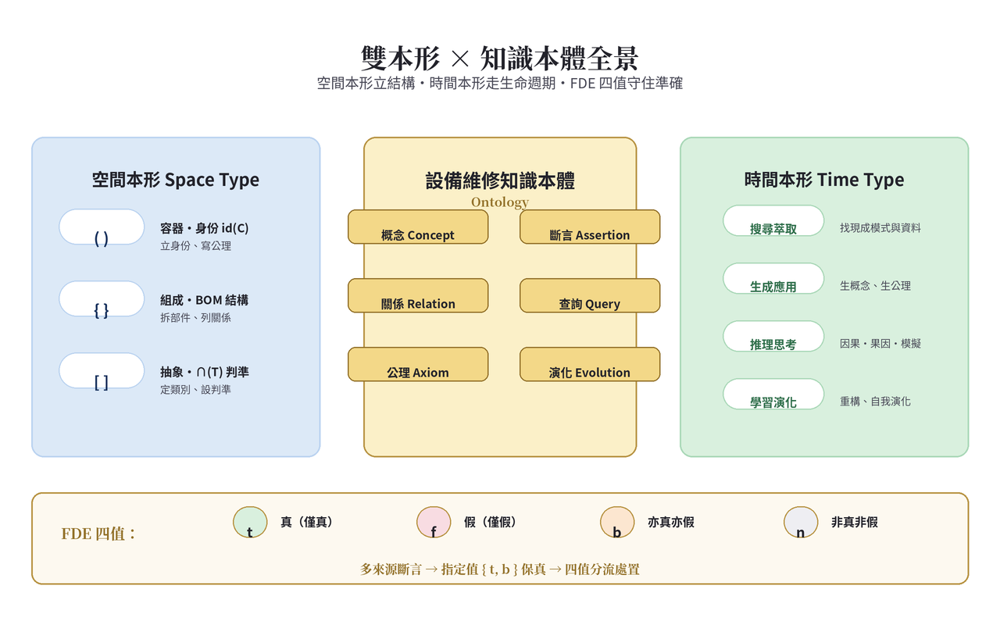

**圖 0-1　雙本形 × 知識本體全景**

# 導讀——這份方案怎麼用

本書內文只說「怎麼用」，但有幾組工具會反覆登場。先花三分鐘對齊兩套語言：左邊是本形學的工具名稱，右邊是它們在本體論與 FDE 場景裡的工作。對照表看熟，後面每一章都會順很多。

**表 D-1　兩套語言對照**

| 本形學工具 | 在本書的工作 |
| --- | --- |
| **抽象集合 [ ]** | 把類別寫成規則：必要特徵 F(T) 與交集判準 ∩(T) |
| **組成集合 { }** | 把部件寫成結構：組成關係、remove 三級必要性 |
| **容器集合 ( )** | 把身份寫成公理：id(C) 與不變性公理、實例同一性 |
| **框架四步驟** | 從雜亂資料長出概念與維度的機器 |
| **時間本形十四招** | 本體生命週期裡的搜尋、生成、推理、演化招式 |
| **三層判斷** | 斷言進帳時的「是・有・對」三關 |
| **形證據鏈** | 每條斷言追得到來源、判準、推理與時間戳 |

**表 D-2　三種讀法**

| 你是誰 | 怎麼讀 | 讀到哪裡 |
| --- | --- | --- |
| **決策者** | 先讀表 0-1、第 1 章與第 6 章，其餘當工具書查 | 20 分鐘建立四值直覺 |
| **建模者** | 第 2 章起逐章讀，邊讀邊把手上設備域套進六種產出形 | 兩天跑完一輪六步驟 |
| **操作者** | 第 5 章提示詞全文直接抄用，第 4 章當現場手冊 | 今天就跑 S1–S7 |

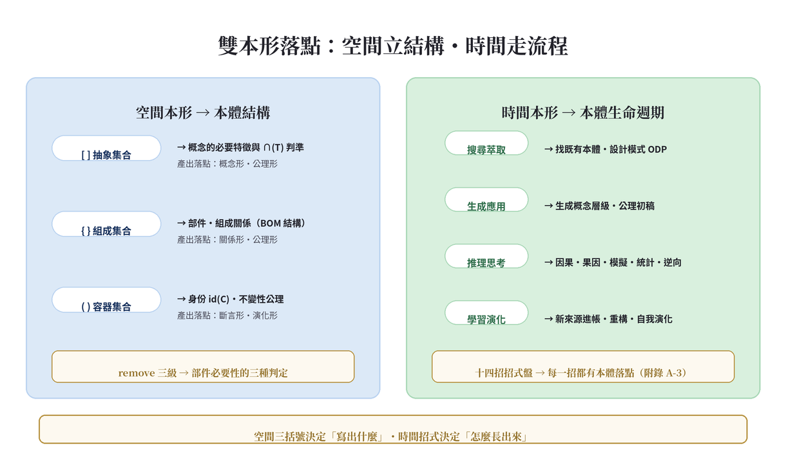

**圖 D-2　雙本形落點總覽**

> **本書的貫穿案例**
>
> 一台冷卻水泵浦 P-101：感測器、人工點檢表、廠商手冊、維修工單史四個來源，
>
> 說著不完全一樣的故事——這正是本體論與 FDE 真正派上用場的地方。

# 第一章　認識本體論與 FDE

先把兩樣主角擺到正確的位置上。本體論管「知識長什麼樣」：把一個領域寫成概念、關係、公理、實例組成的可推理副本。FDE 管「知識不齊全時怎麼判」：面對不完整、甚至互相矛盾的多來源訊息，不崩潰、不作弊、不裝作沒事。兩者合起來，才撐得起「產出準確」四個字。

## 1.1　本體論：為知識立一個可推理的副本

日常的設備知識散落在手冊、點檢表、老師傅的腦子與工單系統裡——它是「能讀的」，但不是「能推的」。本體論做的事情，就是把這團知識寫成一份明確的規格：有哪些概念、概念之間怎麼連、什麼約束永遠成立、現實中哪台設備對應哪個實例。寫完之後，機器才能代替人做歸類、檢查與推理。

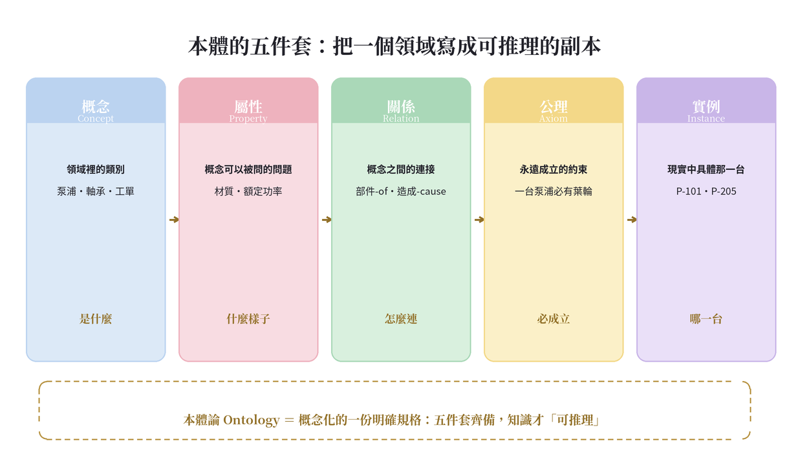

**圖 1-1　本體的五件套**

**表 1-1　本體五件套與本形學對映**

| 零件 | 回答什麼 | 本形學對映 | 設備維修例子 |
| --- | --- | --- | --- |
| **概念 Concept** | 是什麼類別？ | [ ] 抽象集合・∩(T) | 泵浦、軸承、維修工單 |
| **屬性 Property** | 什麼樣子？ | 屬性與屬性值 | 額定功率、材質、警戒值 |
| **關係 Relation** | 怎麼連？ | { } 組成集合・依存 | 軸承 屬於 泵浦、振動 造成 異常 |
| **公理 Axiom** | 什麼必成立？ | 不變性公理・remove 三級 | 一台泵浦必有葉輪與軸承 |
| **實例 Instance** | 現實哪一個？ | 容器身份 id(C) | P-101（二號線冷卻水泵浦） |

值得注意的是五件套與本形學的對映不是貼標籤式的比附：概念靠交集判準生成（開放、能收新成員），關係靠 remove 判準分級（必要、降級、非必要），實例靠 id(C) 守住同一性（改了內容還是同一台）。這三件事，恰好是本體建模最容易做壞的三個地方。

## 1.2　FDE：不完整與矛盾的四個座位

多來源現場的常態是：有的來源說真、有的說假、有的根本不說話。二值邏輯只有兩個座位，於是「亦真亦假」被硬壓成其中一邊、「非真非假」被悄悄當成假——資訊就是這樣蒸發的。Belnap 的 FDE 乾脆開四個座位：t 僅真、f 僅假、b 亦真亦假、n 非真非假。一個斷言坐在哪個座位，由兩個問題決定：有沒有來源支持它真？有沒有來源支持它假？

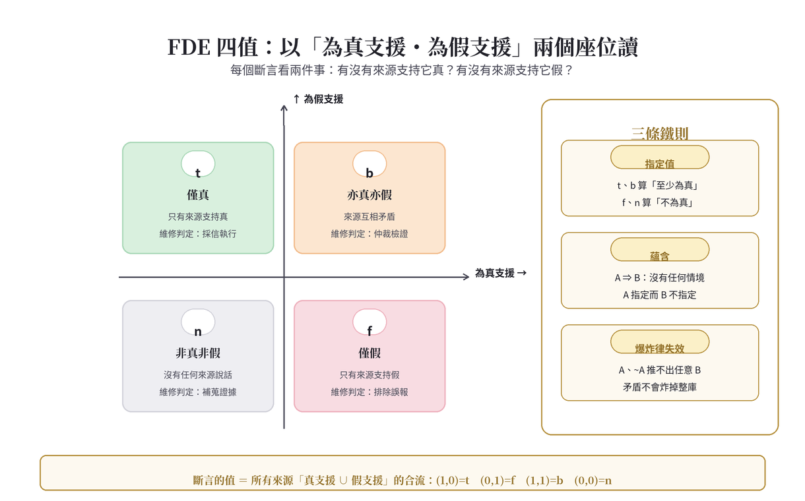

**圖 1-2　FDE 四值：為真支援・為假支援**

**表 1-2　四值語義與處置**

| 值 | 讀法 | 來源狀態 | 維修現場的處置 |
| --- | --- | --- | --- |
| **t 僅真** | 至少為真（指定） | 只見真支援 | 採信執行：開工單、安排更換 |
| **f 僅假** | 不為真 | 只見假支援 | 排除誤報：關閉警報、留檔 |
| **b 亦真亦假** | 至少為真（指定） | 真假支援並存 | 進仲裁：複測、會診、第三方檢證 |
| **n 非真非假** | 不為真 | 兩種支援都沒有 | 開補蒐：調閱紀錄、加裝感測 |

四個座位帶來兩個直接的推論。其一，矛盾不再致命：A 與 ~A 同時成立（都坐 b）時，不會像古典邏輯那樣推出任意結論——這就是 FDE 的「爆炸律失效」，知識庫不會因為一條矛盾就整庫報銷。其二，空白不再等於否定：n 座位上的東西「沒有被說過」，不等於「不成立」，它需要的是補證據，不是被排除。另外要注意：排中律也失效了——A ∨ ~A 不再是恆真式（當 A 坐 n 時，兩邊都不指定）。若把值限制回 t、f 兩個座位，FDE 就退回古典邏輯——它是古典邏輯的保守擴充，不是推翻。

> **斷言的值 ＝（任一來源支持真 → 真支援＝1, 任一來源支持假 → 假支援＝1）　(1,0)=t　(0,1)=f　(1,1)=b　(0,0)=n**

## 1.3　雙本形落點：空間立結構・時間走流程

本形學的雙本形在本書裡各司其職。空間本形負責「本體的靜態結構」：三種括號給出三類公理的格式，remove 判準給出必要性的分級，id(C) 給出實例的同一性。時間本形負責「本體的動態流程」：十四招招式盤覆蓋從找資料、生概念、做推理到自我演化的一整條生命週期。一句話記法：空間決定「產出長什麼樣」，時間決定「產出怎麼長出來」。

**表 1-3　空間本形落點**

| 工具 | 落點 | 產出形 |
| --- | --- | --- |
| **[ ] 抽象集合** | 概念的必要特徵 F(T) 與交集判準 ∩(T) | 概念形・公理形 |
| **{ } 組成集合** | 部件結構與 remove 三級必要性 | 關係形・公理形 |
| **( ) 容器集合** | 身份 id(C)、內部空間 S(C)、不變性公理 | 斷言形・演化形 |
| **三層判斷** | 斷言進帳的「是・有・對」三關 | 斷言形・查證形 |

**表 1-4　時間本形落點（四組招式）**

| 招式組 | 本體生命週期的工作 | 常用招式 |
| --- | --- | --- |
| **搜尋萃取** | 找現成本體、設計模式與資料源 | 形時間函式搜尋、設計搜尋與萃取 |
| **生成應用** | 生成概念層級、公理初稿與查詢 | 邏輯生成與應用、函式生成與應用、設計 |
| **推理思考** | 在四值上做因果與反事實推理 | 推理（因果・果因・模擬・統計・逆向）、思考法 |
| **學習演化** | 值隨證據流轉、結構自我重整 | 持續學習、重構與重組、研發與探索、自我演化 |

## 1.4　產出不準的四個現場

為什麼要這麼講究？因為設備維修知識的產出一旦不準，代價是機器停轉與安全風險。常見的失準現場有四種，每一種都對應本書後面的一套解法——先把敵人看清楚。

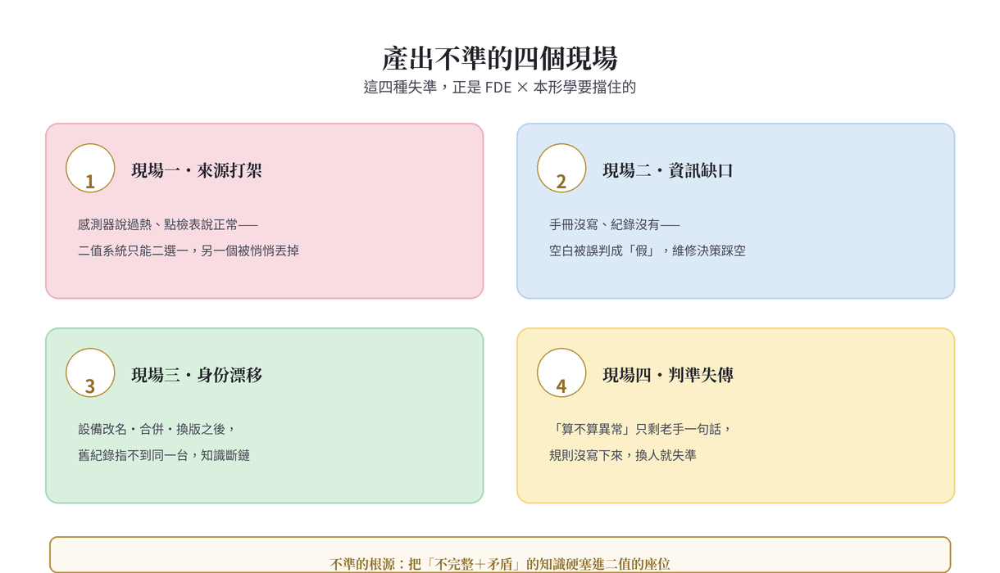

**圖 1-3　產出不準的四個現場**

**表 1-5　四個現場與解法預告**

| 現場 | 病徵 | 解法（章節） |
| --- | --- | --- |
| **來源打架** | 二值系統只能二選一，另一個證據被丟掉 | 四值斷言・仲裁閉環（2.4、5.4） |
| **資訊缺口** | 空白被誤判成假，決策踩空 | n 進補蒐・補到才算（1.2、5.4） |
| **身份漂移** | 改名・合併・換版後紀錄對不上 | id(C) 與不變性公理（2.3） |
| **判準失傳** | 「算不算異常」只在老師傅腦中 | ∩(T) 寫明・反例檢查（3.1、3.3） |

> **本章重點**
>
> ◆　本體論給知識一個「可推理的副本」：概念、屬性、關係、公理、實例，五件套缺一不可。
>
> ◆　FDE 給知識四個座位：t、f、b、n——矛盾進 b、缺口進 n，資訊不再蒸發。
>
> ◆　空間本形立結構、時間本形走流程；產出不準的四個現場，全書各章都有對應解法。

# 第二章　六種產出形「概關公斷查演」

產出要準，先得有形。本章把本體論與 FDE 的全部交付物收斂成六種產出形：概念形、關係形、公理形、斷言形、查證形、演化形——記法「概關公斷查演」。每一種形就是一張欄位卡：欄位寫什麼、什麼時候寫、拿什麼判準驗收，全都先定義好。六種形串成一條產出鏈：先立概念，再連關係，寫下公理，收進斷言，出動查詢，走完演化。

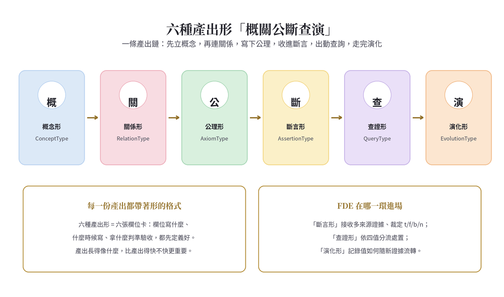

**圖 2-1　六種產出形產出鏈**

## 2.1　概念形 ConceptType：把類別寫成規則

概念形負責「是什麼類別」。它的核心是抽象集合 [ ] 的格式：一個類別 T 由必要特徵集合 F(T) 與交集判準 ∩(T) 兩樣東西決定，特徵全數通過才入類——所以類別是開放規則，不是寫死清單，連尚未出現的設計也能被正確歸類。設備域的常見錯誤是把概念形寫成清單（「泵浦有以下五型號」），結果新型號一進場就失準。

> **抽象類別 T ＝ ( 特徵集合 F(T), 交集判準 ∩(T) )　x 屬於 T ⇔ 全部 f 通過 f(x)＝true**

**表 2-1　概念形欄位卡**

| 欄位 | 寫什麼 | 驗收判準 |
| --- | --- | --- |
| **概念名** | 中文名＋Type 後綴英文名 | 全域唯一、可指稱 |
| **必要特徵 F(T)** | 入類必須通過的特徵清單 | 每一條都可判真假 |
| **交集判準 ∩(T)** | 特徵如何合流判定 | 新實例可機械式套用 |
| **上位・下位** | 類別層級的上下位連結 | 上位特徵全數繼承 |
| **邊界案例** | 擦邊球怎麼歸 | 至少列一筆、附判決理由 |

概念形同時是三括號的匯合點：必要特徵來自 [ ]、組成約束來自 { }、身份約束來自 ( )。把三括號一起寫進概念的定義，本體才不會長成一張只有名字的分類樹。

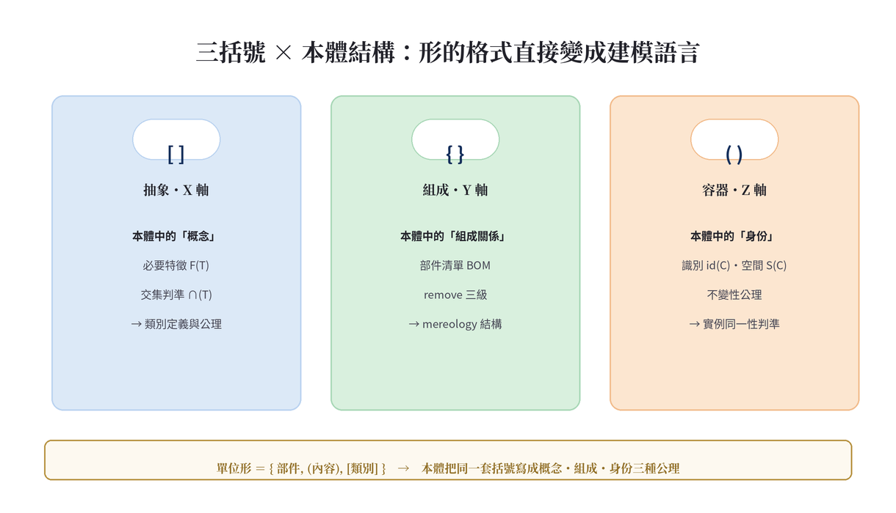

**圖 2-2　三括號 × 本體結構**

## 2.2　關係形 RelationType：把連接寫成結構

關係形負責「怎麼連」。設備域的關係有三種來源：組成關係（軸承 屬於 泵浦）來自 { }，時序關係（振動 先於 異常）來自時間本形，因果關係（潤滑劣化 造成 軸承磨損）來自推理招式。每一條關係都要能回答：兩端是什麼概念？方向與基數？失去這條關係會怎樣？

**表 2-2　關係形欄位卡**

| 欄位 | 寫什麼 | 驗收判準 |
| --- | --- | --- |
| **關係名** | 動詞式命名（屬於・造成・先於） | 主客體型別可約束 |
| **兩端型別** | 定義域與值域的 conceptType | 型別不合即拒收 |
| **基數** | 一對一・一對多・多對多 | 與公理形一致 |
| **必要性級** | remove 三級：必要・降級・非必要 | 級別有判準依據 |
| **反向關係** | hasPart・causedBy 等反向命名 | 可雙向查詢 |

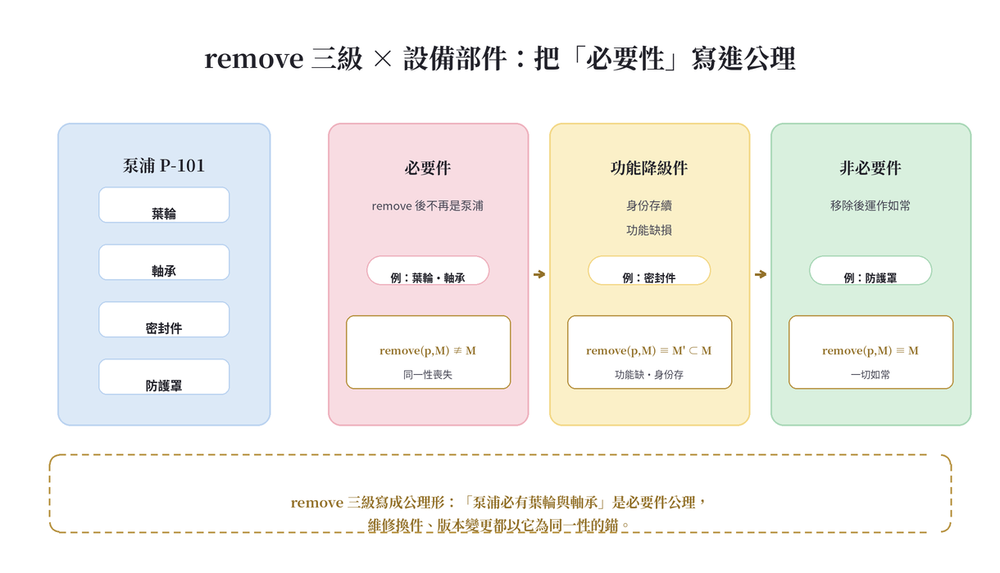

**圖 2-3　remove 三級 × 設備部件**

remove 判準是關係形的骨幹：把部件 p 從整體 M 移除，看移除後的結果落在哪一級。三級的分界必須寫成公式附在關係形上，後面 2.3 的公理形直接引用它。

## 2.3　公理形 AxiomType：把不變寫成約束

公理形負責「什麼必成立」。它把兩樣不變寫成機器可檢查的約束：一是容器的不變性公理——換掉內容物，身份不變；二是部件的必要性公理——必要件被移除，同一性就喪失。這兩條公理是身份漂移的解毒劑：設備改名、合併、換版之後，紀錄依然指得到同一台。

> **容器 C ＝ ( 身份識別 id(C), 內部空間 S(C) )　不變性公理：換掉 S(C) 內任何元素，id(C) 不變**

**表 2-3　公理形欄位卡**

| 欄位 | 寫什麼 | 驗收判準 |
| --- | --- | --- |
| **公理名** | 不變性公理・必要件公理・約束式 | 可命名、可引用 |
| **約束式** | 邏輯式或 remove 判準式 | 可機械檢查 |
| **作用域** | 約束哪些 conceptType／relationType | 範圍外誤用會被拒 |
| **反例清單** | 曾經違反的情境與處理 | 每則反例有閉環 |
| **版本註記** | 公理何時改過、為何改 | 與演化帳連動 |

> **公理的三個書寫紀律**
>
> ◆　一條公理一件事：複合句拆開，違反時才知道是哪條。
>
> ◆　公理要能被違反：寫不出反例情境的句子不是公理，是口號。
>
> ◆　公理要能被改：改公理＝動演化帳，版本註記不能省。

## 2.4　斷言形 AssertionType：四值斷言卡

斷言形是 FDE 的主戰場。每一條斷言都是一張卡：主語、謂詞、四值、來源清單、時間戳、仲裁狀態。值不靠投票表決，靠規則聚合——只要有一個來源支持真，就有真支援；只要有一個來源支持假，就有假支援；兩者並存是 b，兩者皆無是 n。b 與 n 不是壞值，是情報：b 告訴你「去仲裁」，n 告訴你「去補蒐」。

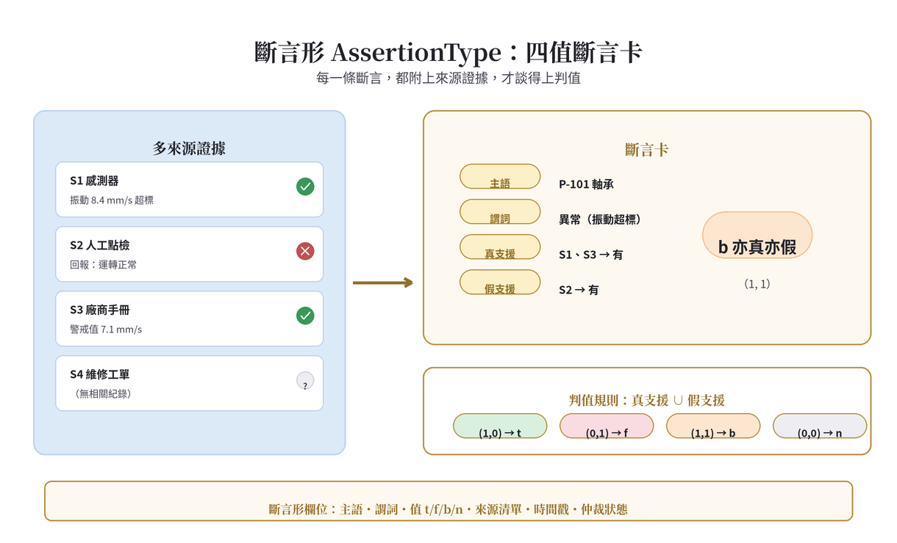

**圖 2-4　四值斷言卡**

**表 2-4　斷言形欄位卡**

| 欄位 | 寫什麼 | 驗收判準 |
| --- | --- | --- |
| **主語** | 實例 ID（id(C) 指認） | 身份可回溯 |
| **謂詞** | 關係形／屬性命題 | 謂詞已註冊於本體 |
| **值** | t・f・b・n 四值之一 | 與聚合規則一致 |
| **來源清單** | S1…Sk 與各自立場 | 至少一筆或明記無來源 |
| **時間戳** | 斷言成立與最近流轉時間 | 可重建當時的值 |
| **仲裁狀態** | 未啟動・進行中・已裁決 | b 必須有仲裁紀錄 |

> **聚合規則：真支援 ＝ 任一來源支持真　假支援 ＝ 任一來源支持假　值 ＝ (真支援, 假支援) 對映 t/f/b/n**

## 2.5　查證形 QueryType：答案與處置一起出

查證形負責「問與答」。它的載體是能力問題——建本體之初就寫下的驗收問題，例如「P-101 的軸承現在能不能繼續運轉？」查證形的產出不是一個布林值，而是四值結果＋處置動作＋追蹤問題。答案說「接下來做什麼」，才叫查證；只說真假的，叫資料庫查詢。

**表 2-5　查證形欄位卡**

| 欄位 | 寫什麼 | 驗收判準 |
| --- | --- | --- |
| **能力問題** | 用白話文寫的驗收問題 | 建本體時即已登錄 |
| **查詢式** | 以概念・關係・公理表達的查詢 | 可重跑、結果可重現 |
| **四值結果** | t・f・b・n | 由斷言形推出，非現場直覺 |
| **處置動作** | 採信・排除・仲裁・補蒐 | 四值分流表決定 |
| **追蹤問題** | 這個答案會往哪裡流轉 | 寫進演化帳 |

## 2.6　演化形 EvolutionType：值的流轉記在帳上

演化形負責「知識怎麼長大」。四值不是標籤，是知識的暫時狀態：新工單進來，n 可能變 t；點檢表翻案，t 可能變 b；仲裁裁決，b 回歸 t 或 f。每一次流轉都要記進演化帳——斷言 ID、前值後值、觸發事件、憑證、時間戳、版次。沒有演化帳的本體是照片；有演化帳的本體是錄影帶。

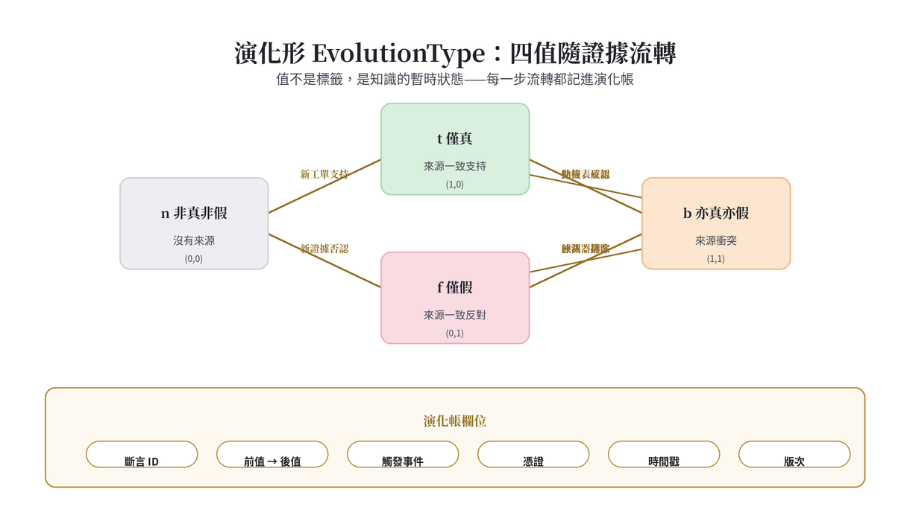

**圖 2-5　四值隨證據流轉**

**表 2-6　演化形欄位卡**

| 欄位 | 寫什麼 | 驗收判準 |
| --- | --- | --- |
| **斷言 ID** | 流轉的是哪一條斷言 | 與斷言形互相可查 |
| **前值 → 後值** | 四值流轉對 | 流轉方向有憑證支持 |
| **觸發事件** | 新來源・仲裁裁決・公理改版 | 事件可回放 |
| **憑證** | 觸發事件的原始文件 | 憑證存檔可調閱 |
| **版次** | 本體 Rev 與異動摘要 | 與公理形版本註記一致 |

> **本章重點**
>
> ◆　概關公斷查演，六種產出形各一張欄位卡——欄位先定義，產出才談得上準。
>
> ◆　概念形靠 ∩(T) 開放生成、關係形靠 remove 三級分必要、公理形守住 id(C) 不變性。
>
> ◆　斷言形以聚合規則判 t/f/b/n；查證形連處置一起出；演化形記下每一次流轉。

# 第三章　四層準確性保證

「準確」不能靠感覺，要靠關卡。本書的四層準確性保證，一層守一層：第一層用交集判準 ∩(T) 確保「判得對」，第二層用演繹骨架與 FDE 推理確保「推得動」，第三層用形式驗證與反例檢查確保「經得起查」，第四層用形證據鏈確保「追得到源頭」。四層全過，再走空間 × 時間交叉驗收。

**表 3-1　四層準確性總表**

| 層 | 守什麼 | 工具 | 不過的時候 |
| --- | --- | --- | --- |
| **第一層** | 判得對 | ∩(T) 判準漏斗 | 回到概念形重寫特徵 |
| **第二層** | 推得動 | 演繹骨架・指定值保真 | 修骨架、換推理招 |
| **第三層** | 經得起查 | 反例檢查・能力問題 | 記反例、改公理 |
| **第四層** | 追得到 | 形證據鏈 | 補憑證、補時間戳 |

## 3.1　第一層・交集判準 ∩(T)

第一層把「算不算異常」從口頭經驗變成機械判準。以「軸承異常」為例：先在概念形寫明必要特徵 F(T)——流量異常？振動超標？溫度異常？再用交集判準把三問合流。在 FDE 下，判準的輸出不是是非題，而是四值：全過且證據一致輸出 t、明確不過輸出 f、有的過有的不過輸出 b、關鍵問項無資料輸出 n。四值輸出讓「判定」與「處置」一次到位。

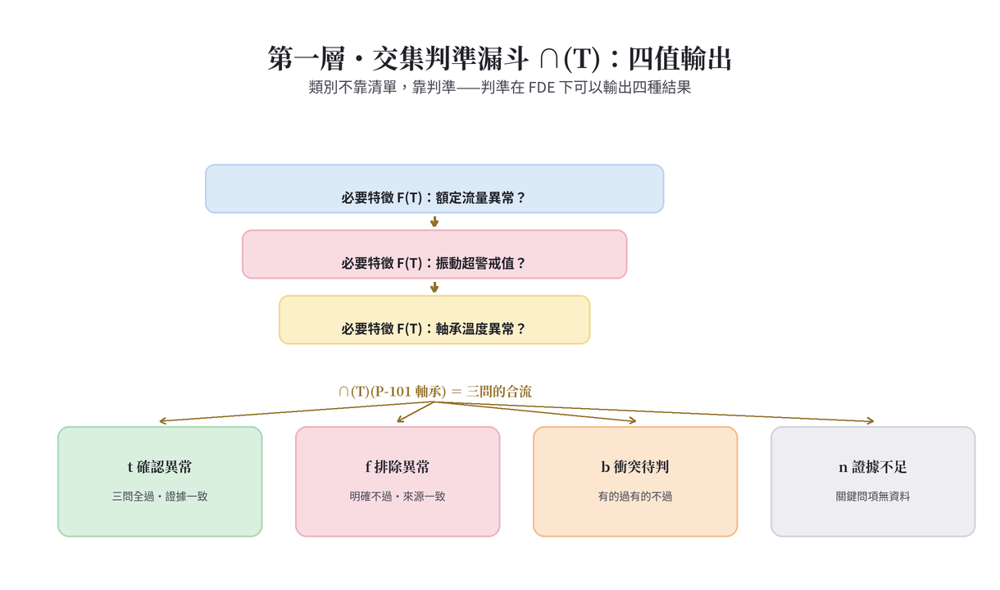

**圖 3-1　交集判準漏斗的四值輸出**

判準書寫的紀律有三：每一問都要能在資料裡找到對應欄位；每一問的通過條件都要寫到不需要再解釋；三問的合流規則要與聚合規則一致（真支援取聯、假支援取聯，對映成四值）。判準寫得含糊，後面三層再嚴謹也只是把模糊包裝得漂亮。

## 3.2　第二層・演繹骨架與 FDE 推理

第二層把維修推理寫成顯式骨架：因（外因：潤滑劣化）→ 機（病機：軸承磨損）→ 證（證據：振動・溫升）→ 法（治法：換件・校心）→ 驗（驗收：四值復歸）。每一環的結論都是四值斷言，推理的每一招——因果、果因、模擬、統計、逆向——都跑在同一套四值語義上。骨架的意義是：推理可以被重放、被質疑、被修，而不是老師傅的一句「我看不對勁」。

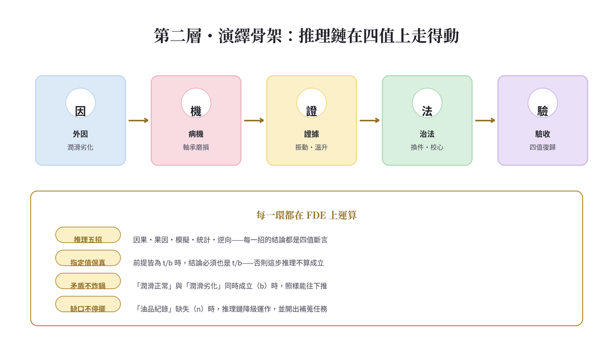

**圖 3-2　演繹骨架與 FDE 推理**

在四值上推理有一條鐵則要先立好：指定值保真。前提全部坐在 t/b（至少為真）時，結論也必須坐在 t/b，這步推理才算成立。並且要小心實質條件句——FDE 的實質條件句（~A ∨ B）不能直接當分離規則用：存在 A＝b、結論＝f 的情境，前提與條件句都指定、結論卻不指定。所以本書的演繹一律以「前提集合 ⇒ 結論」的蘊含形式檢核，見下一節的反例檢查。

> **指定值保真：Γ ⇒ B 成立 ＝ 不存在任何情境，使 Γ 全坐 t/b 而 B 坐 f/n**

## 3.3　第三層・形式驗證與反例檢查

第三層給推理裝上安檢門：反例檢查。方法很機械——把推理式兩端（前提集合 Γ 與結論 B）寫出來，找有沒有情境讓 Γ 全指定而 B 不指定。找不到，蘊含成立；找得到，記下反例、修骨架。四值世界要按四值找反例：二值世界找不到反例，不代表四值世界找不到。

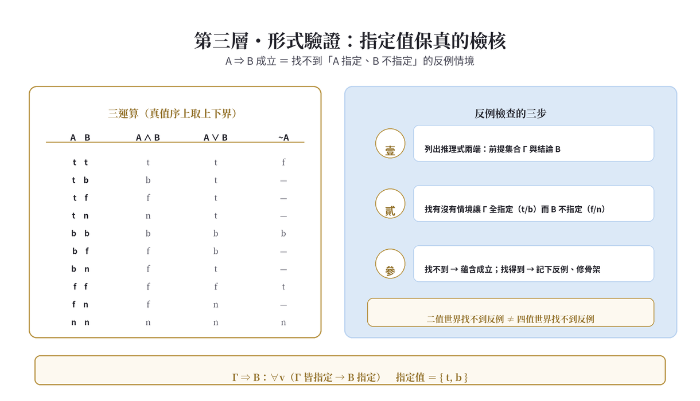

**圖 3-3　指定值保真與反例檢查**

**表 3-2　四值三運算速查（真值序上取上下界）**

| A　B | A ∧ B | A ∨ B | ~A | 備註 |
| --- | --- | --- | --- | --- |
| **t　t** | t | t | f | 古典情形 |
| **t　b** | b | t | — | b 吃掉部分真 |
| **t　f** | f | t | — | 古典情形 |
| **t　n** | n | t | — | n 不拖累析取 |
| **b　b** | b | b | b | 矛盾自持 |
| **b　f** | f | b | — | 假支援會傳導 |
| **b　n** | f | t | — | 四值特有的邊角 |
| **f　f** | f | f | t | 古典情形 |
| **f　n** | f | n | — | 缺口不補假 |
| **n　n** | n | n | n | 全然無訊息 |

讀法提醒：~A 欄只與 A 有關，同一個 A 值出現時記「—」（見同值行）。三個運算都以「為真支援・為假支援」兩個分量計算：合取的真支援取交、假支援取聯；析取反之；否定則交換兩個分量。這張表是本章所有推理檢核的計算基礎。

**表 3-3　能力問題的驗收格式**

| 欄位 | 示範（軸承異常） | 及格線 |
| --- | --- | --- |
| **能力問題** | P-101 軸承現在能不能繼續運轉？ | 白話、可答、有後果 |
| **判定依據** | ∩(T) 三問＋四值聚合 | 可重跑 |
| **結果與處置** | b → 進仲裁（複測振動） | 四值分流不跳級 |
| **追蹤問題** | 仲裁後這個值會流轉到哪裡？ | 寫進演化帳 |

## 3.4　第四層・形證據鏈

第四層確保每一條斷言都追得到源頭：值是誰判的、判準當時問了哪幾問、推理式過了保真檢核嗎、原始憑證還在嗎、值上次流轉是何時。這五問的答案串成形證據鏈。沒有證據鏈，四值只是四個標籤；有了證據鏈，b 能仲裁、n 能補蒐、t 能追責、f 能平反。

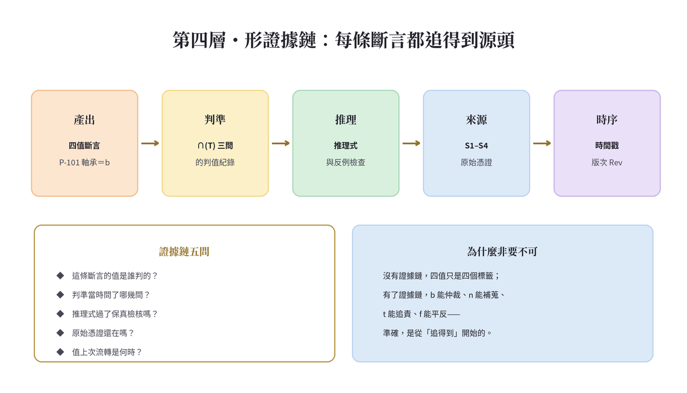

**圖 3-4　形證據鏈五節點**

**表 3-4　形證據鏈五節點**

| 節點 | 存什麼 | 斷鏈的代價 |
| --- | --- | --- |
| **判值** | ∩(T) 三問的判值紀錄 | 值不可解釋 |
| **推理** | 推理式與反例檢查結果 | 推理不可重現 |
| **來源** | S1…Sk 原始憑證 | 爭議無法仲裁 |
| **時序** | 時間戳與流轉次序 | 無法重建現場 |
| **版次** | 公理版本與演化帳索引 | 新舊規則混用 |

## 3.5　空間 × 時間交叉驗收

四層各管一軸，最後用一張九格矩陣收口：空間軸驗「結構對不對」——括號齊備、id(C) 穩、∩(T) 寫明；時間軸驗「流程走沒走」——有演化帳、有推理鏈、有招式簽名。九格全 PASS 才算驗收通過；「衝」回仲裁、「補」開補蒐任務、「檢」重跑判準。驗收的目的是修，不是打分。

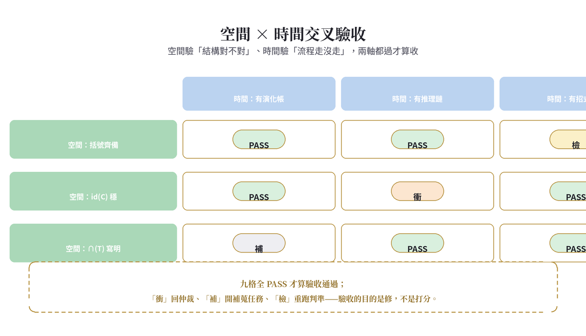

**圖 3-5　空間 × 時間交叉驗收矩陣**

> **本章重點**
>
> ◆　四層關卡：∩(T) 判得對、演繹推得動、反例查得過、證據追得到。
>
> ◆　指定值保真是 FDE 推理的鐵則；實質條件句不可直接分離，一律走反例檢查。
>
> ◆　交叉驗收九格：空間三問 × 時間三問，衝・補・檢各有閉環。

# 第四章　準確使用方法六步驟

工具介紹完畢，這章把它們排成一條可重複運轉的流程。流程的上游是框架四步驟——本形學「從資料長出形」的機器；中游是六步驟操作卡——把產出形一張一張做出來；下游是三層判斷與挑招組招換招——現場決策與招式調度。貫穿的泵浦 P-101 案例在下一章全面展開，本章先把動作做熟。

## 4.1　框架四步驟：從資料長出本體

本體不是抄來的，是被「對照失敗」逼出來的。框架四步驟就是把這個被逼出來的過程固化成機器：拿到一群設備資料，先能分辨異同（壹）；當新差異與舊維度對不上時觸發抽象（貳）；把兩批性質不同的差異各自取名成維度（參）；新資料進來時判斷歸屬——掛進舊維度，或開一條新維度（肆）。每「對不上」一次，概念與公理就再長一輪。

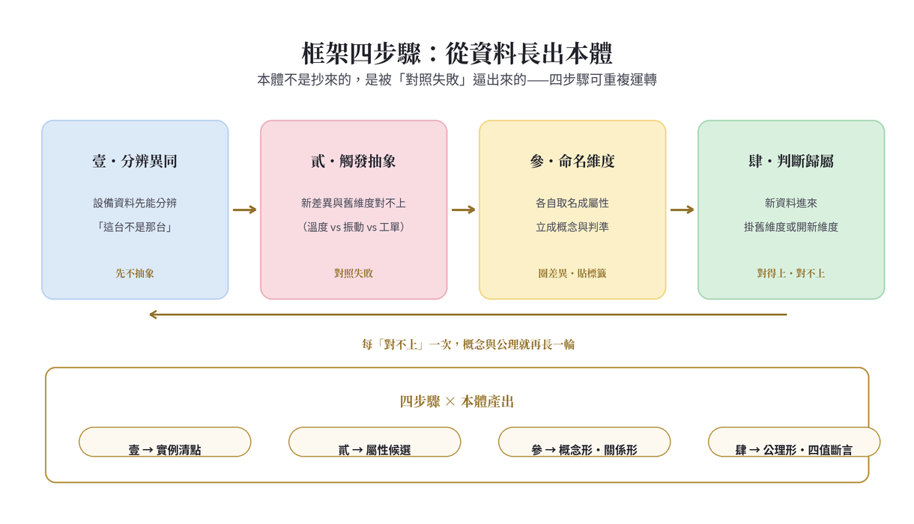

**圖 4-1　框架四步驟：從資料長出本體**

**表 4-1　框架四步驟 × 產出形**

| 步驟 | 現場動作 | 產出形落點 |
| --- | --- | --- |
| **壹・分辨異同** | 設備資料清點、實例分堆 | 實例清單（斷言形初稿） |
| **貳・觸發抽象** | 抓出對照失敗的新差異 | 屬性候選（概念形初稿） |
| **參・命名維度** | 圈差異、貼標籤、立判準 | 概念形・關係形 |
| **肆・判斷歸屬** | 新資料掛舊維度或開新維度 | 公理形・四值斷言 |

## 4.2　六步驟操作卡

六步驟把六種產出形排進一條流水線：認明情境、分軸建形、挑選擴式、生成產出、判準驗收、歸檔演化。每一步都有明確的輸入與輸出，第六步的演化帳會回頭餵第一步的下一輪情境——所以這不是直線，是螺旋。

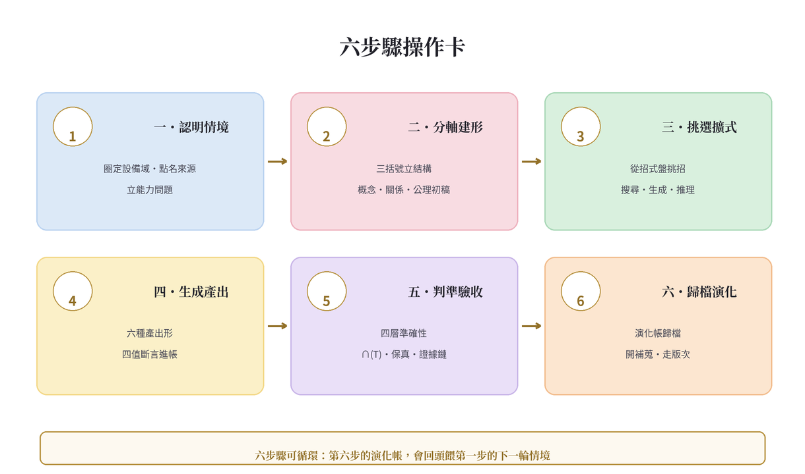

**圖 4-2　六步驟操作卡**

**表 4-2　六步驟的輸入輸出**

| 步驟 | 輸入 | 輸出 | 判準 |
| --- | --- | --- | --- |
| **一・認明情境** | 設備域範圍、來源清單 | 能力問題清單 | 問題可答、有後果 |
| **二・分軸建形** | 能力問題、資料清點 | 概念・關係・公理初稿 | 三括號齊備 |
| **三・挑選擴式** | 建形缺口 | 招式簽名 | 每招有明確任務 |
| **四・生成產出** | 初稿＋招式 | 四值斷言進帳 | 聚合規則一致 |
| **五・判準驗收** | 斷言帳 | 四層驗收報告 | 九格矩陣可判 |
| **六・歸檔演化** | 驗收結果 | 演化帳・版次 | 流轉有憑證 |

## 4.3　三層判斷：是・有・對

斷言進帳時，連闖三關：是——容器判斷，問身份是否獨立於內容（id(C) 還指得到同一台嗎）；有——組成判斷，問該有的部件都在嗎（remove 三級怎麼判）；對——抽象判斷，問過得了 ∩(T) 嗎。三關的答案都可以是 t/f/b/n，處置看四值分流：例如「是＝n、有＝t、對＝b」讀作身份存疑、部件齊全、歸類衝突——先修身份，再仲裁歸類。

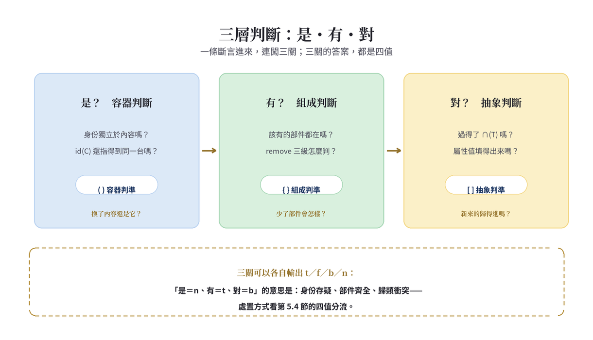

**圖 4-3　三層判斷：是・有・對**

**表 4-3　三層判斷速查**

| 關 | 判準 | 常見病徵 | 四值分流 |
| --- | --- | --- | --- |
| **是？** | ( ) id(C)・不變性公理 | 改名後紀錄對不上 | n → 先補身份證據 |
| **有？** | { } remove 三級 | 少件仍放行 | f → 攔下、開缺件單 |
| **對？** | [ ] ∩(T) 判準 | 擦邊球亂歸類 | b → 進仲裁、補邊界案例 |

## 4.4　挑招・組招・換招

招式盤是工具箱，不是劇本。挑招看情境：來源雜亂走搜尋萃取、概念空白走生成應用、因果存疑走推理五招、判準失準走分析解題。組招講串接：搜尋 → 生成 → 推理是最常用的三連招。換招講紀律：反例出現就換推理招、b 滯留就走仲裁招、n 過多就走補蒐招。每份產出記下招式簽名——用了哪幾招、為什麼選它們——可追責、可重現、可演化。

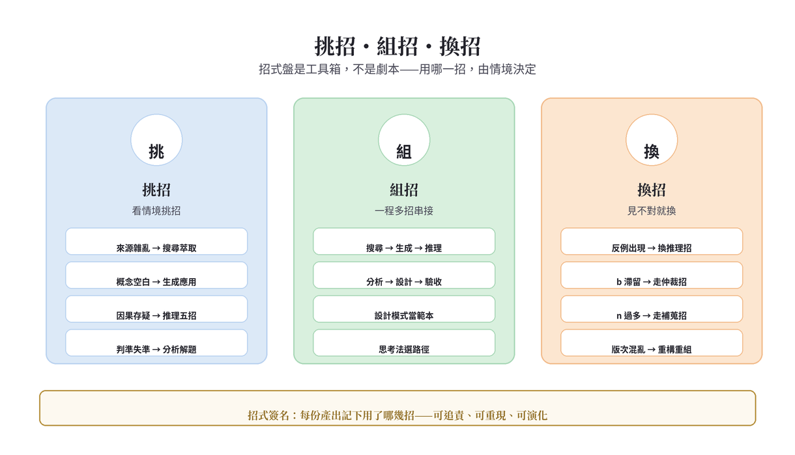

**圖 4-4　挑招・組招・換招**

**表 4-4　挑招・組招・換招速查**

| 動作 | 觸發情境 | 招式 |
| --- | --- | --- |
| **挑招** | 來源雜亂 | 形時間函式搜尋、設計搜尋與萃取 |
| **挑招** | 概念空白 | 邏輯生成與應用、設計 |
| **挑招** | 因果存疑 | 推理（因果・果因・模擬・統計・逆向） |
| **組招** | 建本體主線 | 搜尋 → 生成 → 推理 三連招 |
| **組招** | 選路徑 | 思考法（逆向・水準・第一性原理） |
| **換招** | b 滯留 | 解題・分析 → 仲裁招 |
| **換招** | n 過多 | 研發與探索 → 補蒐招 |
| **換招** | 版次混亂 | 重構與重組 |

> **本章重點**
>
> ◆　框架四步驟從對照失敗長出維度；六步驟把六種產出形排成螺旋流水線。
>
> ◆　三層判斷「是・有・對」三關都出四值，處置走四值分流。
>
> ◆　招式簽名是紀律：每份產出記下用了哪幾招，可追責、可重現、可演化。

# 第五章　S1–S7 與全程產出範例

這章把前面四章的全部方法收進一條七段接力流水線：S1 認範圍、S2 建概念、S3 立公理、S4 收斷言、S5 出查證、S6 走演化、S7 總驗收。每一段交棒給下一段——上一段的產出，是下一段的輸入。先看流水線全貌，再給出七段提示詞全文，最後用泵浦 P-101 走完全程，展示產出長什麼樣。

## 5.1　七段接力：S1–S7 流水線

接力有四條規矩。S1 不定，後面全亂——能力問題先寫下。S4 之前不判值——證據先進帳，值才不會變成主觀印象。S5 起每步留痕——形證據鏈不斷線。S7 不過，退回該退的那一段，不硬過。

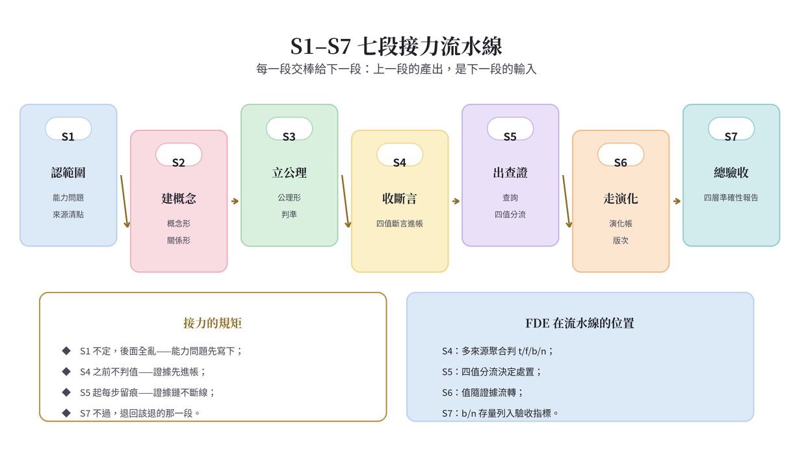

**圖 5-1　S1–S7 七段接力流水線**

**表 5-1　S1–S7 總表**

| 段 | 任務 | 產出形 | 交棒物 |
| --- | --- | --- | --- |
| **S1 認範圍** | 圈設備域、點名來源、立能力問題 | 查證形（題目） | 能力問題清單＋來源清單 |
| **S2 建概念** | 三括號立結構 | 概念形・關係形 | 類別層級＋關係表 |
| **S3 立公理** | 不變寫成約束 | 公理形 | 公理集＋反例清單 |
| **S4 收斷言** | 多來源聚合判值 | 斷言形 | 四值斷言帳 |
| **S5 出查證** | 能力問題驗收＋分流 | 查證形 | 四值結果＋處置單 |
| **S6 走演化** | 值流轉、版次管理 | 演化形 | 演化帳＋版次 |
| **S7 總驗收** | 四層準確性報告 | 全部六形 | 驗收報告＋退回清單 |

## 5.2　S1–S7 提示詞全文

以下七段提示詞可直接抄用。使用方式：每一段把產出貼回對應欄位卡，才進下一段；括號｛｝處填入你的設備域。

> **S1　認範圍（產出：能力問題清單＋來源清單）**
>
> 你是｛設備域｝的知識本體建模者。請幫我圈定本體範圍並產出兩張清單。
>
> 一、能力問題清單：寫出 5–8 個白話、可答、有後果的驗收問題（例：P-101 軸承現在能不能繼續運轉？）。
>
> 二、來源清單：點名所有訊息來源（感測器／人工紀錄／手冊／工單…），逐一註明它能支持什麼、可能與誰矛盾。
>
> 要求：問題不得用本體術語寫；來源必須標明哪些題目它可能缺席（這將是 n 的來源）。

> **S2　建概念（產出：概念形・關係形）**
>
> 針對 S1 的能力問題，用框架四步驟長出概念與關係。
>
> 一、概念形：每個類別給「概念名／必要特徵 F(T)／交集判準 ∩(T)／上下位／邊界案例」五欄位；類別必須開放可收新成員。
>
> 二、關係形：列出組成・時序・因果三類關係，每條給「關係名／兩端型別／基數／remove 必要性級／反向關係」。
>
> 要求：三括號各就其位——[ ] 管特徵、{ } 管組成、( ) 管身份；泵浦 P-101 的葉輪・軸承・密封件・防護罩必須過 remove 三級。

> **S3　立公理（產出：公理形）**
>
> 把 S2 結構中「永遠成立」的部分寫成公理。
>
> 一、不變性公理：為每個實例類別寫出 id(C) 與不變性約束（換掉內容物、改名、換版後仍指認同一台的規則）。
>
> 二、必要件公理：引用 remove 三級，寫出必要件／功能降級件的約束式。
>
> 三、邊界案例公理：把 S2 的擦邊球判決寫成可檢查的約束。
>
> 要求：一條公理一件事；每條都要能寫出反例情境；版本註記欄位預留。

> **S4　收斷言（產出：四值斷言帳）**
>
> 把各來源對 S1 能力問題的證據收進斷言帳，並按聚合規則判值。
>
> 每筆斷言：主語／謂詞／值 t・f・b・n／來源清單（各來源立場）／時間戳／仲裁狀態。
>
> 聚合規則：任一來源支持真＝真支援 1；任一來源支持假＝假支援 1；(1,0)→t、(0,1)→f、(1,1)→b、(0,0)→n。
>
> 要求：b 必須標注衝突對是哪兩個來源；n 必須標注缺席的是哪個來源；嚴禁把 b 當故障、把 n 當 false。

> **S5　出查證（產出：四值結果＋處置單）**
>
> 以 S1 的每一則能力問題執行查證，產出查證形。
>
> 每則查證：能力問題／查詢式（以概念・關係・公理表達）／四值結果／處置動作／追蹤問題。
>
> 四值分流：t→採信執行；f→排除誤報；b→進仲裁（複測・會診・第三方檢證）；n→開補蒐任務。
>
> 要求：結果必須由斷言帳推出並附推理式；推理一律以「前提集合 ⇒ 結論」檢核指定值保真，不得直接分離實質條件句。

> **S6　走演化（產出：演化帳＋版次）**
>
> 模擬新證據進場，讓四值流轉並記帳。
>
> 每筆流轉：斷言 ID／前值 → 後值／觸發事件（新來源・仲裁裁決・公理改版）／憑證／時間戳／版次 Rev。
>
> 要求：每次流轉都要憑證；b 滯留未仲裁、n 滯留未補蒐的存量要列出；結構性異動（新維度、公理改版）要同步更新版本註記。

> **S7　總驗收（產出：四層準確性報告）**
>
> 產出總驗收報告：
>
> 一、四層關卡逐層結論：∩(T) 判得對？演繹推得動？反例查得過？證據追得到？
>
> 二、空間 × 時間九格矩陣：括號齊備・id(C) 穩・∩(T) 寫明 × 演化帳・推理鏈・招式簽名。
>
> 三、退回清單：不通過的項目退回 S2–S6 的哪一段，理由是什麼。
>
> 四、b/n 存量指標：衝突與缺口的數量、平均滯留時間。
>
> 要求：九格未全 PASS 不得宣告完成；報告每條結論都要能翻到證據鏈節點。

## 5.3　案例全程：泵浦 P-101 維修知識本體

貫穿案例登場。P-101 是二號線冷卻水站的泵浦，2019 年裝機。四個來源：S1 感測器 IoT（振動・溫度即時值）、S2 人工點檢表（每週手抄）、S3 廠商手冊（保養規範・警戒值）、S4 維修工單史（歷年更換）。現場的麻煩是家常便飯：軸承振動 S1 說超標、S2 說正常；密封圈更換週期手冊沒寫、工單沒記；馬達絕緣 S4 說劣化、S1 讀數卻正常。

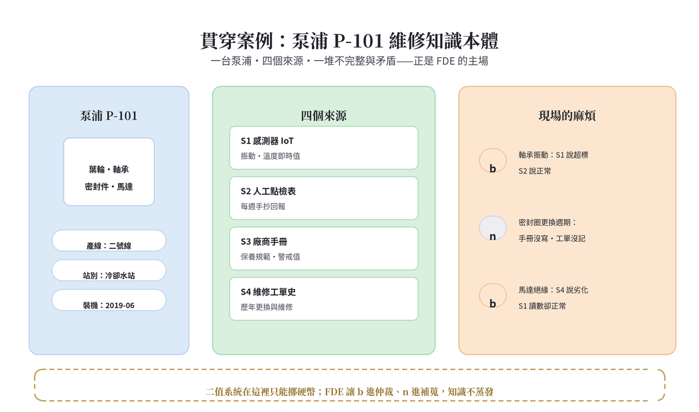

**圖 5-2　泵浦 P-101 案例全景**

**表 5-2　概念形產出（S2 摘要）**

| 概念 | 必要特徵 F(T)（摘要） | ∩(T) 要點 | 邊界案例 |
| --- | --- | --- | --- |
| **泵浦 Pump** | 有葉輪＋有軸承＋可泵送流體 | 三問全過入類 | 無葉輪的磁力泵→入類、註記特例 |
| **軸承 Bearing** | 支撐轉軸＋可判磨損 | 磨損判準見公理 | 含油軸套→功能降級判定 |
| **異常 Fault** | 違反警戒判準之一 | 四值輸出 | 瞬時尖峰→需連續 N 點才算 |

**表 5-3　關係・公理產出（S2–S3 摘要）**

| 名目 | 內容 | 級／約束 |
| --- | --- | --- |
| **組成關係** | 軸承・葉輪・密封件・馬達 屬於 泵浦 | 軸承・葉輪＝必要件；密封件＝功能降級件；防護罩＝非必要件 |
| **因果關係** | 潤滑劣化 造成 軸承磨損；磨損 造成 振動超標 | 因果鏈可反向查詢（果因推理） |
| **不變性公理** | P-101 更換密封件、搬移站別後 id 不變 | id(C)＝設備資產編號＋裝機序 |
| **必要件公理** | remove(葉輪,P-101) ≢ M；remove(軸承,P-101) ≢ M | 違反即同一性喪失 |

## 5.4　四值斷言與查證產出

S4 把四個來源的證據收進斷言帳。聚合規則一跑，值各歸其位：三個現場難題分別落在 b、n、b——不吵架、不蒸發、不裝沒事。

**表 5-4　四值斷言帳（S4 產出節選）**

| 斷言（主語・謂詞） | 真支援 | 假支援 | 值 | 說明 |
| --- | --- | --- | --- | --- |
| **P-101 軸承・振動異常** | S1（8.4 mm/s 超標）、S3（警戒 7.1） | S2（回報正常） | b | 衝突對 S1×S2 → 進仲裁 |
| **P-101 密封件・已達更換週期** | （無） | （無） | n | S3 未載・S4 無紀錄 → 補蒐 |
| **P-101 馬達・絕緣劣化** | S4（工單記劣化） | S1（讀數正常） | b | 衝突對 S4×S1 → 進仲裁 |
| **P-101 葉輪・腐蝕減薄** | S1（厚度量測）、S4（工單） | S2（目視正常） | b→裁 t | 仲裁複測後裁決，見表 5-6 |
| **P-101 潤滑・油品劣化** | S1（油中水含量） | （無） | t | 一致證據 → 採信執行 |

S5 拿能力問題來查證。以第一問「P-101 軸承現在能不能繼續運轉？」為例：查詢式沿軸承異常的 ∩(T) 三問取斷言帳證據，三問合流輸出 b；推理式「振動異常(b) ∧ 潤滑劣化(t) ⇒ 軸承風險升高」通過指定值保真檢核；處置依四值分流定為仲裁——複測振動並比對 S1 原始波形。答案連著處置一起出，才叫查證。

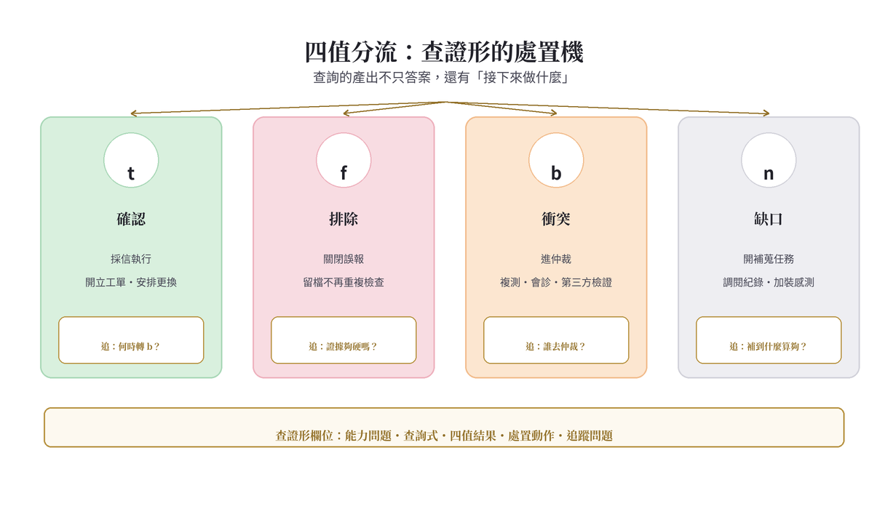

**圖 5-3　四值分流：查證形的處置機**

**表 5-5　查證形產出（S5 產出節選）**

| 能力問題 | 四值 | 處置 | 追蹤問題 |
| --- | --- | --- | --- |
| **軸承能否繼續運轉？** | b | 仲裁：複測振動＋比對波形 | 裁決後值流轉到 t 還是 f？ |
| **密封件該換了嗎？** | n | 補蒐：查原廠公告＋加裝量測 | 補到什麼程度算夠？ |
| **馬達絕緣要停機嗎？** | b | 仲裁：絕緣電阻複測 | 複測與 S4 工單誰更新？ |
| **潤滑系統要保養嗎？** | t | 採信：開立換油工單 | 換油後指標復歸了嗎？ |
| **防護罩缺件有風險嗎？** | f | 排除：安全評估未超標 | 評估依據存檔了嗎？ |

## 5.5　演化與總驗收產出

S6 讓證據繼續進場：複測結果回來，兩筆 b 有了裁決，n 開了補蒐任務並在原廠公告到貨後補到 t。每一次流轉都記進演化帳——這就是「照片」變「錄影帶」的時刻。

**表 5-6　演化帳（S6 產出節選）**

| 斷言 | 前值→後值 | 觸發事件 | 憑證 | 版次 |
| --- | --- | --- | --- | --- |
| **軸承・振動異常** | b → t | 仲裁複測超標（9.1 mm/s） | 複測報告 R-042 | Rev A→B |
| **馬達・絕緣劣化** | b → f | 絕緣電阻複測合格 | 複測報告 R-043 | Rev A→B |
| **密封件・達更換週期** | n → t | 原廠公告補到週期規範 | 原廠公告 OM-118 | Rev B→C |
| **葉輪・腐蝕減薄** | b → t | 厚度複測確認減薄 12% | 量測紀錄 M-077 | Rev A→B |

**表 5-7　總驗收報告（S7 產出摘要）**

| 驗收項 | 結論 | 證據鏈節點 |
| --- | --- | --- |
| **第一層・∩(T) 判得對** | PASS（三問全可機械套用） | 表 5-2 判值紀錄 |
| **第二層・演繹推得動** | PASS（推理式全過保真檢核） | S5 推理式清單 |
| **第三層・反例查得過** | PASS（記 2 則反例、已修邊界案例） | 反例清單 EX-01/02 |
| **第四層・證據追得到** | PASS（五節點齊備） | 形證據鏈索引 |
| **九格矩陣** | 9/9 PASS | 圖 5-1・表 5-1 對映 |
| **b/n 存量** | b＝0、n＝0（本輪清空） | 演化帳表 5-6 |

> **本章重點**
>
> ◆　S1–S7 七段接力：上一段的產出是下一段的輸入，S7 不過退回該退的那段。
>
> ◆　P-101 案例示範四值斷言帳的聚合、查證分流、仲裁裁決與演化記帳全流程。
>
> ◆　產出範例的每一筆值都翻得到證據鏈——這就是「準確」的樣子。

# 第六章　誤用・檢核・成熟度

方法交出去之前，先把坑標出來。本章三件事：誤用五種——把 FDE 當二值用的五個陷阱；十問清單——交付前的自我檢核；成熟度與導入藍圖——從紙上本體到自我演化怎麼升級。

## 6.1　誤用五種

五個陷阱有個共同的病根：名義上用了四值，實際上按二值的直覺在做決定。對照表看熟，現場一看就聞得出來。

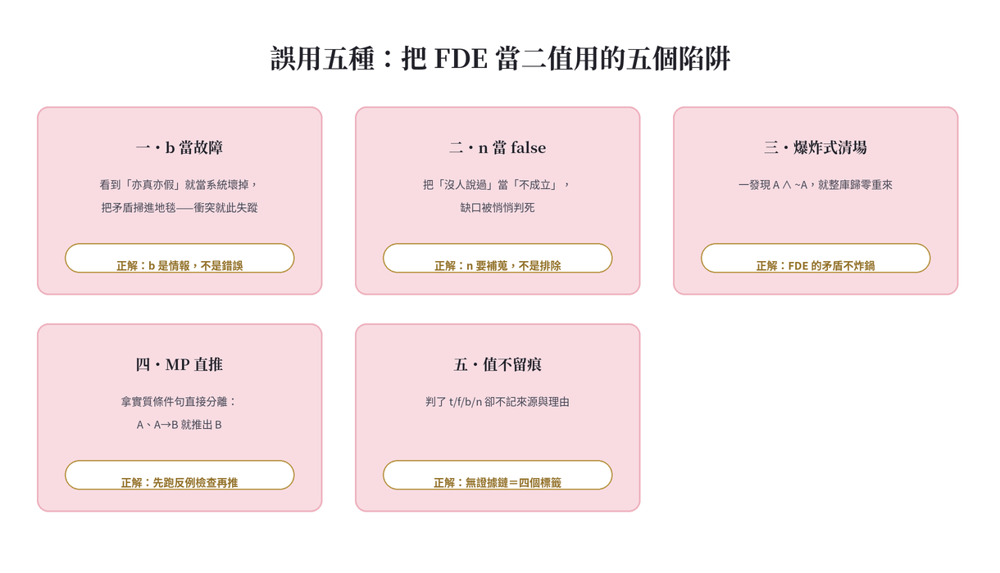

**圖 6-1　誤用五種對照**

**表 6-1　誤用五種與正解**

| 誤用 | 病徵 | 正解 |
| --- | --- | --- |
| **一・b 當故障** | 看到亦真亦假就當系統壞掉，把矛盾掃進地毯 | b 是情報：進仲裁、留痕、可追 |
| **二・n 當 false** | 把「沒人說過」判成「不成立」 | n 要補蒐：開任務、定補足標準 |
| **三・爆炸式清場** | 一見 A ∧ ~A 就整庫歸零重來 | FDE 矛盾不炸鍋：鎖定衝突對處理 |
| **四・MP 直推** | 拿實質條件句直接分離推論 | 一律「前提集合 ⇒ 結論」＋反例檢查 |
| **五・值不留痕** | 判了四值卻不記來源與理由 | 形證據鏈五節點缺一不可 |

## 6.2　十問清單

交付前把十個問題全部答「是」，才准出門。答不出來的每一問，都指向前面某一章的對應工具。

**表 6-2　十問清單**

| # | 問題 | 指向 |
| --- | --- | --- |
| **1** | 能力問題是白話、可答、有後果的嗎？ | 5.1 |
| **2** | 每個類別都有 F(T) 與 ∩(T)，而不是一張清單嗎？ | 2.1 |
| **3** | remove 三級每一條關係都判過嗎？ | 2.2 |
| **4** | id(C) 能扛住改名・合併・換版嗎？ | 2.3 |
| **5** | 每條斷言的值都能翻出聚合紀錄嗎？ | 2.4 |
| **6** | b 都有仲裁人與期限，n 都有補蒐任務嗎？ | 2.4、5.4 |
| **7** | 推理式都過了指定值保真與反例檢查嗎？ | 3.2、3.3 |
| **8** | 九格矩陣全 PASS 嗎？ | 3.5 |
| **9** | 演化帳的每次流轉都有憑證嗎？ | 2.6 |
| **10** | 招式簽名記下了嗎——這份產出用過哪幾招？ | 4.4 |

## 6.3　成熟度 L1–L4

導入不可能一步到位，與其一次做完美，不如分四級升級。每一級的門檻不是工具，是紀律：值有來源、判有準繩、錯有閉環。

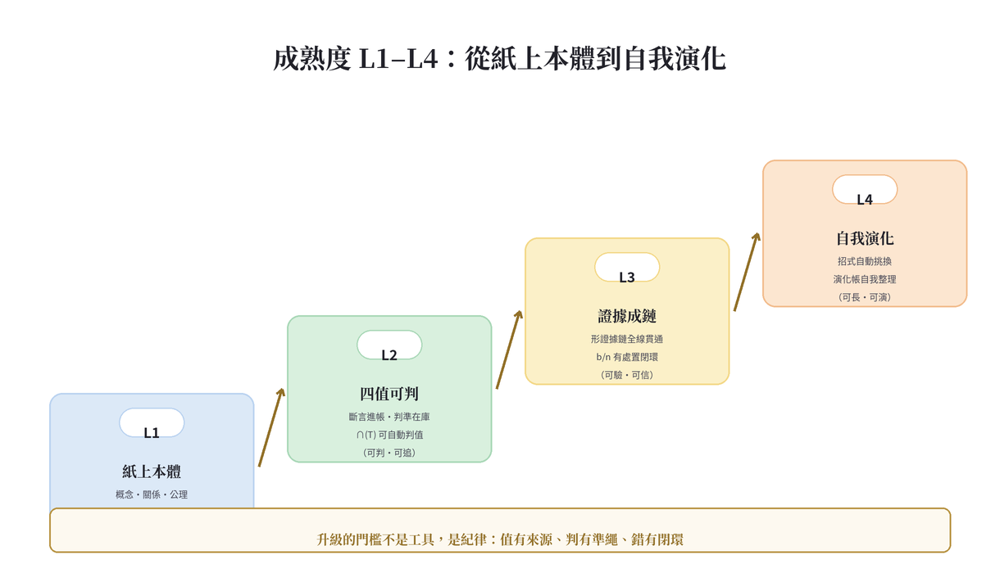

**圖 6-2　成熟度 L1–L4**

**表 6-3　成熟度四級**

| 級 | 名稱 | 門檻 | 常見卡點 |
| --- | --- | --- | --- |
| **L1** | 紙上本體 | 概念・關係・公理寫成文件 | 只寫不判、無人維護 |
| **L2** | 四值可判 | 斷言進帳、∩(T) 可自動判值 | b/n 處置無閉環 |
| **L3** | 證據成鏈 | 五節點貫通、九格常態 PASS | 演化帳記假帳 |
| **L4** | 自我演化 | 招式自動挑換、演化帳自我整理 | 人退太快、失控 |

## 6.4　導入藍圖

最後給一條九十天的導入路線：第一個月立 L1——選一台關鍵設備（例如 P-101）把五件套寫齊；第二個月上 L2——斷言進帳、判準跑通、b/n 處置閉環；第三個月衝 L3——證據鏈貫通、九格常態化。三個月後再談 L4：讓招式盤與演化帳開始自動化。

**表 6-4　九十天導入藍圖**

| 階段 | 天數 | 里程碑 | 退場標準 |
| --- | --- | --- | --- |
| **立形** | Day 1–30 | L1：五件套＋能力問題上牆 | 十問清單 1–4 答是 |
| **進帳** | Day 31–60 | L2：四值斷言帳運轉 | 十問清單 5–6 答是 |
| **成鏈** | Day 61–90 | L3：九格常態 PASS | 十問清單 7–10 答是 |
| **演化** | Day 91– | L4：招式自動挑換 | b/n 滯留時間持續下降 |

> **本章重點**
>
> ◆　五種誤用的病根都是「名四值、實二值」——b 是情報、n 是任務、矛盾不炸鍋。
>
> ◆　十問清單是交付閘門：答不出來就別出門。
>
> ◆　L1→L4 是紀律的升級，不是工具的升級：先立形、再進帳、後成鏈、終演化。

# 回顧——三個帶走

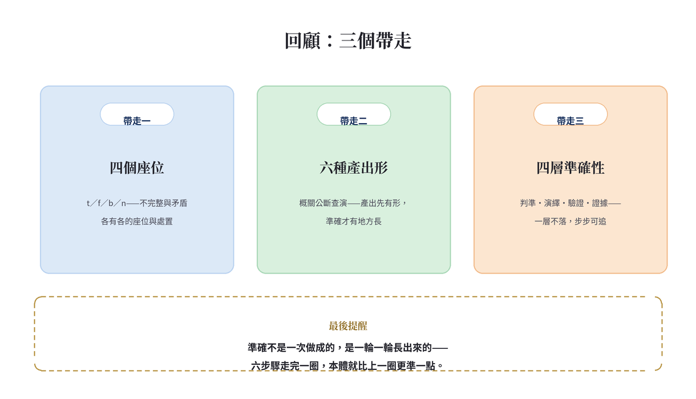

這本書從頭到尾只在做一件事：讓不完整、甚至互相矛盾的多來源知識，長成準確的產出。合上書之前，帶走三樣東西。

> **帶走一・四個座位**
>
> t、f、b、n——不完整與矛盾各有各的座位與處置。
>
> b 去仲裁、n 去補蒐、t 去執行、f 去排除：四值分流是這套方法的心臟。

> **帶走二・六種產出形**
>
> 概關公斷查演——產出先有形，準確才有地方長。
>
> 欄位先定義、判準先寫明、證據先進帳：格式，就是品質的第一道防線。

> **帶走三・四層準確性**
>
> 判準・演繹・驗證・證據——一層不落，步步可追。
>
> 空間三括號守住結構、時間招式守住流程，交叉驗收九格收口。

最後提醒：準確不是一次做成的，是一輪一輪長出來的。六步驟走完一圈，本體就比上一圈更準一點——泵浦 P-101 的故事會在你的設備上，一次又一次重演，而每一次，都比上一次更接近真相。

# 附錄 A　術語・記號・招式速查

**表 A-1　術語速查**

| 術語 | 一句話定義 |
| --- | --- |
| **本體論 Ontology** | 把一個領域寫成概念化明確規格的知識副本 |
| **FDE** | Belnap 四值邏輯：一階蘊含，容得下不完整與矛盾 |
| **四值 t/f/b/n** | 僅真・僅假・亦真亦假・非真非假 |
| **指定值** | t 與 b：「至少為真」的兩個座位 |
| **聚合規則** | 多來源證據合流成四值的規則 |
| **能力問題** | 建本體之初寫下的驗收問題 |
| **概念形 ConceptType** | 把類別寫成 F(T) 與 ∩(T) 的產出形 |
| **關係形 RelationType** | 把連接寫成結構與 remove 三級的產出形 |
| **公理形 AxiomType** | 把不變寫成約束的產出形 |
| **斷言形 AssertionType** | 四值斷言卡：值＋來源＋時間戳＋仲裁狀態 |
| **查證形 QueryType** | 答案與處置一起出的產出形 |
| **演化形 EvolutionType** | 記下四值流轉的演化帳 |
| **形證據鏈** | 判值・推理・來源・時序・版次五節點不斷線 |

**表 A-2　記號速查**

| 記號 | 讀法 | 備註 |
| --- | --- | --- |
| **T ＝ (F(T), ∩(T))** | 抽象類別＝特徵集合＋交集判準 | 開放生成新成員 |
| **C ＝ (id(C), S(C))** | 容器＝身份識別＋內部空間 | 不變性公理的載體 |
| **remove(p,M) ≢ M** | 移除後同一性喪失 | 必要件 |
| **remove(p,M) ≡ M' ⊂ M** | 移除後功能降級 | 功能降級件 |
| **remove(p,M) ≡ M** | 移除後一切如常 | 非必要件 |
| **(1,0)(0,1)(1,1)(0,0)** | t・f・b・n 的（真支援,假支援） | 聚合規則的座標 |
| **Γ ⇒ B** | Γ 蘊含 B | 此書以 ⇒ 表記蘊含 |
| **∧　∨　~** | 合取・析取・否定 | 四值上取上下界與交換 |

**表 A-3　十四招 × 本體落點**

| 招式組 | 招式 | 本體落點 |
| --- | --- | --- |
| **搜尋萃取** | 形時間函式搜尋 | 找現成本體與判準 |
| **搜尋萃取** | 設計搜尋與萃取 | 從文件萃取特徵與關係 |
| **生成應用** | 設計模式（ODP） | 套用本體設計模式 |
| **生成應用** | 邏輯生成與應用 | 生成公理與判準 |
| **生成應用** | 函式生成與應用 | 生成查詢與聚合規則 |
| **生成應用** | 設計（創造與創新） | 新維度與新概念 |
| **推理思考** | 推理（因果・果因・模擬・統計・逆向） | 四值上的演繹骨架 |
| **推理思考** | 思考法（正向・逆向・水準・垂直・第一性原理） | 選路徑、找盲點 |
| **推理思考** | 解題・分析 | b/n 處置與仲裁 |
| **學習演化** | 持續學習 | 新來源進帳 |
| **學習演化** | 重構與重組 | 版次重整、公理改版 |
| **學習演化** | 研發與探索 | 補蒐任務、量測設計 |
| **學習演化** | 自我演化 | 演化帳自我整理 |

> **本形學 Ontypology　空間本形 × 時間本形　── 產出先有形，準確才有地方長 ──**

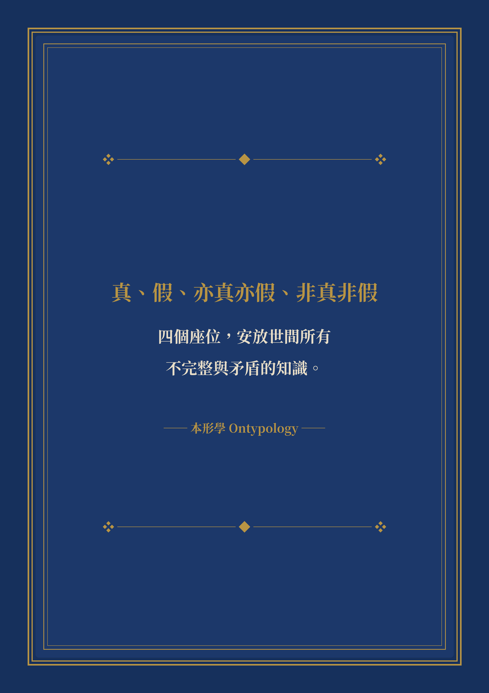
