# Palantir 與本形學

關係・準確使用方法與架構・內容完整方案

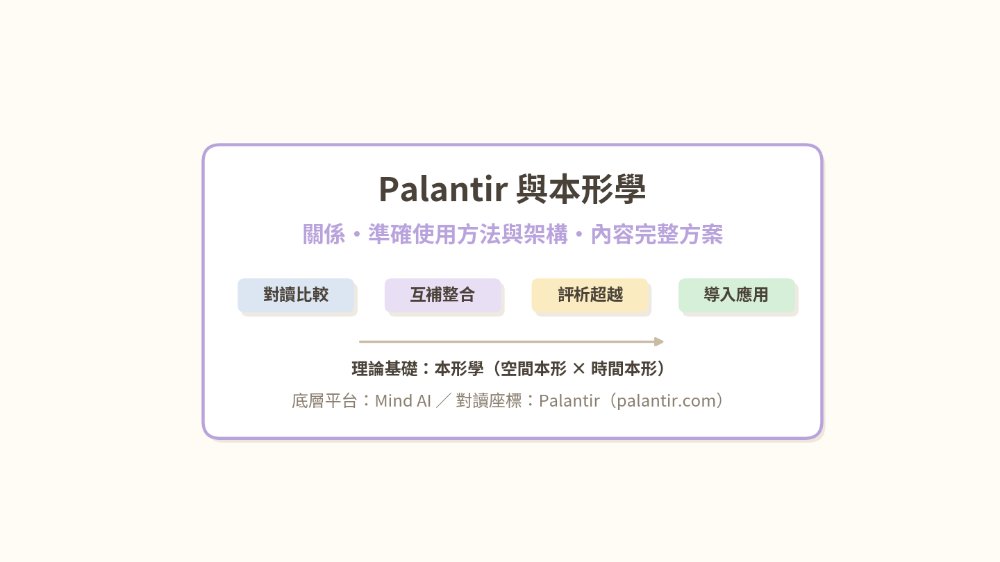

理論基礎：本形學（空間本形 × 時間本形）

底層平台：Mind AI　｜　對讀座標：Palantir（palantir.com）

# 目　錄

- 前言　這本冊子只做一件事
  - 讀者約定：雙軌閱讀
  - 如何使用本書：三種讀法
  - 資料來源與考據聲明
- 第一篇　認識 Palantir：平台全景與關係起點
  - 1.1　為什麼談 Palantir
  - 1.2　Palantir 是什麼
  - 1.3　四大作業系統
  - 1.4　Foundry Ontology：Palantir 的心臟
  - 1.5　AIP：把 AI 綁上企業的資料、邏輯、行動
  - 1.6　本篇小結
- 第二篇　本形學骨幹速覽
  - 2.1　認知鏈：形的誕生
  - 2.2　空間本形：三條軸與單位形
  - 2.3　三層判斷
  - 2.4　時間本形：形進形出
  - 2.5　準確使用方法
  - 2.6　本篇小結
- 第三篇　對讀比較：Palantir Ontology × 本形學
  - 3.1　為何可對讀：同一條認知鏈的兩個實踐
  - 3.2　對讀一：語義元素 ↔ 空間本形
  - 3.3　對讀二：動能元素 ↔ 時間本形
  - 3.4　對讀三：動態元素 ↔ 生成與演化
  - 3.5　對讀總表與一句話
  - 3.6　深度差異：同鏈不同深
  - 3.7　多領域對讀案例
  - 3.8　三種括號 × 物件建模三問
  - 3.9　對讀收束
- 第四篇　互補整合：Mind AI × Palantir
  - 4.1　分層定位：誰在哪一層
  - 4.2　架構對接：兩庫一中樞一迴路 × Foundry／AIP
  - 4.3　互補分工：一條閉環走一圈
  - 4.4　整合情境
  - 4.5　整合前後對照
- 第五篇　評析與超越：以本形學檢視 Palantir
  - 5.1　三個強項：印證本形學
  - 5.2　限制一：有形無學
  - 5.3　限制二：表記與判準缺位
  - 5.4　限制三：抽象與跨域統一的距離
  - 5.5　超越點：補上「認知的形」
  - 5.6　誤用警示：五種常見誤讀
- 第六篇　導入應用指南：準確使用方法實戰
  - 6.1　三種補足：給物件模型立規矩
  - 6.2　證明六步驟
  - 6.3　完整示範：一張調撥單
  - 6.4　函式四問卡：把行動型寫成時間本形
  - 6.5　八問檢查清單
  - 6.6　誤用大對照
  - 6.7　導入常見問答
- 第七篇　總架構：哲學—方法—實踐
  - 7.1　體—用—準總架構
  - 7.2　關係總圖
  - 7.3　AGI 三階段與 Palantir 的位置
- 第八篇　內容完整方案＋框架完整方案
  - 8.1　方案目標與雙軌讀者
  - 8.2　內容模組規劃：M1–M8
  - 8.3　框架方案：學練用教建・八週路線
  - 8.4　情境選路
  - 8.5　建庫四階段與驗收標準
  - 8.6　教學推廣與下一步
  - 8.7　總結：一句話收束
- 附錄 A　術語對照表
- 附錄 B　速查卡
  - B-1　對讀速查（一頁）
  - B-2　八問勾選（可複印）
  - B-3　空白模板：函式四問卡＋形集合卡（可複印）
- 附錄 C　練習參考答案
- 附錄 D　圖表索引

**篇章導覽表**

| 篇 | 回答什麼問題 | 關係面向 |
| --- | --- | --- |
| 前言 | 這本冊子做什麼、怎麼讀？ | 任務與約定 |
| 第一篇 | Palantir 是什麼？ | 認識・考據 |
| 第二篇 | 本形學骨幹有哪些零件？ | 理論基礎 |
| 第三篇 | 兩邊怎麼對得上？ | 對讀比較 |
| 第四篇 | Mind AI 與 Palantir 怎麼分工？ | 互補整合 |
| 第五篇 | 強在哪、缺什麼、超越什麼？ | 評析超越 |
| 第六篇 | 方法怎麼用得準？ | 導入應用 |
| 第七篇 | 全書裝在哪個架構裡？ | 總架構 |
| 第八篇 | 內容與框架怎麼落地？ | 完整方案 |
| 附錄 | 哪裡查、怎麼複核？ | 速查與答案 |

# 前言　這本冊子只做一件事

這本冊子只做一件事：把「Palantir 與本形學的關係」講清楚、講準確，並且給出一套**內容與框架的完整方案**。

Palantir 是當今把「企業世界的形」用得最深的公司之一——它把物件、行動、流程做成通用邏輯層，讓資料變成決策、決策變成行動、行動再沉澱回資料。本形學則是把「形」本身看清楚的學問：形是什麼、怎麼辨識、怎麼命名、怎麼判斷、怎麼運作。兩者從不同的山腳出發，走的卻是同一座山。

本書以**本形學（空間本形與時間本形）為理論基礎**，以 **Mind AI 為底層平台**，以 Palantir（palantir.com）為對讀座標。四個任務面向一體完成：先**對讀比較**、再**互補整合**、後**評析超越**、終**導入應用**——並且把「準確使用方法」貫穿全書。

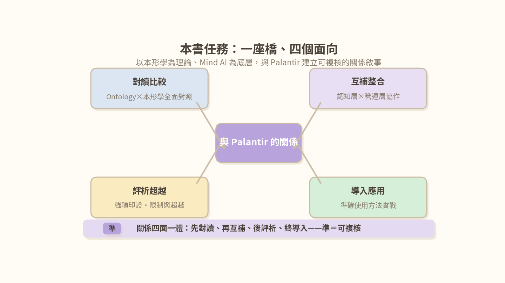

**圖 0-1　本書任務：一座橋、四個面向**

> **本書定位**
>
> ◆ 理論基礎：本形學 Ontypology（空間本形 × 時間本形）
>
> ◆ 底層平台：Mind AI（把形看清楚、轉成顯學、實踐化為 Mind AI）
>
> ◆ 對讀座標：Palantir（Gotham／Foundry／Apollo／AIP）
>
> ◆ 交付內容：準確使用方法＋內容完整方案＋框架完整方案，配以豐富圖文
>
> ◆ 範圍約定：**無須系統實作**——本書談關係、方法與方案，不談系統實作

## 讀者約定：雙軌閱讀

主文寫給所有想「把形用起來」的讀者——企業決策者、顧問、產品與資料工作者、學術研究者。每篇另有**【專業專欄】**，寫給需要落地細節的工程與架構讀者，討論本體工程、主數據管理、API 契約、事件驅動、治理等題目。兩軌分開走，互不干擾。

每篇篇末附**練習**與**小結**；練習參考答案收在附錄 C。書中圖解採粉彩配色，顏色有分工：**黃＝屬性、橘＝組成、藍＝容器、綠＝時間、紫＝總結、粉＝誤用**——藍紫色系的 Palantir 圖塊代表營運座標，紫色系的 Mind AI 圖塊代表認知座標。

術語約定：形的英文用 **Type**。三種括號各有職責：**{ } 組成、[ ] 屬性、( ) 容器**。書中所有「準確」一詞，都指同一件事：**可複核的準**。

## 如何使用本書：三種讀法

同一本書，三種讀法都走得通——依你手上的時間與任務挑一條：

| 讀法 | 時間 | 路徑 | 適合 |
| --- | --- | --- | --- |
| 速覽讀法 | 兩小時 | 前言 → 圖 1-3 → 3.5 對讀總表 → 8.6 總結 | 只想知道「關係是什麼」 |
| 方法讀法 | 一天 | 第二篇 → 第六篇 → 附錄 B 速查卡 | 要上手做導入與驗收 |
| 全書讀法 | 一週 | 依序讀完＋做完練習 E01–E09 | 要教學、要推廣、要建庫 |

> **本篇金句**
>
> 對讀不是比高低，是互相印證；評析不是找茬，是把形看得更清楚。

本書談什麼、不談什麼，先立約定——範圍清楚，讀起來才不會期待錯位：

| 本書談 | 本書不談 |
| --- | --- |
| 關係敘事：對讀、互補、評析、應用 | 系統實作、程式碼、部署架構 |
| 準確使用方法與驗收紀律 | 產品採購建議、報價與合約 |
| 內容與框架完整方案（可教可練可建） | Palantir 內部機密或非公開資訊 |
| 理論骨幹的架構圖與圖文摘要 | 逐章複製本形學原著內容 |

## 資料來源與考據聲明

本書的 Palantir 相關敘述均以公開資料為據，並於 2026 年 10 月查證。引用與定位以官方說法為準；解讀與評析部分則以本形學立場書寫，兩者在行文中分開標示。

| 類別 | 來源 | 用於本書 |
| --- | --- | --- |
| 官方產品定位 | palantir.com（平台頁・Foundry Ontology・AIP） | 語義／動能／動態三元素、三連結、寫回與稽核 |
| 公司公開資料 | 維基百科等公開資料（2026-10 查證） | 創立、營收、產品線沿革、客戶案例 |
| 理論基礎 | 本形學 Ontypology 系列文檔 | 空間本形、時間本形、準確使用方法 |
| 平台願景 | Mind AI 簡介 | 兩庫一中樞一迴路、AGI 三階段 |

聲明：本書為關係研究與方法論著作，不代表 Palantir Technologies 之立場；產品名稱與商標歸其各自權利人所有。書中評析以形學為尺、就事論事，可複核、可爭辯。

# 第一篇　認識 Palantir：平台全景與關係起點

要談關係，先認識對方。本篇不吹不貶，以公開資料為據，把 Palantir 的公司輪廓、四大作業系統、以及與本書最相關的兩個心臟——Foundry Ontology 與 AIP——看清楚。

> **本篇地圖**
>
> 1.1 為什麼談 Palantir　｜　1.2 公司速寫　｜　1.3 四大作業系統
>
> 1.4 Foundry Ontology（心臟之一）　｜　1.5 AIP（心臟之二）　｜　1.6 小結
>
> 讀完本篇，你會知道：Palantir 是什麼、它的「形」長在哪裡。

## 1.1　為什麼談 Palantir

本形學說：有合必有形。一個組織把成千上萬的資料、流程、決策「合」在一起運作，必有一個「形」在其中支撐。Palantir 的核心產品恰恰把這件事做成了顯學級的工程：它的 Foundry Ontology 官方定位是「整合企業的 **semantic（語義）、kinetic（動能）、dynamic（動態）** 三元素」的通用邏輯層。

這三個字正好落在本形學的兩面之上：**語義元素對應「它是什麼」——空間本形；動能元素對應「會做什麼」——時間本形；動態元素對應「以形生形」——生成與演化**。以本形學對讀 Palantir，就像拿一把自己磨過的尺，去量一座別人蓋好的橋——尺與橋互相印證。

## 1.2　Palantir 是什麼

Palantir Technologies 是一家美國軟體公司，2003 年創立，總部設於佛羅里達州邁阿密，主力產品為**資料整合與分析軟體**，客戶涵蓋政府機構、州與地方政府、國際組織與民間企業。公開資料顯示，2025 年營收約 44.8 億美元，員工約 4,400 人。

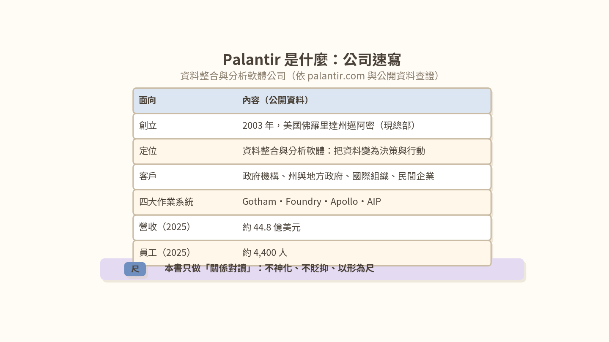

**圖 1-1　Palantir 公司速寫（依 palantir.com 與公開資料查證）**

對本形學而言，Palantir 的重要性不在規模，而在**它證明了一件事：把「形」當作一等公民來工程化，是走得通的**。它把企業的物件、行動、流程抽象成一層可複用的邏輯，讓人在其上做決策、寫回行動、持續學習——這正是「有合必有形」的工業級實證。

公開資料還能看到它的落地廣度：商業客戶涵蓋航空（Airbus）、金融（Morgan Stanley）、製造（Merck KGaA）、汽車（Fiat Chrysler）等；醫療領域的 National COVID Cohort Collaborative（N3C）聯邦電子病歷網路以 Foundry 為底座，衍生大量同儕評審論文；英國國民保健署（NHS England）亦採用其平台。Apollo 更是美國國防部核准用於任務關鍵國安系統（IL5）的五種 SaaS 產品之一。AIP 面世後，Palantir 並以五天密集訓練營（boot camp）帶客戶「從零到用例」快速上手。

這些事實對本書的意義是：**對讀所用的樣本是真實世界裡跑得動的系統**，不是紙上談兵的架構圖。

## 1.3　四大作業系統

Palantir 有四個主要作業系統：**Gotham、Foundry、Apollo、AIP**。Gotham 是防務與情報軟體（2008 年發布，支援警報、地理空間分析與預測）；Foundry 是商業與民事政府用的資料整合平台；Apollo 是跨環境的持續整合／持續交付（CI/CD）平台，負責軟體交付與配置管理；AIP 是 2023 年發布的人工智慧平台，把大型語言模型與代理引進私有網路中的企業運作。

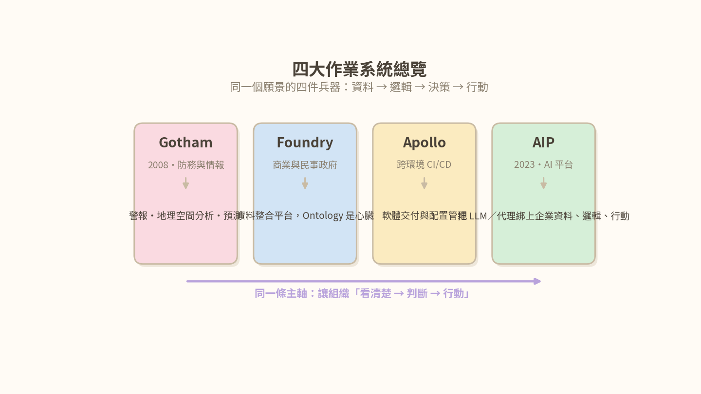

**圖 1-2　四大作業系統總覽：資料 → 邏輯 → 決策 → 行動**

用本形學的話說：**Foundry 給「形」一個家（資料整合與模型），Apollo 給「形」一雙腳（交付到任何環境），Gotham 與 AIP 給「形」兩種用法（防務決策與 AI 決策）**。四件兵器，一條主軸：讓組織「看清楚 → 判斷 → 行動」。

## 1.4　Foundry Ontology：Palantir 的心臟

Palantir 官方如此描述：「**The Foundry Ontology is the heart of Palantir Foundry. It integrates the semantic, kinetic, and dynamic elements of your business**」——Foundry Ontology 是 Foundry 的心臟，整合企業的語義、動能與動態三元素，讓團隊在複雜情境中協調並自動化決策。官方又說，它以「**objects, actions, and processes of your business**」（企業的物件、行動與流程）建起一層通用邏輯。

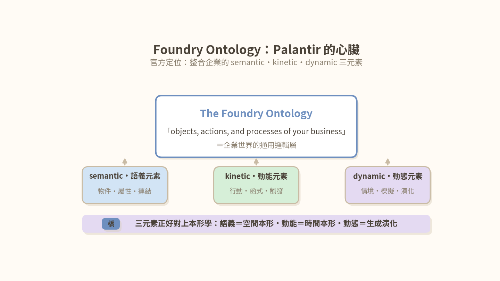

**圖 1-3　Foundry Ontology：語義・動能・動態三元素**

這正是本書第三篇對讀的主戰場。先把三個名字記住：**語義元素（semantic）**——物件、屬性、連結，回答「是什麼」；**動能元素（kinetic）**——行動、函式、觸發，回答「會做什麼」；**動態元素（dynamic）**——情境、模擬、演化，回答「會變成什麼」。

> **【專業專欄 C1】前進部署工程師與「形」的現場**
>
> Palantir 有一種著名職位叫 forward-deployed engineer（前進部署工程師）：直接駐點客戶現場，把客戶的業務「翻譯」成 Ontology 裡的物件與行動。這個角色的實質工作，正是本形學所說的**認明整體 → 分軸描述 → 寫形集合**——只是他們多半靠經驗與直覺，缺一套可複核的表記與判準。
>
> 本書第六篇的「證明六步驟」，等於把前進部署工程師的默會知識寫成顯學流程：任何團隊都能照表操課、逐項複核。這正是「把形看清楚、轉成顯學」的一個具體落點。

## 1.5　AIP：把 AI 綁上企業的資料、邏輯、行動

AIP（Artificial Intelligence Platform）是 Palantir 的 AI 平台。官方把它描述為「**a decision-centric system at the heart of AIP that integrates AI with enterprise data, logic, and action**」——以決策為中心的系統，把 AI 與企業的資料、邏輯、行動整合在一起。它做三件連接：把 AI 連上**企業資料**（Connect AI to Enterprise Data）、連上**企業邏輯**（Connect AI to Enterprise Logic——既有的業務邏輯、ML 模型、最佳化器成為 AI 的確定性工具）、連上**行動系統**（Connect AI to Enterprise Systems of Action——決策安全地同步回營運資料庫與邊緣平台）。

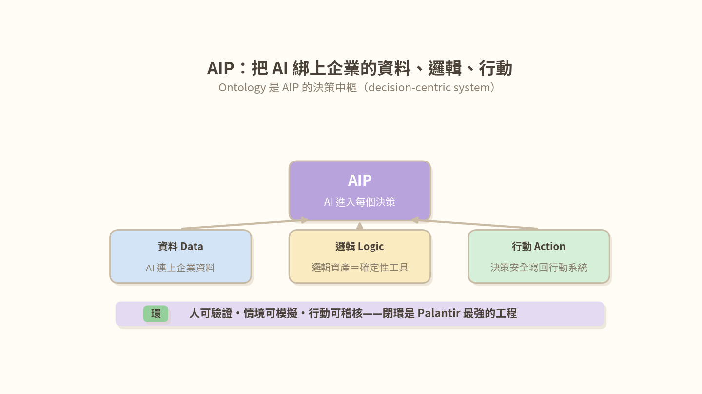

**圖 1-4　AIP 的三個連結：資料・邏輯・行動**

值得注意的是 Palantir 對治理的堅持：**AI 提出的建議要經人可驗證（human validation）、情境可模擬（scenarios）、行動可稽核（audit）**。用本形學的語言，這就是「產出形要過三層檢查」——機器可以提形，**判準在人**。

## 1.6　本篇小結

> **本篇金句**
>
> ◆ Palantir 把企業世界的「形」工程化：物件、行動、流程成為通用邏輯層。
>
> ◆ Foundry Ontology 的語義、動能、動態三元素，正好對上本形學的兩面與生成。
>
> ◆ AIP 的「人可驗證、可稽核」與形學「可複核的準」是同一種執著。

> **練習 E01　平台速寫**
>
> ① 用自己的話說明四大作業系統（Gotham／Foundry／Apollo／AIP）各負責什麼。
>
> ② Foundry Ontology 的三元素（semantic／kinetic／dynamic）各回答什麼問題？
>
> ③ AIP 的三個「Connect AI」分別連向哪裡？為什麼「人可驗證」很重要？

# 第二篇　本形學骨幹速覽

本篇把本形學的骨幹立起來——不逐章重講理論，而以**架構圖＋圖文摘要**的方式，把第三篇以後對讀要用的全部零件備齊。已熟悉本形學的讀者可快速掃過；初識者建議按序讀完，它同時是全書的地圖。

> **本篇地圖**
>
> 2.1 認知鏈　｜　2.2 空間本形：三軸與單位形　｜　2.3 三層判斷
>
> 2.4 時間本形：形進形出　｜　2.5 準確使用方法　｜　2.6 小結
>
> 讀完本篇，你會拿到：對讀要用的全部形學零件。

先回答「為什麼需要形」。數學描述的是事物的數量、關係與規律；本形學描述的是事物的**結構、組成、關聯、演化與本質**——大腦思考＝形＋數。人類智慧由「形」與「數」共同構成，而形的研究長期散落各處、未成體系；本形學把「形」看清楚、轉成顯學，目標是建立一套可跨越語言、數學、科學、哲學、工程與商業的統一認知理論。世界萬物皆可由形來表達與理解——這是全書一切方法的起點。

## 2.1　認知鏈：形的誕生

形，是分合所畫出的邊界，是我們認得出來、並能命名的「東西」。形的誕生有一條固定的認知鏈：先有**異同**的感受，才產生**分**與**合**的動作，最後才生出**形**，而形必有**名**。大腦走這條路走了億萬年；本形學把它寫清楚，轉成顯學。

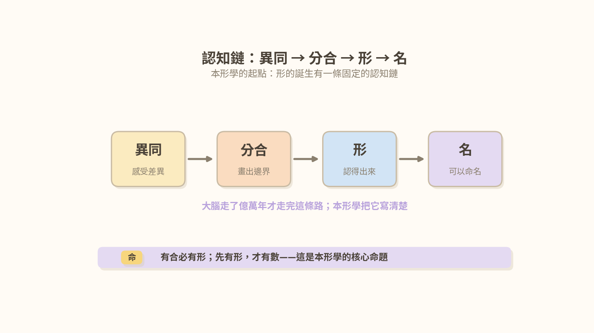

**圖 2-1　認知鏈：異同 → 分合 → 形 → 名**

核心命題有兩句：**有合必有形**；**數＝形裡面的小形・次比較——先有形，才有數**。這兩句話在第三篇對讀時會一再回來：Palantir 的每一個物件型（Object Type），都是某個「合」的邊界被畫了出來。

## 2.2　空間本形：三條軸與單位形

空間本形是形的「體」——名詞的那一面，回答「它是什麼」。它由三條軸構成：**X 屬性軸 [ ]**（維度 × 刻度）、**Y 物料清單 { }**（拆解下來還認得自己嗎——remove 三級：必要件、功能降級件、非必要件）、**Z 容器軸 ( )**（C=(id(C),S(C))，不變性公理）。

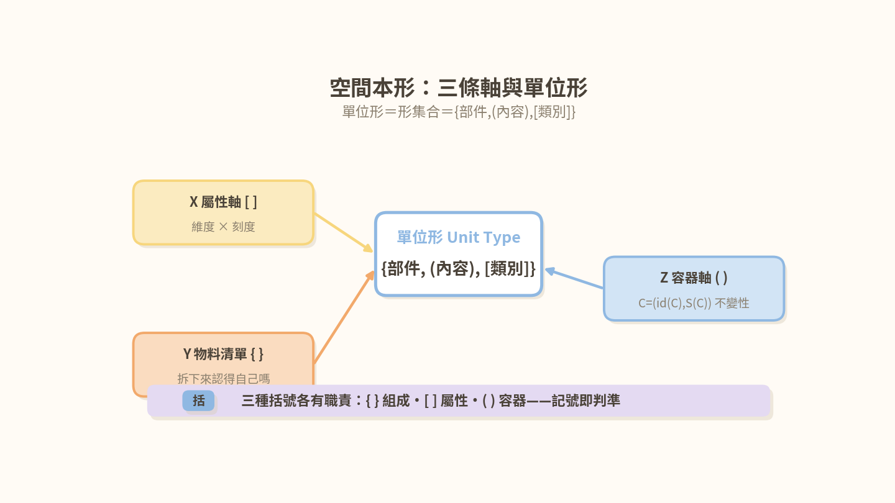

**圖 2-2　空間本形三軸與單位形**

**單位形**＝**形集合**＝**{部件,(內容),[類別]}**。杯子的形集合寫作 {杯把, 杯底, 杯蓋, 杯身, (咖啡), [白色]}：部件組成它、內容可替換、類別給刻度。換了咖啡還是同一個杯子——**變的是內容，不變的是形**。

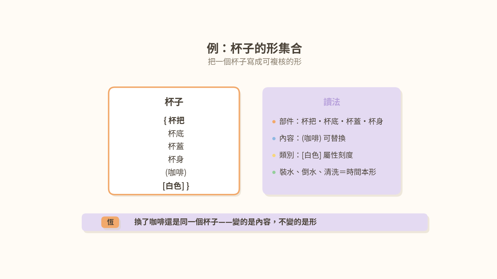

**圖 2-3　例：杯子的形集合**

## 2.3　三層判斷

形要判斷，靠三層：**容器層**（( ) 身份還在嗎——不變性公理）、**BOM 層**（{ } 結構對嗎——remove 三級判準）、**抽象層**（[ ] 類別歸對嗎——T=(F(T),∩(T)) 交集判準，F(T) 是固定特徵、∩(T) 是開放位）。三層聯合寫成 J = J_C ∧ J_B ∧ J_T，**缺一不可**。

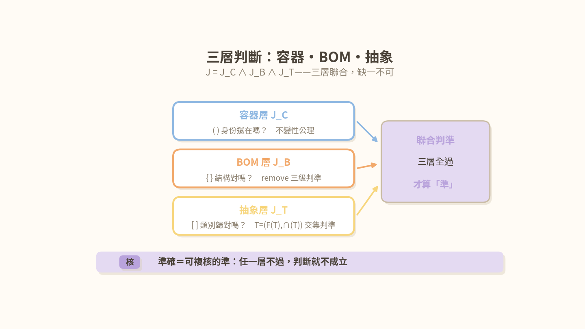

**圖 2-4　三層判斷：容器・BOM・抽象**

抽象層的「開放位」值得記牢：形有邊界，但邊界會學習——新成員隨時入列，形不散。第五篇評析 Palantir 的限制時，這把尺會派上用場。

## 2.4　時間本形：形進形出

時間本形是形的「用」——動詞的那一面，回答「會做什麼」。它等於**函式＝方法＝招式＝服務＝法門**，一句話定義：**輸入一個形，產出一個形**（op : Type → Type）。時間本形依附在空間本形之上——先形後動；而動作產出的新形又充實形庫——體用合一、互相長大。

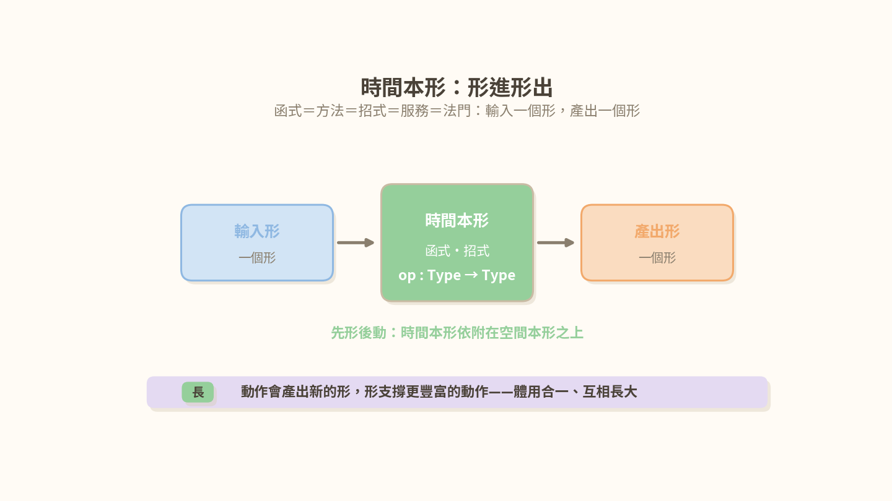

**圖 2-5　時間本形：形進形出**

時間本形函式庫分六群：**認知與萃取**（搜尋、設計搜尋與萃取、設計模式）、**生成與應用**（邏輯生成、函式生成）、**解題與創造**（解題、分析、設計）、**推理與思考**（因果・果因・模擬・統計・逆向推理；正向・逆向・水準・垂直・第一性原理思考）、**成長與維護**（持續學習、重構重組、自我演化）、**探索**（研發探索）。每個函式都可用**函式四問卡**描述：名稱、輸入形、產出形、判準。

| 函式群 | 代表函式 | 對讀 Palantir 時的用途 |
| --- | --- | --- |
| 認知與萃取 | 搜尋、設計搜尋與萃取、設計模式 | 從既有系統認明形、找現成解法形 |
| 生成與應用 | 邏輯生成、函式生成 | 把形集合生成模型與行動型 |
| 解題與創造 | 解題、分析、設計 | 決策情境的推演與方案產出 |
| 推理與思考 | 因果・果因・模擬・統計・逆向；五式思考法 | 情境模擬、反事實、選路 |
| 成長與維護 | 持續學習、重構重組、自我演化 | 決策沉澱、形庫重構 |
| 探索 | 研發探索 | 新業務、新領域的形化先遣 |

## 2.5　準確使用方法

本形學把「準」做成工程，稱**準確使用方法**，收在一個總架構裡：**體（空間本形）— 用（時****間本形）— 準（可複核的準）**。工具三件：**三種補足**（[ ] 規則、( ) 身份、{ } 結構）、**證明六步驟**（認明整體 → 分軸描述 → 寫形集合 → 選定命題 → 判準推理 → 三層檢查）、**八問檢查清單**。另有**誤用對照表**，把常見誤讀一個個對出修正。

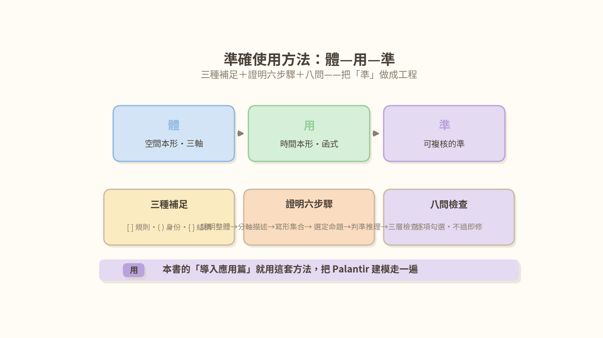

**圖 2-6　準確使用方法：體—用—準**

本書第六篇會把這套方法整套用在 Palantir 情境上——三種補足幫你把物件模型建得嚴格，六步驟幫你把判斷做得可複核，八問幫你收尾驗收。

## 2.6　本篇小結

> **本篇金句**
>
> ◆ 認知鏈：異同 → 分合 → 形 → 名；有合必有形，先有形才有數。
>
> ◆ 空間本形＝體：三軸 [ ]{ }( )、形集合 {部件,(內容),[類別]}、三層判斷。
>
> ◆ 時間本形＝用：輸入一個形、產出一個形；六群函式庫、函式四問卡。
>
> ◆ 準確使用方法＝準：三種補足＋證明六步驟＋八問——準＝可複核的準。

> **練習 E02　骨幹速寫**
>
> ① 把杯子的形集合寫出來，並標明部件、內容、類別。
>
> ② 三層判斷的 J = J_C ∧ J_B ∧ J_T 各檢查什麼？少一層會怎樣？
>
> ③ 用函式四問卡，描述「倒水」這個時間本形。

# 第三篇　對讀比較：Palantir Ontology × 本形學

本篇是全書的主軸。我們把 Palantir Ontology 的三元素——語義、動能、動態——與本形學的空間本形、時間本形、生成演化，一對一地讀過去。對讀的紀律有三條：**一、兩邊的原始術語都保留**；**二、對應關係都給出理由**；**三、深度差異都明說，不含糊**。

> **本篇地圖**
>
> 3.1 為何可對讀　｜　3.2 語義↔空間　｜　3.3 動能↔時間　｜　3.4 動態↔演化
>
> 3.5 對讀總表與一句話　｜　3.6 深度差異　｜　3.7 多領域案例
>
> 3.8 三種括號三問　｜　3.9 收束——讀完本篇，你會拿到：六面向對讀總表。

## 3.1　為何可對讀：同一條認知鏈的兩個實踐

Palantir 從工程實踐出發：先有專案現場，再逐漸沉澱出 Ontology 這層通用邏輯。本形學從認知理論出發：先問「形是什麼」，再推導出表記、判準與函式。兩條路各自走，卻在半山腰相遇——**都發現世界的運作要立在一層「形」之上**。

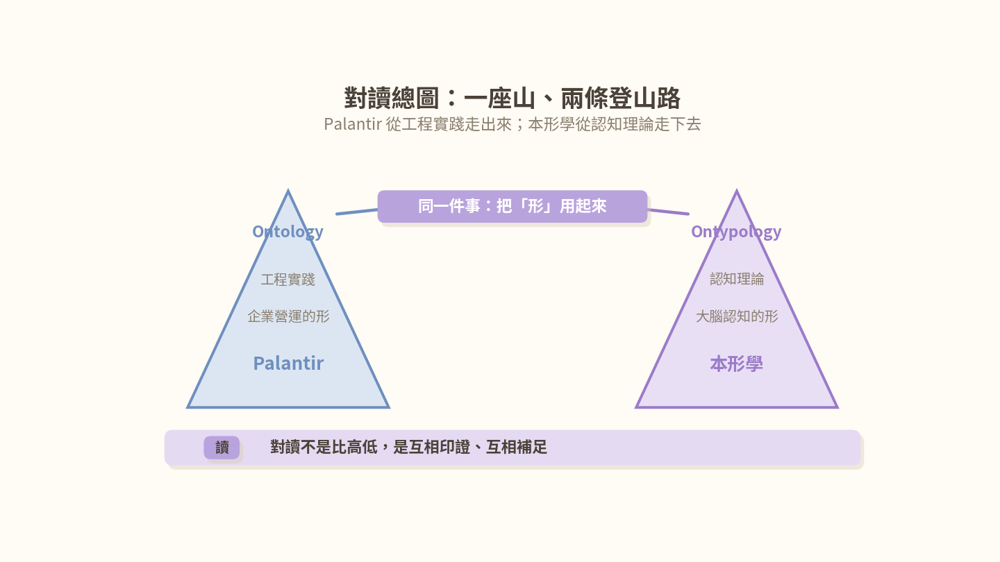

**圖 3-1　對讀總圖：一座山、兩條登山路**

相遇點不是偶然。本形學說「有合必有形」：組織把資料、流程、決策合成一體，必得有一個形來支撐。Palantir 把這個形命名為 Ontology，本形學把這個形命名為**形（Type）**——名字不同，指認的東西是同一類。

## 3.2　對讀一：語義元素 ↔ 空間本形

語義元素回答「它是什麼」——這正是空間本形的本行。逐項對讀：Palantir 的 **Object Type（物件型）**對應**單位形**：一個可複用的形；**Object（物件）**對應**形的實例**：同一形的具體個體；**Property（屬性）**對應 **[ ] 屬性軸**：維度 × 刻度；**Link（連結）**對應**形與形的關係**：歸屬與對照；**Interface（介面）**對應 **( ) 容器**：身份 id(C) 與不變性。

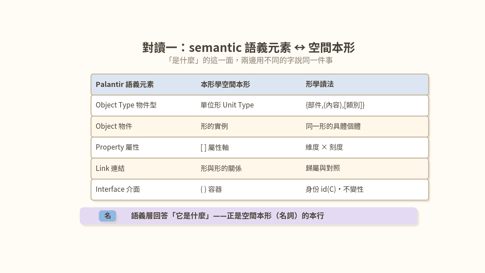

**圖 3-2　語義元素 ↔ 空間本形對讀**

注意一個不對稱：Palantir 的 Property 大多是「欄位清單」式的描寫，而本形學的 [ ] 要求「維度定義＋刻度單位＋邊界值」；Palantir 的模型依賴關係多半隱含在 schema 裡，而本形學的 { } 要求**remove 三級**明說——哪些是必要件、哪些是功能降級件、哪些是非必要件。對讀的價值就在這種落差裡：**同構的部分互相印證，落差的部分互相補足**。

## 3.3　對讀二：動能元素 ↔ 時間本形

動能元素回答「會做什麼」——時間本形的本行。Palantir 的 **Action Type（行動型）**對應**函式（招式・方法）**：一次可複用的運作；**Action（行動）**對應**函式的一次執行**；**Function（函式）**對應**時間本形本體**（op : Type → Type）；**Trigger（觸發）**對應**觸發條件**：情境吻合即上崗；**Writeback（寫回）**對應**產出形回到系統**：閉環與可稽核。

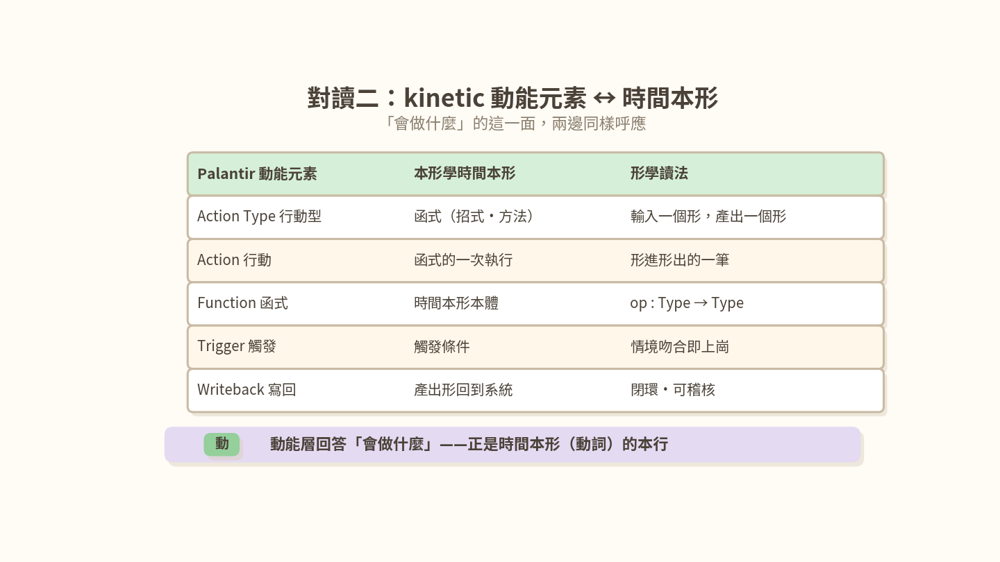

**圖 3-3　動能元素 ↔ 時間本形對讀**

「寫回」值得多看一眼。Palantir 官方說 AIP 讓 Ontology「**safely synchronize decisions back to operational databases, edge platforms, and other systems of action**」——把決策安全地同步回行動系統。形學讀法：**產出形回到世界，並留下稽核痕跡**——這就是「輸入一個形、產出一個形」的閉環版本。工程界用幾十年做出來的事，形學從「形進形出」一句話就預言了結構。

## 3.4　對讀三：動態元素 ↔ 生成與演化

動態元素回答「會變成什麼」——對應本形學的生成與演化。**Scenario（情境）**對應**推理五族的模擬**：假設一個形、推演產出形；**Decision（決策）**對應**選路決策樹**：多形比較、選定一條；**學習沉澱**對應**持續學習・自我演化**：決策沉澱成新形入庫。

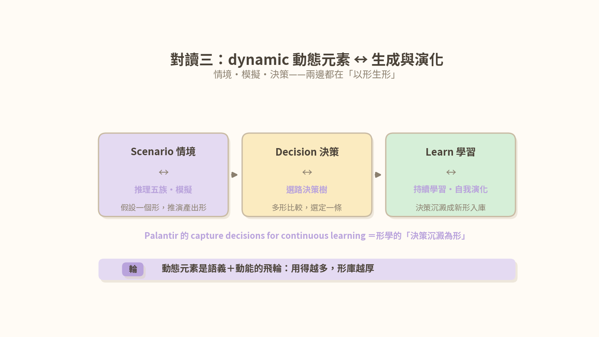

**圖 3-4　動態元素 ↔ 生成與演化**

Palantir 說「**capture decisions for continuous learning**」——把決策捕捉下來、持續學習。形學讀法：**用得越多，形庫越厚；形庫越厚，決策越準**。這就是體用合一的飛輪，兩邊各畫了一半。

## 3.5　對讀總表與一句話

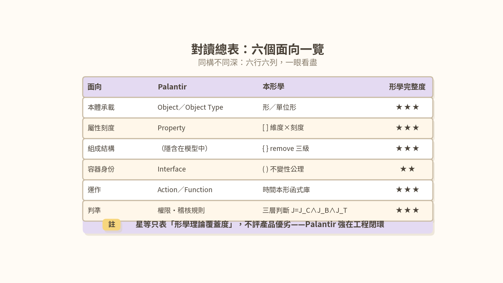

**圖 3-5　對讀總表：六個面向一覽**

把總表再展開一層，可以做成案頭速查——對讀時逐行查、逐行寫理由：

| 面向 | Palantir 說法 | 本形學說法 | 一句話理由 |
| --- | --- | --- | --- |
| 本體承載 | Object／Object Type | 形／單位形 | 都是「可複用的東西」 |
| 屬性刻度 | Property | [ ] 維度×刻度 | 都在描述「量到哪裡」 |
| 組成結構 | 依賴・組成（schema） | { } remove 三級 | 都在回答「拆了還認得嗎」 |
| 容器身份 | Interface・id | ( ) id(C)・不變性 | 都在回答「還是它嗎」 |
| 運作 | Action／Function | 時間本形函式庫 | 都是「形進形出」 |
| 判準 | 權限・稽核規則 | 三層判斷 J=J_C∧J_B∧J_T | 都在回答「怎麼算對」 |

總表的星等只表示「形學理論覆蓋度」，**不是產品評分**——Palantir 強在工程閉環與落地，本形學強在表記、判準與認知深度。把對讀壓成一句話，就是官方那句「**objects, actions, and processes of your business**」：

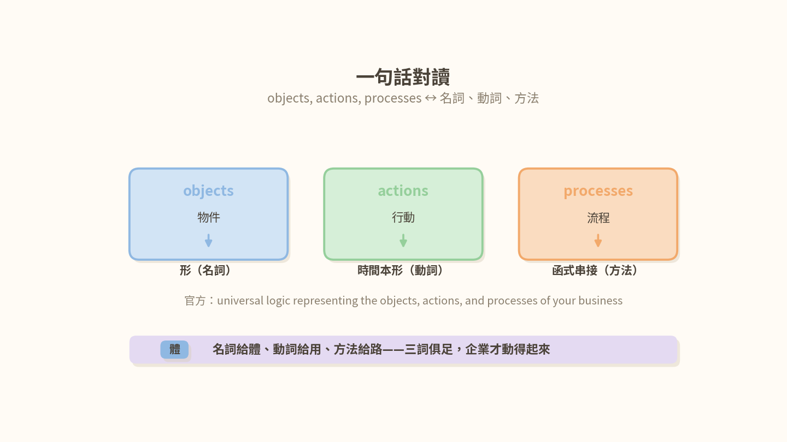

**圖 3-6　一句話對讀：objects・actions・processes ↔ 名詞・動詞・方法**

> **一句話對讀**
>
> objects 是形（名詞），actions 是時間本形（動詞），processes 是函式串接（方法）。名詞給體、動詞給用、方法給路——三詞俱足，企業才動得起來。

## 3.6　深度差異：同鏈不同深

同樣站在認知鏈上，兩邊的深度方向不同。Palantir 的深度**從「形」往後**：命名、建模、決策、行動、稽核——把形用到極致；本形學的深度**從「異同」往前**：認知鏈、三軸、三層判斷、函式庫、演化——把形看透到底。

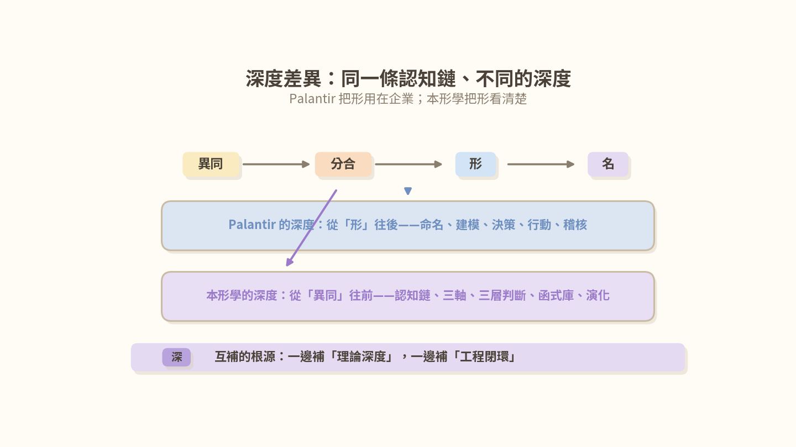

**圖 3-7　深度差異：同一條認知鏈、不同的深度**

這個差異正是互補的根源：**Palantir 缺的理論深度，本形學有；本形學缺的工程閉環，Palantir 有**。第四篇順著這句話展開。

## 3.7　多領域對讀案例

對讀方法與領域無關。看四個並列案例：供應鏈（物件＝訂單・工廠・料件；行動＝調撥・改排程）、城市治理（物件＝路網・車流・號誌；行動＝配時調整・派遣）、醫療（物件＝病床・檢驗・藥劑；行動＝調床・備藥・通報）、金融（物件＝帳戶・部位・限額；行動＝覆核・風控・結案）。

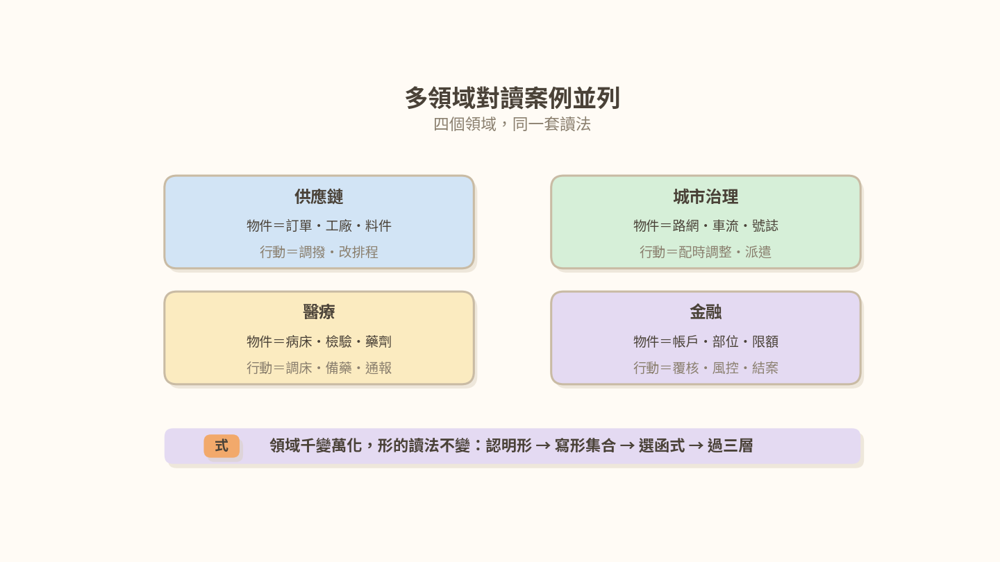

**圖 3-8　多領域對讀案例並列**

領域千變萬化，形的讀法不變：**認明形 → 寫形集合 → 選函式 → 過三層**。這四步在任何領域都通用，因為它們不是領域知識，是「形」本身的知識。

把四個案例再對讀深一層，可以看到同一種「形的節奏」反覆出現：先立物件（認形）、再立行動（選函式）、後立判準（過三層）。供應鏈的「缺料」與醫療的「床位缺口」在形的層面是同一類問題——**缺口是一個形，調配是一個函式，不斷供是一個判準**。領域只是形的衣裳，形是裡子。這就是本形學說「世界萬物皆可由形來表達與理解」的實務含義。

## 3.8　三種括號 × 物件建模三問

把對讀再收緊一格。為 Palantir 建物件模型時，本形學會問三句話：用 **{ }** 問「拆下來還認得自己嗎」（結構）、用 **[ ]** 問「維度選對、刻度量對了嗎」（屬性）、用 **( )** 問「id(C) 是誰、不變性守住了嗎」（身份）。

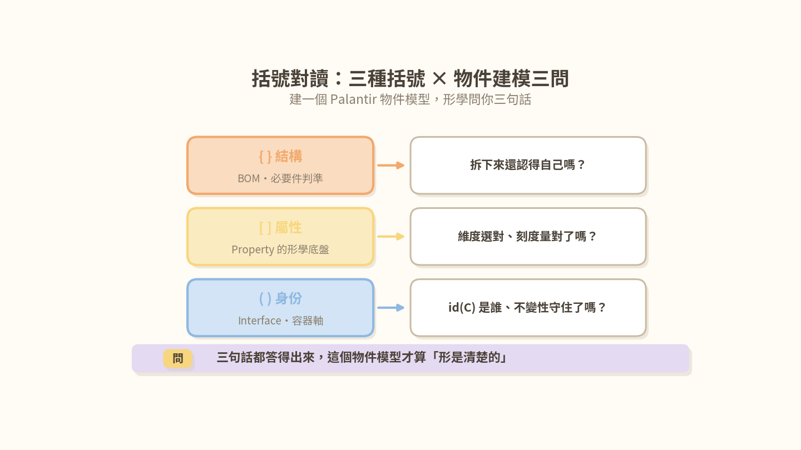

**圖 3-9　三種括號 × 物件建模三問**

三句話都答得出來，這個物件模型才算「形是清楚的」。答不出來的模型，多半正踩在第五篇要談的誤用上。

## 3.9　對讀收束

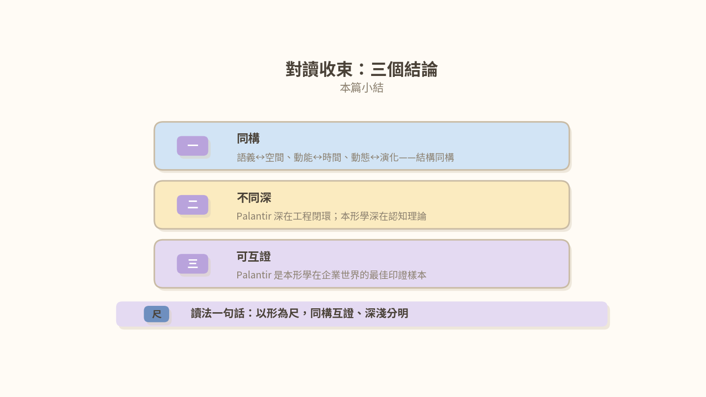

**圖 3-10　對讀收束：三個結論**

> **本篇金句**
>
> ◆ 同構：語義↔空間、動能↔時間、動態↔演化——結構同構，互相印證。
>
> ◆ 不同深：Palantir 深在工程閉環；本形學深在認知理論。
>
> ◆ 可互證：Palantir 是本形學在企業世界的最佳印證樣本。

> **【專業專欄 C2】本體工程 × 本形學：詞彙對照**
>
> 本體工程（Ontology Engineering）實務的常用詞——concept、entity、relationship、axiom、TBox／ABox——與形學詞彙大致可對：concept↔形、entity↔形實例、relationship↔形關係、axiom↔判準、TBox↔形集合定義、ABox↔形庫內容。
>
> 落差在判準的自覺程度：本體工程的 axiom 著重邏輯一致性，形學的三層判斷多了**身份不變性**與 **remove 三級**兩把尺。把這兩把尺補進本體工程，就是「以形學做本體工程」的入門。

> **練習 E03　對讀填表**
>
> ① 把 Object Type、Property、Link、Action Type、Writeback 五個詞，各用一句話寫出對應的形學術語與理由。
>
> ② 「capture decisions for continuous learning」用形學怎麼讀？
>
> ③ 選你熟悉的一個領域（如餐飲、教育、物流），寫出三個物件型與兩個行動型的對讀。

# 第四篇　互補整合：Mind AI × Palantir

對讀說清「同構與不同深」，互補整合就順理成章。本篇回答：**Mind AI 與 Palantir 各在哪一層？怎麼分工？介面怎麼約？**

> **本篇地圖**
>
> 4.1 分層定位　｜　4.2 兩庫一中樞一迴路 × Foundry／AIP　｜　4.3 閉環分工
>
> 4.4 整合情境　｜　4.5 整合前後對照
>
> 讀完本篇，你會拿到：一張分層協作的構想圖與介面約定表。

## 4.1　分層定位：誰在哪一層

回到本形學的三層架構：**哲學層**是根（本體論——問「有什麼」）、**方法層**是幹（本形學——形是什麼、怎麼判斷、怎麼運作）、**實踐層**是果（把形用起來的地方）。Mind AI 與 Palantir 都在實踐層，但分工不同：

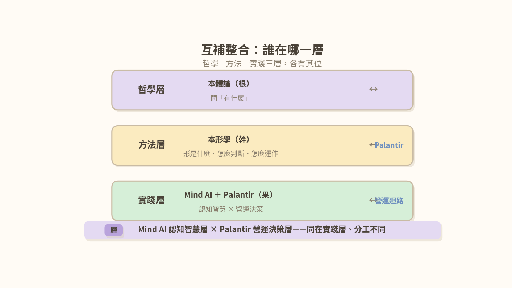

**圖 4-1　分層定位：哲學—方法—實踐**

**Mind AI 站認知智慧層**：管理形庫與函式庫，做理解、推理、學習、創造——把形看清楚、轉成顯學；**Palantir 站營運決策層**：管理企業的物件、行動與決策迴路——把形用到現場。一層管「形的智慧」，一層管「形的營運」。

## 4.2　架構對接：兩庫一中樞一迴路 × Foundry／AIP

Mind AI 的實踐架構可概括為**兩庫一中樞一迴路**：形庫（統一知識）、函式庫（思維方法）、中樞（理解與推理）、迴路（學習與演化）。這四件與 Palantir 的對接構想如下：形庫餵給 **Ontology**（認明的形成為物件型），函式庫餵給 **AIP**（思考與推理成為決策方法），中樞對接 AIP 的推理層，迴路承接 **Writeback** 的決策沉澱。

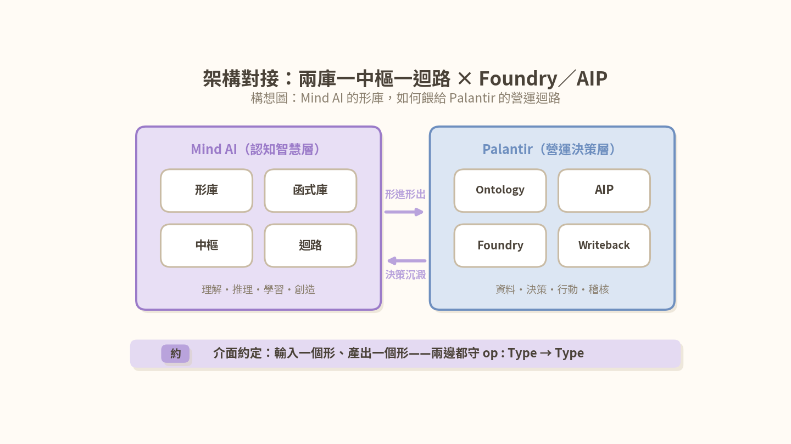

**圖 4-2　架構對接構想：兩庫一中樞一迴路 × Foundry／AIP**

介面約定只有一條，卻是全部：**輸入一個形、產出一個形**（op : Type → Type）。兩邊都守這條約定，介面就永遠接得上。具體對接可以寫成一張約定表：

| 介面方向 | 內容 | 約定 |
| --- | --- | --- |
| 形庫 → Ontology | 認明的形成為物件型 | 每個單位形帶三種補足入庫 |
| 函式庫 → AIP | 思考與推理成為決策方法 | 每個行動型帶四問卡 |
| 中樞 ↔ AIP 推理 | 理解與推理互相調用 | 推理過程可稽核、判準可回放 |
| Writeback → 迴路 | 決策沉澱回形庫 | 每次執行留形進形出痕跡 |

## 4.3　互補分工：一條閉環走一圈

把分工畫成一條閉環：**形庫（Mind AI）→ 建模（Ontology）→ 決策（AIP）→ 行動****（Writeback）→ 學習（沉澱）→ 形庫（更厚）**。

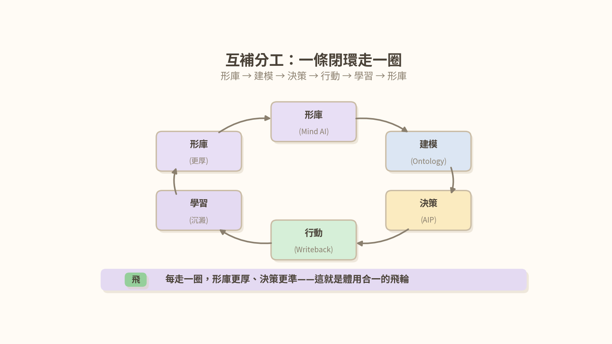

**圖 4-3　互補分工：一條閉環走一圈**

每走一圈，形庫更厚、決策更準。Palantir 的強項是中段（建模到行動的工程閉環），Mind AI 的強項是兩端（形庫的認知深度與學習的演化機制）——**兩端給智慧，中段給力量**。

## 4.4　整合情境

四個領域的協作樣貌：城市紅綠燈（Mind AI 出車流形・配時函式庫；Palantir 出號誌物聯・寫回配時）、供應鏈調撥（Mind AI 出缺料推演・因果推理；Palantir 出訂單物件・行動落地）、醫院調床（Mind AI 出病床形・三層判斷；Palantir 出床旁系統・稽核留痕）、金融風控（Mind AI 出部位形・模擬反事實；Palantir 出限額行動・覆核閉環）。

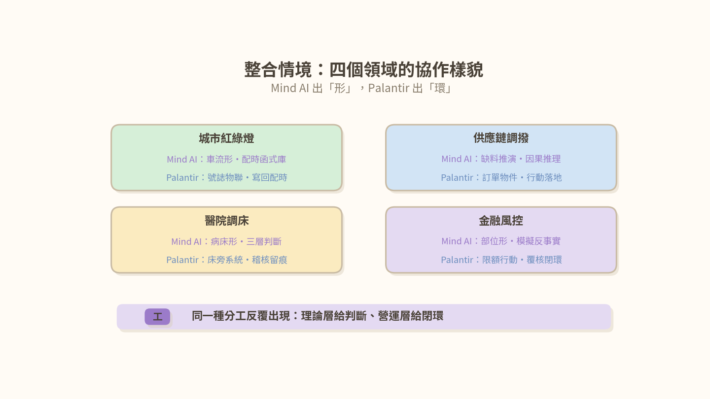

**圖 4-4　整合情境：四個領域的協作樣貌**

同一種分工反覆出現：**理論層給判斷、營運層給閉環**。這不是產品捆綁，是形的分工——因此對任何同類平台都成立；Palantir 只是其中走得最深的一個樣本。

## 4.5　整合前後對照

整合前的組織，資料表、報表、模型、流程各有各的名字，對不上——孤島的本質不是資料不通，是**形不通**。整合後，所有東西共享同一套形：形庫、函式庫、決策迴路、行動系統互相認得。

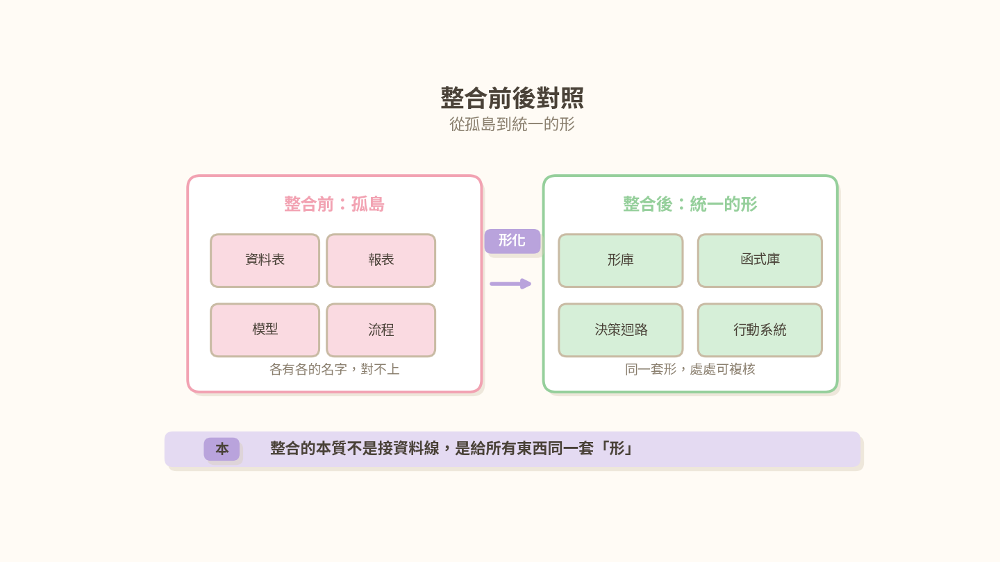

**圖 4-5　整合前後對照：從孤島到統一的形**

整合的本質不是接資料線，是給所有東西同一套「形」。資料線接得再多，形不通就還是孤島——這也是許多數位轉型專案失敗的形學診斷。

值得補一句治理層的話：形通之後，組織的記憶就不再只存在於個人身上。新人接手一個流程，只要讀它的形集合與四問卡，就能站上前人的肩膀——**形是組織的顯性記憶**。Palantir 用前進部署工程師把默會知識搬進系統；本形學用表記與方法把默會知識搬進書本與課堂；Mind AI 要把它搬進可推理、可學習的智慧架構。三條路，一個方向。

> **【專業專欄 C3】MDM × 形學：主數據的形**
>
> 主數據管理（MDM）處理的是「全公司唯一認定的客戶、產品、供應商」——用形學的話說，就是為關鍵實體立**單位形**：id(C) 定身份、{ } 定組成、[ ] 定刻度。MDM 的黃金記錄（golden record）機制，實質是 ( ) 容器不變性的一種工程實作。
>
> 把 MDM 專案用三種補足過一遍：每個主數據域都要有身份規則、組成判準、刻度定義——這三樣齊了，MDM 才從「清洗資料」升級為「立形」。

> **本篇金句**
>
> ◆ Mind AI 站認知智慧層，Palantir 站營運決策層——同在實踐層、分工不同。
>
> ◆ 介面約定一條：輸入一個形、產出一個形。
>
> ◆ 整合的本質：給所有東西同一套形。

> **練習 E04　互補設計**
>
> ① 用一句話說明 Mind AI 與 Palantir 的分層分工。
>
> ② 畫出「形庫 → 建模 → 決策 → 行動 → 學習 → 形庫」閉環，標出哪段是 Mind AI 強項、哪段是 Palantir 強項。
>
> ③ 選一個你熟悉的組織，診斷它是否「形不通」，並提出三條形化建議。

# 第五篇　評析與超越：以本形學檢視 Palantir

評析的紀律是誠實：先說強，再說限制，最後說超越。尺只有一把——**形學的可複核性**。用這把尺量 Palantir，不是為了分高下，是為了把「形的工程」看得更清楚。

> **本篇地圖**
>
> 5.1 三個強項　｜　5.2 有形無學　｜　5.3 表記與判準缺位　｜　5.4 抽象與跨域
>
> 5.5 超越三方向　｜　5.6 誤用警示五種
>
> 讀完本篇，你會拿到：一張誠實的強弱對照與超越路線。

## 5.1　三個強項：印證本形學

第一個強項是**閉環（closed loop）**：資料 → 決策 → 行動 → 回饋，一條環走到底——印證形學「體用合一・互相長大的飛輪」。第二個是**寫回（writeback）**：決策安全同步回行動系統——印證「產出形回到世界」。第三個是**營運本體（operational ontology）**：物件、行動、流程的通用邏輯——印證「有合必有形」。

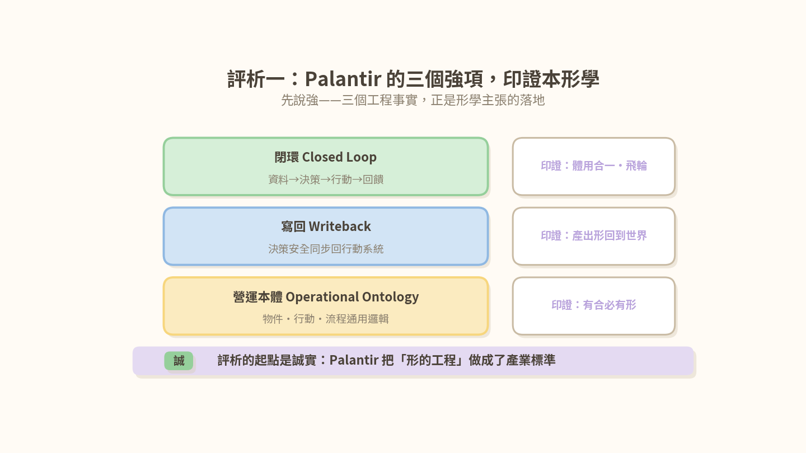

**圖 5-1　三個強項，印證本形學**

這三項都是工程事實，不是行銷話術——它們在官網文檔、客戶案例與產品行為裡都可查證。一個把「形的工程」做成產業標準的公司，值得本形學認真對讀。

## 5.2　限制一：有形無學

限制不在功能，在**自覺**。Palantir 把物件模型做得出來，卻說不清「形是什麼」——它沒有認知鏈、沒有形的定義、沒有可複核的判準體系。它的知識沉澱在工程師的直覺與專案慣例裡，而不是沉澱在可教、可練、可複核的理論裡。

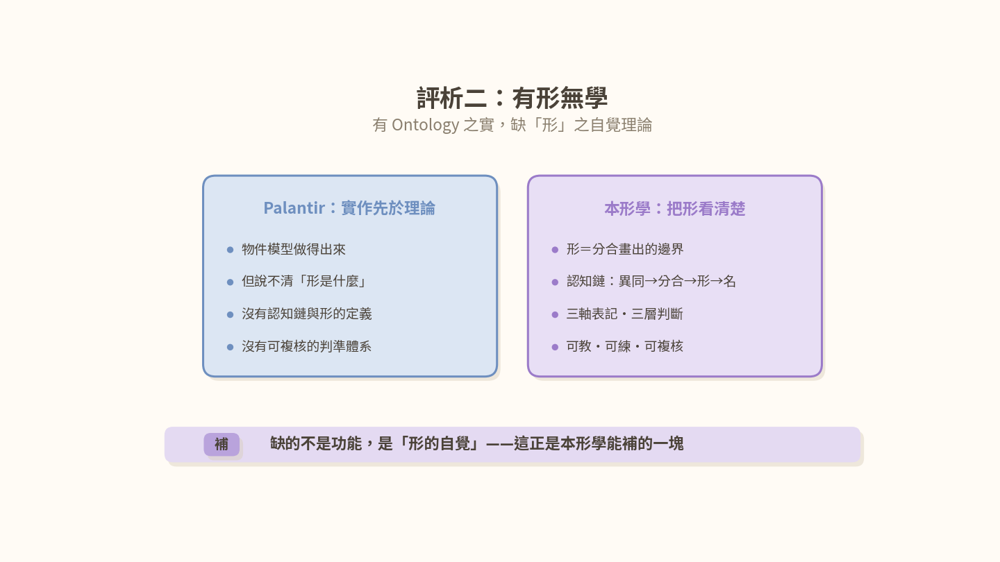

**圖 5-2　有形無學：實作先於理論**

打個比方：Palantir 像一位武功蓋世卻沒寫過拳譜的大師——招招有效，但徒弟只能偷師。本形學做的事就是把拳譜寫出來：**形＝分合畫出的邊界、認知鏈、三軸表記、三層判斷**——可教、可練、可複核。

## 5.3　限制二：表記與判準缺位

同樣一個物件模型，形學能寫得更嚴格：一般做法寫「欄位清單」，形學寫 **{部件,(內容),[類別]}** 形集合；一般做法用「依賴關係」表拆解，形學用 **remove 三級**（必要件・功能降級件・非必要件）；一般做法用標籤分類，形學用 **∩(T) 交集判準**；一般做法用權限規則做判定，形學用 **J = J_C ∧ J_B ∧ J_T 三層連立**。

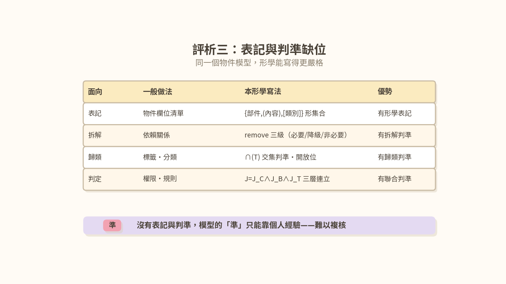

**圖 5-3　表記與判準缺位的對照**

沒有表記與判準，模型的「準」只能靠個人經驗——人一走，準就散。這對以人才為核心的顧問式交付（如前進部署工程師模式）是結構性風險；補法就是第六篇的準確使用方法。

## 5.4　限制三：抽象與跨域統一的距離

企業分類樹長得快、改得慢：新業務、新法域、新資料型別一來，封閉的分類樹就要重畫。形學的解法是 **T=(F(T),∩(T))**——F(T) 固定特徵守住形的本質，∩(T) 開放位留給新成員。**形有邊界，但邊界會學習**。

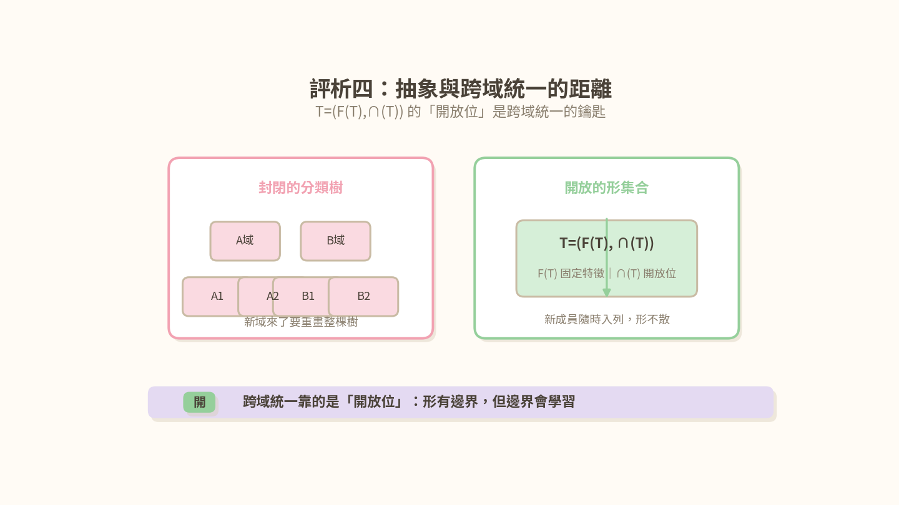

**圖 5-4　封閉分類樹 vs 開放位**

跨域統一（知識統一 → 思維統一 → 智慧統一）需要的正是這種開放的形。Palantir 的 Ontology 為單一企業的營運而優化，天然偏封閉；本形學為「跨越語言、數學、科學、哲學、工程與商業的統一認知」而設計，天然偏開放——兩者的適用半徑不同，不是優劣，是取向。

## 5.5　超越點：補上「認知的形」

超越有三個方向：**表記超越**（形集合・三軸・remove 三級，讓模型可教可複核）、**判準超越**（三層判斷・八問・可複核，讓「準」變成工程）、**演化超越**（函式庫・持續學習・自我演化，讓系統自己長大）。

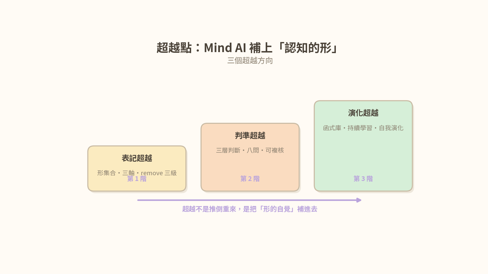

**圖 5-5　三個超越方向**

超越不是推倒重來——Palantir 的閉環工程照單全收；超越是把「形的自覺」補進去，讓已經會走路的人，知道自己為什麼走得穩。

## 5.6　誤用警示：五種常見誤讀

以本形學讀 Palantir，有五個坑要避開：

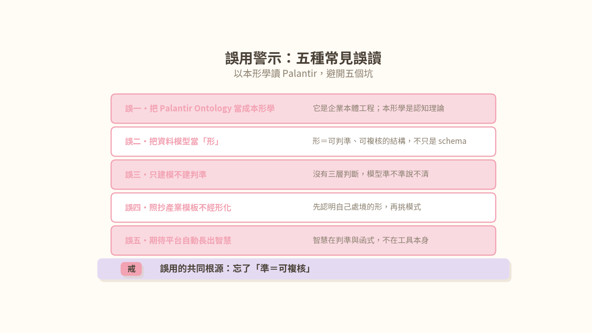

**圖 5-6　誤用警示五種**

把五種誤用展開成對照表，診斷與修正一目了然：

| 誤讀 | 病徵 | 形學診斷 | 修正 |
| --- | --- | --- | --- |
| 把 Ontology 當本形學 | 以為有模型就有理論 | 混淆實作與顯學 | 分清：本形學是尺，Ontology 是被量的橋 |
| 把 schema 當形 | 模型一大堆卻無法判斷 | 缺三軸表記與判準 | 補形集合與三層檢查 |
| 只建模不建判準 | 誰也說不清準不準 | J 未連立 | 立判準表、走證明六步驟 |
| 照抄模板不形化 | 水土不服、越用越亂 | 未認明處境的形 | 先認形、再挑模式 |
| 等平台長智慧 | 工具越買越多 | 智慧在判準不在工具 | 建形庫、教方法、守八問 |

五種誤用的共同根源只有一個：**忘了「準＝可複核」**。把 Palantir 的能力清單誤當形學、把 schema 誤當形、把平台誤當智慧——只要記得「形要過三層檢查」，五個坑都避得開。

> **【專業專欄 C4】知識圖譜為何不夠：從 GraphRAG 到 Mind Model**
>
> 業界常用知識圖譜（Neo4j、Stardog、Neptune）＋GraphRAG 補 LLM 的推理短板。形學診斷其限制：**表達能力有限**（只有節點與邊，寫不出 {部件,(內容),[類別]} 與 remove 三級）、**推理層缺判準**（路徑查詢≠三層判斷）、**難表抽象**（開放位無處安放）。
>
> Mind Model 的立場：不是再做一個更大的圖譜，而是以本形學架構做**統一知識模型**——形庫（知識統一）＋函式庫（思維統一）＋中樞與迴路（智慧統一）。Palantir 的 Ontology 走到「企業營運的統一」；Mind Model 走向「跨域認知的統一」。

> **本篇金句**
>
> ◆ 強項三印證：閉環、寫回、營運本體——形的工程，產業標準。
>
> ◆ 限制在自覺：有形無學、表記判準缺位、開放位不足。
>
> ◆ 超越三方向：表記、判準、演化——補上認知的形。

> **練習 E05　評析練習**
>
> ① 舉一例說明 Palantir 的「閉環」如何印證體用合一。
>
> ② 「有形無學」是什麼意思？為什麼「可教、可複核」很重要？
>
> ③ 用 T=(F(T),∩(T)) 說明：為什麼開放位是跨域統一的鑰匙？

# 第六篇　導入應用指南：準確使用方法實戰

本篇把本形學的**準確使用方法**整套搬進 Palantir 情境：三種補足幫你把物件模型建嚴格，證明六步驟幫你把判斷做可複核，函式四問卡幫你把行動型寫清楚，八問清單幫你收尾驗收。方法與平台無關——你在任何同類平台都用得上。

> **本篇地圖**
>
> 6.1 三種補足　｜　6.2 證明六步驟　｜　6.3 完整示範　｜　6.4 函式四問卡
>
> 6.5 八問清單　｜　6.6 誤用大對照　｜　6.7 導入 FAQ
>
> 讀完本篇，你會拿到：一套可照表操課的導入方法。

## 6.1　三種補足：給物件模型立規矩

建一個物件模型，形學要求補三樣東西：**[ ] 規則補足**——每個 Property 給出維度定義、刻度單位、邊界值；**( ) 身份補足**——每個物件給出 id(C) 命名規則與不變性條件；**{ } 結構補足**——每個模型標明必要件、功能降級件、非必要件。

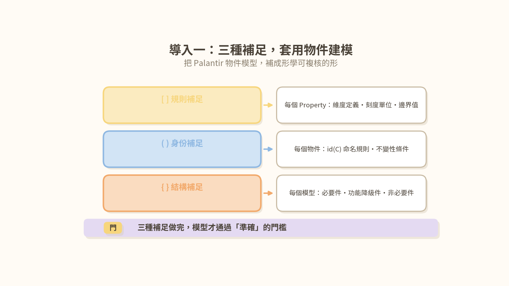

**圖 6-1　三種補足：規則・身份・結構**

三種補足做完，模型才通過「準確」的門檻。實務上建議做成**建模檢查表**：每個物件型入庫前，三欄都要填滿——欄位空白即擋關。

## 6.2　證明六步驟

判斷一個形、證明一個命題，走六步：**認明整體**（認出要判斷的形）→ **分軸描述**（X[ ] Y{ } Z( )）→ **寫形集合**（{部件,(內容),[類別]}）→ **選定命題**（要證明什麼）→ **判準推理**（remove・∩(T)・不變性逐層推）→ **三層檢查**（J = J_C ∧ J_B ∧ J_T）。

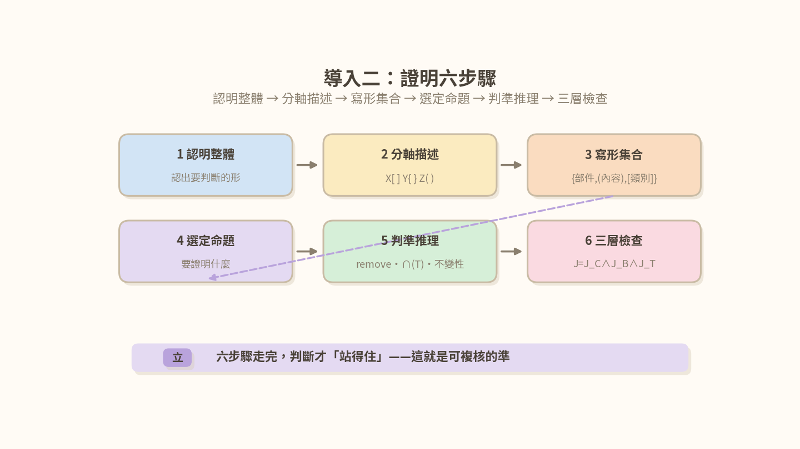

**圖 6-2　證明六步驟**

六步驟的價值在**順序**：先認整體再拆軸、先寫表記再定命題、先推判準再過檢查——順序走對，結論自然站得住；跳步走，多半就是誤用的開端。實務上每一步都有產出物，正好做成工作底稿：

| 步驟 | 產出物 | 常見卡點 |
| --- | --- | --- |
| 1 認明整體 | 形的名稱與一句話定義 | 認錯整體，後面全歪 |
| 2 分軸描述 | 三軸描述表（X/Y/Z） | 漏軸：只寫屬性不寫組成 |
| 3 寫形集合 | {部件,(內容),[類別]} | 內容與部件混寫 |
| 4 選定命題 | 要證明的判斷句 | 命題太大或太模糊 |
| 5 判準推理 | remove・∩(T)・不變性推演 | 跳過判準直接下結論 |
| 6 三層檢查 | J=J_C∧J_B∧J_T 勾稽表 | 只查一層就算過關 |

## 6.3　完整示範：一張調撥單

情境：供應鏈中樞收到一張調撥單 T-2042，問「該不該放行？」用六步驟走全程：

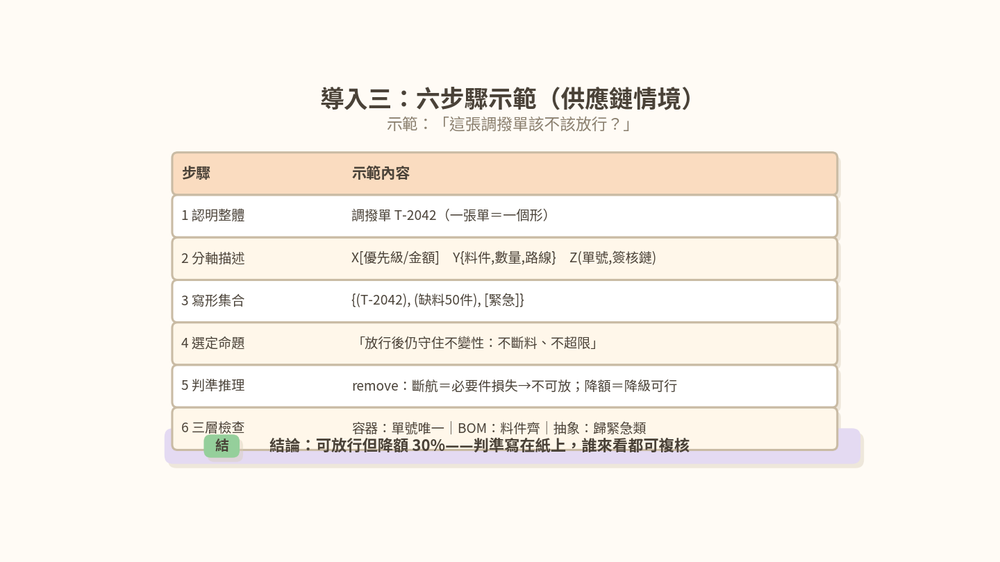

**圖 6-3　六步驟完整示範：調撥單 T-2042**

結論是「**可放行但降額 30%**」——重要的是結論怎麼來的都寫在紙上：誰來看都可複核、可重推、可爭辯。這就是「準＝可複核的準」在真實決策裡的樣子。

## 6.4　函式四問卡：把行動型寫成時間本形

每個行動型（Action Type）都該有一張**函式四問卡**：**名稱**（它是什麼動作）、**輸入形**（認明整體：進來什麼形）、**產出形**（形進形出：出去什麼形）、**判準**（三層檢查：怎麼算對）。

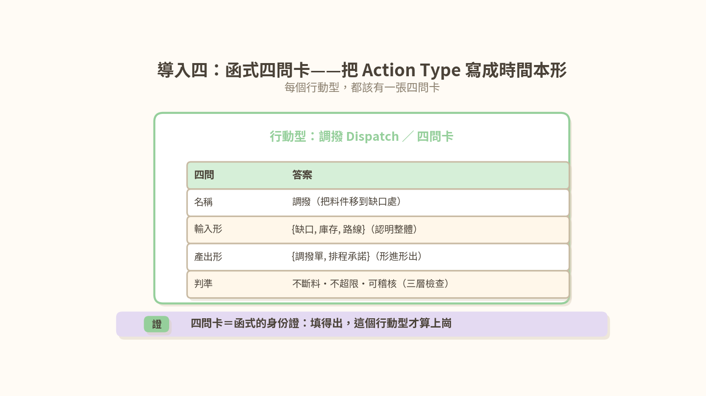

**圖 6-4　函式四問卡示範：調撥 Dispatch**

四問卡就是函式的身份證：填得出，這個行動型才算上崗。大規模導入時，建議每個 Action Type 一張卡、卡片入庫隨模型走——模型改版，卡片跟著改版。

## 6.5　八問檢查清單

導入專案收尾前，逐項勾選八問：整體認明了嗎？三軸都描述了嗎？形集合寫全了嗎？命題選定了嗎？判準推理走過了嗎？三層檢查通過了嗎？四問卡填好了嗎？誤用對照看過了嗎？

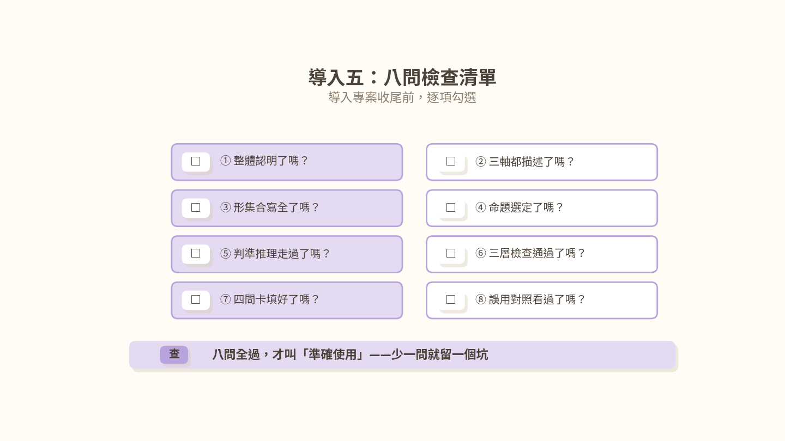

**圖 6-5　八問檢查清單**

八問全過，才叫「準確使用」——少一問就留一個坑。把八問做成驗收表，是把「準」從個人修養變成組織紀律的最短路徑。

## 6.6　誤用大對照

最後把常見的導入病症與形學診斷對成一張表——症狀 → 診斷 → 修正方向，隨時可查：

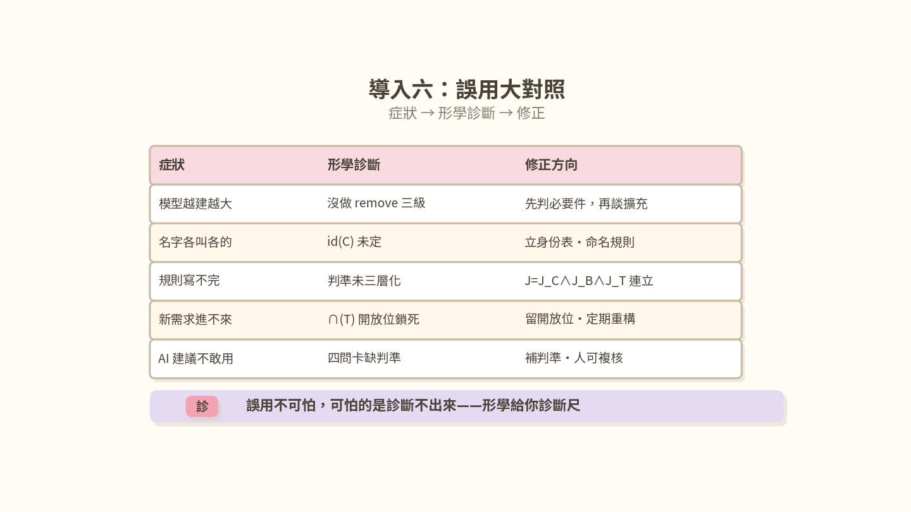

**圖 6-6　誤用大對照：症狀 → 診斷 → 修正**

誤用不可怕，可怕的是診斷不出來。形學給你診斷尺：模型膨脹查 remove、名字混亂查 id(C)、規則爆炸查三層化、新需求卡死查開放位、AI 建議不敢用查四問卡。

## 6.7　導入常見問答

把導入過程最常被問到的問題收成一張 FAQ 表，方便事前對齊預期：

| 常見問題 | 形學回答 |
| --- | --- |
| 要不要先把資料清洗完才開始？ | 不必一步到位——先認明「要判斷的形」，資料清洗跟著形的優先序走。 |
| 四問卡誰來填？ | 懂業務的人填內容、懂方法的人守格式；兩者對坐半小時勝過各自埋頭。 |
| 三層檢查會不會太重？ | 先在關鍵決策型上做全檢，其餘抽檢——重量放在風險所在。 |
| 與現有平台（含 Palantir 式）衝突嗎？ | 不衝突——方法層的尺與工具層的平台是兩件事，尺量平台、平台承載尺。 |
| 多久能看到效果？ | 一個試點流程走完六週內可見：決策依據從「感覺」變「底稿」。 |

> **【專業專欄 C5】API 契約與事件驅動：時間本形的系統側**
>
> 工程視角下，「輸入一個形、產出一個形」對應的就是 **API 契約**：request schema 是輸入形、response schema 是產出形、錯誤碼與限流規則是判準。把每個服務契約翻成四問卡，微服務地圖立刻變成**函式庫地圖**。
>
> 事件驅動架構（event-driven）裡，事件就是「形進形出」的痕跡：每個事件攜帶形的變更（增量），事件流沉澱成可稽核的決策史——正是 Palantir「capture decisions for continuous learning」的系統側實作。Writeback 模式則是「產出形回到系統」的同步版本。

> **本篇金句**
>
> ◆ 三種補足立規矩：規則、身份、結構，三欄填滿才入庫。
>
> ◆ 六步驟走順序：認明 → 分軸 → 形集合 → 命題 → 判準 → 三層。
>
> ◆ 四問卡給行動型身份證；八問清單做驗收紀律。

> **練習 E06　補足練習**
>
> ① 選一個你想建的物件模型（如「課程」「車隊」「帳戶」），寫出三種補足的內容草案。
>
> ② 用證明六步驟，重新走一遍 6.3 的調撥單，但改設「斷航」情境，結論會變嗎？
>
> ③ 為「審批 Approve」這個行動型填一張函式四問卡。

# 第七篇　總架構：哲學—方法—實踐

前六篇走過了對讀、互補、評析、導入。本篇把全部零件裝回一個總架構裡：體—用—準一字不漏，關係總圖一眼看盡，AGI 三階段給出遠方。

> **本篇地圖**
>
> 7.1 體—用—準總架構　｜　7.2 關係總圖　｜　7.3 AGI 三階段
>
> 讀完本篇，你會拿到：一張全書的總裝圖。

## 7.1　體—用—準總架構

全書收在三個字裡：**體**（空間本形——形集合、三軸，給結構）、**用**（時間本形——函式庫、四問卡，給動作）、**準**（準確使用方法——六步驟、八問，給複核）。落點在實踐層的兩個座標：Mind AI（認知智慧層）× Palantir（營運決策層）。

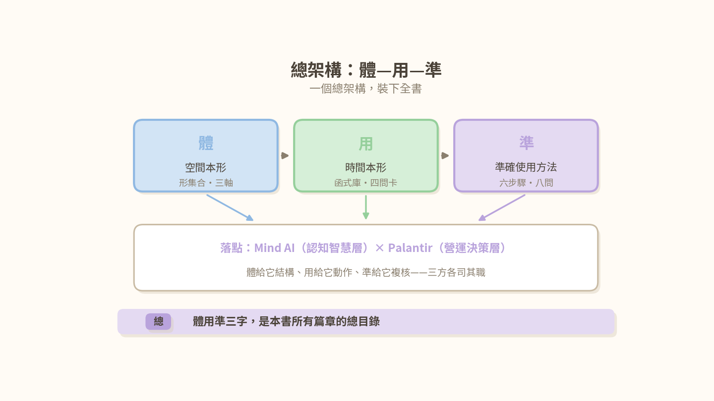

**圖 7-1　體—用—準總架構**

體用準三字是全書的總目錄：第一、二篇給體、第三、四篇給用、第五、六篇給準、本篇與第八篇把三字合成一套方案。

## 7.2　關係總圖

把四個位置連成一條大路：**本體論**（根・有什麼）→ **本形學**（幹・形是什麼）→ **Mind AI**（果・認知智慧）↔ **Palantir**（印證・營運決策）→ 產業世界。理論指導實踐往前走，實踐驗證理論往回饋——雙向箭頭，缺一不可。

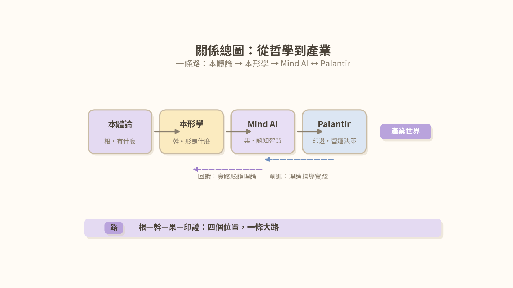

**圖 7-2　關係總圖：從哲學到產業**

這張圖也是本書書名的完整展開：「Palantir 與本形學的關係」＝**印證關係**（Palantir 印證形的工程走得通）＋**互補關係**（理論深度補工程、工程閉環補理論）＋**對讀關係**（同一座山的兩條路）＋**應用關係**（準確使用方法雙向適用）。

## 7.3　AGI 三階段與 Palantir 的位置

Mind AI 的願景分三階段：**知識統一**（建立統一知識表示）、**思維統一**（建立統一推理與思考）、**智慧統一**（整合知識、思維、記憶、學習與創造）。

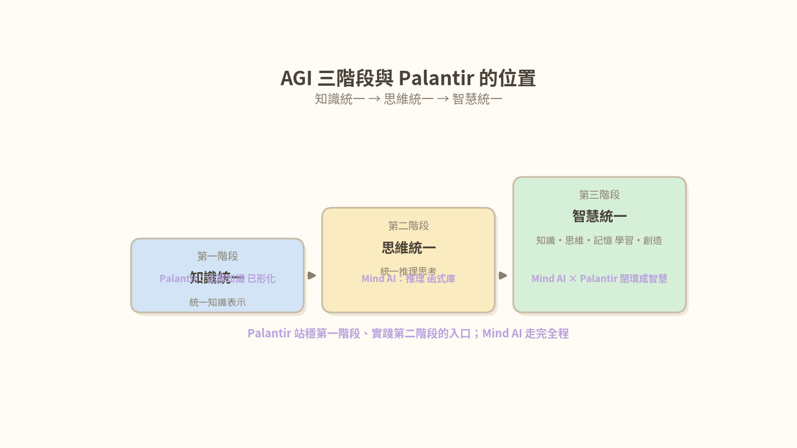

**圖 7-3　AGI 三階段與 Palantir 的位置**

Palantir 的位置很清楚：它把**第一階段**在企業範圍內走到了產業級——企業知識被形化成 Ontology；它也站在**第二階段**的入口——AIP 把推理與決策帶進營運迴路。Mind AI 要走完全程：讓形的智慧不止服務一個企業的營運，而能跨域統一、自我演化——從知識統一走向思維統一，從思維統一走向智慧統一。

| 階段 | 任務 | Mind AI 的角色 | Palantir 的位置 |
| --- | --- | --- | --- |
| 知識統一 | 統一知識表示 | 形庫・形集合表記 | 企業知識已形化（Ontology） |
| 思維統一 | 統一推理與思考 | 函式庫・中樞推理 | AIP 推理進營運迴路（入口） |
| 智慧統一 | 知識・思維・記憶・學習・創造 | 兩庫一中樞一迴路全程 | 閉環為智慧提供營運土壤 |

> **【專業專欄 C6】治理・權限・稽核的形學讀法**
>
> 企業導入最重的題目常是治理：誰能看、誰能改、改了之後誰負責。形學讀法：權限是 **( ) 容器的守門規則**（id(C) 的存取邊界）、稽核是**時間本形的痕跡**（每次函式執行留下的形進形出記錄）、法規遵循是 **[ ] 刻度的外部約束**（維度的合法範圍）。
>
> 把治理寫成三種補足的延伸，治理文件就不再是一堆條文，而是模型的一部分：跟著形走、跟著版本走、跟著四問卡走。Palantir 的 audit 能力與形學的可複核主張，在這裡完全會師。

> **本篇金句**
>
> ◆ 體給結構、用給動作、準給複核——三個字裝下全書。
>
> ◆ 根—幹—果—印證：一條大路，雙向回饋。
>
> ◆ Palantir 站穩知識統一的企業版；Mind AI 走向三階段全程。

> **練習 E07　架構整合**
>
> ① 不看書，畫出體—用—準總架構圖，並標出 Mind AI 與 Palantir 的位置。
>
> ② 用「印證、互補、對讀、應用」四個詞，各寫一句話說明本書的關係觀。
>
> ③ AGI 三階段中，Palantir 已走到哪裡？你的判準是什麼？

# 第八篇　內容完整方案＋框架完整方案

本篇把全書轉成可執行的方案：內容怎麼編、框架怎麼搭、八週怎麼走、情境怎麼選、形庫怎麼建、驗收怎麼過。這是「內容與框架的完整方案」的落點。

> **本篇地圖**
>
> 8.1 目標與雙軌　｜　8.2 八大模組　｜　8.3 學練用教建・八週　｜　8.4 情境選路
>
> 8.5 建庫與驗收　｜　8.6 教學推廣　｜　8.7 總結
>
> 讀完本篇，你會拿到：可教、可練、可建的完整方案。

## 8.1　方案目標與雙軌讀者

方案目標有三：**一、可教**——任何講師照模組能開課；**二、可練**——任何團隊照八週能上手；**三、可建**——任何組織照四階段能建起自己的形庫。雙軌讀者與本書一致：主文給決策者與顧問，專業專欄給架構師與工程師。

| 讀者 | 建議路徑 | 重點模組 |
| --- | --- | --- |
| 決策者／顧問 | 前言 → 一 → 三 → 五 → 八 | 對讀、評析、方案 |
| 架構師／工程師 | 二 → 三 → 六 → 七 → 專業專欄 | 骨幹、對讀、導入、架構 |
| 講師／教育者 | 全書＋附錄 B 速查卡 | 八週路線、練習與答案 |
| 研究者 | 一 → 二 → 三 → 五 → 七 | 關係敘事、理論深度 |

## 8.2　內容模組規劃：M1–M8

八大模組對應全書八篇，可拆可合：企業內訓取 **M3–M6**（對讀、互補、評析、導入），師資培訓取全八模組，一日工作坊取 **M2＋M6**（骨幹＋導入）。

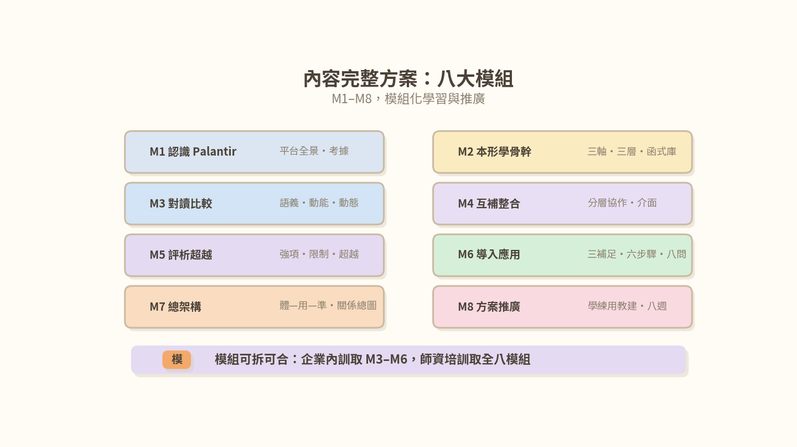

**圖 8-1　八大模組：M1–M8**

每個模組的交付件都是「一概念一圖一例一練習」：概念講透、圖解到位、案例落地、練習過關。這是粉彩教學法的核心紀律，也是本書圖文密度的由來。

## 8.3　框架方案：學練用教建・八週路線

框架採五字訣：**學**（骨幹與對讀）、**練**（四問卡與六步驟）、**用**（選一個情境走全程）、**教**（講給同儕聽）、**建**（形庫入門與驗收）。八週路線把五字訣排成課表：

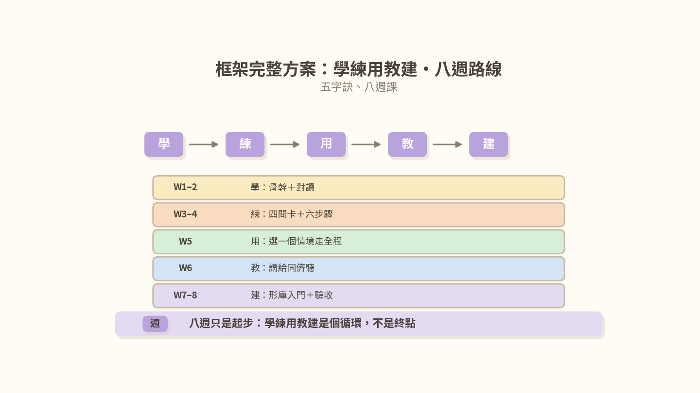

**圖 8-2　學練用教建・八週路線**

每週的交付件列清楚，路線才走得踏實——學練用教建，週週有產出：

| 週次 | 主題 | 交付件 |
| --- | --- | --- |
| W1–2 | 學：骨幹＋對讀 | 讀書筆記＋一張對讀表（六面向） |
| W3–4 | 練：四問卡＋六步驟 | 三張四問卡＋一次六步驟演練底稿 |
| W5 | 用：情境走全程 | 一個情境的完整形化報告 |
| W6 | 教：講給同儕聽 | 一份教材＋一次同儕教學 |
| W7–8 | 建：形庫入門＋驗收 | 形庫雛形＋八問驗收表 |

八週只是起步——學練用教建是循環不是終點。建議每季重跑一次後半段（用→教→建），讓形庫隨業務長大。

## 8.4　情境選路

不是所有情境都走同一條路。選路原則：**先認處境的形，再挑方法**——要判斷「一物是什麼」走空間本形（三軸＋形集合）；要「做一件事」走時間本形（挑函式＋四問卡）；要「證明對不對」走準確使用（六步驟＋八問）。

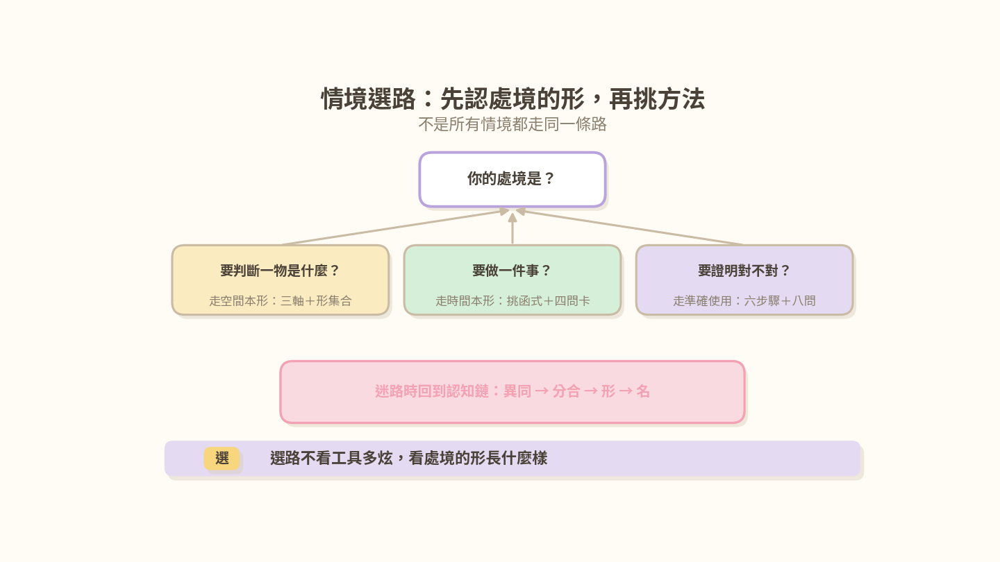

**圖 8-3　情境選路：先認處境的形**

迷路時回到認知鏈：異同 → 分合 → 形 → 名。這條鏈是萬用的導航——不知道走哪條路時，多半是「形還沒認明」，而不是「方法不夠多」。

## 8.5　建庫四階段與驗收標準

形庫不是一天建成的。四階段：**認形**（把手上東西認明、命名）→ **建模**（形集合＋四問卡入庫）→ **上環**（接決策迴路、開始寫回）→ **演化**（持續學習、重構重組）。

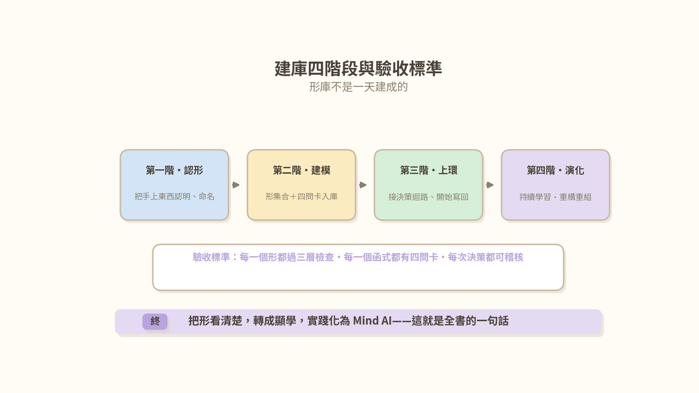

**圖 8-4　建庫四階段與驗收標準**

驗收標準三條，缺一不收：**每一個形都過三層檢查、每一個函式都有四問卡、每次決策都可稽核**。三條都過，這個形庫才算是「準」的。做成驗收表長這樣：

| 驗收項 | 檢查方法 | 通過標準 |
| --- | --- | --- |
| 形過三層 | 抽樣走 J=J_C∧J_B∧J_T | 抽樣 100% 通過，不過者列整改 |
| 函式有四問卡 | 盤點行動型 × 卡片 | 覆蓋率 100%，卡片欄位無空白 |
| 決策可稽核 | 抽查決策留痕 | 每次執行可回放形進形出 |

> **【專業專欄 C8】從試點到量產：導入路線圖**
>
> 大規模導入忌「一步到位」。形學推薦三段路：**試點**（挑一個高痛感、可度量的流程，六週完成一次全程形化）、**擴點**（複製方法到三個流程，同時立命名規則與判準表）、**量產**（建形庫治理節奏——版本化、季重構、八問抽查）。
>
> 每段的門檻都用八問把關：試點過八問才准擴點，擴點過八問才能量產。這樣長出來的形庫，不怕換人、不怕換工具——因為「準」在方法裡，不在個人記憶裡。

## 8.6　教學推廣與下一步

方案最後一哩是推廣。教學推廣建議三條並進：**一曰開課**——以八大模組開班，主文與專業專欄分軌授課；**二曰共創**——與導入組織合寫案例，把形化報告變成教材；**三曰立標**——以八問與三條驗收標準做公開評核，讓「準」成為業界看得懂的門檻。

本書是關係敘事的第一步。下一步的地圖已經畫好：把第三篇的對讀表擴成**跨平台對讀系列**（同尺量各家）、把第六篇的方法做成**工作底稿模板庫**、把第八篇的方案落成**認證與師資體系**。每一條路都遵守同一條紀律——**準＝可複核的準**。路很長，尺在手上。

## 8.7　總結：一句話收束

回到開頭。本形學的任務是「把形看清楚、轉成顯學、實踐化為 Mind AI」；本書多做了一步——**把形的尺拿去量 Palantir，量出印證、量出互補、量出超越點，也量出一套可執行的方案**。

> **本篇金句**
>
> ◆ 對讀：語義↔空間、動能↔時間、動態↔演化——同構互證。
>
> ◆ 互補：認知智慧層 × 營運決策層——兩端給智慧，中段給力量。
>
> ◆ 超越：表記、判準、演化——補上認知的形。
>
> ◆ 導入：三種補足＋六步驟＋四問卡＋八問——準＝可複核的準。
>
> ◆ 方案：M1–M8＋學練用教建＋建庫四階段——可教、可練、可建。

把形看清楚，轉成顯學，實踐化為 Mind AI——這就是全書的一句話。

> **【專業專欄 C7】形庫治理與資料品質**
>
> 形庫上線後的日常運作，比建庫更難：形會長大、判準會鬆動、命名會漂移。形學的治理三件套：**版本化**（形集合與四問卡隨模型版本走）、**定期重構**（remove 三級重審、開放位盤點）、**八問抽查**（每季抽樣走八問）。
>
> 資料品質問題在形學裡幾乎都能歸因到三層：品質事故＝J 過了但世界變了（不變性破了）、資料漂移＝[ ] 刻度失準、主體混亂＝id(C) 治理鬆動。對症下藥，比再買一套清洗工具實在。

> **練習 E08　方案設計**
>
> ① 為你的組織排一份「八週路線」變體，標出每週的產出物。
>
> ② 用情境選路，為三個不同處境各挑一條路，並說明理由。
>
> ③ 建庫四階段中，你的組織現在在哪一階段？下一步是什麼？

> **練習 E09　綜合實作**
>
> ① 選一個真實業務流程，從頭到尾做一次形化：認明形 → 寫形集合 → 選行動型 → 填四問卡 → 六步驟證明 → 八問驗收。
>
> ② 為上述流程寫一頁「關係說明」：它在 Palantir 式平台裡如何運作？Mind AI 式的形庫能補什麼？
>
> ③ 用五種誤用警示自查一遍，寫出三條修正承諾。

# 附錄 A　術語對照表

左欄為本形學術語，中欄為 Palantir 對讀術語，右欄為一般讀者易懂說明。書中「形」一律指 Type。

| 本形學 | Palantir（對讀） | 一句話說明 |
| --- | --- | --- |
| 形（Type） | Ontology 概念／Object Type | 認得出來、可命名的東西 |
| 單位形（Unit Type） | Object Type | 形的基本單位＝形集合 |
| 形集合 {部件,(內容),[類別]} | Object 模型 | 形的表記法 |
| 空間本形（名詞・體） | semantic 語義元素 | 它是什麼 |
| 時間本形（動詞・用） | kinetic 動能元素 | 它會做什麼 |
| 生成與演化 | dynamic 動態元素 | 它會變成什麼 |
| [ ] 屬性軸 | Property | 維度 × 刻度 |
| { } 物料清單／remove 三級 | 組成・依賴（schema） | 拆下來還認得自己嗎 |
| ( ) 容器・id(C)・不變性 | Interface・身份 | 它還是它嗎 |
| 函式 op : Type → Type | Action Type／Function | 輸入一形、產出一形 |
| 函式四問卡 | （無對應，形學補充） | 函式的身份證 |
| 三層判斷 J=J_C∧J_B∧J_T | 權限・稽核規則 | 可複核的判準 |
| ∩(T) 開放位 | （無對應，形學補充） | 形的邊界會學習 |
| 形庫 | Ontology 實例資料 | 存形的地方 |
| 準確使用方法 | 治理・驗收實務（近似） | 把準做成工程 |
| Mind AI | Palantir 平台（對讀座標） | 把形實踐化的平台 |

# 附錄 B　速查卡

## B-1　對讀速查（一頁）

| 問句 | 翻成 Palantir 語 | 翻成本形學語 |
| --- | --- | --- |
| 它由什麼組成？ | Object 模型・Properties | { } 物料清單・remove 三級 |
| 它是什麼類別？ | Object Type・分類 | [ ] 屬性軸・∩(T) 歸類 |
| 它怎麼變、怎麼動？ | Actions・Functions・Triggers | 時間本形・函式四問卡 |
| 怎麼算做對了？ | 權限・audit・human validation | 三層判斷・八問 |
| 決策怎麼落地？ | Writeback・systems of action | 產出形回到世界 |
| 怎麼越用越準？ | capture decisions・learning | 持續學習・自我演化 |

## B-2　八問勾選（可複印）

> **八問檢查清單**
>
> □ ① 整體認明了嗎？　　　　□ ⑤ 判準推理走過了嗎？
>
> □ ② 三軸都描述了嗎？　　　□ ⑥ 三層檢查通過了嗎？
>
> □ ③ 形集合寫全了嗎？　　　□ ⑦ 四問卡填好了嗎？
>
> □ ④ 命題選定了嗎？　　　　□ ⑧ 誤用對照看過了嗎？
>
> 八問全過，才叫「準確使用」。專案名稱：＿＿＿＿＿＿　日期：＿＿＿＿　檢查人：＿＿＿＿

## B-3　空白模板：函式四問卡＋形集合卡（可複印）

| 函式四問卡（空白） | 填寫 |
| --- | --- |
| 名稱 | ＿＿＿＿＿＿＿＿＿＿＿＿＿＿＿＿ |
| 輸入形 | ＿＿＿＿＿＿＿＿＿＿＿＿＿＿＿＿ |
| 產出形 | ＿＿＿＿＿＿＿＿＿＿＿＿＿＿＿＿ |
| 判準 | ＿＿＿＿＿＿＿＿＿＿＿＿＿＿＿＿ |

| 形集合卡（空白） | 填寫 |
| --- | --- |
| 形的名稱 | ＿＿＿＿＿＿＿＿＿＿＿＿＿＿＿＿ |
| 部件 { } | ＿＿＿＿＿＿＿＿＿＿＿＿＿＿＿＿ |
| 內容 ( ) | ＿＿＿＿＿＿＿＿＿＿＿＿＿＿＿＿ |
| 類別 [ ] | ＿＿＿＿＿＿＿＿＿＿＿＿＿＿＿＿ |
| remove 三級 | 必要件：＿＿＿　降級件：＿＿＿　非必要件：＿＿＿ |

# 附錄 C　練習參考答案

> **E01　平台速寫**
>
> ① Gotham＝防務與情報（警報・地理空間分析・預測）；Foundry＝商業與民事政府的資料整合平台（Ontology 是心臟）；Apollo＝跨環境 CI/CD 軟體交付；AIP＝把 LLM 與代理綁上企業資料、邏輯、行動的 AI 平台。
>
> ② semantic 語義元素答「是什麼」；kinetic 動能元素答「會做什麼」；dynamic 動態元素答「會變成什麼」。
>
> ③ 資料、邏輯、行動系統。「人可驗證」＝判準在人：機器可提形，人守三層檢查——這是可稽核、可信任的前提。

> **E02　骨幹速寫**
>
> ① {杯把, 杯底, 杯蓋, 杯身, (咖啡), [白色]}——部件四件、內容 (咖啡) 可替換、類別 [白色] 給刻度。
>
> ② J_C 查身份不變（容器）、J_B 查結構正確（BOM/remove 三級）、J_T 查歸類正確（∩(T)）。少一層則判斷不成立：可能認錯物、拆錯件或歸錯類。
>
> ③ 名稱：倒水；輸入形：{壺, 水}；產出形：{杯, 裝水的杯}；判準：不灑、不溢、杯身份不變（三層檢查）。

> **E03　對讀填表**
>
> ① Object Type↔單位形（都是可複用的形）；Property↔[ ]（都是維度刻度）；Link↔形關係（都是歸屬對照）；Action Type↔函式（都是可複用運作）；Writeback↔產出形回世界（都是閉環落地）。
>
> ② 決策沉澱成新形入庫：用得越多、形庫越厚、決策越準——即體用合一的飛輪。
>
> ③ 參考思路（餐飲）：物件型＝菜色、桌台、訂單；行動型＝出餐、併桌。對讀：菜色↔單位形 {品項,(客製),[類別]}；出餐↔函式 {訂單}→{出餐單}。

> **E04　互補設計**
>
> ① Mind AI 站認知智慧層（形庫與推理），Palantir 站營運決策層（物件與行動迴路）——同在實踐層、分工不同。
>
> ② Mind AI 強項＝兩端（形庫、學習沉澱）；Palantir 強項＝中段（建模、決策、行動的工程閉環）。
>
> ③ 診斷口徑：名字是否各叫各的（id(C)）、拆解是否有判準（remove）、決策是否可稽核（三層檢查）。三條修法＝三種補足＋命名規則＋驗收八問。

> **E05　評析練習**
>
> ① 例：供應鏈閉環——資料（庫存）→決策（補貨）→行動（下單）→回饋（到貨）循環；對應形學「動作產出新形、形支撐動作」的飛輪。
>
> ② 「有形無學」＝做得出模型卻說不清形的定義與判準，知識停在個人直覺。可教可複核才能規模化、才能不因人而散。
>
> ③ F(T) 守住形的本質特徵，∩(T) 開放位接納新成員——跨域統一要的正是邊界會學習的形；封閉分類樹則每遇新域就要重畫。

> **E06　補足練習**
>
> ① 例（課程）：[ ] 規則＝學分刻度、時數邊界；( ) 身份＝課號 id(C) 唯一、課綱不變性；{ } 結構＝必修（必要件）、選修（降級件）、旁聽（非必要件）。
>
> ② 斷航情境下 remove 三級推演：航線是必要件，斷航＝必要件損失→不可放行，結論由「降額放行」變為「改派或延後」。
>
> ③ 審批 Approve：名稱＝審批；輸入形＝{申請單, 證據}；產出形＝{核准單或駁回單}；判準＝權限合規・金額限額・可稽核。

> **E07　架構整合**
>
> ① 參考圖 7-1：體（空間本形）－用（時間本形）－準（準確使用方法），落點 Mind AI × Palantir。
>
> ② 印證＝Palantir 證明形的工程走得通；互補＝理論補工程、工程補理論；對讀＝同一座山兩條路；應用＝準確使用方法雙向適用。
>
> ③ 已走穩第一階段（企業知識形化為 Ontology）、進入第二階段入口（AIP 的推理決策迴路）。判準：知識是否統一表示、推理是否進營運閉環。

> **E08　方案設計**
>
> ① 產出物參考：W1–2 讀書筆記＋對讀表；W3–4 三張四問卡＋一次六步驟演練；W5 一個情境完整形化報告；W6 一次同儕教學；W7–8 形庫雛形＋八問驗收表。
>
> ② 判斷「是什麼」→空間本形；「做一件事」→時間本形；「證明對錯」→六步驟＋八問。理由都從「處境的形長什麼樣」出發。
>
> ③ 依四階段自評（認形→建模→上環→演化），下一步=下一階段的交付件（命名表／形集合＋四問卡／writeback 串接／重構節奏）。

> **E09　綜合實作**
>
> ①②③ 為開放實作題。驗收以八問＋三條驗收標準為準：形過三層、函式有四問卡、決策可稽核；誤用自查至少覆蓋五種誤讀中的三種，修正承諾需可執行、可檢查。

# 附錄 D　圖表索引

全書圖解一覽，方便授課與複核時定位。圖號依篇章排序；顏色分工：黃＝屬性、橘＝組成、藍＝容器、綠＝時間、紫＝總結、粉＝誤用。

| 篇章 | 圖號 | 內容 |
| --- | --- | --- |
| 前言 | 圖 0-1 | 本書任務：一座橋、四個面向 |
| 篇一・認識 Palantir | 圖 1-1 ～ 1-4 | 公司速寫・四大平台・Ontology 三元素・AIP 三連結 |
| 篇二・本形學骨幹 | 圖 2-1 ～ 2-6 | 認知鏈・三軸・形集合・三層判斷・形進形出・體用準 |
| 篇三・對讀比較 | 圖 3-1 ～ 3-10 | 登山路・語義・動能・動態・總表・深度・案例・三問・收束 |
| 篇四・互補整合 | 圖 4-1 ～ 4-5 | 分層定位・架構對接・閉環分工・整合情境・前後對照 |
| 篇五・評析超越 | 圖 5-1 ～ 5-6 | 三強項・有形無學・表記缺位・開放位・超越・誤用 |
| 篇六・導入應用 | 圖 6-1 ～ 6-6 | 三種補足・六步驟・示範・四問卡・八問・誤用對照 |
| 篇七・總架構 | 圖 7-1 ～ 7-3 | 體用準・關係總圖・AGI 三階段 |
| 篇八・完整方案 | 圖 8-1 ～ 8-4 | 八大模組・八週路線・情境選路・建庫驗收 |
