# 視覺語言動作模型  Vision Language Action

**Mind AI & 本形學Ontypology**

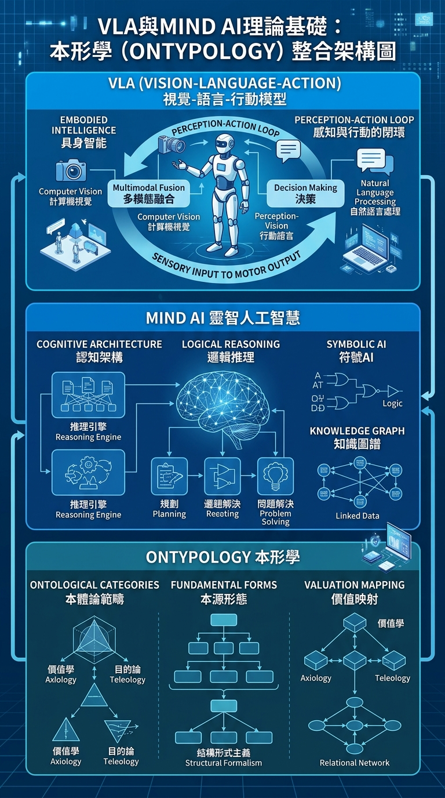

# 目　錄

- 前言　本書地圖
- 導讀　三副眼鏡與符號速覽
- 第一篇　定位——VLA 為什麼需要形
  - 1-1　VLA 是什麼：一句話與三模態
  - 1-2　五個痛點：都是「形沒立好」
  - 1-3　根幹果三層定位
  - 1-4　VLA 三問：本書的主線
- 第二篇　骨幹速覽——工具箱與映射總表
  - 2-1　認知鏈與 VLA 鏈：兩條鏈疊起來
  - 2-2　六件工具，一頁帶完
  - 2-3　映射總表：VLA × 本形學
- 第三篇　空間本形——機器人世界的形
  - 3-1　單位形：形集合的標準寫法
  - 3-2　[ ] 屬性軸：維度 × 刻度
  - 3-3　{ } 組成軸：BOM 與 remove 三級＝安全地圖
  - 3-4　( ) 容器軸：工作單元與不變性公理
  - 3-5　三層判斷：收件漏斗
  - 3-6　五種形，一形一卡
- 第四篇　時間本形——VLA 的動作鏈
  - 4-1　動作就是時間本形
  - 4-2　六站鏈：看、讀、想、動、查、學
  - 4-3　函式四問卡：一式一卡
  - 4-4　動作表示三路：三種產形方式
  - 4-5　推理五族與思考法選路
  - 4-6　單系統與雙系統：兩種節奏
  - 4-7　形進形出閉環
- 第五篇　準確使用方法——體、用、準
  - 5-1　體—用—準總覽
  - 5-2　三種補足：把形補到能用
  - 5-3　證明六步驟：全程示範
  - 5-4　四層準確性與日誌六欄位
  - 5-5　八問：交付前的檢查清單
  - 5-6　誤用 16 種：四組病歷
  - 5-7　選路決策樹
- 第六篇　總架構——兩庫一中樞一迴路
  - 6-1　兩庫一中樞一迴路 × VLA
  - 6-2　生態系對讀：各家 VLA 的落點
  - 6-3　資料與基準：形庫與判準的對讀
  - 6-4　Mind AI：底層平台（只引不述）
  - 6-5　四條驗收線與三個統一
- 第七篇　內容完整方案——學、練、用、教、建
  - 7-1　學練用教建，五字一迴路
  - 7-2　八週路線
  - 7-3　建庫四階段
  - 7-4　情境選路：四種讀者的路線
  - 7-5　PoC 三情境與 FAQ
- 第八篇　總結——五個領域，一條路
  - 8-1　五領域並列
  - 8-2　三個連續目標
- 結語
- 附錄 A　術語表與記號總表
- 附錄 B　速查卡
- 附錄 C　練習參考答案
- 附錄 D　圖表索引

# 前言　本書地圖

這本冊子要回答的是三個問題：VLA 這個形長什麼樣？它怎麼動得準？以及，我們怎麼把「準」變成可複核、可教學、可落地的整套做法？

VLA——視覺・語言・動作（Vision-Language-Action）——是讓機器人「看懂現場、聽懂指令、做出動作」的多模態基礎模型。短短幾年，它從實驗室走進工廠與家庭，成了具身智慧最熱的戰場。但熱鬧背後有一個老問題：描述得漂亮，不等於用得準。本書以本形學（空間本形與時間本形）為理論基礎、以 Mind AI 為底層平台，給出 VLA 的準確使用方法與架構，以及一份完整的內容方案。

**表 0-1　本書地圖**

| 篇章 | 回答的問題 | 核心產出 |
| --- | --- | --- |
| 導讀 | 怎麼讀這本書？ | 三副眼鏡・符號速覽 |
| 第一篇　定位 | VLA 為什麼需要形？ | 五痛點・根幹果・VLA 三問 |
| 第二篇　骨幹速覽 | 工具箱裡有什麼？ | 六件工具・映射總表 |
| 第三篇　空間本形 | 機器人世界的形長什麼樣？ | 五種形・三軸・安全地圖・三層判斷 |
| 第四篇　時間本形 | VLA 的動作怎麼運作？ | 六站鏈・函式四問卡・動作表示三路 |
| 第五篇　準確使用方法 | 怎麼用得準？ | 三種補足・六步驟・八問・誤用 16 種 |
| 第六篇　總架構 | 整套系統怎麼擺？ | 兩庫一中樞一迴路・四條驗收線 |
| 第七篇　內容完整方案 | 怎麼學、練、用、教、建？ | 八週路線・建庫四階段・情境選路 |
| 第八篇　總結 | 這一切通向哪裡？ | 五領域並列・三個連續目標 |
| 附錄 A–D | 查得到、印得出、對得上。 | 術語表・速查卡・練習答案・圖表索引 |

全書約六十頁、四十餘張圖，雙軌閱讀：主文是方法與架構；【專業專欄】帶你到現場——VLA 的簡史、考據、基準與 2026 年的最新趨勢。每篇附練習，答案在附錄 C。

# 導讀　三副眼鏡與符號速覽

讀 VLA 的文獻，多數人戴的是「模型眼鏡」：看架構、看參數、看基準分數。這副眼鏡當然要戴，但只戴它，會錯過兩件更根本的事——VLA 处理的到底是什麼樣的形？它產出的動作，憑什麼叫做準？

所以本書請你換上三副眼鏡疊著看。

- **形學眼鏡：** 把世界看成形與形的運作——空間本形看「它是什麼」，時間本形看「它怎麼動」。
- **VLA 眼鏡：** 把模型看成「形進形出」的函式鏈——影像與指令是進來的形，動作是出去的形。
- **實踐眼鏡：** 把落地看成可複核的準——每一步有判準、有日誌、有驗收線，出錯找得回、改得動。

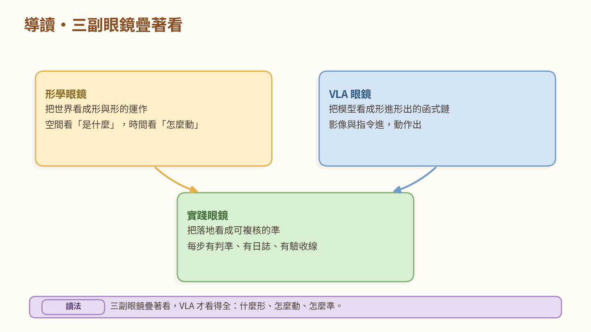

**圖 D-1　三副眼鏡疊著看：形學 × VLA × 實踐**

### 符號速覽

| 記號 | 讀作 | 一句話 |
| --- | --- | --- |
| [ ] | 屬性 | 它有什麼特徵？維度 × 刻度寫清楚。 |
| { } | 組成 | 它由什麼組成？清單（BOM）列出來。 |
| ( ) | 容器 | 它裝在哪裡？身份 id(C) 與內容 S(C) 分開。 |
| {部件,(內容),[類別]} | 單位形 | 一個可以獨立指認的形。 |
| op：形→形 | 時間本形（函式） | 動作就是函式：輸入一個形，產出一個形。 |
| ≡　≢　⊂ | 同一／不同／降級 | 比較的三種結論，各歸其位。 |
| ∩(T) | 抽象判準 | 憑什麼說它屬於這一類？交集說了算。 |
| J = J_C ∧ J_B ∧ J_T | 三層判斷 | 容器層、組成層、抽象層連立，缺一不可。 |

> **讀法建議**
>
> 從頭讀：五十分鐘讀完第一、二篇，拿到整張地圖。
>
> 帶著問題讀：工程師直奔第四、五篇；研究者直奔第三、四篇與專欄；要開課、要導入的讀者直奔第五、七篇。
>
> 查著讀：附錄 B 的速查卡可以影印，B-3 是空白模板，直接帶到你的任務上填。

# 第一篇　定位——VLA 為什麼需要形

## 1-1　VLA 是什麼：一句話與三模態

一句話：給機器人一張（或一段）現場影像、一句自然語言指令，VLA 直接輸出可執行的低階動作——把「看、讀、動」合成了一條龍。這條龍的身體，通常是一台先看懂圖文的視覺語言模型（VLM），加上一個把「看懂的東西」翻譯成「做得到的動作」的動作解碼器。

三模態各有各的形：視覺給的是場景形——桌上有哪些東西、在哪裡；語言給的是指令形——要它做什麼；動作給的是時間本形——怎麼一步步做。VLA 的本領，就是讓這三種形在同一個模型裡交接。

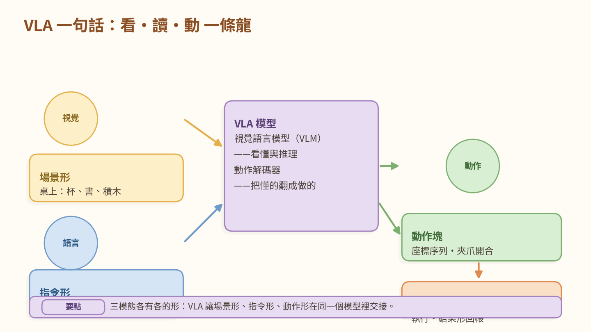

**圖 1-1　VLA 一句話：看懂現場（視覺）＋聽懂指令（語言）→ 產出動作（時間本形）**

2023 年 Google DeepMind 的 RT-2 立下了這個範式：把網頁知識蒸進機器人控制裡，感知、推理、控制一條龍打通。此後 OpenVLA、Octo、π0、Helix、GR00T、Gemini Robotics、SmolVLA 接力，把 VLA 推成具身智慧的主戰場。

## 1-2　五個痛點：都是「形沒立好」

VLA 很強，但用起來的挫折也多。把挫折攤開來看，幾乎都能歸到同一個根源——形沒立好。

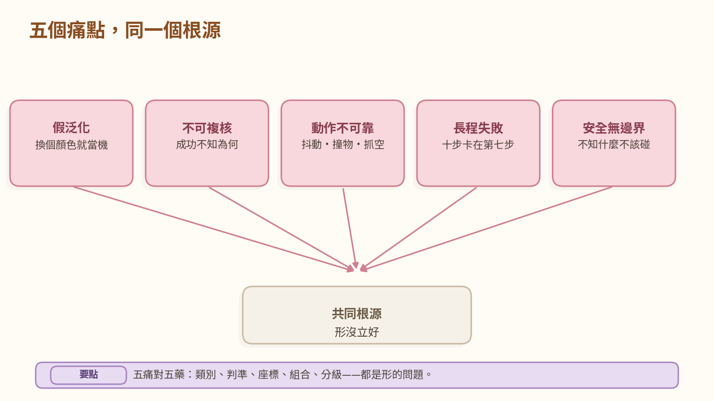

**圖 1-2　五個痛點，同一個根源：形沒立好**

### 痛點一・假泛化

演示裡會疊積木，換個顏色、換張桌子就當機。形的類別（[ ]）沒立好，模型認的是「像素的相似」，不是「形的同一」。

### 痛點二・不可複核

成功了不知道為什麼成功，失敗了不知道哪一步錯。沒有判準、沒有日誌，「準」只存在於演示影片裡。

### 痛點三・動作不可靠

抖動、撞物、抓空。動作沒有自己的形（座標、刻度、約束），輸出的數字看起來像動作，落地就散。

### 痛點四・長程失敗

十步的任務卡在第七步。子任務沒有形、順序沒有形，長程一拉長，組合就垮。

### 痛點五・安全無邊界

不知道什麼該碰、什麼不該碰。安全約束沒有進形、沒有分級，護欄就只能事後補。

這五個痛點，對應的正是形學的五個出發點：類別、判準、座標、組合、分級。本書後面的每一件工具，都在治其中一個。

## 1-3　根幹果三層定位

這本書的理論與平台怎麼擺？用「根、幹、果」三層定位最清楚。

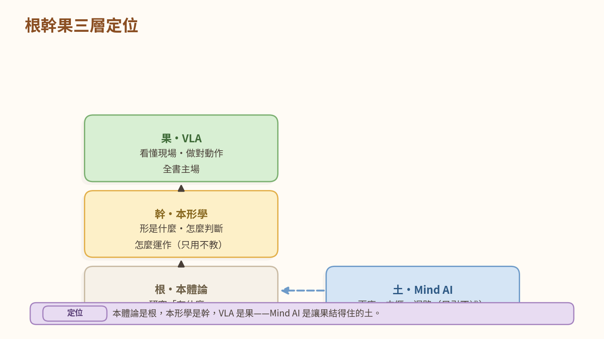

**圖 1-3　根幹果：本體論是根，本形學是幹，VLA 是果園裡的果**

| 層 | 角色 | 在本書的位置 |
| --- | --- | --- |
| 根 | 本體論——研究「有什麼」 | 不重講；提供「世界裡到底有哪些東西」的底氣。 |
| 幹 | 本形學——形是什麼、怎麼判斷、怎麼運作 | 只用不教；三軸、三層判斷、函式庫是本書的工具箱。 |
| 果 | VLA——具身智慧的果 | 全書主場：把形與函式用在「看、讀、動」上。 |
| 土 | Mind AI——底層平台 | 只引不述；兩庫一中樞一迴路，承接形與函式的落地。 |

> **一句話定位**
>
> 本體論回答「世界有什麼」，本形學回答「形是什麼、怎麼判斷、怎麼運作」，VLA 回答「機器人怎麼看懂現場並做對動作」——而 Mind AI 是讓這一切可累積、可複核的平台。

## 1-4　VLA 三問：本書的主線

以後遇到任何一個 VLA 議題，先問這三句話，答案就在本書的三個篇章裡。

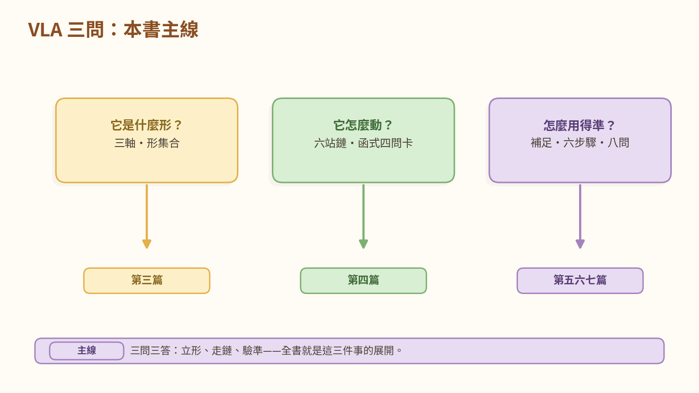

**圖 1-4　VLA 三問：它是什麼形？它怎麼動？怎麼用得準？**

| 問題 | 追問 | 答案所在 |
| --- | --- | --- |
| 它是什麼形？ | 場景、物件、任務、指令，各有什麼屬性、組成、容器？ | 第三篇　空間本形 |
| 它怎麼動？ | 看、讀、想、動、查、學——每一站的函式與判準是什麼？ | 第四篇　時間本形 |
| 怎麼用得準？ | 補什麼、查什麼、避開哪些誤用、怎麼驗收？ | 第五、六、七篇 |

> **練習 E01**
>
> 你手上有一個 VLA 搬運任務：「把桌上的杯子放到水槽裡」。請寫出這個任務裡至少四個「形」，並各用一句話描述它的屬性、組成與容器。
>
> 再指出：如果模型在你家廚房成功、到辦公室茶水間失敗，這比較像五個痛點裡的哪一個？根源是什麼？
>
> 提示：先想「認得出來的東西」有哪些，再套三軸。

# 第二篇　骨幹速覽——工具箱與映射總表

這一篇把工具箱一次攤開：每件工具只給一句話摘要與一張圖，不重抄理論。後面三、四篇再拿起工具逐一上場。

## 2-1　認知鏈與 VLA 鏈：兩條鏈疊起來

認知鏈說：異同 → 分合 → 形 → 名。大腦先分得出「這個≠那個」，把不同切開、相同圈起，邊界誕生成形，再給形一個名字。

VLA 的工作鏈說：看 → 讀 → 想 → 動。機器人先分得出畫面上的「這個≠那個」（看），把指令裡的對象認出來（讀），決定怎麼做（想），最後產出動作（動）。

兩條鏈其實是同一件事的兩個年齡層：VLA 鏈每往前一站，就是在認知鏈上再走一步。把鏈疊起來，就是本書的骨幹。

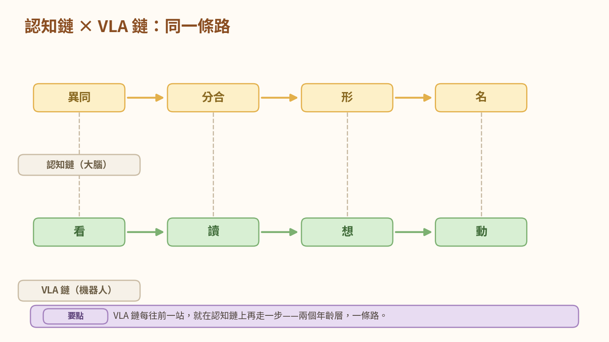

**圖 2-1　認知鏈 × VLA 鏈：同一條路，兩個年齡層**

## 2-2　六件工具，一頁帶完

工具箱裡有六件工具，顏色分工貫穿全書圖表：黃＝屬性、橘＝組成、藍＝容器、綠＝時間、紫＝總結、粉＝誤用。

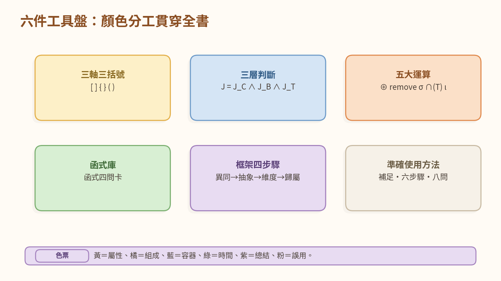

**圖 2-2　六件工具盤：三軸三括號・三層判斷・五大運算・函式庫・框架四步驟・準確使用方法**

| 工具 | 一句話 | 用在哪 |
| --- | --- | --- |
| 三軸三括號 | [ ] 屬性、{ } 組成、( ) 容器，三軸立體描述一個形。 | 第三篇 |
| 三層判斷 | 容器層、組成層、抽象層連立：J = J_C ∧ J_B ∧ J_T。 | 第三、五篇 |
| 五大運算 | ⊕ 合形、remove 拆形、σ 替換、∩(T) 歸類、ι 嵌套。 | 第三、四篇 |
| 函式庫 | 時間本形的招式架：函式四問卡，一式一卡。 | 第四篇 |
| 框架四步驟 | 分辨異同 → 觸發抽象 → 命名維度 → 判斷歸屬。 | 第三、五篇 |
| 準確使用方法 | 三種補足＋證明六步驟＋八問＋誤用清單。 | 第五篇 |

## 2-3　映射總表：VLA × 本形學

下表是全書的骨幹對照：左邊是 VLA 的實務語言，右邊是形學的描述語言。往後各篇會反覆回到這張表。

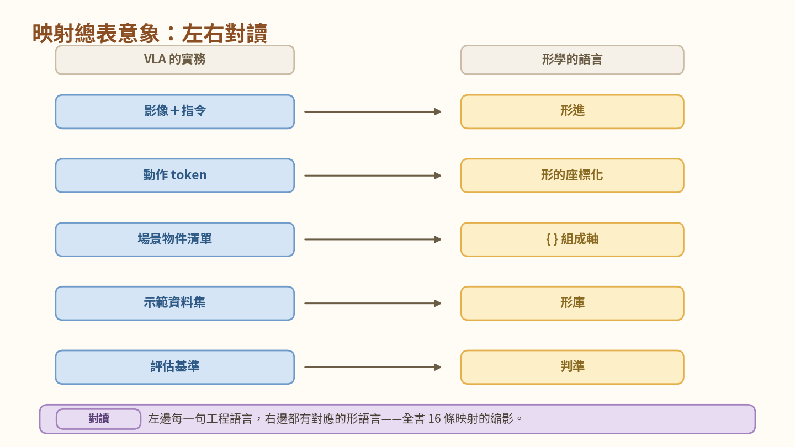

**圖 2-3　映射總表意象：左邊 VLA 的世界，右邊形學的語言**

| VLA 的實務 | 形學的語言 | 一句話對讀 |
| --- | --- | --- |
| 影像＋指令輸入 | 形進 | 兩個形進場：場景形、指令形。 |
| 動作輸出 | 時間本形產形 | op：形→形，一個函式作用出一個新形。 |
| 動作 token（256 格等） | 形的座標化 | 把連續動作量化成刻度，數是形裡的小形。 |
| 關節角、末端位姿 | 數＝形裡小形 | 先有形（手臂、末端），才有數。 |
| 場景物件清單 | { } 組成軸 | BOM 攤開：桌上有什麼，一項一項列。 |
| 安全約束、禁區 | remove 三級 | 必要件、降級件、非必要件，分級就是安全地圖。 |
| 工作空間、相機視野 | ( ) 容器 | C = (id(C), S(C))：身份不變，內容會變。 |
| 任務指令 | 名＋任務形 | 形必有名；指令是任務形的名字。 |
| 動作 chunk（一段動作） | 函式複合 | 幾招連成一式，一次產出一段形鏈。 |
| 泛化能力 | α 抽象生成 | 跨場景、跨機器人保身份，才叫真泛化。 |
| 示範資料集 | 形庫 | Open X-Embodiment 等＝跨容器的大形庫。 |
| 評估基準 | 判準 | LIBERO 等＝可複核的準的量尺。 |
| System 2 慢思考 | 推理・思考法群 | 慢的那層管理解與規劃。 |
| System 1 快反射 | 直取型函式 | 快的那層管 50Hz 的手感。 |
| 頻域動作編碼（FAST） | 刻度換基 | 同一個形，換一組座標描述更省。 |
| 失敗偵測與回饋 | 果因推理 | 由結果回推原因，閉環才長得大。 |

> **骨幹一句話**
>
> VLA 是「形進形出」的函式鏈：進來的形（場景、指令）經過六站函式，出去的形（動作）回到世界，世界再把結果形送回來——兩庫一中樞一迴路，就在這條鏈上長出來。

> **練習 E02**
>
> 拿映射總表自查：你的（或你正在用的）VLA 應用裡，「動作 token」「示範資料集」「安全約束」三列各對應什麼具體東西？各寫一行。
>
> 五個痛點中，你最常遇到的是哪一個？映射總表裡哪一列是它的解藥？

# 第三篇　空間本形——機器人世界的形

要讓機器人用得準，先要把「它面對的世界」描述得準。空間本形回答「它是什麼」：三條軸、一個形集合、一套判斷，把場景裡的每樣東西立成可指認、可比較、可檢查的形。

## 3-1　單位形：形集合的標準寫法

一個可以獨立指認的形，寫成形集合：{部件, (內容), [類別]}。花括號列組成，圓括號括內容，方括號標類別。例如「桌上那杯熱水」：{杯身, (熱水), [容器類]}。杯子拿掉了熱水還是杯子嗎？換了冰水還是同一個杯子嗎？這兩個問題，正是後面 remove 與 σ 替換的引子。

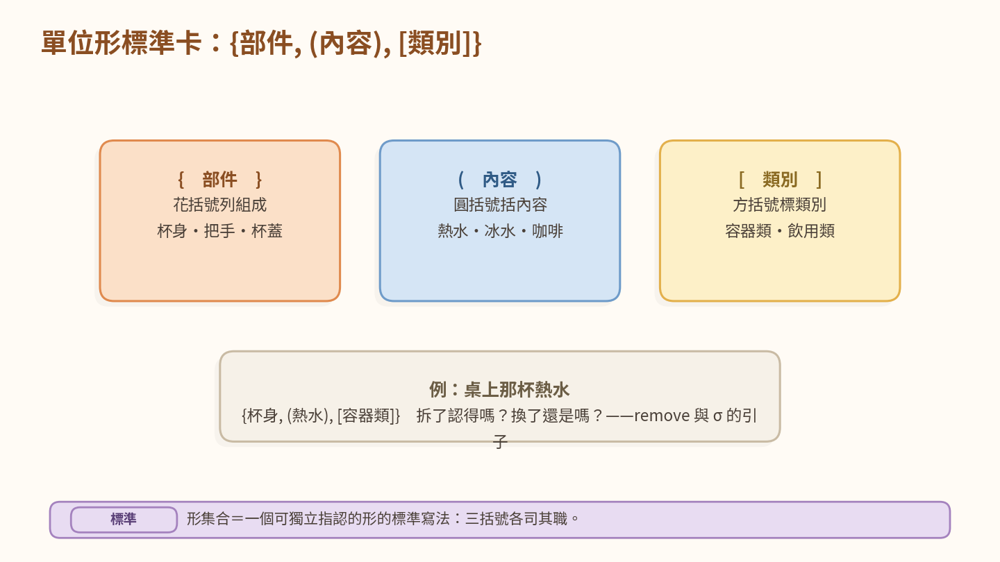

**圖 3-1　單位形標準卡：{部件, (內容), [類別]} 三括號各司其職**

VLA 的世界裡，五種形最常用：場景形、物件形、機器人形、任務形、指令形。每一種都能寫成形集合，每一種都有自己的三軸。

## 3-2　[ ] 屬性軸：維度 × 刻度

屬性寫在方括號裡，一屬性＝一維度，維度上要有刻度。位姿是兩個維度（位置、姿態）；位置有 x、y、z 三個子維度，各有刻度（公尺、公釐、還是格子數？）。刻度不寫清楚，數就沒有資格進形——數是形裡面的小形，先有形，才有數。

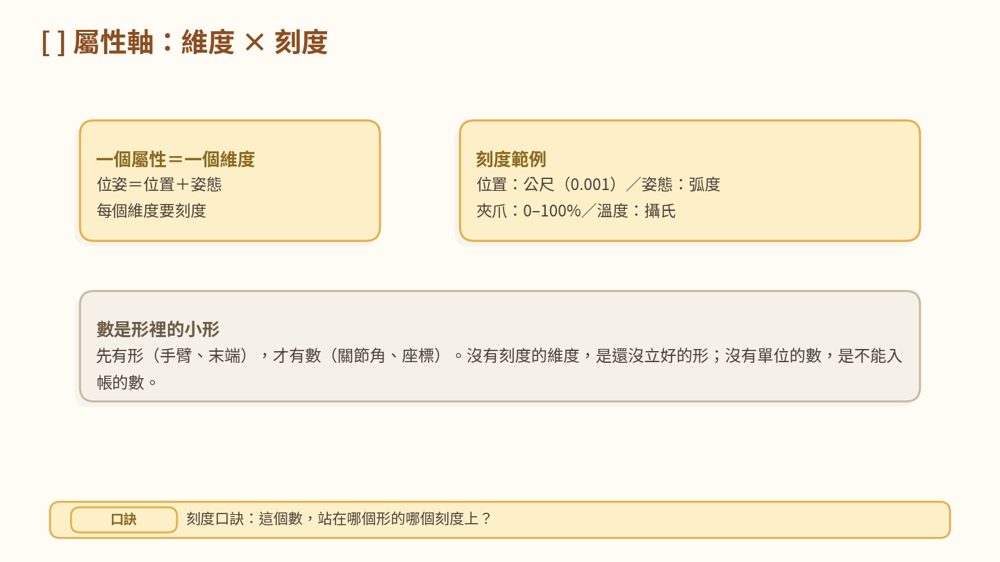

**圖 3-2　[ ] 屬性軸：維度 × 刻度——數是形裡的小形**

| 物件形 | 關鍵維度 | 刻度選擇 | 常見坑 |
| --- | --- | --- | --- |
| 杯子 | 位置、姿態、容量、溫度 | 公尺／弧度／毫升／攝氏 | 四元數與歐拉角混用，姿態刻度不一致。 |
| 積木 | 位置、顏色、尺寸、堆疊序 | 公尺／色票／公分／整數 | 顏色用 RGB 硬比，光影一變就認不出。 |
| 抽屜 | 開度、阻力、內容清單 | 百分比／牛頓／BOM | 開度量測沒有刻度歸零，關到底讀數不為零。 |

> **刻度口訣**
>
> 沒有刻度的維度，是還沒立好的形；沒有單位的數，是不能入帳的數。VLA 輸出的每個座標，都要能回答：這個數，站在哪個形的哪個刻度上？

## 3-3　{ } 組成軸：BOM 與 remove 三級＝安全地圖

組成寫在花括號裡，像一份物料清單（BOM）。場景形的 BOM 是「桌上有哪些東西」；機器人形的 BOM 是「這台機器人由哪些部件組成」。清單在手，才能問「拆下來認得自己嗎」——這就是 remove 三級：

| 級別 | 記號 | 判準 | VLA 對應 |
| --- | --- | --- | --- |
| 必要件 | ≢M | 拆了，這個形就不是這個形。 | 機器人的末端執行器；任務的核心對象。 |
| 功能降級件 | ≡M′ ⊂ M | 拆了還認得，但功能降一級。 | 相機拆了退回盲操；照明壞了改用輪廓辨識。 |
| 非必要件 | ≡M | 拆了，形同一個。 | 裝飾物、背景雜物——不在任務 BOM 內。 |

把場景 BOM 逐項標上三級，就得到一張安全地圖：必要件是紅線（絕不碰、絕不丟），降級件是黃線（可退不可毀），非必要件是綠線（可清理）。這張地圖，就是第五篇護欄的前身。

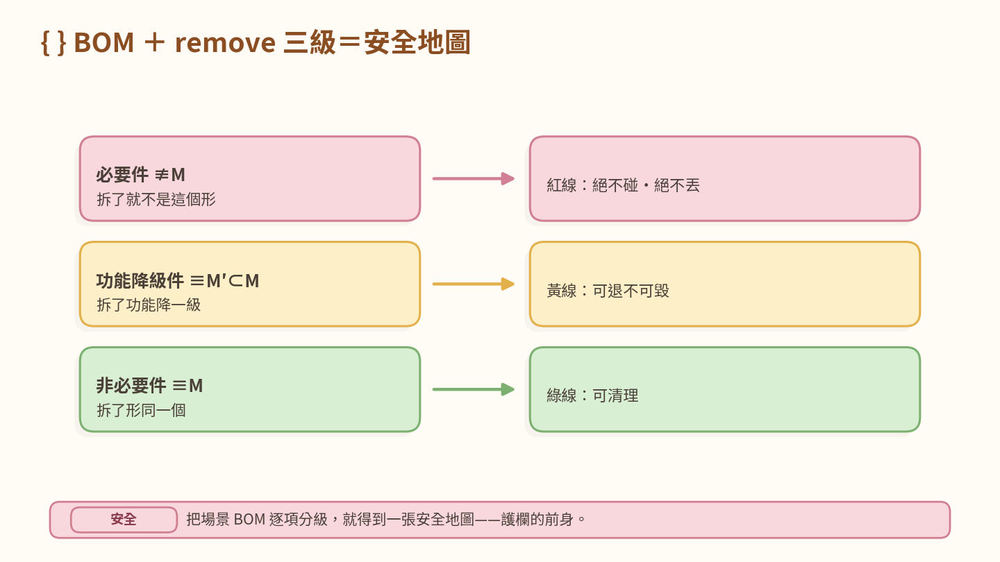

**圖 3-3　{ } BOM ＋ remove 三級＝一張看得懂的安全地圖**

## 3-4　( ) 容器軸：工作單元與不變性公理

容器寫在圓括號裡。工作空間是一個容器：C = (id(C), S(C))——身份與內容分開寫。今天桌上有杯子，明天換成咖啡壺，容器的內容 S(C) 變了，身份 id(C) 沒變：它還是「這張桌子的工作單元」。這條不變性公理，是機器人換場景不失憶的第一道保險。

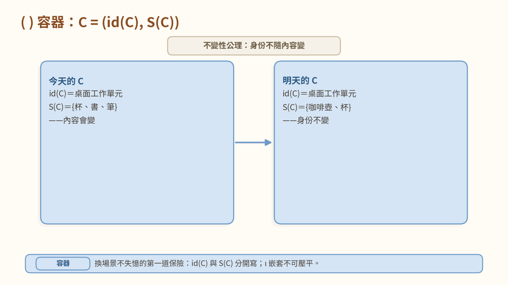

**圖 3-4　( ) 容器：C = (id(C), S(C))——身份不變，內容會變**

容器還管入場規則：什麼形可以進這個容器？工具區裡不能放食材；安全籠裡不能進人。入場規則寫在容器上，而不是靠模型「自己懂事」。ι 嵌套則告訴我們：容器裡還有容器（工作單元裡的工具箱），這條鏈不能隨意壓平——壓平就丟了身份。

> **【專業專欄 C1】本體遷移與跨容器泛化**
>
> 跨容器泛化，是 VLA 最硬的考題之一：模型在 A 機器人、A 場景學會，換到 B 就走樣。Open X-Embodiment 用 22 種本體、百萬集示範證明「跨本體可以學」（RT-X 系列），π0 在 8 種本體上訓練後能控單臂、雙臂；Gemini Robotics 1.5 更把「想清楚再動手」的推理層與動作層分開，讓動作知識跨平台搬家。
>
> 形學讀法：跨容器泛化＝身份錨定問題。泛化不是「像素長得像」，而是 id(C) 換了、形的類別 [ ] 與組成 { } 還認得。訓練時把容器身份與內容分開寫進形，遷移時換的只是 S(C)。

## 3-5　三層判斷：收件漏斗

形立好了，怎麼判斷「它是不是我們要的形」？三層連立：容器層 J_C（它在對的容器裡嗎？）、組成層 J_B（BOM 齊嗎？該在的在嗎？）、抽象層 J_T（依 ∩(T) 判準，它屬於任務要的那一類嗎？）。J = J_C ∧ J_B ∧ J_T——三層缺一不可，過兩層不過一層，就是不收。

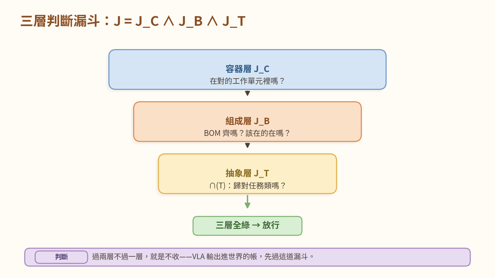

**圖 3-5　三層判斷漏斗：J = J_C ∧ J_B ∧ J_T**

VLA 的輸出要進世界的帳，先過這道漏斗：動作的目標物件在不在對的工作單元（容器層）？抓取點的部件齊不齊（組成層）？這一步歸的任務類別對不對（抽象層）？三層全綠才放行——這就是第五篇「查」那一站的骨架。

> **練習 E03**
>
> 任務：「把微波爐裡的碗拿出來」。寫出微波爐門這個形的形集合，並標出它的 remove 三級（對這個任務而言）。
>
> 微波爐的 id(C) 與 S(C) 各是什麼？今天碗換成盤子，哪個變、哪個不變？

## 3-6　五種形，一形一卡

把 VLA 世界常用的五種形做成速查卡，每卡三軸一句話。往後寫任務、建形庫，都從這五張卡出發。

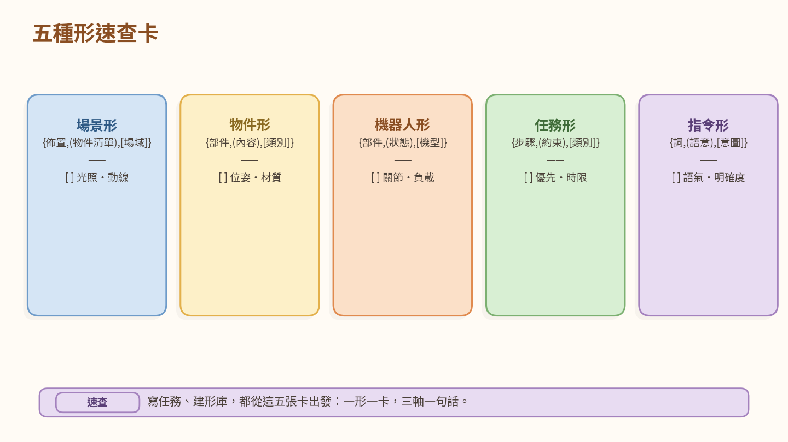

**圖 3-6　五種形速查卡：場景・物件・機器人・任務・指令**

| 形 | 形集合寫法 | [ ] 關鍵屬性 | { } 關鍵組成 | ( ) 容器 |
| --- | --- | --- | --- | --- |
| 場景形 | {佈置, (物件清單), [場域類]} | 光照、面積、動線 | 桌面 BOM、地面 BOM | 工作單元 C |
| 物件形 | {部件, (內容), [類別]} | 位姿、材質、溫度 | 可拆部件 | 所在容器 |
| 機器人形 | {部件, (狀態), [機型]} | 關節角、負載 | 臂、手、相機、底盤 | 操作籠 |
| 任務形 | {步驟, (約束), [類別]} | 優先級、時限 | 子任務清單 | 任務容器 |
| 指令形 | {詞, (語意), [意圖類]} | 語氣、明確度 | 對象詞、動作詞、條件詞 | 對話框 |

# 第四篇　時間本形——VLA 的動作鏈

空間本形回答「是什麼」，時間本形回答「怎麼動」。動詞的世界裡，形就是函式：op：形→形——輸入一個形，產出一個形。VLA 的每一個動作、每一段推理、每一次回饋，都是這樣的函式。

## 4-1　動作就是時間本形

「伸手」是一個函式：輸入「手在 A、杯子在 B」這個形，產出「手在 B 旁」這個新形。「抓」是下一個函式：輸入「手在杯旁、手指張開」，產出「手握杯」。動作不是一串神秘的數字，而是一條形鏈——每個環節都認得出進來什麼、出去什麼。

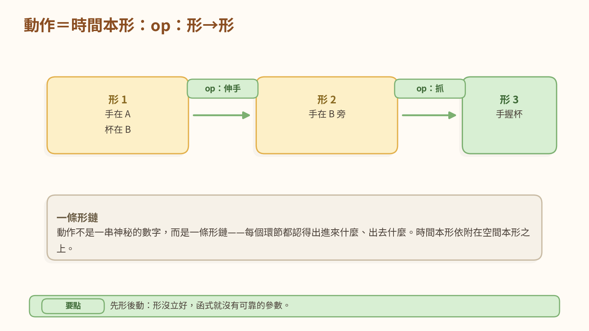

**圖 4-1　動作 = 時間本形：op：形→形，一環扣一環的形鏈**

> **先形後動**
>
> 時間本形依附在空間本形之上。動作的輸入與輸出都必須是立好的形——形沒立好，函式就沒有可靠的參數；數（關節角、速度）永遠站在形的後面。

## 4-2　六站鏈：看、讀、想、動、查、學

把 VLA 的一次完整運作攤開，是六個函式接力。每站有自己的輸入形、輸出形與判準，站站可檢查。

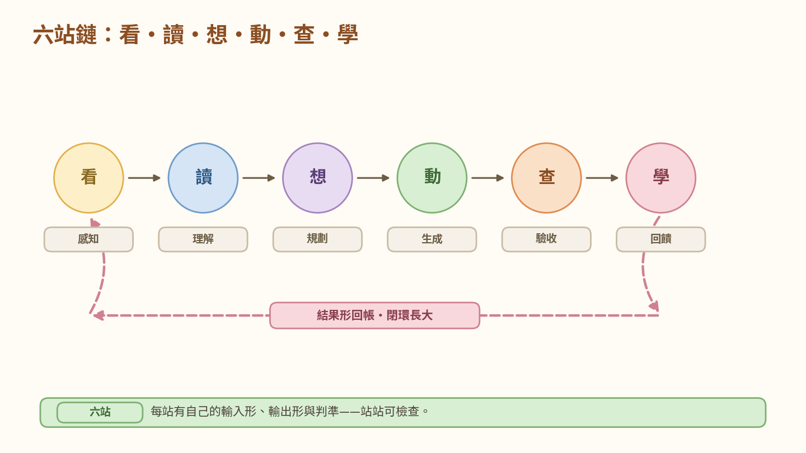

**圖 4-2　六站鏈：看 → 讀 → 想 → 動 → 查 → 學，形進形出**

| 站 | 白話 | 輸入形 | 輸出形 | 判準 |
| --- | --- | --- | --- | --- |
| ① 看 | 感知現場 | 影像幀 | 場景形 | 偵測一致：兩幀之間物件不亂跳。 |
| ② 讀 | 理解指令 | 指令形＋場景形 | 任務形 | 語意對齊：指令裡的對象認得出來。 |
| ③ 想 | 規劃步驟 | 任務形＋場景形 | 計畫形（子任務鏈） | 可行性：步驟順序合乎物理與安全。 |
| ④ 動 | 產出動作 | 計畫形＋目前狀態形 | 動作塊（座標序列） | 動力學可行：不超速、不超載、不穿模。 |
| ⑤ 查 | 驗收放行 | 動作塊＋安全形 | 放行／退回 | 三層判斷 J 全綠才放行。 |
| ⑥ 學 | 回饋演化 | 執行結果形 | 更新形（判準、權重） | 可複核的準：改了什麼，有帳可查。 |

## 4-3　函式四問卡：一式一卡

每個函式入庫，回答四個問題：叫什麼（名稱）、吃什麼（輸入形）、吐什麼（輸出形）、憑什麼算對（判準）。四問卡是函式庫的標準格式，也是團隊溝通的最小單位。

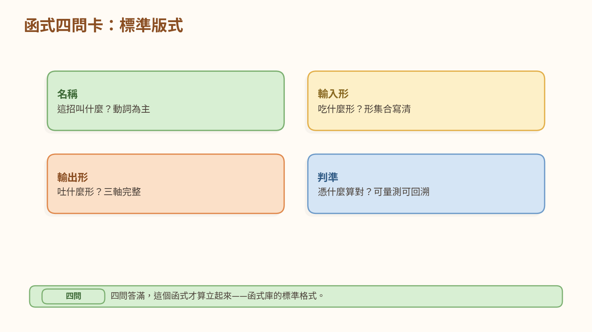

**圖 4-3　函式四問卡標準版式：名稱・輸入形・輸出形・判準**

以最關鍵的「動」站為例：名稱＝動作生成；輸入形＝計畫形與目前狀態形；輸出形＝動作塊（一段座標序列，含末端位姿與夾爪開合）；判準＝動力學可行＋速度曲線平滑＋不進入安全地圖的紅線。四問答滿，這個函式才算立起來。

## 4-4　動作表示三路：三種產形方式

動作怎麼寫成形？業界有三條路。三條路都在回答同一個問題——用什麼刻度、什麼座標，把「連續的動」寫成「模型產得出、機器人接得住」的形。

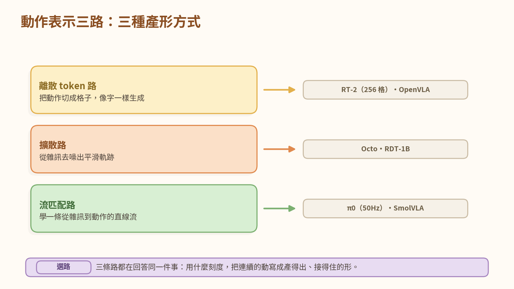

**圖 4-4　動作表示三路：離散 token・擴散・流匹配**

| 路 | 一句話 | 代表 | 長處 | 短處 |
| --- | --- | --- | --- | --- |
| 離散 token | 把動作切成格子，像字一樣生成。 | RT-2（256 格）、OpenVLA | 與語言模型同構，訓練單純，可湧現推理。 | 量化損失，高頻多自由度吃力。 |
| 擴散 | 從雜訊裡去噪出一條平滑軌跡。 | Octo、RDT-1B | 多峰分布抓得住，動作平滑。 | 去噪迭代有延遲。 |
| 流匹配 | 學一條從雜訊到動作的直線流。 | π0（50Hz）、SmolVLA | 高頻、連續、手感好，縮放性佳。 | 訓練與調度較複雜。 |

> **【專業專欄 C2】動作表示三路的底細**
>
> 離散化的老祖宗是量化的思想：連續量寫成有限格，RT-2 把 6 自由度加夾爪加結束旗標共 8 維，每維切成 256 格，動作就成了「句子」。損失在精度，補救靠特標記與細刻度。
>
> π0-FAST（2025）給出第三種化妝法：用離散餘弦變換把動作序列搬到頻域再編碼——同一條軌跡，換一組座標寫更省，解碼還能還原。形學讀法：刻度換基。形沒變，描述它的座標換了；這提醒我們，動作的「形」與它的「寫法」是兩件事，混為一談就會把量化誤當成動作本身。
>
> 2026 年的新戰線：串流式動作編碼（如 ActionCodec2 一類）讓動作邊解邊放，不必等整段解完——對應形學的「函式鏈不必整鏈一次產出，可以一環一環交接」。

## 4-5　推理五族與思考法選路

「想」站內部，推理五族輪流上場：因果推理由因推果（看到杯子在桌沿 → 推出會掉）；果因推理由果回推（任務失敗 → 回溯哪一環出錯）；模擬推理先演再動（What-if：如果抓這裡會怎樣）；統計推理從示範取勢（多數示範是這樣做的）；逆向推理由目標倒推（要杯子進盒 → 先開盒 → 再抓杯）。

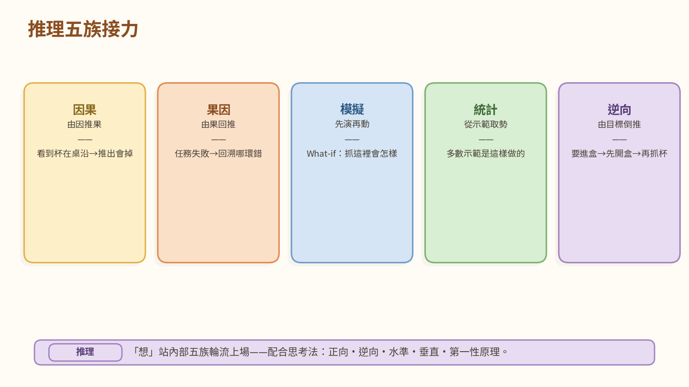

**圖 4-5　推理五族接力：因果・果因・模擬・統計・逆向**

| 思考法 | 走法 | VLA 情境 |
| --- | --- | --- |
| 正向思考 | 由現況順推到目標 | 標準任務執行，六站順走。 |
| 逆向思考 | 由目標倒推回現況 | 長程任務分解：先寫完成條件，再倒排子任務。 |
| 水準思考 | 換一個表示再看 | 動作表示換基（token ↔ 流）；換相機視角重試。 |
| 垂直思考 | 一層層往下分解 | 把「整理桌面」分解成抓、放、歸類三層。 |
| 第一性原理 | 回到物理與約束重推 | 極端案例：模型全錯時，由摩擦係數與重心重算抓取點。 |

## 4-6　單系統與雙系統：兩種節奏

VLA 的譜系裡有兩種心跳。單系統（RT-2、OpenVLA、π0）一次前向完成「理解＋動作」，架構簡單、延遲低；雙系統（Helix、GR00T N1）把慢思考與快反射拆開——System 2 是一台網際網路規模的視覺語言模型，負責看懂與想清楚；System 1 是一台高頻的視運動策略，負責把手感做出來。兩層端到端聯訓，中間以潛在表示交接。

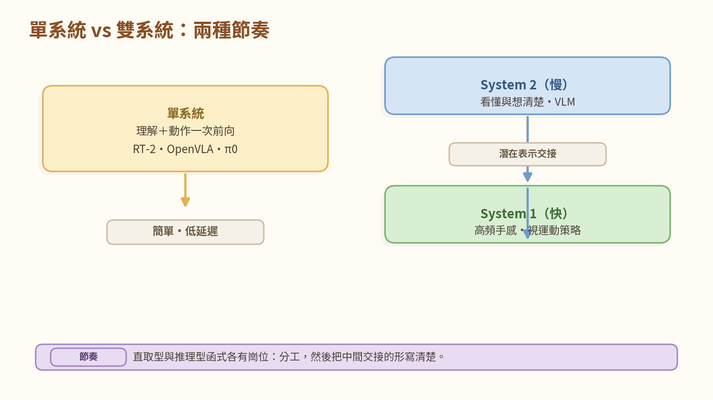

**圖 4-6　單系統 vs 雙系統：一拍到底，或慢想快動**

形學讀法：這是函式的兩種節奏。直取型函式（快、規律、頻率高）與推理型函式（慢、靈活、頻率低）各有各的崗位；把它們混在同一個節奏裡，要嘛慢想拖垮手感，要嘛快反射亂做決定。分工，然後讓中間交接的形寫清楚——這是雙系統設計成敗的關鍵。

## 4-7　形進形出閉環

六站走完不是結束：動作回到世界，世界把結果形送回來（杯子真的進盒了嗎？），「學」站把結果寫回判準與函式庫——形與函式在這條迴路上互相長大。示範資料多一份，形庫厚一層；判準通過一次，函式庫結晶一式。

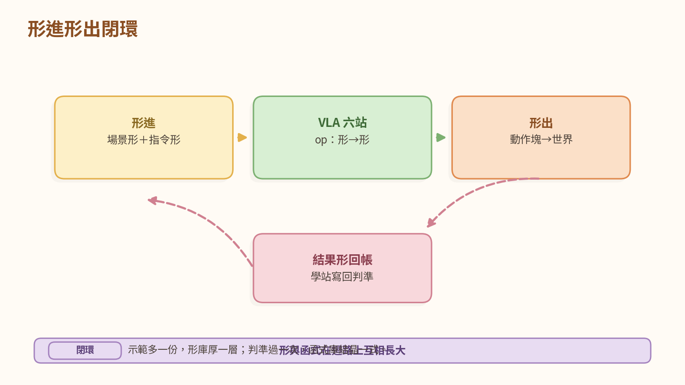

**圖 4-7　形進形出閉環：動作回到世界，世界送回結果形**

> **【專業專欄 C3】資料集考據：形庫的黃金時代**
>
> Open X-Embodiment（2024）：21 家機構攜手，22 種機器人本體、超過一百萬集示範，開源出 RT-1-X 與 RT-2-X——第一次證明「跨本體的形庫」可以養出通用策略。
>
> DROID（2024）：約 7.6 萬條軌跡、564 個場景，走的是「場景多樣性」路線；BridgeData V2 則以低成本眾包補齊家庭桌面任務。
>
> 形學讀法：資料集＝形庫。集示範不是堆影片，是把「場景形→動作形」的映射一格格入帳。帳的品質（形立得準不準）決定模型的天花板——2026 年的研究甚至發現，部分基準高分其實近似「檢索鄰近示範」（kNN 就能做），這正是「形庫裡有沒有新形、模型有沒有真抽象」的警鐘。

> **練習 E04**
>
> 任務：「把桌上的紅積木放進盒子」。請為「抓」這個動作寫一張函式四問卡（名稱、輸入形、輸出形、判準各一行）。
>
> 這個任務若改用雙系統設計，System 1 與 System 2 各負責六站鏈的哪幾站？交接的形是什麼？

> **練習 E05**
>
> 下面的描述各踩了本篇的哪個概念？（a）「模型輸出的每個關節角都可信，不用管單位。」（b）「任務失敗就重跑一次，不用知道哪步錯。」（c）「把所有示範影片全部丟進去就好，不用管場景形立得對不對。」
>
> 提示：刻度、果因推理、形庫品質。

# 第五篇　準確使用方法——體、用、準

前面兩篇立了形、立了函式，這一篇回答 VLA 三問的第三問：怎麼用得準？答案分三層——體（工具與帳本）、用（走六站的步法）、準（判準與檢查）。準不是感覺，是可複核的準。

## 5-1　體—用—準總覽

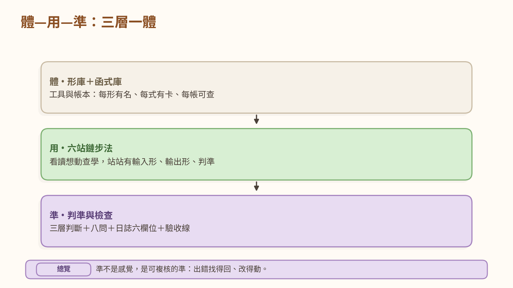

**圖 5-1　體—用—準：工具打底、步法上場、判準收口**

| 層 | 是什麼 | VLA 落地 |
| --- | --- | --- |
| 體 | 形庫＋函式庫：工具與帳本 | 示範資料立成形庫；六站函式入函式庫；每形有名、每式有卡。 |
| 用 | 六站鏈的步法 | 看讀想動查學，站站有輸入形、輸出形、判準。 |
| 準 | 判準與檢查 | 三層判斷＋八問＋日誌六欄位＋驗收線，出錯找得回。 |

## 5-2　三種補足：把形補到能用

要讓形「可判斷」，需要三種補足：把規則補進 [ ]、把身份補進 ( )、把結構補進 { }。

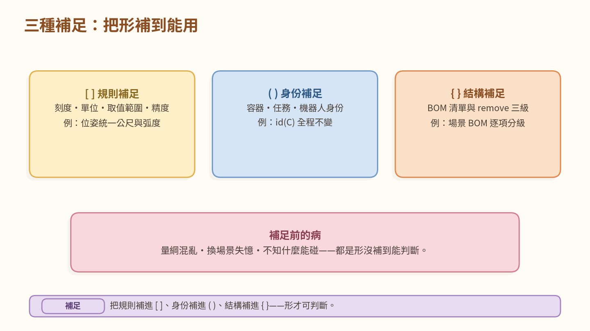

**圖 5-2　三種補足：[ ] 規則、( ) 身份、{ } 結構**

| 補足 | 補什麼 | VLA 實例 | 補足前的病 |
| --- | --- | --- | --- |
| [ ] 規則補足 | 刻度、單位、取值範圍、精度 | 末端位姿統一公尺與弧度；夾爪開度 0–100%；速度上限寫進屬性。 | 數字有量綱混亂，同一動作兩種讀法。 |
| ( ) 身份補足 | 容器身份、任務身份、機器人身份 | 工作單元 id(C) 全程不變；任務單一 id；機型與校準版本入檔。 | 換場景就失憶；跨機器人遷移走樣。 |
| { } 結構補足 | BOM 清單與 remove 三級 | 場景 BOM 逐項分級；任務 BOM 寫明必要件與可棄件。 | 不知道什麼能碰；失敗時不知道缺了哪件。 |

## 5-3　證明六步驟：全程示範

把方法走一遍：任務是「把桌上的紅積木放進盒子」。六步驟從認明整體走到三層檢查，每步都留下可複核的痕跡。

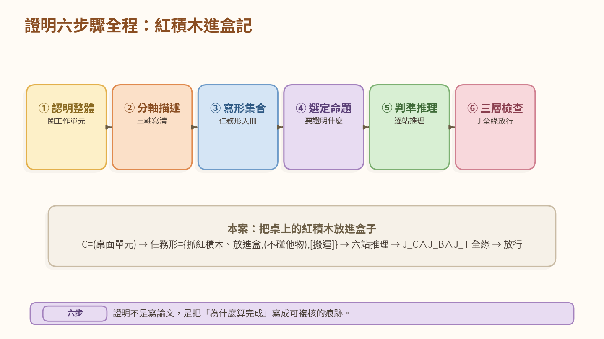

**圖 5-3　證明六步驟全程：紅積木進盒記**

| 步驟 | 做什麼 | 本案寫法 |
| --- | --- | --- |
| ① 認明整體 | 先圈出工作單元 | C = (桌面工作單元, S(C)＝桌、盒、紅積木若干)。 |
| ② 分軸描述 | 三軸寫清 | [ ] 紅積木位姿、尺寸、顏色刻度；{ } 桌面 BOM 三件；( ) 工作單元與安全邊界。 |
| ③ 寫形集合 | 任務形入冊 | 任務形＝{抓紅積木、放進盒, (約束：不碰他物), [搬運類]}。 |
| ④ 選定命題 | 要證明什麼 | 命題：此任務可由六站鏈完成，且全程 id(C) 不變。 |
| ⑤ 判準推理 | 逐站推理 | 看（三件對上）→ 讀（指令對象唯一）→ 想（兩步計畫）→ 動（抓放兩式）→ 查（三層全綠）→ 學（結果入帳）。 |
| ⑥ 三層檢查 | J = J_C ∧ J_B ∧ J_T | J_C：都在桌面單元內 ✓；J_B：紅積木在、盒在 ✓；J_T：歸搬運類 ✓。放行。 |

> **六步驟的精神**
>
> 證明不是寫論文，是把「為什麼這個任務算完成」寫成可複核的痕跡。六步驟走完，任何人拿著這份紀錄，都能重播你的判斷。

## 5-4　四層準確性與日誌六欄位

準有四層，層層相依：資料準（形立對、示範乾淨）→ 模型準（學到形的規律，不是像素的巧合）→ 執行準（動作落地不走樣）→ 複核準（每步有帳，錯在哪找得回）。

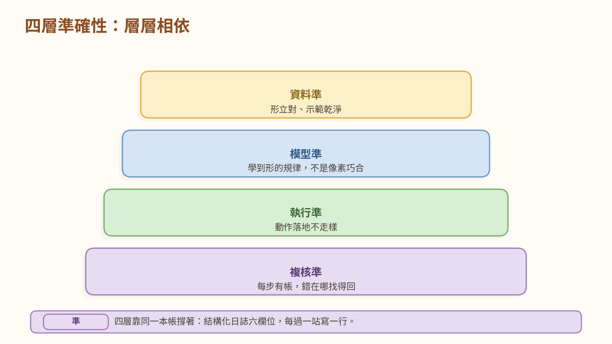

**圖 5-4　四層準確性：資料準 → 模型準 → 執行準 → 複核準**

四層靠同一本帳撐著——結構化日誌六欄位：時間戳、輸入形、輸出形、判準、三層判定、備註。每過一站寫一行。日誌不是給稽核看的，是給下一次失敗的自己看的。

| 時間戳 | 輸入形 | 輸出形 | 判準 | 三層判定 | 備註 |
| --- | --- | --- | --- | --- | --- |
| T+0.0s | 影像幀 ×1 | 場景形 | 偵測一致 | — | 三件物件入帳 |
| T+0.4s | 指令＋場景形 | 任務形 | 語意對齊 | — | 對象鎖定紅積木 |
| T+1.2s | 計畫形＋狀態形 | 動作塊 ×1 | 動力學可行 | — | 抓取式，速度 80% |
| T+1.6s | 動作塊＋安全形 | 放行 | 三層判斷 | J 全綠 | 進入執行 |

## 5-5　八問：交付前的檢查清單

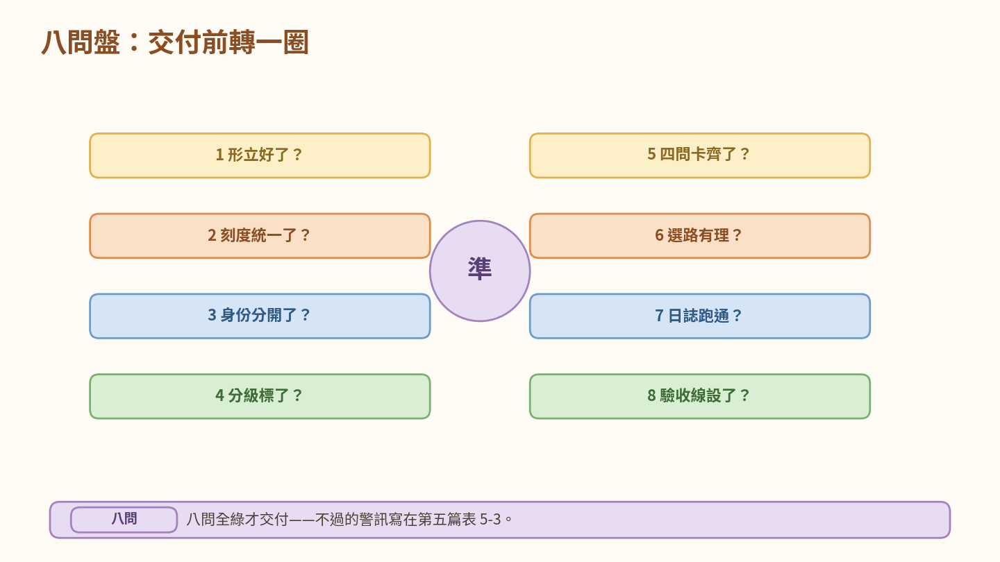

**圖 5-5　八問盤：每一個任務交付前轉一圈**

| # | 八問 | 不過的警訊 |
| --- | --- | --- |
| 1 | 這個任務的形立好了嗎？三軸寫清了嗎？ | 任務描述只有一句自然語言，沒有形集合。 |
| 2 | 刻度與單位統一了嗎？ | 同一個位姿，兩支程式讀法不同。 |
| 3 | 容器身份與內容分開寫了嗎？ | 換桌子就要重訓。 |
| 4 | BOM 與 remove 三級標了嗎？ | 安全邊界靠「模型應該知道」。 |
| 5 | 六站函式各有四問卡嗎？ | 「動」站說不出判準。 |
| 6 | 動作表示選路說得出理由嗎？ | 「大家都用 token」就用 token。 |
| 7 | 日誌六欄位跑通了嗎？ | 失敗只能重現，不能回溯。 |
| 8 | 三層判斷與驗收線設了嗎？ | 成功率是唯一指標。 |

## 5-6　誤用 16 種：四組病歷

誤用分四組：形層、動作層、判準層、系統層。每組四種，都是臨床上真的會遇到的病。

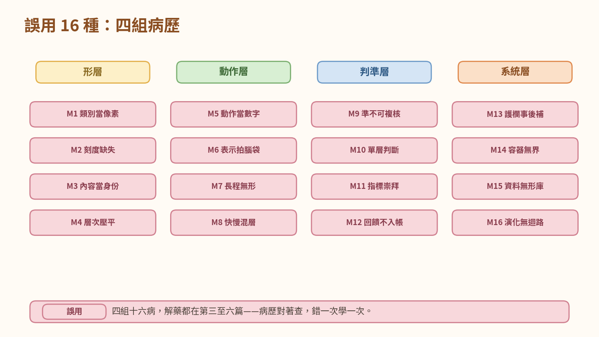

**圖 5-6　誤用 16 種：四組病歷一覽**

| 組 | 誤用 | 病徵 | 解藥 |
| --- | --- | --- | --- |
| 形層 | M1 類別當像素 | 換光影就認不出物件。 | 以 ∩(T) 立類，用形比較不用像素距離。 |
| 形層 | M2 刻度缺失 | 數字有，單位無。 | 每個維度寫明刻度才能入帳。 |
| 形層 | M3 內容當身份 | 換個飲料就當新杯子。 | id(C) 與 S(C) 分開寫。 |
| 形層 | M4 層次壓平 | ι 嵌套被攤成一張表。 | 容器鏈分層立形，不隨意壓平。 |
| 動作層 | M5 動作當數字 | 只看關節角曲線，不看形鏈。 | 每段動作寫成 op：形→形。 |
| 動作層 | M6 表示選路拍腦袋 | 精度不夠仍用粗量化。 | 按任務三問（精度／頻率／多峰）選路。 |
| 動作層 | M7 長程無形 | 十步任務沒有子任務形。 | 先分解成子任務形再排程。 |
| 動作層 | M8 快慢混層 | 慢推理塞進高頻控制迴路。 | 雙系統分頻，交接形寫清。 |
| 判準層 | M9 準不可複核 | 成功靠演示影片。 | 日誌六欄位＋四條驗收線。 |
| 判準層 | M10 單層判斷 | 只查類別，不查容器。 | J = J_C ∧ J_B ∧ J_T 連立。 |
| 判準層 | M11 指標崇拜 | 基準分數高就當能上線。 | 基準是判準之一，不是判準全部。 |
| 判準層 | M12 回饋不入帳 | 微調了什麼說不清。 | 每次更新留更新形，有帳可查。 |
| 系統層 | M13 護欄事後補 | 先部署再想安全。 | 安全形先立，remove 三級先行。 |
| 系統層 | M14 容器無界 | 機器人可以走出工作單元。 | 入場規則寫在容器上。 |
| 系統層 | M15 資料無形庫 | 示範堆成影片倉。 | 示範立形入庫，分類分級。 |
| 系統層 | M16 演化無迴路 | 模型與資料各走各的。 | 形進形出閉環，學站寫回。 |

## 5-7　選路決策樹

面對一個新任務，三個路口做決定：要不要 VLA？要哪種動作表示？要哪種系統節奏？

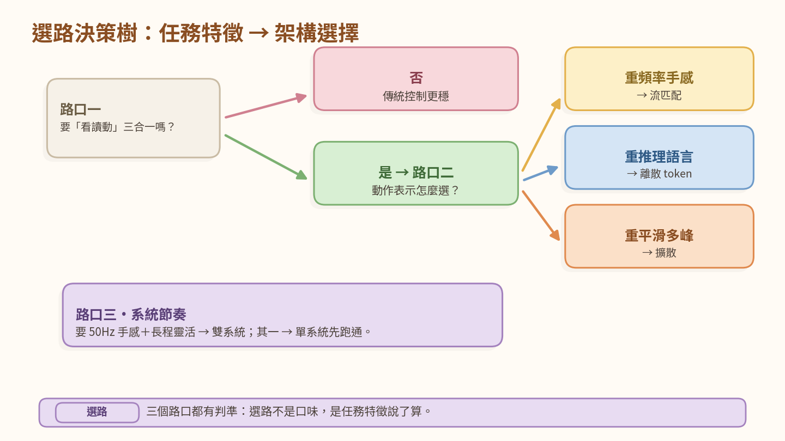

**圖 5-7　選路決策樹：從任務特徵到架構選擇**

| 路口 | 問什麼 | 走法 |
| --- | --- | --- |
| 路口一・要不要 VLA | 任務需要「看懂＋聽懂＋動手」三合一嗎？ | 三合一才上 VLA；純重複動作用傳統控制更穩。 |
| 路口二・動作表示 | 精度、頻率、多峰哪個最吃重？ | 重頻率與手感→流匹配；重推理與語言→離散 token；重平滑多峰→擴散。 |
| 路口三・系統節奏 | 要 50Hz 的手感，還是長程的靈活？ | 兩者都要→雙系統；其一→單系統先跑通。 |

> **【專業專欄 C4】評估基準讀成判準**
>
> LIBERO（2023 起）：130 個任務、空間／物件／目標／長程四組套件，已成 VLA 的體檢標準——2026 年模型在上面普遍超過 95% 成功，於是有了「你的高分有多少是 kNN 檢索」的靈魂拷問。
>
> CALVIN 考長程語言條件連續任務；SIMPLER 把真實機器人搬到模擬器裡評（實→模），省下硬體成本；2026 年的 BEHAVIOR Challenge 把 100 項長程家務擺上檯面，考的是「整套工作流」而不是單一招式。
>
> 形學讀法：基準＝判準的量尺。選基準就是選你要過哪一關的 J；基準分數高只說明某一組 ∩(T) 過了，不說明三層判斷全綠。

> **【專業專欄 C5】安全與人機協作**
>
> 機器人安全不是 VLA 的新問題，是老問題的新變種。ISO 10218 與 ISO/TS 15066 給協作機器人立了力與速度的底線；VLA 帶來的新風險是「不確定性＋生成性」——模型會做沒排練過的動作。
>
> 工程上的三道護欄：輸入護欄（場景形過三層判斷才入場）、過程護欄（動作塊過安全形檢查，remove 三級紅線不可越）、輸出護欄（執行結果回帳，異常即停）。2026 年的研究熱點「低延遲動作驗證器」正是過程護欄的形學實例：產出的形，先驗再動。
>
> 原則一句話：信任不預設——每次執行都重驗身份，每個容器都管好入場。

> **練習 E06**
>
> 用三種補足檢查這個任務描述：「讓機器人把桌上的東西收拾好。」指出它在 [ ]、( )、{ } 三方面各缺什麼，各補一條。
>
> 把這個任務走一遍證明六步驟（寫到第④步即可）。

> **練習 E07**
>
> 誤用辨識：（a）「我們的模型在 LIBERO 拿 96%，直接上生產線。」（b）「示範資料 500 段，全部放一個資料夾，檔名用日期。」（c）「安全護欄等上線穩定後再加。」各踩了 M 幾？解藥是什麼？

# 第六篇　總架構——兩庫一中樞一迴路

方法有了，系統怎麼擺？這一張總圖貫穿全書：兩庫一中樞一迴路——形庫存形、函式庫存招、中樞判準仲裁、迴路閉環演化。VLA 的實務元件，都能在這張圖上找到座位。

## 6-1　兩庫一中樞一迴路 × VLA

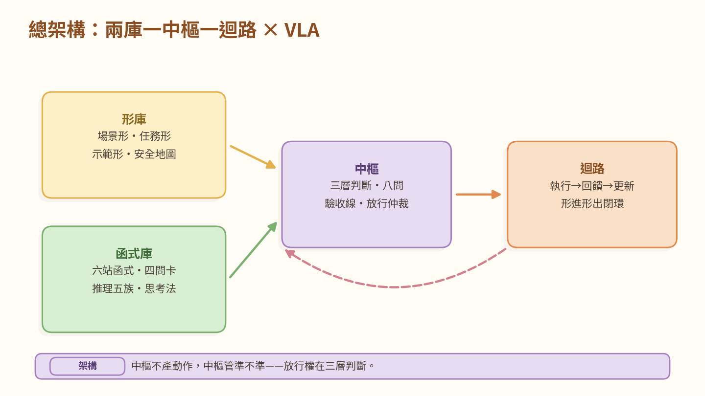

**圖 6-1　總架構：兩庫一中樞一迴路 × VLA**

| 元件 | 存什麼 | VLA 實務對應 |
| --- | --- | --- |
| 形庫 | 形集合與形關係：場景形、物件形、任務形、示範形 | 示範資料庫、場景標註、任務規格書、安全地圖。 |
| 函式庫 | 四問卡：六站函式＋推理五族＋思考法 | 策略權重、動作解碼器、驗證器、提示與流程模板。 |
| 中樞 | 判準與仲裁：三層判斷、八問、驗收線 | 驗收服務、日誌審查、放行閘門。 |
| 迴路 | 形進形出閉環：執行 → 回饋 → 更新 | 部署監控、失敗回溯、定期微調與建庫。 |

> **中樞的一句話**
>
> 中樞不產動作，中樞管準不準。模型再大，放行權在三層判斷——這是 Mind AI 平台「兩庫一中樞一迴路」在 VLA 場景的直接投影。

## 6-2　生態系對讀：各家 VLA 的落點

把主流 VLA 放到形學的地圖上，各家的取捨一目了然。

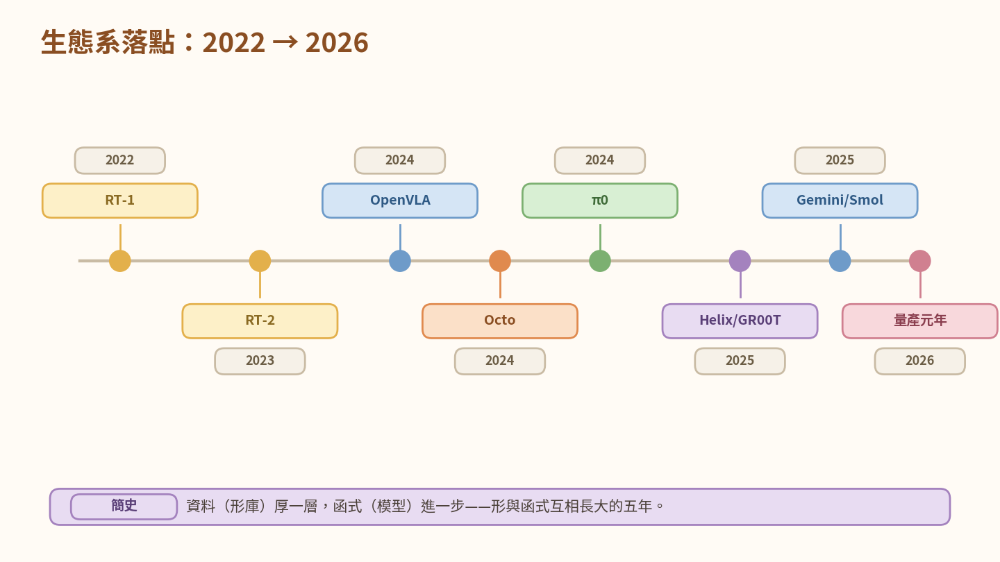

**圖 6-2　生態系落點圖：從 RT-1 到 SmolVLA**

| 模型 | 年・機構 | 架構 | 動作表示 | 形學落點 |
| --- | --- | --- | --- | --- |
| RT-1 | 2022・Google | 單系統 | 離散 token | 動作座標化的先行者。 |
| RT-2 | 2023・Google DeepMind | 單系統 | 離散 token（256 格） | 網頁知識蒸進動作；湧現＝α 抽象生成。 |
| OpenVLA | 2024・Stanford 等 | 單系統 | 離散 token（7B） | 開源形庫（Open X-Embodiment）的產物。 |
| Octo | 2024・UC Berkeley | 單系統 | 擴散（27M/93M） | 輕量通才；塊狀注意力＝σ 換內容不換身份。 |
| π0 | 2024・Physical Intelligence | 單系統 | 流匹配（50Hz） | 高頻手感；8 本體跨容器。 |
| π0-FAST | 2025・Physical Intelligence | 單系統 | 頻域 token | 刻度換基的教科書。 |
| Helix | 2025・Figure AI | 雙系統 | 連續（高頻） | 人形上半身全控；慢想快動分工。 |
| GR00T N1 | 2025・NVIDIA | 雙系統 | 擴散式 | 人形基礎模型；人影片＋合成資料混訓。 |
| Gemini Robotics | 2025・Google DeepMind | 單系統＋推理層 | 連續 | 推理與動作分層；跨平台遷移。 |
| SmolVLA | 2025・Hugging Face | 單系統（非同步） | 流匹配（450M） | 社群形庫（LeRobot）；消費級可跑。 |

## 6-3　資料與基準：形庫與判準的對讀

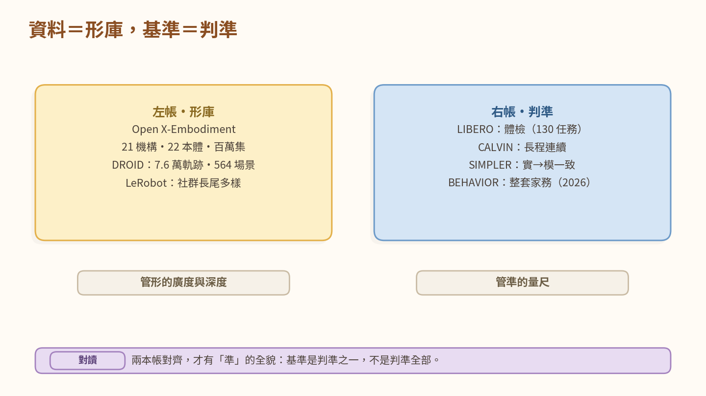

**圖 6-3　資料＝形庫，基準＝判準：兩本帳的分工**

左帳是形庫：Open X-Embodiment（21 機構、22 本體、百萬集）管「形的廣度」；DROID（7.6 萬軌跡、564 場景）管「場景的深度」；LeRobot 社群資料管「長尾的多樣」。右帳是判準：LIBERO 管體檢、CALVIN 管長程、SIMPLER 管實模一致、BEHAVIOR 管整套家務。兩本帳對齊，才有「準」的全貌。

## 6-4　Mind AI：底層平台（只引不述）

本書不重抄 Mind AI 的內容，只立它在 VLA 場景中的座位：形庫承接第三篇的形，函式庫承接第四篇的函式，中樞承接第五篇的判準，迴路承接形進形出閉環。平台的願景是三統一——知識統一（形庫）、思維統一（函式庫與推理）、智慧統一（閉環演化）；VLA 是這條路上「智慧進入物理世界」的關鍵一步。

> **【專業專欄 C6】VLA 簡史：從 RT-1 到 2026**
>
> 2022 年 12 月，Google 放出 RT-1：13 萬集示範、13 台機器人、700 多項任務，把機器人動作切成 token 用 Transformer 生成——業界第一次看到「機器人的 GPT 時刻」的影子。2023 年 7 月，RT-2 把 VLM 直接微調成策略，湧現出沒教過的任務理解，VLA 這個名詞正式立範式。
>
> 2024 年是開源年：OpenVLA 把 7B 的 VLA 放到開源界；Octo 證明輕量通才可行；年尾 π0 用流匹配把手感推到 50Hz。2025 年是分化年：Helix 與 GR00T 上人形、Gemini Robotics 上推理、SmolVLA 下放到消費級。2026 年是落地年：串流編碼、動作驗證、記憶機制、模型蒸餾與服務化成了主戰場——文獻量已超過 2500 篇，產線上開始出現成群的 VLA 機器人。
>
> 形學讀法：這段簡史是「形與函式互相長大」的歷史——資料（形庫）厚一層，函式（模型）就進一步；函式進一步，又逼著資料立更細的形。

> **【專業專欄 C7】效率與量產部署**
>
> 模型會動只是起點，會「準時、省電、安穩地動」才是產品。2026 年的部署現場有四門功課：視覺 token 剪枝（只保留與動作相關的視覺形）、動作串流化（邊解邊放，不等整段）、驗證器輕量化（低延遲動作驗證進控制迴路）、服務化排程（數百台機器人共用模型叢集，按控制頻率排隊）。
>
> 小模型路線同樣亮眼：SmolVLA 450M 參數在社群資料上逼近大模型，TinyVLA 證明架構與資料整理比堆參數更划算。形學讀法：數＝形裡的小形——參數量是刻度，不是身份；把形立對，小模型也能守得住任務身份。

## 6-5　四條驗收線與三個統一

上線之前，四條線都要綠：資料線（形庫有帳、分級齊全）、模型線（基準＋自家測試集雙過）、執行線（實機連續成功率與安全零越線）、複核線（日誌可回溯、失敗可定位）。四線全綠，才談擴點與量產。

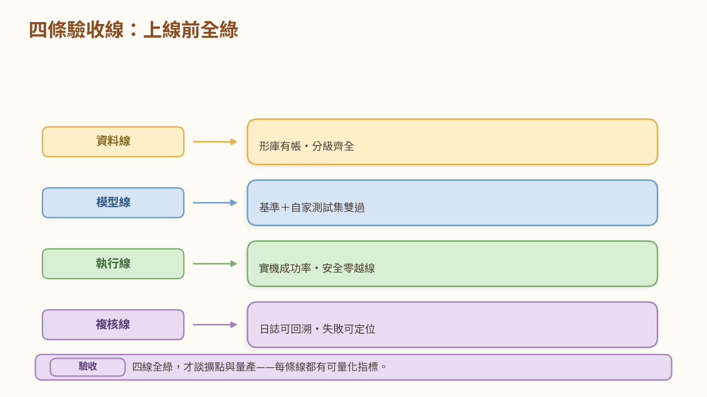

**圖 6-4　四條驗收線：資料・模型・執行・複核**

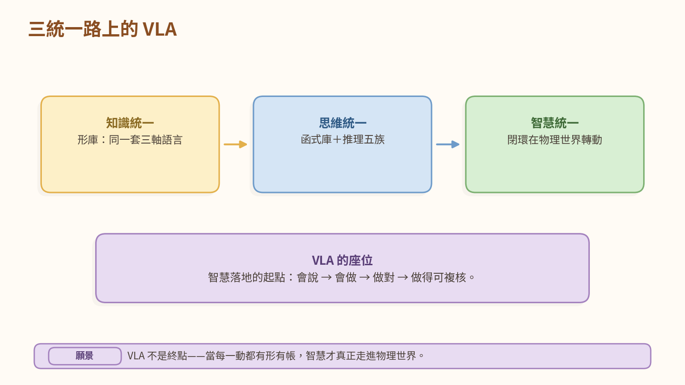

**圖 6-5　三統一路上的 VLA：知識統一 → 思維統一 → 智慧統一**

> **練習 E08**
>
> 你的團隊要做一個倉儲分揀 VLA。請把它的元件填進兩庫一中樞一迴路（每格寫一個具體項目），並說明四條驗收線各用什麼指標。
>
> 在生態系對讀表中選兩個模型，說明它們的動作表示差異會帶來什麼部署差異。

# 第七篇　內容完整方案——學、練、用、教、建

方法與架構都有了，最後把它們排成一條可走的路：怎麼學、怎麼練、怎麼用、怎麼教、怎麼建庫。這一篇是給要動手的人的。

## 7-1　學練用教建，五字一迴路

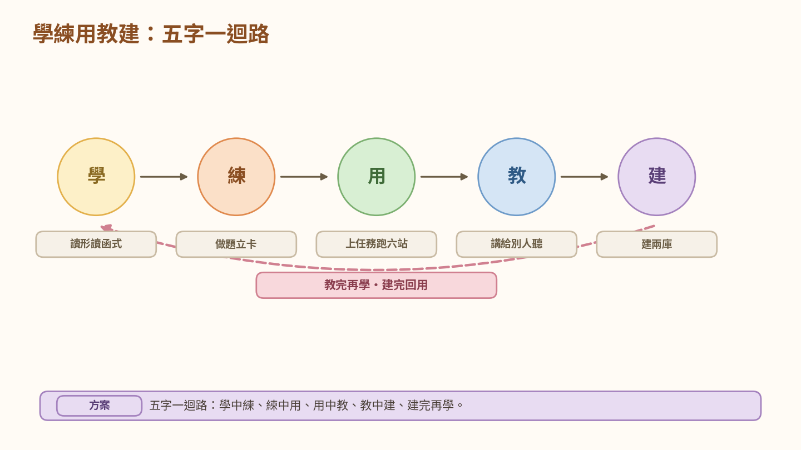

**圖 7-1　學練用教建：五字一迴路**

| 字 | 動詞 | 產出 | 常見誤區 |
| --- | --- | --- | --- |
| 學 | 讀形、讀函式 | 自己的筆記形 | 只讀論文不動手立形。 |
| 練 | 做題、立卡 | 練習題＋四問卡 | 抄範例不改自己的任務。 |
| 用 | 上任務、跑六站 | 實戰紀錄與日誌 | 一上來就挑最難的任務。 |
| 教 | 講給別人聽 | 教案與速查卡 | 講結論不講判準。 |
| 建 | 建形庫與函式庫 | 團隊的兩庫 | 資料堆倉不立形。 |

## 7-2　八週路線

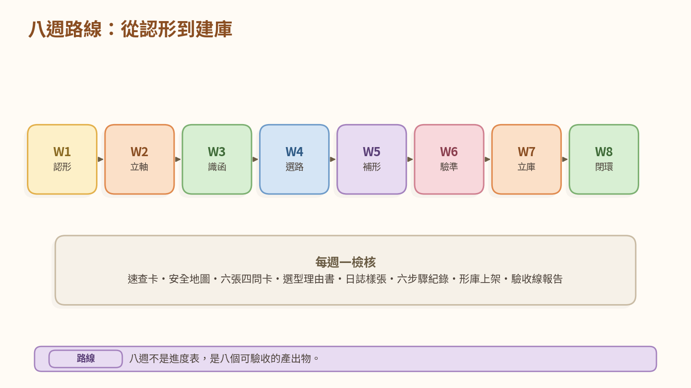

**圖 7-2　八週路線：從認形到建庫**

| 週 | 主題 | 動作 | 檢核 |
| --- | --- | --- | --- |
| 第 1 週 | 認形 | 讀第一、二篇；把手上任務寫成形集合。 | 五種形速查卡填滿。 |
| 第 2 週 | 立軸 | 三軸＋remove 三級；畫安全地圖。 | 安全地圖過目。 |
| 第 3 週 | 識函 | 讀第四篇；為六站各立一張四問卡。 | 六張卡齊。 |
| 第 4 週 | 選路 | 動作表示三路選型；決策樹走一遍。 | 選型理由書。 |
| 第 5 週 | 補形 | 三種補足；寫第一批日誌六欄位。 | 日誌跑通。 |
| 第 6 週 | 驗準 | 證明六步驟全程一次；八問自查。 | 六步驟紀錄。 |
| 第 7 週 | 立庫 | 示範資料立形入庫；標分級。 | 形庫第一批上架。 |
| 第 8 週 | 閉環 | 跑 PoC 一情境；設四條驗收線。 | 驗收線報告。 |

## 7-3　建庫四階段

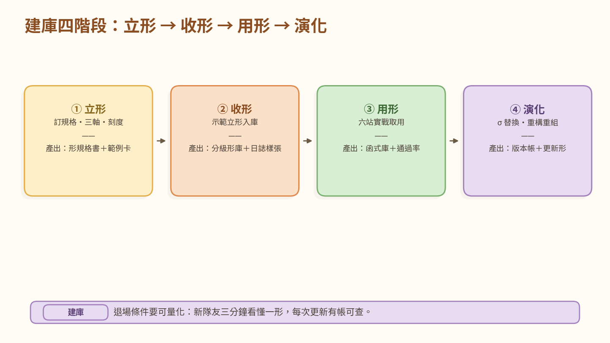

**圖 7-3　建庫四階段：立形 → 收形 → 用形 → 演化**

| 階段 | 重點 | 產出 | 退場條件 |
| --- | --- | --- | --- |
| ① 立形 | 訂形的規格：三軸、刻度、命名 | 形規格書＋範例卡 | 新隊友三分鐘看懂一個形。 |
| ② 收形 | 示範與資料立形入庫 | 分級形庫＋日誌樣張 | 每形有名、每級有標。 |
| ③ 用形 | 六站鏈實戰取用 | 函式庫＋判準通過率 | 判準通過率可量化。 |
| ④ 演化 | 迴路更新：σ 替換、重構重組 | 版本帳＋更新形 | 每次更新有帳可查。 |

## 7-4　情境選路：四種讀者的路線

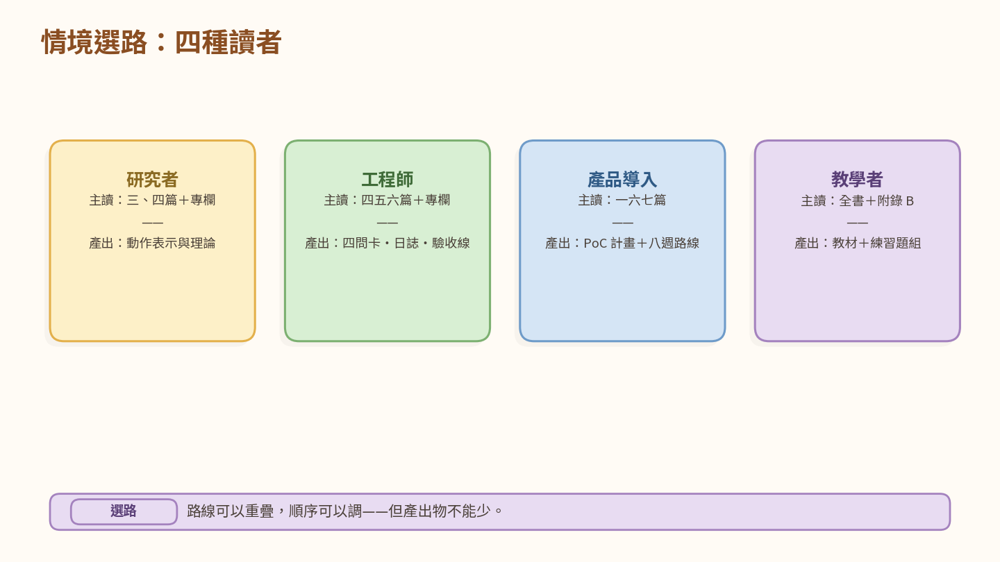

**圖 7-4　情境選路：研究者・工程師・產品・教學**

| 讀者 | 主線 | 先讀 | 重點產出 |
| --- | --- | --- | --- |
| 研究者 | 形的理論與動作表示 | 三、四篇＋專欄 C2、C3 | 研究提案的形化描述。 |
| 工程師 | 落地與複核 | 四、五、六篇＋專欄 C7 | 四問卡、日誌、驗收線三件套。 |
| 產品與導入 | 方案與驗收 | 一、六、七篇 | PoC 計畫＋八週路線。 |
| 教學者 | 教材與練習 | 全書＋附錄 B | 速查卡教材＋練習題組。 |

## 7-5　PoC 三情境與 FAQ

驗收不是口號，是三個具體情境跑出來的：

| 情境 | 任務 | 重點驗的形 | 成功門檻 |
| --- | --- | --- | --- |
| 桌面搬運 | 把指定物放入指定容器 | 物件形、任務形 | 連續 50 局成功率 ≥ 95%，日誌全覆蓋。 |
| 家務長程 | 三步以上收拾流程 | 子任務形鏈 | 長程完成率 ≥ 80%，失敗可回溯到站。 |
| 工廠巡檢 | 看、記、報三件事 | 場景形、報告形 | 異常檢出率 ≥ 99%，零安全越線。 |

### FAQ 快問快答

| 問 | 答 |
| --- | --- |
| 沒有實機，能開始嗎？ | 能。SIMPLER 式的實→模評估與模擬器（CALVIN、ManiSkill 一類）可先跑通方法，實機再補。 |
| 示範資料要多少才夠？ | 先問形立得準不準。形立好，幾十集可微調；形沒立好，萬集也枉然。 |
| 開源模型怎麼選？ | 按第五篇決策樹：看精度／頻率／多峰需求選動作表示，再看算力選規模。 |
| 團隊最該先立的是什麼？ | 兩張卡：五種形速查卡＋函式四問卡。卡立了，溝通就準了。 |
| 怎麼說服管理層？ | 拿四條驗收線談：資料線、模型線、執行線、複核線，每條都有可量化指標。 |

> **練習 E09**
>
> 把八週路線改造成你的版本：換掉兩週的主題，寫明替換理由與檢核方式。

> **練習 E10**
>
> 你的場景要選動作表示路線。寫出三個關鍵需求（精度／頻率／多峰／算力／泛化，任三），走決策樹給出選擇與理由。

> **【專業專欄 C8】通往 Mind AI：VLA 在三統一路上的位置**
>
> 知識統一：VLA 的場景形、任務形、示範形入形庫，與其他領域的形共用一套三軸語言——機器人看懂的世界，和人、和組織看懂的世界，寫在同一家帳上。
>
> 思維統一：六站鏈與推理五族本來就是函式庫的成員；VLA 把這些函式接到物理世界上，讓「想」有了「動」的出口。
>
> 智慧統一：形進形出閉環在物理世界轉起來——每一次執行都是一次實驗，每一份日誌都是一份證據。2026 年的記憶機制、動作驗證、模型蒸餾熱潮，其實都是在把這條迴路磨得更順。
>
> VLA 不是終點，是智慧落地的起點：當機器人的每一動都有形有帳，AGI 才不只是會說，而是會做、做對、做得可複核。

> **練習 S01**
>
> 設計你的建庫四階段計畫：每階段寫出產出物與退場條件，並標出你目前卡在哪一階段。
>
> 提示：退場條件要可量化。

> **練習 S02**
>
> 選一個真實任務（家裡、實驗室、工廠都好），寫出 PoC 情境卡：任務、重點驗的形、成功門檻、風險與 remove 三級分級。

> **練習 S03**
>
> 把本書的速查卡組成一份半日工作坊教案：四個時段各寫主題、活動與檢核點。

# 第八篇　總結——五個領域，一條路

最後把鏡頭拉遠。VLA 的問題——形沒立好、準不可複核——不只屬於機器人，它屬於所有要「把世界描述準、把動作做對」的領域。五個領域並排看，方法是同一套。

## 8-1　五領域並列

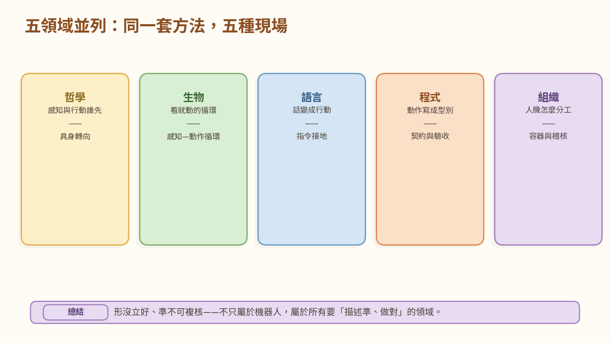

**圖 8-1　五領域並列：同一套形與方法，五種現場**

| 領域 | 形的問題 | VLA 帶來的啟示 |
| --- | --- | --- |
| 哲學 | 感知與行動誰先誰後？ | 具身轉向：認知不在腦裡，在「形進形出」的循環裡。 |
| 生物 | 動物怎麼看就動？ | 感知—動作循環是億萬年打磨過的六站鏈。 |
| 語言 | 一句話怎麼變成行動？ | 指令接地：名必須落到形，動詞必須落到函式。 |
| 程式 | 動作怎麼寫成可靠的型別？ | 契約與驗收：op：形→形 就是函式簽名＋判準。 |
| 組織 | 人與機器人怎麼分工？ | 容器與稽核：每個單元有身份，每個決定有帳。 |

## 8-2　三個連續目標

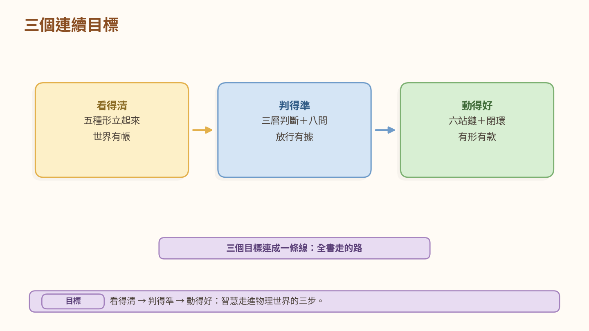

**圖 8-2　三個連續目標：看得清 → 判得準 → 動得好**

看得清：五種形立起來，世界有帳。判得準：三層判斷與八問轉起來，每次放行有據。動得好：六站鏈與閉環跑起來，動作有形有款。三個目標連成一條線，就是本書從第一頁走到這裡的路。

> **全書一句話**
>
> VLA 是「形進形出」的函式鏈：把形立好、把函式問清、把判準轉實——看得清、判得準、動得好，智慧才真正走進物理世界。

> **練習 E11**
>
> 用五領域並列表反推：你的 VLA 任務在「語言」領域的對應問題是什麼？（提示：指令接地）寫一個指令歧義的實例與解法。

> **練習 E12**
>
> 把「三個連續目標」對映到你的專案：各寫一條可量化的達標指標。

> **練習 E13**
>
> 綜合題：挑一個你熟悉的 VLA 模型（生態系表內外皆可），用全書工具寫一份 300 字的形化評論——五種形、動作表示、判準三塊各佔三分之一。

> **練習 E14**
>
> 綜合題：假設你要向一位沒有讀過本書的同事介紹「什麼是用得準的 VLA」，只能用三張圖。你選哪三張（可指定要新畫），各配一句話。

# 結語

這本冊子從三個問題出發：VLA 是什麼形、它怎麼動、怎麼用得準。走完八篇，答案已經寫在你的速查卡上了——但真正的答案，寫在你下一個任務的日誌裡。

形學的承諾只有一句：把形看清楚，準就有了根。VLA 的機會也只有一句：讓智慧不只會說，還會做，而且做得可複核。這兩句話，在兩庫一中樞一迴路上，是同一句話。

**圖 E-1　全書終：形進形出，閉環長大**

> **全書終**
>
> 下一個任務，先立形，再動手。——把形看清楚，轉成顯學，實踐化為 Mind AI。

# 附錄 A　術語表與記號總表

**表 A-1　術語表**

| 術語 | 一句話解釋 |
| --- | --- |
| 形（Type） | 分合畫出的邊界，可指認、可命名的最小描述單位。 |
| 單位形 | 可獨立指認的形，寫作 {部件, (內容), [類別]}。 |
| 形集合 | 以三括號描述一個單位形的標準寫法。 |
| 空間本形 | 描述「是什麼」的形：名詞・靜態・三軸。 |
| 時間本形 | 描述「怎麼動」的形：動詞・動態・函式，op：形→形（op：Type→Type）。 |
| 屬性 [ ] | 形的特徵軸：維度 × 刻度。 |
| 組成 { } | 形的部件軸：BOM 清單。 |
| 容器 ( ) | 形的所在軸：C = (id(C), S(C))，身份與內容分開。 |
| remove 三級 | 必要件 ≢M、功能降級件 ≡M′⊂M、非必要件 ≡M——分級即安全地圖。 |
| 三層判斷 | 容器層 J_C、組成層 J_B、抽象層 J_T 連立：J = J_C ∧ J_B ∧ J_T。 |
| ∩(T) 抽象判準 | 憑什麼說它屬於這一類：以交集立判準。 |
| α 抽象生成 | 從具體形抽出共同形；泛化的形學名字。 |
| σ 替換 | 換內容不換身份：內容替換運算。 |
| ⊕ 合形 | 把兩個形合成一個形。 |
| ι 嵌套 | 容器套容器：形的層級鏈，不可隨意壓平。 |
| 函式四問卡 | 函式入庫格式：名稱、輸入形、輸出形、判準。 |
| 形進形出 | 函式作用的樣態：進來一個形、出去一個形，閉環長大。 |
| 可複核的準 | 準＝有判準、有日誌、有驗收線，任何人可重播判斷。 |
| VLA | 視覺・語言・動作模型：看現場、讀指令、產動作的多模態基礎模型。 |
| VLM | 視覺語言模型：VLA 的感知與推理核心。 |
| 動作解碼器 | 把潛在表示翻譯成可執行動作的模組。 |
| 動作表示 | 動作寫成形的格式：離散 token、擴散、流匹配三路。 |
| 動作塊 | 一段連續動作序列；函式複合的產出。 |
| System 1 / System 2 | 雙系統的快反射與慢推理兩層。 |
| 示範資料 | （場景形→動作形）映射的入帳資料；形庫的來源。 |
| 安全地圖 | 場景 BOM 依 remove 三級標注的紅黃綠分級圖。 |
| 兩庫一中樞一迴路 | 形庫＋函式庫＋判準中樞＋閉環迴路的總架構。 |

**表 A-2　記號總表**

| 記號 | 讀作 | 記號 | 讀作 |
| --- | --- | --- | --- |
| [ ] | 屬性括號 | op：形→形 | 時間本形（op：Type→Type） |
| { } | 組成括號 | J = J_C ∧ J_B ∧ J_T | 三層判斷連立 |
| ( ) | 容器括號 | C = (id(C), S(C)) | 容器＝身份＋內容 |
| ≡　≢　⊂ | 同一／不同／降級 | M′ ⊂ M | 功能降級件 |
| ∩(T) | 抽象判準 | {部件,(內容),[類別]} | 單位形寫法 |

# 附錄 B　速查卡

### B-1　函式四問卡（速查版式）

| 欄位 | 問句 | 填寫要點 |
| --- | --- | --- |
| 名稱 | 這招叫什麼？ | 動詞為主，一眼看出作用。 |
| 輸入形 | 吃什麼形？ | 形集合寫清；缺件要標。 |
| 輸出形 | 吐什麼形？ | 產出形的三軸完整。 |
| 判準 | 憑什麼算對？ | 可量測、可複核、可回溯。 |

### B-2　八問勾選

| □ 1 形立好了？ | □ 2 刻度統一了？ | □ 3 身份分開了？ | □ 4 分級標了？ |
| --- | --- | --- | --- |
| □ 5 四問卡齊了？ | □ 6 選路有理？ | □ 7 日誌跑通？ | □ 8 驗收線設了？ |

### B-3　空白模板（可複印）

**【形集合卡】**

| 任務名稱 |  |
| --- | --- |
| 工作單元 id(C) |  |
| 內容 S(C) |  |
| 物件形 {部件,(內容),[類別]} |  |
| [ ] 屬性與刻度 |  |
| { } BOM 與 remove 三級 |  |
| 任務形 |  |

**【函式四問卡】**

| 名稱 |  |
| --- | --- |
| 輸入形 |  |
| 輸出形 |  |
| 判準 |  |

**【八問勾選】　□1　□2　□3　□4　□5　□6　□7　□8**

# 附錄 C　練習參考答案

以下為示範答案，重點在判準與步法；你的任務不同，答案可以不同——但「形立得準不準、判準說得清不清」的標準不變。

**表 C-1　E01–E07**

| 題 | 示範答案 |
| --- | --- |
| E01 | 四個形：杯子 {杯身, (水), [容器]}、水槽 {槽體, (空間), [容器]}、桌面容器 C=(廚房桌, S(C))、任務形 {抓杯、放杯, (不碰他物), [搬運]}。廚房成功、茶水間失敗＝痛點一假泛化：類別 [ ] 沒立好，模型認像素不認形。 |
| E02 | 自查依表填寫即得分。例如最痛是「長程失敗」→ 解藥映射列「動作 chunk＝函式複合」：先立子任務形，再排形鏈。 |
| E03 | 門形＝{門體, (密封條), [開合部件]}；對本任務是必要件 ≢M（不開門拿不出碗）。id(C)＝微波爐工作單元身份；S(C)＝當前內容（碗）。碗換盤：S(C) 變、id(C) 不變。 |
| E04 | 四問卡：名稱＝抓取；輸入形＝{手, (開爪狀態), [末端]}＋物件形；輸出形＝{手, (握持物件), [末端]}；判準＝接觸力在範圍、物件不滑、姿態偏差 < 刻度容差。雙系統：System 2 負責看讀想、System 1 負責動；交接形＝任務形與計畫形的潛在表示。 |
| E05 | (a) 刻度缺失——數沒有刻度不能入帳。(b) 缺果因推理——失敗要由果回推。(c) 形庫品質——示範先立形再入庫。 |
| E06 | [ ] 缺刻度：補「收拾完成」的可量測狀態（桌面 BOM 歸零或歸位座標範圍）。( ) 缺身份：補 id(C)＝哪張桌子的工作單元。{ } 缺結構：補桌面 BOM＋remove 三級。六步驟至④：①單元＝桌面 ②三軸描述 ③任務形＝{收拾, (歸位), [整理]} ④命題＝收拾可分解為歸位函式鏈且全程 id(C) 不變。 |
| E07 | (a) M11 指標崇拜：基準是判準之一，加自家測試集與實機試跑。(b) M15 資料無形庫：示範立形入庫、分級分類。(c) M13 護欄事後補：安全形先立，remove 三級先行。 |

**表 C-2　E08–E14**

| 題 | 示範答案 |
| --- | --- |
| E08 | 形庫＝貨架場景形、訂單任務形、貨品物件形；函式庫＝六站函式＋分揀模式卡；中樞＝驗收服務（三層判斷＋放行）；迴路＝日誌回饋＋月度微調。四線：資料線＝形庫覆蓋率與分級齊全率；模型線＝基準＋訂單測試集雙過；執行線＝每小時揀貨成功率 ≥ 目標且安全零越線；複核線＝失敗可回溯到站。模型對比例：OpenVLA（token）推理延遲較高但語言接地好，π0（流匹配）高頻手感佳但部署複雜。 |
| E09 | 示範：替換第 4 週為「資料工程週」（示範收集與立形），第 7 週併入「安全驗收週」（remove 三級與護欄演練）；檢核改為資料立形通過率與安全演練紀錄。 |
| E10 | 示範需求：高頻手感（50Hz）、多峰抓取、單卡算力 → 決策樹：頻率吃重→流匹配；多峰→流匹配或擴散；算力單卡→450M 級小模型。結論：SmolVLA 級流匹配配置。 |
| E11 | 語言領域對應＝指令接地。實例：「把紅色的東西拿來」桌上兩個紅色物。解法：[ ] 加維度（顏色＋尺寸）鎖定唯一對象；讀站加澄清子函式（歧義時反問）。 |
| E12 | 看得清＝五種形覆蓋率 100%（任務內每個對象有名有卡）；判得準＝八問通過率 100%、三層判斷攔截率可量化；動得好＝連續 50 局成功率 ≥ 95% 且零安全越線。 |
| E13 | 示範（OpenVLA）：五種形——場景形與指令形入、任務形在中、動作塊出，形的座標化清楚（離散 token）；動作表示——token 路，語言接地佳、精度受限；判準——基準分數高但需自建測試集防 kNN 幻覺，日誌六欄位要補。 |
| E14 | 示範三張：圖 3-1（形集合卡——世界怎麼立形）、圖 4-2（六站鏈——動作怎麼走）、圖 5-1（體用準——準怎麼來）。每張一句話：立形、走鏈、驗準。 |

**表 C-3　S01–S03**

| 題 | 示範答案 |
| --- | --- |
| S01 | 立形階段：形規格書＋範例卡 10 張，退場＝新隊友三分鐘看懂一形；收形階段：首批 50 筆示範立形入庫，退場＝每形有名每級有標；用形階段：六站實戰兩任務，退場＝判準通過率報表；演化階段：月度 σ 替換與重構，退場＝版本帳可查。 |
| S02 | 情境卡示範（餐廚收拾）：任務＝餐具入洗碗機、檯面歸零；重點驗的形＝餐具物件形、檯面場景形；門檻＝連續 30 局 ≥ 90%、日誌全覆蓋；風險＝易碎件（必要件紅線）、濕滑（速度降級件）、垃圾（非必要件綠線）。 |
| S03 | 半日教案：第一時段「立形一小時」（五種形速查卡實作）；第二時段「走鏈一小時」（六站鏈桌面推演）；第三時段「驗準一小時」（六步驟＋八問實作）；第四時段「建庫半小時」（建庫四階段規劃）＋總複習半小時。每時段檢核＝交一張卡。 |

# 附錄 D　圖表索引

**表 D-1　圖索引**

| 圖號 | 標題 | 所在篇 |
| --- | --- | --- |
| 圖 D-1 | 三副眼鏡疊著看 | 導讀 |
| 圖 1-1 | VLA 一句話：三模態合一 | 第一篇 |
| 圖 1-2 | 五個痛點，同一個根源 | 第一篇 |
| 圖 1-3 | 根幹果三層定位 | 第一篇 |
| 圖 1-4 | VLA 三問 | 第一篇 |
| 圖 2-1 | 認知鏈 × VLA 鏈 | 第二篇 |
| 圖 2-2 | 六件工具盤 | 第二篇 |
| 圖 2-3 | 映射總表意象 | 第二篇 |
| 圖 3-1 | 單位形標準卡 | 第三篇 |
| 圖 3-2 | [ ] 屬性軸 | 第三篇 |
| 圖 3-3 | { } BOM＋remove 三級安全地圖 | 第三篇 |
| 圖 3-4 | ( ) 容器 | 第三篇 |
| 圖 3-5 | 三層判斷漏斗 | 第三篇 |
| 圖 3-6 | 五種形速查卡 | 第三篇 |
| 圖 4-1 | 動作＝時間本形 | 第四篇 |
| 圖 4-2 | 六站鏈 | 第四篇 |
| 圖 4-3 | 函式四問卡版式 | 第四篇 |
| 圖 4-4 | 動作表示三路 | 第四篇 |
| 圖 4-5 | 推理五族接力 | 第四篇 |
| 圖 4-6 | 單系統 vs 雙系統 | 第四篇 |
| 圖 4-7 | 形進形出閉環 | 第四篇 |
| 圖 5-1 | 體—用—準 | 第五篇 |
| 圖 5-2 | 三種補足 | 第五篇 |
| 圖 5-3 | 證明六步驟全程 | 第五篇 |
| 圖 5-4 | 四層準確性 | 第五篇 |
| 圖 5-5 | 八問盤 | 第五篇 |
| 圖 5-6 | 誤用 16 種 | 第五篇 |
| 圖 5-7 | 選路決策樹 | 第五篇 |
| 圖 6-1 | 總架構兩庫一中樞一迴路 | 第六篇 |
| 圖 6-2 | 生態系落點圖 | 第六篇 |
| 圖 6-3 | 資料＝形庫，基準＝判準 | 第六篇 |
| 圖 6-4 | 四條驗收線 | 第六篇 |
| 圖 6-5 | 三統一路上的 VLA | 第六篇 |
| 圖 7-1 | 學練用教建 | 第七篇 |
| 圖 7-2 | 八週路線 | 第七篇 |
| 圖 7-3 | 建庫四階段 | 第七篇 |
| 圖 7-4 | 情境選路 | 第七篇 |
| 圖 8-1 | 五領域並列 | 第八篇 |
| 圖 8-2 | 三個連續目標 | 第八篇 |
| 圖 E-1 | 全書終收束卡 | 結語 |

**表 D-2　表索引（精選）**

| 表號 | 標題 | 所在篇 |
| --- | --- | --- |
| 表 0-1 | 本書地圖 | 寫在前面 |
| 表 2-1 | 映射總表（16 條） | 第二篇 |
| 表 4-1 | 六站鏈總表 | 第四篇 |
| 表 5-1 | 三種補足總表 | 第五篇 |
| 表 5-2 | 誤用 16 種 | 第五篇 |
| 表 6-1 | 生態系對讀表（10 模型） | 第六篇 |
| 表 7-1 | 八週路線表 | 第七篇 |
| 表 A-1 | 術語表（27 條） | 附錄 A |
| 表 C-1–C-3 | 練習參考答案（17 題） | 附錄 C |
