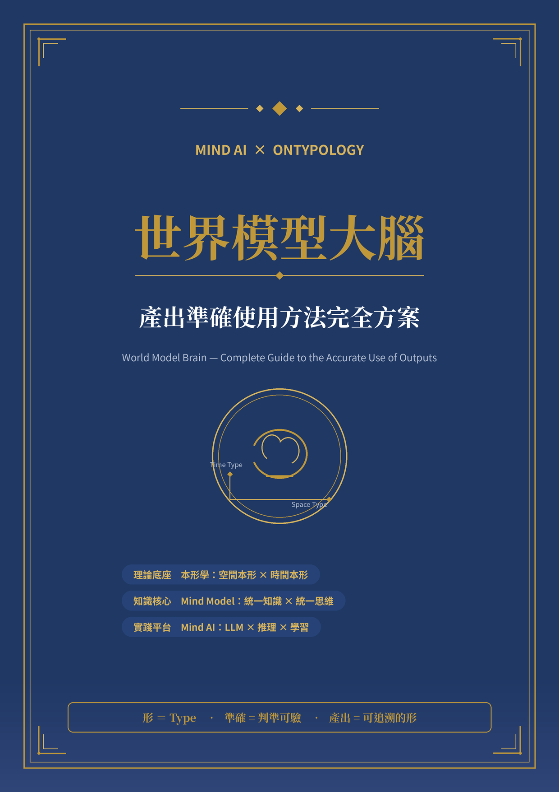

# 總　目　錄

- 寫在前面：三個約定
- 導讀：世界模型大腦一張圖
- 第一章　世界模型大腦：為世界建形的腦
  - 1.1　世界模型是什麼：把世界裝進形裡
  - 1.2　大腦是什麼：形＋數的思考體
  - 1.3　空間本形入座：世界的三條軸・三種括號
  - 1.4　時間本形入座：世界的動詞盤
  - 1.5　雙本形交會：世界狀態＝形×招式
- 第二章　五種產出：世界模型大腦交出什麼
  - 2.1　產出鏈總覽：建形→出招→推演→判決→演化
  - 2.2　產出一：世界形 WorldType
  - 2.3　產出二：招式形 MotionType
  - 2.4　產出三：推演卷 Trace
  - 2.5　產出四：判決書 Verdict
  - 2.6　產出五：演化帳 EvolutionLog
- 第三章　準確從哪裡來：四層準確性保證
  - 3.1　什麼叫「用得準」
  - 3.2　第一層：交集判準 ∩(T)——歸屬驗收
  - 3.3　第二層：不變性公理・id(C)——身份錨定
  - 3.4　第三層：remove 三級——結構依存
  - 3.5　第四層：形證據鏈——可追溯
  - 3.6　交叉驗收：空間判準×時間判準
- 第四章　產出準確使用方法：六步驟
  - 4.1　六步驟總覽
  - 4.2　貫穿範例：送餐機器人的一次判斷
  - 4.3　六步驟走完：逐格看
  - 4.4　判準驗收：三層判斷
  - 4.5　時間本形的用法：挑招・組招・換招
- 第五章　誤用對照與檢查清單
  - 5.1　誤用對照五種
  - 5.2　檢查清單十問
  - 5.3　成熟度 L1–L4：產出的四個等級
- 回顧：要點總整理與自我檢查
- 附錄：術語與記號速查

# 寫在前面：三個約定

世界模型（World Model）正在從論文裡的名詞，走進機器人、模擬系統與決策平台的日常。隨之而來的問題卻很少被正面回答：世界模型大腦交出來的東西——一份世界描述、一次模擬推演、一個行動建議——到底要怎麼用，才叫「用得準」？用不準的世界模型，比沒有世界模型更危險，因為它給的是帶著信心的錯答案。

本書只回答這一個問題：世界模型大腦的產出，如何被準確地使用。它是一份完整方案——先把產出定清楚（第二章），再把準確的來源定清楚（第三章），然後給出可操作的使用方法（第四章）與防錯機制（第五章）。在開始之前，先立下三個約定，它們貫穿全書。

### 約定一：「形」的英文是 Type，不是 Form

本形學的「形」，英文一律寫作 Type。世界形是 WorldType、招式形是 MotionType、抽象類別是 T = (F(T), ∩(T))。Form 這個字在本書中不會出現——它是翻譯史上的一場誤會，不是我們的語言。書中所有「形」字，都請在心裡讀作 Type。

### 約定二：本形學只「用」不「教」

本書的理論底座是本形學（Ontypology）的兩半：空間本形（Space Type）與時間本形（Time Type）。空間本形回答世界「是什麼」，時間本形回答世界「怎麼動」。本書把它的工具拿出來用——三括號、交集判準、不變性公理、remove 三級、框架四步驟、三層判斷、招式盤——但不重述理論本身。理論的完整論證，請回《本形學之空間本形》與《本形學・時間本形篇》；本書只負責把它們用在世界模型上。

### 約定三：Mind AI 只「引」不「述」，且無系統實作

底層平台是 Mind AI——以本形學、Mind Model 與 LLM 結合而成的 AGI 實踐平台。世界模型大腦建在它身上：LLM 負責語言能力，Mind Model 負責智慧能力。本書引用這個分工，但不重述平台簡介；平台的完整介紹，請見《Mind AI 簡介》。同樣地，本書談方法與用法，不包含任何系統實作——它是一份「怎麼用準」的方案，不是一份「怎麼做出來」的規格書。

| 章 | 回答的問題 | 核心產出 |
| --- | --- | --- |
| 寫在前面・導讀 | 三個約定是什麼？全書地圖長什麼樣？ | 閱讀契約 |
| 第一章 | 世界模型大腦是什麼？雙本形如何落座？ | 世界觀 |
| 第二章 | 世界模型大腦交出什麼？ | 五種產出：形・招・卷・判・帳 |
| 第三章 | 準確從哪裡來？ | 四層準確性保證 |
| 第四章 | 產出怎麼用？ | 六步驟使用方法 |
| 第五章 | 怎麼防錯、怎麼驗收？ | 誤用對照＋檢查清單＋成熟度 |
| 回顧・附錄 | 怎麼快速複習與查表？ | 自查表＋術語記號速查 |

**表 0-1　本書任務地圖：每一章回答一個問題，交出一份可驗的東西**

# 導讀：世界模型大腦一張圖

翻開任何一章之前，先看一張圖。世界模型大腦可以壓縮成一句話：以本形學雙本形為理論底座、以 Mind Model 為知識核心、以 Mind AI 為實踐平台，為世界建形、為變化建招，並用判準驗收每一份產出的腦。

**圖 D-1　世界模型大腦一張圖：理論 × 知識 × 平台，產出落在四層保證上**

這張圖的讀法是「由下往上」。最底層是理論底座：本形學把世界的結構交給空間本形、把世界的變化交給時間本形。中間層是 Mind Model：它把知識與思維統一在同一套架構裡，讓世界模型不只是「存起來的世界」，而是「會推理的世界」。最上層是 Mind AI 平台：LLM 的語言能力與 Mind Model 的智慧能力在此分工。世界模型大腦站在三層之上，交出五種產出，並接受四層準確性保證的驗收。

| 面向 | 由誰負責 | 一句話 |
| --- | --- | --- |
| 空間本形 Space Type | 本形學 | 回答「是什麼」：屬性[ ]・組成{ }・容器( ) |
| 時間本形 Time Type | 本形學 | 回答「怎麼動」：動詞＝函式＝招式 |
| 知識與思維 | Mind Model | 統一知識表示＋統一推理思維 |
| 語言與落地 | Mind AI 平台 | LLM 管語言、Mind Model 管智慧 |
| 準確性驗收 | 本書第三章 | ∩(T)・id(C)・remove・形證據鏈 |

**表 D-1　雙本形×平台分工：誰負責什麼，一表看清**

### 三種讀法

想快速上手的人，讀第四章的六步驟與第五章的檢查清單，上工前照著走一遍即可。想知道自己在用什麼的人，讀第一、二章，把世界觀與五種產出裝進腦子。負責驗收的人，讀第三章與第五章，把四層保證與十問清單變成驗收表。三種讀法殊途同歸——都會回到同一句話：產出要用得準，先讓判準說話。

> **◆　導讀重點**
>
> 世界模型大腦＝世界之形（Space）× 世界之動（Time）× 判準之腦（Mind）。
> 五種產出：世界形・招式形・推演卷・判決書・演化帳——是一條鏈，不是五份報告。
> 準確不是形容詞，是四層判準疊起來的結果。

# 第一章　世界模型大腦：為世界建形的腦

## 1.1　世界模型是什麼：把世界裝進形裡

先排除三個誤解。世界模型不是世界的照片——照片只有外表，沒有結構；不是世界的資料庫——資料庫只有記錄，沒有判準；也不是知識圖譜的翻版——圖譜有節點與邊，卻缺少抽象規則與思維結構。世界模型是世界的「可推理副本」：它不僅記住世界長什麼樣，還能回答「如果這樣，世界會怎樣」。

本形學對世界模型的答法只有一句話：世界萬物皆可由形來表達與理解。把世界裝進形，就是用三條軸描述世界的結構（空間本形），用招式收錄世界的變化（時間本形），再用判準驗證每一份描述與變化是否成立。這樣建出來的世界，才是可以推理的世界。

**圖 1-1　世界模型大腦：把世界裝進形，把形裝進腦**

圖 1-1 是全書的地基。左邊是世界：萬事萬物、不斷變化、彼此關聯。中間是建形的動作：用空間本形描「是什麼」、用時間本形描「怎麼動」、用判準管「怎麼驗」。右邊是大腦：持著形與數，做推理、預測與決策。三塊拼起來，才是世界模型大腦——少了任何一塊，就退回成資料庫、簡報或聊天機器人。

**世界模型的最小單位＝世界形 WorldType　·　世界的每一步變化＝招式形 MotionType**

## 1.2　大腦是什麼：形＋數的思考體

本形學有一條貫穿全書的命題：大腦思考＝形＋數。形回答「是什麼」，數回答「有多少」。數學描述數量、關係與規律；本形學描述結構、組成、關聯、演化與本質。兩者缺一，思考就會跛腳——只有數沒有形，世界變成一堆數字；只有形沒有數，世界變成一堆名字。

所謂世界模型大腦，就是持有一個世界模型、並能用形＋數思考它下一步的腦。它做四件事：為世界建形（把場景整理成世界形）、為變化建招（把動詞整理成招式形）、推演與判斷（捲出過程、下出判決）、自我演化（把經驗寫回模型）。這四件事產出的東西——形、招、卷、判、帳——就是第二章要逐一拆解的五種產出。

這裡要特別說清楚世界模型大腦「不是」什麼。它不是問答機器人：聊天機器人給的是語言的答案，世界模型大腦給的是可驗的產出。它也不是最佳化引擎：最佳化引擎只給最優解，世界模型大腦還給你判準、理由與效力範圍。一句話定位——世界模型大腦是把世界整理成形、把變化整理成招、把結論整理成判決的思考體。

## 1.3　空間本形入座：世界的三條軸・三種括號

空間本形描述一個形有三條軸：X 軸是屬性——它長什麼樣子；Y 軸是組成——它由什麼構成；Z 軸是容器——它把什麼裝在哪裡。三條軸各有專屬的括號：屬性用中括號 [ ]，組成用大括號 { }，容器用小括號 ( )。這套表記照單全收地搬到世界模型上：世界的每一個場景、每一台裝置、每一段路徑，都可以用三條軸描一遍、用三種括號記下來。

**圖 1-2　空間本形入座：三條軸、三種括號，直接用在世界上**

| 軸 | 括號 | 回答的問題 | 世界模型的例子 |
| --- | --- | --- | --- |
| X 軸・屬性 Property | [ ] | 它是什麼樣子？ | 路況：[順暢]／[壅塞]；樓層：[2F]～[12F] |
| Y 軸・組成 BOM | { } | 它由什麼組成？ | 機器人＝{車體, 感測器, 螢幕}；電梯＝{轎廂, 門, 按鈕} |
| Z 軸・容器 Container | ( ) | 它把什麼裝在哪裡？ | 電梯轎廂 (乘客)：換一批乘客，仍是同一台電梯 |

使用這三條軸時有兩條紀律。第一條是 BOM 判準的口訣：拆下來認得自己嗎？感測器拆下來仍是一顆感測器，所以進 { }；「行進中」的狀態拆下來什麼都不是，所以不進 { }，那是屬性。第二條紀律來自框架四步驟：世界不斷冒出新差異——新的路況、新的設備、新的法規——每當一批新差異跟既有維度對不上（對照失敗），就走一次「分辨異同→觸發抽象→命名維度→判斷歸屬」。新東西若與既有維度對得上，直接掛進去；對不上，才開新維度。世界模型的軸不是一次畫死的，是跟著世界長出來的。

## 1.4　時間本形入座：世界的動詞盤

世界會動。空間本形說不出世界怎麼動，正如照片說不出故事。時間本形補上另一半：時間本形＝動詞＝函式＝方法＝招式。世界中的每一種變化——移動、等候、推理、決策、學習——都可以被命名、被收錄成一張「招式盤」。世界模型大腦的每一次行動，都是從盤上挑一招、或把幾招組起來使。

**圖 1-3　時間本形招式盤：把世界的「動」收成十四招**

| 組 | 招式 | 世界模型裡的用場 |
| --- | --- | --- |
| 認知招 | 分析・解題・推理・思考法 | 看懂局勢：這段路況是什麼、問題出在哪 |
| 創造招 | 設計・設計模式・設計搜尋與萃取・邏輯生成與應用 | 造出新方案：規劃路線、套用成熟模式 |
| 生成招 | 函式生成與應用・形時間函式搜尋・研發與探索 | 長出新能力：組出新函式、搜尋可用招式 |
| 演化招 | 持續學習・重構與重組・自我演化 | 把經驗寫回模型，讓下一趟更順 |

推理招值得多看一眼，因為它是推演卷的引擎。因果推理問「什麼導致什麼」，果因推理倒過來問「這個結果是什麼造成的」，模擬推理在腦內把世界往前推一格，統計推理從分布裡讀出可能，逆向推理從目標倒推路徑。與之並列的思考法——正向、逆向、水準、垂直、第一性原理——則是使招的姿勢。同一個情境，用不同的推理招切入，推演卷會捲出不同的版本；版本之間的差異，正是判決書需要說明的理由。

## 1.5　雙本形交會：世界狀態＝形×招式

兩本形在時間軸上交會：每一「刻」的世界，是一個世界形；每一「動」，是套用一個招式形。把世界從 t0 推到 t1，就是對世界形 S0 使一個招式 g，得到 S1。世界模型大腦記住的不只是每個狀態，還有狀態之間的每一招——這正是它與資料庫的根本差別。

**圖 1-4　雙本形交會：世界沿著招式一路演化**

**S(t+1) ＝ 招式 g ( S(t) )　·　世界模型記住每一步的形與招**

最後強調一次分工，這是全書反覆回來的座標：空間本形說不出世界怎麼動，時間本形說不出動的是什麼。描述一個世界，兩本形都要出場；驗收一份產出，空間判準與時間判準都要打勾。少了任何一邊的產出，都要降級標註——這條規矩會在第三章變成正式的交叉驗收。

> **◆　本章重點**
>
> 世界模型＝世界的可推理副本：可描述、可推演、可驗證、可演化。
> 世界形沿用單位形三軸：屬性[ ]・組成{ }・容器( )；BOM 判準口訣＝拆下來認得自己嗎。
> 時間本形＝動詞＝招式：四組十四招；推理招是推演的引擎。
> 世界狀態＝形×招式：S(t+1)＝g(S(t))；兩本形缺一不可。

# 第二章　五種產出：世界模型大腦交出什麼

## 2.1　產出鏈總覽：建形→出招→推演→判決→演化

世界模型大腦交出五種產出：世界形、招式形、推演卷、判決書、演化帳。它們不是五份獨立的報告，而是一條產出鏈——建形交出世界形，出招交出招式形，推演交出推演卷，判斷交出判決書，學習交出演化帳。讀產出的人最常犯的錯，就是把鏈上的一環單獨拿去用；正確的用法是順著鏈讀：先看形、再看招、再看卷，然後才信判，最後查帳。

**圖 2-1　五種產出一覽：形・招・卷・判・帳**

| 產出 | 英文 | 是什麼 | 理論根據 | 一句話 |
| --- | --- | --- | --- | --- |
| 世界形 | WorldType | 場景的形集合表記 | 空間本形 | 世界的「是什麼」定格 |
| 招式形 | MotionType | 動詞的函式卡 | 時間本形 | 世界的「怎麼動」出招 |
| 推演卷 | Trace | 形與招的過程紀錄 | 模擬推理 | 把變化捲給你看 |
| 判決書 | Verdict | 三層判斷的結論 | 三層判斷 | 帶著理由的結論 |
| 演化帳 | EvolutionLog | 學習與重構的存摺 | 自我演化 | 讓下次更準的記憶 |

## 2.2　產出一：世界形 WorldType

世界形是把一個場景表記成形集合的產出。它沿用單位形的完整表記法：大括號裡是拆得開的部件、小括號裡是裝得進的內容、中括號裡是判得出的類別。以貫穿全書的送餐機器人為例，辦公室走廊場景可以表記為：

**走廊場景 ＝ { 機器人, 門, 電梯, ( 外賣餐點 ), [ 走廊 ] }**

**圖 2-2　世界形表記：三種括號各管一類問題**

這條式子的讀法就是三括號的讀法。{ 機器人, 門, 電梯 } 說：這個場景拆得開的部件是這三樣，而機器人自己還能再拆成 { 車體, 感測器, 螢幕 }——BOM 是層層可下鑽的。( 外賣餐點 ) 說：餐點是裝進去的內容物，換成飲料、換成空車，場景的身份不變——這就是容器邏輯。[ 走廊 ] 說：這個場景屬於「走廊」這個類別，判決時要按走廊的交集判準逐項驗。

| 欄位 | 內容 | 範例 |
| --- | --- | --- |
| 名稱 | 場景一句話 | 辦公室走廊・送餐情境 |
| 表記 | 形集合完整式 | { 機器人, 門, 電梯 }, ( 外賣餐點 ), [ 走廊 ] |
| 三軸明細 | 屬性表・BOM・容器 | 屬性：樓層、時段；BOM：三層下鑽；容器：id(C) 標記 |
| 判準 | ∩(T) 特徵清單 | [走廊]：兩側有門、淨空可通行、寬度足 |
| 版本 | 演化帳對應號 | W-031（見 2.6 節） |

讀世界形的口訣是三句話：大括號拆得開、小括號裝得進、中括號判得出。三句都讀懂，你才知道這份世界描述的邊界在哪裡；少讀任何一句，就會把內容物誤當部件、或把清單誤當規則。

## 2.3　產出二：招式形 MotionType

招式形是把一個動詞固化成函式卡的產出。時間本形說「時間本形＝動詞＝函式＝方法＝招式＝服務＝法門」——招式形就是這句話的落地形式：一張卡、一個名字、一組前置、一條效果。世界模型大腦的每一次行動，都能指回某張招式卡；沒有卡的行動，屬於未註冊的黑招，驗收時一律打回。

**圖 2-3　招式卡解剖：動詞、前置、效果、招屬性、所屬組**

| 欄位 | 內容 | 為什麼要欄 |
| --- | --- | --- |
| 招名 | 動詞＋對象 | 先能叫得出名字，才能被搜尋與引用 |
| 前置 | 使招前必須成立的條件 | 防止亂接招：前置不成立，招式不合法 |
| 效果 | 使招後世界形怎麼變 | 推演卷的每一格都要能對上某招的效果 |
| 招屬性 | 可否中斷、佇列、併行 | 組招時的相容性依據 |
| 所屬組 | 認知／創造／生成／演化 | 與演化帳連動：演化招才會改模型 |

招式形也用三括號表記：[招類] 是它屬於哪個類別（如 [等候招]），{步驟} 是它拆得開的動作序列，(參數) 是它可以換的輸入（樓層、時段）。跟世界形同一套表記法——這不是巧合，是本形學的統一性：描述「東西」與描述「動作」，用的是同一套形的語言。

## 2.4　產出三：推演卷 Trace

推演卷是把「怎麼動」捲給你看的產出。它由兩條序列交織而成：世界形序列 S0、S1、S2……與招式序列 g1、g2、g3……每一格都記著：這一刻世界是什麼形、用了哪一招、結果變成什麼形。推演卷可以回放——這是它最重要的性質：任何一段推理，都能被重新捲一次、逐步核對。

**圖 2-4　推演卷：世界形序列與招式序列的完整紀錄**

不同的推理招在卷上留下不同的印記。模擬推理捲出「如果這樣，世界會怎樣」的完整序列；因果推理在卷上標出因果断面——哪一格是因、哪一格是果；統計推理在每格旁附上分布與信心；逆向推理則把卷倒著讀——從目標格回推到現況格。判決書引用推演卷時給的是卷號與格號，例如 T-107 第 3 格——這就是第三章形證據鏈的「過程證據」。

## 2.5　產出四：判決書 Verdict

判決書是三層判斷的結論產出，也是五種產出裡唯一會被直接執行的一種——正因如此，它的格式最嚴格。一份判決書必須有四個要素：結論（做什麼）、理由（判準逐項怎麼過的）、效力範圍（適用到哪裡、什麼時候失效）、證據鏈指標（引用的推演卷編號）。四個要素缺一個，這份判決就只能算建議，不能算判決。

**圖 2-5　判決書：三道關卡全過才下的結論**

判決書有一條重要的謙卑條款：它可被撤銷重判。當演化帳長出新證據——例如某條路線的電梯在尖峰時段常滿——舊判決的效力範圍自動收窄，世界模型大腦必須重跑推演、重下判決。判決不是聖旨，是「目前證據下最好的結論」；把判決當聖旨，是第五章誤用對照的第一條。

## 2.6　產出五：演化帳 EvolutionLog

演化帳是世界模型的學習存摺。時間本形把持續學習、重構與重組、自我演化列為三招演化招；演化帳就是這三招落在實處的形式：每一筆都記著事件、處置與回寫。事件是世界教了我們什麼，處置是我們改了哪張卡的哪一欄，回寫是改動流向哪個世界形或招式形。

**圖 2-6　演化帳：每一筆都回寫模型，不許悄悄改**

演化帳的紀律只有一條：不許悄悄改。模型的每一次變動都要落在帳上，讓取用產出的人能回答「這份產出是哪個版本的模型產的」。這是產出可信的最後一道保險——沒有演化帳的世界模型，會在某個清晨變成一個你不再認識的黑箱。

| 產出 | 空間本形的貢獻 | 時間本形的貢獻 | 主判準 |
| --- | --- | --- | --- |
| 世界形 | 三軸・三括號・形集合表記 | — | ∩(T)・BOM 判準 |
| 招式形 | [招類]{步驟}(參數) 表記 | 動詞＝函式＝招式 | 前置檢查 |
| 推演卷 | 每一格的世界形 | 每一招的使法 | 逐步可回放 |
| 判決書 | 三層判斷的結構 | 推理招的理由 | 三層聯合判斷 |
| 演化帳 | 回寫世界形版本 | 持續學習・重構・自我演化 | 回寫可追溯 |

> **◆　本章重點**
>
> 五種產出是一條鏈：建形→出招→推演→判決→演化；順著鏈讀，不要單獨摘一環。
> 世界形＝形集合表記；招式形＝函式卡；兩者共用三括號語言。
> 推演卷可回放，是過程證據；判決書四要素齊備才算判決，且可撤銷重判。
> 演化帳只有一條紀律：不許悄悄改。

# 第三章　準確從哪裡來：四層準確性保證

## 3.1　什麼叫「用得準」

「準確」在本書裡不是一句讚美，而是一個可檢驗的定義。一份產出用得準，要同時滿足三件事：與世界對得上（描述的場景確實存在、推演的結果確實發生）、與自身判準一致（它宣稱通過的每一條判準，逐項可重驗）、可被第三方複驗（另一個人拿同一份產出、同一套判準，能得到同一個結論）。三件事缺一，「準確」就退化成形容詞。

把這三件事落到本形學的工具上，就得到四層準確性保證：歸屬準（交集判準）、身份準（不變性公理與身份錨）、結構準（remove 三級）、可溯準（形證據鏈）。前三層來自空間本形的三條軸，第四層把時間軸接上——每一次推演、每一次演化都要留下可追溯的痕跡。四層由下往上疊：下層失守，上層再漂亮也要降級使用。

**圖 3-1　四層準確性保證：一層層站穩的階梯**

| 層 | 判準 | 管什麼 | 失守的後果 |
| --- | --- | --- | --- |
| 第一層・歸屬準 | ∩(T) 交集判準 | 產出的每個歸屬都可逐項打勾 | 錯誤分類：把不該算的算進來 |
| 第二層・身份準 | id(C)・不變性公理 | 內容千變，身份不漂 | 身份漂移：同一個東西被當成兩個 |
| 第三層・結構準 | remove 三級 | 部件影響分級透明 | 結構失真：缺哪個會壞說不清 |
| 第四層・可溯準 | 形證據鏈 | 每步可回放、可追溯 | 黑箱化：結論無法重現 |

## 3.2　第一層：交集判準 ∩(T)——歸屬驗收

第一層管歸屬。世界模型大腦的產出裡充滿歸屬宣稱：這段路況屬於 [壅塞]、這台機器人屬於 [送餐機器人]、這個場景屬於 [走廊]。每一個宣稱都要能寫成一條交集判準：抽象類別 T 由特徵集合 F(T) 與交集判準 ∩(T) 兩樣東西決定，物件 x 屬於 T，若且唯若 F(T) 的每個特徵都通過。

**圖 3-2　交集判準漏斗：特徵逐項過濾，全過才歸屬**

用法像漏斗。先寫特徵（[走廊] 要求：兩側有門、淨空可通行、寬度足），再把新情境逐項倒進去驗，全部通過才歸屬。漏斗的邊界案例拿來校準規則：如果一個「堆滿雜物的走廊」被判為 [走廊]，要嘛特徵補上「淨空」，要嘛它本來就該被排除——邊界案例是 ∩(T) 的磨刀石。

這裡要重申本形學的一條要點：∩(T) 是開放規則，不是封閉清單。清單只能判「我列過的」，規則能判「還沒見過的」。世界每天生出新情境，只有開放規則接得住——這是交集判準優於白名單的根本理由。

## 3.3　第二層：不變性公理・id(C)——身份錨定

第二層管身份。世界模型裡到處是容器：電梯轎廂裝乘客、機器人裝餐點、資料夾裝檔案。容器的判準只有一條不變性公理：內容物替換前後，容器的身份錨 id(C) 不變。寫成表記是 C ＝ ( id(C), S(C) )：id 是身份、S 是內容；內容千變，身份不漂。

**圖 3-3　身份錨 id(C)：換掉內容物，容器還是同一個容器**

驗收產出時，第二層的操作是容器判斷四步：找出可替換的內容物、替換它、檢查 id(C)、判定——身份不變就是容器關係，用 ( ) 與 id(C) 標記；身份變了就是純集合關係，別硬套容器邏輯。產出格式因此有條硬要求：先報身份，再談內容。一份把「換了餐點的機器人」當成「另一台機器人」的產出，在這一層直接驗收失敗。

## 3.4　第三層：remove 三級——結構依存

第三層管結構。產出的 BOM 裡，每個部件對整體的影響不一樣大，必須分級標明。判準是 remove：把部件 p 從整體 M 拿掉之後，M 還認得自己嗎？答案有三種——不認得（remove(p,M) ≢ M）是必要件，缺了同一性喪失；認得但功能缺一塊，是功能降級件；完全沒感覺（≡ M），是非必要件。

**圖 3-4　remove 三級：部件影響的透明分級**

這條分級直接變成產出的格式要求：清部件必須標級。讀產出的人要一眼看出——缺感測器會整車趴窩（必要件），缺螢幕只剩無法互動（降級件），缺裝飾貼紙無所謂（非必要件）。把三級混成一張平面清單，是把結構說謊——這是結構失真的典型樣貌。

## 3.5　第四層：形證據鏈——可追溯

第四層管追溯。前三層保證產出「此刻是對的」，第四層保證產出「為什麼是對的」可以被重現。形證據鏈把每份產出串到它的上游：這個結論來自哪個世界形版本、哪條推演卷的哪一格、哪幾條判準的打勾紀錄、哪一版演化帳的回寫。四個問題——來源是誰、過程在哪、判準幾條、何時失效——任何一問答不出來，這份產出就還沒長出證據鏈。

| 記號 | 讀法 | 用在哪 | 一句話 |
| --- | --- | --- | --- |
| T ＝ ( F(T), ∩(T) ) | 抽象類別 T 由特徵與判準決定 | 歸屬驗收 | 開放規則，不是封閉清單 |
| x ∈ T | x 通過 ∩(T)，屬於 T | 歸屬結論 | 每個特徵逐項打勾才成立 |
| C ＝ ( id(C), S(C) ) | 容器＝身份＋內容 | 身份錨定 | 先報身份，再談內容 |
| remove(p, M) ≢ M | 拿掉 p，M 不再是 M | 結構分級 | 此 p 為必要件 |
| remove(p, M) ≡ M | 拿掉 p，M 還是 M | 結構分級 | 此 p 為非必要件 |
| S(t+1)＝g( S(t) ) | 招式 g 把世界推進一格 | 推演回放 | 每一格都能指回一招 |

## 3.6　交叉驗收：空間判準×時間判準

空間判準管產出的「是什麼」，時間判準管產出的「怎麼動」。時間判準有四問：招式的前置成立嗎、效果描述可驗嗎、推演卷與招式卡對得上嗎、演化有回寫到帳嗎。四問與空間三判準交叉，就得到一張完整的驗收網——空間準而時間不準的產出，像一張畫錯時間線的地圖；時間準而空間不準的產出，像一場沒有場景的戲。

| 驗收問 | 空間面 | 時間面 |
| --- | --- | --- |
| 歸屬對了嗎？ | ∩(T) 逐項打勾 | 情境與前置條件相符嗎？ |
| 身份穩了嗎？ | id(C) 不隨內容漂移 | 同一招跨版本仍指向同一張卡嗎？ |
| 結構透明嗎？ | remove 三級標明 | 招式序列的依存順序對嗎？ |
| 可溯齊了嗎？ | 世界形版本可查 | 推演卷可回放、演化帳可追嗎？ |

> **◆　本章重點**
>
> 準確的定義：與世界對得上、與判準一致、可被第三方複驗。
> 四層保證：歸屬準 ∩(T)→身份準 id(C)→結構準 remove→可溯準形證據鏈。
> ∩(T) 是開放規則；產出先報身份再談內容；清部件必標級；每份產出要能回答證據鏈四問。
> 空間判準與時間判準交叉驗收，缺一面就要降級標註。

# 第四章　產出準確使用方法：六步驟

## 4.1　六步驟總覽

把前三章的裝備裝進一條流程，就是產出準確使用的六步驟：認明情境、分軸建形、挑選擴式、生成產出、判準驗收、歸檔演化。六步是個圈——第六步的演化會讓下一次的第一步更準。前五步管「這次用準」，第六步管「下次更準」；準確不是一次到位的，是長出來的。

**圖 4-1　六步驟：一條把產出用準的流程**

| 步 | 操作 | 產出 | 常用工具 |
| --- | --- | --- | --- |
| 壹・認明情境 | 說清要解決什麼、判斷對象是哪個整體 | 情境一句話 | — |
| 貳・分軸建形 | 三條軸描世界，寫成形集合 | 世界形 WorldType | 三括號・框架四步驟 |
| 參・挑選擴式 | 按情境挑招、組招 | 招式序列 | 招式盤・前置檢查 |
| 肆・生成產出 | 推演、下判、記帳 | 推演卷・判決書・演化帳 | 模擬推理・三層判斷 |
| 伍・判準驗收 | 四層保證＋交叉驗收逐格打勾 | 驗收紀錄 | ∩(T)・id(C)・remove・證據鏈 |
| 陸・歸檔演化 | 事件、處置、回寫 | 演化帳新頁 | 持續學習・重構・自我演化 |

## 4.2　貫穿範例：送餐機器人的一次判斷

用一個具體情境把六步驟走完。某辦公大樓的送餐機器人接到任務：把一份餐點從 2 樓送到 8 樓。眼前有兩條路——走正門電梯，或穿過堆了雜物的樓梯間捷徑。世界模型大腦要產出一份判決，告訴機器人走哪條、怎麼走。這個情境小得剛好：三條軸都有得描、招式盤有得挑、判準有得驗。

**圖 4-2　貫穿範例場景：辦公室世界與一次送餐判斷**

## 4.3　六步驟走完：逐格看

第一步認明情境：判斷對象是「機器人的一次送餐任務」，不是機器人本身、也不是整棟大樓——認明整體是所有判斷的起點。第二步分軸建形：屬性記下樓層與時段，BOM 拆出 { 車體, 感測器, 螢幕 }，容器標出 ( 外賣餐點 ) 可換而 id 不變，寫成世界形 W-031。

這一步順帶用上框架四步驟。場景裡冒出一批新差異——大樓新裝了門禁卡——它跟既有的「路況」「樓層」維度都對不上：對照失敗，觸發抽象。命名一個新維度「門禁」，再判斷歸屬：兩條候選路的門禁要求，掛進這個新維度底下重驗。這就是框架四步驟在世界模型裡的日常：世界的軸，是被世界的差異逼著長出來的。

第三步挑選擴式：從招式盤挑出移動 Move、等候 WaitForElevator、放置 Place 三招，組成一條送餐流程；查前置——等候招要求「人在電梯廳 ∧ 有樓層需求」，成立。第四步生成產出：跑模擬推理捲出推演卷 T-107（五格：門口→走廊→電梯廳→電梯內→目標門口），下判決書 V-12（走正門電梯），演化帳同步記一筆。

**圖 4-3　六步驟逐格走完：每步留下可驗的形**

| 步 | 本例操作 | 留下的產出 |
| --- | --- | --- |
| 壹・認明情境 | 對象＝一次送餐任務：2 樓→8 樓 | 情境一句話 |
| 貳・分軸建形 | 三軸描走廊場景；門禁新維度入軸 | 世界形 W-031 |
| 參・挑選擴式 | Move＋WaitForElevator＋Place；前置全成立 | 招式序列 g1–g3 |
| 肆・生成產出 | 模擬推理捲卷；三層判斷下判；記帳 | 推演卷 T-107・判決書 V-12・演化帳 E-21 |
| 伍・判準驗收 | ∩(T) 全過；remove：電梯＝必要件；卷可回放 | 驗收紀錄（十問全過） |
| 陸・歸檔演化 | 等候招加時段權重，回寫招式卡 | 演化帳新頁 |

## 4.4　判準驗收：三層判斷

第五步的主體是三層判斷——它們是第三章四層保證在判斷現場的操作版。容器判斷問：身份是否獨立於內容物？組成判斷問：拿掉部件後，整體還是它嗎？抽象判斷問：新情境符合類別規則嗎？三關各有各的盲點，所以必須聯合過關——只做一層就下結論，是使用世界模型產出時最常見的錯誤。

**圖 4-4　三層判斷：三道關卡串成一列**

| 層 | 問 | 本例 | 工具 |
| --- | --- | --- | --- |
| 容器判斷 | 身份獨立於內容嗎？ | 換餐點，機器人仍是它——容器成立 | ( )・id(C) |
| 組成判斷 | 拿掉部件還認得自己嗎？ | 缺感測器不能動＝必要件；缺螢幕＝降級件 | { }・remove |
| 抽象判斷 | 新情境符合類別規則嗎？ | 此路況 ∈ [可通行]：∩(T) 逐項通過 | [ ]・∩(T) |

## 4.5　時間本形的用法：挑招・組招・換招

六步驟裡的第三步與第六步，是時間本形的主場。用招式有三種基本動作：挑招、組招、換招。挑招是搜尋——時間本形的「形時間函式搜尋」招，就是按情境找前置吻合的招式；組招是設計——把多招串成流程，常用的組合按「設計模式」收成固定套路，下次直接套；換招是重構——效果不變的前提下換更好的招，走「重構與重組」。

| 動作 | 對應招式 | 本例 | 檢查點 |
| --- | --- | --- | --- |
| 挑招 | 形時間函式搜尋・分析 | 搜出 Move／Wait／Place 三張卡 | 前置逐條成立才可用 |
| 組招 | 設計・設計模式・邏輯生成與應用 | 三招串成送餐流程 | 效果銜接：上一招的後置＝下一招的前置 |
| 換招 | 重構與重組・持續學習 | 尖峰時段換一組電梯策略 | 效果等價才叫換招，否則是新設計 |

組招最容易出錯的地方在銜接處：上一招的效果，必須滿足下一招的前置，這條鏈斷了，整條招式序列就非法。換招最容易出錯的地方在名實不符：效果已經變了，卻還掛著舊招的名字——那不叫重構，叫偷改。兩種錯誤第五章都會再對照一次。

> **◆　本章重點**
>
> 六步驟成圈：認明情境→分軸建形→挑選擴式→生成產出→判準驗收→歸檔演化。
> 分軸建形時，框架四步驟讓世界的軸跟著新差異長出來。
> 三層判斷聯合過關：容器・組成・抽象，缺一關就下結論是最常見的誤用。
> 用招三動作：挑招查前置、組招查銜接、換招查等價。

# 第五章　誤用對照與檢查清單

## 5.1　誤用對照五種

前四章立規矩，這一章抓壞習慣。以下五種誤用，是使用世界模型大腦產出時最常見的翻車方式。它們表面上是五個不同的錯，底下是同一個根源：沒把產出裡的形、身份與判準，當成產出的一部分——只取結論，丟掉護欄。

**圖 5-1　誤用對照：左邊是翻車方式，右邊是正確用法**

| # | 誤用 | 問題所在 | 正確用法 |
| --- | --- | --- | --- |
| 1 | 把產出當結論用 | 判決書沒看理由與效力範圍，直接照做 | 先讀判準逐項，再引推演卷核對 |
| 2 | 換了情境不重驗 | 甲樓層的判決搬到乙樓層，∩(T) 沒重打勾 | 新情境＝新物件，歸屬逐項重驗 |
| 3 | 招式亂組不查前置 | 等候＋移動亂接，前置條件被跳過 | 組招先對前置；斷鏈就換招 |
| 4 | 內容一換就喊不認得 | (餐點) 換成 (飲料)，就說機器人變了 | 先問 id(C)，再談內容 |
| 5 | 演化帳只記不回讀 | 模型已改版，使用者還在取舊產出 | 取用前查演化帳版本號 |

五種誤用的共同根源，是把產出當成「不含判準的結論」。世界模型大腦的產出之所以可信，正在於它連著判準、連著身份、連著證據鏈；把這些剪掉只取結論，等於把導航儀的地圖撕掉只留語音——照樣會到錯的地方。

## 5.2　檢查清單十問

把規矩變成可執行的習慣，靠清單。取用任何一份世界模型大腦的產出之前，逐格打勾；十問全過才動手，缺一問就先補一問。這十問不是儀式——每一問背後都是一條判準，問的是同一個東西：這份產出的形、身份、結構、證據，齊了沒有。

**圖 5-2　檢查清單十問：取用產出前逐格打勾**

| 問 | 檢查問題 | 通過標準 |
| --- | --- | --- |
| 1 | 情境認明了嗎？ | 「我解決的是什麼、對象是哪個整體」一句話說得出來 |
| 2 | 三軸描過世界形了嗎？ | 屬性・組成・容器齊備，形集合表記完整 |
| 3 | 括號用對了嗎？ | { } 部件、( ) 內容、[ ] 類別，各安其位 |
| 4 | 招式查過前置了嗎？ | 每一招的前置條件逐條成立 |
| 5 | 推演卷可回放嗎？ | 每一格都有世界形與招式可對 |
| 6 | id(C) 標出來了嗎？ | 涉及容器時，身份錨明確不漂 |
| 7 | remove 分級做了嗎？ | 必要・降級・非必要三級各有歸屬 |
| 8 | ∩(T) 逐項打勾了嗎？ | 特徵過濾無遺漏，邊界案例想過 |
| 9 | 效力範圍讀了嗎？ | 適用到哪、失效條件是什麼都清楚 |
| 10 | 演化帳查版本了嗎？ | 確認產出出自最新版模型 |

## 5.3　成熟度 L1–L4：產出的四個等級

最後給一個量尺。不是所有產出都天生同級——按護欄的齊備程度，可以把產出分成四級成熟度。L1 可用：五種產出齊了，能照著做。L2 可信：判準齊了，每個歸屬可打勾。L3 可溯：證據鏈齊了，每步可回放。L4 可演化：演化帳回寫了，模型在長大。使用時按場景要級別——演示用 L1 就好，上線決策至少 L3，長期運營要盯 L4。

| 等級 | 名稱 | 特徵 | 出場條件 |
| --- | --- | --- | --- |
| L1 | 可用 | 五種產出齊備、格式正確 | 內部演示・方案討論 |
| L2 | 可信 | ＋四層判準逐項打勾 | 對外交付・初步驗收 |
| L3 | 可溯 | ＋形證據鏈完整可回放 | 上線決策・高風險場景 |
| L4 | 可演化 | ＋演化帳回寫、模型持續精進 | 長期運營・自主系統 |

成熟度要誠實標示。把 L1 的產出當 L3 用，等於把草圖當竣工圖；把 L3 的產出硬扣成 L1，則是浪費了證據鏈。誠實標級，是這張量尺唯一的要求。

> **◆　本章重點**
>
> 五種誤用一個根源：把產出剪成「不含判準的結論」。
> 十問清單是四層保證的執行版——取用產出前逐格打勾。
> 成熟度 L1 可用→L2 可信→L3 可溯→L4 可演化；場景要什麼級別，誠實標示。

# 回顧：要點總整理與自我檢查

**圖 R-1　全書一張圖：六塊拼出「用得準」**

用一句話收束全書：世界模型大腦，為世界建形、用判準驗產出、用演化讓準確長出來。這句話的三個動作，正好對應三本要義。

### R-1　三句話複習

| 面 | 一句話 | 落點 |
| --- | --- | --- |
| 空間本形 | 世界的「是什麼」交給三條軸：屬性[ ]・組成{ }・容器( ) | 第一章・世界形 |
| 時間本形 | 世界的「怎麼動」交給招式盤：動詞＝函式＝招式 | 第一章・招式形 |
| 準確性 | 準確是四層判準疊出來的：∩(T)・id(C)・remove・形證據鏈 | 第三章・六步驟 |

### R-2　自我檢查三問

合上書之前問自己三個問題。第一問：拿到一份世界模型大腦的產出，我的第一個動作是什麼？——正確答案是「順著產出鏈讀」：先形、再招、再卷、然後才信判、最後查帳。第二問：什麼時候可以不驗就用？——正確答案是「沒有這種時候」，只有「驗到哪一級」的差別。第三問：準確從哪裡長出來？——正確答案是「從演化帳」：每次歸檔演化，都讓下一次的產出更準。

> **◆　全書一句話**
>
> 世界模型大腦：為世界建形，用判準驗產出，用演化讓準確長出來。
> 產出要用得準——先讓判準說話。

# 附錄：術語與記號速查

## 術語速查

| 中文 | 英文 | 一句話 |
| --- | --- | --- |
| 本形學 | Ontypology | 研究「形」的學問：結構・組成・關聯・演化・本質 |
| 形 | Type（不是 Form） | 認得出來的東西；世界的最小可推理單位 |
| 空間本形 | Space Type | 形的靜態面：是什麼 |
| 時間本形 | Time Type | 形的動態面：怎麼動 |
| 世界形 | World Type | 場景的形集合表記 |
| 招式形 | Motion Type | 動詞的函式卡：前置＋效果 |
| 推演卷 | Trace | 世界形序列×招式序列的過程紀錄 |
| 判決書 | Verdict | 三層判斷的結論＋理由＋效力＋證據 |
| 演化帳 | Evolution Log | 學習存摺：事件・處置・回寫 |
| 交集判準 | ∩(T) | 歸屬的開放規則：特徵逐項打勾 |
| 身份錨 | id(C) | 容器的身份：內容千變、身份不漂 |
| 形證據鏈 | Type Evidence Chain | 產出的可追溯鏈：來源・過程・判準・失效 |

## 記號速查

| 記號 | 讀法 | 意義 |
| --- | --- | --- |
| [ ] | 中括號 | 抽象集合：屬性・類別，由 ∩(T) 判 |
| { } | 大括號 | 組成集合 BOM：拆得開的部件 |
| ( ) | 小括號 | 容器集合：裝得進的內容，由 id(C) 錨定 |
| T ＝ ( F(T), ∩(T) ) | 類別 T | 特徵集合＋交集判準＝開放規則 |
| x ∈ T | x 屬於 T | x 通過 T 的每一條特徵 |
| C ＝ ( id(C), S(C) ) | 容器 C | 身份＋內容；不變性公理的寫法 |
| remove(p, M) | 拿掉 p | 結構分級判準：還認得自己嗎 |
| S(t+1) ＝ g( S(t) ) | 推進一格 | 招式 g 作用於世界形 S |

## 時間本形招式表

| 組 | 招式 | 英文 | 一句話 |
| --- | --- | --- | --- |
| 認知招 | 分析 | Analysis | 把整體拆成可看的部分 |
| 認知招 | 解題 | Problem Analysis | 從症狀走到解方 |
| 認知招 | 推理 | Reasoning | 因果・果因・模擬・統計・逆向 |
| 認知招 | 思考法 | Thinking Methods | 正向・逆向・水準・垂直・第一性原理 |
| 創造招 | 設計 | Design | 創造與創新，造出新方案 |
| 創造招 | 設計模式 | Design Patterns | 收成套路的常用組合 |
| 創造招 | 設計搜尋與萃取 | Design Search & Extraction | 從既有設計中找答案 |
| 創造招 | 邏輯生成與應用 | Logic Generation & Application | 長出可重用的邏輯 |
| 生成招 | 函式生成與應用 | Function Generation & Application | 生出新的招式卡 |
| 生成招 | 形時間函式搜尋 | Time Function Search | 按情境搜尋可用招式 |
| 生成招 | 研發與探索 | R&D and Exploration | 走到未知的領域 |
| 演化招 | 持續學習 | Continuous Learning | 邊用邊學，不停機 |
| 演化招 | 重構與重組 | Restructuring & Reorganization | 效果不變，結構更優 |
| 演化招 | 自我演化 | Self-evolution | 把經驗回寫成新模型 |

這張表的用法與招式盤相同：遇到一個情境，先問「該使哪一招」；使完一輪，再問「該演化哪一招」。招式盤是靜態的目錄，你的世界模型大腦是使用它的方式——盤上的每一招，都等著被你使準。

