# 目錄

- 文件說明
- 第 1 章　世界模型大腦的應用定位
  - 1.1　世界模型大腦：定義與邊界
  - 1.2　五類產出與使用場景
  - 1.3　雙本形運用總綱
  - 1.4　Mind AI 底層定位（平台承擔）
  - 1.5　形驅動 Type-Driven 核心循環
  - 1.6　四層準確性保證
  - 1.7　術語對照與七項主張
- 第 2 章　空間本形：世界結構形化工程
  - 2.1　形化起點：異同 → 分合 → 邊界
  - 2.2　屬性與屬性值：世界實體主檔
  - 2.3　空間容器與清單：BOM / SOM
  - 2.4　框架四步驟
  - 2.5　RDB 對應：表頭 = 形
  - 2.6　形集合三括號與交集判準 ∩(T)
  - 2.7　世界知識形 Schema 五件套
  - 2.8　空間形化落地檢查表
- 第 3 章　時間本形：世界動態形化工程
  - 3.1　世界事件庫：檢索與萃取
  - 3.2　模式卡 PatternType 四型
  - 3.3　推理五型
  - 3.4　思考法五型
  - 3.5　問題形化與解題
  - 3.6　設計創新：情境生成與方案合成
  - 3.7　規則驅動檢查與合規
  - 3.8　持續學習閉環與自我演化
  - 3.9　時間本形四模式運用準則
- 第 4 章　知識域與產出契約
  - 4.1　通用世界模型六大知識域
  - 4.2　跨域連鎖與交界形
  - 4.3　五類產出契約 Output Contract
  - 4.4　人機授權矩陣
  - 4.5　交接規格 H1–H5
- 第 5 章　形驅動世界建模八步驟 TDWM
  - 5.1　TDWM 總覽
  - 5.2　S1 任務形化
  - 5.3　S2 形化建模
  - 5.4　S3 事件萃取
  - 5.5　S4 判準設定
  - 5.6　S5 推理推演
  - 5.7　S6 產出合成
  - 5.8　S7 驗證裁決
  - 5.9　S8 回饋入庫
  - 5.10　步驟 × 域 × 形對照與裁剪指引
  - 5.11　失誤劇本彙整
- 第 6 章　六段式規範與 S1–S9 提示詞手冊
  - 6.1　六段式提示詞規範
  - 6.2　S1–S9 手冊總覽與產出等級
  - 6.3　S1–S4 提示詞全文
  - 6.4　S5–S9 提示詞全文
  - 6.5　SC-01 物理世界預測全流程演練
  - 6.6　SC-02 社會經濟推演演練
  - 6.7　SC-03 科技趨勢研判演練
  - 6.8　SC-04 策略決策演練＋SC-X1 抽象速演
  - 6.9　演練 QA
  - 6.10　批次化運用與團隊分工
  - 6.11　產出文件的標準骨架
- 第 7 章　誤用對照
  - 7.1　形化誤用對照
  - 7.2　提示詞誤用對照
  - 7.3　產出裁決誤用對照
  - 7.4　主持與協作誤用對照
  - 7.5　誤用警語彙整
- 第 8 章　準確使用成熟度 L1–L4
  - 8.1　四級定義與入級門檻
  - 8.2　六維能力與判定
  - 8.3　卡關解法
  - 8.4　年度規畫
  - 8.5　成熟度自評表（勾選式）
- 第 9 章　附錄 A–J
  - 附錄 A　S1–S9 速查卡
  - 附錄 B　Schema 速查
  - 附錄 C　檢查清單
  - 附錄 D　產出契約範本（可複製）
  - 附錄 E　想定卡範本（可複製）
  - 附錄 F　術語速查
  - 附錄 G　快速入手三日計畫
  - 附錄 H　參照與版本
  - 附錄 I　提示詞錯誤對照表
  - 附錄 J　版本修訂紀錄

# 文件說明

本文件為《世界模型大腦 產出準確使用方法完全方案》，以本形學（空間本形・時間本形）為理論基礎、以 Mind AI 為運行底層，定義「世界模型大腦」的準確使用方法與完整內容方案。**本文件只談「如何用得準」：應用準則、操作手冊、演練與治理；不重述本形學理論原文與 Mind AI 平台內容。**

### 一、本方案的產出定位

世界模型大腦的「產出」共五類：預測 Prediction、模擬 Simulation、規劃 Plan、決策 Decision、知識 Knowledge。本方案圍繞這五類產出，給出從形化建模、判準設定、推理推演到驗證裁決的完整使用方法，使產出「可驗證、可溯源、可回饋」。

### 二、承載要求

| 編號 | 要求 | 本方案的承載位置 |
| --- | --- | --- |
| R1 | 以本形學（空間本形＋時間本形）為理論基礎 | 第 2 章空間本形運用、第 3 章時間本形運用 |
| R2 | 形驅動 Type-Driven | 第 1.5 節核心循環、第 5 章 TDWM 八步驟 |
| R3 | 底層使用 Mind AI 為平台 | 第 1.4 節底層定位（平台承擔、不重述平台內容） |
| R4 | 不重述本形學與 Mind AI 原有內容 | 全書只應用不重述；理論文件僅作術語依據 |
| R5 | 形的英文為 Type（非 Form） | 全書統一譯名，見第 1.7 節術語對照 |
| R6 | 無須系統實作 | 不設實作章節；僅方法、手冊、演練與治理 |
| R7 | 準確使用方法＋內容完整方案 | 第 6 章 S1–S9 手冊＋第 4–5 章契約與步驟 |
| R8 | 豐富華麗圖文 | 全書 37 張霓虹架構圖＋45+ 表格 |

**表 0-1　承載要求對照表**

### 三、章節導航

| 章 | 主題 | 讀完你會 |
| --- | --- | --- |
| 第 1 章 | 應用定位與準確性總綱 | 說清楚世界模型大腦是什麼、準確性從哪來 |
| 第 2 章 | 空間本形：世界結構形化 | 把世界的結構建成合格的形 |
| 第 3 章 | 時間本形：世界動態形化 | 把世界的演化建成可推理的模式 |
| 第 4 章 | 知識域與產出契約 | 為每類產出定義規格、授權與交接 |
| 第 5 章 | TDWM 八步驟 | 照標準航道從任務走到準確產出 |
| 第 6 章 | S1–S9 提示詞手冊與演練 | 拿著提示詞就上手，看完四想定會實做 |
| 第 7 章 | 誤用對照 | 避開四類常見誤用 |
| 第 8 章 | 成熟度 L1–L4 | 知道現在在哪、下一級怎麼走 |
| 第 9 章 | 附錄 A–J | 速查卡、檢查清單、範本即取即用 |

**表 0-2　章節導航表**

**閱讀建議：**急用者直上第 6 章拿 S 提示詞；管理者讀第 1、4、8 章；建模者精讀第 2–5 章。每章末附「本章檢查表」，可當工作清單。

# 第 1 章　世界模型大腦的應用定位

本章定義世界模型大腦的應用邊界：它做什麼、產出什麼、準確性從哪來，以及在 Mind AI 平台上如何運行。閱讀本章後，你應能向任何人用三分鐘說清楚世界模型大腦的定位。

## 1.1　世界模型大腦：定義與邊界

世界模型大腦（World Model Brain）是以「形 Type」表達世界、以推理運算世界的智慧系統。它的任務不是生成漂亮的文字，而是建立一套可以回答三類問題的世界模型：世界現在是什麼樣子（結構）、世界正在如何變化（演化）、在給定行動下世界會走向哪裡（推演）。

其邊界同樣重要：世界模型大腦不做無來源的臆測、不做越權的判定、不把「可能」說成「一定」。一切產出皆須落在判準 ∩(T) 之內，並附形證據鏈。

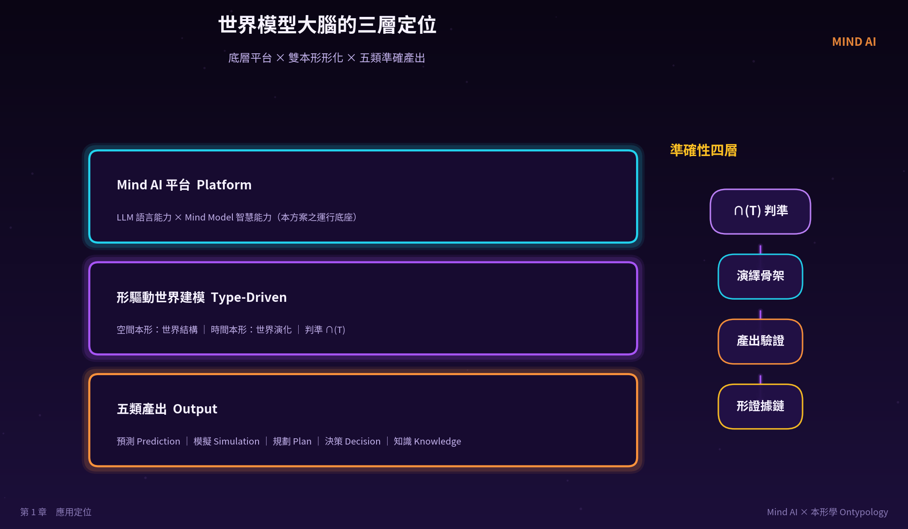

**圖 1-1　世界模型大腦的三層定位：底層平台 × 雙本形形化 × 五類準確產出**

### 與一般 LLM 問答的差異

| 面向 | 一般 LLM 問答 | 世界模型大腦 |
| --- | --- | --- |
| 知識 | 參數中的隱式統計 | 形化的顯式世界模型（形＋關係＋版本） |
| 推理 | 下一句最可能的文字 | 五型推理＋演繹骨架，結論可拆解 |
| 產出 | 文本 | 五類產出契約（預測/模擬/規劃/決策/知識） |
| 準確性 | 無標準定義 | ∩(T) 判準＋四驗＋形證據鏈 |
| 錯誤 | 難以追責 | 可溯源到形與來源，可回饋修正 |

**表 1-1　世界模型大腦與一般 LLM 問答的差異**

## 1.2　五類產出與使用場景

世界模型大腦的一切使用，都以「產出」為中心。先選定產出類型，再決定形化深度、推理選型與驗證強度——這就是「產出導向」的使用姿勢。

| 產出類型 | 典型使用場景 | 核心保證 | 常見誤用 |
| --- | --- | --- | --- |
| 預測 Prediction | 供需缺口、風險預警、趨勢外推 | 量值/方向/時窗＋置信區間 | 把參考預測當確定值 |
| 模擬 Simulation | 政策推演、方案比選、壓力測試 | 情境/約束/軌跡＋反事實分支 | 漏列約束導致軌跡失真 |
| 規劃 Plan | 路線圖、資源配置、行動計畫 | 目標/步驟/資源＋前提清單 | 前提不成立仍照做 |
| 決策 Decision | 進入/退出、投資、處置 | 選項/判準/取捨＋授權級 | 機器建議直接當決定 |
| 知識 Knowledge | 知識整理、模式萃取、教材 | 形/關係/來源＋版本證據 | 無來源知識入庫 |

**表 1-2　五類產出一覽**

**使用口訣：**先定產出、再定判準、後定形化深度。順序反了，準確性就沒了依據。

## 1.3　雙本形運用總綱

本形學把世界拆成兩個正交的面向：空間本形回答「世界是什麼樣子」——實體、屬性、組成、容器；時間本形回答「世界如何演化」——事件、模式、推理、演化。世界模型大腦的每一個任務，都要同時運用這兩個面向，缺一即偏。

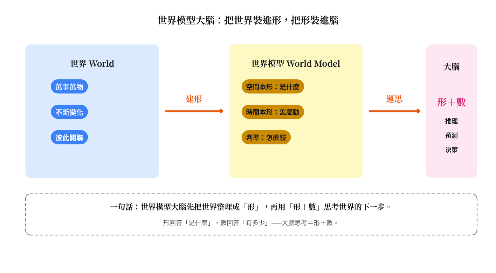

**圖 1-2　雙本形運用總綱：空間本形刻畫世界結構、時間本形刻畫世界演化**

運用口訣如下：結構問題走空間本形（這東西是什麼、由什麼組成）；動態問題走時間本形（這件事怎麼發生、會怎樣發展）；複雜問題兩軌並行，以交界形接合（這個系統在這種事件下會變成什麼樣子）。

## 1.4　Mind AI 底層定位（平台承擔）

世界模型大腦運行於 Mind AI 平台之上。平台承擔智慧能力的底座：LLM 負責語言理解與生成，Mind Model 負責知識統一、深層推理與記憶演化。本方案不重述平台內容，只定義使用分工：凡涉及世界知識的結構化、推理鏈的成立、長期記憶的沉澱，由平台的 Mind Model 承擔；凡涉及語言的解析與表達，由 LLM 承擔。

對使用者而言最重要的含意是：不要把世界模型大腦當「聊天機器人」使喚。給它的任務應以形與契約表達（見第 4 章），讓平台的推理骨架承重，LLM 只做語言的外衣。

## 1.5　形驅動 Type-Driven 核心循環

形驅動是本方案的方法論核心：一切使用動作都循著同一個六環循環運轉——形化、判準、推理、產出、驗證、回饋。六環相扣，產出可驗證、可回饋。

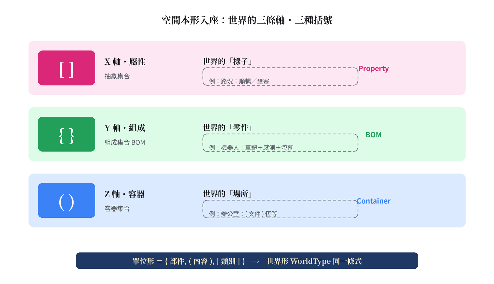

**圖 1-3　形驅動核心循環：六環相扣**

| 環 | 動作 | 產物 | 常見破口 |
| --- | --- | --- | --- |
| 形化 | 把任務與世界建成形 | 形件（五件套齊備） | 跳過形化直接問 |
| 判準 | 定義何謂正確 | ∩(T) 判準表 | 判準後補、邊做邊改 |
| 推理 | 選型推演 | 推理鏈（前提→推演→結論） | 五型混用不聲明 |
| 產出 | 依契約合成 | 五類產出之一 | 產出無契約規格 |
| 驗證 | 四驗＋證據鏈 | 驗證紀錄 | 只驗結論不驗來源 |
| 回饋 | 度量、修訂、入庫 | 模式卡更新 | 用完即走不回饋 |

**表 1-3　六環動作與常見破口**

## 1.6　四層準確性保證

「準確」不是感覺，而是四層防線的疊加。由內而外：第一層以 ∩(T) 交集判準先行定義正確；第二層以演繹骨架承重，讓結論的結構成立；第三層以產出驗證（回測、反事實一致、邊界聲明、壓力情境）檢查結論本身；第四層以形證據鏈讓每一步可溯源。

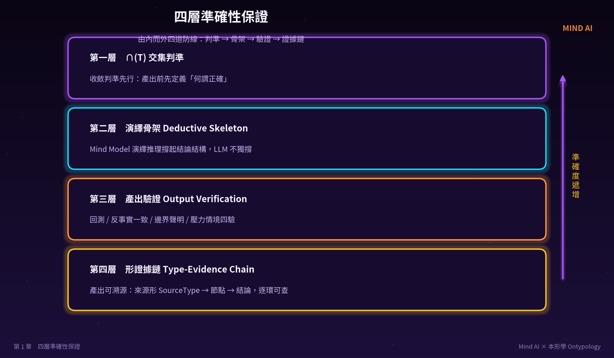

**圖 1-4　四層準確性保證：判準 → 骨架 → 驗證 → 證據鏈**

| 層 | 機制 | 一句話 | 失效時的症狀 |
| --- | --- | --- | --- |
| 第一層 | ∩(T) 交集判準 | 產出前先定義何謂正確 | 各方對「對」吵不停 |
| 第二層 | 演繹骨架 | 結論由推理鏈撐起 | 結論像口號、拆不開 |
| 第三層 | 產出驗證 | 四驗檢查結論本身 | 一驗就倒、一壓就垮 |
| 第四層 | 形證據鏈 | 每一步可溯源 | 「我記得好像⋯」 |

**表 1-4　四層準確性一覽**

## 1.7　術語對照與七項主張

### 術語對照表

| 中文 | 英文 | 備註 |
| --- | --- | --- |
| 形 | Type | 全書核心譯名，非 Form |
| 空間本形 | Space-Type | 世界的結構面 |
| 時間本形 | Time-Type | 世界的演化面 |
| 屬性 / 屬性值 | Attribute / Value | 形的描述單位 |
| 空間容器 | Space Collections | ( ) 身份獨立的容納 |
| BOM / SOM | Bill / Structure of Materials | 列舉 / 組成結構 |
| 框架 | Framework | 可重複套用的描述方法 |
| 交集判準 | ∩(T) | 收斂「何謂正確」 |
| 形證據鏈 | Type-Evidence Chain | 產出溯源鏈 |
| 形驅動 | Type-Driven | 方法論核心 |
| 產出契約 | Output Contract | 產出的規格承諾 |
| TDWM | Type-Driven World Modeling | 八步驟建模流程 |

**表 1-5　術語對照表**

### 七項主張

1. 世界萬物皆可由形來表達與理解；不能形化的問題，先問是不是沒切開。
2. 結構（空間本形）與演化（時間本形）是世界的兩個正交面，缺一即偏。
3. 準確性的前提是判準：∩(T) 不先立，產出無從談對錯。
4. LLM 負責語言，Mind Model 負責智慧；讓骨架承重，外衣才不會塌。
5. 五類產出各有契約；契約缺件的產出，拒收。
6. 驗證不是流程的尾巴，是產出的一部分；四驗不跑完不算交付。
7. 用得越多、回饋越勤，世界模型越準；閉環是世界模型大腦的成長方式。

**本章檢查表：**□ 能三分鐘說清定位　□ 五類產出能對號入座　□ 知道自己任務該走哪條本形軌　□ 記住口訣「先產出、再判準、後形化」

# 第 2 章　空間本形：世界結構形化工程

空間本形回答「世界是什麼樣子」。本章給出把世界的結構建為合格之形的完整工程方法：從異同分辨開始，經屬性、容器、清單、框架，到 Schema 五件套收束。每一節皆附可操作的檢查點。

## 2.1　形化起點：異同 → 分合 → 邊界

形不是天生存在的。大腦先偵測異同，再做分合，最後畫出邊界、生出形，形必有名。把這套認知次序工程化，就是形化的標準起手式：面對一堆世界物件，先比較出異同，把不同的分開、相同的歸併，再為每一類畫出清楚的邊界與名稱。

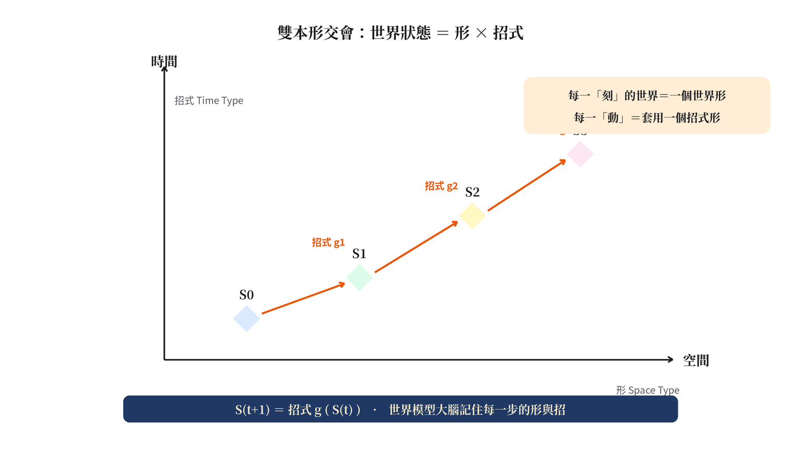

**圖 2-1　形化起點：異同 → 分合 → 邊界**

### 操作步驟

1. 列舉：把任務涉及的物件、事件、資料一股腦列出（寧多勿漏）。
2. 比較：兩兩比較找異同——注意是「先異同，後名詞」，不要一開始就套既有分類。
3. 分合：不同的分成兩堆，相同的合進一堆；反覆直到每一堆內部都「同」、堆與堆之間都「異」。
4. 命名：為每一堆取名，就是形名；名要能自解釋（如「物流樞紐形」而非「東西A」）。
5. 驗界：檢查邊界——有沒有物件同時符合兩個形？有，回去重分；沒有，形化完成。

**判準提示：**一組形化合格的標準是「同形必同構、異形必異構」——同形的物件屬性骨架一致，異形的物件至少有一個關鍵屬性不同。

## 2.2　屬性與屬性值：世界實體主檔

形給出骨架，屬性與屬性值給出血肉。形是表頭（屬性集），實體是資料列（屬性值集）。建立世界實體主檔，就是為每個形定義屬性欄位，為每個實體填入屬性值。

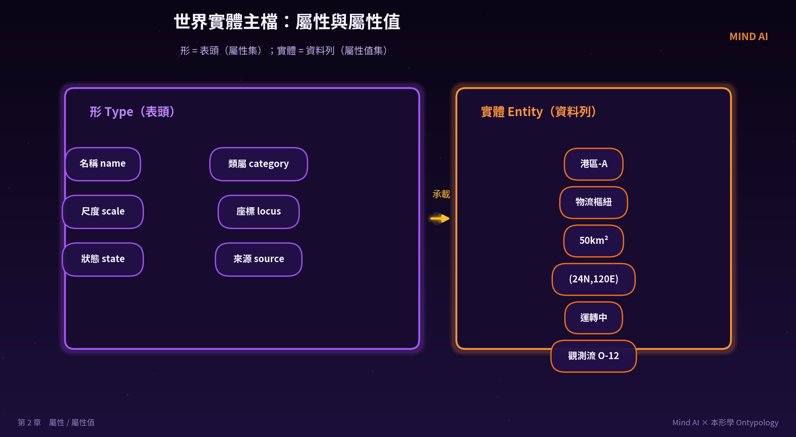

**圖 2-2　世界實體主檔：形（表頭）承載實體（資料列）**

### 屬性設計五原則

1. 必要最小：每一欄都要回答「沒有它會怎樣」；答不出來就砍。
2. 值域明確：每欄聲明可容許的屬性值範圍（數值區間、枚舉、格式）。
3. 單位一致：量測欄位必附單位；單位混用是世界模型失準的頭號暗坑。
4. 時點可溯：狀態類欄位附觀測時點，避免「用舊狀態推新結論」。
5. 來源掛鉤：每欄可追溯到來源形 SourceType（誰、何時、以何方法觀測）。

## 2.3　空間容器與清單：BOM / SOM

描述一個世界物件有三個互補視角：容器（它裝在哪裡）、BOM（它由什麼組成）、SOM（組成之間是什麼結構）。三者各補一事：容器補身份獨立性、BOM 補列舉、SOM 補元素間的結構。

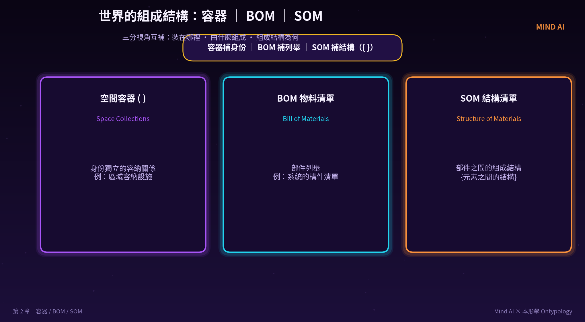

**圖 2-3　容器 ( )｜BOM｜SOM 三分視角**

世界模型的組成描述建議一律「三件齊出」：先寫容器關係（區域容納設施、組織容納角色），再寫 BOM（構件清單），最後寫 SOM（構件之間的層級、並列、依附關係）。只有 BOM 沒有 SOM 的描述，會在推理時散架——知道有什麼，卻不知道怎麼擺。

## 2.4　框架四步驟

框架把「描述一個物件」抽象成可重複套用的方法：定界、切分、填值、掛載。換到新領域，只換域形、不換框架——這是世界模型大腦可擴張的關鍵。

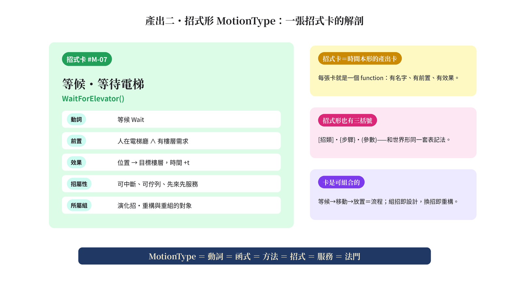

**圖 2-4　框架四步驟：定界 → 切分 → 填值 → 掛載**

| 步驟 | 要問的問題 | 產物 |
| --- | --- | --- |
| 定界 | 這次要描述的對象是什麼、不是什麼？ | 對象聲明與邊界 |
| 切分 | 用哪些維度切開它？（X 軸、Y 軸） | 屬性維度清單 |
| 填值 | 每個維度上它的值是什麼？ | 實體主檔 |
| 掛載 | 它的容器、BOM、SOM 是什麼？ | 組成三件套＋Schema 對齊 |

**表 2-1　框架四步驟操作表**

## 2.5　RDB 對應：表頭 = 形

形的邏輯與關聯式資料庫逐條可對譯：表頭是形、資料列是實體、主鍵是身份獨立性、主從參考是容器與引用關係。這組對應讓世界模型的儲存與治理有現成的工程語彙可用。

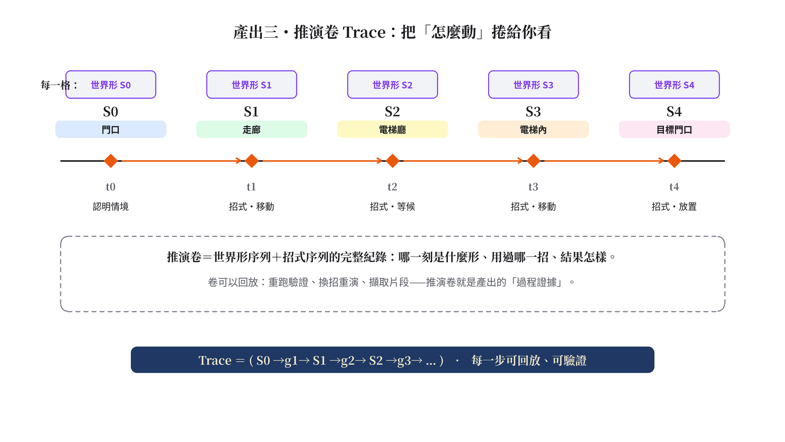

**圖 2-5　RDB 對應：表頭=形、資料列=實體**

**治理含意：**新增一列＝新增實體（低風險、可即時）；新增一欄＝修改形（高風險、須走版本治理）。任何「幫我加個欄位」的請求，都應視為形變更，須經 ∩(T) 重審。

## 2.6　形集合三括號與交集判準 ∩(T)

形的集合語彙有三個括號：( ) 容器補身份獨立性、{ } SOM 補元素間結構、[ ] 抽象補特徵交集的生成規則。三括號之上，交集判準 ∩(T) 用來收斂「何謂正確」：候選產出須落在判準的交集內，才算合格。

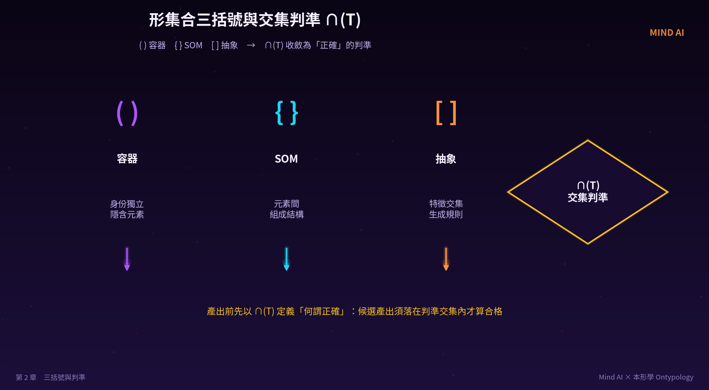

**圖 2-6　三括號與交集判準 ∩(T)**

### ∩(T) 的工程寫法

每個任務在 S4 判準設定步驟產出一張判準表：每列一條判準、每條附檢查方法與通過線。任務結束時，產出逐條對表打勾；打不滿的產出降級為參考件並標註缺口。

## 2.7　世界知識形 Schema 五件套

世界模型的每一形都以五件套承載：定義、屬性、判準、來源、版本。缺件即擋——五件套齊備才算一個合格的形。

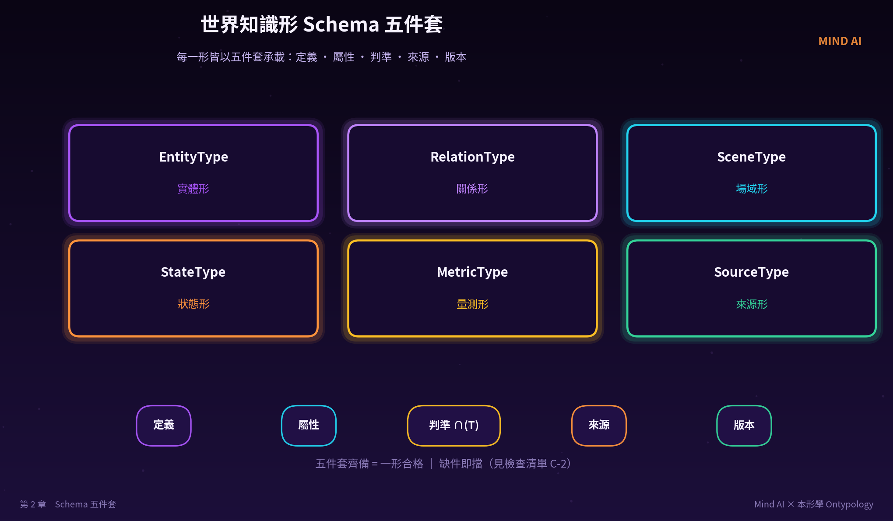

**圖 2-7　世界知識形 Schema 五件套**

| 件 | 內容 | 最低要求 | 常見缺件後果 |
| --- | --- | --- | --- |
| 定義 | 這形是什麼、不是什麼 | 一句定義＋一條反例 | 萬物皆可裝、形無邊界 |
| 屬性 | 表頭欄位＋值域 | 3–8 欄、值域明確 | 描述靠猜 |
| 判準 ∩(T) | 此形的正確標準 | 至少一條可檢查判準 | 對錯無依據 |
| 來源 | 知識從哪來 | 來源形＋取得時點 | 無法溯源 |
| 版本 | 何時修訂、修訂了什麼 | 版本號＋修訂摘要 | 新舊混用 |

**表 2-2　Schema 五件套規格表**

### 世界模型常用形清單（起手包）

| 形 | 英文 | 承載 |
| --- | --- | --- |
| 實體形 | EntityType | 世界中的物、人、組織、系統 |
| 關係形 | RelationType | 實體之間的關聯與權重 |
| 場域形 | SceneType | 情境與舞台（時空範圍＋參與者集合） |
| 狀態形 | StateType | 實體在時點上的狀態 |
| 量測形 | MetricType | 可度量的指標與單位 |
| 來源形 | SourceType | 知識與觀測的出處 |

**表 2-3　世界知識形起手包**

## 2.8　空間形化落地檢查表

| # | 檢查項 | 通過標準 |
| --- | --- | --- |
| C1 | 同形必同構 | 同形實體屬性骨架一致 |
| C2 | 五件套齊備 | 定義/屬性/判準/來源/版本皆在 |
| C3 | 邊界無重疊 | 無實體同時屬於兩個互斥形 |
| C4 | 容器成對 | 每個「容納」關係兩端皆有形 |
| C5 | SOM 成樹 | 組成結構無循環、無孤兒 |
| C6 | 單位一致 | 量測欄位單位聲明齊全 |
| C7 | 主鍵可指認 | 每個實體可被唯一指認 |
| C8 | 形變更已記錄 | 新增欄位皆有版本修訂紀錄 |

**表 2-4　空間形化落地檢查表（C1–C8）**

**本章檢查表：**□ 起手式五步跑過一輪　□ 主檔五原則守住　□ 三件套齊出　□ 框架四步可重複　□ 五件套無缺件　□ C1–C8 全綠

# 第 3 章　時間本形：世界動態形化工程

時間本形回答「世界如何演化」。本章把世界的變化建為可推理、可重用的動態形：事件入庫、模式萃取、推理選型、思考法調度、學習閉環。結構建得再好，不懂演化，世界模型就只是一張靜態地圖。

## 3.1　世界事件庫：檢索與萃取

時間本形的起點是事件。世界事件庫（Episode Library）以事件形承載「何時、何地、誰、發生了什麼、前後狀態變化」；同形召回讓新情境能比對舊事件，萃取則把一團事件流沉澱成可重用的模式卡。

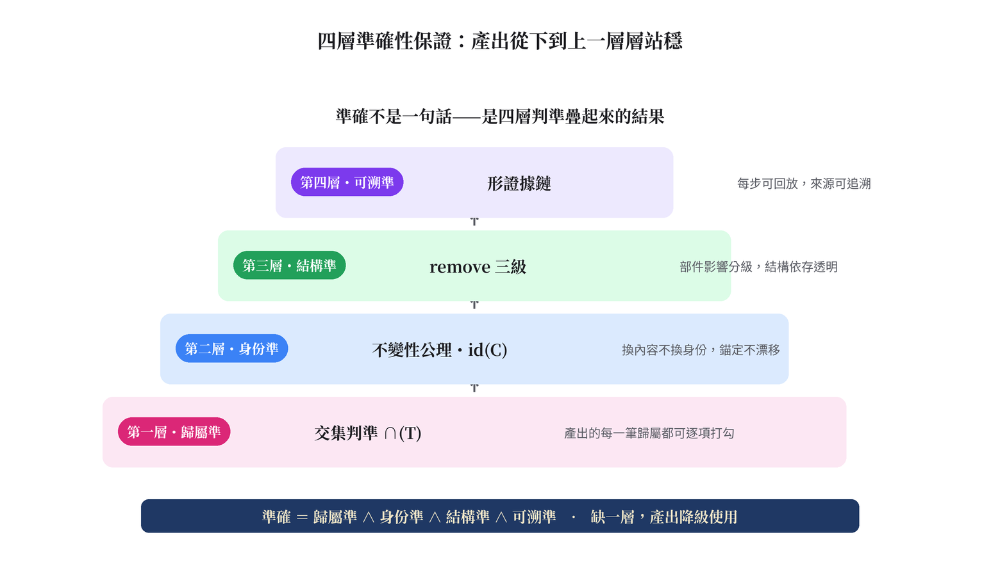

**圖 3-1　世界事件庫：檢索 → 萃取 → 模式卡**

### 事件形最低欄位

| 欄位 | 說明 | 示例 |
| --- | --- | --- |
| event_id | 事件唯一指認 | EP-2026-0412 |
| 時點 / 時窗 | 發生與持續 | 2026-07 起，為期 6 週 |
| 場域形 | 舞台範圍 | SceneType: 區域電網 |
| 參與形 | 涉入的實體 | EntityType × 4 |
| 狀態變化 | 前狀態 → 後狀態 | 備轉容量 15% → 7% |
| 來源形 | 觀測出處 | SourceType: 電網調度月報 |

**表 3-1　事件形最低欄位**

萃取作業的三步：去噪（剔除無關事件流）、摘要（壓成時序節點表）、對齊（把事件對齊到既有模式卡的階段位置）。萃取的產物有二：更新後的模式卡、以及「未能歸模」的殘差清單——殘差正是新知的入口。

## 3.2　模式卡 PatternType 四型

世界動態可歸納為四種基本型：趨勢、因果、週期、突變。模式卡是這四型的標準承載格式，每張卡聲明前提、特徵、可信度與反例。

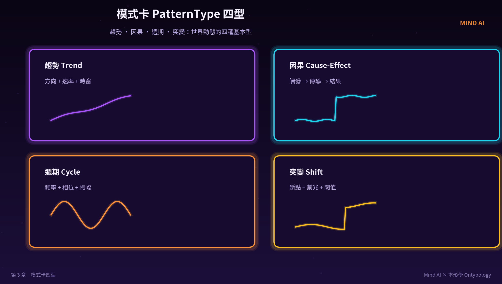

**圖 3-2　模式卡 PatternType 四型**

| 欄位 | 內容要求 |
| --- | --- |
| 型別 | 趨勢 / 因果 / 週期 / 突變 四擇一 |
| 前提 | 此模式成立的條件清單（少一條即失效） |
| 特徵 | 可觀測的辨識特徵（用於同形召回） |
| 參數 | 趨勢:方向+速率+時窗；因果:觸發+傳導+結果；週期:頻率+相位+振幅；突變:斷點+前兆+閾值 |
| 可信度 | 支持案例數 / 反例數 / 最近驗證時點 |
| 反例 | 已知失效案例（必填，防空轉） |

**表 3-2　模式卡欄位規格**

**警語：**沒有反例的模式卡不可用於預測產出。只見過成功案例的模式，只是還沒見過它的失效。

## 3.3　推理五型

情境決定推理選型：由因推果用因果、由果溯因用果因、在腦內跑世界用模擬、處理不確定用統計、由目標回推路徑用逆向。選型必須聲明——推理鏈首行就寫「本鏈採用 X 型推理」。

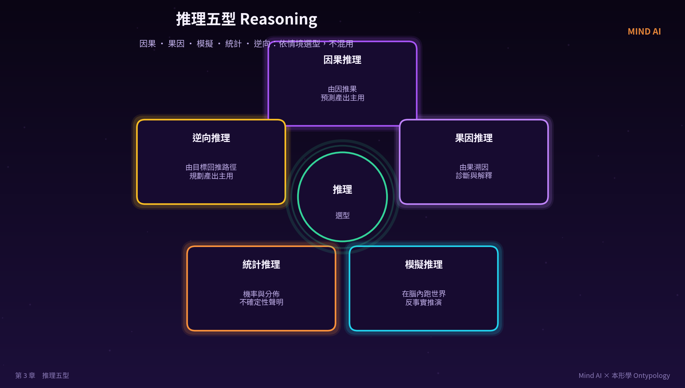

**圖 3-3　推理五型：依情境選型，不混用**

| 型 | 適用情境 | 產出類型配對 | 失效樣態 |
| --- | --- | --- | --- |
| 因果 | 有明確機制的推進 | 預測 | 把相關當因果 |
| 果因 | 事後解釋、診斷 | 知識 | 單因歸因、忽略共因 |
| 模擬 | 政策/方案推演 | 模擬 | 約束漏列、軌跡失真 |
| 統計 | 數據充分、需置信聲明 | 預測 | 樣本偏態外推 |
| 逆向 | 目標既定、找路徑 | 規劃 | 回推前提不成立 |

**表 3-3　推理五型配對表**

混用不是不行，但要「接力不混流」：多型推理串接時，交接處聲明前提承接關係（前一型的結論是後一型的前提），並在推理鏈上留下節點。

## 3.4　思考法五型

思考法是更上位的心智姿勢：正向順推、逆向回推、水準跳脫、垂直深化、第一性原理重建。任務調度建議：創新類用水準＋第一性原理；驗證類用垂直＋逆向；例行推進用正向。

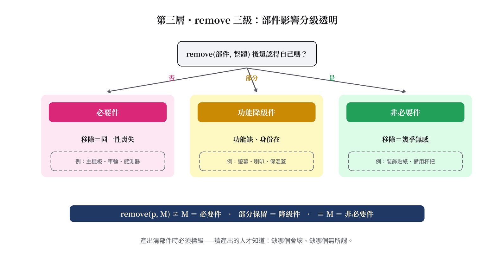

**圖 3-4　思考法五型**

與推理五型的分工：思考法決定「從哪個角度切入」，推理決定「鏈條怎麼接」。先以思考法定切入角度，再以推理五型建鏈——順序不要反。

## 3.5　問題形化與解題

解題之前先形化問題：一個問題被建成「現狀形 StateType(現)、期望形 StateType(標)、差距 Gap、約束 Constraint」四件套後，才是可解的問題。未形化的問題直接求解，是世界模型使用中最常見的空轉。

| 步 | 動作 | 產物 |
| --- | --- | --- |
| 1 形化 | 現狀/期望/差距/約束 四件套 | 問題形 |
| 2 定準 | 差距收斂到多少算解決 | ∩(T) 解題判準 |
| 3 選型 | 推理選型＋思考法切入 | 推理策略聲明 |
| 4 推演 | 候選路徑生成與比選 | 路徑集＋比選表 |
| 5 驗收 | 對判準打勾、回饋入庫 | 解題紀錄＋模式卡更新 |

**表 3-4　問題形化解題五步**

## 3.6　設計創新：情境生成與方案合成

設計（創造與創新）在時間本形中表現為「未來情境的生成與方案的合成」。做法：由模式卡組合出未來情境（趨勢延伸、突變插入、週期疊加），在各情境下用設計模式（Design Patterns）合成候選方案，再以判準比選。

1. 情境生成：至少三個未來情境（基準 / 樂觀 / 悲觀），每個情境聲明所依模式卡。
2. 方案合成：先找既有設計模式卡（過去驗證過的解法骨架），再做適配改造，最後才自由創新。
3. 比選落地：候選方案對 ∩(T) 判準打分，附取捨說明；分數接近時以「可逆性」為最終裁決。

## 3.7　規則驅動檢查與合規

產出出門前過一道規則驅動檢查：把領域守則、法規限制、倫理紅線寫成可執行的檢查規則（條件 → 判定 → 處置），對產出逐條掃描。檢查不是表演：命中即擋、疑義即升級人工。

| 規則級 | 示例 | 處置 |
| --- | --- | --- |
| 硬性 | 危急警訊、法規禁止事項 | 命中即擋，升級人工 |
| 柔性 | 領域守則、慣例偏差 | 標註警示，附偏差說明 |
| 提示 | 風格、格式、完備度 | 自動修飾後交付 |

**表 3-5　規則級與處置**

## 3.8　持續學習閉環與自我演化

世界模型大腦的長期價值在閉環：產出被使用後，度量其實際表現、與預期比對、修訂模式卡與形、入庫沉澱。這個閉環跑得越勤，世界模型越準——這就是自我演化（Self-evolution）的工程含意。

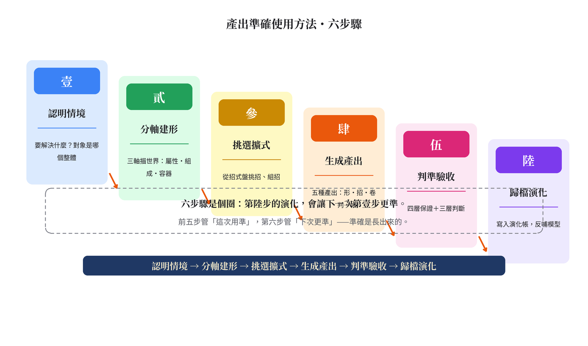

**圖 3-5　持續學習閉環：產出 → 度量 → 比對 → 修訂 → 入庫**

### 回饋三問（每次產出被採用或否決後必答）

1. 對在哪：命中的是哪條判準、哪張模式卡？（寫回模式卡的可信度）
2. 錯在哪：偏差的根因是形化、推理還是資料？（寫入殘差清單）
3. 改什麼：下一次同類任務要改哪一件形、哪一張卡？（開立修訂單）

## 3.9　時間本形四模式運用準則

時間本形的運用可歸納為四種模式：搜尋、推理、設計模式、自我演化。每一模式皆掛時序節點（觸發 → 中段 → 交付 → 回饋），讓動態過程可管理、可檢查。

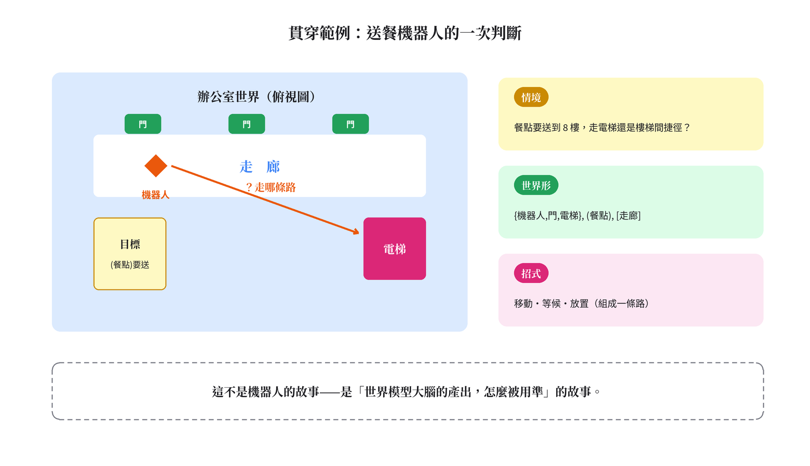

**圖 3-6　時間本形四模式：搜尋 · 推理 · 設計模式 · 自我演化**

| 模式 | 時序節點 | 產物 | 檢查點 |
| --- | --- | --- | --- |
| 搜尋 | 入庫 → 索引 → 命中 | 召回案例集 | 命中案例的同形性 |
| 推理 | 前提 → 推演 → 結論 | 推理鏈 | 每步前提承接聲明 |
| 設計模式 | 約束 → 生成 → 擇優 | 候選方案 | 取捨說明完整性 |
| 自我演化 | 產出 → 度量 → 修訂 | 模式卡更新 | 回饋三問有答案 |

**表 3-6　四模式運用準則**

**本章檢查表：**□ 事件形欄位齊全　□ 模式卡必有反例　□ 推理選型已聲明　□ 問題已四件套形化　□ 規則檢查掃過　□ 回饋三問有答案

# 第 4 章　知識域與產出契約

世界模型大腦橫跨六大知識域，產出分五類契約。本章給出知識域的形清單、跨域連鎖方法、產出契約規格、人機授權矩陣與交接規格——把「用得準」落實為可簽核的規格文件。

## 4.1　通用世界模型六大知識域

通用世界模型以六大知識域覆蓋世界的結構面與演化面。每域皆有自己的形清單與量測慣例，但 Schema 五件套與 ∩(T) 寫法全域統一——這正是「換域不換法」的形驅動優勢。

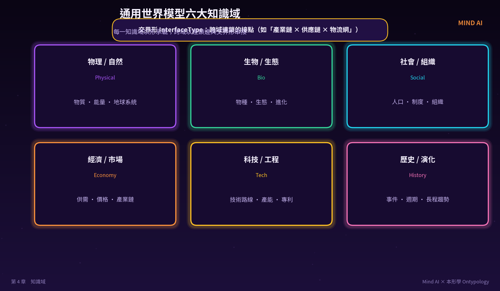

**圖 4-1　通用世界模型六大知識域**

| 知識域 | 代表形 | 典型量測 | 常見陷阱 |
| --- | --- | --- | --- |
| 物理 / 自然 | 氣象形、能源形、地理形 | 量值＋單位＋觀測網 | 單位與尺度混用 |
| 生物 / 生態 | 物種形、生態系形、流行形 | 族群量、分佈 | 以偏概全外推 |
| 社會 / 組織 | 人口形、制度形、組織形 | 比率、滿意度 | 忽略行為反饋 |
| 經濟 / 市場 | 價格形、供需形、產業鏈形 | 價格、量、彈性 | 把相關當因果 |
| 科技 / 工程 | 技術路線形、產能形、專利形 | 成熟度、良率 | 線性外推突破 |
| 歷史 / 演化 | 事件形、週期形、趨勢形 | 頻率、時窗 | 以史硬套今 |

**表 4-1　六大知識域形清單**

## 4.2　跨域連鎖與交界形

真實世界的問題幾乎都跨域。跨域連鎖以「交界形 InterfaceType」接合：一個交界形同時隸屬兩個域，作為連鎖傳導的接點（如「產業鏈 × 供應鏈 × 物流網」的樞紐、「氣候 × 能源」的極端天候衝擊）。

1. 連鎖聲明：跨域推演必須逐跳聲明「哪個域的哪張模式卡」在傳導，不許黑箱跳域。
2. 交界形治理：交界形歸雙域共管，五件套齊備且兩域判準皆通過才合格。
3. 連鎖斷點：任一跳的可信度低於門檻，整條連鎖降級為參考，並標註斷點位置。

**示例：**極端氣候（物理）→ 用電尖峰（能源）→ 現貨價格（經濟）→ 產業產能（科技）→ 就業（社會）。每一跳都是一張模式卡，每一跳都要可驗。

## 4.3　五類產出契約 Output Contract

產出契約是世界模型大腦與使用者之間的規格承諾：每類產出聲明格式、必附件、時效與置信聲明。契約缺件的產出，拒收——這是準確使用的第一道門。

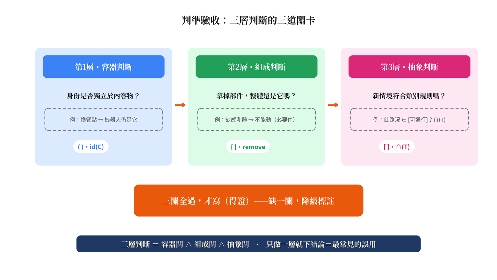

**圖 4-2　五類產出契約：規格 · 時效 · 置信聲明**

| 產出 | 格式骨架 | 必附件 | 置信聲明 |
| --- | --- | --- | --- |
| 預測 | 標的＋量值/方向＋時窗 | 推理鏈、模式卡引用、回測紀錄 | 置信區間或機率，禁用「肯定」 |
| 模擬 | 情境＋約束＋軌跡 | 約束清單、反事實分支、敏感度 | 分支條件明示，禁漏約束 |
| 規劃 | 目標＋步驟＋資源 | 前提清單、風險條目、回退路徑 | 前提失效即作廢聲明 |
| 決策 | 選項＋判準＋取捨 | 比選表、授權級、反對意見欄 | 建議定位，決定權在人 |
| 知識 | 形＋關係＋陳述 | 來源形、版本號、證據節點 | 可信度＋反例清單 |

**表 4-2　產出契約規格表**

### 產出等級與契約厚度

契約厚度隨產出等級伸縮：快查等級可簡化為「單頁＋一句置信」，標準等級附完整推理鏈，深度等級加跑四驗全項並附形證據鏈全圖。等級在任務開跑前由人機共同選定，不可產出後再降級遮醜。

## 4.4　人機授權矩陣

越靠近判斷與承擔，人越靠前。授權矩陣依產出衝擊度分五級：由機器自主到僅人，逐級收緊自動化程度。

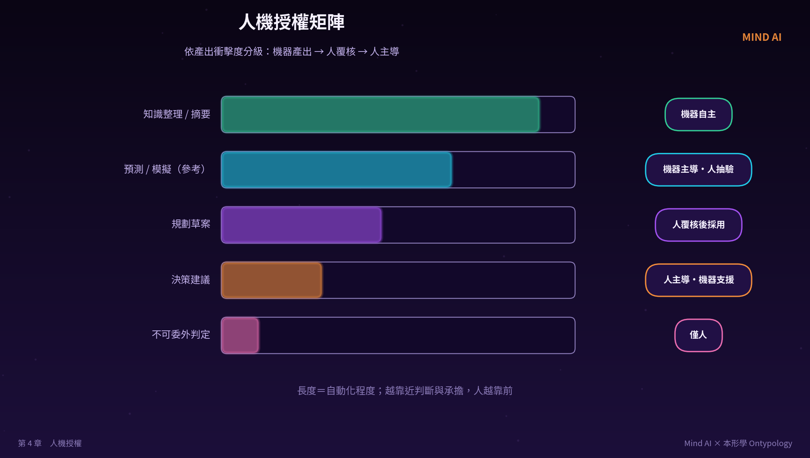

**圖 4-3　人機授權矩陣**

| 產出情境 | 自動化級 | 機器角色 | 人的角色 |
| --- | --- | --- | --- |
| 知識整理 / 摘要 | 機器自主 | 產出 | 抽查 |
| 預測 / 模擬（參考用） | 機器主導 | 產出＋自檢 | 抽驗＋採用聲明 |
| 規劃草案 | 人覆核後採用 | 草案 | 覆核簽核 |
| 決策建議 | 人主導 | 分析＋比選 | 決定＋承擔 |
| 高衝擊判定（安全/權益/不可逆） | 僅人 | 僅供資料 | 全權 |

**表 4-3　人機授權矩陣表**

## 4.5　交接規格 H1–H5

步驟與步驟之間的「產出」必須可交接：格式一致、判準承接、責任明確、時點守時、版本可溯。五項任缺其一即為斷鏈，退回上一步重產。

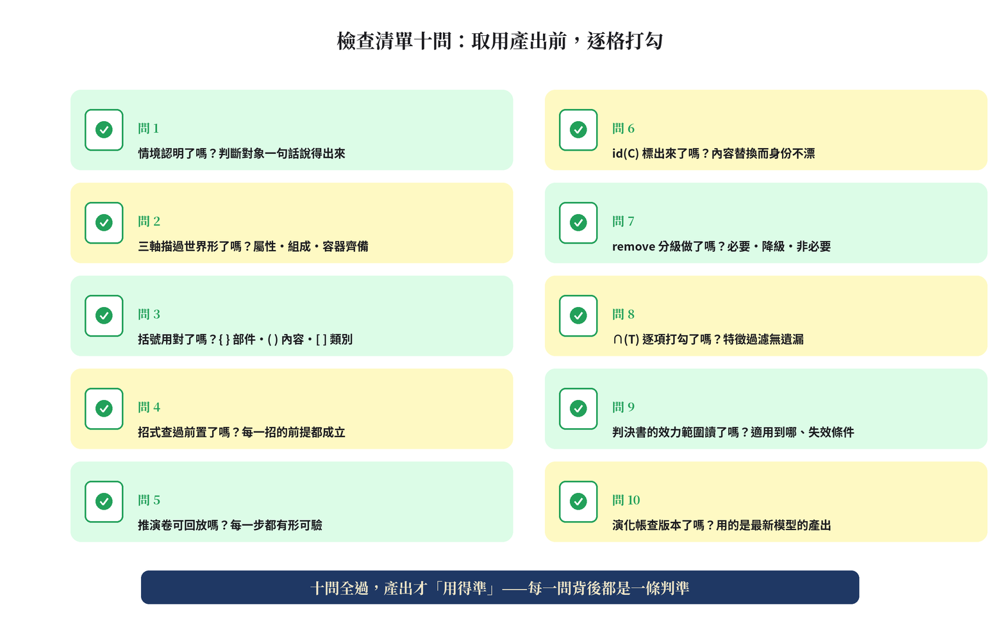

**圖 4-4　交接規格 H1–H5**

| 規格 | 要求 | 檢查方法 |
| --- | --- | --- |
| H1 格式一致 | 同一 Schema 五件套 | 欄位比對全過 |
| H2 判準承接 | ∩(T) 相互對齊、無衝突 | 判準交集非空 |
| H3 責任明確 | 產出者與驗證者分離 | 簽核欄皆有名字 |
| H4 時點守時 | 時序節點不遲交 | 節點時間戳在窗內 |
| H5 版本可溯 | 形證據鏈不斷點 | 逐節點可回溯來源 |

**表 4-4　交接規格 H1–H5**

**本章檢查表：**□ 任務落在哪個域已標定　□ 跨域連鎖逐跳聲明　□ 產出契約無缺件　□ 授權級已確認　□ H1–H5 交接全綠

# 第 5 章　形驅動世界建模八步驟 TDWM

TDWM（Type-Driven World Modeling）是把任務化為準確產出的標準航道：S1 任務形化 → S2 形化建模 → S3 事件萃取 → S4 判準設定 → S5 推理推演 → S6 產出合成 → S7 驗證裁決 → S8 回饋入庫。每步皆有 I/O 規格、判準與失誤劇本。

## 5.1　TDWM 總覽

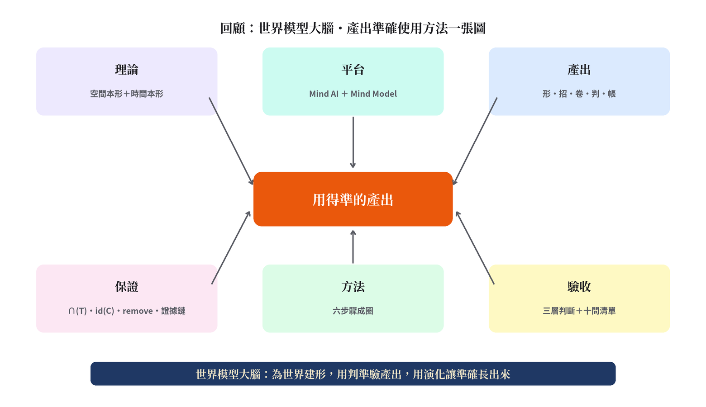

**圖 5-1　TDWM 八步驟：由任務到準確產出的標準航道**

| 步 | 使命 | 輸入 | 輸出 |
| --- | --- | --- | --- |
| S1 任務形化 | 定義任務與產出契約 | 原始需求 | 任務形＋產出契約草稿 |
| S2 形化建模 | 世界結構建模 | 任務形 | 空間形件（五件套） |
| S3 事件萃取 | 世界動態建模 | 事件庫＋情境 | 模式卡＋時序節點表 |
| S4 判準設定 | 定義何謂正確 | 產出契約 | ∩(T) 判準表 |
| S5 推理推演 | 推演結論 | 形件＋判準 | 推理鏈＋候選結論 |
| S6 產出合成 | 合成契約產出 | 推理鏈 | 五類產出之一 |
| S7 驗證裁決 | 四驗＋裁決 | 產出＋判準 | 驗證紀錄＋裁決書 |
| S8 回饋入庫 | 度量與修訂 | 使用回饋 | 模式卡更新＋修訂單 |

**表 5-1　TDWM 八步驟 I/O 總表**

**航道原則：**步不跳、判準先行、產出隨契約。可裁剪（見 5.10），不可倒序。

## 5.2　S1 任務形化

使命：把「想要」變成「可驗收的任務」。輸入是原始需求，輸出任務形與產出契約草稿。任務形聲明：標的、產出類型、產出等級、時窗、授權級、涉入知識域。

| I/O 規格 | 內容 |
| --- | --- |
| 輸入 | 原始需求文字、可用資料清單、時限 |
| 輸出任務形 | 標的 / 產出類型 / 等級 / 時窗 / 授權級 / 域 |
| 判準 | 任務形可被第三者讀懂且不歧義；產出契約欄位無空缺 |
| 時程 | 快查 5–10 分鐘；標準 30–60 分鐘；深度 0.5–1 日 |
| 失誤劇本 | 需求含糊→退回澄清清單；產出類型選錯→契約重簽；等級虛高→按裁剪指引降級 |

**表 5-2　S1 任務形化 I/O 規格**

## 5.3　S2 形化建模

使命：世界結構建模。依第 2 章工程方法產出空間形件：異同分合、主檔、容器/BOM/SOM、框架四步、五件套齊備。

| I/O 規格 | 內容 |
| --- | --- |
| 輸入 | 任務形、既有形庫、領域資料 |
| 輸出 | 新增/複用的空間形件清單（含五件套） |
| 判準 | C1–C8 檢查表全綠（見 2.8） |
| 時程 | 快查 15–30 分鐘（複用為主）；標準 2–4 小時；深度 1–2 日 |
| 失誤劇本 | 形爆炸→合併同構形；邊界重疊→重跑異同分合；五件套缺件→缺件即擋 |

**表 5-3　S2 形化建模 I/O 規格**

## 5.4　S3 事件萃取

使命：世界動態建模。由世界事件庫檢索同形案例、萃取模式卡、建立時序節點表。殘差清單一併產出。

| I/O 規格 | 內容 |
| --- | --- |
| 輸入 | 事件庫、任務情境、時間範圍 |
| 輸出 | 模式卡（四型）＋時序節點表＋殘差清單 |
| 判準 | 模式卡必有反例；事件形欄位齊全；殘差已分類 |
| 時程 | 快查 15–30 分鐘；標準 2–4 小時；深度 1–3 日 |
| 失誤劇本 | 事件不足→標註資料缺口＋降級產出；模式硬套→反例檢查擋下；殘差忽視→回饋強制入庫 |

**表 5-4　S3 事件萃取 I/O 規格**

## 5.5　S4 判準設定

使命：定義何謂正確。產出 ∩(T) 判準表：每列一條判準、檢查方法、通過線、裁決人。判準表是 S7 驗收的依據，務必先行。

| I/O 規格 | 內容 |
| --- | --- |
| 輸入 | 產出契約、領域守則、歷史驗收紀錄 |
| 輸出 | ∩(T) 判準表（判準/方法/通過線/裁決人） |
| 判準 | 每條判準可檢查、可判定、無歧義；判準間無衝突 |
| 時程 | 快查 5–10 分鐘；標準 30–90 分鐘；深度 半日 |
| 失誤劇本 | 判準後補→禁止，回 S4 重立；判準不可測→改寫為可觀測；多頭判準→取交集 ∩(T) 收斂 |

**表 5-5　S4 判準設定 I/O 規格**

## 5.6　S5 推理推演

使命：推演結論。依第 3.3 節選型，建推理鏈（前提 → 推演 → 結論），多型接力須聲明承接。深度等級加跑反事實分支。

| I/O 規格 | 內容 |
| --- | --- |
| 輸入 | 形件、模式卡、判準表 |
| 輸出 | 推理鏈（選型聲明＋節點）＋候選結論集 |
| 判準 | 每步前提承接已聲明；結論可回指形與模式卡 |
| 時程 | 快查 15–30 分鐘；標準 2–6 小時；深度 2–5 日 |
| 失誤劇本 | 五型混流→拆鏈分段聲明；結論跳步→補節點；數據外推過度→統計推理＋置信收窄 |

**表 5-6　S5 推理推演 I/O 規格**

## 5.7　S6 產出合成

使命：依契約合成產出。以產出契約（4.3）為骨架填裝推理結論，缺件即拒收。產出文件首頁附契約對照欄。

| I/O 規格 | 內容 |
| --- | --- |
| 輸入 | 推理鏈、產出契約、產出等級 |
| 輸出 | 五類產出之一（附契約對照欄） |
| 判準 | 契約欄位全數滿足；置信聲明合規（禁「肯定/必然」） |
| 時程 | 快查 10–20 分鐘；標準 1–2 小時；深度 半日–1 日 |
| 失誤劇本 | 契約缺件→拒收重產；等級超厚度→裁剪；置信越界→改寫聲明 |

**表 5-7　S6 產出合成 I/O 規格**

## 5.8　S7 驗證裁決

使命：四驗＋裁決。四驗＝回測、反事實一致、邊界聲明、壓力情境；快查可擇二。裁決書逐條對 ∩(T) 打勾，未過項降級標註。

| I/O 規格 | 內容 |
| --- | --- |
| 輸入 | 產出、判準表、歷史基準 |
| 輸出 | 驗證紀錄＋裁決書（通過/降級/退回） |
| 判準 | 驗證方法先於驗證動作聲明；裁決人簽核（H3 責任分離） |
| 時程 | 快查 5–15 分鐘（擇二）；標準 1–3 小時；深度 1–2 日（全跑） |
| 失誤劇本 | 自產自驗→強制分離；只驗結論不驗來源→形證據鏈必查；失敗遮掩→降級標註＋殘差入庫 |

**表 5-8　S7 驗證裁決 I/O 規格**

## 5.9　S8 回饋入庫

使命：度量與修訂。依第 3.8 節回饋三問作答，更新模式卡可信度、開立形修訂單、把殘差入庫。這一步決定世界模型的成長速度。

| I/O 規格 | 內容 |
| --- | --- |
| 輸入 | 裁決書、實際使用結果、回饋三問答案 |
| 輸出 | 模式卡更新＋形修訂單＋殘差入庫紀錄 |
| 判準 | 回饋三問皆有答案；修訂單有負責人與期限 |
| 時程 | 快查 5 分鐘；標準 30–60 分鐘；深度 半日＋定期回顧 |
| 失誤劇本 | 用完即走→交付卡關不放行；只記成功→強制反例欄；修訂無主→拒絕入庫 |

**表 5-9　S8 回饋入庫 I/O 規格**

## 5.10　步驟 × 域 × 形對照與裁剪指引

同一航道，各域換形不換步。下圖為對照鳥瞰，完整映射見表 5-10；裁剪依產出等級走快查軌或深度軌。

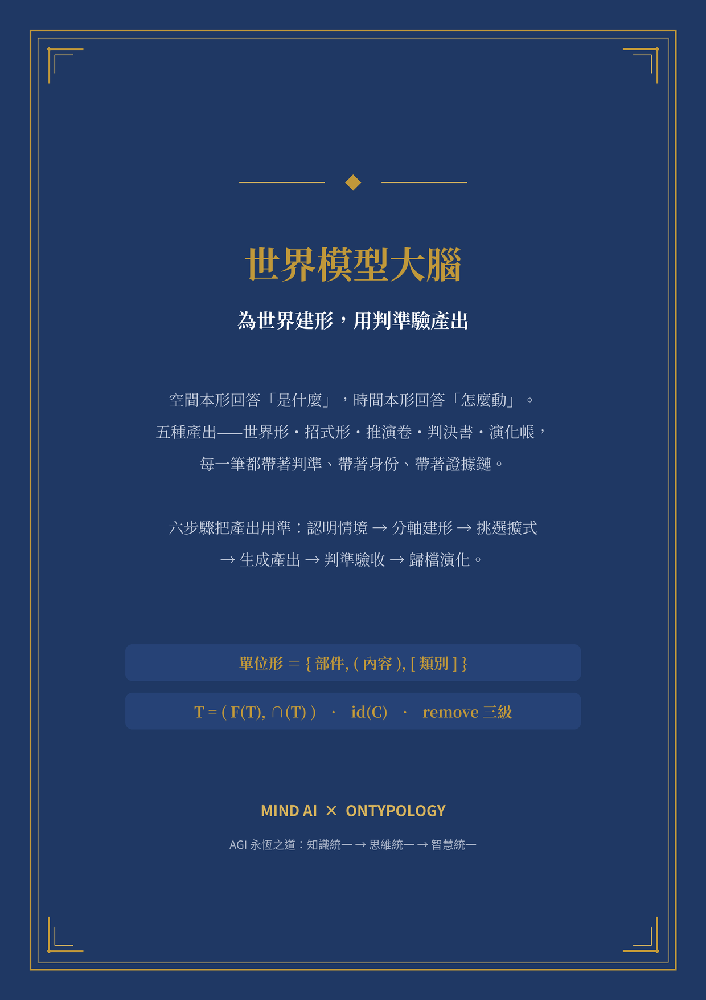

**圖 5-2　步驟 × 知識域 × 形 對照**

| 步驟 \ 域 | 物理/自然 | 生物/生態 | 社會/組織 | 經濟/市場 | 科技/工程 | 歷史/演化 |
| --- | --- | --- | --- | --- | --- | --- |
| S2 形化 | 氣象形·能源形 | 物種形·生態系形 | 人口形·制度形 | 供需形·產業鏈形 | 路線形·產能形 | 事件形·週期形 |
| S3 萃取 | 熱浪事件庫 | 疫情波次 | 政策事件庫 | 景氣循環 | 技術突破史 | 長程週期 |
| S5 推理 | 因果＋統計 | 統計＋模擬 | 模擬＋果因 | 因果＋統計 | 逆向＋因果 | 類比＋趨勢 |
| S7 驗證 | 回測氣象史 | 分佈比對 | 情境壓力測 | 回測行情 | 專利/產能驗證 | 週期校驗 |

**5-10　步驟 × 域 × 形 對照表**

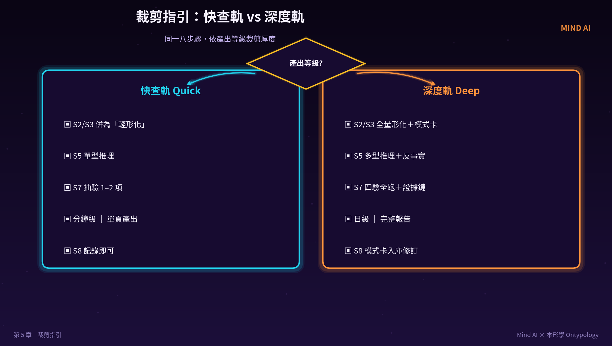

**圖 5-3　裁剪指引：快查軌 vs 深度軌**

## 5.11　失誤劇本彙整

失誤劇本是「預先寫好的救火劇本」：每一步的高頻失誤、早期徵兆與標準處置。建議印出置於案頭——出事時不要發明處置，照劇本走。

| 步 | 高頻失誤 | 早期徵兆 | 標準處置 |
| --- | --- | --- | --- |
| S1 | 需求含糊就開跑 | 任務形寫不出產出類型 | 停：產出澄清問題清單，等回覆 |
| S1 | 產出類型選錯 | 契約欄位一直填不順 | 回 S1 重簽契約；勿硬填 |
| S2 | 形爆炸、越建越多 | 同類形超過 3 件 | 暫停立新形；檢形庫、合併同構 |
| S2 | 邊界重疊 | 實體同時符合兩形 | 重跑異同→分合→邊界；驗界 |
| S3 | 模式硬套 | 反例欄寫不出來 | 模式卡降級；標資料缺口 |
| S3 | 殘差被丟棄 | 萃取報告乾淨得可疑 | 強制殘差清單；分類入庫 |
| S4 | 判準後補 | S5 已開跑才想起判準 | 停：回 S4 先立後推 |
| S4 | 判準不可測 | 出現「盡量」「美觀」 | 改寫為可觀測指標＋通過線 |
| S5 | 五型混流 | 推理鏈中段換型無聲明 | 拆鏈分段；交接處補承接聲明 |
| S5 | 硬推結論 | 推理鏈越推越長還在繞 | 允許「推不出」；列資料缺口 |
| S6 | 契約缺件交付 | 對照欄有空格 | 拒收重產；缺件列表回 S5/S7 |
| S6 | 置信越界 | 出現「肯定」「必然」 | 改寫機率式表達；補區間 |
| S7 | 自產自驗 | 裁決欄與產出者同名 | H3 強制分離；換人重驗 |
| S7 | 壓力情境太客氣 | 四驗全一次過 | 故意為難：假設最壞前提 |
| S8 | 用完即走 | 交付後無回饋包 | S8 不答不放行（卡關） |
| S8 | 只記成功 | 模式卡可信度只升不降 | 反例欄強制；月度重審 |

**表 5-11　失誤劇本彙整表（S1–S8）**

**本章檢查表：**□ 八步不跳不倒　□ 每步 I/O 齊備　□ 失誤劇本已備援　□ 裁剪等級事前定　□ 對照表標定域形

# 第 6 章　六段式規範與 S1–S9 提示詞手冊

本章是世界模型大腦的操作核心：先立六段式提示詞規範，再給 S1–S9 九支提示詞全文（每支含輸出規格），最後以四想定全流程演練收束。手冊可直接複製使用——六段填好、判準寫明，產出就有準確性的底。

## 6.1　六段式提示詞規範

每支提示詞都由六段構成：Role（角色）、Type（形聲明）、Context（情境）、Task（任務）、Constraint（約束與判準）、Output（產出契約）。六段缺一不可，段內順序固定；判準先於產出。

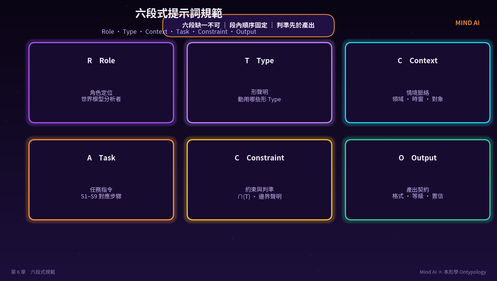

**圖 6-1　六段式提示詞規範**

| 段 | 回答的問題 | 常見偷懶 | 補法 |
| --- | --- | --- | --- |
| R Role | 你是誰、以什麼專業承擔 | 「你是個助手」 | 點名角色＋承擔範圍 |
| T Type | 動用哪些形 Type | 不寫形，直接問 | 列形件編號與名稱 |
| C Context | 領域、時窗、對象 | 情境三句話帶過 | 場域形＋時窗＋資料範圍 |
| A Task | 要完成哪一步（S 編號） | 任務混併 | 一提示詞一步驟 |
| C Constraint | ∩(T) 判準與紅線 | 「盡量準確」 | 逐條可檢查判準 |
| O Output | 產出契約與等級 | 「給我一份報告」 | 契約欄位＋等級＋置信要求 |

**表 6-1　六段式規格表**

## 6.2　S1–S9 手冊總覽與產出等級

九支提示詞對應 TDWM 八步驟＋一支總複核。可單用、可串聯；主航道為 S1→S8 依序，S9 於交付前總複核。

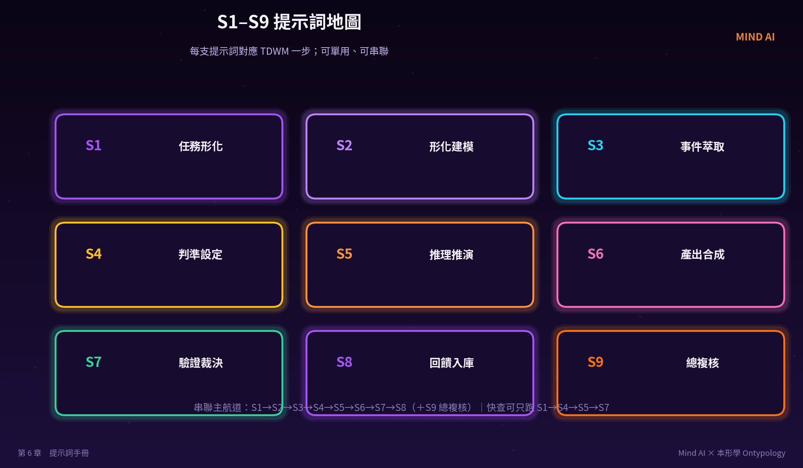

**圖 6-2　S1–S9 提示詞地圖**

| 編號 | 名稱 | 對應步 | 產出 | 等級彈性 |
| --- | --- | --- | --- | --- |
| S1 | 任務形化 | S1 | 任務形＋契約草稿 | 全等級 |
| S2 | 形化建模 | S2 | 空間形件 | 全等級 |
| S3 | 事件萃取 | S3 | 模式卡＋時序節點表 | 全等級 |
| S4 | 判準設定 | S4 | ∩(T) 判準表 | 全等級 |
| S5 | 推理推演 | S5 | 推理鏈＋候選結論 | 全等級 |
| S6 | 產出合成 | S6 | 契約產出 | 全等級 |
| S7 | 驗證裁決 | S7 | 驗證紀錄＋裁決書 | 四驗可裁剪 |
| S8 | 回饋入庫 | S8 | 模式卡更新＋修訂單 | 全等級 |
| S9 | 總複核 | 交付前 | 複核意見＋放行判定 | 建議全跑 |

**表 6-2　S1–S9 索引表**

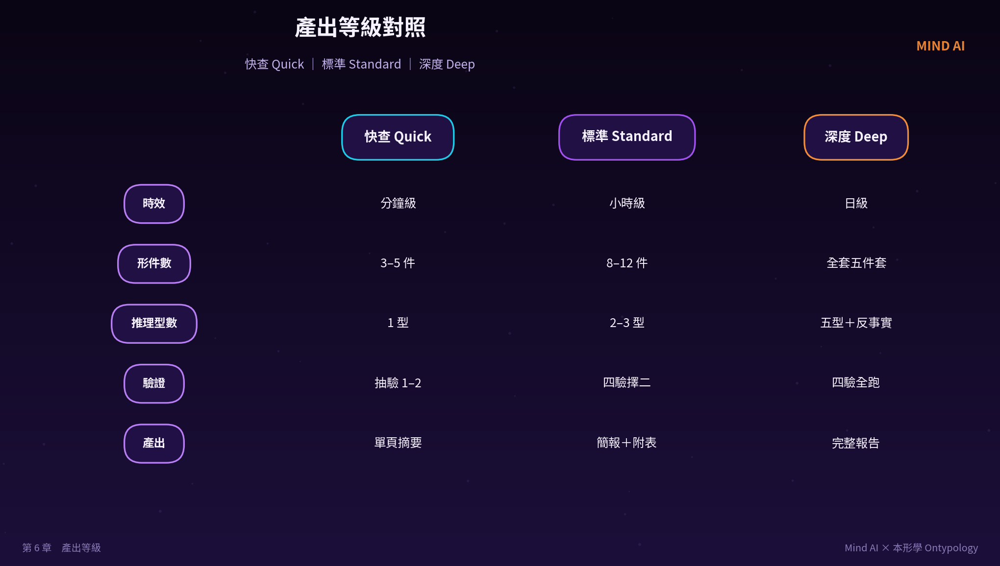

**圖 6-3　產出等級對照：快查 / 標準 / 深度**

**串聯口訣：**S1 定契約、S2 建結構、S3 養動態、S4 立判準、S5 出推理、S6 合產出、S7 過四驗、S8 記回饋、S9 總放行。

## 6.3　S1–S4 提示詞全文

### S1　任務形化

**提示詞全文（六段式）** R｜你是世界模型大腦的需求形化專家，承擔任務定義的明確性。 T｜建立「任務形 TaskType」；引用既有的產出契約模板（第 4.3 節）。 C｜背景與需求如下：【填入：原始需求、可用資料、時限、使用者授權級】。 A｜執行 S1 任務形化：產出任務形與產出契約草稿；列出澄清問題清單。 C｜約束：任務形必含標的、產出類型、產出等級、時窗、授權級、涉入知識域；產出類型不可曖併（五類擇一，可附次要類）；產出等級須與時限相容。 O｜輸出任務形表＋產出契約草稿＋澄清問題清單（若有）；置信聲明：需求歧義處一律標註。

| 輸出規格 | 內容 |
| --- | --- |
| 輸出 | 任務形表（6 欄）＋產出契約草稿＋澄清清單 |
| 判準 | 第三者可讀懂且無歧義 |
| 拒收 | 產出類型空缺或等級與時限矛盾 |

**表　S1 輸出規格**

**使用提示：**需求裡的形容詞（「準確的」「全面的」）要改寫成可驗收的判準，再進契約。

### S2　形化建模

**提示詞全文（六段式）** R｜你是空間本形建模專家，承擔形件品質（五件套齊備）。 T｜動用形：實體形 EntityType、關係形 RelationType、場域形 SceneType、狀態形 StateType、量測形 MetricType、來源形 SourceType；複用形庫【填入：形庫索引】。 C｜任務形：【貼上 S1 產出】；領域資料：【填入】。 A｜執行 S2 形化建模：異同→分合→邊界起手，產出主檔、容器/BOM/SOM、框架四步、五件套形件。 C｜約束：同形必同構；缺件即擋；新增欄位視為形變更須聲明版本；C1–C8 檢查表逐項自檢。 O｜輸出形件清單（每件含五件套）＋C1–C8 自檢表＋殘差清單（未能形化者）。

| 輸出規格 | 內容 |
| --- | --- |
| 輸出 | 形件清單＋自檢表＋殘差清單 |
| 判準 | C1–C8 全綠 |
| 拒收 | 任一形件五件套缺件 |

**表　S2 輸出規格**

**使用提示：**寧可先複用形庫的舊形，也不要平行發明新形；新形要有殘差清單的正當性。

### S3　事件萃取

**提示詞全文（六段式）** R｜你是時間本形事件分析專家，承擔模式萃取的可信度。 T｜動用形：事件形（見 3.1 欄位）、模式卡 PatternType（趨勢/因果/週期/突變）。 C｜任務情境：【貼上任務形】；事件庫範圍與時窗：【填入】。 A｜執行 S3：同形召回 → 去噪 → 摘要為時序節點表 → 對齊既有模式卡或立新卡；產出殘差清單。 C｜約束：模式卡必附反例（無反例不得用於預測）；事件形欄位齊全；殘差必分類（資料缺口/新現象/雜訊）。 O｜輸出模式卡集＋時序節點表＋殘差清單＋可信度聲明（支持/反例/最近驗證時點）。

| 輸出規格 | 內容 |
| --- | --- |
| 輸出 | 模式卡集＋時序節點表＋殘差清單 |
| 判準 | 反例欄非空；事件欄位齊全 |
| 拒收 | 模式卡無反例、殘差未分類 |

**表　S3 輸出規格**

**使用提示：**召回只找「同形」案例；形不同卻硬比對，是模式卡失準的主因。

### S4　判準設定

**提示詞全文（六段式）** R｜你是判準設計專家，承擔「何謂正確」的定義品質。 T｜動用 ∩(T) 交集判準；引用領域守則【填入】。 C｜產出契約：【貼上】；歷史驗收紀錄：【填入或無】。 A｜執行 S4：產出判準表——每列含判準、檢查方法、通過線、裁決人；檢查判準間衝突並取交集收斂。 C｜約束：每條判準可檢查、可判定、無歧義；禁止「盡量」「美觀」類不可測用語；判準數量與產出等級相稱（快查 3–5 條、標準 6–10 條、深度 10+ 條）。 O｜輸出 ∩(T) 判準表＋衝突處理紀錄＋裁決人簽核欄。

| 輸出規格 | 內容 |
| --- | --- |
| 輸出 | ∩(T) 判準表 |
| 判準 | 每條可檢查、無衝突 |
| 拒收 | 不可測用語、裁決人空缺 |

**表　S4 輸出規格**

**使用提示：**判準表就是 S7 的考卷；考卷先出，答案才不能作弊。

## 6.4　S5–S9 提示詞全文

### S5　推理推演

**提示詞全文（六段式）** R｜你是推理引擎專家，承擔推理鏈的成立性。 T｜動用推理五型（因果/果因/模擬/統計/逆向）＋思考法五型；形件：【貼上 S2 清單】。 C｜模式卡：【貼上 S3】；判準表：【貼上 S4】；資料截止時點：【填入】。 A｜執行 S5：宣告選型 → 建推理鏈（前提→推演→結論逐節點）→ 產出候選結論集；深度等級加跑反事實分支。 C｜約束：鏈首行宣告推理選型；多型接力須聲明承接；每節點可回指形與模式卡；外推須附統計置信。 O｜輸出推理鏈（節點化）＋候選結論集＋選型聲明＋置信聲明。

| 輸出規格 | 內容 |
| --- | --- |
| 輸出 | 推理鏈＋候選結論集 |
| 判準 | 節點可溯源、承接已聲明 |
| 拒收 | 跳步結論、未聲明混型 |

**表　S5 輸出規格**

**使用提示：**推不出來就寫「推不出」並列資料缺口——這比硬推的產出更接近真實世界。

### S6　產出合成

**提示詞全文（六段式）** R｜你是產出合成專家，承擔契約符合度。 T｜動用產出契約（預測/模擬/規劃/決策/知識）；推理鏈：【貼上 S5】。 C｜產出等級：【快查/標準/深度】；使用者與授權級：【填入】。 A｜執行 S6：以契約骨架填裝推理結論；產出文件首頁附契約對照欄；置信聲明依 4.3 合規。 C｜約束：契約欄位缺件即拒收重產；禁用「肯定/必然/百分之百」；參考件與結論件分欄標示。 O｜輸出契約產出＋契約對照欄（逐欄打勾）＋置信聲明。

| 輸出規格 | 內容 |
| --- | --- |
| 輸出 | 契約產出＋對照欄 |
| 判準 | 契約全滿足、置信合規 |
| 拒收 | 缺件、置信越界 |

**表　S6 輸出規格**

**使用提示：**對照欄逐欄打勾再交件；打不了勾的欄位，就是退回 S5 的清單。

### S7　驗證裁決

**提示詞全文（六段式）** R｜你是驗證裁決專家，承擔產出的放行判定（與產出者分離）。 T｜動用四驗：回測、反事實一致、邊界聲明、壓力情境；形證據鏈五節點。 C｜產出：【貼上 S6】；判準表：【貼上 S4】；歷史基準：【填入】。 A｜執行 S7：依產出等級跑四驗（快查擇二、深度全跑）→ 逐條判準打勾 → 產裁決書（通過/降級/退回）。 C｜約束：驗證方法先聲明後執行；未過項必標降級理由；形證據鏈斷點即退回；裁決人必簽。 O｜輸出驗證紀錄（四驗明細）＋裁決書＋降級/退回清單。

| 輸出規格 | 內容 |
| --- | --- |
| 輸出 | 驗證紀錄＋裁決書 |
| 判準 | 方法先聲明、逐條打勾 |
| 拒收 | 自產自驗、斷鏈放行 |

**表　S7 輸出規格**

**使用提示：**壓力情境要「故意為難」產出：假設最壞前提成立，看結論撐不撐得住。

### S8　回饋入庫

**提示詞全文（六段式）** R｜你是知識治理專家，承擔世界模型的成長。 T｜動用模式卡可信度機制、形修訂單、殘差清單。 C｜裁決書：【貼上 S7】；實際使用結果（若有）：【填入】。 A｜執行 S8：回答回饋三問（對在哪/錯在哪/改什麼）→ 更新模式卡 → 開立形修訂單 → 殘差入庫。 C｜約束：三問皆須有答案；修訂單必有負責人與期限；只記成功不記失敗的回饋拒收。 O｜輸出回饋三問答案＋模式卡更新 diff＋修訂單＋殘差入庫紀錄。

| 輸出規格 | 內容 |
| --- | --- |
| 輸出 | 回饋包（三問＋更新＋修訂單） |
| 判準 | 三問有主、修訂有期限 |
| 拒收 | 用完即走、只記成功 |

**表　S8 輸出規格**

**使用提示：**把回饋當例行公事，世界模型就停止長大；這是 L1 到 L4 的分水嶺。

### S9　總複核

**提示詞全文（六段式）** R｜你是總複核官，承擔交付放行（對使用者負責）。 T｜動用全部形件索引、產出契約、判準表、裁決書。 C｜全套交付包：【貼上/列明】；使用情境與風險級：【填入】。 A｜執行 S9：契約對照欄覆核 → 降級項與前提清單覆核 → 置信聲明覆核 → 授權級覆核 → 產放行判定（放行/補件/退回）。 C｜約束：任一降級項未標示即不得放行；授權級與人機矩陣（4.4）不符即不得放行。 O｜輸出複核意見＋放行判定＋放行條件（若有）。

| 輸出規格 | 內容 |
| --- | --- |
| 輸出 | 複核意見＋放行判定 |
| 判準 | 降級項全標、授權合矩陣 |
| 拒收 | 帶病放行 |

**表　S9 輸出規格**

**使用提示：**S9 是「出門照鏡」：三分鐘的複核，省掉三天的事後救火。

## 6.5　SC-01 物理世界預測全流程演練

想定：區域電力供需 × 極端氣候衝擊預測。產出類型＝預測；產出等級＝標準；授權級＝機器主導、人抽驗。本演練以實跑表逐節點展示 S1–S8 全流程。

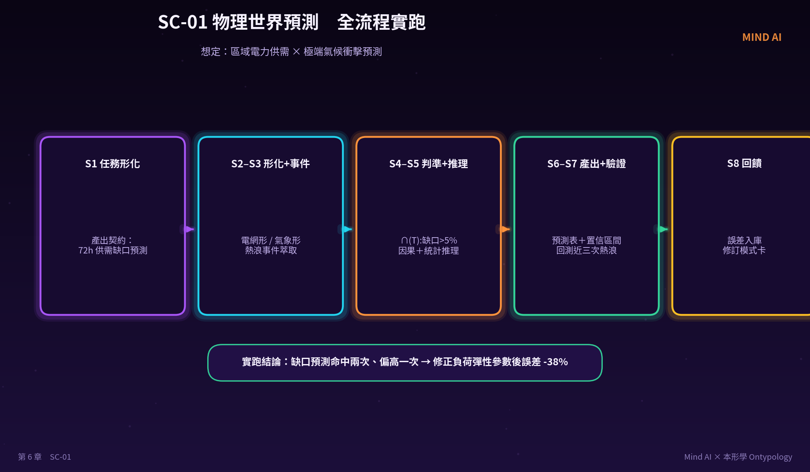

**圖 6-4　SC-01 物理世界預測全流程實跑**

| 步 | 關鍵動作 | 產物 | 實跑要點 |
| --- | --- | --- | --- |
| S1 | 契約：未來 72h 區域備轉容量缺口預測 | 任務形＋契約草稿 | 產出類型鎖定「預測」，時窗 72h |
| S2 | 建氣象形、電網形、負載形 | 3 形件（五件套） | 複用形庫 2 件、新建 1 件 |
| S3 | 召回近五年熱浪事件 EP×12，萃取模式卡 | 熱浪負載模式卡（因果型） | 反例：2023 熱浪但尖峰未起（風電高出力） |
| S4 | 判準：缺口量級誤差 ≤20%、方向全對、時窗不漂 | ∩(T) 判準表 | 裁決人＝調度主管 |
| S5 | 因果＋統計雙軌推理，節點鏈 9 節點 | 推理鏈＋候選結論 3 組 | 統計軌置信區間收窄至 ±1.2% |
| S6 | 合成預測表＋置信聲明 | 預測產出 | 「72h 內缺口機率 0.66」不用「將缺口」 |
| S7 | 回測近三次熱浪＋壓力情境（風電歸零） | 驗證紀錄＋裁決書 | 一次偏高 → 降級標註 |
| S8 | 修正負荷彈性參數，誤差 -38% | 模式卡更新 | 殘差入庫：需求回應未建模 |

**表 6-3　SC-01 全流程實跑表**

**演練結論：**三情境預測兩中一偏；因降級項已標註、參數已回饋修訂，第二次同類任務誤差續降——這就是閉環在跑。

## 6.6　SC-02 社會經濟推演演練

想定：最低工資調整的社會經濟連鎖推演。產出類型＝模擬；產出等級＝深度；授權級＝人覆核後採用。重點展示跨域連鎖與反事實分支。

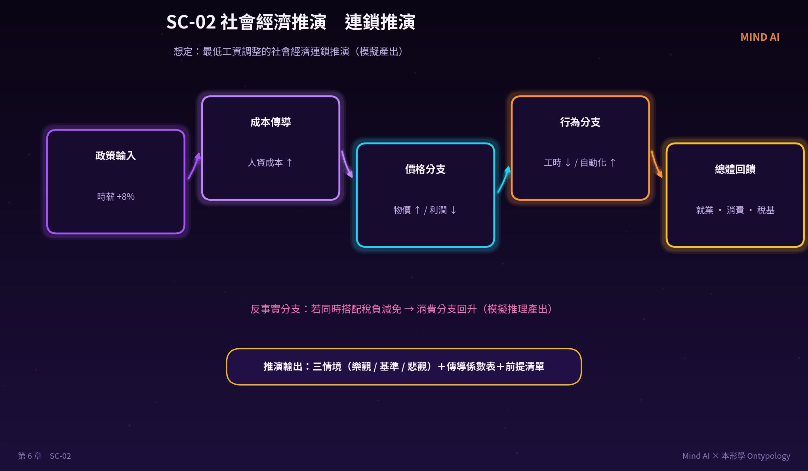

**圖 6-5　SC-02 社會經濟連鎖推演**

| 步 | 關鍵動作 | 產物 | 實跑要點 |
| --- | --- | --- | --- |
| S2 | 建政策形、成本形、價格形、就業形 | 4 形件＋交界形 2 件 | 交界形：「薪資成本 × 物價」雙域共管 |
| S3 | 政策事件庫召回 8 國 14 案例 | 傳導模式卡（因果型）×3 | 反例：某國調升後就業反升（產業政策對沖） |
| S5 | 模擬推理跑三情境，逐跳聲明模式卡 | 軌跡 ×3＋反事實分支 ×2 | 連鎖 5 跳全部聲明，無黑箱跳域 |
| S7 | 反事實一致＋壓力情境（出口衰退併發） | 裁決書：通過（1 降級） | 傳導係數跨域外推降級標註 |
| S8 | 三情境入庫為「政策推演」新形 | 形庫 +1、模式卡 +2 | 回饋：行為反饋參數待補 |

**表 6-4　SC-02 實跑表**

演練產出摘錄（模擬契約骨架）：情境定義（基準／樂觀／悲觀）、約束清單（勞動供給彈性、出口價格彈性等 9 項）、軌跡（消費／物價／就業三曲線）、反事實分支（搭配稅負減免 → 消費分支回升）、敏感度（傳導係數 ±10% 對就業分支影響最大）。

## 6.7　SC-03 科技趨勢研判演練

想定：固態電池產業化技術路線研判。產出類型＝知識＋預測（主知識、次預測）；產出等級＝標準。重點展示證據鏈與置信分級。

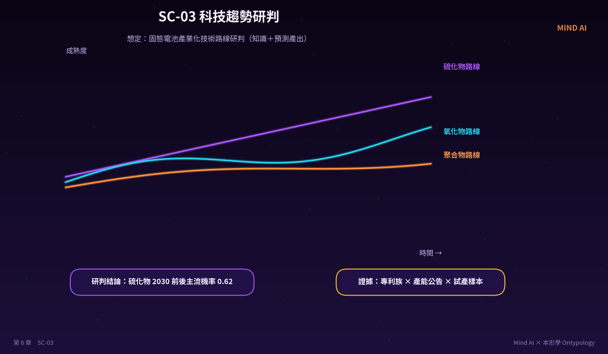

**圖 6-6　SC-03 科技趨勢研判**

| 步 | 關鍵動作 | 產物 | 實跑要點 |
| --- | --- | --- | --- |
| S2 | 建技術路線形、產能形、專利族形 | 3 形件 | 成熟度以量測形承載（TRL 1–9） |
| S3 | 專利族 × 產能公告 × 試產樣本三源對齊 | 趨勢模式卡 ×3 | 殘差：某大廠路線跳代（標新現象） |
| S5 | 因果＋逆向：由 2030 成本目標回推瓶頸 | 推理鏈 12 節點 | 統計置信：硫化物主流機率 0.62 |
| S7 | 回測：用 2020 資料預測 2025 格局 | 驗證紀錄：方向對、時點偏早 18 個月 | 時點偏差入庫為系統性殘差 |
| S8 | 產能公告形加「時點可信度」欄 | 形修訂單 ×1 | 回饋三問：錯在時點不對、不在方向 |

**表 6-5　SC-03 實跑表**

**研判產出摘錄：**「硫化物路線於 2030 前後成為主流的機率為 0.62（回測顯示時點判斷平均偏早 18 個月，故實際窗口可能落在 2031–2032）」——量化的置信、誠實的偏差，都在產出裡。

## 6.8　SC-04 策略決策演練＋SC-X1 抽象速演

想定：企業進入新市場的策略決策。產出類型＝決策；產出等級＝標準；授權級＝人主導、機器支援。本演練展示決策產出的比選結構與人機分工。

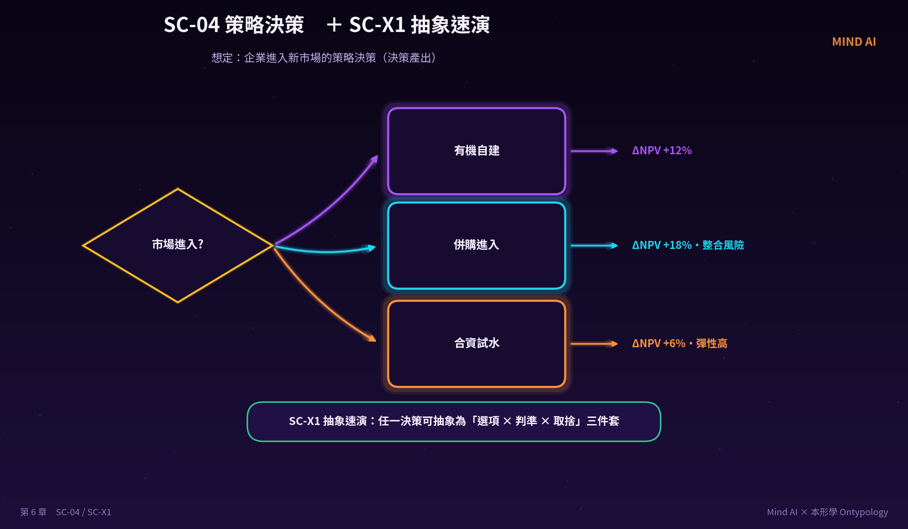

**圖 6-7　SC-04 策略決策＋SC-X1 抽象速演**

| 步 | 關鍵動作 | 產物 | 實跑要點 |
| --- | --- | --- | --- |
| S2 | 建市場形、競爭形、能力形 | 3 形件 | 能力形含「不可逆性」量測欄 |
| S5 | 三選項比選：有機自建／併購／合資 | 比選表＋推理鏈 | 判準：ΔNPV、整合風險、彈性、可逆性 |
| S6 | 決策產出（建議定位） | 比選表＋反對意見欄 | 「建議合資試水」並附反對意見 2 條 |
| S7 | 壓力情境：併購標的暴雷 | 裁決書：通過 | 可逆性作為最終裁決已執行 |
| S9 | 總複核：授權級合矩陣（人主導） | 放行判定：放行 | 產出首頁標「建議，非決定」 |

**表 6-6　SC-04 實跑表**

### SC-X1 抽象速演

任一決策可抽象為「選項 × 判準 × 取捨」三件套。速演口訣（30 秒）：列出選項、寫下判準、標出取捨、按可逆性收束。示例：選項＝立即表態／觀望／私下接觸；判準＝資訊增益、關係成本、可逆性；取捨＝資訊增益與關係成本成反比；裁決＝選可逆的私下接觸。

## 6.9　演練 QA

| 問 | 答 |
| --- | --- |
| S 中途發現形建錯了怎麼辦？ | 停、回 S2 重修，受影響步驟重跑；不可「將錯就錯」一路補丁。補丁產出一律標降級。 |
| 快查等級可以跳過 S4 嗎？ | 不可。判準先行是全等級鐵律；快查只是判準條數縮減到 3–5 條。 |
| 四驗的「反事實一致」是什麼？ | 把結論的前提換成對立假設重推一遍：若結論毫無變化，代表推理鏈可能根本沒用上前提（空轉），須查。 |
| 產出被使用者誤用怎麼辦？ | 契約與產出首頁本就標註使用邊界與授權級；發現誤用即開立治理事件，並在 S8 回饋補強標示。 |
| 模式卡可信度如何量化？ | 支持案例數 ÷（支持＋反例）為基礎值，乘以最近驗證的時效係數；低於 0.6 的卡不得用於預測產出。 |
| 多人協作時 S7 裁決人怎麼定？ | H3 責任分離：產出者不得自裁；裁決人由任務形的授權級決定（見 4.4）。 |

**表 6-7　演練 QA**

## 6.10　批次化運用與團隊分工

單任務跑順後，下一步是批次化：多個任務共用形庫、判準庫與模式卡庫，以標準分工並行推進。批次化不是「多開視窗」，而是「多任務共用一套世界模型資產」。

| 角色 | 承擔 | 對應 S 步 | 不可兼任 |
| --- | --- | --- | --- |
| 建模者 | 形庫品質、五件套齊備 | S2、S3 | 兼任同任務裁決人 |
| 判準設計 | ∩(T) 判準表定版 | S4 | 兼任產出者 |
| 推理分析 | 推理鏈成立性 | S5、S6 | — |
| 裁決人 | 四驗與放行判定 | S7、S9 | 兼任同任務產出者 |
| 治理員 | 形庫治理、回饋入庫 | S8 | — |

**表 6-8　批次化角色分工表**

1. 共用資產：批次內所有任務共用同一形庫版本、同一判準庫；個別任務可加嚴不可放寬。
2. 排程節奏：每日站會只對「失誤劇本命中」與「交接斷鏈」兩件事；其餘異步。
3. 批次驗收：批次收官跑一次 S9 總複核（跨任務一致性抽查：同形同構、判準無雙標）。
4. 容量上限：單批次建議 3–5 個並行任務；超過則分批，避免形庫寫入衝突。

## 6.11　產出文件的標準骨架

無論哪類產出，交付文件都用同一骨架，讓使用者三秒找到他要的東西：

| 區塊 | 內容 | 對應保證 |
| --- | --- | --- |
| ① 契約對照欄 | 產出契約逐欄打勾＋等級＋授權級 | 產出契約（4.3） |
| ② 結論摘要 | 一句結論＋置信聲明＋前提清單 | 置信合規 |
| ③ 主體 | 依產出類型的格式骨架展開 | 契約格式 |
| ④ 推理摘要 | 推理選型＋關鍵節點（深度等級附全鏈） | 演繹骨架 |
| ⑤ 驗證摘要 | 四驗結果＋降級項清單 | 產出驗證 |
| ⑥ 形證據鏈 | 來源形 → 節點 → 結論 溯源圖 | 形證據鏈 |

**表 6-9　產出文件標準骨架表**

**本章檢查表：**□ 六段式能默寫　□ S1–S9 能對號　□ 四想定跑過一輪　□ 快查/深度軌能選　□ QA 六題能答　□ 骨架六區塊齊

# 第 7 章　誤用對照

準確使用的方法再好，也擋不住誤用把根基掏空。本章把四類高頻誤用攤開對照：形化誤用、提示詞誤用、產出裁決誤用、主持與協作誤用。每條皆給「誤用 × → 正解 ○」，可直接當診斷清單。

## 7.1　形化誤用對照

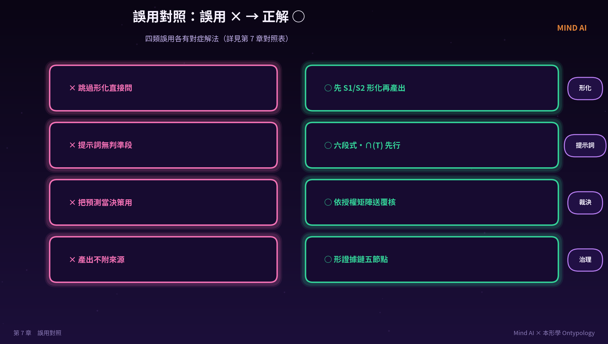

**圖 7-1　誤用 × → 正解 ○**

| # | 誤用 × | 症狀 | 正解 ○ |
| --- | --- | --- | --- |
| M1 | 跳過形化直接問 | 答案漂、換個問法就變 | S1/S2 形化先行，形件入提示詞 |
| M2 | 一物多形、形界模糊 | 同一東西在不同回答裡不同身份 | 異同→分合→邊界重跑，驗界 |
| M3 | 只有 BOM 沒 SOM | 知道有什麼、不知道怎麼擺 | 三件套齊出（容器+BOM+SOM） |
| M4 | 把欄位當形、把形當欄位 | 加欄位越加越亂 | 表頭=形；新增欄位走形變更治理 |
| M5 | 形庫不複用、平行發明 | 同類任務形越長越多 | 先檢形庫再立新形，殘差作證 |
| M6 | 五件套缺件放行 | 推理時才發現沒判準、沒來源 | 缺件即擋（C2 檢查） |

**表 7-1　形化誤用對照表**

## 7.2　提示詞誤用對照

| # | 誤用 × | 症狀 | 正解 ○ |
| --- | --- | --- | --- |
| M7 | 六段缺段（尤缺 Constraint） | 產出美觀但無法驗收 | 六段齊備；判準逐條可檢查 |
| M8 | 一支提示詞混多步驟 | 產出四不像、錯誤難定位 | 一提示詞一步驟（S 編號對齊） |
| M9 | 「盡量準確、全面」式約束 | 模型自由發揮 | 改寫為可測判準與通過線 |
| M10 | 情境不給時窗與資料範圍 | 模型拿舊資料推新結論 | Context 段必填時窗＋資料截止 |
| M11 | 要求「肯定的答案」 | 置信聲明被擠掉、假確定 | 明令禁語（肯定/必然），要置信 |
| M12 | 拿結果反推提示詞（事後補段） | 永遠覺得提示詞不夠好 | 六段先立、判準先寫，再開跑 |

**表 7-2　提示詞誤用對照表**

## 7.3　產出裁決誤用對照

| # | 誤用 × | 症狀 | 正解 ○ |
| --- | --- | --- | --- |
| M13 | 把預測當決策用 | 參考件直接變成行動 | 授權矩陣送覆核；建議≠決定 |
| M14 | 自產自驗 | 永遠通過 | H3 責任分離；S7 獨立裁決 |
| M15 | 只驗結論不驗來源 | 結論對了也說不清為何 | 形證據鏈五節點必查 |
| M16 | 失敗遮掩、降級不標 | 同一錯誤反覆犯 | 未過項必標降級＋殘差入庫 |
| M17 | 產出後再降級遮醜 | 等級失真、驗證深度不足 | 等級事前定；產出後不降級 |
| M18 | 置信區間當裝飾 | 區間寬窄與事實脫鉤 | 回測校準置信；偏了就收窄或放大 |

**表 7-3　產出裁決誤用對照表**

## 7.4　主持與協作誤用對照

| # | 誤用 × | 症狀 | 正解 ○ |
| --- | --- | --- | --- |
| M19 | 會議上即席要求深度產出 | 拿快查件冒充深度件 | 即席=快查；深度另開任務 |
| M20 | 多頭判準、誰都能改 | 判準天天變、產出無所適從 | 判準表定版＋裁決人簽核 |
| M21 | 回饋變批鬥、沒人敢入庫 | 殘差消失、模型停止成長 | 回饋三問對事不對人 |
| M22 | 交接不帶版本 | 上一步的產出對不上下一步 | H5 版本可溯；交接必附版本號 |

**表 7-4　主持與協作誤用對照表**

## 7.5　誤用警語彙整

**十句警語（可張貼）： **① 不形化，不開口。② 判準先立，產出後至。③ 同形同構，缺件即擋。 ④ 選型要聲明，混型要分段。⑤ 契約缺件，產出拒收。⑥ 建議不是決定。 ⑦ 自產不自驗，降級必標註。⑧ 無反例，不預測。⑨ 念來源，走證據鏈。 ⑩ 回饋三問，閉環長大。

**本章檢查表：**□ 診斷清單 M1–M22 掃過本團隊　□ 十句警語張貼　□ 裁決人分離已落實　□ 降級標註有慣例

# 第 8 章　準確使用成熟度 L1–L4

準確使用是一種能力，能力有等級。本章定義 L1 起步、L2 可控、L3 可信、L4 自演化四級，給出入級門檻、六維判定、卡關解法與年度規畫——讓團隊知道「現在在哪、下一級怎麼走」。

## 8.1　四級定義與入級門檻

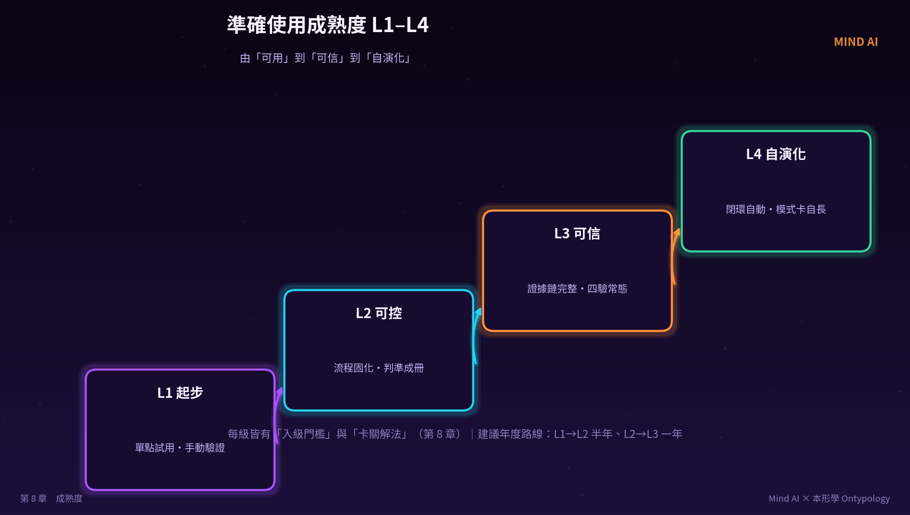

**圖 8-1　準確使用成熟度階梯 L1–L4**

| 級 | 定義 | 入級門檻 | 失格條件 |
| --- | --- | --- | --- |
| L1 起步 | 單點試用、手動驗證 | 完成 1 次 S1–S8 全流程＋產出被實際採用 | 產出無法溯源 |
| L2 可控 | 流程固化、判準成冊 | S 手冊常態使用＋判準表模板化＋M1–M22 誤用掃描完成 | 判準屢屢後補 |
| L3 可信 | 證據鏈完整、四驗常態 | 形證據鏈全覆蓋＋四驗入流程＋裁決分離常態化 | 自產自驗回潮 |
| L4 自演化 | 閉環自動、模式卡自長 | 回饋閉環自動運轉＋模式卡可信度自動校準＋年度演化報告 | 殘差不再入庫 |

**表 8-1　四級定義與門檻**

## 8.2　六維能力與判定

成熟度以六維能力判定：形化品質、判準嚴謹、推理深度、驗證強度、證據鏈、回饋演化。每維分四級描述，雷達圖一眼看出瓶頸。

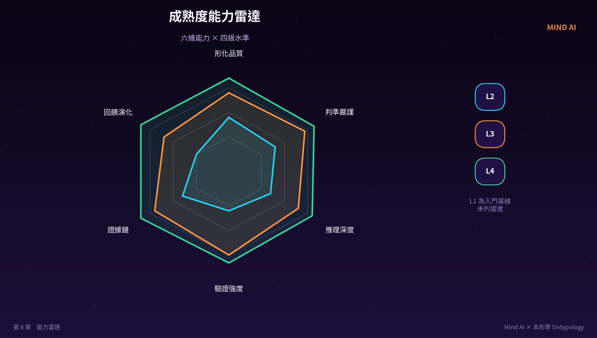

**圖 8-2　成熟度能力雷達**

| 能力維 | L2 標準 | L3 標準 | L4 標準 |
| --- | --- | --- | --- |
| 形化品質 | 五件套齊、C1–C8 過 | 形庫複用率 >60% | 形變更自動版本化 |
| 判準嚴謹 | 判準表模板化 | 判準衝突自動偵測 | 判準隨回饋自動修訂 |
| 推理深度 | 單型鏈成立 | 多型接力可聲明 | 反事實自動分支 |
| 驗證強度 | 四驗擇二常態 | 四驗全跑常態 | 壓力情境自動生成 |
| 證據鏈 | 關鍵結論可溯源 | 五節點全覆蓋 | 斷點自動偵測告警 |
| 回饋演化 | 回饋三問例行 | 殘差入庫常態 | 可信度自動校準 |

**表 8-2　六維能力判定表**

## 8.3　卡關解法

| 卡關 | 典型症狀 | 解法 |
| --- | --- | --- |
| L1→L2 卡在「習慣」 | 手冊有、但大家還是直接問 | 把 S1 前置為入口閘：沒有任務形就沒有產出；主管以身作則 |
| L2→L3 卡在「驗證」 | 四驗嫌煩、裁決走形式 | 四驗裁剪成快查兩項降低門檻；裁決書入交付卡關 |
| L3→L4 卡在「回饋」 | 用完即走、殘差沒人管 | 回饋三問綁定放行（S8 不答不放行）；月度演化回顧會 |
| 全域卡在「形庫」 | 形越建越亂、複用率低 | 季度形庫治理：合併同構形、清理孤兒形、重審五件套 |

**表 8-3　卡關解法表**

## 8.4　年度規畫

| 季度 | 目標 | 關鍵結果 |
| --- | --- | --- |
| Q1 | L1 站穩 | 完成 3 個任務全流程；S 手冊團隊普及 |
| Q2 | 衝 L2 | 判準表模板化；誤用掃描 M1–M22 完成；形庫 v1 建立 |
| Q3 | L2 可控 | S 流程常態使用率 >80%；裁決分離落實 |
| Q4 | 望 L3 | 四驗入流程；形證據鏈覆蓋率 >90%；年度演化報告 |

**表 8-4　年度規畫表示例（首年）**

## 8.5　成熟度自評表（勾選式）

每半年自評一次；每列勾「是」得 1 分，總分對照入級線：0–5 分 L1、6–11 分 L2、12–17 分 L3、18–24 分 L4。

| # | 自評題 | L1 | L2 | L3 | L4 |
| --- | --- | --- | --- | --- | --- |
| 1 | 每個任務都有任務形與產出契約 | □ | □ | □ | □ |
| 2 | 形件五件套齊備、無缺件放行 | □ | □ | □ | □ |
| 3 | 形庫有複用、無平行發明 | □ | □ | □ | □ |
| 4 | 判準表先行、無後補 | □ | □ | □ | □ |
| 5 | 判準可檢查、無「盡量」用語 | □ | □ | □ | □ |
| 6 | 推理鏈選型已聲明 | □ | □ | □ | □ |
| 7 | 產出契約對照欄全勾才交件 | □ | □ | □ | □ |
| 8 | 置信聲明合規、無禁語 | □ | □ | □ | □ |
| 9 | 四驗依等級執行完畢 | □ | □ | □ | □ |
| 10 | 裁決人與產出者分離 | □ | □ | □ | □ |
| 11 | 降級項皆已標註 | □ | □ | □ | □ |
| 12 | 形證據鏈可逐節點溯源 | □ | □ | □ | □ |
| 13 | 回饋三問每次有答案 | □ | □ | □ | □ |
| 14 | 殘差有入庫、有分類 | □ | □ | □ | □ |
| 15 | 模式卡可信度定期更新 | □ | □ | □ | □ |
| 16 | 誤用 M1–M22 有掃描紀錄 | □ | □ | □ | □ |
| 17 | 批次任務共用形庫版本 | □ | □ | □ | □ |
| 18 | 年度演化報告有產出 | □ | □ | □ | □ |

**表 8-5　成熟度自評表**

**本章檢查表：**□ 現況等級已標定　□ 六維瓶頸已圈出　□ 卡關解法對號　□ 年度規畫已排　□ 自評表已填

# 第 9 章　附錄 A–J

本章收錄即取即用的速查件與範本。建議把附錄 A、C 印出置於案頭；附錄 D、E 為可複製範本。

## 附錄 A　S1–S9 速查卡

| S | 一句使命 | 產出 | 鐵律 |
| --- | --- | --- | --- |
| S1 | 把想要變成可驗收的任務 | 任務形＋契約草稿 | 產出類型不曖併 |
| S2 | 世界結構建為合格形件 | 形件（五件套） | 缺件即擋 |
| S3 | 世界變化萃為模式卡 | 模式卡＋時序節點表 | 無反例不預測 |
| S4 | 先定義何謂正確 | ∩(T) 判準表 | 判準先行 |
| S5 | 推演結論並可溯源 | 推理鏈＋候選結論 | 選型要聲明 |
| S6 | 依契約合成產出 | 契約產出 | 缺件即拒收 |
| S7 | 四驗後裁決 | 驗證紀錄＋裁決書 | 自產不自驗 |
| S8 | 回饋讓模型長大 | 回饋包＋修訂單 | 三問必答 |
| S9 | 出門前照鏡 | 放行判定 | 帶病不放行 |

**表 A-1　S1–S9 速查卡**

## 附錄 B　Schema 速查

形件五件套：定義（一句＋一反例）｜屬性（3–8 欄＋值域）｜判準（≥1 條可檢查）｜來源（SourceType＋時點）｜版本（號＋摘要）。起手包六形：實體形、關係形、場域形、狀態形、量測形、來源形。交界形雙域共管，兩域判準皆過才合格。

## 附錄 C　檢查清單

### C-1 產出契約檢查清單

1. 產出類型明確（五類擇一，主次分明）
2. 格式骨架全（標的/量值/時窗 或 情境/約束/軌跡 等）
3. 必附件齊（推理鏈、模式卡引用、回測或反事實）
4. 置信聲明合規（無禁語；區間/機率已給）
5. 授權級標定且合人機矩陣

### C-2 形件檢查清單

1. 五件套齊備
2. 同形同構、異形異構
3. 容器成對、SOM 成樹
4. 單位一致、時點可溯
5. 版本修訂有紀錄

### C-3 驗證檢查清單

1. 驗證方法先聲明
2. 四驗依等級執行（快查擇二）
3. 判準逐條打勾
4. 降級項已標註
5. 形證據鏈五節點無斷點
6. 裁決人已簽核

### C-4 回饋檢查清單

1. 回饋三問有答案
2. 模式卡可信度已更新
3. 形修訂單有主有期限
4. 殘差已分類入庫

## 附錄 D　產出契約範本（可複製）

| 欄位 | 填寫 |
| --- | --- |
| 產出名稱 | 【例】區域備轉容量 72h 缺口預測 |
| 產出類型／等級 | 預測 ／ 標準 |
| 使用者／授權級 | 調度主管 ／ 機器主導・人抽驗 |
| 時窗／資料截止 | 2026-10-20 00:00–23:00 ／ 資料至 2026-10-18 24:00 |
| 格式骨架 | 量值＋方向＋時窗＋置信區間 |
| 必附件 | 推理鏈、模式卡引用、回測紀錄 |
| ∩(T) 判準 | 誤差 ≤20%｜方向全對｜時窗不漂 |
| 置信聲明 | 機率式表達，禁「肯定」 |
| 降級／前提 | 【交付時填】 |

**表 D-1　產出契約範本**

## 附錄 E　想定卡範本（可複製）

| 欄位 | 填寫 |
| --- | --- |
| 想定編號／名稱 | SC-XX ／【名稱】 |
| 產出類型／等級 | 【五類】／【快查/標準/深度】 |
| 情境 | 【場域形＋時窗＋觸發事件】 |
| 涉入知識域 | 【六域擇一或多】 |
| 主用模式卡 | 【PatternType 編號】 |
| S 航線 | S1→S2→S3→S4→S5→S6→S7→S8（＋S9） |
| 實跑表 | 【步/關鍵動作/產物/要點 四欄】 |
| 演練結論 | 【命中/偏誤/回饋】 |

**表 E-1　想定卡範本**

## 附錄 F　術語速查

形 Type｜空間本形 Space-Type｜時間本形 Time-Type｜交集判準 ∩(T)｜形證據鏈 Type-Evidence Chain｜產出契約 Output Contract｜TDWM Type-Driven World Modeling｜模式卡 PatternType｜場域形 SceneType｜交界形 InterfaceType。完整對照見第 1.7 節表 1-5。

## 附錄 G　快速入手三日計畫

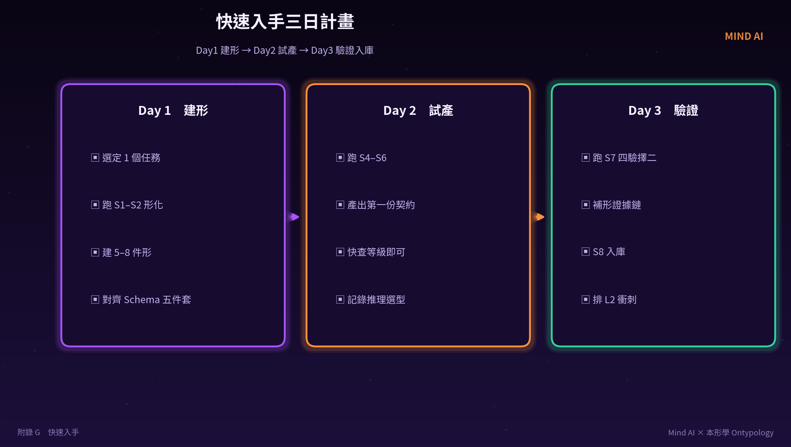

**圖 G-1　快速入手三日計畫**

| 日 | 動作 | 完成定義 |
| --- | --- | --- |
| Day 1 | 選 1 任務、跑 S1–S2、建 5–8 件形 | 五件套齊備、C1–C8 過 |
| Day 2 | 跑 S4–S6、產出第一份契約產出 | 契約對照欄全勾（快查等級即可） |
| Day 3 | 跑 S7（四驗擇二）＋S8 入庫 | 裁決書＋回饋三問有答案；排 L2 衝刺 |

**表 G-1　三日計畫表**

## 附錄 H　參照與版本

1. 理論依據：本形學（空間本形・時間本形）——本方案僅應用，不重述理論原文。
2. 運行底層：Mind AI 平台（LLM × Mind Model 分工見第 1.4 節）。
3. 譯名原則：形＝Type（非 Form）；術語對照見表 1-5。
4. 版本：V1.0（2026-10）；修訂依形變更治理（新增欄位即修訂）。

## 附錄 I　提示詞錯誤對照表

把最常見的「壞提示詞」改寫為六段式合規版，可作團隊教學範例。

| 壞提示詞 × | 問題 | 改寫 ○（節錄六段） |
| --- | --- | --- |
| 「幫我預測一下明年經濟」 | 無標的、無時窗、無產出類型 | R 經濟分析者｜T 趨勢模式卡｜C 區域＝X、時窗＝明年全年｜A 產出預測（S5→S6）｜C 判準：方向＋量級＋置信區間｜O 預測表＋置信聲明 |
| 「全面分析這個市場」 | 「全面」不可測、無產出契約 | R 市場分析者｜T 市場形×3｜C 時窗＝近 3 年｜A 產出知識件（S2→S3→S6）｜C 五件套＋C1–C8｜O 知識件＋來源形＋反例清單 |
| 「給我一份完美的計畫」 | 「完美」無判準、無授權級 | R 規劃者｜T 任務形｜C 資源上限、時限｜A 產出規劃（S5→S6）｜C 前提清單必附、可逆性優先｜O 規劃＋風險條目＋回退路徑，授權級＝人覆核 |
| 「用最準確的數據回答」 | 無資料範圍、無截止時點 | R 分析者｜T 量測形｜C 資料來源＝X、截止＝YYYY-MM-DD｜A 產出預測｜C 逾期資料禁用、單位聲明｜O 置信區間＋資料缺口清單 |

**表 I-1　提示詞錯誤對照表**

## 附錄 J　版本修訂紀錄

| 版本 | 日期 | 修訂內容 | 形變更治理 |
| --- | --- | --- | --- |
| V1.0 | 2026-10 | 初版：雙本形運用＋TDWM 八步驟＋S1–S9 手冊＋四想定演練＋誤用對照＋成熟度 L1–L4 | 起始形庫 v1 建立 |
| — | — | 後續修訂依形變更治理：新增欄位即修訂，須附版本號與修訂摘要 | 見 2.5 治理含意 |

**表 J-1　版本修訂紀錄**

**維護說明：**本方案的「形」與「判準」是活的資產；每次使用回饋（S8）都可能產生修訂。請將修訂寫入本表，讓方案與世界模型一同演化。

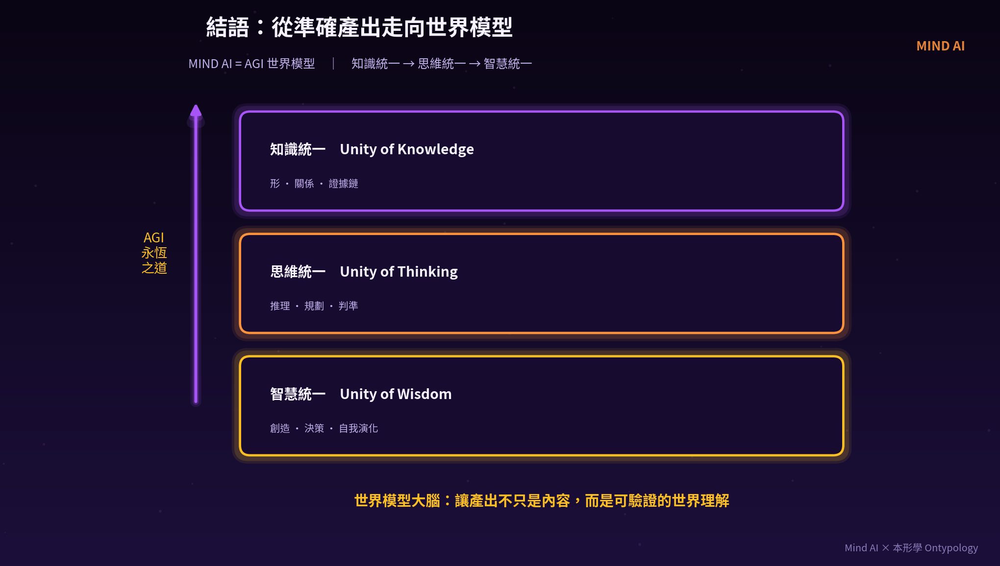

**圖 H-1　結語：從準確產出走向世界模型**

**結語：**準確不是一次性的技巧，而是形、判準、推理、驗證、回饋五件事的日課。世界模型大腦用得越準，它就越懂世界——這條路，就是從知識統一走向思維統一、從思維統一走向智慧統一之路。
