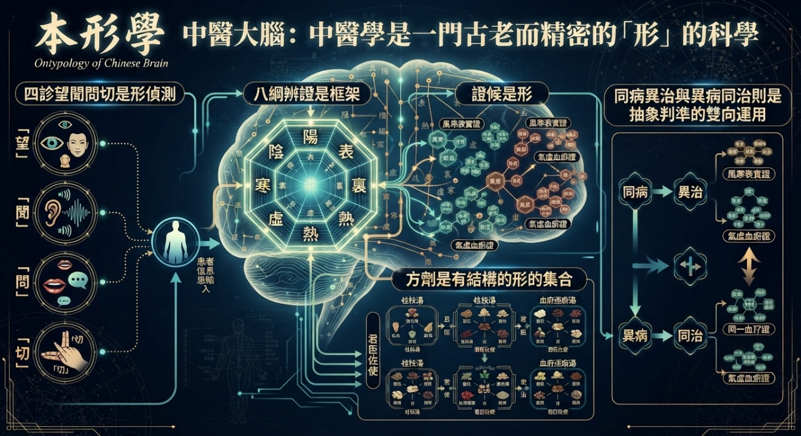

# AI 中醫大腦系統

## Mind AI 平台 × 本形學 Ontypology

*形驅動辨證論治 Type-Driven Diagnosis & Treatment*

全科涵蓋｜四診・辨證・本草・方劑・針灸・養生・專科・經典

# 前　言

《AI 中醫大腦系統・準確使用方法完全方案》是「準確使用方法」系列在中醫領域的完全方案書：以本形學（空間本形與時間本形）為理論基礎、以 Mind AI 為平台底座，給出一套把中醫全科知識形化、並以受檢核的推理流程完成辨證論治的完整方法。

本書的三個關鍵詞是「形 Type」「判準」「留痕」：一切中醫知識皆以形（Type）存在；一切結論皆須通過交集判準 ∩(T) 檢核；一切推理皆入形證據鏈。圍繞這三個關鍵詞，全書分為八章：第 1 章立系統定位與雙本形運用總綱；第 2–3 章展開空間本形的知識形化工程與時間本形的動態推理；第 4 章鋪陳中醫全科知識映射；第 5 章建立形驅動辨證論治八步驟；第 6 章是核心的 S1–S8 準確使用方法提示詞手冊；第 7 章立準確性保證與醫療安全護欄；第 8 章附速查附錄。

依文件定位，本形學與 Mind AI 平台本身的理論內容不在書中重述，一切環節直接以該理論的術語與操作體系運用於中醫；「形」之英文譯名一律用 Type。本書為方案書，不含系統實作。

鄭重聲明：本書所述系統為醫療輔助工具，不能替代執業中醫師的診斷與處方。任何診療決策皆須經執業中醫師覆核簽署；急危重症請即刻就近就醫，不得以本書內容延誤救治。

# 目　錄

- **第1章 系統定位與雙本形運用總綱**
  - 1.1 系統定位與願景
  - 1.2 空間本形之運用總綱
  - 1.3 時間本形之運用總綱
  - 1.4 形驅動辨證論治：TDDT 方法論
  - 1.5 四層準確性保證
  - 1.6 系統總覽架構
  - 1.7 文件導讀
- **第2章 中醫知識形化工程 — 空間本形全面應用**
  - 2.1 中醫形分類體系：十四形總表
  - 2.2 屬性・屬性值設計準則
  - 2.3 空間容器與形集合三括號之運用
  - 2.4 BOM / SOM 雙向對應
  - 2.5 框架四步驟之操作規範
  - 2.6 RDB 對應原則：表頭即形
  - 2.7 交集判準 ∩(T) 之形式化
  - 2.8 形化品質檢核清單
- **第3章 時間本形於中醫動態推理**
  - 3.1 病程時間軸與傳變形
  - 3.2 三大傳變體系的時間結構
  - 3.3 四診動態採集與時間序列
  - 3.4 治療時間軸：服藥時辰・子午流注・療程節點
  - 3.5 時間本形四模式之臨床循環
  - 3.6 自我演化：療效回饋與判準精進
- **第4章 中醫全科知識映射 — 九大知識域**
  - 4.1 中醫基礎理論形化
  - 4.2 中醫診斷學：四診全項形化
  - 4.3 辨證體系大全
  - 4.4 中藥學：本草形的完整屬性空間
  - 4.5 方劑學：方劑形的組成學
  - 4.6 針灸經絡學
  - 4.7 養生治未病：體質形與養生形
  - 4.8 專科知識：專科形的臨床覆蓋
  - 4.9 經典典籍：典籍形的知識源流
- **第5章 形驅動辨證論治八步驟 TDDT**
  - 5.1 TDDT 總覽與步驟銜接
  - 5.2 T1–T8 步驟規範
  - 5.3 全程留痕與形證據鏈
- **第6章 準確使用方法提示詞手冊 S1–S8**
  - 6.0 使用方法總則
  - 6.1 S1 四診採集官 — 資訊形化
  - 6.2 S2 八綱定位官 — 病位病性初判
  - 6.3 S3 辨證推理官 — 體系推演
  - 6.4 S4 治則確立法官 — 治法推導
  - 6.5 S5 方藥設計官 — 君臣佐使
  - 6.6 S6 針灸外治官 — 經穴處方
  - 6.7 S7 療效演化官 — 病程評估
  - 6.8 S8 知識沉澱官 — 醫案演化
  - 6.9 綜合醫案演練：一案走完 S1–S8
  - 6.10 提示詞使用要點與常見偏差
  - 6.11 第二演練：風熱咳嗽案的雙工作流對話實錄
- **第7章 準確性保證與醫療安全**
  - 7.1 四層準確性保證的執行規範
  - 7.2 形證據鏈與可審計性
  - 7.3 醫療安全護欄
  - 7.4 用藥安全檢核清單
  - 7.5 危急重症識別與轉診警訊
  - 7.6 不確定性管理與人工覆核
  - 7.7 醫療文書、倫理與個資規範
  - 7.8 中西醫結合使用注意事項
- **第8章 附錄**
  - 8.1 附錄 A：中醫形名詞對照表
  - 8.2 附錄 B：常用方劑速查表
  - 8.3 附錄 C：常用本草速查表
  - 8.4 附錄 D：常用穴位速查表
  - 8.5 附錄 E：診療歌訣摘編
  - 8.6 附錄 F：S1–S8 提示詞速查總表
  - 8.7 附錄 G：核心術語英中對照索引
  - 8.8 附錄 H：常見病治法方藥總表

# 第1章 系統定位與雙本形運用總綱

AI 中醫大腦系統是一套以 Mind AI 為平台底座、以本形學（空間本形與時間本形）為理論基礎的中醫智慧輔助系統。它不重造中醫理論，而是把中醫兩千年沉澱的知識——從《黃帝內經》的藏象經絡，到《傷寒論》的六經辨證，再到溫病學派的衛氣營血——全部「形化（Type-Ization）」為可檢核、可推演、可回溯的結構，使辨證論治從個人經驗的暗箱，轉變為每一步皆有據可查的透明推理鏈。

本章說明系統的定位、雙本形於中醫的運用總綱、形驅動辨證論治方法論，以及貫穿全書的四層準確性保證。依文件定位，本形學與 Mind AI 平台本身的理論內容不在本書重述；書中一切環節皆直接以該理論之術語與操作體系運用於中醫領域。

## 1.1 系統定位與願景

### ◆ 使命：讓辨證論治的每一步皆可形化、可檢核、可回溯

中醫臨床的核心能力是「辨證論治」——透過四診採集資訊，判斷病因病位病性，確立證型，再依治則治法組方用藥、施針取穴。這條鏈條長期依賴醫師個人的心法傳承：同一患者，不同醫師可能辨出不同證型；同一證型，用方思路也各有師承。AI 中醫大腦的定位不是取代醫師，而是把這條推理鏈的每一環節「形化」——賦予明確的形（Type）結構、屬性邊界與判準，使推理可檢核、可比較、可累積。

在 Mind AI 平台之上，大語言模型負責對海量醫案、本草、方劑文獻作歸納統計，Mind Model 則承擔演繹推理：由證型形的判準出發，一步步推導治則、治法、方藥，並以交集判準 ∩(T) 檢核每一環的吻合程度。歸納提供「古人怎麼說」的廣度，演繹保證「本案為什麼這樣治」的深度，兩者缺一不可。

### ◆ 服務對象與使用邊界

| 使用對象 | 核心用途 | 系統角色 | 使用邊界 |
| --- | --- | --- | --- |
| 執業中醫師 | 臨床輔助：四診結構化、辨證推演、方藥檢核、療效追蹤 | 輔助決策與檢核工具 | 處方須醫師審核簽署，系統不出具最終處方 |
| 中醫學員 | 學習訓練：辨證思路演練、經典對照、錯因分析 | 陪練式教學教官 | 學習輸出不可直接用於真實診療 |
| 中醫研究者 | 醫案結構化、文獻檢索、規律萃取 | 研究助理與資料工程 | 規律萃取僅供假設生成，須另行驗證 |
| 智慧養生使用者 | 體質辨識、治未病指引、食療建議 | 養生顧問 | 嚴禁診療行為；疑似疾病一律轉介醫師 |

> **系統紅線**
>
> AI 中醫大腦是醫療輔助系統，不是醫療行為主體。任何診斷結論與治療方案，皆須經執業中醫師覆核簽署；急危重症識別後第一優先是即時轉診，不得以系統建議延誤救治。

## 1.2 空間本形之運用總綱

空間本形處理「萬物如何被定義、分類、容納與檢核」。中醫知識體系龐大——數千味本草、數萬首方劑、三百餘經穴、難以窮盡的證型變化——若無明確的形結構，任何智慧系統都會退化為模糊的關鍵字檢索。空間本形於中醫的運用，可歸納為下表之總綱：全書後續所有環節，皆由此展開。

| 空間本形要素 | 於 AI 中醫大腦之運用 | 具體示例 |
| --- | --- | --- |
| 形（Type）：異同→分合→邊界 | 中醫知識第一等公民：一切知識皆以形存在，各有明確邊界 | 證型形 SyndromeType、本草形 HerbType、方劑形 FormulaType 等十四形（見 2.1） |
| 屬性 / 屬性值 | 形之內部結構：四診表現、藥性、方義皆為屬性填值 | 脈形之「位、數、形、勢」；本草形之「四氣、五味、歸經、毒性」 |
| 空間容器 ( ) | 有邊界的容納關係：處方容納藥味、經脈容納穴位 | ( 麻黃湯 )＝容納麻黃・桂枝・杏仁・甘草之處方容器 |
| 形集合 SOM { } | 同現屬性值的集體歸納：證候集合 | { 惡寒, 發熱, 無汗, 頭痛, 脈浮緊 }→太陽傷寒證候集 |
| 抽象 [ ] | 由具體上升為一般：症狀→證型→治則 | [ 太陽傷寒證 → 辛溫解表 ] 之治則抽象 |
| BOM / SOM 對應（表頭＝形） | 方劑 BOM（藥味明細）與辨證 SOM（證候集合）雙向映射 | 桂枝湯 BOM ↔ 太陽中風證 SOM；知識表表頭即形 |
| 框架四步驟 | 一切形化作業的標準流程 | 形定義→屬性填值→關係連邊→判準檢核（見 2.5） |
| 交集判準 ∩(T) | 證型確立之硬閘門：患者證候集與證型判準集的量化吻合 | ∩(T) ≥ 臨界值方可立證；灰區強制標注（見 2.7） |

## 1.3 時間本形之運用總綱

時間本形處理「狀態如何隨時間推移、推理如何在時間中展開、系統如何隨時間演化」。中醫本質上是時間性的醫學：疾病有傳變（六經傳變、衛氣營血傳變），診察有時序（初診、複診、晝夜節律），治療有時辰（服藥時間、子午流注），知識有演進（醫案沉澱、流派爭鳴）。時間本形於中醫的運用總綱如下：

| 時間本形要素 | 於 AI 中醫大腦之運用 | 具體示例 |
| --- | --- | --- |
| 搜尋模式 | 典籍・醫案・本草的時序檢索：先查經典，再查醫案，後查近代研究 | 查「不寐」：內經→傷寒（少陰病但欲寐）→名醫醫案→現代研究 |
| 推理模式 | 辨證論治的時間推演：由現在四診推斷過去病機、預測未來傳變 | 由「汗出惡風脈浮緩」推斷太陽中風，預測入裡化熱之可能 |
| 設計模式 | 治療方案的時間設計：療程節點、服藥時辰、針灸擇時 | 桂枝湯「啜熱稀粥溫覆取微汗」；子午流注依時取穴 |
| 自我演化 | 系統隨醫案累積精進：療效回饋→判準修正→知識沉澱 | S7 療效評估→S8 知識沉澱→∩(T) 判準微調 |
| 病程時間軸 | 疾病全程的時間結構化記錄 | 初診（表證）→三日（表解）→七日（癒後防復） |

## 1.4 形驅動辨證論治：TDDT 方法論

綜合雙本形，AI 中醫大腦採用「形驅動辨證論治」（Type-Driven Diagnosis & Treatment，TDDT）作為核心方法論：以形為起點，以八個步驟完成一次完整臨床推理——從四診採集的資訊形化（T1），到八綱定位（T2）、辨證體系推理（T3）、證型確立（T4），再進入治療端的治則確立（T5）、方藥設計（T6）、針灸外治（T7），最後以醫案與療效演化收束（T8）。每一步皆有明確的輸入、輸出與 ∩(T) 判準，全程留痕形成形證據鏈。

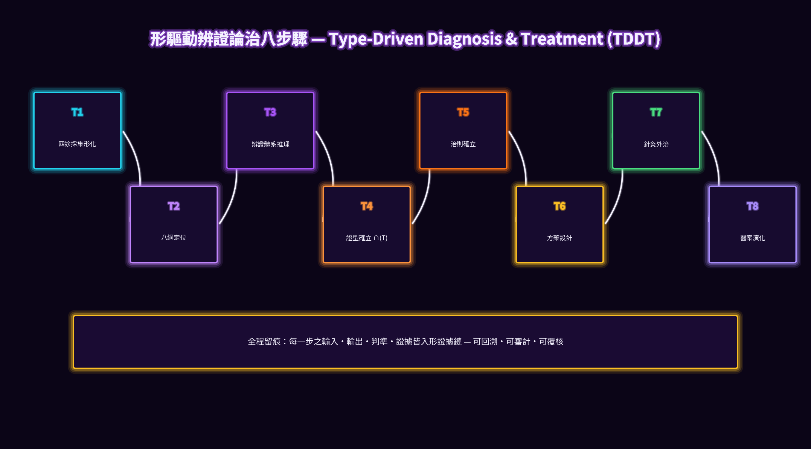

**【圖】形驅動辨證論治八步驟 TDDT：每步皆有輸入・輸出・判準，全程形證據鏈留痕**

TDDT 與傳統「理法方藥」完全同構，只是把心法顯性化：T1–T2 對應「四診合參」，T3–T4 對應「辨證」，T5 對應「立法」，T6–T7 對應「處方遣藥・針灸取穴」，T8 對應「醫案書寫與總結」。差別在於：每一步的中間產物都是結構化的形實例，下一步的輸入有明確規格，任何一步出錯都可以被定位、被回放、被修正。

### ◆ 治法八法與 TDDT 之對應

| 八法 | 適應證型 | 代表方 | TDDT 落點 |
| --- | --- | --- | --- |
| 汗法 | 表證：邪在皮毛 | 麻黃湯、桂枝湯、銀翹散 | T5 立法＋T6 選方（瘡家衄家汗家禁） |
| 吐法 | 痰涎宿食壅塞上脘 | 瓜蒂散（現少用） | T5 立法（虛人孕婦忌） |
| 下法 | 裡實證：燥屎、瘀血、水飲 | 大承氣湯、桃核承氣湯 | T5＋T6（中病即止，護胃氣） |
| 和法 | 少陽不和、肝脾不和、寒熱錯雜 | 小柴胡湯、逍遙散、半夏瀉心湯 | T3 鑑別半表半裡＋T5 立法 |
| 溫法 | 裡寒證：陽虛寒盛 | 理中丸、四逆湯、當歸四逆湯 | T5 立法（陰虛者忌） |
| 清法 | 裡熱證：氣營血分熱 | 白虎湯、清營湯、犀角地黃湯 | T3 衛氣營血定位＋T5 立法 |
| 消法 | 氣血痰濕食積痞塊 | 保和丸、越鞠丸、枳實消痞丸 | T5＋T6（消不傷正） |
| 補法 | 虛證：氣血陰陽不足 | 四君子湯、四物湯、六味地黃丸 | T5 立法（虛不受補先調脾） |

## 1.5 四層準確性保證

醫療輔助系統的生命線是準確性。AI 中醫大腦以四層準確性保證貫穿 TDDT 全流程：第一層「交集判準 ∩(T)」在證型確立處設硬閘門；第二層「演繹骨架推理」保證證→法→方→藥每一環可驗；第三層「臨床驗證覆核」引入執業中醫師、經典原文與文獻比對；第四層「形證據鏈留痕」使全程可回溯、可審計。任一層未通過，系統即停止出方、顯式標注不確定性並升級人工審核。

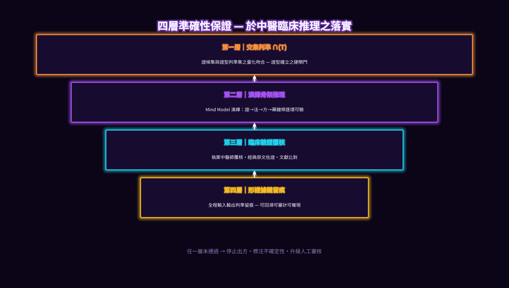

**【圖】四層準確性保證：由硬閘門到留痕，逐層收斂不確定性**

## 1.6 系統總覽架構

系統分為五層：使用者層定義四類使用者與其邊界；應用工作流層即 S1–S8 八個準確使用方法工作流（詳第 6 章）；AI 中醫大腦核心承載形化知識庫、辨證推理引擎、方藥設計引擎、療效演化引擎與形證據鏈；Mind AI 平台底座提供 LLM 歸納統計與 Mind Model 演繹推理；四層準確性保證則縱貫所有層級。

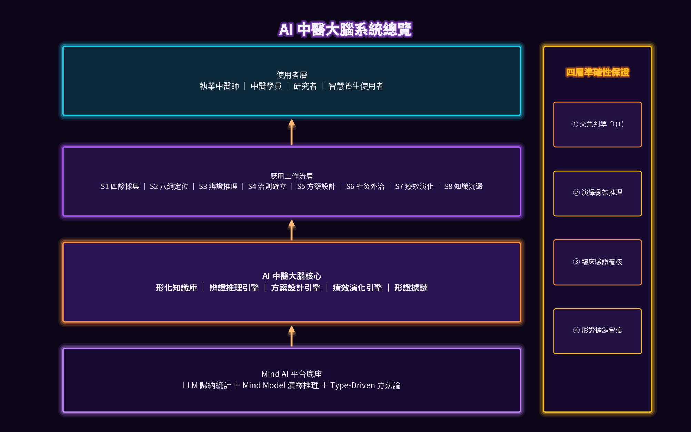

**【圖】AI 中醫大腦系統總覽：五層架構 × 四層準確性護欄**

## 1.7 文件導讀

| 讀者 | 建議路徑 | 重點章節 |
| --- | --- | --- |
| 臨床醫師 | 第 1 章 → 第 5 章 → 第 6 章（S1–S8 手冊）→ 第 7 章 | 第 6 章提示詞手冊、第 7 章安全護欄 |
| 中醫學員 | 第 2 章 → 第 4 章（知識映射）→ 第 5 章 → 第 6 章演練 | 第 4 章知識全貌、第 6.9 節綜合演練 |
| 研究者 | 第 2 章 → 第 3 章 → 第 4.9 節 → 第 8 章附錄 | 形化工程方法、典籍知識源流 |
| 養生使用者 | 第 1.1 節（邊界）→ 第 4.7 節（體質養生） | 治未病與體質辨識，其餘章節作背景閱讀 |

### ◆ 本書的使用方式

- 當作「方法書」通讀：依章序理解形化工程如何支撐辨證論治——適合首次接觸本系統者；
- 當作「手冊」查用：臨床時直接翻第 6 章取提示詞模板、翻第 8 章取速查表——適合已受訓使用者；
- 當作「教材」授課：第 4 章知識映射配合第 6.9 節演練，可作中醫辨證思維訓練的結構化教案；
- 當作「規範」引用：第 7 章安全護欄與第 2.8 節檢核清單，可直接納入機構的 AI 輔助使用規範。

> **版本與演化**
>
> 本書所述判準與提示詞皆帶版本號。系統自我演化後，配套提示詞手冊同步出新版——使用者應以「判準版本一致」為前提跨版本比較結果，避免新舊判準混用造成不可比。

# 第2章 中醫知識形化工程 — 空間本形全面應用

本章把空間本形的全部要素——形、屬性、容器、集合、抽象、BOM/SOM、框架四步驟、交集判準——逐一落實到中醫知識的建模作業中，構成 AI 中醫大腦的「知識形化工程」規範。此後所有臨床推理的準確度，根本上取決於形化工程的品質。

## 2.1 中醫形分類體系：十四形總表

中醫知識的第一等公民是形。全系統定義十四個基本形，分屬診斷、藏象、治療、知識四個形群。每個形都有明確的邊界：判斷一個知識單元「是不是」某形，不靠語感，靠邊界條件——這正是「異同→分合→邊界」的操作化。

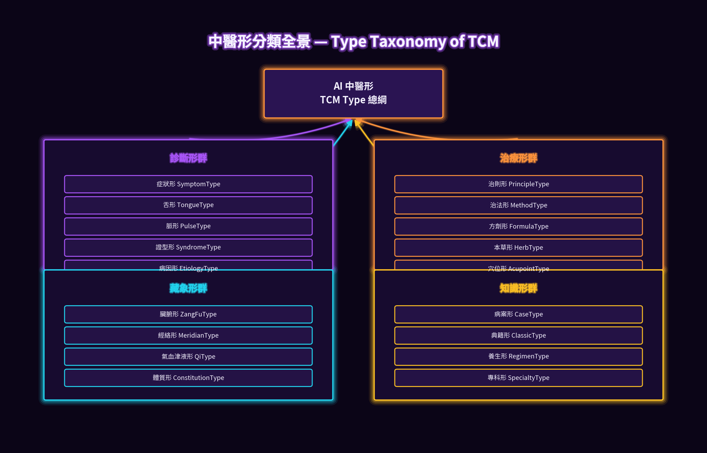

**【圖】中醫形分類全景：四大形群 × 十四基本形**

| 形 | 英文 | 定義 | 關鍵屬性 | 代表知識 |
| --- | --- | --- | --- | --- |
| 症狀形 | SymptomType | 患者可察覺或可觀察之異常表現 | 部位、性質、程度、時間規律、加劇緩解因素 | 惡寒、發熱、頭痛、咳嗽、心悸 |
| 舌形 | TongueType | 舌象之結構化描述 | 舌色、舌形、舌態、苔色、苔質、舌下絡脈 | 淡紅舌薄白苔、紅舌黃膩苔 |
| 脈形 | PulseType | 脈象之結構化描述 | 位、數、形、勢、節律（寸關尺分候） | 浮脈、沉脈、弦脈、滑脈、細脈 |
| 證型形 | SyndromeType | 疾病某階段病位病性病因之綜合判斷 | 病位、病性、病因、病勢、判準集合 | 太陽中風證、肝鬱脾虛證、心脾兩虛證 |
| 病因形 | EtiologyType | 致病因素之分類模型 | 六淫、七情、痰飲瘀血、飲食勞逸外傷 | 風寒束表、肝氣鬱結、瘀血阻絡 |
| 臟腑形 | ZangFuType | 藏象系統之功能模型 | 生理功能、病理特點、體竅華液、絡屬關係 | 心主血脈藏神、肝主疏洩藏血 |
| 經絡形 | MeridianType | 經脈絡屬與氣血流注模型 | 經脈路線、流注時辰、是動所生病 | 十二正經、奇經八脈、十五絡脈 |
| 氣血津液形 | QiType | 氣血津液之生成輸布與病變模型 | 生成、功能、病變類型 | 氣虛、血瘀、津虧、痰飲 |
| 體質形 | ConstitutionType | 個體相對穩定的體質特徵 | 九種體質分型、易感傾向、調理原則 | 平和質、陽虛質、痰濕質、氣鬱質 |
| 治則形 | PrincipleType | 治療之總體策略 | 標本緩急、扶正祛邪、三因制宜 | 治病求本、標本兼治、先表後裡 |
| 治法形 | MethodType | 治則之下之具體治法 | 八法、十劑、具體運用條件 | 辛溫解表、疏肝健脾、滋陰降火 |
| 方劑形 | FormulaType | 有機組合之處方模型 | 組成（君臣佐使）、功效、主治、煎服法、加減、禁忌 | 桂枝湯、逍遙散、六味地黃丸 |
| 本草形 | HerbType | 單味藥之性用模型 | 四氣、五味、升降浮沉、歸經、毒性、劑量 | 麻黃辛溫入肺膀胱經、附子大熱有毒 |
| 穴位形 | AcupointType | 腧穴之定位與主治模型 | 定位、歸經、特定穴類別、主治、刺灸法 | 足三里、合谷、太沖、三陰交 |

此外尚有三個支撐形：病案形（CaseType，一次完整診療的時間膠囊）、典籍形（ClassicType，文獻知識的出處錨點）、養生形（RegimenType，治未病方案）。支撐形不直接參與辨證推理，卻是形證據鏈與自我演化不可或缺的載體。

## 2.2 屬性・屬性值設計準則

屬性是形的內部結構。屬性設計須同時滿足五項準則：其一「完備」——足以支撐該形的全部判定；其二「可判」——兩位合格醫師依屬性描述應得出一致結論；其三「可枚舉或可量化」——屬性值有閉合清單或量表；其四「可回溯」——每一個屬性值都能指回四診證據；其五「可演化」——允許隨判準精進增補新屬性值。

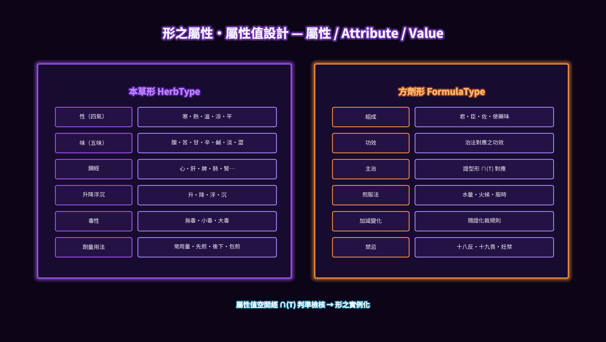

**【圖】屬性・屬性值設計：以本草形與方劑形為例**

| 形 | 屬性綱目 | 屬性值示例（節錄） |
| --- | --- | --- |
| 症狀形 | 部位｜性質｜程度｜時間規律｜加劇緩解因素｜伴隨症狀 | 頭（部位）｜脹痛（性質）｜中度（程度）｜晨起加重（時律）｜遇風加重（誘因） |
| 舌形 | 舌色｜舌形｜舌態｜苔色｜苔質｜舌下絡脈 | 淡紅｜胖大｜歪顫｜白｜膩｜絡脈青紫迂曲 |
| 脈形 | 位｜數｜形｜勢｜節律｜分候 | 浮（位）｜遲（數）｜細（形）｜無力（勢）｜代（節律）｜左寸弱 |
| 證型形 | 病位｜病性｜病因｜病勢｜判準集合｜兼證夾雜 | 心脾（病位）｜兩虛（病性）｜思慮過度（病因）｜慢性（病勢） |
| 本草形 | 四氣｜五味｜升降浮沉｜歸經｜毒性｜常用量｜特殊煎法 | 溫｜辛苦｜升｜肺膀胱｜小毒（麻黃）｜2–10g｜先煎去沫 |
| 方劑形 | 組成｜君臣佐使｜功效｜主治證型｜煎服法｜加減｜禁忌 | 桂枝湯｜桂枝君芍藥臣｜解肌發表調和營衛｜太陽中風證 |

> **形化設計的實務提醒**
>
> 屬性值寧可先粗後精：先用「輕／中／重」三級起步，再依醫案累積細化；切忌一開始就追求無窮細分——完備而不封閉的屬性空間，會讓 ∩(T) 判準失去可操作性。

### ◆ 屬性值標準化：程度分級與術語詞表

| 屬性 | 標準化詞表（節錄） | 分級／枚舉規範 |
| --- | --- | --- |
| 程度 | 輕・中・重・極重 | 輕：可忽略不影響生活；中：明顯不適；重：影響生活起居；極重：臥床或危候 |
| 病程 | 急性（＜2 週）・亞急性（2–4 週）・慢性（＞4 週） | 以起病至就診之時間計；反覆發作者標注發作頻度 |
| 時間規律 | 持續・間歇・晝重夜輕・日晡・五更・子午 | 按十二時辰與晝夜節律標準枚舉 |
| 加劇緩解 | 得溫則減・得按則減・遇怒加重・勞後加重・食後加重 | 與寒熱虛實鑑別直接掛鉤，須強制填寫 |
| 舌色 | 淡白・淡紅・紅・絳・紫・青 | 六值閉合清單，禁止「偏紅」等模糊語 |
| 脈象 | 二十八脈標準名＋位數形勢四軸 | 術語依《脈經》詞表；四軸分列，禁止合併描述 |

## 2.3 空間容器與形集合三括號之運用

形集合三括號是空間本形的語法：圓括號 ( ) 表容器——有邊界的容納；花括號 { } 表 SOM——同現屬性值的集合歸納；方括號 [ ] 表抽象——由具體上升為一般。三者在中醫知識中各有明確職責：

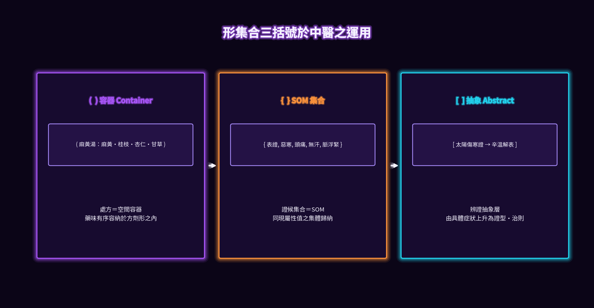

**【圖】形集合三括號於中醫：處方容器・證候集合・治則抽象**

| 括號 | 語法 | 中醫運用 | 操作規範 |
| --- | --- | --- | --- |
| ( ) 容器 | 有邊界的容納 | 處方＝藥味容器；經脈＝穴位容器；醫案＝診療事件容器 | 容器有邊界：藥味出容器即為加減新方，須重新檢核 |
| { } SOM | 同現屬性值集合 | 證候集合＝同現症狀脈舌之歸納；藥對・藥組 | SOM 成員須同現於同一患證，並標注出現頻度 |
| [ ] 抽象 | 由具體到一般 | 症狀群→證型；證型→治則；醫案→規律 | 抽象須可回指：任一抽象層皆能還原為下層證據 |

以一則虛證醫案為例：{ 失眠多夢, 心悸健忘, 食少納呆, 面色萎黃, 脈細弱 } 依 SOM 歸納為「心脾兩虛」證候集；處方 ( 歸脾湯：人參・黃芪・白朮・當歸… ) 以容器容納藥味；再抽象 [ 心脾兩虛 → 補益心脾 ] 成為治則。三括號一體運用，構成由症狀到處方的完整語法。

## 2.4 BOM / SOM 雙向對應

BOM（物料清單）原指產品的組成明細，在中醫映射為「方劑的藥味清單」：方劑形之下，每一味藥都是帶角色（君臣佐使）、劑量、用法的明細項。SOM（同現集合）映射為「證候的同現集合」：證型形之下，每一個症狀脈舌都是帶權重的同現項。二者的雙向對應，是「方證對應」這一中醫核心命題的形化表達：

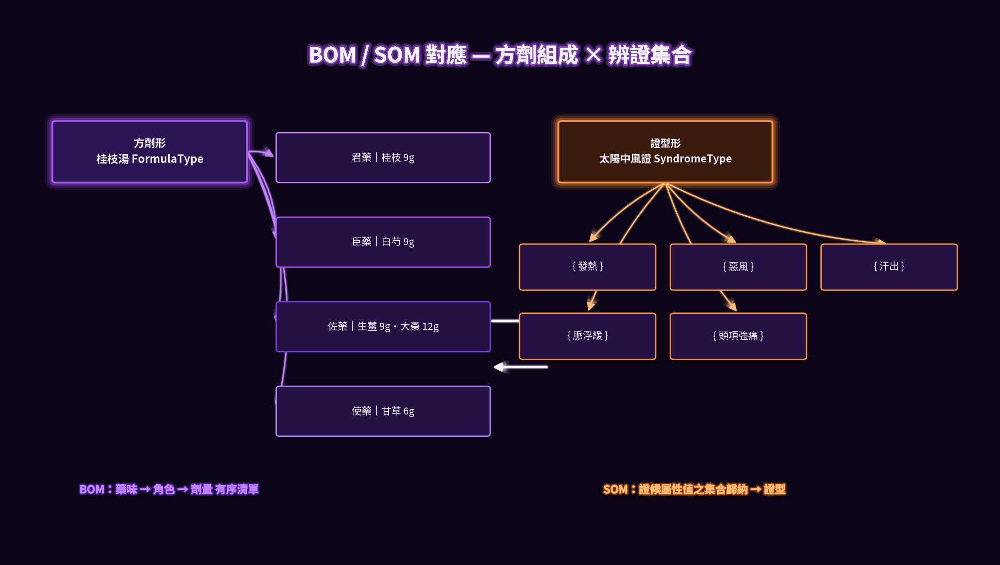

**【圖】BOM / SOM 對應：方劑藥味清單 × 證候同現集合**

| 對應方向 | 操作 | 示例（桂枝湯 ↔ 太陽中風證） | 檢核要點 |
| --- | --- | --- | --- |
| SOM → BOM（由證出方） | 證候集合匹配方劑形主治，組成藥味 BOM | {發熱,惡風,汗出,脈浮緩}→桂枝湯 | 君藥須直指主證；全方功效覆蓋證候全集 |
| BOM → SOM（由方測證） | 由藥味性味歸經反推可治證候集合 | 桂枝湯 BOM→解肌發表・調和營衛→太陽中風 | 反推 SOM 不得超出原方主治邊界 |
| 加減對應 | 兼證 SOM 增項→BOM 對應增減藥味 | 兼項{項背強几几}→加葛根 | 加減後須整方重新 ∩(T) 檢核 |

## 2.5 框架四步驟之操作規範

一切形化作業——無論定義一個新證型、建一味本草，還是錄一則醫案——都遵循框架四步驟：

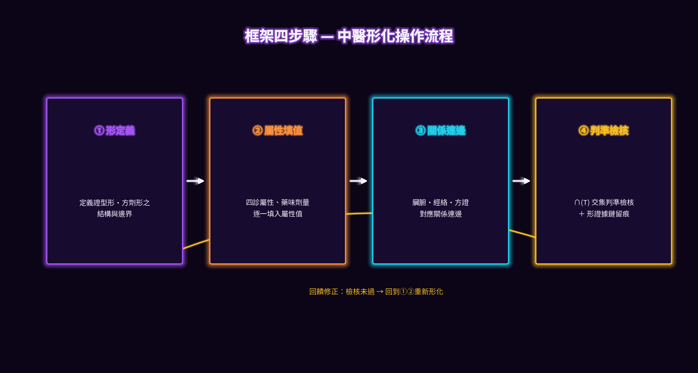

**【圖】框架四步驟：形定義→屬性填值→關係連邊→判準檢核**

| 步驟 | 輸入 | 操作 | 輸出與檢核 |
| --- | --- | --- | --- |
| ① 形定義 | 知識單元類型與文獻依據 | 確定形之邊界：哪些屬性必備、哪些特徵排除 | 形規格書；邊界條件可判定性檢核 |
| ② 屬性填值 | 四診證據・文獻原文 | 逐屬性填入屬性值，標注證據來源 | 屬性實例；空缺值顯式標注「未採集」 |
| ③ 關係連邊 | 形實例之間的關聯 | 連接方證、藥證、穴證、臟腑絡屬等邊 | 知識圖邊集；邊皆有方向與語義 |
| ④ 判準檢核 | ∩(T) 判準 | 吻合度計算、灰區判定、醫師覆核 | 檢核報告；未過者回①②修正 |

四步驟的價值在於強制性：任何跳過「判準檢核」直接入庫的知識，都會在日後的推理中以幻覺的形式付出代價。檢核未過的項目回到起點重新形化，形成封閉的品質迴圈。

## 2.6 RDB 對應原則：表頭即形

空間本形與關聯式資料庫（RDB）有天然對應：形即表頭（Schema），形的實例即資料列，形的關係即外鍵。這一對應使形化知識庫可以無縫落地為資料表，也使「表設計」與「形設計」成為同一份工作的兩個視角。下表為核心知識表的概念設計：

| 知識表 | 表頭（＝形） | 關鍵欄位（節錄） |
| --- | --- | --- |
| 證型表 | 證型形 SyndromeType | 證型編碼｜病位｜病性｜病因｜判準集合 SOM｜治則｜來源典籍 |
| 本草表 | 本草形 HerbType | 藥名｜四氣｜五味｜歸經｜毒性｜常用量｜配伍禁忌｜炮製 |
| 方劑表 | 方劑形 FormulaType | 方名｜組成 BOM｜君臣佐使｜功效｜主治｜煎服法｜加減｜禁忌 |
| 穴位表 | 穴位形 AcupointType | 穴名｜歸經｜定位｜特定穴類別｜主治｜刺法｜灸量 |
| 醫案表 | 病案形 CaseType | 案號｜四診記錄｜證型推演鏈｜處方｜療效｜時間軸節點｜審核醫師 |

設計時須把握三點：第一，表頭欄位的取捨以形規格書為準，不因臨時需求增刪；第二，判準集合 SOM 與組成 BOM 這類集合型屬性，以子表實現（證候表、藥味表），維持第一正規化；第三，每張知識表都保留「來源典籍」與「版本」欄位——典籍形的出處錨點，是形證據鏈的文獻端點。

## 2.7 交集判準 ∩(T) 之形式化

交集判準 ∩(T) 是證型確立的硬閘門。設患者證候集 P（由 S1–S2 形化而來）與證型判準集 T（證型形的核心屬性集合），則 ∩(T) 吻合度定義為二者的加權重合程度：權重依證候對該證型的鑑別力分配（主證權重高、次證權重低、舌脈常為關鍵權重）。

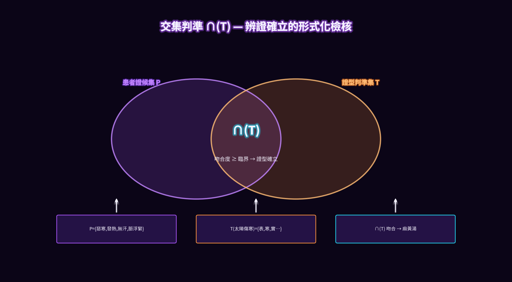

**【圖】交集判準 ∩(T)：患者證候集與證型判準集的量化吻合**

| 吻合度區間 | 判定 | 系統行為 |
| --- | --- | --- |
| ∩(T) ≥ 0.85 | 證型確立 | 進入 T5 治則推導；標注支持證據與殘餘疑點 |
| 0.70 ≤ ∩(T) < 0.85 | 證型傾向（灰區） | 並列次選證型；標注鑑別要點；建議補充四診資訊 |
| ∩(T) < 0.70 | 證型不成立 | 退回 S3 重新辨證；禁止以弱吻合強行出方 |

| 計算要素 | 說明 | 示例（太陽傷寒證 T） |
| --- | --- | --- |
| 主證（權重 3） | 該證型的必要或高度特異證候 | 惡寒、無汗、脈浮緊 |
| 次證（權重 2） | 常見支持證候 | 頭項強痛、身疼痛、發熱 |
| 舌脈佐證（權重 2） | 關鍵鑑別證據 | 苔薄白、脈浮緊有力 |
| 反證（扣分） | 與判準衝突者 | 汗出（反對無汗）→ 扣分並提示桂枝湯證鑑別 |

> **灰區是特性不是缺陷**
>
> 中醫辨證本有「疑似之間」的傳統——《傷寒論》中大量條文正是鑑別診斷。系統在灰區強制並列證型與鑑別要點，正是還原中醫思維的本來面目；最危險的不是灰區，而是把灰區強行判成確證。

## 2.8 形化品質檢核清單

每完成一批知識形化，依下表逐項檢核。全數通過方可入庫；任一項未過，退回對應步驟修正。

| 檢核項 | 判定標準 | 未過處理 |
| --- | --- | --- |
| 邊界可判性 | 兩位醫師依形規格獨立判定結論一致 | 回①重定義邊界 |
| 屬性完備度 | 必備屬性無空缺；空缺皆顯式標注 | 回②補填或標注 |
| 證據可回溯 | 每屬性值可指回四診記錄或典籍原文 | 回②補證據來源 |
| 關係有語義 | 每條邊有方向與關係類型 | 回③重連邊 |
| ∩(T) 可計算 | 判準集合與權重完整，可重算吻合度 | 回④補判準 |
| 版本可追溯 | 來源典籍、修改記錄、審核人齊備 | 補版本資訊 |

# 第3章 時間本形於中醫動態推理

中醫是時間性的醫學。疾病在時間中傳變，診察在時間中展開，治療在時間中生效，知識在時間中演進。時間本形的五大要素——病程時間軸、搜尋、推理、設計、自我演化模式——在 AI 中醫大腦中各有明確落點，使系統不僅能回答「這是什麼證」，更能回答「這個證從哪裡來、往哪裡去、何時介入、如何演化」。

## 3.1 病程時間軸與傳變形

病程時間軸把一次疾病歷程結構化為節點序列：起病節點（病因介入與初現症狀）、演變節點（證型轉折）、介入節點（治療開始與方案調整）、結局節點（痊癒、好轉、傳變、惡化）。每個節點都是一組時間戳記的四診屬性快照，節點之間的變化方向即是「傳變」。

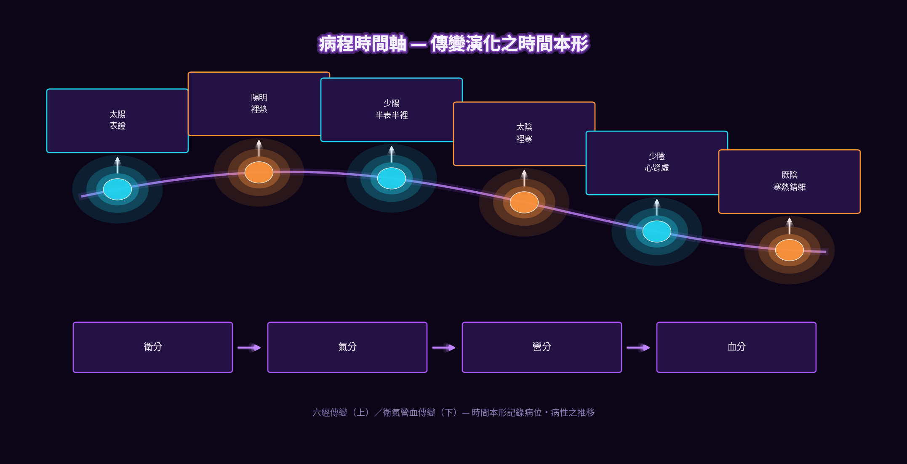

**【圖】病程時間軸：六經傳變與衛氣營血傳變的時間結構**

傳變不是隨機的——中醫經典為傳變提供了三套成熟的方向圖：六經傳變描述傷寒由表入裡的層級推移，衛氣營血傳變描述溫病由淺入深的四個階段，三焦傳變描述溫邪由上焦向中下焦的縱向發展。系統以「傳變形」記錄每一次移動的起訖、條件與證據，使病勢判斷（《傷寒論》所謂「觀其脈證，知犯何逆，隨證治之」）成為可計算的推理。

## 3.2 三大傳變體系的時間結構

| 傳變體系 | 階段序列 | 轉折指徵 | 臨床意義 |
| --- | --- | --- | --- |
| 六經傳變 | 太陽→陽明→少陽→太陰→少陰→厥陰 | 由表入裡、由寒轉熱或由熱轉寒；直中、兩感、合病併病為變局 | 傷寒外感病的定位與預後判斷 |
| 衛氣營血 | 衛分→氣分→營分→血分 | 發熱特徵、神志變化、斑疹出血、舌象推移 | 溫病熱性病的深淺與險候識別 |
| 三焦傳變 | 上焦（肺衛心包）→中焦（脾胃）→下焦（肝腎） | 病位縱向推移；濕溫多沿三焦漫延 | 濕溫與溫病的病位判斷 |
| 臟腑傳變 | 母病及子、子盜母氣、乘侮傳變 | 五臟生剋關係決定的擴散路徑 | 內傷雜病的病勢推演 |

> **傳變判斷的時間紀律**
>
> 傳變判斷必須給出「時間證據」：何時出現新症狀、何時舌脈改變、何時加重緩解。沒有時間戳記的「傳變」只是猜測——系統要求每一個傳變結論都附上節點對照，正是把《溫病條辨》「入營猶可透熱轉氣」的時機醫學落到實處。

## 3.3 四診動態採集與時間序列

四診不是一次性的快照，而是時間序列。系統在四診屬性中內建時間欄位：症狀形的起病時間、持續時間、晝夜規律（如陽虛之晨瀉、陰虛之盜汗）、加重緩解因素；脈形的至數與節律本身就是時間屬性（遲、數、促、結、代）；舌形的動態推移（苔由白轉黃、由薄轉膩）是病機熱化、濕化的直接證據。

| 時間屬性 | 所屬形 | 示例 | 臨床價值 |
| --- | --- | --- | --- |
| 起病與病程 | 症狀形 | 惡寒三日、發熱兩日 | 判斷病程階段與傳變速度 |
| 晝夜節律 | 症狀形 | 日晡潮熱、五更洩瀉、盜汗 | 病位病性鑑別（陽明潮熱 vs 陰虛潮熱） |
| 加劇緩解規律 | 症狀形 | 得溫則減（虛寒）、遇怒加重（肝鬱） | 寒熱虛實鑑別的重要砝碼 |
| 脈之至數節律 | 脈形 | 一息四至為常、代脈動而中止 | 心氣盛衰與預後判斷 |
| 舌象推移 | 舌形 | 薄白苔→黃膩苔（三日） | 病機熱化濕化的客觀化指標 |

## 3.4 治療時間軸：服藥時辰・子午流注・療程節點

治療同樣在時間中展開。中醫對給藥時辰有精細講究：補益藥宜飯前、消導藥宜飯後、安神藥宜睡前、截瘧藥宜發前；針灸則有子午流注——氣血循經依時辰灌注，某經當令之時取其穴效果最著。系統以「治療時間軸」管理療程：每個療程節點安排複診四診、療效評估與方案調整。

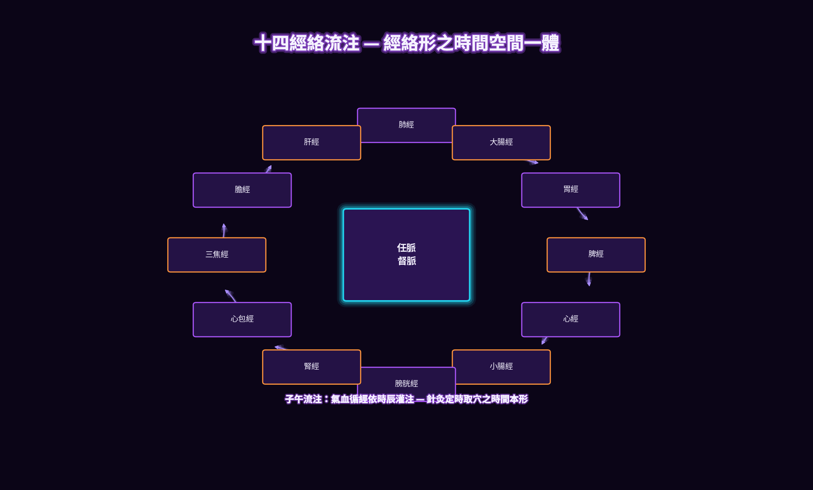

**【圖】十四經絡流注：子午流注的時間空間一體結構**

| 時辰 | 當令經脈 | 針灸運用 | 服藥參考 |
| --- | --- | --- | --- |
| 寅時 03–05 | 肺經 | 咳喘哮證取肺經穴 | 補肺藥黎明前服 |
| 辰時 07–09 | 胃經 | 胃脘痛取足三里 | 健胃藥早飯前後 |
| 午時 11–13 | 心經 | 心悸不寐取神門 | 養心藥午後服 |
| 酉時 17–19 | 腎經 | 腎虛腰痛取太溪 | 補腎藥晚飯前 |
| 亥時 21–23 | 三焦經 | 水腫調三焦 | 利水藥傍晚服 |
| 子時 23–01 | 膽經 | 口苦脅痛取陽陵泉 | 和解劑睡前一服 |

療程節點的標準節奏為「首診立方案、三日看轉歸、七日評療效、十四日定進退」——急性病節奏加密，慢性病放寬。每個節點執行 S7 療效演化工作流，節點間隔本身也是病勢信息：如期轉歸為順，逾期不變為滯，反而加重為逆。

## 3.5 時間本形四模式之臨床循環

時間本形的四模式在臨床上首尾相接、循環運轉：搜尋模式為辨證提供文獻與醫案證據，推理模式完成辨證論治推演，設計模式產出處方與針灸方案，自我演化模式以療效回饋收束——一次診療的終點，正是系統與醫師共同成長的起點。

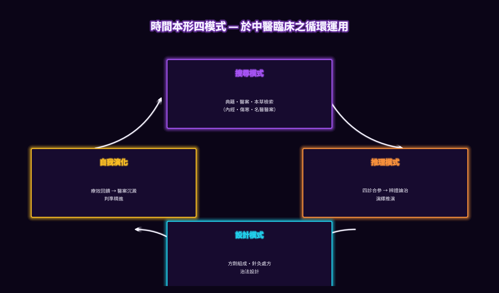

**【圖】時間本形四模式：搜尋→推理→設計→自我演化之臨床循環**

| 模式 | 臨床動作 | 系統支援 | 產出 |
| --- | --- | --- | --- |
| 搜尋模式 | 「此證古人如何論治？」 | 典籍檢索：內經傷寒條文、名醫醫案、近代研究 | 證據清單（附出處篇章） |
| 推理模式 | 「本案病機為何？」 | 四診合參→八綱→辨證體系→∩(T) 檢核 | 證型結論＋鑑別診斷 |
| 設計模式 | 「如何立法處方？」 | 治則推導→君臣佐使組方→禁忌檢核 | 處方＋針灸方案＋療程 |
| 自我演化 | 「療效如何？學到什麼？」 | 前後對照→規律萃取→判準精進提案 | 療效報告＋醫案入庫＋判準提案 |

## 3.6 自我演化：療效回饋與判準精進

自我演化是時間本形的最高形態，也是 Mind AI 區別於靜態知識庫的關鍵。其閉環為：醫案完整入庫（S8）→ 療效結局與辨證鏈比對 → 提取「預測—結果」偏差 → 若偏差可歸因於判準（如某證候權重過低），則生成 ∩(T) 判準修正提案；若歸因於辨證疏漏，則生成鑑別要點補充提案。所有提案經醫師審核會議通過後才進入判準版本——演化永遠在人工閘門之後。

| 演化類型 | 觸發條件 | 提案內容 | 審核要求 |
| --- | --- | --- | --- |
| 判準權重精進 | 同類醫案反覆出現系統性偏差 | ∩(T) 權重調整提案 | 醫師組審核＋樣本量門檻 |
| 鑑別要點補充 | 灰區誤判率偏高 | 證型鑑別對照表增補 | 須附誤判醫案證據 |
| 方藥加減沉澱 | 名醫醫案高頻加減反覆出現 | 加減規則入庫提案 | 須標注流派與適用邊界 |
| 新證型候選 | 大量醫案聚集於現有證型之外 | 新證型形候選規格書 | 須文獻依據＋多醫師共識 |

> **演化的保守原則**
>
> 寧可漏演化，不可誤演化。所有演化提案默認「不生效」，通過審核閘門前，臨床推理一律使用現行判準版本——保證同一醫案在任何時刻重放，結果可複現。

# 第4章 中醫全科知識映射 — 九大知識域

本章是全書的知識底座：把中醫全科知識——基礎理論、診斷、辨證體系、中藥、方劑、針灸、養生、專科、典籍——逐一映射為形結構。內容力求全備，作為形化知識庫的藍本與 S1–S8 工作流的知識後盾。

## 4.1 中醫基礎理論形化

### ◆ 陰陽五行：總綱與關係模型

陰陽是中醫的總綱辨證（八綱之綱），五行是藏象之間的關係模型。形化要點：陰陽作為「二值判斷軸」貫穿所有證型形的病性屬性；五行生剋乘侮作為臟腑形之間的「關係邊類型」——生（母子相生）、克（制約平衡）、乘（克制太過）、侮（反向欺凌）。

| 五行 | 臟 | 腑 | 五官 | 五志 | 五味 | 病變特徵 |
| --- | --- | --- | --- | --- | --- | --- |
| 木 | 肝 | 膽 | 目 | 怒 | 酸 | 疏洩失常：鬱結、上亢、動風 |
| 火 | 心 | 小腸 | 舌 | 喜 | 苦 | 血脈神志失常：悸、煩、不寐 |
| 土 | 脾 | 胃 | 口 | 思 | 甘 | 運化失常：虛、瀉、腫、不統血 |
| 金 | 肺 | 大腸 | 鼻 | 悲 | 辛 | 宣降失常：咳、喘、痰、便秘 |
| 水 | 腎 | 膀胱 | 耳 | 恐 | 鹹 | 藏精失常：虛、洩、水腫、骨弱 |

### ◆ 藏象：臟腑形的功能模型

藏象學說是中醫的「人體功能學」。形化要點：每個臟腑形定義生理功能、病理特點、體竅華液、絡屬關係四組屬性，並以關係邊連接相表裡的臟腑（心—小腸、肺—大腸、脾—胃、肝—膽、腎—膀胱）。

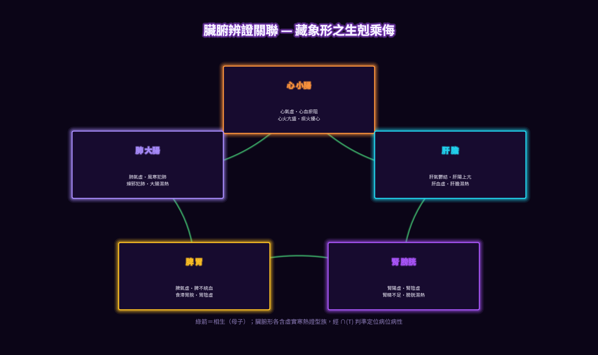

**【圖】臟腑辨證關聯：藏象形之生剋乘侮與證型族**

| 臟腑 | 核心功能 | 病理特點 | 常見證型族 |
| --- | --- | --- | --- |
| 心・小腸 | 主血脈、藏神明；小腸主泌別清濁 | 血脈與神志失常 | 心氣虛、心陽虛、心血虛、心陰虛、心火亢盛、心血瘀阻、痰迷心竅、痰火擾心 |
| 肺・大腸 | 主氣司呼吸、通調水道、朝百脈；大腸主傳導 | 宣降失常、衛表不固 | 肺氣虛、肺陰虛、風寒犯肺、風熱犯肺、燥邪犯肺、痰濕阻肺、大腸濕熱、大腸津虧 |
| 脾・胃 | 主運化統血、升清；胃主受納腐熟、降濁 | 運化升降失常 | 脾氣虛、脾陽虛、脾不統血、脾虛下陷、寒濕困脾、濕熱蘊脾、胃陰虛、食滯胃脘、胃寒、胃熱 |
| 肝・膽 | 主疏洩、藏血、主筋；膽主決斷貯精汁 | 疏洩失常、易鬱易亢 | 肝氣鬱結、肝火上炎、肝血虛、肝陰虛、肝陽上亢、肝風內動、寒滯肝脈、肝膽濕熱、膽鬱痰擾 |
| 腎・膀胱 | 藏精主骨生髓、主水納氣；膀胱主氣化 | 藏精不足、水液失調 | 腎陽虛、腎陰虛、腎精不足、腎氣不固、腎不納氣、膀胱濕熱 |

### ◆ 氣血津液：功能物質模型

| 物質 | 生成與功能 | 病變類型 | 代表證候 |
| --- | --- | --- | --- |
| 氣 | 元氣・宗氣・營氣・衛氣；推動溫煦防禦固攝 | 氣虛、氣滯、氣逆、氣陷、氣閉、氣脫 | 倦怠氣短（氣虛）、脹痛走竄（氣滯）、噯氣嘔逆（氣逆） |
| 血 | 營氣津液化赤；濡養全身、神志活動基礎 | 血虛、血瘀、血熱、血寒 | 面色萎黃（血虛）、刺痛舌紫（血瘀）、斑疹吐衄（血熱） |
| 津液 | 濡潤充養、代謝調節 | 津液不足、水濕停聚、痰飲 | 口乾便結（津虧）、水腫尿少（水停）、痰多苔膩（痰飲） |

### ◆ 病因：病因形分類

病因形採三級分類：外感（六淫：風寒暑濕燥火，疫癘）、內傷（七情：喜怒憂思悲恐驚）、不內外因（飲食不節、勞逸失度、外傷、痰飲、瘀血、結石）。每一病因形都攜帶「致病特徵」屬性——風性善行數變、寒性凝滯收引、濕性重濁黏滯、火性炎上急迫——這正是由症狀反推病因的判準來源。

| 六淫 | 性質 | 症狀特徵 | 常見證候 |
| --- | --- | --- | --- |
| 風 | 善行數變、為百病之長 | 游走性、變化快、癢、抽搐 | 風寒束表、風熱犯肺、風邪犯絡、肝風內動 |
| 寒 | 凝滯收引、易傷陽氣 | 冷痛固定、拘急、清稀 | 寒邪客表、寒凝心脈、寒滯肝脈、脾胃虛寒 |
| 暑 | 炎熱升散、耗氣傷津、多夾濕 | 高熱、汗多、口渴、倦怠 | 中暑、暑濕感冒 |
| 濕 | 重濁黏滯、趨下、礙運化 | 身重、苔膩、病程纏綿、便溏 | 寒濕困脾、濕熱蘊脾、膀胱濕熱 |
| 燥 | 乾澀傷津、易傷肺 | 乾咳、口鼻乾、皮燥便結 | 涼燥、溫燥、肺陰虧虛 |
| 火 | 炎上急迫、傷津動血生風 | 紅腫熱痛、高熱、出血、神昏 | 心火亢盛、肝火上炎、胃火熾盛、熱入營血 |

## 4.2 中醫診斷學：四診全項形化

四診是資訊入口，其形化品質決定一切後續推理。以下按望聞問切給出全項綱目。

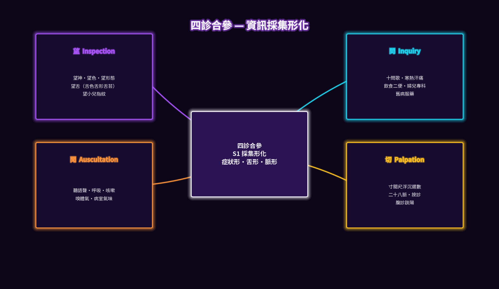

**【圖】四診合參：望聞問切的資訊採集形化**

### ◆ 望診

| 望診項 | 觀察內容 | 常見表現 | 主病意義 |
| --- | --- | --- | --- |
| 望神 | 得神・失神・假神・神亂 | 目光靈活、反應敏銳（得神） | 得神者昌；失神者亡；假神為迴光返照 |
| 望色 | 青赤黃白黑五色 | 面色萎黃、兩顴潮紅、面色黧黑 | 黃主脾虛濕蘊；赤主熱；青主寒痛驚風；白主虛寒失血；黑主腎虛水飲瘀血 |
| 望形態 | 形體胖瘦、姿態動靜 | 形盛氣虛、角弓反張、瞤動瘛瘲 | 肥人多痰濕；瘦人多虛火；動風見抽搐震顫 |
| 望舌 | 舌色舌形舌態苔色苔質 | 淡白舌、胖大齒痕、黃膩苔 | 舌診為望診之核心，另立專表 |
| 望小兒指紋 | 風氣命三關、浮沉淡滯 | 指紋紫紅、透關射甲 | 三歲以下小兒脈診之替代：浮沉分表裡、紅紫辨寒熱 |

| 舌象要素 | 常見類型 | 主病 | 形化屬性值 |
| --- | --- | --- | --- |
| 舌色 | 淡白・淡紅・紅・絳・紫・青 | 淡白主虛寒；紅絳主熱入營血；紫青主瘀血寒凝 | 舌色＝淡白｜淡紅｜紅｜絳｜紫｜青 |
| 舌形 | 老嫩・胖瘦・裂紋・齒痕・芒刺 | 老主實；嫩主虛；胖大齒痕主脾虛濕盛；裂紋主陰津虧 | 舌形屬性多值可並存 |
| 舌態 | 痿軟・強硬・歪斜・顫動・吐弄 | 歪斜主中風先兆；顫動主肝風；強硬主熱入心包 | 舌態異常多屬重症警訊 |
| 苔質 | 厚薄・潤燥・腐膩・剝落・真假 | 膩主痰飲濕濁；腐主食積痰濁；剝落主胃氣陰兩傷 | 苔質是病機濕、食、傷陰的關鍵 |
| 苔色 | 白・黃・灰黑 | 白主表寒；黃主裡熱；灰黑主裡熱極或寒極 | 苔色推移是病機熱化的動態指標 |

### ◆ 聞診與問診

聞診含聽聲音（語聲強弱、譫語鄭聲獨語、呼吸喘哮、咳嗽嘔逆噯氣太息、呃逆）與嗅氣味（口氣、體氣、病室氣味）。問診以十問歌為綱：一問寒熱二問汗，三問頭身四問便，五問飲食六問胸，七聾八渴俱當辨，九問舊病十問因，再兼服藥參機變；婦女尤必問經期，遲速閉崩皆可見；再添片語告兒科，天花麻疹全占驗。

| 問診項 | 鑑別要點 | 臨床意義 |
| --- | --- | --- |
| 寒熱 | 惡寒發熱並見（表證）／但寒不熱（裡寒）／但熱不寒（裡熱）／寒熱往來（少陽） | 八綱表裡寒熱的第一入口 |
| 汗 | 自汗（氣虛陽虛）／盜汗（陰虛）／大汗（亡陽或裡熱）／無汗（表實或津虧） | 汗為心之液，虛實關鍵鑑別 |
| 頭身 | 頭痛部位經絡歸屬、身痛重著與游走 | 六經頭痛有分部：太陽後項、陽明前額、少陽兩側、厥陰巔頂 |
| 二便 | 便秘溏結、尿清尿赤、頻急痛澀 | 裡熱裡寒、膀胱濕熱的直接證據 |
| 飲食口味 | 納呆厭食、消穀善飢、口渴喜飲冷熱 | 脾胃功能與寒熱真假鑑別 |
| 胸腹 | 脅脹、心悸、胸悶、脘痞 | 病位在心肝脾胃的定位依據 |
| 耳目 | 耳鳴耳聾、目眩目赤 | 腎開竅於耳、肝開竅於目 |
| 渴不渴 | 不渴（寒或濕）／渴喜冷飲（裡熱）／渴不欲飲（濕或瘀） | 津液存亡與病性鑑別 |
| 舊病與因 | 既往病史、發病誘因（情志、飲食、勞倦） | 病因形判定與體質形修正 |

### ◆ 切診（脈診與按診）

脈診以寸關尺分候臟腑（左寸心、左關肝、左尺腎；右寸肺、右關脾、右尺命門），以浮沉遲數滑澀虛實為綱，二十八脈各有體象主病。按診含按肌膚、按手足、按脘腹（虛里、痞滿結聚）。

| 脈綱 | 代表脈 | 脈象 | 主病 |
| --- | --- | --- | --- |
| 浮脈類 | 浮・洪・芤・革 | 輕取即得、重按稍減 | 表證（浮）；氣分熱盛（洪）；失血傷陰（芤） |
| 沉脈類 | 沉・伏・牢 | 輕取不應、重按始得 | 裡證（沉）；邪閉厥逆（伏）；陰寒內實（牢） |
| 遲脈類 | 遲・緩・澀・結 | 一息不足四至 | 寒證（遲）；濕證或平人（緩）；氣滯血瘀精傷（澀）；陰盛氣結（結） |
| 數脈類 | 數・疾・促・動 | 一息五至以上 | 熱證（數）；陽極陰竭（疾）；陽熱亢盛氣滯痰瘀（促） |
| 虛脈類 | 虛・微・細・代 | 應指無力 | 虛證（虛）；陽氣暴脫（微）；氣血兩虛濕盛（細）；臟氣衰微（代） |
| 實脈類 | 實・滑・弦・緊 | 應指有力 | 實證（實）；痰飲食滯實熱（滑）；肝膽病痛證（弦）；寒痛宿食（緊） |

## 4.3 辨證體系大全

辨證體系是中醫的推理引擎。系統並行支持八大辨證體系，並依病種自動推薦主用體系：外感熱病首選六經或衛氣營血三焦，內傷雜病首選臟腑辨證，經絡病變首選經絡辨證，起手定位一律先過八綱。

### ◆ 八綱辨證（總綱）

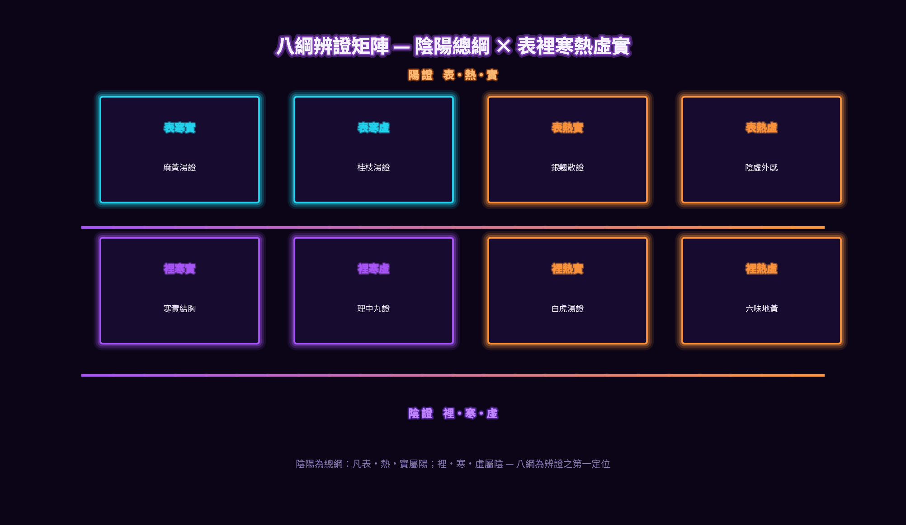

**【圖】八綱辨證矩陣：陰陽總綱 × 表裡寒熱虛實**

| 綱 | 證型 | 辨證要點 | 鑑別 |
| --- | --- | --- | --- |
| 表裡 | 表證／裡證／半表半裡 | 表：發熱惡寒並見、脈浮、病淺；裡：但寒但熱、臟腑症狀 | 表裡同病、表邪入裡、裡邪出表須動態判斷 |
| 寒熱 | 寒證／熱證 | 寒：冷白稀潤靜；熱：紅黃乾稠動 | 真寒假熱、真熱假寒的寒熱真假為重症關鍵 |
| 虛實 | 虛證／實證 | 虛：久病、聲低、痛喜按、脈無力；實：新病、聲高、痛拒按、脈有力 | 虛實夾雜、真實假虛、真虛假實 |
| 陰陽 | 陰證／陽證 | 總綱：表熱實屬陽；裡寒虛屬陰 | 亡陰（汗熱味鹹）與亡陽（汗冷味淡）為危候 |

### ◆ 六經辨證（傷寒體系）

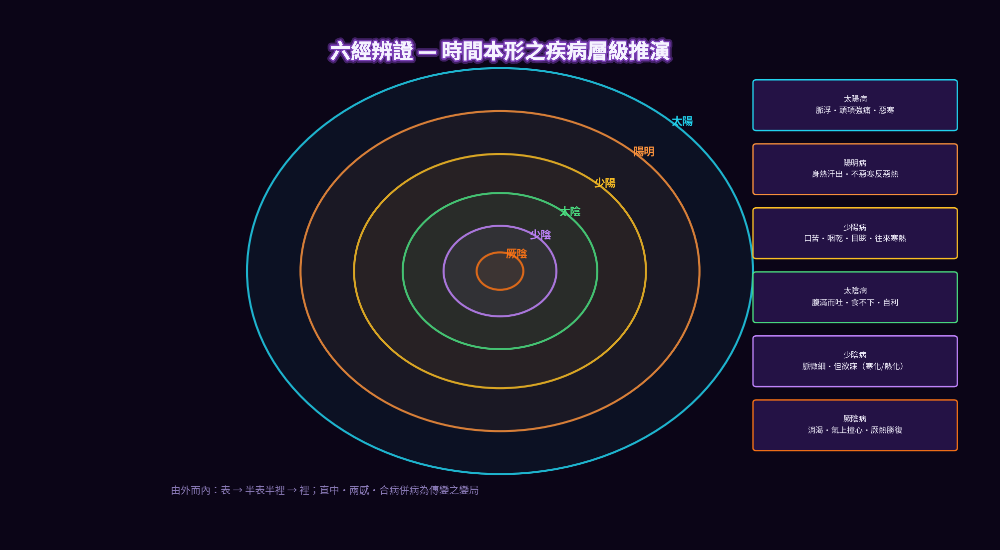

**【圖】六經辨證：由外而內的疾病層級推演**

| 六經 | 提綱 | 主要證型 | 代表方 |
| --- | --- | --- | --- |
| 太陽病 | 脈浮、頭項強痛而惡寒 | 太陽中風（表虛：汗出惡風脈浮緩）；太陽傷寒（表實：無汗身痛脈浮緊） | 桂枝湯；麻黃湯 |
| 陽明病 | 胃家實是也 | 陽明經證（大熱大汗大渴脈洪大）；陽明腑證（潮熱譫語腹滿便秘） | 白虎湯；大承氣湯 |
| 少陽病 | 口苦、咽乾、目眩 | 少陽病：往來寒熱、胸脅苦滿、嘿嘿不欲飲食 | 小柴胡湯 |
| 太陰病 | 腹滿而吐、食不下、自利益甚 | 太陰虛寒：腹痛喜溫按、便溏 | 理中丸 |
| 少陰病 | 脈微細、但欲寐 | 少陰寒化（惡寒踡臥、下利清穀）；少陰熱化（心煩不寐、舌紅） | 四逆湯；黃連阿膠湯 |
| 厥陰病 | 消渴、氣上撞心、心中疼熱 | 寒熱錯雜、厥熱勝復、蛔厥 | 烏梅丸 |

### ◆ 六經病鑑別與傳變要點

| 鑑別項 | 要點 | 臨床意義 |
| --- | --- | --- |
| 太陽中風 vs 太陽傷寒 | 汗出脈浮緩（表虛）／無汗脈浮緊（表實） | 桂枝湯與麻黃湯的分水嶺 |
| 陽明經證 vs 陽明腑證 | 大熱大汗大渴脈洪大／潮熱譫語腹滿便秘 | 白虎湯清氣 vs 承氣湯攻下 |
| 少陽病 vs 太陽病 | 寒熱往來、胸脅苦滿 vs 惡寒發熱並見 | 和解 vs 發汗，禁汗吐下 |
| 少陰寒化 vs 少陰熱化 | 惡寒踡臥下利清穀脈微 vs 心煩不寐舌紅脈細數 | 四逆湯回陽 vs 黃連阿膠湯育陰 |
| 厥陰蛔厥 vs 真熱假寒 | 吐蛔、飢不欲食、厥熱勝復 | 烏梅丸寒熱並用，誤判則殤 |
| 直中 vs 傳經 | 初起即見三陰證 vs 由太陽循經傳入 | 直中多因正虛寒盛，治宜急溫 |

### ◆ 衛氣營血與三焦辨證（溫病體系）

| 階段 | 辨證要點 | 舌象 | 治則與代表方 |
| --- | --- | --- | --- |
| 衛分證 | 發熱微惡風寒、頭痛口渴、脈浮數 | 舌邊尖紅苔薄白 | 辛涼解表——銀翹散、桑菊飲 |
| 氣分證 | 但熱不寒、汗多渴飲、苔黃脈洪數 | 舌紅苔黃 | 清氣分熱——白虎湯；熱結腸腑用承氣 |
| 營分證 | 身熱夜甚、心煩譫語、斑疹隱隱 | 舌絳無苔 | 清營透熱——清營湯「入營猶可透熱轉氣」 |
| 血分證 | 吐衄便血、斑疹透露、神昏動風 | 舌深絳 | 涼血散血——犀角地黃湯；動風用大定風珠 |
| 上焦（溫病） | 邪犯肺衛或逆傳心包 | 薄黃或絳 | 辛涼清上焦；逆傳心包用安宮牛黃丸 |
| 中焦（溫病） | 陽明熱盛或太陰濕熱 | 黃燥或黃膩 | 清熱攻下或化濕清熱 |
| 下焦（溫病） | 肝腎陰虛、虛風內動 | 絳而少苔 | 滋陰息風——大定風珠、三甲復脈湯 |

### ◆ 臟腑辨證、氣血津液辨證、經絡辨證

臟腑辨證（見 4.1 證型族表）是內傷雜病的主力；氣血津液辨證把病性細化為氣血津液的虛滯逆陷；經絡辨證以病位循經歸屬——頭痛分六經、脅痛責肝膽、腰背痛屬膀胱經，是針灸取穴的直接依據。

## 4.4 中藥學：本草形的完整屬性空間

中藥學的形化圍繞本草形展開：四氣（寒熱溫涼）定病性相逆，五味（酸苦甘辛鹹淡澀）定作用趨勢（辛散酸收甘緩苦堅鹹軟），升降浮沉定作用方向，歸經定作用部位，毒性定安全邊界。配伍關係七情（單行、相須、相使、相畏、相殺、相惡、相反）與禁忌（十八反、十九畏、妊娠禁忌）是方藥設計的安全底線。

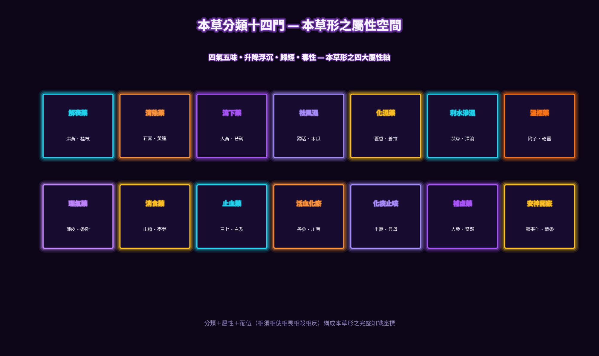

**【圖】本草分類十四門：本草形之屬性空間**

| 分類 | 功效 | 代表藥 | 性味 | 要點 |
| --- | --- | --- | --- | --- |
| 解表藥 | 發散表邪 | 麻黃桂枝（辛溫）；薄荷桑葉柴胡（辛涼） | 多辛 | 辛溫治風寒、辛涼治風熱；中病即止 |
| 清熱藥 | 清解裡熱 | 石膏知母梔子；黃芩黃連黃柏；金銀花連翹 | 多苦寒 | 分清熱瀉火、涼血、燥濕、解毒、清虛熱 |
| 瀉下藥 | 通導大便 | 大黃芒硝（攻下）；火麻仁（潤下） | 苦寒或甘潤 | 攻下慎用於虛人；潤下宜老年津枯 |
| 祛風濕藥 | 祛風散寒除濕 | 獨活威靈仙防己木瓜 | 辛苦溫 | 痹證要藥；多溫燥傷陰，陰虛慎用 |
| 化濕藥 | 芳香化濁 | 藿香蒼朮厚朴砂仁 | 芳香溫燥 | 濕濁中阻要藥；砂仁兼安胎 |
| 利水滲濕藥 | 通利水道 | 茯苓豬苓澤瀉薏苡仁茵陳 | 甘淡 | 茵陳為黃疸要藥；薏苡仁兼健脾 |
| 溫裡藥 | 溫中回陽 | 附子乾薑肉桂吳茱萸 | 辛熱 | 附子回陽救逆第一品，須先煎去毒 |
| 理氣藥 | 行氣解鬱 | 陳皮枳實木香香附 | 辛苦溫 | 香附為氣病之總司、女科之主帥 |
| 消食藥 | 消化食積 | 山楂神曲麥芽萊菔子 | 甘平 | 山楂消肉積、麥芽消米麵、萊菔子消痰食 |
| 止血藥 | 制止出血 | 三七茜草蒲黃白及仙鶴草 | 多澀或苦 | 三七止血不留瘀；白及斂瘡生肌 |
| 活血化瘀藥 | 通行血脈 | 川芎丹參紅桃仁牛膝 | 辛苦溫 | 川芎為血中之氣藥；丹參一味功同四物 |
| 化痰止咳平喘 | 化痰降氣 | 半夏貝母桔梗杏仁蘇子 | 辛或苦 | 半夏燥濕化痰、貝母清熱化痰，寒熱有別 |
| 安神藥 | 安定神志 | 酸棗仁柏子仁遠志龍骨 | 甘平或重鎮 | 養心安神與重鎮安神兩路 |
| 平肝息風藥 | 平抑肝陽息風止痙 | 天麻鉤藤羚羊角全蠍 | 多入肝經 | 天麻為眩暈要藥；全蠍蜈蚣搜風通絡 |
| 補虛藥 | 補益虛損 | 人參黃芪白朮（氣）；當歸熟地阿膠（血）；麥冬百合（陰）；鹿茸杜仲（陽） | 甘 | 補氣補血補陰補陽四路；虛不受補先調脾胃 |

| 配伍・禁忌 | 內容 | 系統檢核行為 |
| --- | --- | --- |
| 七情配伍 | 相須相使增效；相畏相殺減毒；相惡相反為忌 | 組方時自動標注藥對關係，相反者攔截 |
| 十八反 | 烏頭反半夏瓜蔞貝母白及白蘞；甘草反海藻大戟甘遂芫花；藜蘆反諸參辛芍 | S5 出方前逐對掃描，命中即紅燈 |
| 十九畏 | 硫磺畏朴硝；水銀畏砒霜；狼毒畏密陀僧；巴豆畏牽牛；丁香畏鬱金… | 同上；命中須醫師書面確認例外 |
| 妊娠禁忌 | 禁用：水蛭虻蟲巴豆牽牛麝香…；慎用：桃仁紅大黃枳實肉桂… | 孕產婦通道強制啟用，禁用藥直接攔截 |

### ◆ 常用藥對（配伍精華）

| 藥對 | 配伍意義 | 常見出處 |
| --- | --- | --- |
| 麻黃・桂枝 | 相須發汗解表，治太陽傷寒 | 麻黃湯 |
| 桂枝・白芍 | 一散一收調和營衛 | 桂枝湯 |
| 石膏・知母 | 相須清氣分大熱 | 白虎湯 |
| 柴胡・黃芩 | 和解少陽基本對 | 小柴胡湯 |
| 人參・黃芪 | 相須大補脾肺之氣 | 補中益氣湯 |
| 當歸・川芎 | 養血活血行氣止痛 | 四物湯 |
| 半夏・陳皮 | 燥濕化痰理氣和中 | 二陳湯 |
| 黃連・吳茱萸 | 辛開苦降治肝火犯胃 | 左金丸 |
| 黃連・肉桂 | 交通心腎治心腎不交 | 交泰丸 |
| 金銀花・連翹 | 清熱解毒疏散風熱 | 銀翹散 |
| 桃仁・紅 | 活血祛瘀止痛 | 桃紅四物湯 |
| 乳香・沒藥 | 活血行氣止痛生肌 | 活絡效靈丹 |
| 三稜・莪朮 | 破血行氣消積止痛 | 三稜丸 |
| 酸棗仁・柏子仁 | 養心安神治失眠心悸 | 天王補心丹 |
| 龍骨・牡蠣 | 重鎮安神收斂固澀 | 桂枝加龍骨牡蠣湯 |
| 天麻・鉤藤 | 平肝息風治眩暈抽搐 | 天麻鉤藤飲 |
| 全蠍・蜈蚣 | 搜風通絡止痙止痛 | 止痙散 |
| 砂仁・厚朴 | 化濕行氣醒脾和胃 | 平胃散加減 |
| 枳實・白朮 | 消痞健脾治脾虛氣滯 | 枳朮丸 |
| 黃芪・防風 | 益氣固表止汗防感 | 玉屏風散 |
| 乾薑・細辛・五味子 | 溫肺化飲斂肺止咳 | 小青龍湯 |
| 芍藥・甘草 | 緩急止痛（酸甘化陰） | 芍藥甘草湯 |

## 4.5 方劑學：方劑形的組成學

方劑是中醫治療的主力載體。組方原則為君臣佐使：君藥針對主證，臣藥輔君加強，佐藥佐助佐制或反佐，使藥引經調和。方劑的變化有三式——藥味加減（隨證化裁）、藥量增減（改變主治重心）、劑型更換（湯者蕩也、丸者緩也、散者散也）。

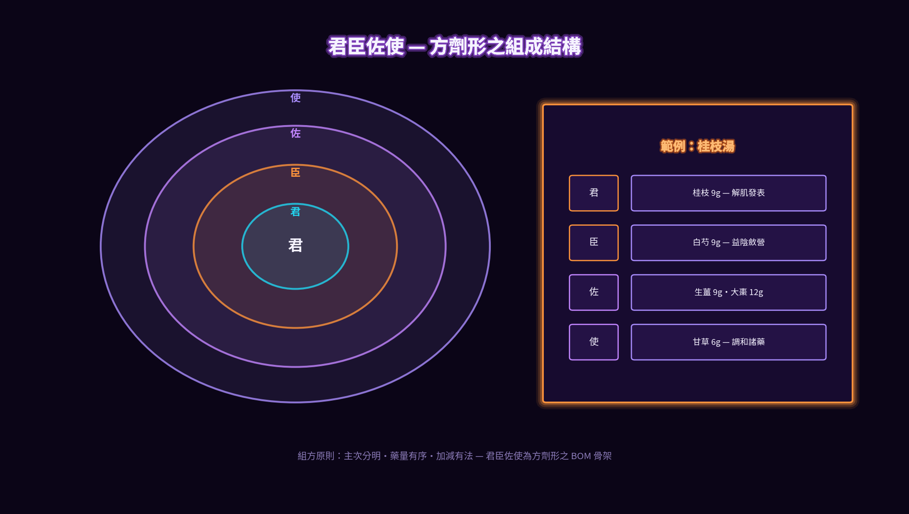

**【圖】君臣佐使：方劑形之組成結構與桂枝湯範例**

| 分類 | 代表方 | 組成（節錄） | 功效 | 主治 |
| --- | --- | --- | --- | --- |
| 解表劑 | 桂枝湯 | 桂枝芍藥生薑大棗甘草 | 解肌發表調和營衛 | 太陽中風表虛證 |
| 解表劑 | 麻黃湯 | 麻黃桂枝杏仁甘草 | 發汗解表宣肺平喘 | 太陽傷寒表實證 |
| 解表劑 | 銀翹散 | 金銀花連翹桔梗薄荷竹葉 | 辛涼透表清熱解毒 | 溫病初起衛分證 |
| 和解劑 | 小柴胡湯 | 柴胡黃芩半夏人參甘草 | 和解少陽 | 少陽病往來寒熱 |
| 和解劑 | 逍遙散 | 柴胡當歸白芍白朮茯苓 | 疏肝解鬱健脾養血 | 肝鬱血虛脾弱證 |
| 清熱劑 | 白虎湯 | 石膏知母粳米甘草 | 清氣分大熱 | 陽明經證四大症 |
| 清熱劑 | 龍膽瀉肝湯 | 龍膽草黃芩梔子澤瀉車前子 | 瀉肝膽實火清下焦濕熱 | 肝火上炎肝膽濕熱 |
| 溫裡劑 | 理中丸 | 人參乾薑白朮甘草 | 溫中散寒健脾 | 太陰虛寒脾胃虛寒 |
| 溫裡劑 | 四逆湯 | 附子乾薑甘草 | 回陽救逆 | 少陰寒化亡陽證 |
| 補益劑 | 四君子湯 | 人參白朮茯苓甘草 | 益氣健脾 | 脾胃氣虛證 |
| 補益劑 | 四物湯 | 當歸川芎白芍熟地 | 補血調血 | 血虛血滯諸證 |
| 補益劑 | 六味地黃丸 | 熟地山萸肉山藥澤瀉茯苓丹皮 | 滋陰補腎 | 腎陰虛證 |
| 補益劑 | 歸脾湯 | 人參黃芪白朮當歸龍眼肉酸棗仁 | 益氣補血健脾養心 | 心脾兩虛證 |
| 理氣劑 | 半夏厚朴湯 | 半夏厚朴茯苓生薑蘇葉 | 行氣散結降逆化痰 | 梅核氣痰氣鬱結 |
| 理血劑 | 血府逐瘀湯 | 桃仁紅當歸川芎柴胡枳殼 | 活血化瘀行氣止痛 | 胸中血瘀證 |
| 治風劑 | 川芎茶調散 | 川芎荊芥防風細辛白芷 | 疏風止痛 | 外感風邪頭痛 |
| 祛濕劑 | 平胃散 | 蒼朮厚朴陳皮甘草 | 燥濕運脾行氣和胃 | 濕滯脾胃 |
| 祛濕劑 | 獨活寄生湯 | 獨活桑寄生杜仲牛膝細辛 | 祛風濕止痹痛補肝腎益氣血 | 痹證日久肝腎兩虛 |
| 祛痰劑 | 二陳湯 | 半夏陳皮茯苓甘草 | 燥濕化痰理氣和中 | 濕痰證 |
| 消導劑 | 保和丸 | 山楂神曲萊菔子半夏陳皮 | 消食和胃 | 食積停滯 |
| 安神劑 | 天王補心丹 | 生地天冬麥冬酸棗仁柏子仁 | 滋陰清熱養血安神 | 陰虛血少神志不安 |
| 固澀劑 | 玉屏風散 | 黃芪白朮防風 | 益氣固表止汗 | 表虛自汗易感風邪 |
| 固澀劑 | 四神丸 | 補骨脂肉豆蔻五味子吳茱萸 | 溫腎暖脾澀腸止瀉 | 五更洩瀉 |
| 開竅劑 | 安宮牛黃丸 | 牛黃麝香犀角鬱金黃連 | 清熱開竅豁痰解毒 | 熱入心包神昏譫語 |

> **方證對應是主線**
>
> 系統組方的主線是「方證對應」——由證型形直達方劑形（太陽中風→桂枝湯），而非自由組合藥味。經方為骨架、時方為擴充、自組方為例外：自組方須給出「為何不用成方」的理由並接受更高一級檢核。

### ◆ 方劑加減變化示例（桂枝湯法）

| 兼證／變化 | 加減 | 出處依據 |
| --- | --- | --- |
| 項背強几几 | 加葛根 12g | 桂枝加葛根湯 |
| 喘咳 | 加厚朴、杏仁 | 桂枝加厚朴杏子湯 |
| 汗漏不止、惡風 | 加附子溫經固表 | 桂枝加附子湯 |
| 脈促胸滿 | 去芍藥 | 桂枝去芍藥湯 |
| 腹滿時痛 | 倍芍藥加飴糖 | 小建中湯法 |
| 心悸、煩躁 | 加龍骨、牡蠣 | 桂枝加龍骨牡蠣湯 |

### ◆ 十劑與方劑功效分類

| 十劑 | 功效 | 代表藥／方 |
| --- | --- | --- |
| 宣劑 | 湧吐宣壅 | 瓜蒂散、桔梗 |
| 通劑 | 通行氣血水濕 | 木通、防己、五苓散 |
| 補劑 | 補益虛損 | 四君子湯、六味地黃丸 |
| 洩劑 | 瀉下去實 | 大承氣湯、葶藶子 |
| 輕劑 | 解表發散 | 麻黃湯、銀翹散 |
| 重劑 | 重鎮安神 | 朱砂安神丸、磁石 |
| 滑劑 | 潤燥滑利 | 麻子仁丸、蜂蜜 |
| 澀劑 | 收斂固脫 | 玉屏風散、四神丸 |
| 燥劑 | 燥濕化痰 | 二陳湯、平胃散 |
| 濕劑 | 滋陰潤燥 | 百合固金湯、麥冬 |

## 4.6 針灸經絡學

經絡形與穴位形構成針灸知識體系。十二正經依流注次序相接（肺→大腸→胃→脾→心→小腸→膀胱→腎→心包→三焦→膽→肝→肺），任督二脈統攝前後。特定穴體系是取穴的精華：五輸穴（井滎輸經合）依「所出為井、所溜為滎、所注為輸、所行為經、所入為合」配五行補瀉；原穴調臟腑原氣；俞穴募穴治臟腑病；八會穴治特定組織病；八脈交會穴通奇經；下合穴治六腑病。

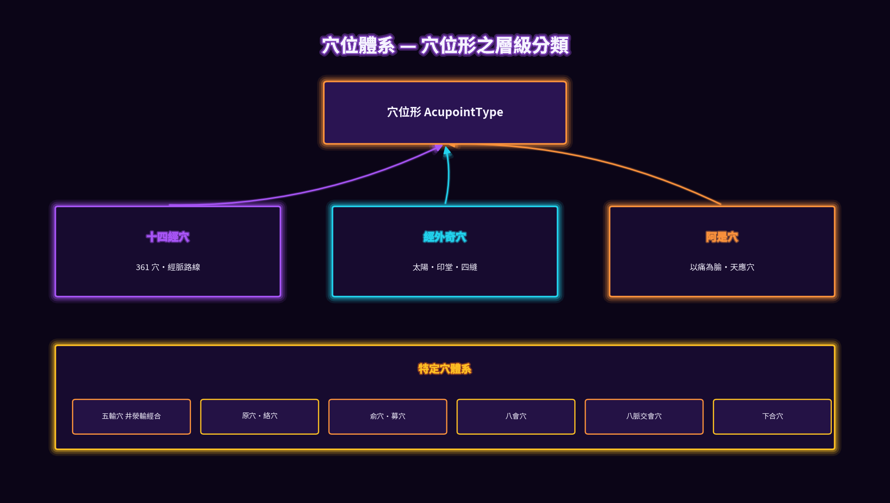

**【圖】穴位體系：穴位形之層級分類與特定穴**

| 常見病證 | 治則 | 主穴（節錄） | 配穴與加減 |
| --- | --- | --- | --- |
| 頭痛（外感） | 疏風通絡止痛 | 百會太陽風池合谷 | 太陽經痛加後溪；陽明加印堂內庭；少陽加外關足臨泣 |
| 胃脘痛 | 和胃止痛 | 中脘足三里內關公孫 | 寒證加灸；肝氣犯胃加太沖；食滯加下脘梁門 |
| 腰痛 | 補腎強腰通絡 | 腎俞委中夾脊阿是穴 | 寒濕加灸關元；瘀血加膈俞；腎虛加太溪 |
| 不寐 | 寧心安神 | 神門百會安眠三陰交 | 心脾兩虛加心俞脾俞；肝火加太沖行間 |
| 中風（中經絡） | 醒腦開竅疏通經絡 | 內關水溝三陰交極泉尺澤委中 | 上肢不遂加肩髃曲池；口眼歪斜加地倉頰車 |
| 面癱（口僻） | 祛風通絡疏調經筋 | 翳風地倉頰車合谷太沖 | 急性期輕刺；恢復期加足三里補氣 |
| 痛經（實證） | 行氣散寒化瘀止痛 | 中極次髎三陰交地機 | 寒凝加關元灸；氣滯加太沖 |

刺灸法要點：補瀉手法（提插補瀉、捻轉補瀉、迎隨補瀉）依虛實而施；灸法（艾炷灸、艾條灸、溫針灸）宜寒證虛證；刺灸禁忌須內建——小兒囟門、孕婦腰骶與三陰交合谷等禁刺部位、飢飽疲勞醉酒暫緩、有出血傾向慎刺。

### ◆ 五輸穴・八脈交會穴體系

| 特定穴 | 內容 | 配屬／配伍 | 應用要點 |
| --- | --- | --- | --- |
| 五輸穴 | 井滎輸經合（所出所溜所注所行所入） | 陰井木、陽井金之五行配屬 | 「滎輸治外經、合治內腑」；虛則補其母、實則瀉其子 |
| 原穴 | 十二原：臟腑原氣留止之處 | 合谷・太沖・太溪・神門・衝陽… | 臟腑病取原穴；四關穴（合谷太沖）調氣血 |
| 絡穴 | 十五絡脈別出之處 | 列缺・內關・豐隆・公孫… | 表裡兩經同病取絡穴；長針久留 |
| 俞穴・募穴 | 背俞（陽）・腹募（陰） | 肺俞中脘、心俞巨闕… | 「陰病引陽、陽病引陰」；俞募配穴治臟腑病 |
| 八會穴 | 臟會中脘、腑會中脘、氣會膻中、血會膈俞、筋會陽陵泉、脈會太淵、骨會大杼、髓會絕骨 | 各會穴主治相應組織病 | 血證取膈俞、筋病取陽陵泉 |
| 八脈交會穴 | 公孫內關（胃心胸）、臨泣外關（目外眥頸耳肩）、後溪申脈（目內眥頸項耳肩）、列缺照海（肺系咽喉胸膈） | 上下肢配穴 | 按病位所在配對取穴 |
| 下合穴 | 胃三里、大腸上巨虛、小腸下巨虛、膀胱委中、膽陽陵泉、三焦委陽 | 六腑病取下合穴 | 「合治內腑」，《內經》古法 |

## 4.7 養生治未病：體質形與養生形

《素問·四氣調神大論》「聖人不治已病治未病」是中醫養生的總綱。系統以體質形為個體化底座，九種體質辨識（王琦九分法）決定養生方向，養生形承載四季、食療、起居、情志方案。

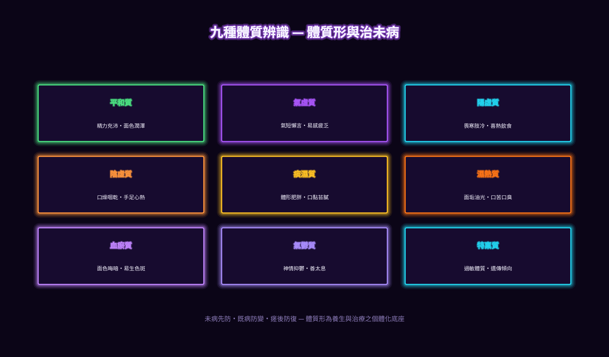

**【圖】九種體質辨識：體質形與治未病**

| 體質 | 特徵 | 易感傾向 | 調理原則 |
| --- | --- | --- | --- |
| 平和質 | 精力充沛面色潤澤體態勻稱 | 較少 | 飲食有節起居有常，維持平衡 |
| 氣虛質 | 氣短懶言易疲乏易感冒 | 反覆感冒、內臟下垂 | 補氣健脾：黃芪山藥大棗；忌耗氣 |
| 陽虛質 | 畏寒肢冷喜熱飲食 | 水腫洩瀉、陽痿宮寒 | 溫陽散寒：羊肉生薑韭菜；忌生冷 |
| 陰虛質 | 口燥咽乾手足心熱失眠 | 虛火上炎、乾燥病證 | 滋陰潤燥：百合銀耳芝麻；忌辛辣 |
| 痰濕質 | 體肥腹滿口黏苔膩 | 三高、中風、多囊 | 健脾化濕：薏米陳皮冬瓜；忌肥甘 |
| 濕熱質 | 面垢油光口苦苔黃膩 | 瘡瘍黃疸、泌尿感染 | 清熱利濕：綠豆苦瓜薏米；忌酒熱 |
| 血瘀質 | 面色晦暗易生色斑刺痛 | 痛經、血栓、腫瘤 | 活血行氣：山楂醋玫瑰；忌寒凝 |
| 氣鬱質 | 神情抑鬱善太息胸脅脹 | 鬱證、梅核氣、甲狀腺 | 疏肝理氣：玫瑰花佛手；多運動 |
| 特稟質 | 過敏體質遺傳傾向 | 哮喘蕁麻疹過敏性鼻炎 | 益氣固表避過敏原：黃芪防風；忌發物 |

| 季節 | 養生要旨 | 飲食要點 | 起居運動 |
| --- | --- | --- | --- |
| 春 | 生發養肝、夜臥早起 | 省酸增甘以養脾氣（少酸多甘） | 廣步於庭舒展筋骨、條暢情志 |
| 夏 | 養長養心、夜臥早起 | 省苦增辛以養肺氣；適食酸收 | 無厭於日適度汗出、忌過用空調 |
| 秋 | 收斂養肺、早臥早起 | 省辛增酸以養肝氣；潤燥生津 | 安寧神志、防秋燥傷肺 |
| 冬 | 閉藏養腎、早臥晚起 | 省鹹增苦以養心氣；溫補潛陽 | 避寒就溫、勿擾陽氣、適度冬練 |

### ◆ 食療常見方案（養生形範例）

| 體質／狀態 | 食療方案 | 要點 |
| --- | --- | --- |
| 氣虛質 | 黃芪山藥大棗粥、黨參燉雞 | 補氣而不壅滯，佐陳皮理氣 |
| 陽虛質 | 當歸生薑羊肉湯、韭菜核桃粥 | 溫陽散寒；嚴忌生冷 |
| 陰虛質 | 百合銀耳羹、麥冬枸杞茶、桑椹膏 | 滋陰潤燥；忌辛辣香燥 |
| 痰濕質 | 薏米赤小豆粥、荷葉冬瓜湯、陳皮普洱 | 健脾化濕；忌肥甘厚味 |
| 濕熱質 | 綠豆百合湯、苦瓜薏米粥、玉米須茶 | 清熱利濕；嚴戒酒 |
| 血瘀質 | 山楂玫瑰茶、黑木耳、醋泡黑豆 | 活血不傷正；孕期忌用活血食材 |
| 氣鬱質 | 玫瑰花茶、佛手柑粥、小麥甘草大棗湯 | 疏肝理氣安神 |
| 病後調理 | 四神湯（山藥蓮子芡實茯苓）、小米紅棗粥 | 健脾益氣助運化，虛不受補首選 |

## 4.8 專科知識：專科形的臨床覆蓋

專科形繼承通科辨證骨架，疊加專科特有規律：婦科以沖任督帶與月經週期為軸，兒科須知「啞科」以望診為先、臟腑嬌嫩易虛易實，骨傷以筋骨並重內外兼治為則，五官以經絡分部為要。

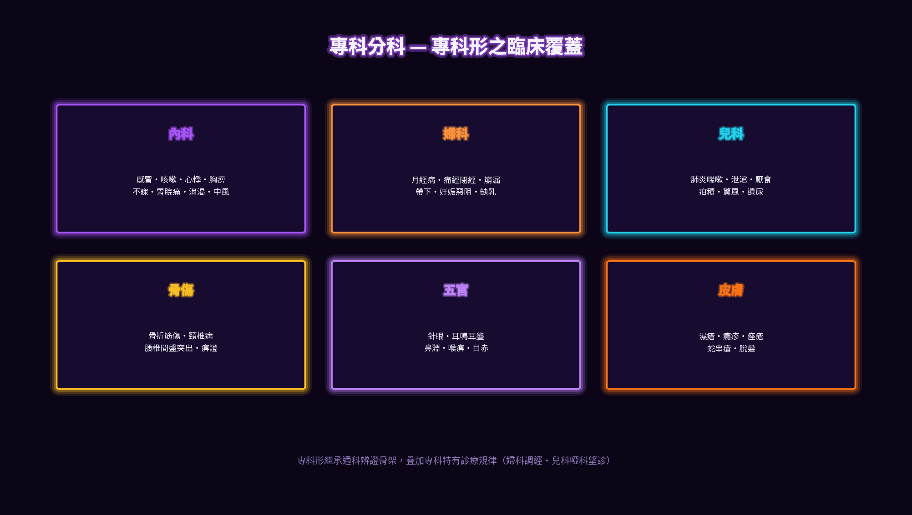

**【圖】專科分科：專科形之臨床覆蓋**

| 專科 | 常見病 | 核心證型 | 代表治法方 | 專科要點 |
| --- | --- | --- | --- | --- |
| 內科 | 感冒・咳嗽・心悸・不寐・胃脘痛・消渴・眩暈・中風 | 風寒束表、心脾兩虛、肝陽上亢、痰瘀阻絡 | 麻黃湯、歸脾湯、天麻鉤藤飲、補陽還五湯 | 內科為全科之基，臟腑辨證為主軸 |
| 婦科 | 月經先後期・痛經・閉經・崩漏・帶下・惡阻・缺乳 | 氣滯血瘀、氣血兩虛、腎虛、濕熱下注 | 逍遙散、四物湯、完帶湯、下乳湧泉散 | 調經以「補腎-疏肝-健脾」為三法；孕期用藥有禁忌層級 |
| 兒科 | 肺炎喘嗽・泄瀉・厭食・疳積・驚風・遺尿 | 風熱閉肺、脾虛洩瀉、食積疳積、脾腎氣虛 | 麻杏石甘湯、參苓白朮散、肥兒丸 | 啞科望診為先；藥量按體重年齡折算；推拿捏脊常為首選 |
| 骨傷 | 頸椎病・腰突・骨折筋傷・痹證 | 氣滯血瘀、風寒濕痹、肝腎不足 | 身痛逐瘀湯、獨活寄生湯、補腎壯筋湯 | 筋骨並重、內外兼治、動靜結合；三期用藥（攻瘀-續骨-補腎） |
| 五官 | 針眼・耳鳴耳聾・鼻淵・喉痹・目赤 | 風熱上攻、肝火上炎、腎精虧虛、肺經鬱熱 | 銀翹散、龍膽瀉肝湯、耳聾左慈丸、蒼耳子散 | 循經分部：目屬肝、耳屬腎、鼻屬肺、咽喉屬肺胃 |
| 皮膚 | 濕瘡・癮疹・痤瘡・蛇串瘡・脫髮 | 濕熱浸淫、風邪襲表、血熱、肝鬱血瘀 | 龍膽瀉肝湯、消風散、枇杷清肺飲、桃紅四物湯 | 「治外必本諸內」；血虛風燥為慢性瘙癢共性 |

### ◆ 婦科月經病辨證提要

| 病證 | 常見證型 | 辨證要點 | 代表方 |
| --- | --- | --- | --- |
| 月經先期 | 血熱（實熱/虛熱/肝鬱）、氣虛 | 量色質＋兼症；先期量多色紅屬熱 | 清經散、丹梔逍遙散、歸脾湯 |
| 月經後期 | 血寒（實寒/虛寒）、血虛、氣滯 | 後期量少色黯有塊屬寒 | 溫經湯、大補元煎、烏藥湯 |
| 痛經 | 氣滯血瘀、寒凝血瘀、濕熱蘊結、氣血虛弱、腎氣虧虛 | 痛的時間（經前/經中/經後）、拒按喜按 | 膈下逐瘀湯、少腹逐瘀湯、清熱調血湯、聖愈湯 |
| 閉經 | 氣血虛弱、腎氣虧虛、陰虛血燥、氣滯血瘀、痰濕阻滯 | 虛實之分；原發繼發 | 人參養榮湯、加減蓯蓉菟絲子、血府逐瘀湯 |
| 崩漏 | 血熱、腎虛、脾虛、血瘀 | 崩中漏下之別；塞流澄源復舊三法 | 清熱固經湯、固本止崩湯、逐瘀止血湯 |
| 帶下病 | 脾虛、腎陽虛、陰虛夾濕、濕熱下注、熱毒蘊結 | 帶下量色質味 | 完帶湯、內補丸、知柏地黃丸、止帶方 |

### ◆ 兒科要點補充

| 病證 | 要點 | 代表治法 |
| --- | --- | --- |
| 肺炎喘嗽 | 風寒閉肺/風熱閉肺/痰熱閉肺/毒熱閉肺/心陽虛衰 | 宣肺開閉為總則；麻杏石甘湯為主方；危候防心陽虛衰 |
| 小兒泄瀉 | 常證（風寒/濕熱/傷食/脾虛/脾腎陽虛）；變證（傷陰/傷陽/陰陽兩傷） | 運脾化濕為主；防脫水傷陰傷陽為要 |
| 疳積 | 疳氣（輕）→疳積（中）→乾疳（重） | 健運脾胃為主；肥兒丸；配合捏脊刺四縫 |
| 驚風 | 急驚風（感受時邪/暴受驚恐/痰熱積滯）；慢驚風（脾虛肝旺/脾腎陽虛） | 急驚先開竅息風；慢驚溫補脾腎 |
| 五遲五軟 | 肝腎不足、心脾兩虛 | 補腎養肝健脾；六味地黃丸加減 |
| 小兒用藥特點 | 藥量按體重年齡折算；中病即止；慎用大苦大寒大辛大熱 | 推拿捏脊常為首選輔助；劑量分次服 |

### ◆ 內科常見病辨證提要

| 病證 | 常見證型 | 辨證要點 | 代表方 |
| --- | --- | --- | --- |
| 感冒 | 風寒束表、風熱犯表、暑濕傷表、氣虛感冒 | 寒熱偏重、汗出有無、脈浮緊或浮數 | 荊防敗毒散、銀翹散、新加香薷散、參蘇飲 |
| 咳嗽 | 風寒襲肺、風熱犯肺、燥邪傷肺、痰濕蘊肺、肝火犯肺、肺陰虧虛 | 痰色質、發病急緩、與情志關係 | 三拗湯、桑菊飲、桑杏湯、二陳湯、瀉白散、沙參麥冬湯 |
| 心悸 | 心虛膽怯、心血不足、心陽不振、水飲凌心、心血瘀阻 | 悸動誘因、伴隨症狀、舌脈 | 安神定志丸、歸脾湯、桂枝甘草龍骨牡蠣湯、苓桂朮甘湯、桃仁紅花煎 |
| 不寐 | 肝火擾心、痰熱擾心、心脾兩虛、心腎不交、心膽氣虛 | 入睡難易、多夢、兼症 | 龍膽瀉肝湯、黃連溫膽湯、歸脾湯、黃連阿膠湯、安神定志丸 |
| 胃脘痛 | 寒邪客胃、飲食停滯、肝氣犯胃、肝胃鬱熱、瘀血停胃、胃陰虧虛、脾胃虛寒 | 痛勢喜按拒按、與飲食情志關係 | 良附丸、保和丸、柴胡疏肝散、化肝煎、失笑散、一貫煎、黃芪建中湯 |
| 泄瀉 | 寒濕內盛、濕熱傷中、食滯腸胃、脾胃虛弱、腎陽虛衰 | 瀉下勢緩勢急、五更、腹痛特點 | 藿香正氣散、葛根芩連湯、保和丸、參苓白朮散、四神丸 |
| 眩暈 | 肝陽上亢、氣血虧虛、腎精不足、痰濕中阻 | 虛實之分、與體位情志關係 | 天麻鉤藤飲、歸脾湯、左歸丸、半夏白朮天麻湯 |
| 中風（中經絡） | 風痰入絡、風陽上擾、陰虛風動 | 半身不遂口眼歪斜之有無、神志 | 真方白丸子、天麻鉤藤飲、鎮肝息風湯 |
| 消渴 | 上消肺熱津傷、中消胃熱熾盛、下消腎陰虧虛、陰陽兩虛 | 多飲多食多尿偏重 | 消渴方、玉女煎、六味地黃丸、金匱腎氣丸 |
| 痹證 | 風寒濕痹（行痹痛痹著痹）、風濕熱痹、痰瘀痹阻、肝腎兩虛 | 痛之游走固定重著、紅熱有無 | 防風湯、烏頭湯、薏苡仁湯、白虎加桂枝湯、獨活寄生湯 |

## 4.9 經典典籍：典籍形的知識源流

典籍形為一切知識提供出處錨點。系統要求：凡引經典條文，必標注書名篇章；凡用經方，必可回溯至原始條文。這既是形證據鏈的文獻端點，也是防範 LLM 幻覺的最後防線。

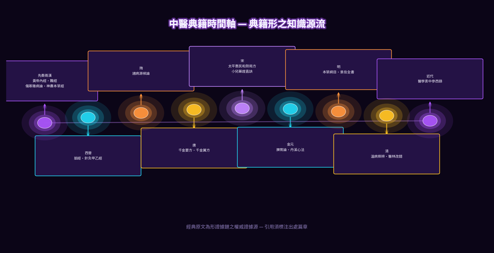

**【圖】中醫典籍時間軸：典籍形之知識源流**

| 典籍 | 時代・作者 | 核心貢獻 | 系統應用方式 |
| --- | --- | --- | --- |
| 《黃帝內經》 | 戰國至西漢・集體 | 陰陽五行、藏象經絡、病因病機、治則養生之奠基 | 理論判定的最高依據；條文式檢索 |
| 《難經》 | 東漢・傳扁鵲 | 脈學、奇經八脈、命門三焦發揮 | 脈診與奇經辨證補充依據 |
| 《傷寒雜病論》 | 東漢・張仲景 | 六經辨證、方證對應、經方體系之祖 | 六經辨證判準來源；經方主幹 |
| 《神農本草經》 | 東漢・集體 | 四氣五味、有毒無毒、上中下三品分類 | 本草形屬性的原始定義源 |
| 《脈經》 | 西晉・王叔和 | 二十四脈規範化、脈診體系化 | 脈形屬性值的標準詞表 |
| 《針灸甲乙經》 | 西晉・皇甫謐 | 腧穴定位與主治體系化 | 穴位形定位屬性的權威來源 |
| 《諸病源候論》 | 隋・巢元方 | 病因病機證候學巨著 | 症狀形與病機關係的證候庫 |
| 《千金要方》 | 唐・孫思邈 | 百科式臨床、醫德規範、婦兒專科 | 專科知識與養生形來源 |
| 《太平惠民和劑局方》 | 宋・官修 | 成方規範、劑型標準 | 方劑形的官方規格參考 |
| 《小兒藥證直訣》 | 宋・錢乙 | 兒科辨證體系、六味地黃丸 | 兒科形與臟腑補瀉範式 |
| 《脾胃論》 | 金・李東垣 | 內傷脾胃學說、補中益氣湯 | 脾胃證型族與補土派依據 |
| 《丹溪心法》 | 元・朱丹溪 | 滋陰降火、痰瘀致病說 | 陰虛痰瘀證型依據 |
| 《景岳全書》 | 明・張介賓 | 命門學說、溫補體系、八陣分類 | 溫補派治法與方劑分類 |
| 《本草綱目》 | 明・李時珍 | 本草集大成、1892 味藥 | 本草形屬性值的擴充主庫 |
| 《溫病條辨》 | 清・吳鞠通 | 三焦辨證、衛氣營血實踐、銀翹散 | 溫病體系判準與代表方 |
| 《醫林改錯》 | 清・王清任 | 瘀血學說、血府逐瘀湯 | 血瘀證型與活血治法 |
| 《醫學衷中參西錄》 | 近代・張錫純 | 中西匯通、藥理實踐 | 近代過渡知識與實證參考 |

檢索策略採「先經後案再研」的時間序列：先查經典原文（最高權威），再查名醫醫案（實踐證據），後查近代研究（統計證據）。三層證據衝突時，以經典定方向、以醫案定可行性、以研究定強度，並在輸出中顯式標注三層的一致程度。

### ◆ 經典原文引用示例（形證據鏈之文獻端點）

| 主題 | 原文（節錄） | 出處 |
| --- | --- | --- |
| 治病求本 | 陰陽者，天地之道也……治病必求於本 | 《素問・陰陽應象大論》 |
| 正氣存內 | 正氣存內，邪不可干；邪之所湊，其氣必虛 | 《素問・刺法論》／《評熱病論》 |
| 辨證論治 | 觀其脈證，知犯何逆，隨證治之 | 《傷寒論》第 16 條 |
| 太陽中風 | 太陽病，發熱，汗出，惡風，脈緩者，名為中風 | 《傷寒論》第 2 條 |
| 太陽傷寒 | 太陽病，或已發熱，或未發熱，必惡寒，體痛，嘔逆，脈陰陽俱緊者，名為傷寒 | 《傷寒論》第 3 條 |
| 治未病 | 聖人不治已病治未病，不治已亂治未亂 | 《素問・四氣調神大論》 |
| 溫病衛分 | 太陰之為病，脈不緩不緊而動數…… | 《溫病條辨》上焦篇 |
| 用藥如用兵 | 藥之治病，猶兵之戡亂也…… | 《用藥如用兵論》（徐大椿） |
| 醫德規範 | 凡大醫治病，必當安神定志，無欲無求，先發大慈惻隱之心 | 《備急千金要方・大醫精誠》 |

> **引用紀律**
>
> 凡引經典必標注書名篇章；引文須逐字核對原文，禁止半文半白之改寫；同一條文在不同版本有異文時標注版本——這是防範 LLM 幻覺在文獻端的第一道閘門。

# 第5章 形驅動辨證論治八步驟 TDDT

TDDT（Type-Driven Diagnosis & Treatment）是 AI 中醫大腦的操作骨架。它把辨證論治拆解為八個形驅動步驟，每步都遵循「形定義→屬性填值→關係連邊→判準檢核」的框架，並在步驟之間以規格化中間產物交接。本章給出八步驟的完整規範；第 6 章則把每一步翻譯為可直接使用的提示詞工作流。

## 5.1 TDDT 總覽與步驟銜接

**【圖】形驅動辨證論治八步驟：輸入・輸出・判準全程留痕**

八步驟分屬三個階段：資訊階段（T1–T2）把原始四診資訊形化並完成八綱定位；辨證階段（T3–T4）展開辨證體系推演並以 ∩(T) 立證；治療階段（T5–T7）完成立法、處方、針灸外治；T8 為閉環階段，負責醫案沉澱與演化。步驟之間的銜接契約是「形實例」：上一步的輸出形，就是下一步的輸入形，任何未形化的自由文本都不能跨步傳遞。

## 5.2 T1–T8 步驟規範

| 步驟 | 輸入 | 核心操作 | 輸出 | 判準 |
| --- | --- | --- | --- | --- |
| T1 四診採集形化 | 主訴・現病史・望聞問切原始描述 | 按四診綱目結構化為症狀形・舌形・脈形；缺失顯式標注 | 四診屬性表＋缺口清單 | 完整性；不臆造體徵；術語規範 |
| T2 八綱定位 | 四診屬性表 | 表裡寒熱虛實陰陽逐綱判定並列證據；夾雜顯式標注 | 八綱定位表＋假設清單 | 每綱有據；矛盾顯式；陰陽總綱一致 |
| T3 辨證體系推理 | 八綱定位＋四診表 | 依病種啟用臟腑／六經／衛氣營血／三焦／經絡體系並行推演 | 候選證型排名＋∩(T) 吻合度 | 體系選擇有據；≥2 候選比較 |
| T4 證型確立 ∩(T) | 候選證型集 | 主證型判定、鑑別診斷、兼證夾雜整理 | 證型形實例＋鑑別表 | ∩(T) ≥ 0.85；反證已排除 |
| T5 治則確立 | 證型形實例 | 標本緩急排序、八法選定、兼證立法 | 治則形＋治法形組合 | 證→法推導鏈完整；禁忌反向檢核 |
| T6 方藥設計 | 治法組合＋體質禁忌 | 方證對應選方、君臣佐使組成、劑量煎服法、加減 | 方劑形 BOM＋加減備案 | 配伍禁忌全檢；每味藥有治法指歸 |
| T7 針灸外治 | 證型＋經絡病位 | 循經＋局部＋特定穴配伍；補瀉手法；療程 | 穴位形處方＋療程表 | 取穴有經絡依據；刺灸禁忌檢核 |
| T8 醫案演化 | 全程形證據鏈＋療效 | 醫案入庫、規律萃取、判準精進提案 | 病案形＋演化提案 | 一般化不越界；審核閘門留痕 |

表中判準欄即各步的「出關條件」——不滿足者不得流入下一步。TDDT 對傳統「理法方藥」的增益在於：每步之間的中間產物都可獨立審查，錯誤在對應步驟即可攔截，不會一路傳導到處方才爆發。

## 5.3 全程留痕與形證據鏈

形證據鏈是 TDDT 的時間戳記化存證：每一步的輸入快照、提示詞版本、輸出形實例、判準計算結果、醫師覆核簽署，依序封存為鏈式結構。它支撐三件事：其一，可回溯——任何一張處方都能一路回溯到四診原始記錄；其二，可審計——醫療爭議與合規審查有完整證據；其三，可複現——同一醫案以同一版本判準重放，結果一致。

| 鏈節 | 存證內容 | 時間語義 |
| --- | --- | --- |
| T1–T2 節點 | 四診快照、八綱判定與證據指標 | 就診時刻的患者狀態 |
| T3–T4 節點 | 候選證型、∩(T) 計算過程、鑑別排除理由 | 推理時刻的判斷依據 |
| T5–T7 節點 | 治法推導、處方 BOM、針灸方案、禁忌檢核報告 | 治療決策時刻的完整意圖 |
| T8 節點 | 療效結局、前後對照、演化提案與審核結果 | 閉環時刻的經驗沉澱 |

# 第6章 準確使用方法提示詞手冊 S1–S8

本章是全書的核心使用手冊：把 TDDT 八步驟翻譯為八個可直接貼用的提示詞工作流（S1–S8），每個工作流給出定位、輸入規格、完整提示詞模板、輸出規格、∩(T) 檢核表與實戰範例。使用者在 Mind AI 平台上，按序啟用八個工作流，即可完成一次全程受檢核的辨證論治。

## 6.0 使用方法總則

### ◆ 在 Mind AI 上啟用工作流的標準動作

- 第一步「定角色」：新會話開始即貼用該工作流的角色設定段，明確告知系統以中醫輔助角色運作、以形化格式輸出；
- 第二步「給規格」：依輸入規格表準備材料，按模板佔位符填入；缺項寧可標注「未採集」，不可編造；
- 第三步「收輸出」：對照輸出規格表驗收，檢查 ∩(T) 檢核表逐項通過後才進入下一工作流；
- 第四步「留痕」：保存輸入輸出全文（即形證據鏈節點），並記錄所用判準版本；
- 第五步「覆核」：涉及診斷與處方的工作流（S3–S6）輸出一律須執業中醫師覆核簽署後方可採用。

| 規則 | 內容 | 理由 |
| --- | --- | --- |
| 逐步交付 | 一次會話只走一個 S 工作流，產出驗收後再開下一步 | 避免上下文污染與檢核跳步 |
| 形化輸出 | 所有輸出以規格表的形格式呈現，拒絕自由散文 | 形實例才可檢核、可傳遞、可入庫 |
| 顯式缺口 | 缺失資訊標注「未採集」，不確定結論標注置信區間 | 空白臆想是醫療幻覺的主要來源 |
| 版本記錄 | 每次會話記錄判準版本與提示詞版本 | 可複現、可審計的前提 |
| 紅線攔截 | S5 觸發十八反十九畏妊禁、S7 觸發危急警訊時立即停止並升級人工 | 安全優先於流程完成度 |

> **與一般 AI 問診的本質區別**
>
> 一般用法是「把問題丟給 AI 要答案」；本手冊的用法是「讓 AI 在形規格裡作業，每步交卷給判準和醫師批改」。準確度不來自模型本身，而來自流程的檢核密度——這是「準確使用方法」四個字的真正含義。

### ◆ 依病種的工作流組合策略

| 病種 | 工作流序列 | 辨證體系重心 | 檢核重點 |
| --- | --- | --- | --- |
| 外感急性病 | S1→S2→S3（六經/溫病）→S4→S5（可加 S6）→S7 | 六經或衛氣營血三焦 | 傳變時機；汗法下法禁忌；療程節奏加密 |
| 內傷慢性病 | S1→S2→S3（臟腑）→S4→S5→S6→S7→S8 | 臟腑辨證＋氣血津液 | 標本緩急；虛實夾雜；長期用藥安全 |
| 婦科病 | S1（加經帶胎產）→S2→S3（臟腑＋沖任）→S4→S5→S7 | 臟腑辨證＋沖任督帶 | 妊娠禁忌強制啟用；經期用藥時機 |
| 兒科病 | S1（望診為重）→S2→S3（臟腑）→S4→S5（劑量折算）→S7 | 臟腑辨證（啞科） | 劑量折算；推拿捏脊備選；病情變化快 |
| 筋骨傷科 | S1→S2→S3（經絡＋臟腑）→S4→S5（內服）→S6（針灸外治）→S7 | 經絡辨證＋肝腎 | 三期用藥；外治禁忌；影像合參 |
| 養生調理 | S1（體質採集）→S2（平和判定）→S7（階段評估） | 體質辨識（非診療） | 邊界紅線：疑似疾病即轉介 |

## 6.1 S1 四診採集官 — 資訊形化

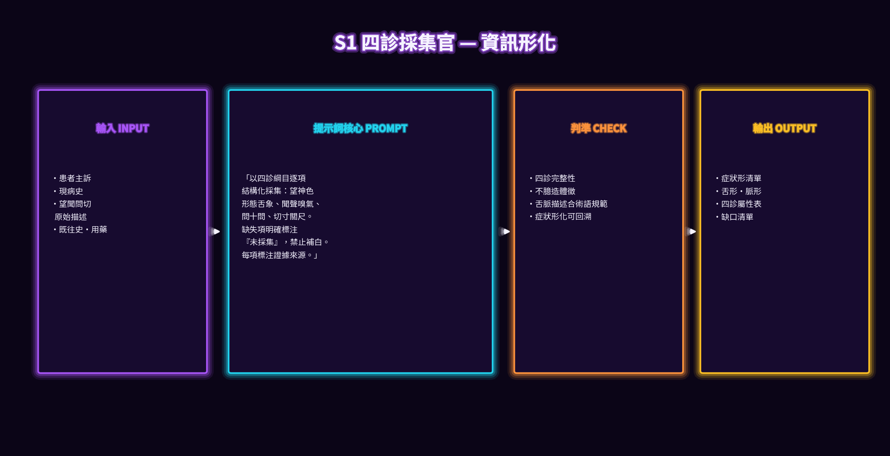

**【圖】S1 四診採集官：輸入→提示詞→判準→輸出工作流卡**

S1 是全流程的資訊入口：把患者主訴、現病史與望聞問切原始描述，結構化為症狀形・舌形・脈形清單。S1 的鐵律是「只記錄、不判斷」——辨證結論一律留給 S3，採集官一旦越權下判斷，就會把暗示性偏見寫進證據層，污染全鏈。

> **S1 提示詞模板（角色＋任務＋規格）**
>
> 【角色】你是「四診採集官」，負責中醫四診資訊的結構化採集，只記錄不判斷。
>
> 【任務】將下列原始診療資訊逐項轉為四診結構化表：
>
> 1. 望診：望神（得神/失神/假神/神亂）、望色（青赤黃白黑）、望形態、望舌（舌色/舌形/舌態/苔色/苔質）、望小兒指紋。
>
> 2. 聞診：語聲、呼吸、咳嗽、嘔逆噯氣、體氣病室氣味。
>
> 3. 問診：依十問歌逐項——寒熱、汗、頭身、二便、飲食口味、胸腹、耳目、渴、舊病、病因，婦科加經帶胎產。
>
> 4. 切診：寸關尺脈象（位/數/形/勢/節律分候）、按診。
>
> 【規格】每項輸出：症狀形[名稱｜部位｜性質｜程度｜時間規律｜加劇緩解因素｜證據來源]。
>
> 【鐵律】① 未採集項目一律標注「未採集」，禁止補白、禁止推測；② 只用規範中醫術語，不寫同義模糊語；③ 不下任何辨證結論；④ 主訴原文完整保留於表頭。

| 輸入項 | 格式 | 示例 |
| --- | --- | --- |
| 主訴 | 一句話＋病程時間 | 惡寒發熱伴頭痛三天 |
| 現病史 | 起病、演變、已接受處理 | 三天前受涼後惡寒重、發熱輕、無汗、頭項強痛 |
| 四診原始描述 | 自然語言或問卷 | 面色偏白、苔薄白、脈浮緊有力、無咽痛口渴 |
| 既往史・用藥 | 簡列 | 既往體健；自行服用感冒藥兩日未緩解 |

| ∩(T) 檢核項 | 通過標準 | 未過處理 |
| --- | --- | --- |
| 四診完整性 | 望聞問切四欄皆有明確填寫或「未採集」標注 | 列出缺口清單請醫師補採 |
| 不臆造體徵 | 所有體徵皆可回指原始描述 | 刪除無來源項目並標記異常 |
| 術語規範 | 症狀名稱符合中醫規範詞表 | 術語歸一化並保留原文 |

### ◆ 範例演練（外感案）

> **S1 範例輸入**
>
> 主訴：惡寒發熱伴頭痛三天。
>
> 現病史：三天前淋雨受涼後惡寒重、發熱輕（T 37.8℃）、無汗、頭項強痛、鼻塞流清涕、咳嗽痰白清稀、口不渴、二便調。
>
> 四診：面色偏白、苔薄白、脈浮緊有力。既往體健。

> **S1 範例輸出（節錄）**
>
> 症狀形清單：①惡寒｜全身｜冷感｜重度｜持續三天｜得溫不減｜主訴；②發熱｜全身｜T37.8℃｜輕度｜持續三天｜—｜現病史；③頭痛｜頭項部｜強痛｜中度｜持續｜遇風加重｜現病史；④無汗｜全身｜—｜—｜三天｜—｜現病史；⑤鼻塞流涕｜鼻｜清涕｜中度｜三天｜—｜現病史；⑥咳嗽｜肺系｜痰白清稀｜輕度｜三天｜—｜現病史；⑦口不渴｜口｜—｜—｜—｜—｜現病史。
>
> 舌形：淡紅舌薄白苔。脈形：浮（位）｜數平（數）｜—（形）｜有力（勢）｜齊（節律）｜寸關尺皆浮緊。
>
> 缺口清單：未採集——聞診氣息、按診、舊病細節。

使用要點：S1 輸出將直接作為 S2–S3 的證據層，其品質決定全鏈上限。實務上常見的失敗模式是採集官偷跑辨證——例如把「惡寒重發熱輕」寫成「風寒表實」。凡在 S1 輸出看到證型詞彙，一律退回重做。

## 6.2 S2 八綱定位官 — 病位病性初判

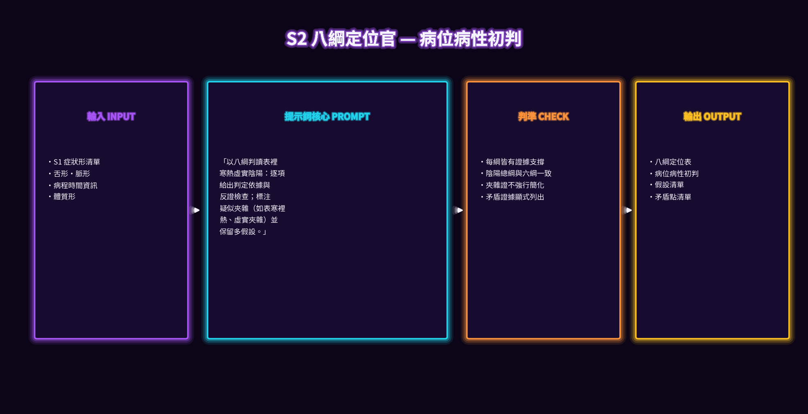

**【圖】S2 八綱定位官：輸入→提示詞→判準→輸出工作流卡**

S2 以四診屬性表為輸入，逐綱判定表裡、寒熱、虛實，並彙總陰陽。每綱判定必須附證據指標與反證檢查；出現夾雜（表寒裡熱、虛實夾雜）時並列呈現，不得強行簡化。

> **S2 提示詞模板**
>
> 【角色】你是「八綱定位官」，負責病位病性的第一層判定，只做八綱，不做臟腑證型。
>
> 【任務】依四診屬性表逐綱判定並輸出定位表：
>
> 1. 表裡：表證（發熱惡寒並見、脈浮、病程短）／裡證（但寒但熱、臟腑症狀）／半表半裡（寒熱往來）。
>
> 2. 寒熱：寒（冷白稀潤靜：惡寒肢冷、面色白、痰涕清稀、口不渴、舌淡苔白、脈遲）／熱（紅黃乾稠動：發熱、面赤、痰涕稠黃、口渴、舌紅苔黃、脈數）。
>
> 3. 虛實：虛（久病、聲低、痛喜按、脈無力）／實（新病、聲高、痛拒按、脈有力）。
>
> 4. 陰陽：依表熱實＝陽、裡寒虛＝陰彙總。
>
> 【輸出】八綱定位表[綱｜判定｜支持證據（屬性值）｜反證檢查｜置信度高/中/低]。
>
> 【鐵律】① 每綱必附證據；② 矛盾證據顯式列出；③ 寒熱真假、虛實真假須專項鑑別並標注；④ 不出現任何臟腑證型結論。

| ∩(T) 檢核項 | 通過標準 | 常見偏差 |
| --- | --- | --- |
| 證據支撐 | 每綱判定至少 2 項證據指標 | 憑單一症狀定綱 |
| 陰陽一致 | 陰陽總綱與六綱判定不矛盾 | 表寒實判陽卻總綱判陰之類邏輯錯 |
| 夾雜顯式 | 夾雜證並列呈現並標注轉化傾向 | 強行簡化為單一綱證 |
| 真假鑑別 | 疑似寒熱虛實真假時給出鑑別專項 | 忽略脈象舌象的關鍵鑑別價值 |

### ◆ 範例演練（續 S1 案）

> **S2 範例輸出**
>
> 表裡｜表證｜支持：惡寒發熱並見、頭項強痛、脈浮、病程三天｜反證檢查：無裡證症狀｜置信度：高
>
> 寒熱｜寒證｜支持：惡寒重、痰白清稀、口不渴、苔薄白｜反證檢查：無熱象（T37.8℃ 屬微熱，與惡寒並見支持表寒）｜置信度：高
>
> 虛實｜實證｜支持：新病、脈浮緊有力、聲高｜反證檢查：無虛象｜置信度：高
>
> 陰陽｜陽證（表寒實）｜一致。寒熱真假：無徵象，不需鑑別。
>
> 假設清單：①表寒實證（主假設）；②待鑑別：表寒裡熱（需問口渴咽痛——現有「口不渴」已弱化此假設）。

## 6.3 S3 辨證推理官 — 體系推演

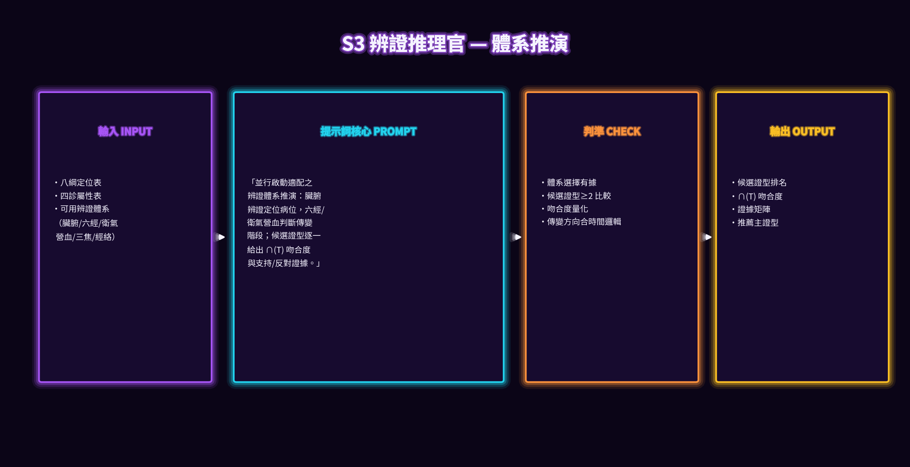

**【圖】S3 辨證推理官：輸入→提示詞→判準→輸出工作流卡**

S3 是辨證的核心推理步驟：在八綱定位之上，啟用適當辨證體系（外感熱病用六經或衛氣營血三焦，內傷雜病用臟腑，經絡病變加經絡辨證），產出帶 ∩(T) 吻合度的候選證型排名。

> **S3 提示詞模板**
>
> 【角色】你是「辨證推理官」，負責多體系辨證推演與候選證型排名。
>
> 【任務】依八綱定位表與四診屬性表執行：
>
> 1. 體系選擇：外感病→六經辨證（傷寒）或衛氣營血三焦（溫病）；內傷雜病→臟腑辨證；循經症狀→加經絡辨證。說明選擇理由。
>
> 2. 並行推演：候選證型 ≥ 2 個，逐一給出：判準集合 T（主證/次證/舌脈佐證/反證）、∩(T) 吻合度、支持證據、反對證據。
>
> 3. 傳變判斷：若病程有動態，給出傳變方向（六經/衛氣營血/三焦/臟腑乘侮）與時間證據。
>
> 4. 推薦主證型與次選證型，標注鑑別要點。
>
> 【輸出】候選證型排名表[證型｜判準集｜∩(T)｜支持/反對證據｜鑑別要點]。
>
> 【鐵律】① 禁止只給一個候選；② 吻合度按主證 3 分次證 2 分舌脈 2 分反證扣分計算；③ 六經與溫病體系不混用；④ 引用經典條文須標注篇章。

| ∩(T) 檢核項 | 通過標準 |
| --- | --- |
| 體系適配 | 體系選擇與病種（外感/內傷/經絡）相符並說明理由 |
| 多候選比較 | ≥ 2 候選證型逐一量化比較 |
| 吻合度可覆算 | 判準集與權重完整，讀者可自行覆算 |
| 傳變有時間證據 | 傳變結論附節點對照（何時出現何症） |
| 經典可溯源 | 所引條文標注書名篇章 |

### ◆ 範例演練（續 S2 案）

> **S3 範例輸出（節錄）**
>
> 體系選擇：六經辨證（傷寒）——理由：起病急、惡寒發熱並見、脈浮，屬外感傷寒範疇；無高熱口渴斑疹，不啟用溫病體系。
>
> 候選一：太陽傷寒證｜T={惡寒(3),無汗(3),頭項強痛(2),脈浮緊(3),苔薄白(2),發熱(2)}｜反證：無｜∩(T)=0.94｜支持：S1 全部證候；反對：無。
>
> 候選二：太陽中風證｜T={汗出(3),惡風(3),脈浮緩(3)}｜∩(T)=0.41｜反證：「無汗」直接反對「汗出」，排除。
>
> 鑑別要點：傷寒與中風之別在汗出有無、脈緊與緩。
>
> 推薦：太陽傷寒證（主證型）。傳變預測：表寒不解可入裡化熱（陽明），或鬱熱於肺（麻杏石甘湯證）。

## 6.4 S4 治則確立法官 — 治法推導

**【圖】S4 治則確立法官：輸入→提示詞→判準→輸出工作流卡**

S4 承上啟下：由證型形推導治則治法。核心紀律是「證→法推導鏈」——每一條治法都必須能回指證型的具體證候，禁止「經驗性堆砌治法」。

> **S4 提示詞模板**
>
> 【角色】你是「治則確立法官」，負責由證立法。
>
> 【任務】依證型形實例執行：
>
> 1. 標本緩急：判定標證本證，確定「急則治標、緩則治本、標本兼治」策略。
>
> 2. 扶正祛邪：判定正邪盛衰，確定祛邪為主、扶正為主或攻補兼施。
>
> 3. 八法選定：汗吐下和溫清消補，選定主法與輔法，逐一說明對應證候。
>
> 4. 三因制宜：因人（體質形、年齡性別）、因時（季節病程）、因地制宜的修正。
>
> 5. 兼證夾雜的立法加減安排。
>
> 【輸出】治則治法表[治則｜治法｜對應證候（證→法推導鏈）｜時機｜修正因素]。
>
> 【鐵律】① 無推導鏈的治法不得出現；② 汗法須明確禁忌（瘡家衄家汗家禁汗）；③ 下法須評估正氣耐受；④ 緩急次序明確到先後時間。

| ∩(T) 檢核項 | 通過標準 |
| --- | --- |
| 證法對應 | 每條治法可回指證型的具體證候 |
| 標本有序 | 緩急次序明確且與病勢相符 |
| 禁忌反檢 | 所選治法的禁忌證逐一反向檢核通過 |
| 體質修正 | 體質形、時令、地域修正已納入 |

### ◆ 範例演練（續 S3 案）

> **S4 範例輸出**
>
> 標本：標證＝表寒實；本證＝衛陽被遏。急則治標。
>
> 扶正祛邪：邪盛正未衰 → 祛邪為主。
>
> 治法：①辛溫解表（主法）——對應惡寒重、無汗、脈浮緊；②宣肺止咳（輔法）——對應咳嗽痰白清稀。
>
> 三因制宜：深秋淋雨感寒，加溫覆取汗之助；患者體壯能耐汗法。
>
> 禁忌反檢：無衄血、瘡家、汗家史，汗法可用；囑「微似有汗」不可大汗淋漓。

## 6.5 S5 方藥設計官 — 君臣佐使

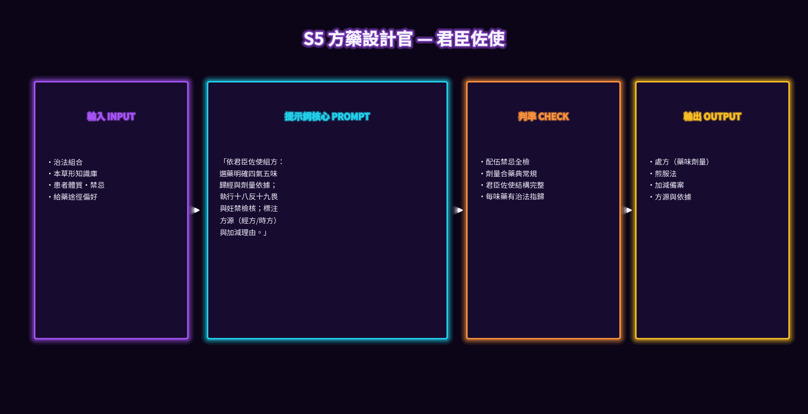

**【圖】S5 方藥設計官：輸入→提示詞→判準→輸出工作流卡**

S5 是安全閘門最密集的工作流：由治法進入處方，優先方證對應選用成方，以君臣佐使檢核組方結構，並以配伍禁忌（十八反、十九畏、妊娠禁忌、毒性藥劑量）逐對掃描。

> **S5 提示詞模板**
>
> 【角色】你是「方藥設計官」，負責立法處方與用藥安全檢核。
>
> 【任務】依治則治法表執行：
>
> 1. 方證對應：優先選用成方（經方優先、時方次之），說明方源與條文依據；不用成方者須說明理由。
>
> 2. 君臣佐使：逐味標注角色——君藥直指主證、臣藥輔君、佐藥佐助佐制反佐、使藥引經調和。
>
> 3. 劑量與用法：每味藥給出常用量區間與本案取值理由；先煎後下包煎烊化另煎單列。
>
> 4. 安全檢核（紅線）：十八反十九畏逐對掃描、妊娠禁忌（孕產通道強制啟用）、毒性藥（附子烏頭馬錢子等）劑量與炮製、老人小兒劑量折算。
>
> 5. 加減備案：兼證或複診轉歸時的加減規則。
>
> 【輸出】處方 BOM 表[藥味｜角色｜劑量｜性味歸經｜治法指歸｜特殊煎法]＋煎服法＋加減備案＋方源依據。
>
> 【鐵律】① 禁忌命中立即停止並出紅燈報告；② 無治法指歸的藥味不得入方；③ 終審權在執業中醫師。

| ∩(T) 檢核項 | 通過標準 | 攔截級別 |
| --- | --- | --- |
| 配伍禁忌 | 十八反十九畏零命中（或醫師書面例外） | 紅燈：立即停止 |
| 妊娠禁忌 | 孕產通道下禁用藥零命中 | 紅燈 |
| 劑量邊界 | 每味藥在藥典常用量內；毒性藥有炮製與先煎 | 紅燈（超量）／黃燈（接近上限） |
| 組方結構 | 君臣佐使齊備，君藥直指主證 | 黃燈：提示補正 |
| 方源依據 | 成方標注方源；自組方說明不用成方之由 | 黃燈 |

### ◆ 範例演練（續 S4 案）

> **S5 範例輸出（節錄）**
>
> 選方：麻黃湯（《傷寒論》太陽傷寒提綱證）——方證對應：無汗、惡寒、脈浮緊、喘咳。
>
> 處方 BOM：君｜麻黃 9g｜辛溫微苦入肺膀胱｜發汗解表宣肺平喘｜先煎去沫；臣｜桂枝 6g｜辛甘溫｜解肌發表助麻黃發汗；佐｜杏仁 9g｜苦溫｜降氣止咳平喘；使｜甘草 3g｜甘平｜調和諸藥。
>
> 煎服法：水煎溫服，服後溫覆取微汗，啜熱稀粥一盞助汗；忌大汗。
>
> 安全檢核：十八反十九畏掃描零命中；非妊娠；麻黃含麻黃鹼，甲亢心悸失眠者慎用（本案無）。
>
> 加減備案：項背強几几加葛根 12g；咳嗽痰多加半夏 9g；裡熱加石膏 15g（麻杏石甘湯意）。

## 6.6 S6 針灸外治官 — 經穴處方

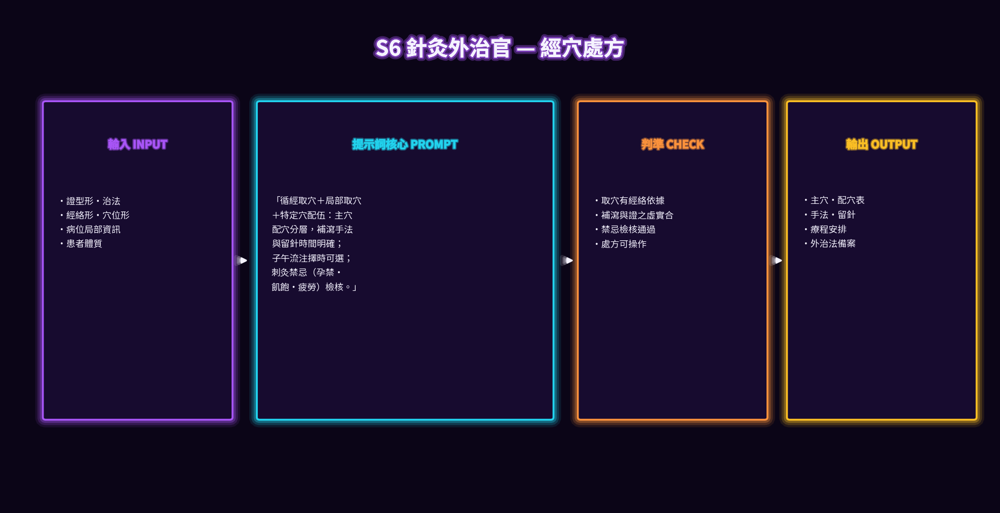

**【圖】S6 針灸外治官：輸入→提示詞→判準→輸出工作流卡**

S6 依證型與病位制定針灸外治方案：循經取穴、局部取穴、特定穴配伍三路並行，主配穴分層，補瀉手法與留針時間明確，刺灸禁忌強制檢核。

> **S6 提示詞模板**
>
> 【角色】你是「針灸外治官」，負責經穴處方與外治方案。
>
> 【任務】依證型形、病位與經絡辨證執行：
>
> 1. 取穴三路：循經取穴（病位所屬經脈）、局部取穴（阿是穴與鄰近穴）、特定穴配伍（五輸穴/原穴/俞募穴/八脈交會穴/下合穴）。
>
> 2. 主配穴分層：主穴 2–4 個直指主證，配穴依兼證加減。
>
> 3. 手法與劑量：補瀉手法（提插捻轉迎隨）依虛實而施；留針 15–30 分鐘；療程（隔日一次或每週三次）。
>
> 4. 擇時選項：子午流注依病位經脈當令時辰。
>
> 5. 禁忌檢核（紅線）：孕婦腰骶與合谷三陰交等禁刺穴、小兒囟門、出血傾向、飢飽疲勞醉酒、重要臟器部位刺法深度。
>
> 【輸出】穴位處方表[穴名｜歸經｜定位｜角色（主/配）｜補瀉｜刺法深度留針｜治法指歸]＋外治備案（艾灸拔罐推拿）。
>
> 【鐵律】① 禁刺禁灸部位命中立即停止；② 每穴須有經絡依據；③ 補瀉與證之虛實方向一致。

| ∩(T) 檢核項 | 通過標準 |
| --- | --- |
| 取穴有據 | 每穴標注歸經與治法指歸 |
| 補瀉合證 | 手法方向與虛實判定一致 |
| 禁忌通過 | 孕禁、部位、狀態禁忌掃描零命中 |
| 處方可操作 | 定位、深度、留針、療程完整可執行 |

### ◆ 範例演練（續 S5 案）

> **S6 範例輸出**
>
> 處方：主穴｜大椎（督脈，諸陽之會，散寒解表，刺 0.5–0.8 寸，瀉法）｜風門（膀胱經，風邪出入之門，瀉法）｜列缺（肺經絡穴，頭項尋列缺，瀉法）。
>
> 配穴｜合谷（原穴，面口合谷收，加強解表）｜肺俞（背俞穴，宣肺止咳）。
>
> 外治備案：大椎風門拔罐 10 分鐘（風寒表實適宜）。
>
> 療程：每日一次，汗出症減後停針，改調理。
>
> 禁忌檢核：非妊娠、無出血傾向、無過勞過飢——通過。子午流注參考：膀胱經申時（15–17 時）取膀胱經穴效佳。

## 6.7 S7 療效演化官 — 病程評估

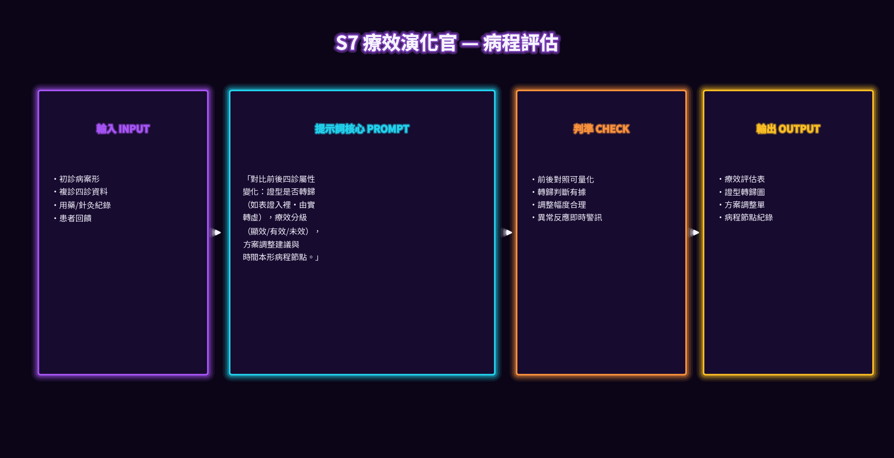

**【圖】S7 療效演化官：輸入→提示詞→判準→輸出工作流卡**

S7 在複診時啟用：對比前後四診屬性變化，評估療效分級，判斷證型轉歸，輸出方案調整建議。S7 同時承擔危急警訊掃描——任何惡化徵象（神昏、胸痛、大出血、呼吸困難）必須第一時間升級轉診。

> **S7 提示詞模板**
>
> 【角色】你是「療效演化官」，負責前後對照、轉歸判斷與危急警訊掃描。
>
> 【任務】依初診病案形與複診四診執行：
>
> 1. 屬性對照：逐項對比初診與複診的症狀形/舌形/脈形屬性值變化（好轉/未變/加重/新增）。
>
> 2. 療效分級：顯效（主證消失≥70%）／有效（主證減輕 30–70%）／未效（＜30%）／加重。
>
> 3. 轉歸判斷：證型是否變化（如表證入裡、由實轉虛、熱化寒化），附時間證據與舌脈推移。
>
> 4. 方案調整：效不更方、隨證加減或改弦更張，說明理由與調整幅度。
>
> 5. 危急警訊掃描（紅線）：神志改變、胸痛徹背、大出血、呼吸困難、高熱驚厥、劇烈腹痛——命中即轉診。
>
> 【輸出】療效評估表[屬性｜初診值｜複診值｜變化｜時間節點]＋轉歸判斷＋調整方案＋警訊掃描報告。
>
> 【鐵律】① 無前後對照不下療效結論；② 轉歸必附舌脈推移證據；③ 警訊命中立即停止流程。

| ∩(T) 檢核項 | 通過標準 |
| --- | --- |
| 對照可量化 | 逐屬性前後對照，變化方向明確 |
| 轉歸有據 | 證型變化附時間證據與舌脈推移 |
| 調整合理 | 調整幅度與轉歸程度相符，效不更方原則被尊重 |
| 警訊掃描 | 危急症清單逐項過目並留痕 |

## 6.8 S8 知識沉澱官 — 醫案演化

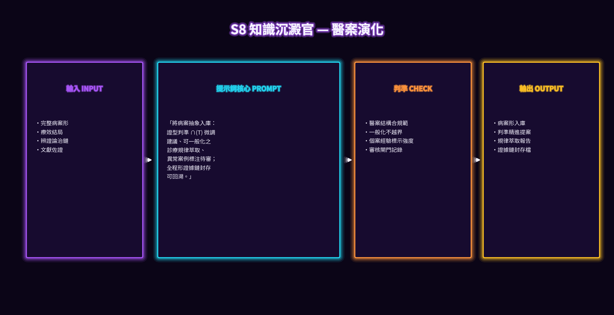

**【圖】S8 知識沉澱官：輸入→提示詞→判準→輸出工作流卡**

S8 把一次診療閉環為可累積的知識：醫案結構化入庫、診療規律萃取、判準精進提案。S8 是時間本形「自我演化」的工作流化——但一切演化皆以提案形式產出，經醫師審核閘門後才生效。

> **S8 提示詞模板**
>
> 【角色】你是「知識沉澱官」，負責醫案入庫與演化提案。
>
> 【任務】依完整病案形與療效結局執行：
>
> 1. 醫案規範化：主訴、現病史、四診、辨證鏈（S2–S4 產物）、治法方藥（S5–S6）、療效（S7）、時間軸節點——七段齊備。
>
> 2. 規律萃取：可一般化的診療規律（如「本案加葛根後項背強痛緩解迅速」），標注證據強度（單案/多案/經典支持）。
>
> 3. 判準精進提案：若療效與 ∩(T) 預測有系統性偏差，提出權重調整或鑑別要點補充提案。
>
> 4. 異常標注：與經典相悖、療效異常、診斷存疑的案例標注「待審」。
>
> 【輸出】病案形入庫檔＋規律萃取報告＋演化提案（默認不生效，待審）。
>
> 【鐵律】① 個案經驗與普遍規律嚴格區分標示；② 提案一律「不生效」直到審核通過；③ 病案含患者識別資訊者去識別化後入庫。

## 6.9 綜合醫案演練：一案走完 S1–S8

以下以一則完整醫案走讀全流程，展示八個工作流的實際銜接。案：王某，女，45 歲，失眠多夢三月，加重一週。

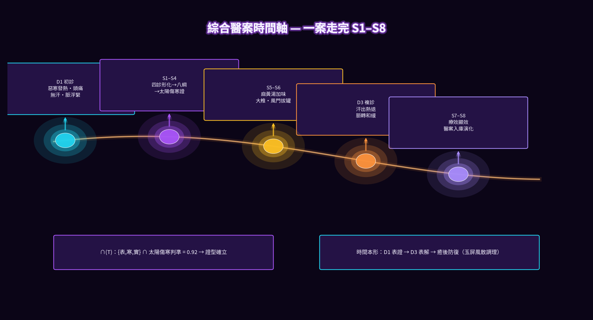

**【圖】綜合醫案時間軸：初診→S1–S6→複診→S7–S8 閉環**

| 工作流 | 本案輸出（節錄） | 檢核結果 | 醫師覆核 |
| --- | --- | --- | --- |
| S1 | 失眠多夢｜心悸健忘｜食少納呆｜面色萎黃｜神疲乏力｜月經量少色淡；舌淡苔薄白；脈細弱 | 缺口：聞診未採 | 補採後通過 |
| S2 | 裡證｜虛證（氣血兩虛）｜寒象不顯｜陰證 | 每綱證據齊備 | 通過 |
| S3 | 臟腑辨證：候選一 心脾兩虛證 ∩(T)=0.91；候選二 心腎不交 ∩(T)=0.48（排除：無煩熱腰酸） | ≥2 候選、可覆算 | 通過 |
| S4 | 標本兼治（病久本虛）；補益心脾、養血安神；歸脾湯意 | 證→法鏈完整 | 通過 |
| S5 | 歸脾湯加減：君黃芪人參；臣當歸龍眼肉；佐白朮茯苓酸棗仁遠志；使甘草生薑大棗。禁忌掃描零命中 | 紅線零命中 | 通過簽署 |
| S6 | 主穴神門三陰交足三里；配穴心俞脾俞百會；補法，隔日一次 | 禁忌通過 | 通過 |
| S7（兩週後） | 睡眠好轉（易醒減）、心悸減、食欲增；脈細較前有力；評定「有效」；效不更方加柏子仁 | 前後對照完整 | 通過 |
| S8 | 醫案七段入庫；規律：「歸脾湯加夜交藤 30g 對入睡困難型心脾兩虛效佳」標注「單案經驗」；判準提案：食少納呆權重由 2 調至 2.5（待審） | 提案不生效待審 | 審核中 |

### ◆ 演練重點解說

此案演示了三個關鍵操作。其一「多候選的價值」：S3 若只看「失眠」直奔心腎不交，便會漏掉「食少納呆、面色萎黃」指向的脾虛線索——強制多候選讓辨證從「找證據支持第一直覺」變成「證據與證型的雙向篩選」。其二「效不更方的節制」：S7 面對「有效但未癒」的中間狀態，沒有急於改弦更張，只作最小加減（加柏子仁安神），這是《傷寒論》「觀其脈證」的時間智慧。其三「演化的保守」：S8 的判準提案標注「待審」，單案經驗標注「單案」——知識沉澱的同時守住強度標示的紀律。

| 環節 | 本案關鍵決策 | 若反向操作的風險 |
| --- | --- | --- |
| S3 多候選 | 心脾兩虛為主、心腎不交列次選並排除 | 直覺式單證型易漏脾虛線索，歸脾湯改黃連阿膠湯則失治 |
| S5 方證對應 | 以歸脾湯成方為骨架加減 | 自由組方（十味藥雜湊）使君臣無主、療效不可解釋 |
| S7 效不更方 | 兩週有效只作最小加減 | 頻繁更方使藥效累積中斷，轉歸無法歸因 |
| S8 強度標示 | 規律標「單案」、提案標「待審」 | 個案經驗直接入判準會污染未來辨證 |

## 6.10 提示詞使用要點與常見偏差

彙整實務上最常影響準確度的使用偏差與對策，作為手冊的日常檢核鏡：

| 常見偏差 | 典型表現 | 後果 | 對策 |
| --- | --- | --- | --- |
| 跳步直達 | 一則提示詞同時要求辨證＋開方 | 檢核鏈斷裂、幻覺率升高 | 嚴格 S1→S8 逐步交付 |
| 採集官越權 | S1 輸出混入證型詞彙 | 暗示性偏見污染證據層 | 見證型詞彙即退回重做 |
| 單候選思維 | S3 只列一個證型 | 鑑別診斷缺位、誤辨風險 | 強制 ≥ 2 候選＋反證檢查 |
| 自由文本交接 | 以散文摘要代替形實例傳遞 | 下游輸入失真 | 形規格表為唯一交接格式 |
| 禁忌後補 | 先開方再檢查禁忌 | 紅線形同虛設 | S5 內建先掃描後出方 |
| 療效印象化 | 「睡得好些了」不作對照 | 轉歸判斷失據 | S7 強制屬性級前後對照 |
| 忽視灰區 | ∩(T) 0.7 仍強出結論 | 把疑似判成確證 | 灰區並列證型＋建議補檢 |
| 不記錄版本 | 未記判準與提示詞版本 | 結果不可複現 | 會話結束記錄版本號 |

> **準確度來自流程，不來自運氣**
>
> 以上八類偏差的共同根源，是把系統當「答案機」而非「受檢核的推理流程」。只要嚴守逐步交付、形化輸出、顯式缺口、版本記錄、紅線攔截五項總則，S1–S8 的組合準確度就會顯著高於單次直覺式提問。

## 6.11 第二演練：風熱咳嗽案的雙工作流對話實錄

本節以「逐字實錄」方式呈現 S1 與 S5 兩個工作流的實際對話樣貌，讓使用者直觀掌握提示詞的貼用方式、輸出的形化格式與檢核的發生時點。案：李某，男，28 歲，咳嗽三天，加重一天。

> **對話實錄一：S1 會話（貼用 S1 模板後）**
>
> 使用者：（貼用 S1 模板）【輸入】主訴：咳嗽三天加重一天。現病史：三天前感冒後咳嗽，痰少而黏，色黃，咽喉腫痛，口微渴，發熱（T 38.2℃），汗出，頭痛。望診：面色微紅，咽部充血，舌尖紅苔薄黃。脈象：浮數。
>
> ----
>
> 系統：S1 四診採集表
>
> 症狀形：①咳嗽｜肺系｜乾咳少痰｜中度｜三天（加重一天）｜遇煙塵加重｜現病史；②痰｜肺系｜黏稠色黃｜少｜三天｜—｜現病史；③咽喉痛｜咽部｜紅腫痛｜中度｜三天｜吞嚥明顯｜現病史；④發熱｜全身｜T38.2℃｜中度｜三天｜—｜現病史；⑤汗出｜全身｜微汗｜輕度｜三天｜—｜現病史；⑥頭痛｜頭部｜脹痛｜輕度｜三天｜—｜現病史；⑦口渴｜口｜微渴喜冷飲｜輕度｜三天｜—｜現病史。
>
> 舌形：舌尖紅｜薄｜—｜黃｜薄｜未採集（舌下絡脈）。脈形：浮（位）｜數（數）｜—（形）｜有力（勢）｜齊（節律）｜分候未採集。
>
> 缺口清單：聞診（咳嗽聲響）、二便、舊病、用藥史未採集。

> **對話實錄二：S5 會話（承 S4 產物「辛涼解表、宣肺止咳」）**
>
> 使用者：（貼用 S5 模板）【輸入】治法：辛涼解表、清肺止咳。證型：風熱犯肺（S3 產出 ∩(T)=0.89）。體質：平和質。非妊娠。
>
> ----
>
> 系統：S5 處方報告
>
> 【選方】桑菊飲（《溫病條辨》）——方證對應：咳嗽為主、身熱不甚、口微渴、苔薄黃脈浮數，屬風溫初起邪在肺絡。
>
> 【處方 BOM】君｜桑葉 9g｜甘苦寒｜疏風清熱宣肺止咳。臣｜菊花 9g｜辛甘苦微寒｜疏散風熱；杏仁 6g｜苦微溫｜降氣止咳。佐｜桔梗 6g｜苦辛平｜宣肺利咽（與杏仁一宣一降）；連翹 9g｜苦微寒｜清熱解毒；薄荷 3g（後下）｜辛涼｜疏散風熱利咽。使｜蘆根 15g｜甘寒｜清熱生津；甘草 3g｜甘平｜調和諸藥。
>
> 【煎服法】水煎溫服，日一劑分兩次；薄荷後下；服藥避風。
>
> 【安全檢核】十八反十九畏掃描：零命中｜妊娠禁忌：不適用｜劑量：全在常規區間｜配伍：無相惡相反。
>
> 【加減備案】痰黃黏加瓜蔞皮 9g、浙貝母 9g；咽痛甚加牛蒡子 6g、板藍根 12g；高熱加石膏 24g（麻杏石甘湯意）。
>
> 【覆核提示】本處方為 AI 輔助生成，須執業中醫師審核簽署後使用。

兩段實錄示範了三個要領：其一，S1 輸出中「未採集」明確列缺口，而非編造；其二，S5 的選方給出方源條文、BOM 逐味標注治法指歸、安全檢核逐項列示；其三，覆核提示自帶——這是系統出方的標準結尾，任何缺少覆核提示的 S5 輸出都應視為異常。

| 實錄觀察 | 體現的準確使用原則 | 若違反的後果 |
| --- | --- | --- |
| S1 只記錄不判斷 | 採集與辨證分權 | 暗示性偏見污染證據層 |
| 缺口清單顯式 | 缺失不補白 | 幻覺體徵進入 ∩(T) 計算 |
| S5 選方給方源 | 結論必附證據 | 自由組方不可解釋 |
| 加減備案單列 | 決策與備援分離 | 複診調整失去依據 |
| 覆核提示自動附加 | 人機邊界內建 | 越權處方的法律與醫療風險 |

# 第7章 準確性保證與醫療安全

醫療輔助系統的價值＝準確度 × 安全度。本章把四層準確性保證落到可執行的規範，並建立醫療安全護欄：用藥安全、危急警訊、不確定性管理與人工覆核，確保系統永遠站在「輔助」的位置上。

## 7.1 四層準確性保證的執行規範

**【圖】四層準確性保證：逐層收斂不確定性**

| 層 | 保證機制 | 執行規範 | 失敗處置 |
| --- | --- | --- | --- |
| 第一層 | 交集判準 ∩(T) | 證型確立前必算吻合度；＜0.85 進入灰區流程並列證型 | 退 S3 重辨；禁止弱吻合出方 |
| 第二層 | 演繹骨架推理 | 證→法→方→藥每環可回指；Mind Model 推演鏈完整呈現 | 斷鏈環節標紅重推 |
| 第三層 | 臨床驗證覆核 | 執業中醫師覆核簽署；經典原文比對；文獻一致性檢查 | 未覆核不得採用 |
| 第四層 | 形證據鏈留痕 | 輸入輸出判準版本全程封存；醫案可重放複現 | 鏈節缺失即該步作廢 |

四層的運作哲學是「逐層收斂」：第一層收斂證型的不確定性，第二層收斂推理的跳躍性，第三層收斂機器的盲區，第四層收斂流程的不可追溯性。任何一層亮紅燈，都觸發「停止出方—標注不確定性—升級人工」的標準動作，而非繞過繼續。

## 7.2 形證據鏈與可審計性

形證據鏈的結構為：醫案頭（去識別化識別碼、時間、醫師）→ 四診快照鏈 → 推理鏈（八綱、辨證、∩(T) 計算書）→ 決策鏈（治法、處方 BOM、針灸方案、禁忌掃描報告）→ 結局鏈（療效對照、轉歸、演化提案）→ 審核簽名鏈。每個鏈節皆帶時間戳記與版本號。

| 審計場景 | 檢視內容 | 鏈中對應 |
| --- | --- | --- |
| 醫療爭議回溯 | 當時為何如此辨證用藥 | 推理鏈＋決策鏈逐環重放 |
| 合規檢查 | 處方審核、禁忌檢核是否執行 | 禁忌掃描報告＋醫師簽名鏈 |
| 療效研究 | 同證型治療結局統計 | 結局鏈批式萃取（去識別化） |
| 系統複現 | 同案同版本判準能否重放 | 判準版本號＋提示詞版本號 |

## 7.3 醫療安全護欄

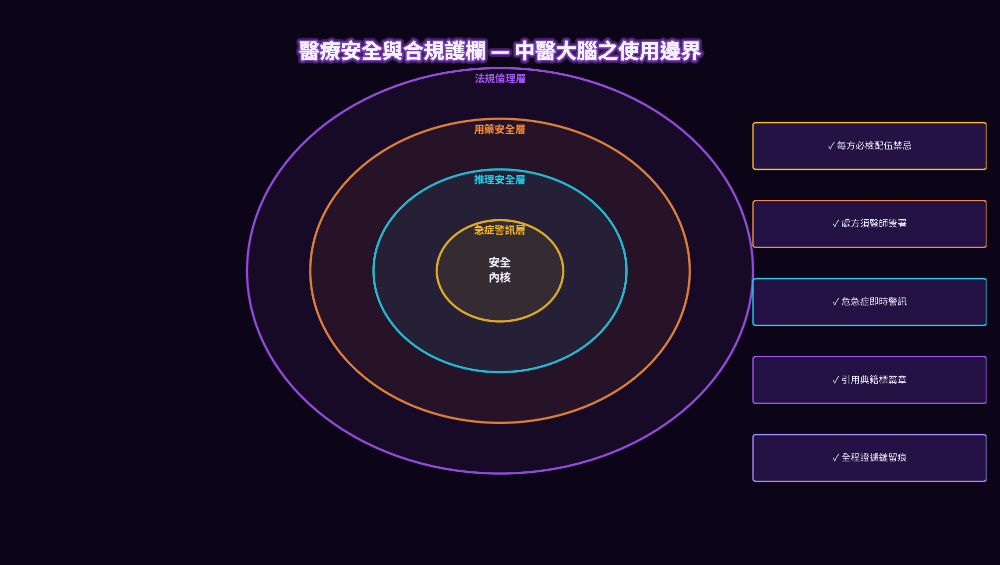

**【圖】醫療安全與合規護欄：四環同心防護**

- 法規倫理層：AI 輔助不處方——一切診療結論須執業中醫師審核簽署；患者資料去識別化、最小必要存取；使用同意與告知義務由醫療機構承擔；
- 用藥安全層：十八反十九畏強制掃描、妊娠禁忌分級攔截、毒性藥專帳管理（炮製、劑量、先煎）、老人小兒劑量折算；
- 推理安全層：幻覺防範三招——引文必溯源、結論必附證據、不確定必標注；經典原文引用須逐字核對篇章；
- 急症警訊層：危急重症識別即時警訊，第一優先轉診，不得以系統建議延誤救治。

## 7.4 用藥安全檢核清單

| 檢核項 | 內容 | 處置 |
| --- | --- | --- |
| 十八反 | 烏頭反半夏瓜蔞貝母白及白蘞；甘草反海藻大戟甘遂芫花；藜蘆反諸參辛芍 | 命中即紅燈攔截 |
| 十九畏 | 硫磺畏朴硝、水銀畏砒霜、狼毒畏密陀僧、巴豆畏牽牛、丁香畏鬱金、牙硝畏三稜、川烏草烏畏犀角、人參畏五靈脂、官桂畏赤石脂 | 命中即紅燈攔截 |
| 妊娠禁忌 | 禁用：芫花甘遂大戟巴豆牽牛水蛭虻蟲麝香三稜莪朮…；慎用：桃仁紅大黃枳實附子肉桂冬葵子… | 孕產通道強制啟用 |
| 毒性藥管理 | 附子烏頭馬錢子朱砂雄黃細辛蒼耳子：炮製合規、劑量邊界、先煎久煎、蓄積監測 | 超量或炮製不明即攔截 |
| 特殊人群 | 老人（劑量 3/4 起）、小兒（按體重年齡折算）、肝腎功能不全（減量避毒） | 自動折算並標注 |
| 中西藥交互 | 抗凝藥與活血藥、降壓藥與溫裡藥、鎮靜藥與安神藥同用時提示交互風險 | 黃燈提示醫師評估 |

## 7.5 危急重症識別與轉診警訊

系統內建危急警訊清單：命中任一項，S7 之類評估流程立即中止，彈出轉診指引。這是「急則治標」的現代化——先救命，再辨證。

| 警訊 | 表現 | 可能危候 | 即時處置 |
| --- | --- | --- | --- |
| 神志改變 | 神昏譫語、抽搐、口開目合、撒手遺尿 | 中風、熱入心包、脫證 | 立即急救轉診（120/急診） |
| 胸痛徹背 | 胸悶痛連背、冷汗、唇紫 | 胸痹心真心痛（急性心梗） | 立即急救轉診 |
| 呼吸困難 | 喘促鼻煽、張口抬肩、不能平臥 | 喘脫、肺閉 | 立即急救轉診 |
| 大出血 | 吐血便血崩漏不止、面色蒼白 | 血脫、亡陽 | 止血同時立即轉診 |
| 高熱驚厥 | 壯熱不退、小兒高熱抽風 | 急驚風、疫毒痢 | 退熱防驚同時轉診 |
| 劇烈腹痛 | 腹痛拒按、板狀腹、汗出肢冷 | 急腹症（腸結、石淋嵌頓） | 禁食禁痛，立即轉診 |

## 7.6 不確定性管理與人工覆核

系統對不確定性採「顯式三級標注」：高置信（∩(T) ≥ 0.85 且四診完備）標注為結論；中置信（灰區）並列證型與鑑別要點；低置信（∩(T) < 0.7 或關鍵四診缺失）只給檢查建議、不給結論。凡涉及毒性藥、孕產、兒科、急症、手術後等高風險情境，無論置信度高低，一律強制人工覆核。

| 置信級 | 條件 | 系統輸出形態 | 人工介入要求 |
| --- | --- | --- | --- |
| 高置信 | ∩(T) ≥ 0.85 且四診完備 | 結論＋證據鏈 | 常規覆核簽署 |
| 中置信 | 0.70 ≤ ∩(T) < 0.85 | 並列證型＋鑑別要點＋補檢建議 | 醫師主導裁決 |
| 低置信 | ∩(T) < 0.70 或關鍵缺口 | 只給檢查建議與缺口清單 | 醫師接手主導 |
| 高風險 | 毒藥/孕產/兒科/急症/術後 | 任何置信級皆附紅框警示 | 強制覆核，不可單獨採用 |

> **系統永遠站在輔助位**
>
> 最終診療決定權、處方權、簽署權永遠在執業中醫師。系統的責任是：把不確定性說清楚、把證據擺完整、把紅線看牢靠——然後把決定交還給人。

## 7.7 醫療文書、倫理與個資規範

AI 產出的病歷文書屬醫療文書範疇，須符合病歷書寫規範與個資保護要求。系統在文書與資料層面的規範如下：

| 面向 | 規範 | 系統落實 | 責任歸屬 |
| --- | --- | --- | --- |
| 病歷書寫 | 客觀、真實、準確、及時、完整、規範 | S1–S8 產物自動組裝病歷草稿；醫師修改留痕後簽署 | 簽署醫師負責 |
| AI 標識 | AI 參與生成之內容須可識別 | 文書尾欄標注「本病歷由 AI 中醫大腦輔助生成」 | 醫療機構負責 |
| 個資保護 | 去識別化、最小必要、目的限定 | 醫案入庫前去識別化；存取權限分級；傳輸加密 | 機構資訊安全責任 |
| 知情同意 | 告知 AI 輔助之使用與邊界 | 就診告知書範本內建 AI 輔助條款 | 醫療機構負責 |
| 資料保存 | 病歷保存年限依法規；形證據鏈同步保存 | 鏈式存證與病歷同週期保存 | 機構負責 |
| 研究使用 | 二次利用須去識別化並經倫理審查 | 醫案萃取僅供假設生成；研究輸出標注審查需求 | 研究者負責 |

## 7.8 中西醫結合使用注意事項

- 檢查互參：現代檢查（影像、實驗室）作為中醫四診的延伸資訊接入，標注為「客觀檢查」屬性，不替代舌脈；
- 病名互參：西醫病名與中醫病證並行記錄（如「冠心病 ↔ 胸痹」），但辨證推理一律以中醫證型形為主線；
- 用藥交互：中西藥併用時啟用交互提示層（抗凝藥與活血藥、降壓藥與溫裡藥、降糖藥與消渴方），並建議錯開服藥時間；
- 療效評價：雙軌記錄——中醫證候積分（主觀量表）與西醫指標（客觀數據）並行納入 S7 對照表；
- 急重症定位：明確「先西醫搶救、後中醫調理」的優先序，與第 7.5 節危急警訊體系接軌。

# 第8章 附錄

本章彙整速查工具：形名詞對照、方劑速查、本草速查、穴位速查、診療歌訣與提示詞總表，供臨床與教學即查即用。

## 8.1 附錄 A：中醫形名詞對照表

| 中文 | English（Type 譯名） | 一句定義 |
| --- | --- | --- |
| 形 | Type | 有明確邊界的知識單元；全系統基本構件 |
| 症狀形 | SymptomType | 可觀察可察覺的異常表現之結構化 |
| 舌形 | TongueType | 舌象之結構化描述 |
| 脈形 | PulseType | 脈象之結構化描述 |
| 證型形 | SyndromeType | 病位病性病因病勢之綜合判斷模型 |
| 病因形 | EtiologyType | 致病因素之分類模型 |
| 臟腑形 | ZangFuType | 藏象功能模型 |
| 經絡形 | MeridianType | 經脈流注與絡屬模型 |
| 氣血津液形 | QiType | 氣血津液生成輸布病變模型 |
| 體質形 | ConstitutionType | 個體體質特徵模型 |
| 治則形 | PrincipleType | 治療總體策略模型 |
| 治法形 | MethodType | 具體治療方法模型 |
| 方劑形 | FormulaType | 處方組成模型（BOM） |
| 本草形 | HerbType | 單味藥性用模型 |
| 穴位形 | AcupointType | 腧穴定位主治模型 |
| 病案形 | CaseType | 一次完整診療的時間膠囊 |
| 典籍形 | ClassicType | 文獻知識出處錨點 |
| 養生形 | RegimenType | 治未病方案模型 |
| 交集判準 | ∩(T) Criteria | 證候集與證型判準集之量化吻合閘門 |
| 形證據鏈 | Type Evidence Chain | 全程留痕的推理存證鏈 |
| 形驅動辨證論治 | Type-Driven Diagnosis & Treatment (TDDT) | 八步驟臨床推理方法論 |
| BOM / SOM | Bill of Materials / Set of Members | 方劑藥味清單 / 證候同現集合 |

## 8.2 附錄 B：常用方劑速查表

| 分類 | 方名 | 組成（節錄） | 功效 | 主治 |
| --- | --- | --- | --- | --- |
| 解表 | 桂枝湯 | 桂枝芍藥生薑大棗甘草 | 解肌發表調和營衛 | 太陽中風表虛 |
| 解表 | 麻黃湯 | 麻黃桂枝杏仁甘草 | 發汗解表宣肺平喘 | 太陽傷寒表實 |
| 解表 | 九味羌活湯 | 羌活防風蒼朮細辛川芎白芷 | 發汗祛濕兼清裡熱 | 外感風寒濕兼裡熱 |
| 解表 | 小青龍湯 | 麻黃桂枝乾薑細辛半夏五味子 | 解表散寒溫肺化飲 | 外寒裡飲證 |
| 解表 | 銀翹散 | 金銀花連翹桔梗薄荷竹葉荊芥 | 辛涼透表清熱解毒 | 溫病初起 |
| 解表 | 麻杏石甘湯 | 麻黃杏仁石膏甘草 | 辛涼宣洩清肺平喘 | 肺熱壅盛咳喘 |
| 瀉下 | 大承氣湯 | 大黃芒硝枳實厚朴 | 峻下熱結 | 陽明腑實 |
| 瀉下 | 麻子仁丸 | 麻子仁杏仁芍藥枳實大黃厚朴 | 潤腸洩熱行氣通便 | 腸胃燥熱便秘 |
| 和解 | 小柴胡湯 | 柴胡黃芩半夏人參甘草 | 和解少陽 | 少陽病 |
| 和解 | 逍遙散 | 柴胡當歸白芍白朮茯苓薄荷 | 疏肝解鬱健脾養血 | 肝鬱血虛脾弱 |
| 和解 | 半夏瀉心湯 | 半夏黃芩黃連乾薑人參甘草 | 寒熱平調消痞散結 | 寒熱錯雜痞證 |
| 清熱 | 白虎湯 | 石膏知母粳米甘草 | 清氣分大熱 | 陽明經證 |
| 清熱 | 清營湯 | 犀角生地玄參麥冬黃連銀花連翹 | 清營解毒透熱養陰 | 熱入營分 |
| 清熱 | 犀角地黃湯 | 犀角生地芍藥丹皮 | 清熱解毒涼血散瘀 | 熱入血分 |
| 清熱 | 龍膽瀉肝湯 | 龍膽草黃芩梔子澤瀉車前柴胡 | 瀉肝膽實火清濕熱 | 肝火肝膽濕熱 |
| 清熱 | 青蒿鱉甲湯 | 青蒿鱉甲生地知母丹皮 | 養陰透熱 | 溫病後期陰虛邪伏 |
| 溫裡 | 理中丸 | 人參乾薑白朮甘草 | 溫中散寒健脾 | 脾胃虛寒太陰病 |
| 溫裡 | 小建中湯 | 桂枝芍藥飴糖生薑甘草 | 溫中補虛和裡緩急 | 虛勞裡急腹痛 |
| 溫裡 | 四逆湯 | 附子乾薑甘草 | 回陽救逆 | 少陰亡陽 |
| 溫裡 | 當歸四逆湯 | 當歸桂枝芍藥細辛通草 | 溫經散寒養血通脈 | 血虛寒厥 |
| 補益 | 四君子湯 | 人參白朮茯苓甘草 | 益氣健脾 | 脾胃氣虛 |
| 補益 | 參苓白朮散 | 人參白朮茯苓山藥蓮肉薏苡仁 | 益氣健脾滲濕止瀉 | 脾虛夾濕洩瀉 |
| 補益 | 補中益氣湯 | 黃芪人參白朮當歸升麻柴胡 | 補中益氣升陽舉陷 | 氣虛下陷、氣虛發熱 |
| 補益 | 四物湯 | 當歸川芎白芍熟地 | 補血調血 | 血虛血滯 |
| 補益 | 當歸補血湯 | 黃芪當歸（5:1） | 補氣生血 | 血虛陽浮發熱 |
| 補益 | 六味地黃丸 | 熟地山萸肉山藥澤瀉茯苓丹皮 | 滋陰補腎 | 腎陰虛 |
| 補益 | 左歸丸 | 熟地山藥枸杞山萸菟絲鹿角膠 | 滋陰補腎填精益髓 | 真陰不足 |
| 補益 | 右歸丸 | 附子肉桂鹿角膠熟地山藥杜仲 | 溫補腎陽填精補血 | 腎陽不足命門火衰 |
| 補益 | 一貫煎 | 沙參麥冬當歸生地枸杞川楝子 | 滋陰疏肝 | 肝腎陰虛肝鬱 |
| 補益 | 歸脾湯 | 人參黃芪白朮當歸龍眼酸棗仁遠志 | 益氣補血健脾養心 | 心脾兩虛 |
| 理氣 | 越鞠丸 | 香附川芎蒼朮梔子神曲 | 行氣解鬱 | 六鬱證 |
| 理氣 | 半夏厚朴湯 | 半夏厚朴茯苓生薑蘇葉 | 行氣散結降逆化痰 | 梅核氣 |
| 理血 | 血府逐瘀湯 | 桃仁紅當歸川芎柴胡枳殼牛膝 | 活血化瘀行氣止痛 | 胸中血瘀 |
| 理血 | 補陽還五湯 | 黃芪當歸尾川芎赤芍地龍桃仁紅 | 補氣活血通絡 | 中風後遺氣虛血瘀 |
| 治風 | 川芎茶調散 | 川芎荊芥防風細辛白芷薄荷 | 疏風止痛 | 風邪頭痛 |
| 治風 | 天麻鉤藤飲 | 天麻鉤藤石決明梔子黃芩牛膝 | 平肝息風清熱活血 | 肝陽上亢眩暈 |
| 治燥 | 桑杏湯 | 桑葉杏仁沙參貝母梔子豆豉 | 清宣溫燥潤肺止咳 | 溫燥傷肺 |
| 治燥 | 百合固金湯 | 百合生地熟地麥冬貝母桔梗 | 滋陰潤肺化痰止咳 | 肺腎陰虛咳血 |
| 祛濕 | 平胃散 | 蒼朮厚朴陳皮甘草 | 燥濕運脾行氣和胃 | 濕滯脾胃 |
| 祛濕 | 藿香正氣散 | 藿香紫蘇白芷半夏厚朴陳皮 | 解表化濕理氣和中 | 外感風寒內傷濕滯 |
| 祛濕 | 茵陳蒿湯 | 茵陳梔子大黃 | 清熱利濕退黃 | 濕熱黃疸 |
| 祛濕 | 八正散 | 木通瞿麥萹蓄滑石車前梔子大黃 | 清熱瀉火利水通淋 | 濕熱淋證 |
| 祛濕 | 真武湯 | 附子白朮茯苓芍藥生薑 | 溫陽利水 | 陽虛水腫 |
| 祛濕 | 獨活寄生湯 | 獨活桑寄生杜仲牛膝細辛秦艽 | 祛風濕止痹痛補肝腎益氣血 | 痹證日久肝腎兩虛 |
| 祛痰 | 二陳湯 | 半夏陳皮茯苓甘草 | 燥濕化痰理氣和中 | 濕痰 |
| 祛痰 | 溫膽湯 | 半夏竹茹枳實陳皮茯苓 | 理氣化痰和胃利膽 | 膽鬱痰擾 |
| 消導 | 保和丸 | 山楂神曲萊菔子半夏陳皮茯苓 | 消食和胃 | 食積 |
| 安神 | 朱砂安神丸 | 朱砂黃連生地當歸甘草 | 鎮心安神養陰清熱 | 心火亢盛陰血不足 |
| 安神 | 天王補心丹 | 生地天冬麥冬酸棗仁柏子仁丹參 | 滋陰清熱養血安神 | 陰虛血少失眠 |
| 固澀 | 玉屏風散 | 黃芪白朮防風 | 益氣固表止汗 | 表虛自汗易感 |
| 固澀 | 四神丸 | 補骨脂肉豆蔻五味子吳茱萸 | 溫腎暖脾澀腸止瀉 | 五更洩瀉 |
| 開竅 | 安宮牛黃丸 | 牛黃麝香犀角鬱金黃連朱砂 | 清熱開竅豁痰解毒 | 熱入心包神昏 |
| 開竅 | 蘇合香丸 | 蘇合香麝香安息香丁香檀香 | 芳香開竅行氣止痛 | 寒閉神昏 |
| 解表 | 敗毒散 | 柴胡前胡川芎枳殼羌活獨活茯苓 | 散寒祛濕益氣解表 | 氣虛外感風寒濕 |
| 解表 | 再造散 | 黃芪人參桂枝附子細辛羌活 | 助陽益氣發汗解表 | 陽虛外感 |
| 和解 | 蒿芩清膽湯 | 青蒿黃芩竹茹半夏陳皮枳殼 | 清膽利濕和胃化痰 | 少陽濕熱痰濁 |
| 清熱 | 黃連解毒湯 | 黃連黃芩黃梔子 | 瀉火解毒 | 三焦火毒熱盛 |
| 清熱 | 普濟消毒飲 | 黃芩黃連牛蒡子薄荷連翹板藍根 | 清熱解毒疏風散邪 | 大頭瘟 |
| 清熱 | 導赤散 | 生地木通竹葉生甘草梢 | 清心利水養陰 | 心經火熱／口瘡 |
| 溫裡 | 吳茱萸湯 | 吳茱萸人參生薑大棗 | 溫中補虛降逆止嘔 | 肝寒犯胃／少陰吐利 |
| 溫裡 | 陽和湯 | 熟地鹿角膠肉桂麻黃白芥子 | 溫陽補血散寒通滯 | 陰疽貼骨疽 |
| 補益 | 生脈散 | 人參麥冬五味子 | 益氣生津斂陰止汗 | 氣陰兩虛／暑傷氣陰 |
| 補益 | 炙甘草湯 | 炙甘草人參桂枝生地麥冬阿膠 | 益氣滋陰通陽復脈 | 心動悸脈結代 |
| 補益 | 腎氣丸 | 附子肉桂六味地黃丸基礎 | 補腎助陽 | 腎陽不足 |
| 理氣 | 枳實薤白桂枝湯 | 枳實薤白桂枝厚朴瓜蔞 | 通陽散結祛痰下氣 | 胸痹心中痞滿 |
| 理血 | 小薊飲子 | 小薊生地滑石木通蒲黃藕節 | 涼血止血利水通淋 | 下焦瘀熱血淋 |
| 理血 | 桂枝茯苓丸 | 桂枝茯苓丹皮桃仁芍藥 | 活血化瘀緩消癥塊 | 瘀阻胞宮癥瘕 |
| 治燥 | 麥門冬湯 | 麥冬半夏人參甘草粳米 | 滋養肺胃降逆下氣 | 肺痿咳唾涎沫 |
| 祛濕 | 五苓散 | 豬苓澤瀉白朮茯苓桂枝 | 利水滲濕溫陽化氣 | 蓄水證水腫洩瀉 |
| 祛濕 | 苓桂朮甘湯 | 茯苓桂枝白朮甘草 | 溫陽化飲健脾利濕 | 中陽不足痰飲 |
| 消導 | 枳實導滯丸 | 枳實大黃黃芩黃連神曲白朮 | 消導化積清熱祛濕 | 濕熱食積 |
| 治風 | 大秦艽湯 | 秦艽羌活防風川芎當歸細辛 | 疏風清熱養血活血 | 風邪初中經絡 |
| 固澀 | 真人養臟湯 | 罌粟殼肉豆蔻訶子人參白朮 | 澀腸固脫溫補脾腎 | 久瀉久痢脾腎虛寒 |

## 8.3 附錄 C：常用本草速查表

| 藥名 | 性味 | 歸經 | 功效 | 要點 |
| --- | --- | --- | --- | --- |
| 麻黃 | 辛微苦溫 | 肺膀胱 | 發汗解表宣肺平喘利水 | 表實無汗要藥；先煎去沫；汗多者忌 |
| 桂枝 | 辛甘溫 | 心肺膀胱 | 發汗解肌溫通經脈助陽化氣 | 表虛有汗亦可用（配白芍） |
| 柴胡 | 苦辛微寒 | 肝膽 | 解表退熱疏肝解鬱升舉陽氣 | 少陽要藥；陰虛陽亢慎用 |
| 石膏 | 甘辛大寒 | 肺胃 | 清熱瀉火除煩止渴 | 氣分大熱要藥；脾胃虛寒忌 |
| 黃連 | 苦寒 | 心肝胃大腸 | 清熱燥濕瀉火解毒 | 中焦濕熱要藥；苦寒傷胃中病即止 |
| 金銀花 | 甘寒 | 肺心胃 | 清熱解毒疏散風熱 | 瘡瘍要藥；炒炭止痢 |
| 大黃 | 苦寒 | 脾胃大腸肝心包 | 瀉下攻積清熱瀉火涼血解毒 | 將軍之品；孕婦忌；生用後下 |
| 附子 | 辛甘大熱 | 心腎脾 | 回陽救逆補火助陽散寒止痛 | 回陽第一品；須炮製先煎；陰虛忌 |
| 乾薑 | 辛熱 | 脾胃腎心肺 | 溫中散寒回陽通脈溫肺化飲 | 溫中要藥；與附子相須 |
| 人參 | 甘微苦微溫 | 肺脾心 | 大補元氣補脾益肺生津安神 | 救脫要藥；反藜蘆；實證忌 |
| 黃芪 | 甘微溫 | 脾肺 | 補氣升陽固表止汗利水消腫 | 補氣要藥；生用固表炙用補中 |
| 白朮 | 苦甘溫 | 脾胃 | 健脾益氣燥濕利水止汗安胎 | 脾虛要藥；炒用止瀉 |
| 當歸 | 甘辛溫 | 肝心脾 | 補血活血調經止痛潤腸 | 血中聖藥；便溏者慎 |
| 熟地黃 | 甘微溫 | 肝腎 | 補血養陰填精益髓 | 滋膩礙胃；宜配砂仁陳皮 |
| 白芍 | 苦酸微寒 | 肝脾 | 養血斂陰柔肝止痛平抑肝陽 | 與桂枝一散一收調營衛 |
| 川芎 | 辛溫 | 肝膽心包 | 活血行氣祛風止痛 | 血中氣藥；頭痛要藥；孕婦慎 |
| 丹參 | 苦微寒 | 心肝 | 活血祛瘀涼血消癰養血安神 | 一味丹參功同四物；反藜蘆 |
| 半夏 | 辛溫 | 脾胃肺 | 燥濕化痰降逆止嘔消痞散結 | 燥濕化痰要藥；反烏頭；生半夏有毒 |
| 茯苓 | 甘淡平 | 心肺脾腎 | 利水滲濕健脾寧心 | 利水不傷正；白茯苓偏補 |
| 甘草 | 甘平 | 心肺脾胃 | 補脾益氣清熱解毒祛痰止咳緩急止痛調和諸藥 | 國老之稱；反大戟甘遂芫花海藻；久服水腫 |
| 陳皮 | 辛苦溫 | 脾肺 | 理氣健脾燥濕化痰 | 氣滯痰濕要藥；配補藥防壅滯 |
| 香附 | 辛微苦微甘平 | 肝脾三焦 | 疏肝解鬱理氣寬中調經止痛 | 氣病總司；女科主帥 |
| 酸棗仁 | 甘酸平 | 肝膽心 | 養心補肝寧心安神斂汗生津 | 失眠要藥；生用炒用有別 |
| 天麻 | 甘平 | 肝 | 息風止痙平抑肝陽祛風通絡 | 眩暈要藥；不論虛實寒熱皆可配伍 |
| 三七 | 甘微苦溫 | 肝胃 | 散瘀止血消腫定痛 | 止血不留瘀化瘀不傷正 |
| 黃芪 | 甘微溫 | 脾肺 | 補氣升陽固表止汗利水托毒 | 補氣之長；生炙用法有別 |
| 柴胡 | 苦辛微寒 | 肝膽 | 和解退熱疏肝升陽 | 少陽要藥；劫肝陰之戒 |
| 葛根 | 甘辛涼 | 脾胃 | 解肌退熱生津止渴透疹升陽 | 項背強痛要藥；煨用止瀉 |
| 金銀花 | 甘寒 | 肺心胃 | 清熱解毒疏散風熱 | 瘡瘍聖藥；炒炭止痢 |
| 黃芩 | 苦寒 | 肺膽脾胃大腸 | 清熱燥濕瀉火解毒止血安胎 | 上焦濕熱；安胎要藥 |
| 生地黃 | 甘苦寒 | 心肝腎 | 清熱涼血養陰生津 | 熱入營血；滋膩礙胃 |
| 麥冬 | 甘微苦微寒 | 肺胃心 | 養陰潤肺益胃生津清心除煩 | 肺胃陰虛要藥 |
| 枸杞子 | 甘平 | 肝腎 | 滋補肝腎益精明目 | 平補陰陽；明目要藥 |
| 杜仲 | 甘溫 | 肝腎 | 補肝腎強筋骨安胎 | 腰痛要藥；炒用效佳 |
| 丹皮 | 苦辛微寒 | 心肝腎 | 清熱涼血活血化瘀 | 涼血不留瘀；陰虛發熱 |
| 赤芍 | 苦微寒 | 肝 | 清熱涼血散瘀止痛 | 血熱瘀滯；反藜蘆 |
| 桔梗 | 苦辛平 | 肺 | 宣肺祛痰利咽排膿載藥上行 | 舟楫之劑；開提肺氣 |
| 杏仁 | 苦微溫 | 肺大腸 | 止咳平喘潤腸通便 | 降肺氣；有小毒勿過量 |
| 柴胡・黃芩 | 辛苦微寒 | 肝膽 | 和解少陽基本藥對 | 見藥對表 |
| 細辛 | 辛溫 | 心肺腎 | 祛風散寒通竅止痛溫肺化飲 | 頭痛要藥；細辛不過錢之戒 |
| 肉桂 | 辛甘大熱 | 腎脾心肝 | 補火助陽引火歸原散寒止痛溫經通脈 | 命門火衰；後下焗服 |
| 五味子 | 酸甘溫 | 肺心腎 | 收斂固澀益氣生津補腎寧心 | 久咳虛喘；斂汗安神 |

## 8.4 附錄 D：常用穴位速查表

| 穴位 | 歸經 | 定位 | 特定穴 | 主治要點 |
| --- | --- | --- | --- | --- |
| 合谷 | 大腸經 | 手背第 1–2 掌骨間 | 原穴 | 面口合谷收；解表止痛通絡 |
| 曲池 | 大腸經 | 肘橫紋外側端 | 合穴 | 清熱疏風；上肢不遂皮膚病 |
| 足三里 | 胃經 | 犢鼻下 3 寸 | 合穴下合穴 | 肚腹三里留；健脾胃補虛弱 |
| 內關 | 心包經 | 腕橫紋上 2 寸 | 絡穴八脈交會 | 心胸內關謀；止嘔安神寬胸 |
| 神門 | 心經 | 腕橫紋尺側端 | 原穴輸穴 | 寧心安神；失眠心悸要穴 |
| 三陰交 | 脾經 | 內踝尖上 3 寸 | 肝脾腎三經交會 | 婦科要穴；孕期禁針 |
| 太沖 | 肝經 | 足背第 1–2 蹠骨間 | 原穴輸穴 | 疏肝理氣；四關穴之一 |
| 太溪 | 腎經 | 內踝尖與跟腱間 | 原穴 | 補腎要穴；咽喉乾痛耳鳴 |
| 陽陵泉 | 膽經 | 腓骨小頭前下方 | 合穴八會（筋會） | 脅痛口苦；筋病要穴 |
| 委中 | 膀胱經 | 膕橫紋中點 | 合穴 | 腰背委中求 |
| 大椎 | 督脈 | 第 7 頸椎棘突下 | 諸陽之會 | 解表退熱；截瘧要穴 |
| 百會 | 督脈 | 頭頂正中 | 諸陽之會 | 升陽舉陷；安神醒腦 |
| 中脘 | 任脈 | 臍上 4 寸 | 胃募八會（腑會） | 胃腑一切病；和胃健脾 |
| 關元 | 任脈 | 臍下 3 寸 | 小腸募 | 溫補元氣；回陽固脫 |
| 氣海 | 任脈 | 臍下 1.5 寸 | 肓之原 | 補氣要穴；氣虛諸證 |
| 肺俞 | 膀胱經 | 第 3 胸椎旁開 1.5 寸 | 背俞穴 | 肺系病要穴；補肺固表 |
| 腎俞 | 膀胱經 | 第 2 腰椎旁開 1.5 寸 | 背俞穴 | 補腎強腰；耳鳴遺精 |
| 列缺 | 肺經 | 橈骨莖突上方 | 絡穴八脈交會 | 頭項尋列缺；宣肺止咳 |
| 中渚 | 三焦經 | 手背第 4–5 掌骨間 | 輸穴 | 少陽頭痛耳鳴；疏三焦氣 |
| 外關 | 三焦經 | 腕背橫紋上 2 寸 | 絡穴八脈交會 | 少陽病要穴；熱病頭痛 |
| 水溝（人中） | 督脈 | 人中溝上 1/3 | 急救要穴 | 醒腦開竅；中暑昏厥 |
| 湧泉 | 腎經 | 足底前 1/3 凹陷 | 井穴 | 急救引火下行；頭痛眩暈 |
| 膈俞 | 膀胱經 | 第 7 胸椎旁開 1.5 寸 | 背俞穴八會（血會） | 血證要穴；呃逆 |
| 天樞 | 胃經 | 臍旁 2 寸 | 大腸募穴 | 便秘洩瀉雙向調節 |
| 豐隆 | 胃經 | 外踝尖上 8 寸 | 絡穴 | 化痰要穴；痰多眩暈 |
| 太淵 | 肺經 | 腕橫紋橈側 | 原穴八會（脈會） | 肺虛咳喘；脈病要穴 |
| 期門 | 肝經 | 乳頭直下第 6 肋間 | 肝募穴 | 疏肝理氣；胸脅脹痛 |
| 命門 | 督脈 | 第 2 腰椎棘突下 | 要穴 | 溫補腎陽；腰痛陽虛 |
| 至陰 | 膀胱經 | 足小趾外側 | 井穴 | 胎位不正艾灸要穴 |

> **子午流注十二時辰用藥・取穴速查**
>
> 子時（23–01）膽經｜丑時（01–03）肝經｜寅時（03–05）肺經｜卯時（05–07）大腸經
>
> 辰時（07–09）胃經｜巳時（09–11）脾經｜午時（11–13）心經｜未時（13–15）小腸經
>
> 申時（15–17）膀胱經｜酉時（17–19）腎經｜戌時（19–21）心包經｜亥時（21–23）三焦經
>
> 運用：當令經脈之病於其時辰取穴效佳；補虛藥於臟腑當令前服；瀉實藥於病經當令時服。

## 8.5 附錄 E：診療歌訣摘編

> **十問歌（問診綱目）**
>
> 一問寒熱二問汗，三問頭身四問便，五問飲食六問胸，七聾八渴俱當辨，
>
> 九問舊病十問因，再兼服藥參機變；婦女尤必問經期，遲速閉崩皆可見；
>
> 再添片語告兒科，天花麻疹全占驗。

> **藥性賦・四氣五味要義**
>
> 四氣：寒涼治熱、溫熱治寒。
>
> 五味：辛散、酸收、甘緩、苦堅、鹹軟；辛甘發散為陽，酸苦湧洩為陰。
>
> 升降浮沉：升浮上行外達（升麻柴胡），沉降下行內收（大黃代赭石）。
>
> 歸經：引藥達所——羌活入膀胱治頭項，白芷入陽明治眉稜。
>
> 配伍：相須相使增效，相畏相殺減毒，相惡相反為忌。

> **脈綱提要**
>
> 浮脈主表沉主裡，遲脈主寒數脈熱；虛脈主虛實脈實，滑脈痰食澀血瘀。
>
> 弦脈肝膽痛證見，緊脈寒痛宿食停；細脈氣血兩虛濕，代結促動各分明。
>
> 寸關尺分候：左寸心左關肝左尺腎；右寸肺右關脾右尺命門。

> **病機十九條（《素問・至真要大論》節錄）**
>
> 諸風掉眩，皆屬於肝；諸寒收引，皆屬於腎；諸氣膹鬱，皆屬於肺；諸濕腫滿，皆屬於脾；
>
> 諸熱瞀瘛，皆屬於火；諸痛癢瘡，皆屬於心；諸厥固洩，皆屬於下；諸痿喘嘔，皆屬於上；
>
> 諸禁鼓慄，如喪神守，皆屬於火；諸痙項強，皆屬於濕；諸逆衝上，皆屬於火；
>
> 諸脹腹大，皆屬於熱；諸躁狂越，皆屬於火；諸暴強直，皆屬於風；
>
> 諸病有聲，鼓之如鼓，皆屬於熱；諸病胕腫疼酸驚駭，皆屬於火；諸轉反戾，水液渾濁，皆屬於熱；
>
> 諸病水液，澄澈清冷，皆屬於寒；諸嘔吐酸，暴注下迫，皆屬於熱。
>
> ——十九條為病機推演之綱目，與臟腑形・病因形直接對應。

## 8.6 附錄 F：S1–S8 提示詞速查總表

| 工作流 | 一句定位 | 核心鐵律 | 關鍵輸出 | 紅線 |
| --- | --- | --- | --- | --- |
| S1 四診採集官 | 只記錄不判斷 | 未採集禁止補白 | 四診屬性表＋缺口清單 | 見證型詞彙即退回 |
| S2 八綱定位官 | 病位病性第一層 | 每綱必附證據 | 八綱定位表 | 不越權寫臟腑證型 |
| S3 辨證推理官 | 多體系推演排名 | 強制 ≥ 2 候選 | 候選證型＋∩(T) | 六經溫病不混用 |
| S4 治則確立法官 | 由證立法 | 無推導鏈不立法 | 治則治法表 | 汗下禁忌反檢 |
| S5 方藥設計官 | 立法處方＋安全掃描 | 無指歸不入方 | 處方 BOM＋煎服法 | 十八反十九畏妊禁 |
| S6 針灸外治官 | 經穴處方 | 每穴須有經絡依據 | 穴位處方＋療程 | 禁刺禁灸攔截 |
| S7 療效演化官 | 前後對照＋警訊掃描 | 無對照不下療效 | 療效評估＋調整 | 危急警訊即轉診 |
| S8 知識沉澱官 | 醫案閉環入庫 | 提案默認不生效 | 病案＋演化提案 | 去識別化入庫 |

速查表與第 6 章詳版配合使用：日常按此表記憶鐵律與紅線，實作時回到第 6 章取完整提示詞模板與規格表。

## 8.7 附錄 G：核心術語英中對照索引

| 中文術語 | English | 應用位置 |
| --- | --- | --- |
| 辨證論治 | Syndrome Differentiation and Treatment | 全書核心方法 |
| 四診 | Four Examinations (Inspection/Auscultation-Olfaction/Inquiry/Palpation) | S1 |
| 八綱 | Eight Principles | S2 |
| 證型 | Syndrome Pattern | S3–S4 |
| 治則 | Treatment Principle | S4 |
| 治法 | Treatment Method | S4 |
| 君臣佐使 | Monarch-Minister-Assistant-Guide | S5 |
| 方證對應 | Formula-Pattern Correspondence | S5 |
| 歸經 | Meridian Tropism | 本草形 |
| 四氣五味 | Four Qi and Five Flavors | 本草形 |
| 升降浮沉 | Ascending-Descending-Floating-Sinking | 本草形 |
| 配伍七情 | Seven Types of Compatibility | 4.4 |
| 十八反十九畏 | Eighteen Incompatibilities and Nineteen Antagonisms | S5／7.4 |
| 經絡 | Meridians and Collaterals | S6 |
| 腧穴 | Acupoints | S6 |
| 特定穴 | Specific Points | 4.6／附錄 D |
| 子午流注 | Midnight-Midday Ebb and Flow | 3.4／附錄 D |
| 補瀉手法 | Reinforcing and Reducing Techniques | S6 |
| 治未病 | Preventive Treatment of Disease | 4.7 |
| 體質辨識 | Constitution Identification | 4.7 |
| 醫案 | Medical Case Record | S8 |
| 傳變 | Pathological Transmission | 3.1–3.2 |
| 標本緩急 | Root-Branch and Urgency | S4 |
| 三因制宜 | Treatment in Accordance with Three Conditions | S4 |
| 形證據鏈 | Type Evidence Chain | 全書 |

## 8.8 附錄 H：常見病治法方藥總表

| 病證 | 證型 | 治法 | 代表方・要穴 |
| --- | --- | --- | --- |
| 感冒 | 風寒束表／風熱犯表／暑濕傷表／氣虛感冒 | 辛溫解表／辛涼解表／清暑祛濕解表／益氣解表 | 荊防敗毒散／銀翹散／新加香薷散／參蘇飲；大椎風門 |
| 咳嗽 | 風寒襲肺／風熱犯肺／燥邪傷肺／痰濕蘊肺／肝火犯肺／肺陰虧虛 | 疏風散寒宣肺／疏風清熱宣肺／疏風清肺潤燥／燥濕化痰／清肺瀉肝／滋陰潤肺 | 三拗湯／桑菊飲／桑杏湯／二陳湯／瀉白散／沙參麥冬湯；肺俞列缺 |
| 哮病 | 冷哮／熱哮／寒包熱哮／風痰哮／虛哮 | 宣肺散寒化痰／清熱宣肺化痰／解表清裡／祛風滌痰／補肺納腎 | 射干麻黃湯／定喘湯／小青龍加石膏湯／三子養親湯／平喘固本湯 |
| 心悸 | 心虛膽怯／心血不足／心陽不振／水飲凌心／心血瘀阻 | 鎮驚定志養心／補血養心益氣安神／溫補心陽／振奮心陽化氣利水／活血化瘀理氣通絡 | 安神定志丸／歸脾湯／桂甘龍牡湯／苓桂朮甘湯／桃仁紅花煎；神門內關 |
| 胸痹 | 心血瘀阻／氣滯心胸／痰濁閉阻／寒凝心脈／氣陰兩虛／心腎陰虛 | 活血化瘀通脈止痛／疏肝理氣活血／通陽洩濁豁痰／辛溫散寒通陽／益氣養陰活血通脈／滋陰清火養心和絡 | 血府逐瘀湯／柴胡疏肝散／栝蔞薤白半夏湯／枳實薤白桂枝湯／生脈散／天王補心丹；膻中巨闕 |
| 不寐 | 肝火擾心／痰熱擾心／心脾兩虛／心腎不交／心膽氣虛 | 疏肝瀉火鎮心安神／清化痰熱和中安神／補益心脾養血安神／滋陰降火交通心腎／益氣鎮驚安神定志 | 龍膽瀉肝湯／黃連溫膽湯／歸脾湯／黃連阿膠湯／安神定志丸；神門三陰交 |
| 胃痛 | 寒邪客胃／飲食停滯／肝氣犯胃／肝胃鬱熱／瘀血停胃／胃陰虧虛／脾胃虛寒 | 散寒止痛／消食導滯／疏肝理氣／疏肝泄熱和胃／化瘀通絡／養陰益胃／溫中健脾 | 良附丸／保和丸／柴胡疏肝散／化肝煎／失笑散／一貫煎／黃芪建中湯；中脘足三里 |
| 泄瀉 | 寒濕內盛／濕熱傷中／食滯腸胃／脾胃虛弱／腎陽虛衰 | 芳香化濕解表散寒／清熱利濕／消食導滯／健脾益氣化濕／溫補脾腎固澀止瀉 | 藿香正氣散／葛根芩連湯／保和丸／參苓白朮散／四神丸；天樞神闕 |
| 便秘 | 熱祕／氣祕／冷祕／氣虛祕／血虛祕／陰虛祕／陽虛祕 | 瀉熱導滯潤腸通便／順氣導滯／溫裡散寒通便／益氣潤腸／養血潤燥／滋陰通便／溫陽通便 | 麻子仁丸／六磨湯／溫脾湯／黃芪湯／潤腸丸／增液湯／濟川煎；天樞大腸俞 |
| 眩暈 | 肝陽上亢／氣血虧虛／腎精不足／痰濕中阻 | 平肝潛陽滋養肝腎／補益氣血調養心脾／滋養肝腎益精填髓／化痰祛濕健脾和胃 | 天麻鉤藤飲／歸脾湯／左歸丸／半夏白朮天麻湯；風池百會 |
| 頭痛 | 風寒頭痛／風熱頭痛／風濕頭痛／肝陽頭痛／血虛頭痛／痰濁頭痛／腎虛頭痛／瘀血頭痛 | 疏風散寒／疏風清熱／祛風勝濕／平肝潛陽／養血滋陰／健脾燥濕化痰降逆／養陰補腎填精生髓／活血化瘀通竅 | 川芎茶調散／芎芷石膏湯／羌活勝濕湯／天麻鉤藤飲／加味四物湯／半夏白朮天麻湯／大補元煎／通竅活血湯；按六經分部取穴 |
| 中風（中經絡） | 風痰入絡／風陽上擾／陰虛風動 | 祛風化痰通絡／平肝潛陽活血通絡／滋陰潛陽息風通絡 | 真方白丸子／天麻鉤藤飲／鎮肝息風湯；水溝內關三陰交 |
| 消渴 | 上消肺熱津傷／中消胃熱熾盛／下消腎陰虧虛／陰陽兩虛 | 清熱潤肺生津止渴／清胃瀉火養陰增液／滋陰固腎／滋陰溫陽補腎固攝 | 消渴方／玉女煎／六味地黃丸／金匱腎氣丸；肺俞脾俞腎俞 |
| 痹證 | 行痹／痛痹／著痹／風濕熱痹／痰瘀痹阻／肝腎兩虛 | 祛風通絡散寒除濕／溫經散寒祛風除濕／除濕通絡祛風散寒／清熱通絡祛風除濕／化痰行瘀蠲痹通絡／培補肝腎舒筋止痛 | 防風湯／烏頭湯／薏苡仁湯／白虎加桂枝湯／雙合湯／獨活寄生湯；阿是穴局部取穴 |
| 水腫 | 風水相搏／濕毒浸淫／水濕浸漬／濕熱壅盛／脾陽虛衰／腎陽衰微 | 疏風清熱宣肺行水／宣肺解毒利濕消腫／運脾化濕通陽利水／分利濕熱／溫運脾陽以利水濕／溫腎助陽化氣行水 | 越婢加朮湯／麻黃連翹赤小豆湯／五皮飲／疏鑿飲子／實脾飲／真武湯；水分氣海 |
| 月經不調 | 肝鬱／血熱／血寒／血虛／氣虛／腎虛 | 疏肝理氣調經／清熱涼血調經／溫經散寒調經／補血益氣調經／補脾益氣攝血固沖／補腎調經 | 逍遙散／清經散／溫經湯／四物湯／補中益氣湯／歸腎丸；三陰交關元 |
