# 目錄

- 本書使用說明

- 第 1 章 系統定位與雙本形運用總綱

  - 1.1 系統定位與使命

  - 1.2 參照案例：GE26 與 WarMatrix 的啟示

  - 1.3 空間本形在兵棋推演的運用總綱

  - 1.4 時間本形在兵棋推演的運用總綱

  - 1.5 雙本形合流與四層準確性保證

  - 1.6 準確使用三原則的操作化

  - 1.7 本書名詞與縮寫速覽

  - 1.8 使用前準備：角色、資料與環境

- 第 2 章 空間本形形化工程：戰場十四形

  - 2.1 形化總覽：四組十四形

  - 2.2 想定形 ScenarioType：推演的總綱

  - 2.3 戰場形 BattleSpaceType：戰域空間容器

  - 2.4 兵力形 ForceType：BOM 物料清單 × SOM 空間清單

  - 2.5 威脅形 × 目標形：交集判準 ∩(T) 的雙載體

  - 2.6 行動形 × 資源形：四約束行動

  - 2.7 準則形 × 情報形：合法與真實的雙閘

  - 2.8 指揮形 × 事件形：指揮鏈與觸發器

  - 2.9 裁決形 × 指標形 × 戰例形：判定與學習

  - 2.10 三括號與 ∩(T) 的聯合運用

  - 2.11 形化工程操作守則

  - 2.12 形化實例：從一段戰報到十四形

  - 2.13 十四形屬性 Schema 速查

  - 2.14 三層聯合判斷示範

- 第 3 章 時間本形形化工程：推演時序與演化

  - 3.1 推演時序形總覽

  - 3.2 搜尋模式：COA 分支樹與剪枝

  - 3.3 推理模式五式

  - 3.4 設計模式：COA 設計搜尋與戰法模式萃取

  - 3.5 自我演化模式：推演庫的持續學習

  - 3.6 思考法工具箱與 OODA 節奏

  - 3.7 時序節點表規格

  - 3.8 推理前提清單規格

  - 3.9 四模式協同：一回合內的接力

  - 3.10 戰法模式卡範本

- 第 4 章 推演知識域：全層級 × 多域

  - 4.1 全層級嵌套：戰略・戰役・戰術

  - 4.2 多域戰域矩陣

  - 4.3 戰略層知識：嚇阻、升級與 DIME

  - 4.4 戰役層知識：戰區、兵力對比與節奏

  - 4.5 戰術層知識：交戰、裁決表與戰耗

  - 4.6 裁決機制選型

  - 4.7 評估指標體系

  - 4.8 人機分工：指揮官的決策權

  - 4.9 推演課題庫

  - 4.10 戰史類比使用守則

  - 4.11 跨域連鎖示例庫

  - 4.12 態勢圖與要圖標註規範

- 第 5 章 TDDW 形驅動推演八步驟

  - 5.1 方法論總覽

  - 5.2 八步驟詳解

  - 5.3 四層準確性在八步驟的落點

  - 5.4 產出物規格

  - 5.5 與大規模矩陣推演的整合

  - 5.6 八步驟輸入輸出規格

  - 5.7 推演時程規劃

  - 5.8 推演失誤劇本庫

  - 5.9 量化解算法示意：指數法 × 結構修正

- 第 6 章 S1–S9 準確使用方法提示詞手冊

  - 6.0 手冊使用法

  - 6.1 S1 想定生成與結構化

  - 6.2 S2 戰場與戰域形化

  - 6.3 S3 兵力編組 BOM/SOM

  - 6.4 S4 威脅研判與紅隊推理

  - 6.5 S5 COA 設計與藍隊

  - 6.6 S6 對抗推演與裁決

  - 6.7 S7 多域協同與時序編排

  - 6.8 S8 AAR 評估與戰例萃取

  - 6.9 S9 自我演化與想定變體

  - 6.10 演練一：島嶼防衛想定 SC-01（S1–S9 全流程）

  - 6.11 演練二：灰色地帶想定 SC-02（重點步驟）

  - 6.12 演練三：海上交通線想定 SC-03（重點步驟）

  - 6.13 速演：抽象虛構想定 SC-X174

  - 6.14 提示詞常見問答

  - 6.15 進階技巧：提示詞組合與批次化

- 第 7 章 準確性、裁決可信度與安全倫理

  - 7.1 幻覺防護三關卡

  - 7.2 推演一致性驗證

  - 7.3 形證據鏈

  - 7.4 紅隊對抗與偏差檢測

  - 7.5 倫理、戰爭法與資料保全

  - 7.6 文書倫理與治理

  - 7.7 誤用申訴與手冊改版流程

  - 7.8 推演環境與資安實務

  - 7.9 平民保護與戰爭法特別條款

- 第 8 章 誤用對照

  - 8.1 形化誤用對照

  - 8.2 提示詞誤用對照

  - 8.3 裁決與評估誤用對照

  - 8.4 推演主持人誤用對照

  - 8.5 誤用發現後的復盤流程

- 第 9 章 成熟度模型 L1–L487

  - 9.1 成熟度總覽

  - 9.2 各級檢核與升級條件

  - 9.3 評量實施

  - 9.4 各級常見卡關與解法

  - 9.5 單位年度推演規畫示例

- 第 10 章 附錄

  - 附錄 A 想定卡片（四想定建檔）

  - 附錄 B 裁決表彙編（節錄）

  - 附錄 C 術語對照表

  - 附錄 D 十四形速查卡

  - 附錄 E S 手冊速查索引

  - 附錄 F 推演檢查清單（L1–L4 評量表）

  - 附錄 G 戰例庫與簡報模板

  - 附錄 H 想定變體生成規則庫

  - 附錄 I 演練紀錄空白表單

  - 附錄 J 參照與說明

  - 附錄 K 快速入手三日計畫

# 本書使用說明

本書是「AI 兵棋推演系統」的**準確使用方法完全方案**，定位為推演作業人員、指揮參謀與系統運用者的標準操作讀本。全書以本形學雙本形──**空間本形**與**時間本形**──為理論基礎，以 **Mind AI** 為平台底座，目標只有一個：**讓 AI 兵棋推演的每一個結論都可信、可查、可複製**。

本書刻意**不重述**本形學（空間本形篇、時間本形篇）與 Mind AI 的既有理論內容，而直接進入「如何運用」的層次；凡涉及理論之處，皆以運用準則與映射表呈現。書中「形」的英文一律為 **Type**（如想定形 ScenarioType、兵力形 ForceType），不使用 Form。本書聚焦方法與運用，**不涉及系統實作**。

全書架構如下：

- 第 1 章　系統定位、GE26 × WarMatrix 參照案例、雙本形運用總綱、四層準確性保證。

- 第 2 章　空間本形形化工程：戰場十四形、三括號、∩(T) 判準的推演運用。

- 第 3 章　時間本形形化工程：推演時序、搜尋／推理／設計／自我演化四模式。

- 第 4 章　推演知識域：戰略／戰役／戰術全層級 × 陸海空天網電認知多域。

- 第 5 章　TDDW 形驅動推演八步驟方法論與產出規格。

- 第 6 章　S1–S9 準確使用方法提示詞手冊，含島嶼防衛、灰色地帶、海上交通線、抽象虛構四想定演練。

- 第 7 章　準確性、裁決可信度與安全倫理。

- 第 8 章　誤用對照；第 9 章　成熟度 L1–L4；第 10 章　附錄 A–K（想定卡、裁決表、術語、速查卡、檢查清單、簡報模板、變體規則庫、演練表單、參照、快速入手）。

閱讀建議：作業人員可直奔第 6 章手冊開始使用；參謀與評估人員建議先讀第 1、4、5 章建立共同語言；推演主持人與督導則務必讀完第 7、8、9 章。

# 第 1 章 系統定位與雙本形運用總綱

## 1.1 系統定位與使命

AI 兵棋推演系統是建置於 **Mind AI 平台**之上的推演作業環境。它的使命不是取代指揮官思考，而是把「想定建構、對抗推演、裁決評估、經驗沉澱」四件重工程，提升到可規模化、可重現、可審計的水準。系統的理論底座是本形學雙本形：**空間本形**負責把戰場上的「東西」切乾淨──每一個戰域、每一支兵力、每一項資源都有明確的形（Type）與邊界；**時間本形**負責把推演的「變化」推明白──每一次決策、每一條因果、每一輪演化都有可回放的推理路徑。

「準確使用方法」是本書的核心訴求。大型語言模型擅長歸納與生成，但會產生自信的錯誤；Mind Model 擅長演繹推理，但需要明確的形與判準。本書的做法是：**LLM 走歸納統計，Mind Model 走演繹推理**，再用四層準確性保證把兩者的輸出鎖進可驗證的框架裡。使用者只要按第 6 章的提示詞手冊操作，就能穩定得到符合形規格、可通過裁決一致化的推演產出。

- 形先行：任何推演作業開始前，先確認要素的形（Type）已定義、欄位已對齊，不允許「邊推邊想」。

- 判準先行：任何裁決與評估前，先確認 ∩(T) 判準已寫定，不允許「推完再圓」。

- 證據必留：任何結論輸出時，同步掛載形證據鏈，不允許「有結論沒來歷」。

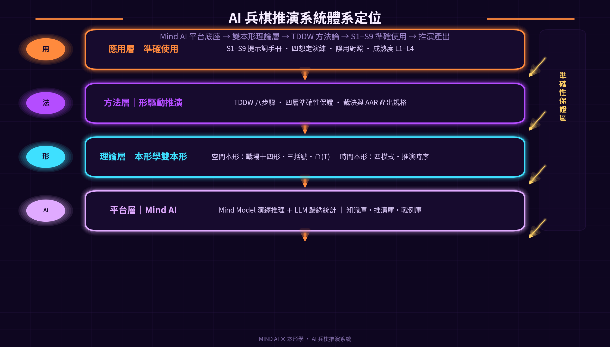

**圖 1-1 AI 兵棋推演系統體系定位：平台層、理論層、方法層、應用層四層分工**

## 1.2 參照案例：GE26 與 WarMatrix 的啟示

本書的重要參照案例是：**美國空軍在代號 GE26 的兵棋推演活動中，首次啟用人工智能兵棋推演系統「戰爭矩陣 WarMatrix」**。這是兵棋推演史上第一次由 AI 系統在正式推演活動中承擔大規模對抗推演的核心角色，意義在於：AI 兵棋推演已從「研究玩具」跨入「作業裝備」。

從公開揭示的定位來看，WarMatrix 以「矩陣」為核心意象：大量推演分支被排進矩陣並行推進，AI 與 AI 對抗、AI 為人類指揮官批量生成與淘汰行動方案，裁決由矩陣規則即時回饋。這種作法把傳統兵推「一場推演講一個故事」的模式，翻轉為「一場推演掃過一整片可能性空間」。對我方系統而言，GE26 × WarMatrix 帶來五點直接啟示，對照如下表。

| 面向 | WarMatrix 揭示的方向 | 本系統對應機制 | 本形學支撐 |
| --- | --- | --- | --- |
| 推演規模 | AI×AI 大規模對抗、想定快速迭代 | S1 想定批次變體生成、S9 演化閉環 | 想定形新增列＝輕量、新增欄＝升版 |
| 裁決機制 | 矩陣式自動裁決、即時回饋 | 裁決形 × 混合裁決 × 一致化三律 | ∩(T) 交集判準保證同案同判 |
| 決策加速 | 壓縮 OODA、指揮官聚焦例外 | 時間本形節奏函式、決策週期管理 | 形時間函式搜尋定位節點 |
| 知識沉澱 | 推演數據回流、系統自我改進 | 戰例形入庫、模式萃取、推演庫治理 | 自我演化模式＋持續學習 |
| 人機分工 | AI 主導沙盤、人類保留決策 | 人機分工梯度 L1–L5、準則形 G 門 | 指揮形授權鏈不可繞過 |

**表 1-1 GE26 × WarMatrix 五面向對標**

對標結論：WarMatrix 證明了「大規模 AI 推演」的可行性與價值；本系統的差異化在於用本形學雙本形把推演要素與推演時序全部形化，讓大規模自動裁決**不失真**——量大，更要準。

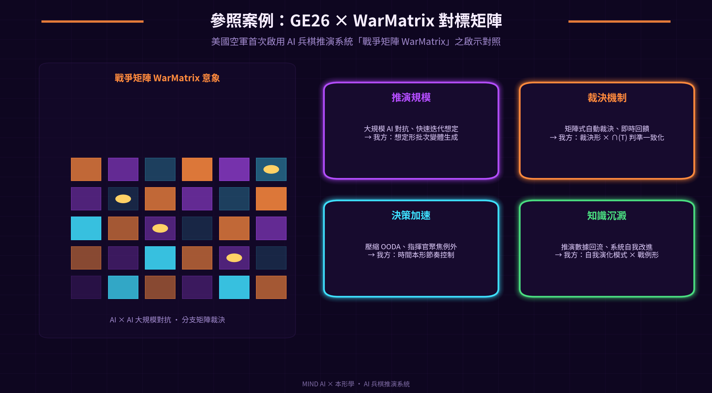

**圖 1-2 參照案例對標矩陣：WarMatrix 意象與我方四象限對應**

### 大規模矩陣推演的五個工程挑戰

WarMatrix 式的大規模推演把問題從「推得對不對」放大為「一萬個格子怎麼保證都對」。工程上至少有五個挑戰，本書後續章節逐一給出解法：

| 挑戰 | 症狀 | 本書解法 | 章節 |
| --- | --- | --- | --- |
| 一致化 | 同事件異判決 | ∩(T) 判準＋一致化三律 | 2.10 |
| 回溯 | 結論指不回依據 | 形證據鏈五環 | 7.3 |
| 算力分配 | 分支爆炸 | 估值剪枝＋例外管理 | 3.2/5.5 |
| 知識沉澱 | 推完即忘 | 戰例形＋自我演化閉環 | 3.5 |
| 人機邊界 | AI 越權 | 指揮形授權鏈＋人機梯度 | 4.8 |

**表 1-2a 大規模矩陣推演五挑戰**

## 1.3 空間本形在兵棋推演的運用總綱

空間本形回答「推演的是什麼」。本書不重述理論，直接給出運用映射：凡本形學空間篇的每一項工具，在兵棋推演中都有明確崗位。

| 空間本形工具 | 兵棋推演運用 | 操作要點 |
| --- | --- | --- |
| 異同 → 分合 → 邊界 | 戰場要素形化的起手式 | 先分辨「這個不是那個」，再把同類圈起、異類切開，邊界即形 |
| 屬性 / 屬性值 | 戰力屬性軸（射程、載彈、機動…） | 新差異對上舊軸→加值；對不上→開新欄並回填舊實體 |
| 空間容器 ( ) | 戰域容器：陸海空天網電認知 | 容器身份不隨進駐兵力改變；進出有記錄、邊界可判定 |
| BOM / SOM { } | 兵力編組與部件結構 | 編制不是清單是結構；結構依存判斷決定戰力降級算法 |
| 抽象 [ ] | 威脅類別、戰法類別的開放生成規則 | 新實體過 ∩(T) 判準才算入類，杜絕「看起來像」 |
| 交集判準 ∩(T) | 裁決一致化、目標達成判定 | 判準含特徵清單、門檻、排除條款、證據要求、裁決映射 |
| RDB 表頭＝形 | 想定庫、推演庫、戰例庫建檔 | 表頭即形、資料列即實體、主鍵＝想定ID＋時序節點 |

**表 1-2 空間本形 → 兵棋推演運用映射**

運用總綱的核心記憶點是一句話：**戰場上的每一個「東西」都要有形，形與形之間的關係要能用三括號說清楚**。第 2 章會把這套映射展開成戰場十四形的完整形化工程。

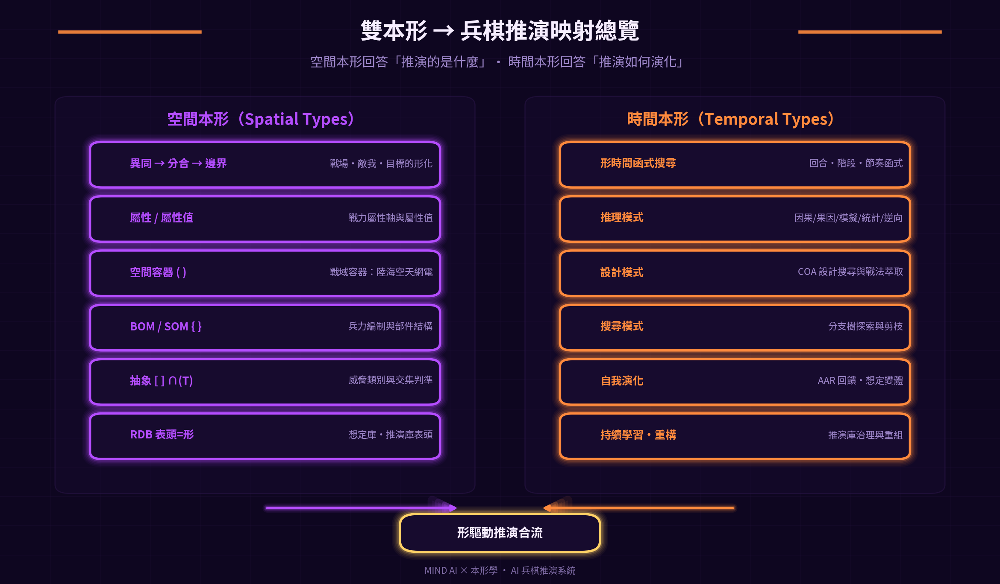

**圖 1-3 雙本形 → 兵棋推演映射總覽：空間答「是什麼」，時間答「怎麼變」**

## 1.4 時間本形在兵棋推演的運用總綱

時間本形回答「推演如何演化」。時間篇的每一項能力，在推演中各有崗位：

| 時間本形能力 | 兵棋推演運用 | 操作要點 |
| --- | --- | --- |
| 形時間函式搜尋 | 回合、階段、節奏的時序節點檢索 | 把時間結構化為可索引節點，任何行動掛時窗 |
| 搜尋模式 | COA 分支樹探索與剪枝 | 寬度平行、深度預推、∩(T) 估值、守恆剪枝 |
| 推理模式（因果/果因/模擬/統計/逆向） | 紅隊意圖研判、藍隊結果預測 | 結論必須標註推理式＋前提清單 |
| 設計模式（設計搜尋與萃取） | COA 生成與戰法模式複用 | 戰例庫檢索→模式萃取→想定改寫→回存 |
| 自我演化 | AAR 回饋、想定變體、推演庫治理 | 四門治理：品質門、版本門、淘汰門、審計門 |
| 持續學習 / 重構與重組 | 推演庫治理與判準修訂 | 改版留痕、舊值保留、失效標記 |
| 思考法（正向/逆向/水準/垂直/第一性原理） | 分析與設計的思維工具箱 | 垂直思考深化因果、水準思考拓寬 COA |
| 解題 / 分析 / 設計 / 研發探索 | 推演作業的四類基本功 | 解題界定問題、分析拆態勢、設計出方案、探索試新戰法 |

**表 1-3 時間本形 → 兵棋推演運用映射**

時間本形的記憶點：**推演的時間不是一條平順的線，而是一串可索引、可搜尋、可推理的節點**。第 3 章展開四模式的完整運用。

## 1.5 雙本形合流與四層準確性保證

空間本形把要素切乾淨，時間本形把變化推明白，兩者合流才是完整的推演。合流的判準是：**任一時序節點上的任一實體，都能被空間本形定址；任一空間實體的狀態變遷，都能被時間本形解釋**。做不到這一點的推演，就是「散推」——有故事、沒結構，結論不可信。

為守住可信度，本系統實行**四層準確性保證**，自上而下逐層鎖定：

- 第一層｜∩(T) 判準：裁決規則、威脅歸類、目標達成條件皆定義為可判定的交集判準，先於推演存在。

- 第二層｜演繹骨架：推演結論由 Mind Model 演繹推理導出，LLM 僅做歸納統計與生成輔助，每一步行動有推理路徑。

- 第三層｜一致性驗證：兵力平衡、時序閉合、資源守恆、準則合規四重自動檢查，攔截內部矛盾。

- 第四層｜形證據鏈：每個裁決與結論掛回形實體，形成可回溯、可審計的證據鏈。

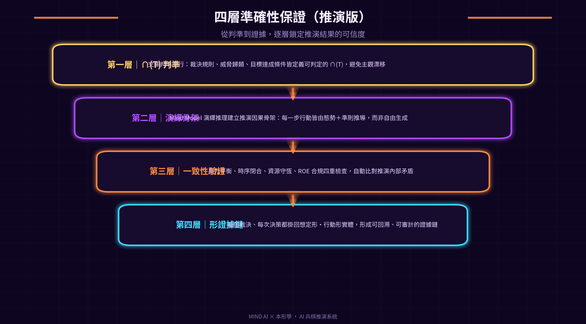

**圖 1-4 四層準確性保證：從判準到證據的逐層鎖定**

## 1.6 準確使用三原則的操作化

1.1 節提出「形先行、判準先行、證據必留」三原則。原則若不能檢查，就只是標語；本節把三原則展開為可稽核的操作表，推演主持人可逐列勾稽。

| 原則 | 操作化問題 | 檢查方法 | 不過處置 |
| --- | --- | --- | --- |
| 形先行 | 要素都有形嗎？欄位對齊嗎？ | 十四形歸類檢查＋四檢查 | 停推，先做第 2 章形化工程 |
| 形先行 | 有沒有「無形之物」混進來？ | 抽樣問：這筆資訊歸哪形？ | 歸形或開新欄，不得懸置 |
| 判準先行 | ∩(T) 五要素齊全嗎？ | 特徵/門檻/排除/證據/映射逐項查 | 補齊判準才能裁決 |
| 判準先行 | 裁決有表行號嗎？ | 裁決流水抽樣 10% 回指檢查 | 無表行號判決作廢重裁 |
| 證據必留 | 結論拖著證據鏈嗎？ | 結論→裁決→行動→情報→想定五環抽測 | 斷鏈結論降級為待驗 |
| 證據必留 | 改版有連動失效嗎？ | 版本稽核：上游改版下游標記 | 補跑待重驗清單 |

**表 1-4 三原則操作化稽核表**

主持人口訣：**開推先問形、下判先問準、出結先問鏈**。九個字，三道關，比任何檢查表都好記。

## 1.7 本書名詞與縮寫速覽

| 名詞 | 縮寫 | 一句話 |
| --- | --- | --- |
| 形驅動推演 | TDDW | 本書方法論：八步驟＋四層準確性 |
| 行動方案 | COA | 藍隊方案單位（Course of Action） |
| 交集判準 | ∩(T) | 可判定的類別與裁決規則 |
| 推演後檢討 | AAR | After Action Review 評估工序 |
| 物料清單／空間清單 | BOM／SOM | 組成清單／結構依存組成 |
| 判斷-決策週期 | OODA | 觀-判-決-動 |
| 外交-情報-軍事-經濟 | DIME | 戰略層四軸施力框架 |
| 戰爭矩陣 | WarMatrix | GE26 啟用的美軍 AI 兵推系統 |
| 海上交通線 | SLOC | Sea Lines of Communication |
| 國際人道法 | LOAC | Law of Armed Conflict |

**表 1-5 名詞與縮寫速覽（完整對照見附錄 C）**

## 1.8 使用前準備：角色、資料與環境

準確使用方法要落地，推演前的準備缺一不可。標準推演席位配置如下（可一人多席，但席位責任不可合併）：

| 席位 | 職責 | 主用工具 | 不可兼任 |
| --- | --- | --- | --- |
| 主持人 | 課題定錨、時程掌控、例外裁決 | 任務說明書・表 5-5 | 紅隊長 |
| 紅隊長 | 敵方意圖與方案推演 | S4 | 藍隊長 |
| 藍隊長 | COA 設計與修訂 | S5 | 紅隊長 |
| 裁決官 | 混合裁決與一致化 | S6・裁決表 | 紅/藍隊長 |
| 評估官 | 四軸指標與 AAR | S8 | 裁決官 |
| 治理官 | S9 入庫與版本治理 | 治理四門 | 裁決官 |

**表 1-6 推演席位配置**

- 資料準備：裝備庫（BOM 基數）、裁決表校準版、戰例庫存取權、想定分級設定——四項未備齊不開推。

- 環境準備：推演環境與外部網路隔離；想定分級與帳號權限對齊；備份推演庫快照（開推前基準版）。

- 身心準備：紅隊席位安排「魔鬼代言人」性格者；連續推演每 2 小時強制休整——疲勞是判準的頭號殺手。

# 第 2 章 空間本形形化工程：戰場十四形

## 2.1 形化總覽：四組十四形

把空間本形套上兵棋推演，戰場全要素被歸納為**四組十四形**：情境組描述推演的舞台與規則，力量組描述對抗的實力與指揮，行動組描述意圖與作為，裁決組描述判定與學習。十四形覆蓋推演全要素，任何推演產出都必須以十四形之一的實體落庫。

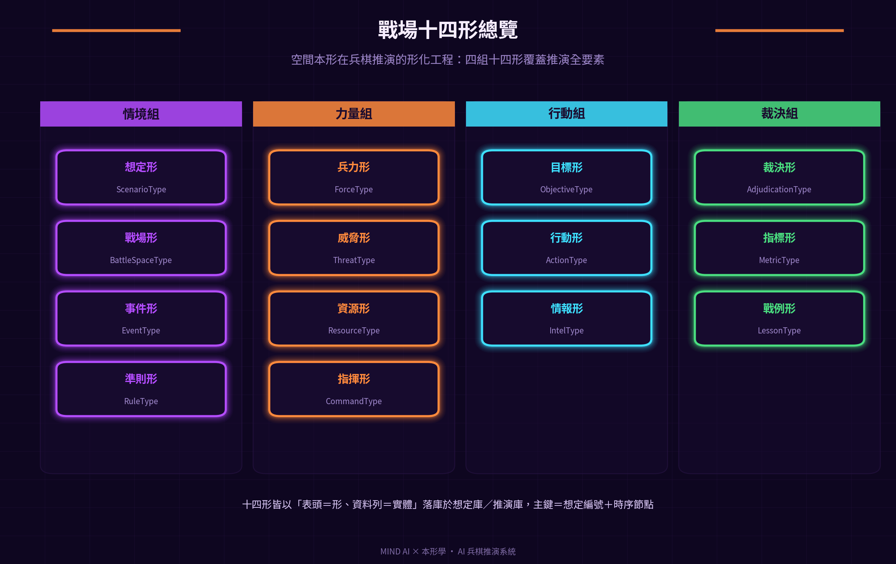

**圖 2-1 戰場十四形總覽：情境・力量・行動・裁決四組**

| 組別 | 形（Type） | 職責 | 主鍵建議 |
| --- | --- | --- | --- |
| 情境組 | 想定形 ScenarioType | 推演的整體設定與邊界 | 想定ID＋版本 |
| 情境組 | 戰場形 BattleSpaceType | 戰域容器與空間屬性 | 戰域ID |
| 情境組 | 事件形 EventType | 時序節點上的觸發器 | 事件ID＋時序節點 |
| 情境組 | 準則形 RuleType | ROE 與交戰門檻 | 準則ID＋G門編號 |
| 力量組 | 兵力形 ForceType | 編制、裝備、戰力 | 兵力ID＋編組層級 |
| 力量組 | 威脅形 ThreatType | 威脅類別與等級 | 威脅ID＋∩(T) 編號 |
| 力量組 | 資源形 ResourceType | 油彈人預算後勤 | 資源ID |
| 力量組 | 指揮形 CommandType | 指揮層級與授權鏈 | 指揮節點ID |
| 行動組 | 目標形 ObjectiveType | 勝負判準的載體 | 目標ID＋∩(T) 編號 |
| 行動組 | 行動形 ActionType | 一切作戰作為 | 行動ID＋時序節點 |
| 行動組 | 情報形 IntelType | 證據與來源等級 | 情報ID |
| 裁決組 | 裁決形 AdjudicationType | 判決與裁決表映射 | 裁決ID＋裁決表行號 |
| 裁決組 | 指標形 MetricType | 評估指標與計算式 | 指標ID |
| 裁決組 | 戰例形 LessonType | 可複用的經驗卡 | 戰例ID＋版本 |

**表 2-1 戰場十四形職責表**

形化總守則：**不允許無形之物進入推演**。凡無法歸入十四形的資訊，先問「它是新形，還是既有形的新欄位？」——這正是框架四步驟的判斷。

## 2.2 想定形 ScenarioType：推演的總綱

想定形是推演的「表頭」，一張想定卡就是一個想定形實體。依 RDB 對應原則：**新增一個想定＝新增一列**（輕量，不動框架）；**新增一個維度**（例如戰爭迷霧強度）**＝新增一欄**（動框架，須回頭為所有舊想定補值）。這保證想定庫永遠欄位齊整、批次變體不會長歪。

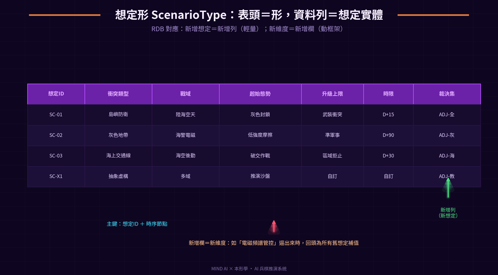

**圖 2-2 想定形的 RDB 對應：新增列與新增欄的不對稱變動**

| 欄位 | 型別 | 說明 | ∩(T) 掛鉤 |
| --- | --- | --- | --- |
| 想定ID / 版本 | 文字 | SC-01 v2.3 之類 | 版本連動證據鏈 |
| 衝突類型 | 列舉 | 島嶼防衛／灰色地帶／交通線／自訂 | 歸類判準 |
| 戰域容器 | 外鍵 | 指向戰場形 | 邊界判準 |
| 起始態勢 | 敘述＋實體組 | 初始兵力、位置、關係 | 態勢完整性檢查 |
| 升級上限 | 列舉 | 準軍事／有限武裝／全面衝突 | 升級臨界線 |
| 時限 / 回合數 | 數值 | D+n、回合數、時序節點數 | 時序閉合檢查 |
| 裁決集 / 指標集 / ROE | 外鍵 | 裁決形・指標形・準則形 | 裁決映射行號 |
| 勝負判準 | ∩(T) 組 | 目標形的交集判準組合 | 目標達成判定 |

**表 2-2 想定形標準欄位**

## 2.3 戰場形 BattleSpaceType：戰域空間容器

戰場形以**空間容器**語法建模：**( 戰域 )**。容器的核心性質是**身份獨立性**——戰域不會因為進駐兵力改變而變成另一個戰域，換防、失守、易主都只是「內容物」變動，戰域 ID 不變。這條性質在推演中極其實用：戰報掛戰域 ID，不會因為戰線移動而斷鏈。

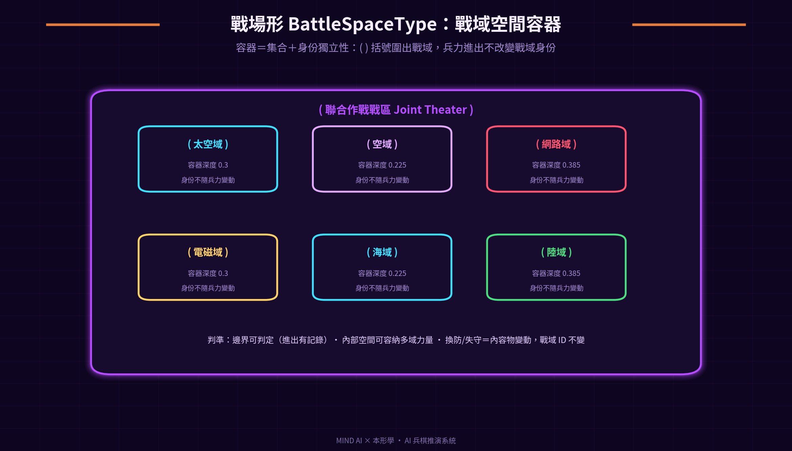

**圖 2-3 戰場形空間容器：六域嵌套與身份獨立性**

- 邊界可判定：每個戰域的邊界以座標、時限、管轄三要素定義；「進去了／還沒進去」必須能被裁決。

- 內部空間可容納多域力量：同一戰域容器內可同時有多支兵力形實體，互不干擾身份。

- 容器可嵌套：戰區 ⊃ 戰區段 ⊃ 任務區；子容器隨父容器連動約束（如禁區覆蓋全子域）。

## 2.4 兵力形 ForceType：BOM 物料清單 × SOM 空間清單

兵力形用 **{ }** 括號描述編組。關鍵觀念是：**編制是部件結構，不是並列清單**。BOM（Bill of Materials）列出「由什麼組成」，SOM（Space of Materials）進一步回答「部件之間的結構依存」——拿掉一個部件，整體還是同一個兵力形嗎？

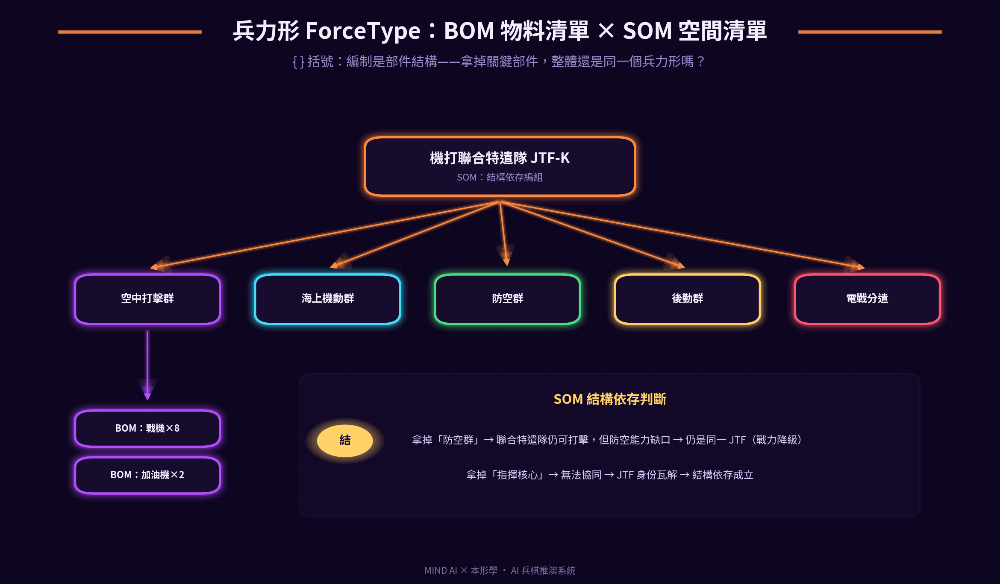

**圖 2-4 兵力形 BOM/SOM：結構依存判斷**

- 替換測試：同型裝備替換（戰機 A 換戰機 B）→ 身份不變，僅屬性值變動。

- 降級測試：拿掉次要部件（如電戰分遣）→ 仍是同一兵力形，戰力指數下修。

- 瓦解測試：拿掉結構依存部件（如指揮核心）→ 兵力形身份瓦解，編組解散重組。

三測試的判決直接餵給裁決形：降級測試結果決定戰力指數修正係數，瓦解測試結果觸發事件形「編組瓦解」，進入下一時序節點。

## 2.5 威脅形 × 目標形：交集判準 ∩(T) 的雙載體

威脅形用 **[ ]** 抽象括號建模：抽象＝集合＋**生成規則**，新式裝備、新式戰法過得了 ∩(T) 判準才算入類。目標形則是勝負判準的載體——每個目標實體都掛一組 ∩(T)，全達成即勝、全失效即敗、其間為比例量尺。

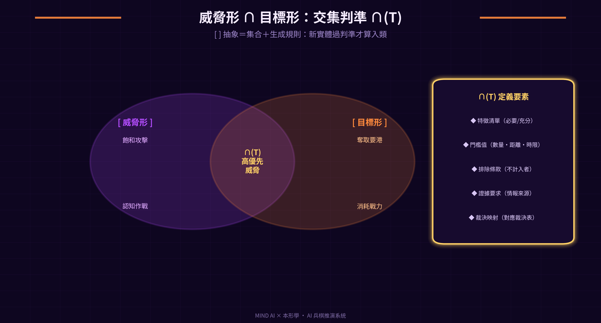

**圖 2-5 威脅形 ∩ 目標形：交集判準五要素**

∩(T) 的定義五要素缺一不可：**特徵清單**（必要／充分條件）、**門檻值**（數量・距離・時限）、**排除條款**（不計入者）、**證據要求**（情報形來源等級）、**裁決映射**（對應裁決表行號）。五要素齊備，判準才可判定；否則就是形容詞，不是判準。

## 2.6 行動形 × 資源形：四約束行動

行動形是推演的動詞。每個行動實體出場時必須綁定**四約束**：資源預算（資源形）、時窗與先後序（時間本形）、空間邊界（戰場形）、準則門檻（準則形）。四約束缺一的行動不得進入推演——這條規則攔下的是「浪漫化作戰」：有決心、沒油彈的行動，推演裡一律以資源守恆剪除。

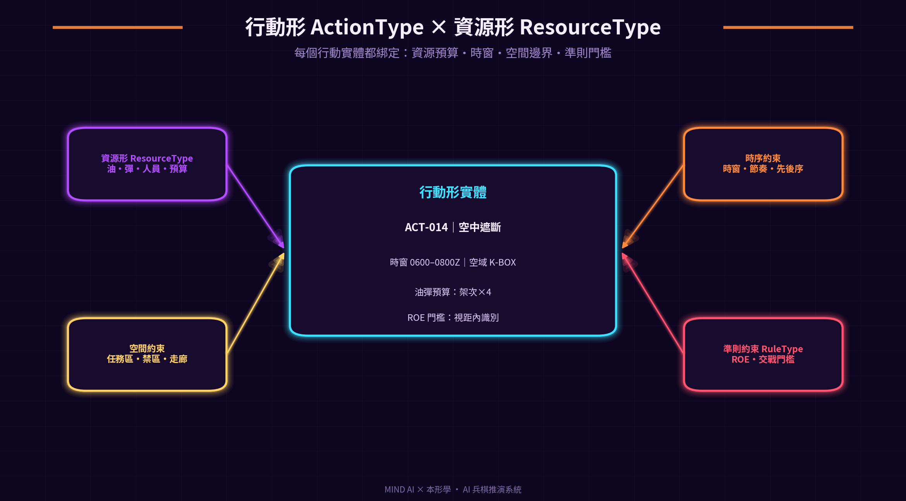

**圖 2-6 行動形四約束：資源・時序・空間・準則**

| 約束 | 檢查內容 | 違反處置 |
| --- | --- | --- |
| 資源預算 | 油・彈・人員・預算是否可支應 | 剪除或降級行動規模 |
| 時窗約束 | 時窗衝突、先後序矛盾 | 重排時序節點或報衝突 |
| 空間約束 | 任務區・禁區・走廊符合性 | 改道或報準則門 G2/G3 |
| 準則約束 | ROE 門檻 G1–G5 通過性 | 阻卻並回報指揮形 |

**表 2-3 行動形四約束檢查**

## 2.7 準則形 × 情報形：合法與真實的雙閘

準則形 RuleType 把 ROE 寫成五道可判定的決策門：**G1 識別門**（敵我識別可信度）、**G2 威脅門**（威脅形 ∩(T) 命中）、**G3 授權門**（指揮層級符合）、**G4 比例門**（武力使用比例）、**G5 記錄門**（全程取證）。任何行動推進到裁決前逐門檢查，任一門不過即阻卻。

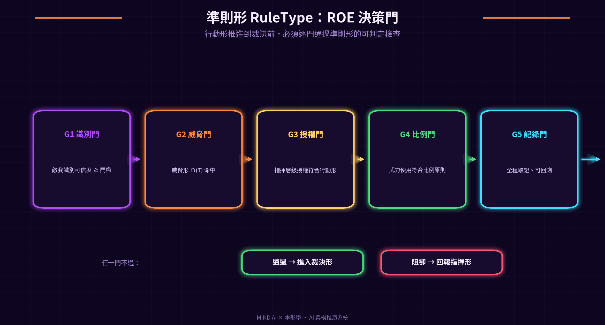

**圖 2-7 準則形 ROE 決策門 G1–G5**

情報形 IntelType 是「真實」的閘門：每筆情報實體都掛**來源等級**（原始訊號／影像／人力／公開來源）、**可信度**（A–E）、**時效**。情報形餵給威脅形與裁決形時，其可信度直接乘入判準命中權重——低可信情報不得單獨觸發高階裁決。

## 2.8 指揮形 × 事件形：指揮鏈與觸發器

指揮形 CommandType 建模指揮層級與授權鏈：誰能批准哪一級行動、代理順位、通聯失效時的備援指揮。**指揮形的授權邊界高於一切 AI 建議**——這是人機分工的形化落點。

事件形 EventType 是時序節點上的觸發器：「防空網破口」「外交斡旋展開」「後勤線中斷」都是事件實體。事件的三要素：**觸發條件**（∩(T)）、**影響範圍**（連動哪些形實體）、**節奏效果**（加速／凍結／切換推演節拍）。事件形是時間本形與空間本形的黏合劑——事件在時間上發生，改寫空間實體的屬性值。

## 2.9 裁決形 × 指標形 × 戰例形：判定與學習

裁決組三形是推演可信度的守門員。裁決形負責「這一仗怎麼判」，指標形負責「整場推演怎麼量」，戰例形負責「下次推演怎麼更強」。

| 形 | 職責 | 與他形的掛鉤 |
| --- | --- | --- |
| 裁決形 AdjudicationType | 交戰判決、事件裁決、升級裁決 | 指回裁決表行號＋∩(T) 編號 |
| 指標形 MetricType | 目標達成度、戰力比、風險、節奏四軸 | 計算式引用裁決形與情報形實體 |
| 戰例形 LessonType | 推演／實兵／戰史的可複用經驗卡 | 掛行動形骨架＋指標形結果 |

**表 2-4 裁決組三形職責**

## 2.10 三括號與 ∩(T) 的聯合運用

三括號是形化的三副眼鏡：**( )** 看位置（容器）、**{ }** 看結構（SOM）、**[ ]** 看類別（抽象）。同一個戰場語句可以用三括號分別檢驗：「防空群進入北戰域」——容器語句（位置）、「防空群由雷達與飛彈連構成」——SOM 語句（結構）、「這是區域拒止威脅」——抽象語句（類別）。三種語句各有各的判準，混用就會出現「拿集合論管身份」的謬誤。

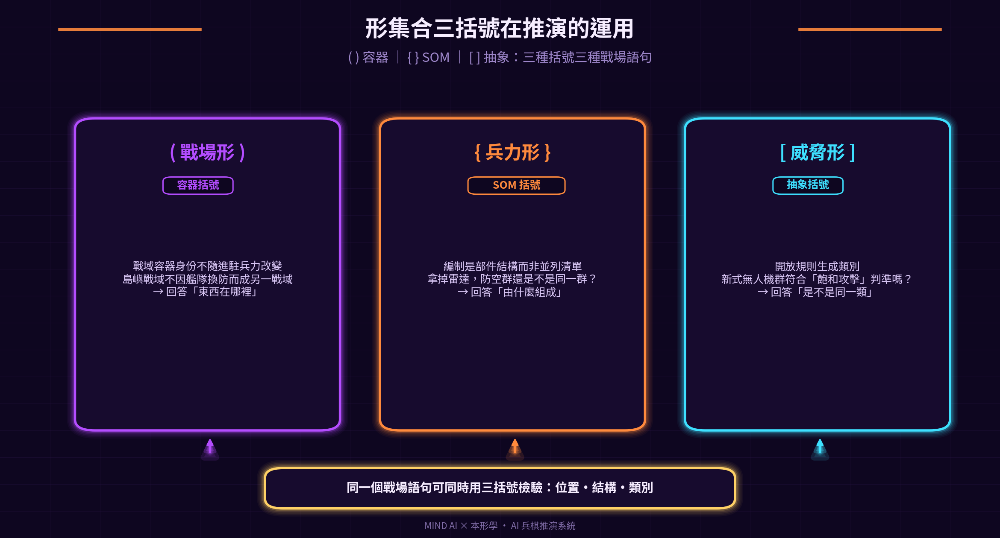

**圖 2-8 形集合三括號：容器・SOM・抽象三種戰場語句**

∩(T) 則貫穿三括號：容器判準（邊界可判定嗎）、SOM 判準（結構依存在哪）、抽象判準（過不過生成規則）。裁決一致化的實務口訣是**一致化三律**：

- 同事件重跑同判決——可重現：裁決是函式，不是心情。

- 異事件同特徵同判決——可類化：判準管到的是類別，不是個案。

- 判決皆可指回裁決表行號與證據——可審計：每一判都有來歷。

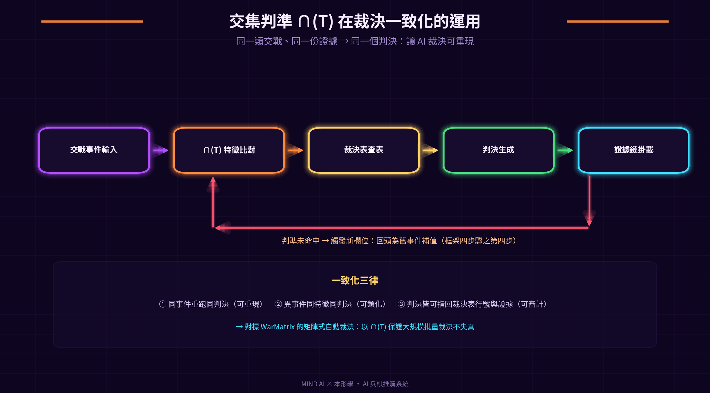

**圖 2-9 ∩(T) 裁決一致化流程與一致化三律**

## 2.11 形化工程操作守則

形化工程以框架四步驟循環運作：偵測異同 → 逼出屬性 → 維度命名 → 歸檔判斷。落到推演作業，展開為十項守則：

- 推演要素先攤開再分組：把想定內的力量、地點、事件全部列出，逐對比較「這個不是那個」。

- 差異對不上舊軸才開新欄：對得上就加值，絕不重複開欄。

- 開新欄必回填：所有既有實體在新欄補值（哪怕是「空」）。

- 欄位命名用形語言：中文形名＋英文 Type 名對齊（如「戰場形 BattleSpaceType」）。

- 每形必有主鍵：無主鍵的實體無法被證據鏈指認。

- 容器與內容物分表：戰域表與兵力表分開，以外鍵連動。

- 編組用 SOM 不用清單：部件關係要能回答結構依存三測試。

- 類別用 ∩(T) 不用印象：「像」不算「是」。

- 形化產出過四檢查：欄位齊全、主鍵唯一、外鍵有效、判準可判定。

- 形化即建檔：推演未動、形庫先行，產出同步落庫。

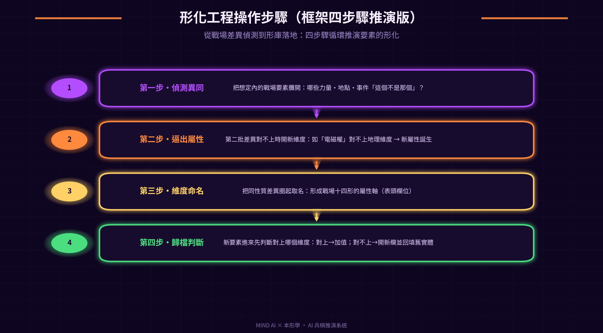

**圖 2-10 形化工程四步驟循環（框架四步驟推演版）**

## 2.12 形化實例：從一段戰報到十四形

本節以虛構戰報示範形化的完整手法。戰報原文：「D+4 0600Z，紅方艦艇 8 艘進入北任務區外緣，海警船伴隨；藍方防空群雷達受強烈電磁干擾，識別困難；0800Z 藍方下令空中巡邏兵力前推警戒。」

### 第一步・偵測異同：攤開要素

| 戰報要素 | 初步歸形 | 異同判斷 |
| --- | --- | --- |
| 紅方艦艇 8 艘 | 兵力形（紅方海上群） | 與既有「紅方兩棲集群」同型不同編——加值 |
| 海警船伴隨 | 兵力形（紅方準軍事群） | 與軍艦性質不同——新子群 |
| 北任務區外緣 | 戰場形（北任務區） | 既有容器，位置屬性更新 |
| 電磁干擾 | 事件形＋電磁域行動 | 干擾強度是新差異——逼出「電磁權」欄 |
| 識別困難 | 情報形（可信度降級） | 既有欄位加值 |
| 前推警戒令 | 行動形（ACT-前推警戒） | 四約束待補 |

**表 2-5 異同偵測：戰報要素歸形**

### 第二步・逼出屬性與第三步・維度命名

「電磁干擾強度」對不上既有地理維度，逼出新欄位**「電磁權」**（屬性值：完全掌握／優勢／均勢／劣勢／喪失）——依守則三，開欄後回頭為 D+0 至 D+3 的所有事件實體補值「均勢（預設）」。

### 第四步・歸檔判斷與裁決掛鉤

- 「前推警戒令」行動形四約束檢查：資源（巡邏架次×2，可支應）、時窗（0800Z 起，無衝突）、空間（北區走廊，未越界）、ROE（G1 識別門——因電磁干擾暫不過，改掛「識別困難」情報形，觸發 G2 複核）。

- 裁決形挂鉤：識別困難 → 誤擊風險上升 → 裁決表 ADJ-電戰「強干擾×複雜空情→誤判機率 +0.2」。

- 證據鏈落地：本戰報全文掛情報形 IMINT/ELINT 來源，所有衍生判決指回本節點。

實例要點：形化不是文書工作，是**把戰報變成可裁決的資料**。六個要素、三個形組、一條證據鏈——這就是一次合格的形化。

## 2.13 十四形屬性 Schema 速查

本節給出十四形的完整欄位架構，供建庫與 S 手冊輸出驗收對照。欄位分**必填（●）**與**選填（○）**；主鍵欄位恆為必填。凡 S 手冊輸出缺必填欄，即為不合格輸出。

### 情境組 Schema

| 形 | 欄位（●必填／○選填） |
| --- | --- |
| 想定形 | ●想定ID ●版本 ●衝突類型 ●戰域容器 ●起始態勢 ●升級上限 ●時限/回合數 ●裁決集 ●指標集 ●ROE ●勝負判準 ○備註 ○變體軸 |
| 戰場形 | ●戰域ID ●名稱 ●層級 ●邊界三要素 ●容量 ○子容器清單 ○禁區清單 ○管轄單位 |
| 事件形 | ●事件ID ●觸發條件∩(T) ●影響範圍 ●節奏效果 ○連鎖事件 ○機率 ○備註 |
| 準則形 | ●準則ID ●G門編號 ●判定式 ●阻卻處置 ○授權層級 ○例外條款 |

**表 2-6 情境組四形 Schema**

### 力量組 Schema

| 形 | 欄位（●必填／○選填） |
| --- | --- |
| 兵力形 | ●兵力ID ●編組層級 ●BOM 明細 ●SOM 依存等級 ●戰力指數 ●結構依存判決 ○降級係數 ○備註 |
| 威脅形 | ●威脅ID ●∩(T) 編號 ●類別判定 ●等級 ●觀察指標 ○反證指標 ○機率 |
| 資源形 | ●資源ID ●品項 ●基數 ○日耗率 ○補給線 ○維持天數 ○優先序 |
| 指揮形 | ●指揮節點ID ●層級 ●授權範圍 ○代理順位 ○備援通聯 ○失效處置 |

**表 2-7 力量組四形 Schema**

### 行動組與裁決組 Schema

| 形 | 欄位（●必填／○選填） |
| --- | --- |
| 目標形 | ●目標ID ●∩(T) 組 ●層級 ●達成比例尺 ○失效條件 ○優先序 |
| 行動形 | ●行動ID ●四約束 ●時序節點表 ●目標掛鉤 ○備案 ○風險註記 ○估值 |
| 情報形 | ●情報ID ●來源等級 ●可信度 ●時效 ●內容摘要 ○複核時點 ○關聯威脅 |
| 裁決形 | ●裁決ID ●裁決表行號 ●判決 ●戰果 ○例外標記 ○爭議狀態 |
| 指標形 | ●指標ID ●計算式 ●數值 ●證據來源 ●門檻比對 ○趨勢 |
| 戰例形 | ●戰例ID ●版本 ●態勢摘要 ●行動骨架 ●指標結果 ●複用註記 ○適用想定類 ○退役狀態 |

**表 2-8 行動組三形與裁決組三形 Schema**

## 2.14 三層聯合判斷示範

三括號判斷可聯合運用於一個疑難問題。示範問題：「敵方以無人機群飽和攻擊我防空陣地，這算不算『飽和攻擊』類威脅？」三層依序判斷：

| 層 | 判斷 | 問題 | 結論 |
| --- | --- | --- | --- |
| 容器層 ( ) | 身分判斷 | 無人機群是否獨立作戰單元？ | 是——有指揮核心，容器成立 |
| SOM 層 { } | 結構依存 | 拿掉蜂群指揮節點？ | 蜂群瓦解——關鍵件成立 |
| 抽象層 [ ] | ∩(T) 歸類 | 過「飽和攻擊」判準？ | 數量門檻✓ 同時性✓ 手法✓→入類 |

**表 2-9 三層聯合判斷示範**

聯合判斷的意義：**容器管「是不是一個東西」、SOM 管「內部怎麼撐」、抽象管「算不算這一類」**。三層答案齊備，裁決形才有完整的歸類依據；跳層判斷（直接問「算不算」）是裁決爭議的常見根源。

# 第 3 章 時間本形形化工程：推演時序與演化

## 3.1 推演時序形總覽

時間本形的第一個運用是把推演時間**結構化**。推演時序形把時間切成三層：**回合**（Turn，決策週期單位）× **階段**（Phase，回合內節拍：偵察・決策・機動・交戰・整補）× **節點**（Node，可索引的時序位置）。任何行動、事件、裁決都掛在時序節點上，這使整場推演成為可檢索的時序資料庫——這正是「形時間函式搜尋」的推演版本。

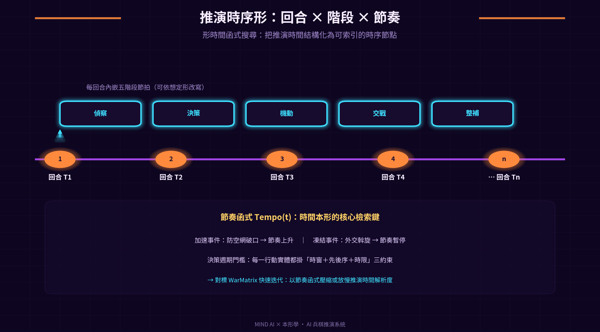

**圖 3-1 推演時序形：回合 × 階段 × 節點與節奏函式**

| 時序要素 | 單位 | 用途 | 檢索鍵 |
| --- | --- | --- | --- |
| 回合 Turn | D+日／自訂 | 決策週期、資源補給週期 | Turn 編號 |
| 階段 Phase | 五節拍 | 行動排程、裁決批次 | Turn＋Phase |
| 節點 Node | 事件級 | 證據鏈定位、狀態快照 | Turn＋Phase＋序號 |
| 節奏函式 Tempo(t) | 曲線 | 加速／凍結／切換推演解析度 | 事件觸發紀錄 |

**表 3-1 推演時序四要素**

節奏函式 Tempo(t) 是時間本形的核心檢索鍵：加速事件（防空網破口）拉高節奏、凍結事件（外交斡旋）暫停節奏。對標 WarMatrix 的快速迭代，節奏函式讓主持人可把「沒事發生的時段」壓縮、把「關鍵決策時段」放慢細看——推演時間的解析度是可調的。

## 3.2 搜尋模式：COA 分支樹與剪枝

搜尋模式在行動分支上推演未來：每個 COA（Course of Action，行動方案）是一條分支，分支向前預推 2–4 回合，以 ∩(T) 目標達成度估值排序，違反守恆律的分支即刻剪除。

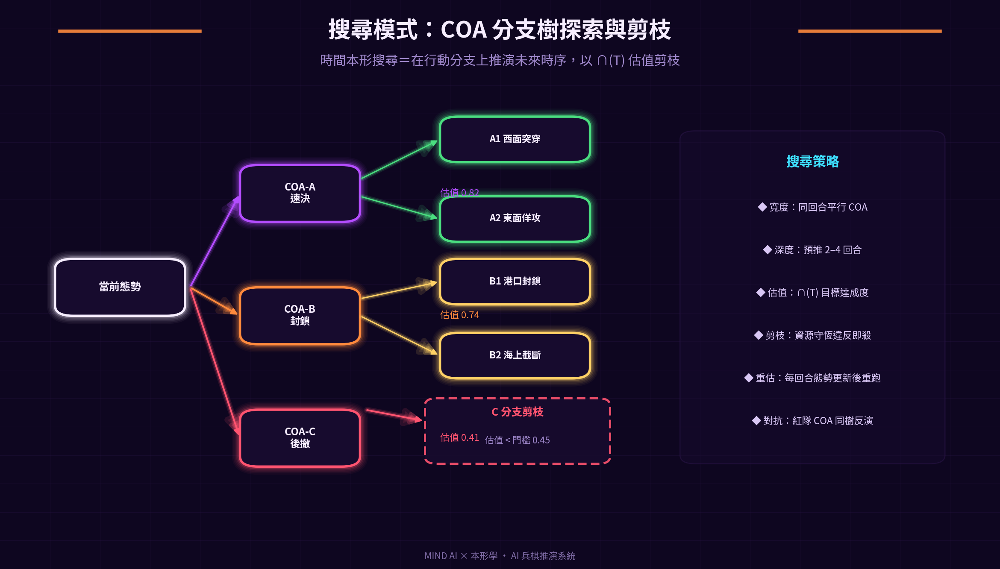

**圖 3-2 搜尋模式：COA 分支樹探索與剪枝**

- 寬度：同一回合平行展開多條 COA，避免過早收斂。

- 深度：預推 2–4 回合；再遠則不確定性主導，浪費算力。

- 估值：∩(T) 目標達成度＋風險指標合成估值分數。

- 剪枝：資源守恆違反、準則違反、升級越界三類分支即殺。

- 重估：每回合態勢更新後整樹重估，不沿用過期估值。

- 對抗：紅隊 COA 在同一棵樹上反演，藍隊分支估值須對紅隊最優解穩健。

| 分支 | 預推深度 | ∩(T) 達成 | 風險 | 估值 | 處置 |
| --- | --- | --- | --- | --- | --- |
| COA-A 西面突穿 | 3 回合 | 0.78 | 升級 0.55 | 0.82 | 保留主案 |
| COA-A2 東面佯攻 | 2 回合 | 0.61 | 升級 0.40 | 0.71 | 併入主案支線 |
| COA-B 港口封鎖 | 4 回合 | 0.66 | 後勤 0.48 | 0.74 | 保留備案 |
| COA-C 後撤待援 | 2 回合 | 0.30 | 民心 0.62 | 0.41 | 剪除（<0.45） |

**表 3-2a 分支估值與剪枝示例**

## 3.3 推理模式五式

推理模式是 Mind Model 演繹骨架的引擎。五種推理式各有適用場景，推演中**強制標註**所用推理式與前提清單，供證據鏈回溯。

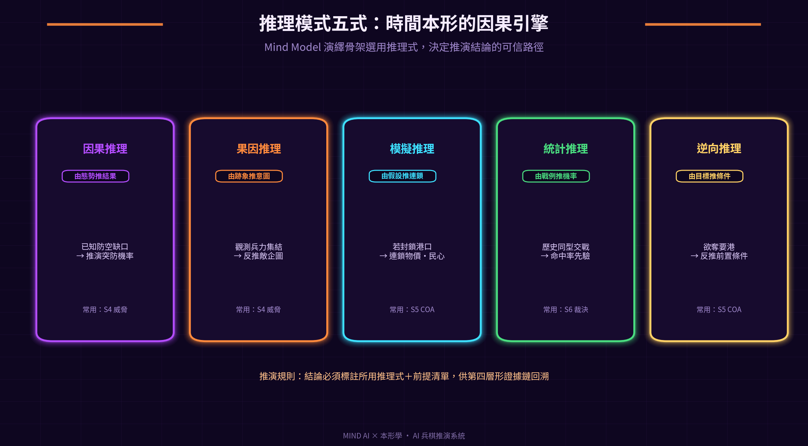

**圖 3-3 推理模式五式與常用工序**

| 推理式 | 方向 | 適用 | 產出要求 |
| --- | --- | --- | --- |
| 因果推理 | 態勢 → 結果 | 藍隊效果預測 | 因果鏈每環可檢驗 |
| 果因推理 | 跡象 → 意圖 | 紅隊意圖研判 | 多假設並列＋機率排序 |
| 模擬推理 | 假設 → 連鎖 | 升級與二階效應 | 連鎖路徑含中斷條件 |
| 統計推理 | 戰例 → 機率 | 命中率、損耗率先驗 | 標註樣本數與來源 |
| 逆向推理 | 目標 → 條件 | COA 前置條件反推 | 條件清單可驗證 |

**表 3-2 推理模式五式**

推演鐵律：**無前提、不結論**。凡不能展開前提清單的推演結論，一律標記「待驗」，不得進入裁決。

## 3.4 設計模式：COA 設計搜尋與戰法模式萃取

設計模式負責「出方案」。它不從零開始想，而是從**戰例庫**檢索相似態勢、萃取可複用的戰法模式、依本想定屬性改寫，並行輸出多案 COA；推演成功的模式再回存模式庫，形成越用越強的複利。

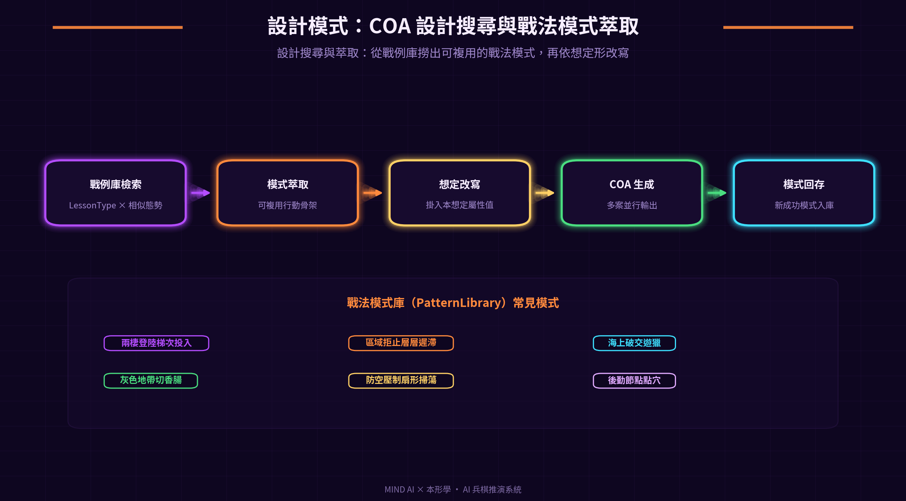

**圖 3-4 設計模式：戰例檢索 → 模式萃取 → 想定改寫 → COA 生成**

模式庫常見模式包括：兩棲登陸梯次投入、區域拒止層層遲滯、海上破交遊獵、灰色地帶切香腸、防空壓制扇形掃蕩、後勤節點點穴等。每張模式卡含：適用態勢、行動骨架、所需資源形門檻、歷史指標結果、改寫注意事項。

## 3.5 自我演化模式：推演庫的持續學習

自我演化是時間本形的最高階能力，也是對標 WarMatrix「推演數據回流」的落點。每場推演結束，AAR（After Action Review）萃取四類輸出：想定變體、判準修訂、提示詞修訂、模式新卡。四類輸出必須通過治理四門才能入庫。

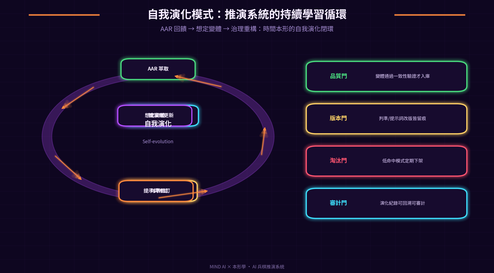

**圖 3-5 自我演化閉環與治理四門**

| 治理門 | 檢查 | 不通過處置 |
| --- | --- | --- |
| 品質門 | 變體通過一致性驗證（四重檢查） | 退回重推或廢棄 |
| 版本門 | 判準／提示詞改版全程留痕、舊值保留 | 不允許覆蓋式改寫 |
| 淘汰門 | 低命中模式定期下架 | 僅留目錄不刪檔 |
| 審計門 | 演化紀錄可回溯可審計 | 無紀錄不得入庫 |

**表 3-3 自我演化治理四門**

## 3.6 思考法工具箱與 OODA 節奏

時間本形的思考法工具箱是推演人員的配備：**正向思考**（由現況推進展）、**逆向思考**（由勝負條件倒推）、**水準思考**（橫向拓寬 COA）、**垂直思考**（縱深強化因果鏈）、**第一性原理**（回到底層約束重算，例如「這個島的後勤極限到底是幾天」）。

思考法與 OODA（觀 Observe・判 Orient・決 Decide・動 Act）決策週期結合，是時間本形的實戰用法：**打贏推演的本質是打贏週期**。我方週期快於敵方，就能以行動主導態勢；打斷敵方週期的最好位置在「判 Orient」——情報污染、電磁壓制、欺敵都是「判」的破壞手段。

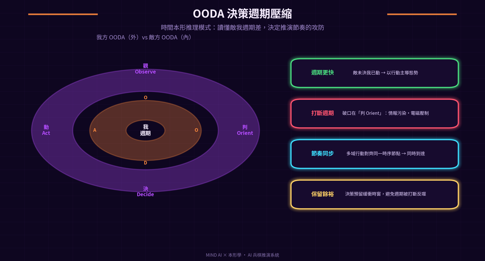

**圖 3-6 OODA 決策週期壓縮與四策略**

| 思考法 | 推演用法 | 常見時機 |
| --- | --- | --- |
| 正向思考 | 由起始態勢推演後續發展 | S6 對抗推演主線 |
| 逆向思考 | 由勝負判準倒推前置條件 | S5 COA 設計 |
| 水準思考 | 橫向產生非常規 COA | S5 藍隊發散階段 |
| 垂直思考 | 深化單一 COA 的因果鏈 | S4/S5 收斂階段 |
| 第一性原理 | 回底層約束重算關鍵數字 | S8 AAR 質疑環節 |

**表 3-4 思考法工具箱推演用法**

## 3.7 時序節點表規格

時序節點是推演資料庫的時間主鍵。每個節點一份快照記錄，規格如下表；節點表是 S6 裁決流水與 S8 指標冊的共同骨架——三份文件共享同一節點編號，回溯時一點即達。

| 欄位 | 型別 | 說明 | 範例 |
| --- | --- | --- | --- |
| 節點ID | 文字 | 回合-階段-序號 | T3-P4-02 |
| 時刻 | 時標 | 推演時／現實時雙軌 | 0800Z / D+4 |
| 節奏狀態 | 列舉 | Tempo(t) 段位 | 加速段 0.8 |
| 事件觸發 | 外鍵組 | 本節點觸發的事件形 | EV-升級警報 |
| 狀態快照 | 實體組 | 關鍵形實體欄位值 | 電磁權=劣勢 |
| 裁決掛載 | 外鍵組 | 本節點的裁決形ID | ADJ-0114 |
| 證據掛載 | 外鍵組 | 情報形來源ID | ELINT-0031 |

**表 3-5 時序節點表規格**

## 3.8 推理前提清單規格

「無前提、不結論」的落點是前提清單：每則推演結論都附一張前提表，缺表結論一律待驗。前提清單同時是 S9 判準修訂的線索來源——前提被現實推翻，對應判準就要修。

| 欄位 | 型別 | 說明 |
| --- | --- | --- |
| 前提ID | 文字 | P-序號，供結論引用 |
| 前提敘述 | 文字 | 一句話、可判定真偽 |
| 依據 | 外鍵 | 情報形／戰例形／假設標記 |
| 穩健度 | 列舉 | 確證／高／中／低／假設 |
| 推翻影響 | 文字 | 前提若假，結論如何變化 |
| 複核時點 | 時序節點 | 下一次檢查前提的節點 |

**表 3-6 前提清單規格**

前提清單的複核時點欄常被忽略，卻是推演不失真的關鍵：**前提會過期**——情報更新、戰線變動都會讓「穩健度」下降，複核時點就是前提的保鮮期。

## 3.9 四模式協同：一回合內的接力

四模式不是四選一，而是一回合內的接力賽。以典型回合為例，看四模式如何依序上場、互相交棒：

| 階段 | 主導模式 | 作業 | 交棒物 |
| --- | --- | --- | --- |
| 回合開端 | 搜尋模式 | 展開 COA 分支、估值排序 | 候選分支組 |
| 研判節點 | 推理模式 | 果因推理判紅方意圖更新 | 假設組更新 |
| 設計節點 | 設計模式 | 依新態勢改寫 COA、萃取模式 | 修訂案 COA |
| 交戰節點 | 搜尋＋推理 | 推進分支、裁決、二階效應 | 裁決流水 |
| 回合收束 | 自我演化 | 回合 AAR 速記、前提複核 | 待驗清單 |

**表 3-7 四模式一回合接力表**

接力的規則：**上一模式的交棒物，是下一模式的輸入形實體**。搜尋交出分支組，推理更新假設組，設計交出修訂 COA——模式之間不傳口頭結論，只傳形實體。這一條規則保證了即使換人操作、換模型跑，推演鏈依然連續。

## 3.10 戰法模式卡範本

設計模式的萃取產物是戰法模式卡。模式卡是推演資產，也是 S5 的檢索對象。標準範本如下：

| 欄位 | 內容 | 範例（防空壓制扇形掃蕩 v2） |
| --- | --- | --- |
| 模式ID/版本 | 唯一編號 | PT-007 v2 |
| 適用態勢 | ∩(T) 描述 | 敵固定防空網＋我電磁權均勢以上 |
| 行動骨架 | 行動形序列 | 偵察定位→扇形干擾→分區硬殺→窗口開闢 |
| 資源門檻 | 資源形下限 | 架次×12、反輻射彈×24 |
| 歷史指標 | 指標形結果 | 突防率 +22%；自身戰損 0.08 |
| 改寫注意 | 常見改寫點 | 地形破碎區扇形角度縮小 15° |
| 失效條件 | 不適用情境 | 敵機動雷達占比 > 40% |

**表 3-8 戰法模式卡範本**

# 第 4 章 推演知識域：全層級 × 多域

## 4.1 全層級嵌套：戰略・戰役・戰術

兵棋推演覆蓋三個層級，三層皆是**空間容器**：上層是下層的戰域容器，下層行動向上層目標掛鉤。判準很硬：**下層行動若不能掛鉤上層目標 ∩(T)，一律修剪**——這條規則杜絕了「戰術轟轟烈烈、戰略毫無意義」的推演失真。

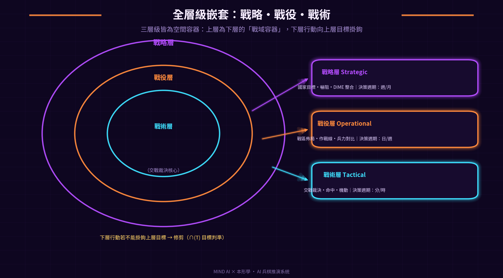

**圖 4-1 全層級嵌套與目標掛鉤判準**

| 層級 | 核心問題 | 決策週期 | 主要產出 | 裁決尺度 |
| --- | --- | --- | --- | --- |
| 戰略 Strategic | 國家目標・嚇阻・升級管控 | 週／月 | DIME 同步計畫・指導 | 目標達成度・升級風險 |
| 戰役 Operational | 戰區佈局・作戰線・兵力對比 | 日／週 | 戰役計畫・兵力分配 | 戰力比・節奏指標 |
| 戰術 Tactical | 交戰・命中・機動・保存 | 分／時 | 交戰方案・裁決紀錄 | 交戰判決表・戰耗比 |

**表 4-1 三層級推演要素對照**

跨層級的黏合劑是**時序節點**：戰略層的「升級警報」事件，會改寫戰役層的節奏函式；戰役層的「制空爭奪」節點，會觸發戰術層的交戰裁決批次。三層共享同一套十四形，只是解析度不同——這是空間本形「同一套形的底層邏輯」在推演的體現。

## 4.2 多域戰域矩陣

現代推演必須是多域的。戰場形容器把戰域切成**陸・海・空・太空・網路・電磁・認知**七域，每一域都跑「偵察感知・打擊壓制・防護保存・後勤保障・資訊作戰」五類行動。多域推演的勝負手在**跨域效應**：網路域的破口可以打開空域的門，認知域的輿論可以改寫戰略層的節奏——這些跨域連鎖必須以事件形明確建模，不能靠推演員腦補。

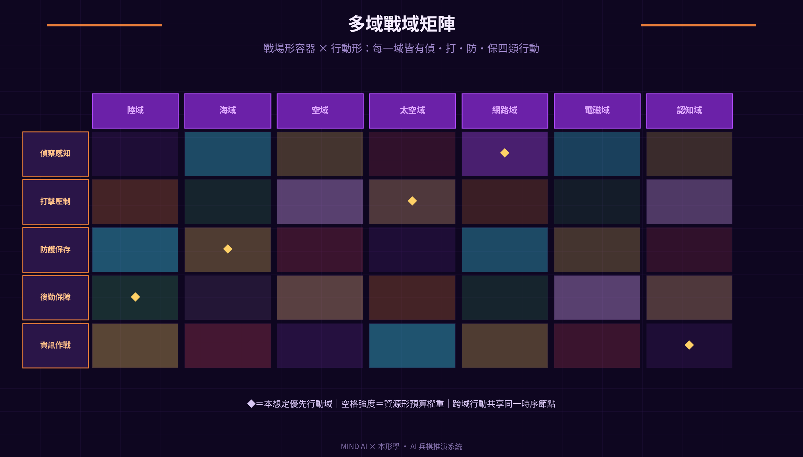

**圖 4-2 多域戰域矩陣：七域 × 五類行動**

- 跨域連鎖建模：每條跨域效應都是一個事件形實體，掛觸發條件、影響範圍、節奏效果。

- 優先行動域：每張想定卡標註本想定的優先行動域（矩陣中以 ◆ 標記），資源形預算向其傾斜。

- 認知域特別條款：認知域行動的裁決須區分「可觀測效果」與「推定效果」，後者須掛情報形可信度。

## 4.3 戰略層知識：嚇阻、升級與 DIME

戰略層推演的核心不是「怎麼打贏」，而是「怎麼讓局勢朝目標演化」。工具是 **DIME 同步輪**：外交（Diplomatic）、情報（Information）、軍事（Military）、經濟（Economic）四軸對齊同一時序節點施力，避免單軸冒進。戰略層推演的四條規律：

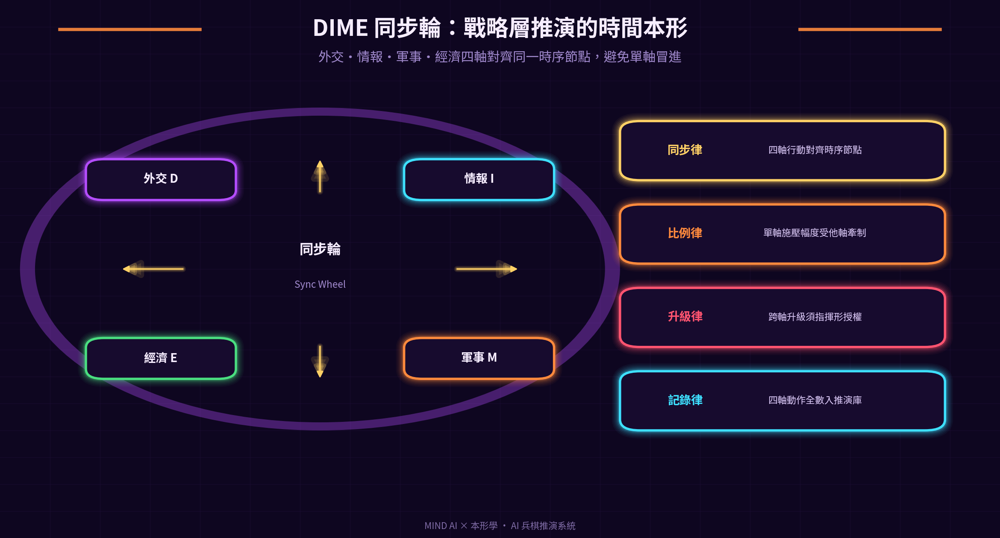

**圖 4-3 DIME 同步輪與戰略四律**

- 同步律：四軸行動對齊時序節點，孤軍深入的施力不予支持。

- 比例律：單軸施壓幅度受他軸承受力牽制（軍事升級受經濟與外交成本約束）。

- 升級律：跨軸升級必須取得指揮形授權，且觸發升級臨界線檢查。

- 記錄律：四軸動作全數入推演庫，供戰略評估與歷史研究。

嚇阻推演的特產是**升級階梯**：把衝突從低到高排成階梯（認知輿論 → 海上民兵 → 海警執法 → 準軍事封鎖 → 有限武裝 → 全面衝突），每一階掛「可逆性＋證據要求＋升級代價」。戰略推演的主要產出往往就是這張階梯圖與各階的行動選單。

## 4.4 戰役層知識：戰區、兵力對比與節奏

戰役層是推演的主戰場。核心作業是：戰區劃分（戰場形容器層級）、作戰線設計（行動形鏈）、兵力對比（兵力形 BOM/SOM 對照與指數換算）、節奏控制（時序形排程）。

| 作業 | 形工具 | 產出 | 常見陷阱 |
| --- | --- | --- | --- |
| 戰區劃分 | 戰場形容器嵌套 | 戰域表＋邊界定義 | 邊界不可判定→裁決爭議 |
| 作戰線設計 | 行動形鏈＋時序節點 | 行動時序表 | 四約束缺漏→中途斷線 |
| 兵力對比 | 兵力形 BOM/SOM＋指數 | 戰力對比表 | 拿清單比結構→高估戰力 |
| 節奏控制 | 節奏函式＋事件形 | 推演節拍表 | 節奏單一化→錯過窗口 |

**表 4-2 戰役層四大作業**

兵力對比的實務方法是**指數法＋結構修正**：先以裝備指數換算基礎戰力，再以 SOM 結構依存判斷修正（缺指揮核心、缺防空群各有係數）。指數法粗看量、SOM 看質，兩者並用才不會「帳面五比一、實際被各個擊破」。

## 4.5 戰術層知識：交戰、裁決表與戰耗

戰術層推演以**裁決表**為核心。裁決表把交戰結果寫成可查表的規則：攻防雙方類型 × 地形 × 天候 × 戰果（命中・擊毀・壓制・規避）。裁決表的每一行都是一個 ∩(T) 判準的具體化——查表裁決可重現、可批量，正是 WarMatrix 式大規模推演的基礎單元。

- 命中裁決：武器 × 目標 × 環境 → 命中機率（統計推理先驗＋地形修正）。

- 機動裁決：部隊 × 地形 × 節奏 → 到位時間（時序節點落點）。

- 後勤裁決：消耗率 × 補給線 → 維持天數（資源形守恆）。

- 電子戰裁決：干擾 × 感測 → 感測降級係數（情報形可信度連動）。

- 認知裁決：行動 × 傳播環境 → 輿情指標移動（可觀測／推定分離）。

| 步驟 | 作業 | 判定依據 |
| --- | --- | --- |
| 1 歸類 | 交戰雙方歸入裁決表軸（攻方類×防方類） | 兵力形類別判定 |
| 2 定欄 | 地形・天候・電磁權修正欄 | 戰場形屬性值 |
| 3 查表 | 查表得基礎判決 | 裁決表行號 |
| 4 修正 | 結構依存係數・士氣・疲勞 | SOM 判決＋時序節點 |
| 5 出判 | 判決＋戰果＋狀態變更 | 裁決形欄位 |
| 6 掛鏈 | 證據掛情報形、指回表行號 | 形證據鏈 |

**表 4-5a 交戰裁決六步流程**

## 4.6 裁決機制選型

裁決機制有四種基本型與一種混合型。選型原則：**大規模自動推演用混合裁決**——判決表管交戰細節、指數法管宏觀力量、AI 對抗管奇詭行動、專家裁決管例外；四者輸出全部掛裁決形，統一受一致化三律約束。

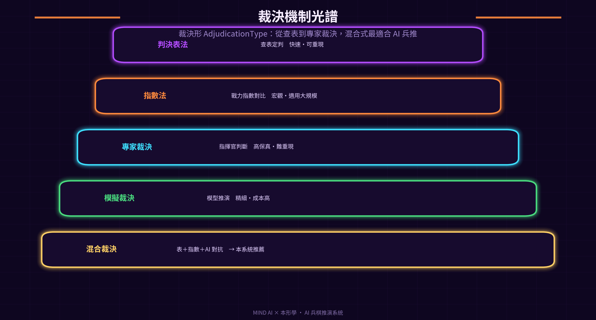

**圖 4-4 裁決機制光譜與混合裁決**

| 機制 | 優點 | 限制 | 適用 |
| --- | --- | --- | --- |
| 判決表法 | 快速、可重現 | 表外情境無法裁決 | 戰術層批量交戰 |
| 指數法 | 宏觀、成本低 | 掩蓋結構差異 | 戰役層力量對比 |
| 專家裁決 | 高保真、可裁例外 | 難重現、難批量 | 關鍵節點・異常事件 |
| 模擬裁決 | 精細、可連鎖 | 建模成本高 | 高價值單元交戰 |
| 混合裁決 | 兼具規模與保真 | 需一致化治理 | 本系統推薦（AI 兵推） |

**表 4-3 裁決機制比較**

## 4.7 評估指標體系

推演評估以指標形建模為四軸指標樹：**目標達成度、戰力比、風險、節奏**。每個指標實體掛 ∩(T) 計算式與證據來源，數字可回溯到裁決形與情報形——「報告裡的每個數字都要能被打問」。

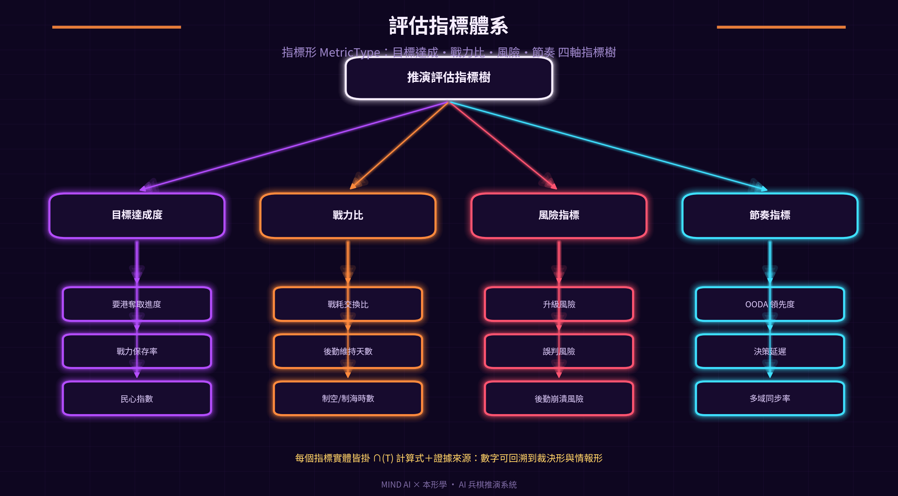

**圖 4-5 評估指標體系：四軸指標樹**

| 軸 | 核心指標 | 計算依據 | 警示門檻 |
| --- | --- | --- | --- |
| 目標達成 | 要港奪取進度・戰力保存率・民心指數 | 目標形 ∩(T) 達成比例 | 達成度 < 40% 紅燈 |
| 戰力比 | 戰耗交換比・後勤維持天數・制權時數 | 裁決形累計＋資源形結餘 | 維持天數 < 7 黃燈 |
| 風險 | 升級風險・誤判風險・崩潰風險 | 模擬推理連鎖統計 | 升級風險 > 0.6 紅燈 |
| 節奏 | OODA 領先度・決策延遲・多域同步率 | 時序節點比對 | 同步率 < 70% 黃燈 |

**表 4-4 四軸指標與警示門檻**

## 4.8 人機分工：指揮官的決策權

AI 兵棋推演的最後一條、也是最硬的一條規則：**指揮官保留決策權**。人機分工分五級梯度：AI 整料 → AI 提建議 → AI 草擬案 → AI 代執行（限授權範圍）→ AI 主導（僅限推演沙盤內）。實兵相關層級永遠止步於「草擬案」，任何自動裁決都必須在準則形 G3 授權門的範圍內。

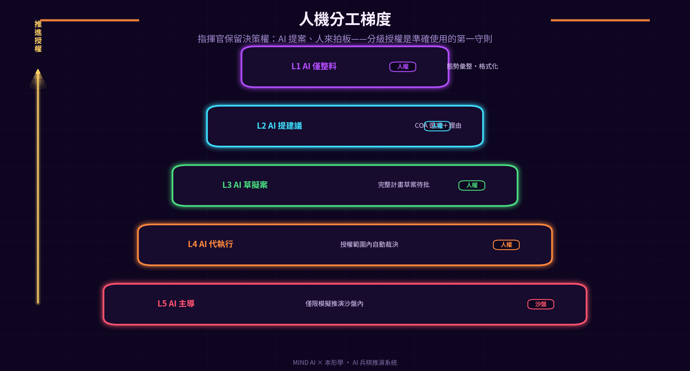

**圖 4-6 人機分工梯度 L1–L5**

| 決策事項 | AI 角色 | 人為決策者 | 授權依據 |
| --- | --- | --- | --- |
| 想定變更 | 提案 | 主持人 | 指揮形-推演授權 |
| 交戰裁決（表內） | 執行（自動） | 裁決官覆核抽樣 | 裁決形＋準則形 |
| 例外裁決 | 草案 | 指揮形授權人 | G3 授權門 |
| 升階行動推薦 | 建議 | 指揮官 | 升級律 |
| 判準修訂 | 提案＋影響分析 | 治理官＋指揮官 | S9 治理四門 |

**表 4-6a 人機授權矩陣示例**

分級授權的形化落點是**指揮形授權鏈**：每一級 AI 可做什麼、做到哪裡，都寫在指揮形實體裡；繞過授權鏈的 AI 動作在系統中不存在——不是「不建議」，是「裁決不予受理」。

## 4.9 推演課題庫

推演不是為推而推，而是回答課題。以下課題庫供推演立案選題；每張課題卡對應一組目標形 ∩(T) 草稿，選定課題即定錨全場推演。

| # | 課題 | 層級 | 主工序 |
| --- | --- | --- | --- |
| 1 | 封鎖升級的臨界線在哪裡？ | 戰略 | S1/S4/S6 |
| 2 | 制空爭奪要投入多少戰力才夠？ | 戰役 | S3/S5/S6 |
| 3 | 兩棲登陸的最佳窗口與最大風險？ | 戰役 | S4/S5 |
| 4 | 後勤維持天數如何撐過 D+30？ | 戰役 | S3/S6/S8 |
| 5 | 灰色地帶行動的歸因如何取證？ | 戰略 | S4/S8 |
| 6 | 海上交通線護航兵力如何配置？ | 戰役 | S3/S5 |
| 7 | 電磁權劣勢下的空中戰力發揮率？ | 戰術 | S6/S7 |
| 8 | 認知戰對民心指數的傳導係數？ | 戰略 | S7/S8 |
| 9 | 多線分兵的兵力比門檻？ | 戰役 | S3/S5 |
| 10 | 升級反制選項的可逆性排序？ | 戰略 | S1/S4 |
| 11 | 關鍵節點防護的兵力效益最大化？ | 戰術 | S5/S6 |
| 12 | 盟友馳援到達前的戰力保存方案？ | 戰役 | S5/S7 |

**表 4-5 推演課題庫（示範節錄）**

## 4.10 戰史類比使用守則

戰史是推演的富礦，也是陷阱。用得好，統計推理有先驗、模式庫有素材；用不好，就是拿上一場戰爭的結論打下一場。戰史類比四守則：

- 先形化再類比：戰史要素先過十四形歸類，形對形比對，不比「故事相似度」。

- 差異欄位必列出：類比成立時同步列出「時代差異欄」（裝備代差、條令差異、環境差異），差異欄掛修正係數。

- 樣本數標註：統計推理引用戰例必標樣本數與取樣偏誤（倖存者偏誤、出版偏誤）。

- 類比結論標記：凡由戰史類比導出的結論，證據鏈標記「類比推定」，穩健度不高於「中」。

| 錯誤類比樣式 | 問題 | 修正 |
| --- | --- | --- |
| 「上次這樣打贏了」 | 忽略時代差異欄 | 跑差異欄位檢查＋修正係數 |
| 「史上沒人這樣打過」 | 以史否新，扼殺水準思考 | 史無先例≠不可行，改走第一性原理 |
| 「某某戰例完全適用」 | 故事相似度錯覺 | 形對形比對，逐形列相似/差異 |

**表 4-6 常見戰史類比錯誤**

## 4.11 跨域連鎖示例庫

跨域效應是多域推演的靈魂，也是最難裁決的部分。本節示範六條標準化連鎖（每條皆為事件形實體），供 S7 協同編排時檢索改寫。

| 連鎖 | 觸發 | 傳導 | 效應 | 中斷條件 |
| --- | --- | --- | --- | --- |
| 網路開門 | 指揮網入侵成功 | 防空 C2 降級 | 空域突防率上升 | 備援通聯切換 |
| 電磁奪權 | 強干擾壓制雷達 | 識別困難 | 誤判風險上升 | 反輻射壓制 |
| 認知牽引 | 輿情事件發酵 | 決策壓力上升 | 戰略節奏被牽制 | 可信度揭露 |
| 後勤點穴 | 補給節點打擊 | 日耗結餘下降 | 維持天數縮短 | 備用路線啟用 |
| 太空致盲 | 偵察衛星干擾 | 情報形可信度降級 | 威脅研判遲滯 | 多源互補 |
| 外交緩衝 | 斡旋展開 | 升級臨界線後移 | 節奏凍結 | 斡旋破裂 |

**表 4-7 跨域連鎖示例庫**

## 4.12 態勢圖與要圖標註規範

推演的視覺化必須與形化同構：**圖上每個符號都是一個形實體**。要圖標註規範四則：

- 符號即實體：每個軍標/圖元對應一個形實體 ID；圖例就是形庫查詢結果。

- 顏色即歸屬：紅藍綠（中立）固定；第四色只用於「待確認」——不確定性要看得見。

- 時間即節點：每張圖標註時序節點 ID；連環圖＝節點序列，禁止無時標的態勢圖。

- 虛線即假設：情報形可信度 C 以下的目標以虛線標註，實虛線混用即違規。

| 圖種 | 用途 | 必備標註 | 主用席位 |
| --- | --- | --- | --- |
| 總態勢圖 | 開推對齊認知 | 戰域邊界・雙方主力・時標 | 主持人 |
| 行動要圖 | COA 說明 | 行動鏈・時窗・目標掛鉤 | 藍隊長 |
| 威脅要圖 | 紅隊研判 | 假設組・觀察指標・機率 | 紅隊長 |
| 裁決對照圖 | 回合結算 | 戰果・狀態變更・例外點 | 裁決官 |
| 指標趨勢圖 | AAR 簡報 | 四軸曲線・門檻線・警訊 | 評估官 |

**表 4-8 推演要圖規範**

# 第 5 章 TDDW 形驅動推演八步驟

## 5.1 方法論總覽

TDDW（Type-Driven Wargaming，形驅動推演）是本系統的方法論主幹：把一場推演從任務到演化拆成**八步驟**，每步都有明確的輸入、形化作業、產出與準確性落點。八步驟不是瀑布——S9 的回饋會修訂 S1 的想定，形成演化閉環；但任何一步都不可以跳過「形先行、判準先行、證據必留」三原則。

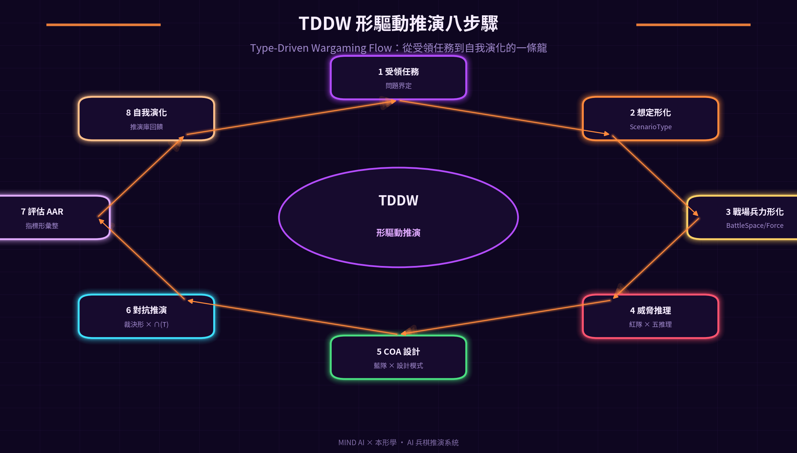

**圖 5-1 TDDW 形驅動推演八步驟**

| 步驟 | 核心作業 | 主形 | 產出 |
| --- | --- | --- | --- |
| 1 受領任務 | 問題界定、目標初擬 | 目標形 | 任務說明書 |
| 2 想定形化 | 想定建構與批次變體 | 想定形 | 想定包 |
| 3 戰場兵力形化 | 戰域容器、編組 BOM/SOM | 戰場形・兵力形 | 態勢冊・編組表 |
| 4 威脅推理 | 紅隊研判、五推理 | 威脅形・情報形 | 紅隊研判書 |
| 5 COA 設計 | 藍隊設計、模式萃取 | 行動形・資源形 | COA 方案集 |
| 6 對抗推演 | 分支推進、混合裁決 | 裁決形・準則形 | 裁決紀錄 |
| 7 評估 AAR | 四軸指標彙整、覆盤 | 指標形 | AAR 報告 |
| 8 自我演化 | 變體、判準修訂、治理 | 戰例形 | 戰例卡・改版紀錄 |

**表 5-1 TDDW 八步驟總表**

## 5.2 八步驟詳解

### 步驟 1 受領任務：把問題說清楚

輸入是上級指導或研究命題。作業是把「要回答什麼問題」寫成可判定的目標形草稿：推演要證明什麼、比較什麼、探索什麼。產出任務說明書，關鍵欄位是**推演問題**（一句話）與**成功判準**（可檢查）。常見失敗是問題太大（「研究臺海局勢」）——目標形無法掛 ∩(T)，整場推演必然漂移。

### 步驟 2 想定形化：建構推演舞台

以想定形標準欄位（表 2-2）建構想定實體，並生成批次變體：換起始態勢、換升級上限、換時限，形成變體組。變體組的作用是掃過可能性空間——這正是 WarMatrix 式大規模推演的最小單元。產出想定包（1 個主想定＋2–4 個變體）。

### 步驟 3 戰場兵力形化：把東西切乾淨

依第 2 章形化工程十守則建構戰場形容器與兵力形 BOM/SOM。此步驟的產出（態勢冊、編組表）是後續一切推演的地基；地基歪一吋，推演歪一尺。出產前必過四檢查：欄位齊全、主鍵唯一、外鍵有效、判準可判定。

### 步驟 4 威脅推理：紅隊先行

以果因推理為主軸研判紅方意圖與方案，多假設並列、機率排序；以模擬推理推演升級連鎖。紅隊產出必須能回答：**紅方最想讓我們相信什麼？**——這句話是欺敵檢測的起點。

### 步驟 5 COA 設計：藍隊發散收斂

先以水準思考＋模式庫發散多案，再以四約束檢查與 ∩(T) 估值收斂為 2–3 案。每案掛：行動形鏈、資源預算表、時序節點表、風險註記。禁做的事：把「努力」當方案——COA 是可裁決的行動序列，不是決心展示。

### 步驟 6 對抗推演：分支推進與裁決

紅藍 COA 在同一棵分支樹上對抗，以混合裁決判決每回合交戰，四重一致性檢查同步跑。此步驟是四層準確性保證全滿的關鍵節點（詳 5.3）。

### 步驟 7 評估 AAR：四軸彙整與覆盤

指標形四軸彙整推演結果，結論掛形證據鏈。AAR 會議的三問：哪一步判斷出錯？哪個前提不成立？哪條判準要修？三問的回饋直通步驟 8。

### 步驟 8 自我演化：閉環治理

四類輸出（想定變體、判準修訂、提示詞修訂、模式新卡）過治理四門入庫。此步驟完成後，下一次推演的起點比這一次高——這是 TDDW 與一次性兵推的根本分野。

## 5.3 四層準確性在八步驟的落點

四層準確性保證不是口號，它在八步驟中有明確的落點分布。圖 5-2 顯示：裁決步驟（6）是四層全滿的關鍵節點；形化步驟（2、3）是 ∩(T) 判準與證據鏈的主要落點；推理與設計步驟（4、5）則由演繹骨架主導。

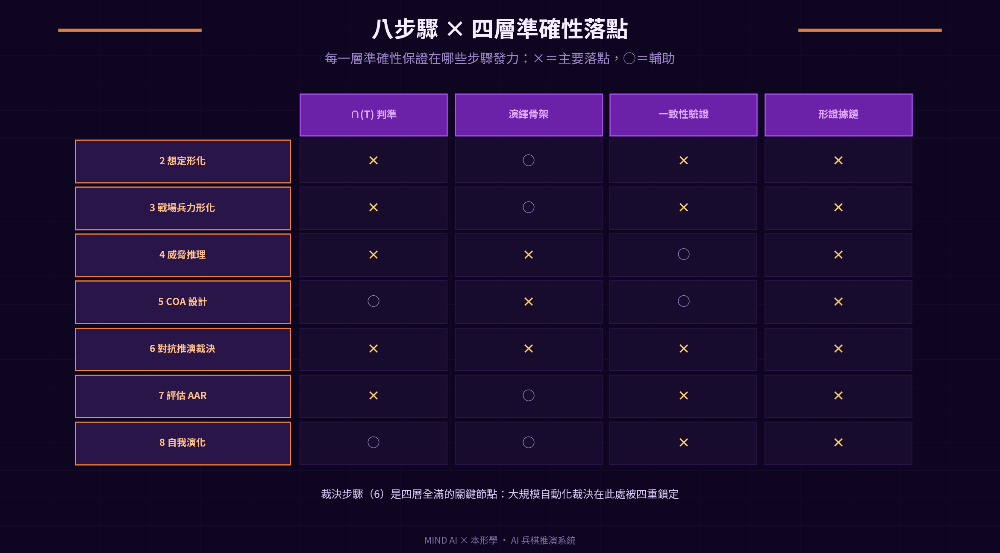

**圖 5-2 八步驟 × 四層準確性落點矩陣**

實務提醒：第三層一致性驗證在步驟 2、3 就要啟動預檢——想定自相矛盾、編組資源不守恆，越早抓越省事；拖到步驟 6 才發現，整場推演要重跑。

## 5.4 產出物規格

八步驟的產出全部是形實體，規格化、可回溯、可複用。產出物版本隨想定形版本連動：想定改版 → 依賴產出標記失效 → 觸發重推或局部重推。

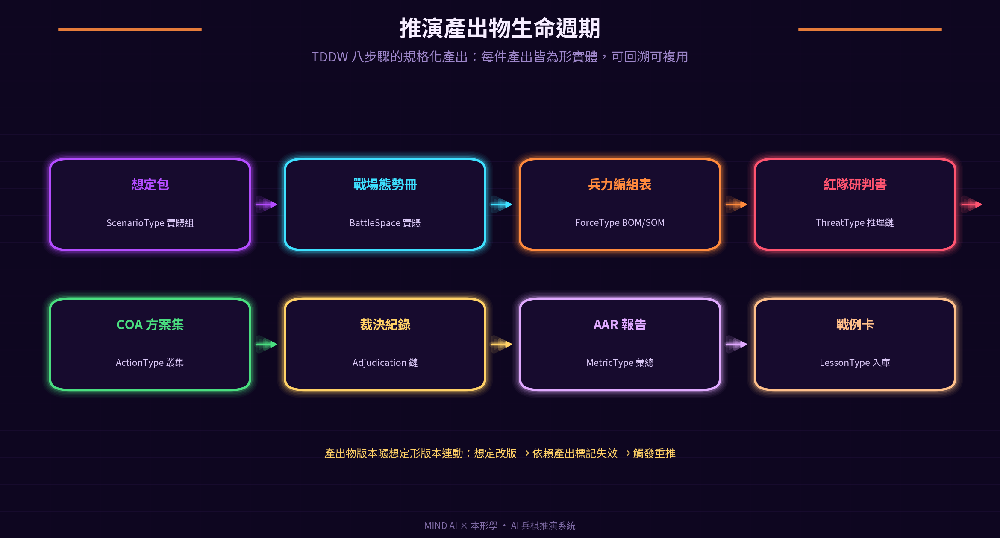

**圖 5-3 推演產出物生命週期**

| 產出物 | 格式 | 必備欄位 | 歸檔形 |
| --- | --- | --- | --- |
| 想定包 | 想定卡組 | 表 2-2 全欄位 | 想定形 |
| 戰場態勢冊 | 戰域表＋地圖標註 | 容器定義＋邊界 | 戰場形 |
| 兵力編組表 | BOM/SOM 樹 | 結構依存標註 | 兵力形 |
| 紅隊研判書 | 假設組＋機率 | 推理式＋前提清單 | 威脅形 |
| COA 方案集 | 方案卡組 | 四約束＋估值 | 行動形 |
| 裁決紀錄 | 判決流水 | 裁決表行號＋證據 | 裁決形 |
| AAR 報告 | 四軸指標冊 | 計算式＋來源 | 指標形 |
| 戰例卡 | 經驗卡 | 態勢＋骨架＋指標 | 戰例形 |

**表 5-2 八步驟產出物規格**

| 改版事件 | 失效範圍 | 重推範圍 | 標記方式 |
| --- | --- | --- | --- |
| 想定升版 | 全鏈產出 | 全推或截推（變更影響評估） | 全鏈待重驗 |
| 兵力編組變更 | S3 之後產出 | S3–S7 重推 | 依賴鏈連動 |
| 裁決表修訂 | 裁決紀錄、AAR | S6 局部重裁＋S7 重評 | 裁決列標失效 |
| 判準 ∩(T) 修訂 | 裁決、指標 | S6–S8 重評 | 判準版本連動 |
| 情報更新 | 相關結論 | S4 穩健度重評 | 穩健度降級標記 |

**表 5-2a 產出物版本相依與失效連動**

## 5.5 與大規模矩陣推演的整合

TDDW 是「一場推演」的方法論；WarMatrix 揭示的方向是「一場推演掃過一整片可能性空間」。兩者的整合介面是**批次想定矩陣**：以步驟 2 的批次變體為列、以步驟 5 的 COA 叢集為欄，排成推演矩陣並行推進，步驟 6 的混合裁決批量出判決，步驟 7 的四軸指標批量出報告。

- 列維度｜想定變體：起始態勢、升級上限、時限的組合。

- 欄維度｜COA 叢集：紅藍雙方各 2–3 案交叉。

- 裁決維度｜批量一致化：一致化三律在批量下的抽樣稽核（每批 5% 回放）。

- 人機維度｜例外管理：指揮官不看全部格子，只看 AI 標記的「例外格」（高估值落差、高升級風險、判準未命中）。

這套整合讓小組級推演（單機作業）與戰區級推演（矩陣並行）使用同一套形、同一套判準、同一套手冊——規模可伸縮，準確性不稀釋。

## 5.6 八步驟輸入輸出規格

把 5.2 節的詳解收斂成規格表，供推演主持人派工與驗收。每一步驟的「檢查」欄就是該步的出關條件，不過關不進下一步。

| 步驟 | 輸入 | 核心作業 | 輸出 | 出關檢查 |
| --- | --- | --- | --- | --- |
| 1 受領任務 | 上級指導／研究命題 | 問題界定、成功判準 | 任務說明書 | 推演問題可一句話表述 |
| 2 想定形化 | 任務說明書 | 想定卡＋批次變體 | 想定包 | ∩(T) 五要素俱全 |
| 3 戰場兵力形化 | 想定包 | 容器組＋BOM/SOM | 態勢冊・編組表 | 四檢查一次通過 |
| 4 威脅推理 | 態勢冊・情報 | 紅隊假設組＋升級鏈 | 紅隊研判書 | 欺敵警示非空 |
| 5 COA 設計 | 研判書・模式庫 | 發散≥5 收斂2–3 | COA 方案集 | 四約束全備 |
| 6 對抗推演 | COA 集・裁決表 | 分支推進・混合裁決 | 裁決流水 | 一致化抽樣回放一致 |
| 7 評估 AAR | 裁決流水・指標集 | 四軸彙整・覆盤三問 | AAR 報告 | 指標全數可回放 |
| 8 自我演化 | AAR・治理四門 | 四類提案・治理 | 入庫清單 | 留痕完整、版本可稽 |

**表 5-3 八步驟輸入輸出規格**

## 5.7 推演時程規劃

實務推演的時間成本要先估後行。兩種標準時程供參考——半日快推適合課題驗證，一週全推適合戰役級研究。

| 時段 | 半日快推（4 小時） | 一週全推（5 日） |
| --- | --- | --- |
| 前置 | 想定包預製（事前） | D-3 ～ D-1 想定形化＋形化預檢 |
| 第 1 節 | S2–S3 形化複習（30 分） | D1：S2–S3 形化與檢查 |
| 第 2 節 | S4 紅隊（45 分） | D2：S4 紅隊＋S5 藍隊 |
| 第 3 節 | S5–S6 對抗推演（90 分） | D3–D4：S6–S7 對抗與協同 |
| 第 4 節 | S8 AAR（45 分） | D5：S8–S9 評估與演化 |
| 產出 | AAR 速報（當日） | AAR 報告＋戰例卡（D+2 內） |

**表 5-4 標準推演時程**

時程鐵律：**形化與檢查不可壓縮**。快推可以壓推演回合、壓簡報時間，但 S2–S3 的形化與四檢查壓不得——壓掉的每一小時，都會在裁決爭議裡加倍奉還。

## 5.8 推演失誤劇本庫

以下六個失誤劇本，是各單位推演最常見的翻車現場。每則含徵候與處置；建議列入推演主持人隨身卡。

| 劇本 | 徵候 | 處置 |
| --- | --- | --- |
| 浪漫化作戰 | COA 有決心沒油彈 | 資源守恆剪枝即刻攔截；S5 自檢② |
| 紅隊塌房 | 紅方 COA 都很弱 | 紅隊席位獨立＋最優解穩健性測試 |
| 裁決扯皮 | 每判都有爭議 | 裁決表行號制＋一致化三律張貼 |
| 指標打架 | 兩套數字對不上 | 指標計算式統一入庫、可回放 |
| 想定漂移 | 推到最後不像開頭 | 版本紀律＋節點快照對比 |
| 簡報爆雷 | 被問 3 個問題就崩 | 證據鏈三步回溯演練（7.3） |

**表 5-5 推演失誤劇本庫**

## 5.9 量化解算法示意：指數法 × 結構修正

戰役層的兵力對比以指數法起步、SOM 結構修正收尾。示意算法（虛構數值）：

| 步驟 | 計算 | 示範值 | 說明 |
| --- | --- | --- | --- |
| 1 基礎指數 | Σ（裝備數 × 單件指數） | 戰機8×12＋艦6×15＝186 | 統計推理先驗 |
| 2 結構修正 | × 結構依存係數 | 缺電戰 -0.1 → 167 | SOM 三測試判決 |
| 3 環境修正 | × 地形/天候係數 | 雨季 -0.05 → 159 | 裁決表環境欄 |
| 4 對比 | 藍 159 : 紅 142 | 比值 1.12 | ＞1 藍方帳面優勢 |
| 5 穩健性 | 紅方最優解重算 | 比值 0.95–1.30 | 區間跨 1 → 不可輕言優勢 |

**表 5-6 指數法 × 結構修正示意**

算法要義：**帳面比值只供起點，穩健區間才是結論**。區間跨越 1 的對比，報告必須寫「不確定」——敢寫不知道，才是準確。

# 第 6 章 S1–S9 準確使用方法提示詞手冊

## 6.0 手冊使用法

本章是全書核心：**九則提示詞 = 九道工序**，串起從想定生成到自我演化。每則提示詞都是六段式骨架（圖 6-1）：角色與任務、形約束、判準注入、推理式指定、輸出格式、自檢清單。使用者只需把〔〕佔位換成本場推演的實際值，其餘照貼——準確性來自結構，不來自臨場發揮。

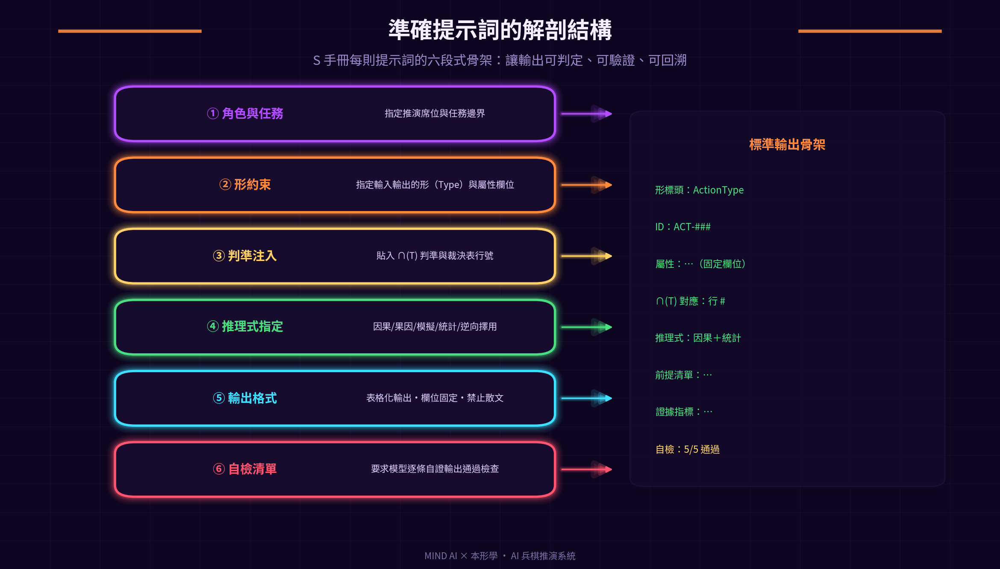

**圖 6-1 準確提示詞六段式解剖**

- 〔〕佔位：如〔想定ID〕〔戰域名〕，使用時替換為實際值；未替換的佔位視為錯誤輸入。

- 形約束欄：指定輸入輸出的形與欄位；模型輸出凡缺欄位即作廢重跑。

- 判準注入欄：貼入 ∩(T) 判準編號與裁決表行號；無判準不裁決。

- 自檢清單欄：要求模型逐條自證；自檢不過的輸出一律標記「待驗」。

| 變數 | 格式 | 範例 | 登錄處 |
| --- | --- | --- | --- |
| 〔想定ID〕 | SC-##（＋版本） | SC-01 v2.3 | 想定庫 |
| 〔戰域名〕 | 容器名稱 | 北任務區 | 戰域表 |
| 〔推演任務〕 | 一句話 | 評估 D+7 奪港機率 | 任務說明書 |
| 〔時窗〕 | D+n～D+n／時標 | D+5～D+9 | 時序節點表 |
| 〔∩(T) 編號〕 | ∩(T)-## | ∩(T)-07 | 判準庫 |
| 〔裁決集〕 | ADJ-＊ | ADJ-全 | 裁決表彙編 |

**表 6-1a 提示詞變數登錄簿**

| 提示詞 | 工序 | 對應 TDDW | 主形 |
| --- | --- | --- | --- |
| S1 想定生成 | 建構想定與批次變體 | 步驟 2 | 想定形 |
| S2 戰場形化 | 戰域容器與邊界定義 | 步驟 3 | 戰場形 |
| S3 兵力編組 | BOM/SOM 編組建構 | 步驟 3 | 兵力形 |
| S4 威脅研判 | 紅隊意圖與方案推演 | 步驟 4 | 威脅形 |
| S5 COA 設計 | 藍隊方案生成收斂 | 步驟 5 | 行動形 |
| S6 對抗推演 | 分支推進與裁決 | 步驟 6 | 裁決形 |
| S7 多域協同 | 跨域行動時序編排 | 步驟 6 | 事件形 |
| S8 AAR 評估 | 四軸指標與覆盤 | 步驟 7 | 指標形 |
| S9 自我演化 | 變體、修訂、治理入庫 | 步驟 8 | 戰例形 |

**表 6-1 S1–S9 總索引**

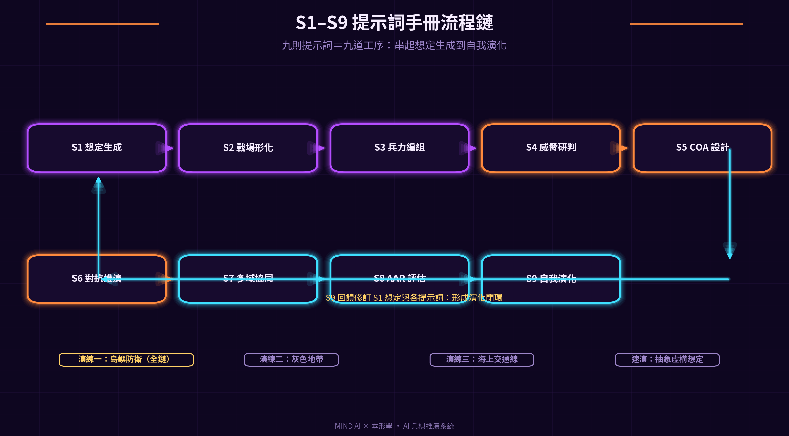

**圖 6-2 S1–S9 流程鏈與演化閉環**

| 工序 | 輸出規格（欄位摘要） | 驗收要點 |
| --- | --- | --- |
| S1 | 想定卡 11 欄＋變體差異說明 | ∩(T) 五要素俱全 |
| S2 | 戰域表 7 欄＋嵌套樹＋連鎖清單 | 邊界三要素可判定 |
| S3 | 編組樹＋BOM＋SOM＋三測試表 | 關鍵件全數判決 |
| S4 | 假設組表＋COA 組＋升級鏈＋欺敵警示 | 反證跡象非空 |
| S5 | 發散清單＋終選案卡（四約束/時序/估值） | 估值計算式可回放 |
| S6 | 裁決流水 8 欄＋回合結算＋例外清單 | 全數掛表行號 |
| S7 | 協同時序表＋連鎖清單＋備案表 | 七域全落位 |
| S8 | 四軸指標冊＋結論頁＋覆盤三問＋戰例卡 | 指標可回放 |
| S9 | 四類提案表＋四門檢查表＋入庫/退回清單 | 改版全程留痕 |

**表 6-2 S 手冊輸出規格與驗收要點彙整**

## 6.1 S1 想定生成與結構化

**用途**：把一句推演任務擴充為結構完整的想定形實體組（主想定＋批次變體）。**使用時機**：TDDW 步驟 2。**主形**：想定形 ScenarioType。

**▣ 提示詞範本（可直接複製使用）**

〔角色與任務〕你是 AI 兵棋推演系統的想定官（Scenario Officer）。任務：依下列推演任務生成 1 個主想定與 2–4 個批次變體，全部以想定形 ScenarioType 輸出。

〔推演任務〕〔一句話推演任務〕

〔形約束〕每張想定卡必備欄位：想定ID（SC-##）、版本、衝突類型、戰域容器（外鍵）、起始態勢、升級上限、時限/回合數、裁決集、指標集、ROE、勝負判準（∩(T) 組）。缺欄作廢。

〔判準注入〕勝負判準 ∩(T) 必須含五要素：特徵清單、門檻值、排除條款、證據要求、裁決映射行號。升級上限必須對齊升級階梯六級：認知輿論/海上民兵/海警執法/準軍事封鎖/有限武裝/全面衝突。

〔推理式指定〕起始態勢用模擬推理展開連鎖效應；變體設計用逆向推理（由勝負判準反推差異化前提）。

〔輸出格式〕表格化輸出：每變體一張卡（Markdown 表），卡後附「變體差異說明（≤3行）」與「本變體掃過的可能性空間（≤2行）」。禁止散文。

〔自檢清單〕①全卡欄位齊全 ②∩(T) 五要素俱全 ③變體間差異互斥可辨 ④時限與升級上限邏輯相容 ⑤每卡掛裁決集與指標集。逐條自證通過率 5/5 才可輸出。

- 常見錯誤：變體之間只換地名不換結構（無效變體）；勝負判準寫成形容詞（「取得優勢」）而非 ∩(T)。

- 驗收要點：抽一張卡檢查 ∩(T) 五要素；抽兩張變體檢查差異是否落在不同維度。

## 6.2 S2 戰場與戰域形化

**用途**：把想定的地理與多域空間建構為戰場形 BattleSpaceType 容器組。**使用時機**：TDDW 步驟 3。**主形**：戰場形。

**▣ 提示詞範本（可直接複製使用）**

〔角色與任務〕你是戰場形化官（BattleSpace Typifier）。任務：為〔想定ID〕建構戰場形容器組，輸出戰域表。

〔形約束〕容器語法 ( 戰域 )。每容器必備：戰域ID、名稱、層級（戰區/戰區段/任務區）、邊界定義（座標＋時限＋管轄）、內部空間容量、子容器清單、禁區清單。七域覆蓋檢查：陸/海/空/太空/網路/電磁/認知。

〔判準注入〕邊界判準 ∩(B)：進出可判定（記錄留痕）；容器身份獨立性：進駐兵力變動不改戰域ID；嵌套判準：子容器約束隨父容器連動。

〔推理式指定〕用因果推理展開「戰域失守」的跨域連鎖（至少 2 條，掛事件形草稿）。

〔輸出格式〕戰域表（表格）＋嵌套樹狀圖（縮排文字）＋跨域連鎖清單（每條含觸發條件/影響範圍/節奏效果）。

〔自檢清單〕①七域全覆蓋或說明缺域理由 ②每容器邊界可判定 ③無容器ID衝突 ④子容器不越父邊界 ⑤每條跨域連鎖掛事件形三要素。5/5 通過才可輸出。

## 6.3 S3 兵力編組 BOM/SOM

**用途**：建構雙方兵力形 ForceType 編組樹與戰力屬性表。**使用時機**：TDDW 步驟 3。**主形**：兵力形。

**▣ 提示詞範本（可直接複製使用）**

〔角色與任務〕你是兵力結構官（Force Structure Officer）。任務：為〔想定ID〕雙方建構兵力形 BOM/SOM 編組，輸出編組樹＋戰力表。

〔形約束〕{ 兵力形 } 語法。BOM 欄位：部件ID、名稱、數量、戰力指數、備註。SOM 欄位：部件層級、結構依存（關鍵/一般/可替換）、父節點。編組主鍵：兵力ID＋編組層級。

〔判準注入〕結構依存三測試：替換測試（同型替換身份不變）、降級測試（拿一般件戰力下修但身份不變）、瓦解測試（拿關鍵件編組解散）。戰力指數修正係數：降級 -15%~-40%，瓦解重組另計。

〔推理式指定〕用統計推理換算基礎戰力指數（標註先驗來源）；用因果推理評估缺件後果。

〔輸出格式〕編組樹（縮排）＋BOM 表＋SOM 依存表＋三測試判決表（每關鍵件一行）。

〔自檢清單〕①BOM 數量與資源形預算相容 ②每個部件標註結構依存等級 ③關鍵件全數通過三測試判決 ④戰力指數計算式可回放 ⑤雙方編組覆蓋想定起始態勢。5/5 通過才可輸出。

## 6.4 S4 威脅研判與紅隊推理

**用途**：以紅隊立場推演敵方意圖、方案與升級路徑。**使用時機**：TDDW 步驟 4。**主形**：威脅形 ThreatType。

**▣ 提示詞範本（可直接複製使用）**

〔角色與任務〕你是紅隊研判官（Red Team Analyst）。任務：為〔想定ID〕推演紅方意圖與行動方案組，輸出紅隊研判書。

〔形約束〕威脅形 [ ] 語法。每項威脅實體必備：威脅ID、∩(T) 編號、類別歸屬判定、等級、觀察指標（可驗證的跡象清單）。

〔判準注入〕威脅 ∩(T) 五要素（特徵/門檻/排除/證據/裁決映射）。情報形可信度 A–E 權重：低可信情報不得單獨觸發高階威脅判定。

〔推理式指定〕果因推理為主（跡象→意圖，多假設並列＋機率排序）；模擬推理展開升級連鎖；逆向推理反推紅方前置條件。

〔輸出格式〕①意圖假設組表（假設/支持跡象/反證跡象/機率）②紅方 COA 組（≥3案）③升級路徑鏈 ④欺敵警示（紅方最想讓我們相信什麼）。

〔自檢清單〕①每假設有支持與反證跡象 ②機率標註推理式 ③升級連鎖含中斷條件 ④欺敵警示非空 ⑤全數威脅掛 ∩(T) 編號。5/5 通過才可輸出。

紅隊鐵律：**先當壞人、再當參謀**。研判書裡沒有「我方視角」的措辭——出現「我軍應…」即視為污染，重跑。

| 假設組欄位 | 要求 | 合格線 |
| --- | --- | --- |
| 假設敘述 | 一句話、可判定 | 與其他假設互斥可辨 |
| 支持跡象 | ≥2 條、掛情報形ID | 至少 1 條 B 級以上 |
| 反證跡象 | ≥1 條 | 非空（空即不合格） |
| 機率 | 推理式＋先驗來源 | 總和歸一、標註方法 |
| 觀察指標 | 可驗證的後續跡象 | 掛觀察時點 |

**表 6-2a S4 假設組規格**

## 6.5 S5 COA 設計與藍隊

**用途**：生成並收斂藍方行動方案組。**使用時機**：TDDW 步驟 5。**主形**：行動形 ActionType。

**▣ 提示詞範本（可直接複製使用）**

〔角色與任務〕你是藍隊設計官（Blue Team Designer）。任務：為〔想定ID〕設計藍方 COA 方案組，收斂為 2–3 案。

〔形約束〕每案行動形鏈必備：行動ID、四約束（資源預算/時窗/空間邊界/ROE 門檻）、時序節點表、目標掛鉤（對應目標形 ∩(T)）、風險註記。

〔判準注入〕修剪判準：行動不掛上層目標 ∩(T) 即剪；四約束缺一不入選；升級越界即殺。估值函數：∩(T) 目標達成度×0.6＋風險控管×0.25＋資源效率×0.15。

〔推理式指定〕水準思考＋模式庫檢索先發散（≥5案）；垂直思考＋因果推理深化各案連鎖；逆向推理驗證前置條件完備。

〔輸出格式〕發散案清單表（一案一行）→收斂說明→終選案卡組（每案含行動鏈表、時序節點表、資源表、估值分數）。

〔自檢清單〕①發散≥5收斂2–3 ②每行動四約束齊備 ③每案掛目標 ∩(T) ④估值計算式可回放 ⑤風險註記含升級風險。5/5 通過才可輸出。

| COA 卡欄位 | 要求 | 合格線 |
| --- | --- | --- |
| 行動鏈 | 行動形序列、含分支點 | 每步四約束齊備 |
| 時序節點表 | 時窗・先後序・容差 | 與 S7 協同表相容 |
| 資源表 | 油彈人預算分配 | 守恆檢查通過 |
| 目標掛鉤 | 對應目標形 ∩(T) | 不掛目標即剪 |
| 估值分數 | 計算式＋分項 | 可回放、含穩健區間 |
| 風險註記 | 升級/後勤/誤判風險 | 升級風險必填 |

**表 6-2b S5 COA 卡規格**

## 6.6 S6 對抗推演與裁決

**用途**：紅藍 COA 在分支樹上對抗推進，逐節點裁決。**使用時機**：TDDW 步驟 6。**主形**：裁決形 AdjudicationType。

**▣ 提示詞範本（可直接複製使用）**

〔角色與任務〕你是推演裁決官（Adjudicator）。任務：為〔想定ID〕執行紅藍對抗推演，逐回合輸出裁決紀錄。

〔形約束〕裁決紀錄必備：裁決ID、時序節點、交戰雙方兵力ID、裁決表行號、判決結果、戰果、狀態變更（連動的形實體欄位）、證據指標（情報形ID）。

〔判準注入〕混合裁決規則：戰術交戰查判決表；宏觀對比用指數法；例外事件報專家裁決；奇詭行動跑 AI 對抗。一致化三律：同事件同判決、同特徵同判決、判決皆可回指。

〔推理式指定〕每回合以因果推理推進態勢；以模擬推理處理二階效應；統計推理提供損耗先驗（標註樣本數）。

〔輸出格式〕逐回合裁決流水表（回合/節點/事件/判決/戰果/狀態變更）＋回合結算（四軸指標快照）＋例外清單（報專家裁決事項）。

〔自檢清單〕①每判決掛裁決表行號 ②資源守恆（戰耗不超預算）③時序閉合（無節點衝突）④ROE 合規（G1–G5 通過記錄）⑤例外清單不隱匿。5/5 通過才可輸出。

## 6.7 S7 多域協同與時序編排

**用途**：編排跨域行動的協同節拍與事件連鎖。**使用時機**：TDDW 步驟 6（與 S6 並行）。**主形**：事件形 EventType。

**▣ 提示詞範本（可直接複製使用）**

〔角色與任務〕你是多域協同官（Multi-Domain Coordinator）。任務：為〔想定ID〕編排〔時窗〕內七域行動協同計畫。

〔形約束〕協同表必備欄位：時序節點、戰域、行動形ID、跨域依賴（前置行動/觸發事件）、同步要求（到位時間容差）、失敗備案。

〔判準注入〕跨域連鎖判準：每條連鎖掛事件形三要素（觸發條件 ∩(T)/影響範圍/節奏效果）。同步律：孤軍深入的施力不予支持；升級律：跨軸升級須指揮形授權記錄。

〔推理式指定〕因果推理驗證連鎖有效性；模擬推理推演連鎖中斷的降級路徑。

〔輸出格式〕協同時序表（甘特式文字表）＋跨域連鎖清單＋失敗備案表＋同步率預估（計算式）。

〔自檢清單〕①七域行動皆在時序表落位 ②每連鎖三要素齊備 ③每行動有失敗備案 ④同步容差可判定 ⑤升級律檢查通過。5/5 通過才可輸出。

## 6.8 S8 AAR 評估與戰例萃取

**用途**：推演結束後彙整四軸指標、覆盤檢討、萃取戰例卡。**使用時機**：TDDW 步驟 7。**主形**：指標形 MetricType。

**▣ 提示詞範本（可直接複製使用）**

〔角色與任務〕你是評估官（Evaluator）。任務：為〔想定ID〕推演結果產出 AAR 報告與戰例卡組。

〔形約束〕四軸指標（目標達成/戰力比/風險/節奏）每指標必備：指標ID、計算式、數值、證據來源（裁決形/情報形 ID）、警示門檻比對結果。戰例卡必備：戰例ID、態勢摘要、行動骨架、判決、指標結果、複用註記。

〔判準注入〕指標 ∩(T) 計算式必須可回放。覆盤三問強制欄位：哪一步判斷出錯？哪個前提不成立？哪條判準要修？

〔推理式指定〕第一性原理質疑關鍵數字（至少重算 2 個）；因果推理歸因主要結果。

〔輸出格式〕四軸指標冊（表）＋結論頁（勝負判準現況）＋覆盤三問表＋戰例卡組（≥3張）。

〔自檢清單〕①每指標可回放 ②結論掛形證據鏈 ③覆盤三問非空且具體 ④戰例卡含複用註記 ⑤警示門檻全部比對。5/5 通過才可輸出。

## 6.9 S9 自我演化與想定變體

**用途**：把推演經驗轉化為系統升級，閉環回饋。**使用時機**：TDDW 步驟 8。**主形**：戰例形 LessonType。

**▣ 提示詞範本（可直接複製使用）**

〔角色與任務〕你是演化治理官（Evolution Governor）。任務：依〔想定ID〕AAR 產出四類演化提案並執行治理檢查。

〔形約束〕四類提案各成表：①想定變體（差異化欄位）②判準修訂（∩(T) 差異對照）③提示詞修訂（六段式差異對照）④模式新卡（適用態勢/行動骨架/門檻/指標）。

〔判準注入〕治理四門：品質門（一致性四重檢查）、版本門（留痕不覆蓋）、淘汰門（低命中下架）、審計門（紀錄可回溯）。

〔推理式指定〕因果推理歸因演化收益；逆向推理驗證提案可落地。

〔輸出格式〕四類提案表＋治理四門檢查表（每門通過/退回）＋入庫清單（含版本號）＋退回清單（含理由）。

〔自檢清單〕①四類提案齊全或說明缺類 ②每提案過四門檢查 ③入庫項皆有版本號 ④退回項皆有理由 ⑤演化紀錄完整留痕。5/5 通過才可輸出。

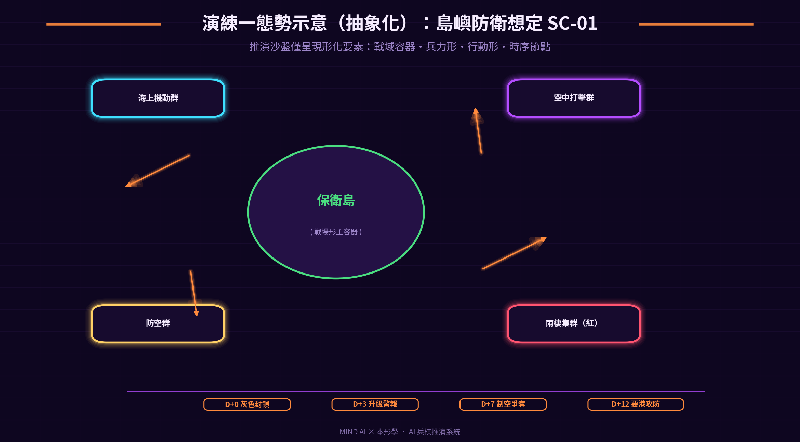

**圖 6-3 演練一態勢示意（抽象化）：島嶼防衛想定 SC-01**

## 6.10 演練一：島嶼防衛想定 SC-01（S1–S9 全流程）

演練一是主演練，走完 S1–S9 全流程。想定背景為**泛用島嶼防衛**：保衛島遭海上力量灰色封鎖，逐步升級至要港攻防。所有內容皆為虛構推演，用於示範準確使用方法的操作節奏。

### S1 想定生成（實跑摘要）

主想定 SC-01 完整卡片如下（變體節錄於表 6-3）——這是一張合格想定形實體的樣板，注意每個欄位都可判定、可掛鉤：

| 欄位 | SC-01 主想定卡內容 |
| --- | --- |
| 想定ID / 版本 | SC-01 v2.3 |
| 衝突類型 | 島嶼防衛（虛構泛用） |
| 戰域容器 | ( 聯合作戰戰區 ) ＞ 六子域（北區/南區/走廊/外島/後勤線/網電） |
| 起始態勢 | D+0 起紅方灰色封鎖；藍方 JTF-K 防衛；外島守備營 1 |
| 升級上限 | 武裝衝突（升級階梯第 5 級） |
| 時限 / 回合數 | D+15 / 15 回合（每回合約 24 推演時） |
| 裁決集 | ADJ-全（含交戰/機動/後勤/電戰） |
| 指標集 | MET-四軸（目標達成/戰力比/風險/節奏） |
| ROE | G1–G5 全門；G2 複核門於電磁劣勢時啟動 |
| 勝負判準 | ∩(T) 目標組：要港控制○ 戰力保存≥0.6○ 民心≥基線○ 升級控制○（四項全達勝/全失敗/其間比例尺） |

**表 6-3a SC-01 主想定卡完整欄位**

| 欄位 | 主想定 SC-01 | 變體 SC-01B | 變體 SC-01C |
| --- | --- | --- | --- |
| 衝突類型 | 島嶼防衛 | 島嶼防衛 | 島嶼防衛 |
| 起始態勢 | 灰色封鎖 | 海上交通線中斷 | 外島先遭奪占 |
| 升級上限 | 武裝衝突 | 有限武裝 | 武裝衝突 |
| 時限 | D+15 / 15 回合 | D+30 / 20 回合 | D+15 / 15 回合 |
| 掃過空間 | 升級速度 | 後勤韌性 | 多線分兵 |

**表 6-3 SC-01 想定組（S1 輸出摘要）**

### S2–S3 形化（實跑摘要）

戰域容器：**( 聯合作戰戰區 )** 下切六子域（北任務區、南任務區、海空走廊、外島群、後勤線、網路電磁域）。兵力形：藍方 JTF-K（SOM 關鍵件：指揮核心、防空群；一般件：電戰分遣），紅方兩棲集群（關鍵件：登陸艦隊、空中掩護群）。三測試判決：紅方缺空中掩護 → 降級 -30%；藍方缺指揮核心 → 瓦解重組。

| 三測試 | 測試對象 | 判決 | 後續連動 |
| --- | --- | --- | --- |
| 替換測試 | 戰機 A1 換 A3 型 | 身份不變 | 屬性值更新（載彈+2） |
| 降級測試 | 紅方缺空中掩護 | 降級 -30% | 裁決係數下修 |
| 降級測試 | 藍方缺電戰分遣 | 降級 -15% | 識別係數下修 |
| 瓦解測試 | 藍方缺指揮核心 | 編組瓦解 | 事件形「指揮中斷」觸發 |
| 瓦解測試 | 紅方缺登陸艦隊 | 攻勢瓦解 | 紅方 COA-A 剪除 |

**表 6-3b SC-01 結構依存三測試判決（S3 輸出節錄）**

### S4 紅隊研判（實跑摘要）

| 意圖假設 | 支持跡象 | 反證跡象 | 機率 |
| --- | --- | --- | --- |
| 奪取主港為最終目的 | 兩棲艦隊前推、掃雷活動 | 外交管道保持暢通 | 0.55 |
| 封鎖施壓迫談判 | 海警船為主、軍艦後置 | 兵力規模超出施壓需求 | 0.30 |
| 欺敵掩護他向行動 | 電磁靜默異常、衛星迴避 | 無他向兵力調動 | 0.15 |

**表 6-4 SC-01 紅方意圖假設組（S4 輸出摘要）**

欺敵警示：紅方最想讓我們相信「主攻在北」——所有北向跡象須過情報形可信度 B 以上複核。

### S5 COA 設計（實跑摘要）

發散 6 案、收斂 3 案，其中 COA-C 依修剪判準（估值 0.41 < 0.45 且民心風險超標）剪除。估值對比明細：

| 案 | ∩(T) 達成 | 風險控管 | 資源效率 | 加權估值 | 穩健區間 |
| --- | --- | --- | --- | --- | --- |
| COA-A 速決 | 0.86 | 0.70 | 0.88 | 0.82 | 0.74–0.88 |
| COA-B 封鎖反制 | 0.72 | 0.78 | 0.70 | 0.74 | 0.68–0.80 |
| COA-C 後撤待援 | 0.32 | 0.55 | 0.50 | 0.41 | 剪除 |

**表 6-3c SC-01 COA 估值對比明細（S5 輸出）**

| 案 | 行動骨架 | 估值 | 關鍵風險 |
| --- | --- | --- | --- |
| COA-A 速決 | 先制防空壓制→空中遮斷→反登陸 | 0.82 | 升級過快、國際觀感 |
| COA-B 封鎖反制 | 護航重組→外線破交→持久消耗 | 0.74 | 後勤維持天數 |
| COA-C 後撤待援 | 保存戰力→固守要港→等援 | 0.41 | 民心指數下滑（剪除） |

**表 6-5 SC-01 藍方 COA 組（S5 輸出摘要；COA-C 依修剪判準剪除）**

### S6–S7 推演與協同（實跑摘要）

第 1–3 回合：灰色封鎖期，裁決集中在海警對峙與電磁域；D+3 觸發事件「升級警報」，節奏函式 Tempo(t) 由 0.4 升至 0.8。第 4–7 回合：制空爭奪，COA-A 分支估值領先；D+7 事件「空中走廊開啟」觸發多域協同：空域打擊與海域機動同步到位（容差 ±2 小時）。裁決一致化抽樣回放 5%，同事件判決全數一致。

### S6 裁決流水（實跑節錄）

| 節點 | 事件 | 裁決 | 表行號 | 戰果／狀態變更 |
| --- | --- | --- | --- | --- |
| T2-P4-01 | 海警對峙升溫 | 壓制有效、未開火 | ADJ-灰#07 | 輿情指數 -3；歸因升「確證」 |
| T3-P3-02 | 強電磁干擾 | 識別降級 0.5 | ADJ-電戰#12 | 誤判機率 +0.2；電磁權=劣勢 |
| T4-P2-01 | 升級警報（事件） | 節奏 0.4→0.8 | ADJ-全#01 | Tempo(t) 加速段啟動 |
| T5-P3-04 | 空中走廊爭奪 | 紅方損失戰機 2 | ADJ-交戰#37 | 制空時數 +6h；紅方降級 |
| T7-P1-02 | 紅方兩棲前推 | 登陸窗口受限 | ADJ-海#22 | 紅方 COA-A 估值下修 |

**表 6-6 SC-01 裁決流水節錄（S6 輸出）**

### S8 指標冊（實跑節錄）

| 軸 | 指標 | 數值 | 門檻 | 證據 |
| --- | --- | --- | --- | --- |
| 目標達成 | 要港奪取進度 | 0.62 | ≥0.7 綠 | 裁決 ADJ-0114～0188 |
| 戰力比 | 戰耗交換比 | 1:1.3 | ≥1:1 綠 | 裁決累計＋BOM 結餘 |
| 戰力比 | 後勤維持天數 | 9 天 | ≥7 黃燈上 | 資源形 RS-日耗結算 |
| 風險 | 升級風險 | 0.58 | ≤0.5 黃 | 模擬推理連鎖統計 |
| 節奏 | 多域同步率 | 82% | ≥70% 綠 | 時序節點到位比對 |

**表 6-7 SC-01 四軸指標冊節錄（S8 輸出）**

### S8–S9 評估與演化（實跑摘要）

- 四軸結論：目標達成 0.62（黃）、戰耗交換比 1:1.3、升級風險 0.58（黃）、多域同步率 82%。

- 覆盤三問：①D+5 高估紅方登陸時機（果因推理單假設跳結）②「民心指數」前提不成立（未掛調查先驗）③升級臨界線門檻要下修 0.1。

- 演化產出：變體 SC-01D（換渡海窗口）、判準修訂 ∩(T)-07、模式新卡「防空壓制扇形掃蕩 v2」入庫。

## 6.11 演練二：灰色地帶想定 SC-02（重點步驟）

灰色地帶推演的特徵是「不開戰的戰爭」：升級階梯低階、歸因困難、裁決重心在**證據與歸因**而非火力。本演練聚焦 S4、S6、S8 三道工序的灰色地帶特化用法。

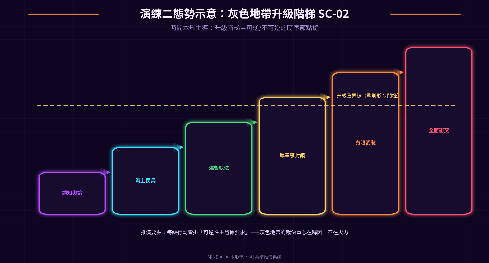

**圖 6-4 灰色地帶升級階梯（演練二）**

- S4 特化：果因推理的假設組必須納入「非國家行為者」「自發事件」類；每項跡象掛情報形可信度與歸因判定（確證/推定/存疑）。

- S6 特化：裁決表用 ADJ-灰（附錄 B）：行動合法性判定先於軍事效果判定；「可逆性」是裁決欄位——升階容易降階難。

- S8 特化：指標加掛「歸因完成度」與「國際觀感指數」；警示門檻：歸因完成度 < 60% 不得啟動升階行動。

| 升階 | 合法性判定（先行） | 歸因門檻 | 可逆性 | 裁決表行 |
| --- | --- | --- | --- | --- |
| 認知輿論 | 言論自由邊界內 | 推定可啟動 | 完全可逆 | ADJ-灰#01 |
| 海上民兵 | 船籍與任務可解釋 | 存疑即凍結 | 高度可逆 | ADJ-灰#03 |
| 海警執法 | 管轄權主張成立 | 確證可升階 | 可逆 | ADJ-灰#07 |
| 準軍事封鎖 | 國際法審查通過 | 確證＋多源 | 難逆 | ADJ-灰#11 |
| 有限武裝 | G1–G5 全門通過 | 確證＋授權 | 難逆 | ADJ-灰#14 |
| 全面衝突 | 指揮形最高授權 | 不適用 | 不可逆 | ADJ-全#01 |

**表 6-8 灰色地帶升階裁決表（ADJ-灰節錄）**

演練二 S4 節錄（歸因判定表）——灰色地帶的紅隊重心在「誰做的、能證明嗎」：

| 跡象 | 歸因假設 | 可信度 | 判定 | 行動影響 |
| --- | --- | --- | --- | --- |
| 漁船編隊逼近 | 海上民兵組織 | B | 推定 | 不得升階，加監偵 |
| 海警雷射照射 | 官方授意 | C | 存疑 | 外交照會，留證 |
| 假訊息潮 | 認知作戰機構 | B | 推定 | 啟動揭露作戰 |
| 海底電纜破損 | 作戰行動 | D | 存疑 | 維修＋保留追責 |

**表 6-8a SC-02 歸因判定表節錄（S4 輸出）**

演練二 S8 節錄（灰色地帶專用指標）：

| 指標 | 計算式要點 | 數值 | 門檻 | 判定 |
| --- | --- | --- | --- | --- |
| 歸因完成度 | 確證跡象占比 | 0.58 | ≥0.6 | 黃（不得升階） |
| 國際觀感指數 | 輿情移動加權 | +3 | ≥0 | 綠 |
| 升階可逆性 | 行動回退成本 | 中 | 低 | 黃 |
| 法遵合規率 | 合法性判定通過比 | 0.92 | ≥0.9 | 綠 |
| 節奏掌控 | 升階時機自選比 | 0.75 | ≥0.7 | 綠 |

**表 6-8b SC-02 灰色地帶指標冊節錄（S8 輸出）**

## 6.12 演練三：海上交通線想定 SC-03（重點步驟）

海上交通線（SLOC）推演的主軸是**資源形的守恆與節點攻防**：維持天數是核心指標，每個節點（始發港、匯集點、護航隊、隘口、威脅區、接收港）都是容器形——失守＝容器易主，ID 不變，證據鏈不斷。

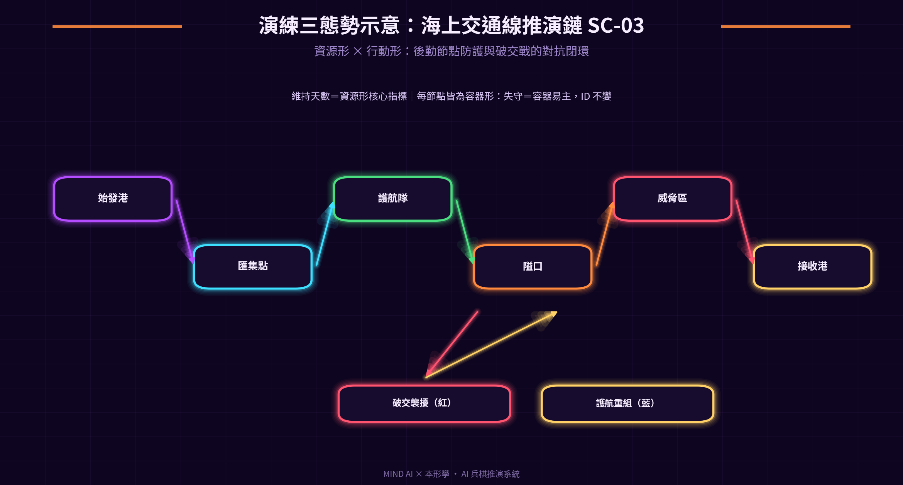

**圖 6-5 海上交通線推演鏈（演練三）**

- S3 特化：護航隊 SOM 關鍵件為指揮艦與補給艦；護航重組測試（瓦解測試變體）必跑。

- S5 特化：COA 參數化為護航兵力配置 × 航路選擇 × 偽裝策略三軸；估值權重後勤效率 0.35。

- S6 特化：破交裁決用判決表＋統計推理先驗（歷史破交戰例）；每航次結算維持天數。

| 航次 | 航路 | 護航配置 | 威脅遭遇 | 裁決（表行） | 維持天數結算 |
| --- | --- | --- | --- | --- | --- |
| V-01 | 北線 | 輕護航 | 無 | ADJ-海#05 | 30 → 29.6 天 |
| V-02 | 北線 | 重護航 | 潛艇疑蹤 | ADJ-海#11 | 29.6 → 29.2 天 |
| V-03 | 隘口 | 偽裝分散 | 空巡壓制 | ADJ-海#22 | 29.2 → 28.4 天 |
| V-04 | 南線 | 護航重組中 | 破交襲擾 | ADJ-海#31 | 28.4 → 26.9 天（受創） |

**表 6-9 海上交通線航次結算表示例（SC-03）**

演練三 S5 節錄（護航配置三軸估值）——資源形主導的方案設計：

| 配置案 | 兵力軸 | 航路軸 | 偽裝軸 | 維持天數 | 估值 |
| --- | --- | --- | --- | --- | --- |
| H-1 集中護航 | 重護航×1 | 北線 | 低 | 31 天 | 0.71 |
| H-2 分散護航 | 輕護航×3 | 多線 | 中 | 28 天 | 0.78 |
| H-3 偽裝滲透 | 輕護航×2 | 南線 | 高 | 33 天 | 0.83 |
| H-4 外線破交 | 特遣×1 | 敵後 | 高 | 30 天（風險高） | 0.69 |

**表 6-9a SC-03 護航配置估值對比（S5 輸出節錄）**

## 6.13 速演：抽象虛構想定 SC-X1

抽象虛構想定用於訓練與系統驗收：以代號化紅藍（赤曜方 vs 蒼嵐方）在虛構多域戰場推演，不指向任何真實區域。速演走 S1→S6→S8 三工序，重點驗收：

- S1 輸出全卡欄位齊全、∩(T) 五要素俱全（驗收形紀律）。

- S6 裁決流水全數掛裁決表行號、一致化抽樣回放 100% 一致（驗收裁決紀律）。

- S8 指標全數可回放、覆盤三問具體（驗收評估紀律）。

三關全過，代表使用者的操作已達成熟度 L1（詳第 9 章）；速演成績同時是 S 手冊本身的驗收依據——速演失敗先修手冊，再怪使用者。

| 驗收項 | 方法 | 合格線 | 紀錄 |
| --- | --- | --- | --- |
| S1 形紀律 | 抽 3 張想定卡查 ∩(T) 五要素 | 3/3 齊全 | □ |
| S6 裁決紀律 | 一致化回放 10% | 一致率 100% | □ |
| S8 評估紀律 | 指標回放 2 個 | 2/2 可回放 | □ |
| 全程操作 | 自檢紀錄抽查 | 5/5 全過 | □ |
| 時程 | 速演計時 | ≤90 分鐘 | □ |

**表 6-11 SC-X1 速演驗收紀錄表**

## 6.14 提示詞常見問答

### Q1 為什麼不直接對話式推演，要用固定提示詞？

對話式推演的最大敵人是**漂移**：第 20 分鐘的「想定」已經不是第 1 分鐘的想定，欄位漏了、判準忘了、輸出格式散了。六段式提示詞把約束寫死在每則輸入裡，每一次呼叫都是乾淨的開始——準確性來自結構，不來自記性。

### Q2 模型輸出缺欄位，要補欄還是整批重跑？

整批重跑。補欄看似省事，但缺欄代表模型沒有完整理解形約束——手工補的欄位沒有經過推理與自檢，會污染後續裁決。只有在「單欄筆誤、其餘自檢通過」時才允許點修，且點修要留痕。

### Q3 自檢 5/5 通過，但結論看起來怪怪的，聽模型的還是聽直覺？

聽直覺，但要把它變成問題。自檢是必要條件不是充分條件；「看起來怪」通常代表某個前提與你的領域知識衝突——追前提清單，找到衝突點，以 S9 提出判準或提示詞修訂。直覺是免費的紅隊。

### Q4 同一則提示詞，不同人跑出不同結果，正常嗎？

輕微差異正常（生成本質），結構性差異不正常。若輸出的形、欄位、判準掛鉤一致，只有敘述措辭不同，可接受；若欄位結構不同、裁決方向相反，先檢查佔位替換與判準注入是否一致，再檢查是否用了對應想定版本。

### Q5 推演中可以臨時改想定嗎？

可以，但要走版本：生成新版想定卡（v+0.1），標記受影響產出為「待重推」，已跑回合按變更影響範圍決定全推或截推。**禁止**原地改字——沒有版本的想定變更會讓證據鏈集體斷裂。

### Q6 S 手冊可以用在非軍事領域的對抗推演嗎？

可以。十四形與 TDDW 是方法不是軍事教條：商戰、資安、危機應變推演同樣能形化。只需在 S1 想定卡把「衝突類型」「升級階梯」換成該領域的對應欄位，裁決表換成領域規則——換形不換法。

### Q7 AI 裁決和人類專家裁決意見不同時聽誰的？

聽裁決形。爭議處置流程：①各自指回裁決表行號與 ∩(T)；②比對誰的判準掛鉤完整；③判準完整者優先；④判準皆完整而結論仍異 → 報例外，由指揮形授權人裁決，並把爭議寫成 S9 判準修訂提案。

## 6.15 進階技巧：提示詞組合與批次化

熟練使用者可把 S 手冊升級為批次作業流，呼應 WarMatrix 式的大規模矩陣推演。三項進階技巧：

- 管道化：S1 輸出的想定卡直接作為 S2/S3 的輸入參數；S3 編組表直接餵 S6 裁決基數。參數以形實體傳遞，人手不抄數字。

- 批次化：同一工序對多想定變體批量執行（S4×4 變體、S6×4×3 COA 組合），輸出統一格式表；批次結果以一致化三律抽樣稽核。

- 模板化：把驗證過的提示詞＋判準注入組合存為任務模板（如「灰色地帶研判模板」），模板隨 S9 版本治理連動升級。

| 技巧 | 省下的 | 風險 | 防呆 |
| --- | --- | --- | --- |
| 管道化 | 人工抄錄與格式轉換 | 參數斷鏈 | 形實體傳遞＋版本連動 |
| 批次化 | 重複操作時間 | 批量同錯 | 一致化抽樣稽核 5–10% |
| 模板化 | 重組提示詞時間 | 模板過期 | 模板掛版本、S9 連動 |

**表 6-10 進階技巧風險與防呆**

進階的真諦：**規模化的每一步，都要帶著準確性一起走**。批次跑 100 個格子不是本事，100 個格子全部通過一致化才是本事。

# 第 7 章 準確性、裁決可信度與安全倫理

## 7.1 幻覺防護三關卡

AI 兵推最大的風險不是算不動，而是**自信的錯誤**——推演結論看起來頭頭是道，實則無據。本系統以三關卡攔截：

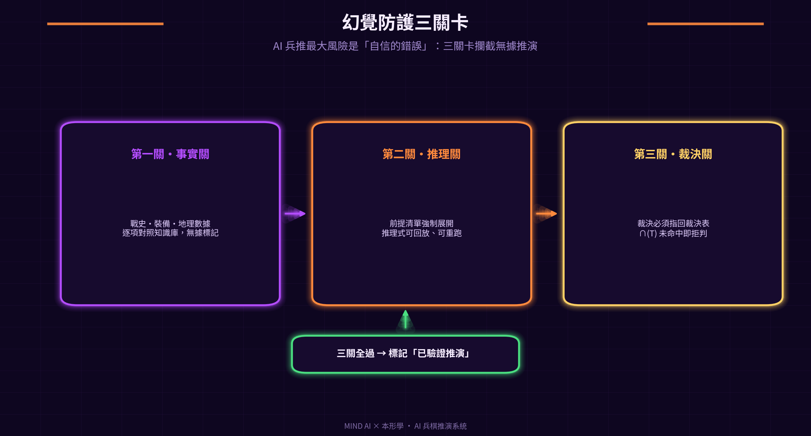

**圖 7-1 幻覺防護三關卡**

| 關卡 | 檢查內容 | 處置 |
| --- | --- | --- |
| 第一關・事實關 | 戰史・裝備・地理數據對照知識庫 | 無據項目標記「待查」，不得進裁決 |
| 第二關・推理關 | 前提清單展開、推理式可回放 | 前提缺漏即重跑；無前提不結論 |
| 第三關・裁決關 | 裁決指回裁決表行號＋∩(T) | ∩(T) 未命中即拒判，報例外 |

**表 7-1 幻覺防護三關卡**

三關全過的輸出標記「已驗證推演」；任何一關不過的輸出標記「待驗」——待驗輸出可以進討論，不能進裁決、不能進簡報結論頁。

| 狀態 | 定義 | 可用範圍 | 轉換條件 |
| --- | --- | --- | --- |
| 已驗證 | 三關全過 | 裁決・簡報・入庫 | —— |
| 待驗 | 任一關未過 | 內部討論・研究 | 補驗過關升級 |
| 假設 | 前提清單穩健度=假設 | 推演輸入・情節推演 | 前提獲證升級 |
| 失效 | 證據鏈斷或前提推翻 | 僅留檔 | 重推後另立新結論 |

**表 7-1a 推演結論狀態分級與處置**

## 7.2 推演一致性驗證

第三層準確性保證展開為四重自動檢查，每回合執行、每批次抽樣：

- 兵力平衡檢查：雙方戰耗累計不超 BOM 基數；「越打越多」即報錯。

- 時序閉合檢查：行動時窗無重疊衝突、先後序無環、事件觸發時序合法。

- 資源守恆檢查：油彈人預算全程守恆；行動資源消耗≤資源形結餘。

- 準則合規檢查：每項交戰行動掛 G1–G5 通過記錄；無記錄的交戰判決無效。

檢查失敗的處置分兩級：**可修**（時序重排、資源重分配）→ 退回重推該回合；**不可修**（判準矛盾、想定內在衝突）→ 步驟 2 重來，並觸發 S9 判準修訂提案。

| 檢查 | 檢查式 | 示例結果 | 處置 |
| --- | --- | --- | --- |
| 兵力平衡 | 戰耗累計 ≤ BOM 基數 | T5：紅方戰機損耗 12/16 ✓ | 通過 |
| 時序閉合 | 時窗無衝突・先後序無環 | T3：ACT-011/014 時窗重疊 ✗ | 退回重排 |
| 資源守恆 | Σ消耗 ≤ 預算結餘 | T4：油料結餘 0.82 ✓ | 通過 |
| 準則合規 | 交戰行動掛 G1–G5 記錄 | T2：ADJ-灰#07 缺 G5 記錄 ✗ | 補記錄重裁 |

**表 7-2a 一致性四重檢查結果示例**

## 7.3 形證據鏈

第四層準確性保證是形證據鏈：每個結論都拖著一條「結論 → 裁決形行號 → 行動形實體 → 情報形來源 → 想定形版本」的鏈。鏈上任一環節改版，上游結論自動標記「待重驗」。

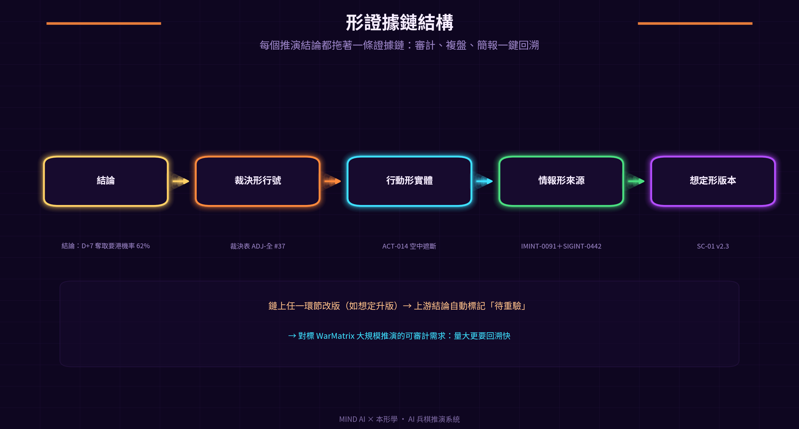

**圖 7-2 形證據鏈結構與失效連動**

證據鏈讓推演可審計、可複盤、可簡報——指揮官問「這個 62% 怎麼來的」，操作員三步內指到裁決表行號與情報來源。對標 WarMatrix 的大規模推演：**量大更要回溯快**，證據鏈就是回溯的高速公路。

| 環 | 欄位 | 檢核 | 失效連動 |
| --- | --- | --- | --- |
| 結論 | 結論ID・敘述・狀態 | 狀態非待驗才能進簡報 | 下游簡報標記過期 |
| 裁決 | 裁決ID・表行號 | 表行號可回指裁決表 | 裁決改判→結論待重驗 |
| 行動 | 行動ID・時序節點 | 四約束紀錄完整 | 行動重推→裁決待重驗 |
| 情報 | 情報ID・來源等級 | 可信度≥門檻 | 情報更新→結論穩健度重評 |
| 想定 | 想定ID・版本 | 版本與產出一致 | 想定升版→全鏈待重驗 |

**表 7-3 形證據鏈五環規格**

## 7.4 紅隊對抗與偏差檢測

除了推演內的紅隊（S4），推演流程本身也要有紅隊：定期以「攻擊者」視角檢查推演系統的偏差。常見偏差與檢測法：

| 偏差 | 症狀 | 檢測法 |
| --- | --- | --- |
| 錨定偏差 | COA 都長得像上一場 | S5 發散案數量稽核（<5 即警） |
| 樂觀偏差 | 藍方估值普遍偏高 | 紅隊最優解穩健性測試 |
| 確認偏差 | 情報只收集支持項 | 假設組反證跡象非空稽核 |
| 自動化偏誤 | AI 輸出不經人審直接用 | 人機分工梯度稽核（越級即警） |
| 歷史類比謬誤 | 戰例不當套用 | 模式卡適用態勢複核 |

**表 7-2 五類推演偏差檢測**

## 7.5 倫理、戰爭法與資料保全

推演不是遊戲：推演中建立的作戰概念終將影響真實決策。本系統設三閘門，任一不過即中止推演並回報：

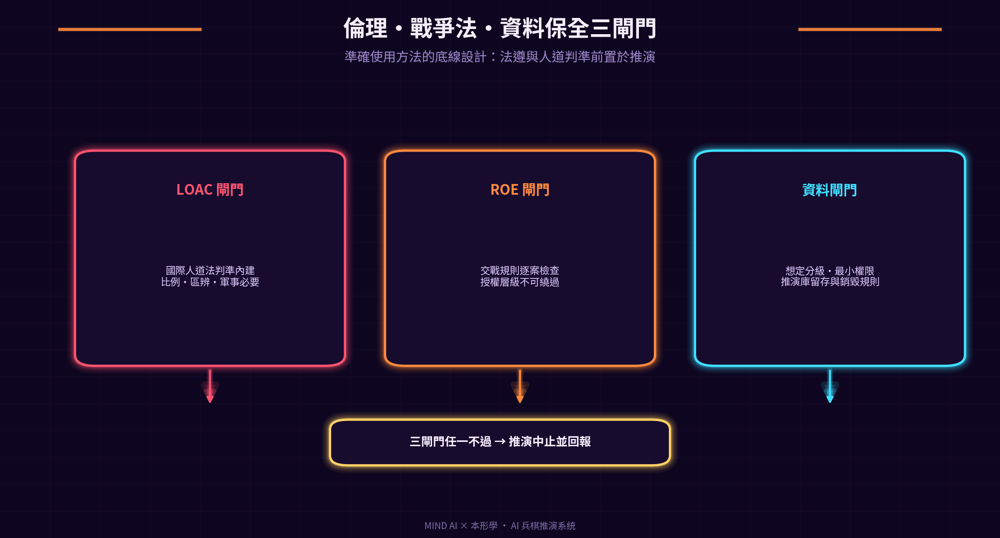

**圖 7-3 倫理・戰爭法・資料保全三閘門**

- LOAC 閘門：國際人道法判準內建——比例原則、區辨原則、軍事必要性寫進準則形 G 門，推演中不得以「推演假設」為由繞過。

- ROE 閘門：交戰規則逐案檢查；授權層級不可繞過；AI 建議不得直接觸發交戰裁決。

- 資料閘門：想定分級管理、最小權限、推演庫留存與銷毀規則；分級資訊不得跨級混推。

7.6 節另述文書倫理：推演報告的對外表述必須區分「推演結論」與「現實情資」，兩者混淆是最嚴重的文書失格。

## 7.6 文書倫理與治理

- 結論標註：報告結論頁每句話標註證據鏈狀態（已驗證/待驗/假設）。

- 虛構識別：演練中的虛構數據（如想定兵力）不得以現實名詞表述；對外文件統一以代號化想定呈現。

- 分級傳承：推演產出繼承想定分級；衍生文件自動標級。

- 誤用申訴：使用者發現手冊誤導或判準不公，可提 S9 修訂提案；治理四門於 5 個工作天內回覆。

## 7.7 誤用申訴與手冊改版流程

使用者對手冊、判準或裁決提出異議時，走標準申訴流程——異議本身就是系統變強的燃料：

- 提出：填異議單（異議項、理由、建議修正、證據）。

- 受理：治理官 2 個工作天內確認受理並掛 S9 提案編號。

- 驗證：以抽象虛構想定重現異議情境（複現失敗也要記錄）。

- 決議：品質門裁定「修正入庫／維持原判／退回補證」，5 個工作天回覆。

- 留痕：無論結果，異議與決議全數入推演庫審計紀錄。

申訴率本身是健康指標：申訴率為零的單位，不是完美，是**沉默**——沒有人願意質疑的推演系統，比錯誤更危險。

## 7.8 推演環境與資安實務

推演資料往往具分級敏感性，環境安全是準確性的物理前提。最低要求四件套：

- 隔離：推演環境與外部網路隔離；模型推論在可控環境執行，禁止把分級想定貼入公有服務。

- 最小權限：帳號權限對齊想定分級；紅藍席位資料視窗分離（紅隊看不見藍隊未公開 COA）。

- 留痕：操作日誌、模型輸出、裁決異動全數留痕；留痕本身也分級管理。

- 快照：開推前推演庫基準快照、推演中定時快照；事故時可回放定位。

| 風險 | 情境 | 防制 |
| --- | --- | --- |
| 資料外洩 | 推演產出流入公有雲 | 分級標示＋傳承＋外發審查 |
| 模型污染 | 外部輸入夾帶指令 | 輸入清洗＋提示詞注入檢測 |
| 權限越界 | 低權限帳號讀高分級 | 分級對齊＋視窗分離 |
| 紀錄篡改 | 裁決紀錄被覆蓋 | 追加式留痕＋版本治理 |

**表 7-4 推演環境風險與防制**

## 7.9 平民保護與戰爭法特別條款

推演中涉及平民、民用設施、文化財的場景，適用特別條款。這些條款不是「推演外掛」，而是裁決的硬約束——違反條款的行動，即使戰果再大，裁決形輸出一律標記「法遵否決」：

- 區辨條款：目標形必須掛「軍事目標/民用目標/混合」分類與判定依據；民用目標不得列入打擊選單。

- 比例條款：附帶損害預估（戰術層裁決表必填欄）超過門檻的行動方案自動降權。

- 預防條款：可行的替代方案存在時，損害較大方案不得推薦——S5 估值函數納入此檢查。

- 記錄條款：涉及平民風險的推演全程錄影式留痕，供事後審查與教學。

# 第 8 章 誤用對照

本章以誤用對照表收束全書的「準確」訴求。每則對照＝一句話的教訓；建議張貼於推演作業席。

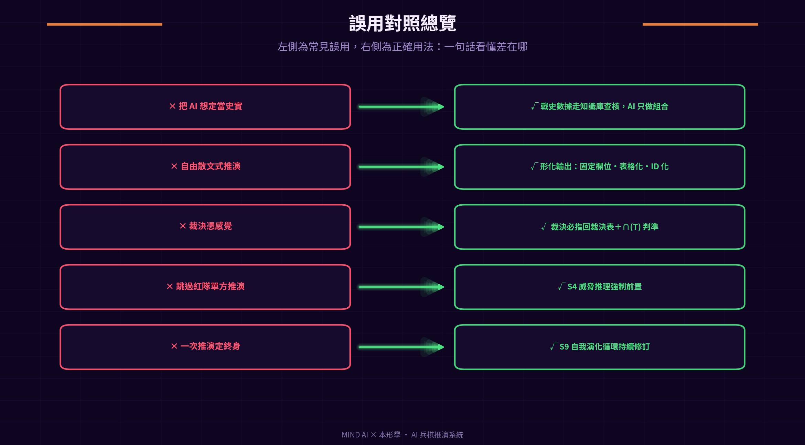

**圖 8-1 誤用對照總覽**

## 8.1 形化誤用對照

| ✗ 誤用 | 後果 | ✓ 正確用法 |
| --- | --- | --- |
| 無形之物直接進推演 | 要素互相黏連、裁決扯皮 | 先過十四形歸類，形先行 |
| 編組當清單不當 SOM | 戰力高估、降級誤判 | 跑結構依存三測試 |
| 威脅歸類憑印象 | 「像」被當「是」 | [ ] 抽象過 ∩(T) 判準 |
| 戰域邊界含糊 | 戰報歸屬爭議 | 邊界三要素：座標＋時限＋管轄 |
| 開新欄不回填 | 舊實體欄位空洞 | 新欄回頭為全部舊實體補值 |

**表 8-1 形化誤用對照**

## 8.2 提示詞誤用對照

| ✗ 誤用 | 後果 | ✓ 正確用法 |
| --- | --- | --- |
| 散文式自由推演 | 輸出不可驗證 | 六段式骨架＋表格化輸出 |
| 佔位不替換就跑 | 假數據混入 | [ ] 佔位逐一替換並檢查 |
| 自檢清單刪掉 | 錯誤長驅直入 | 自檢 5/5 才收貨 |
| 跨工序混用提示詞 | 形約束錯位 | S1–S9 對號入座（表 6-1） |
| 單方立場推演 | 紅隊污染、樂觀偏差 | S4 紅隊先行，禁「我軍應」 |

**表 8-2 提示詞誤用對照**

## 8.3 裁決與評估誤用對照

| ✗ 誤用 | 後果 | ✓ 正確用法 |
| --- | --- | --- |
| 裁決憑感覺 | 同案異判、信任崩壞 | 裁決必指回裁決表＋∩(T) |
| 指標不可回放 | 數字被挑戰即崩 | 指標掛計算式＋證據來源 |
| 一次推演定終身 | 結論過期仍引用 | S9 演化閉環＋待重驗機制 |
| 跳過一致性四重檢查 | 矛盾累積到簡報爆雷 | 每回合跑、每批次抽 |
| 把推演結論當情資 | 決策被虛構污染 | 結論標註證據鏈狀態 |

**表 8-3 裁決與評估誤用對照**

## 8.4 推演主持人誤用對照

| ✗ 誤用 | 後果 | ✓ 正確用法 |
| --- | --- | --- |
| 進度焦慮壓縮形化 | 地基歪一尺 | 時程鐵律：形化不可壓縮（5.7） |
| 自己兼任紅隊 | 確認偏差 | 紅隊席位獨立、先壞人後參謀 |
| 現場改判不走流程 | 裁決威信崩壞 | 例外報裁＋S9 判準修訂 |
| 簡報只放好數字 | 決策被樂觀污染 | 警示門檻全數呈報（簡報第 5 頁） |
| 推完就散不做 AAR | 演化閉環斷鏈 | S8 當日速報、S9 週內入庫 |

**表 8-4 主持人誤用對照**

## 8.5 誤用發現後的復盤流程

發現誤用不是醜聞，隱匿才是。標準復盤五步：

- 止血：標記受污染產出為「待重驗」，暫停引用。

- 定界：沿證據鏈找出污染範圍（哪些結論、哪幾場推演受影響）。

- 歸因：誤用屬於人、手冊、判準還是環境？四類歸因對應四種修復。

- 修復：S9 流程修訂入庫；人員補訓；環境加固。

- 公告：誤用案例匿名化後入教案——別人的錯誤是最好的教材。

# 第 9 章 成熟度模型 L1–L4

## 9.1 成熟度總覽

成熟度模型衡量「單位運用 AI 兵棋推演系統的能力」，分 L1–L4 四級。分級的目的不是評比，而是給出**升級路徑**：每一級都有可檢查的關卡，過關才升級。

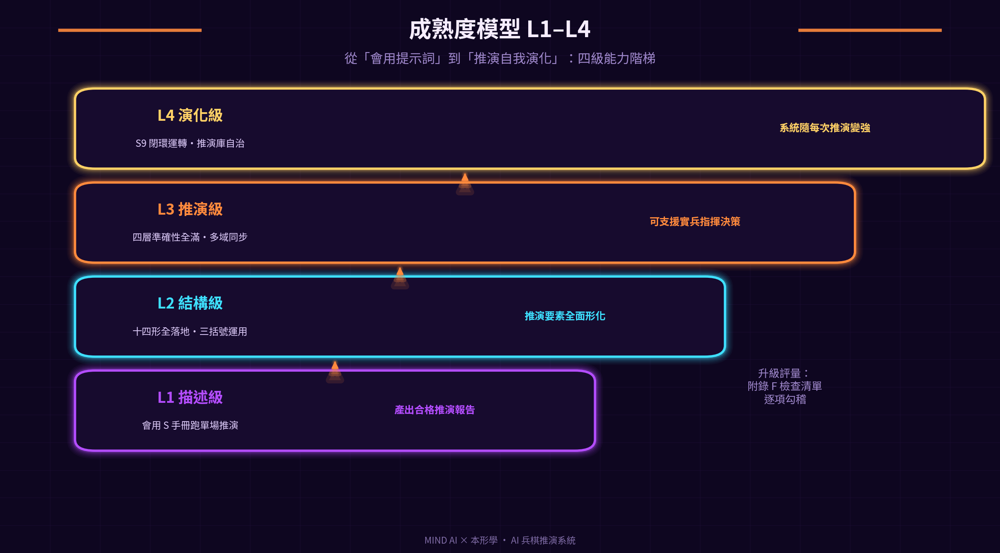

**圖 9-1 成熟度 L1–L4 階梯**

| 級別 | 名稱 | 能力標誌 | 產出水準 |
| --- | --- | --- | --- |
| L1 | 描述級 | 會用 S 手冊跑完一場推演 | 合格推演報告（三關全過） |
| L2 | 結構級 | 十四形全落地、三括號運用熟練 | 推演要素全面形化、證據鏈完整 |
| L3 | 推演級 | 四層準確性全滿、多域同步推演 | 可支援實兵指揮決策參考 |
| L4 | 演化級 | S9 閉環運轉、推演庫自治 | 系統隨每次推演變強 |

**表 9-1 成熟度四級標誌**

## 9.2 各級檢核與升級條件

### L1 描述級 → L2 結構級

- 檢核：連續 3 場推演 S 手冊操作自檢 5/5；速演 SC-X1 三關全過。

- 升級條件：能獨立完成 S1–S3 形化，四檢查一次通過率 ≥ 80%。

### L2 結構級 → L3 推演級

- 檢核：推演抽審——證據鏈完整率 ≥ 95%、一致化回放一致率 100%。

- 升級條件：獨立主持多域推演（S6+S7 並行），四軸指標全部可回放。

### L3 推演級 → L4 演化級

- 檢核：S9 治理四門運作紀錄完整；模式庫命中率持續監測。

- 升級條件：演化提案入庫率 ≥ 60%、推演庫版本治理通過審計門。

## 9.3 評量實施

評量每半年一次，採「文件審查＋現場抽演」雙軌：文件審查看推演產出物規格（表 5-2）與治理紀錄；現場抽演用抽象虛構想定 SC-X1 速演，考驗操作紀律。評量表詳附錄 F。

成熟度的對象是「運用單位」不是「軟體」——軟體再強，操作不形化、裁決無判準，成熟度永遠停在 L1。

## 9.4 各級常見卡關與解法

| 卡關 | 症狀 | 解法 |
| --- | --- | --- |
| L1：自檢過不了 | 每次跑都有欄位缺漏 | 回 6.0 節逐段核對六段式；佔位清單化 |
| L1：裁決被質疑 | 同案異判 | 先補裁決表行號，再跑一致化回放 |
| L2：形化總是返工 | 四檢查通過率低 | 用 2.12 實例法：先攤開再歸形 |
| L2：證據鏈斷 | 結論指不回情報 | S6 流水強制掛情報形ID欄 |
| L3：多域協同亂 | 時序衝突多 | S7 協同時序表先於 S6 推演產出 |
| L3：指標吵不完 | 數字各說各話 | 指標計算式統一入庫、可回放 |
| L4：演化停滯 | 提案都不入庫 | 檢查治理四門是否過嚴；放寬品質門門檻試行 |
| L4：模式庫膨脹 | 低命中模式堆積 | 淘汰門季度執行，退役留目錄 |

**表 9-2 常見卡關與解法**

## 9.5 單位年度推演規畫示例

成熟度要升級，靠的是規畫過的推演量與質。以下年度規畫示例供參：

| 季 | 推演主題 | 級別目標 | 產出 |
| --- | --- | --- | --- |
| Q1 | 基礎課題×2（速推）＋SC-X1 驗收 | 全員 L1 | AAR 速報×2 |
| Q2 | 全層級課題×1（全推）＋灰色地帶專題 | L1→L2 | AAR 報告＋戰例卡×5 |
| Q3 | 多域聯合課題×1＋交通線專題 | L2→L3 | 模式新卡×3＋判準修訂 |
| Q4 | 矩陣批次推演×1＋年度總結演練 | L3→L4 | 年度演化報告＋模式庫治理 |

**表 9-3 年度推演規畫示例**

# 第 10 章 附錄

## 附錄 A 想定卡片（四想定建檔）

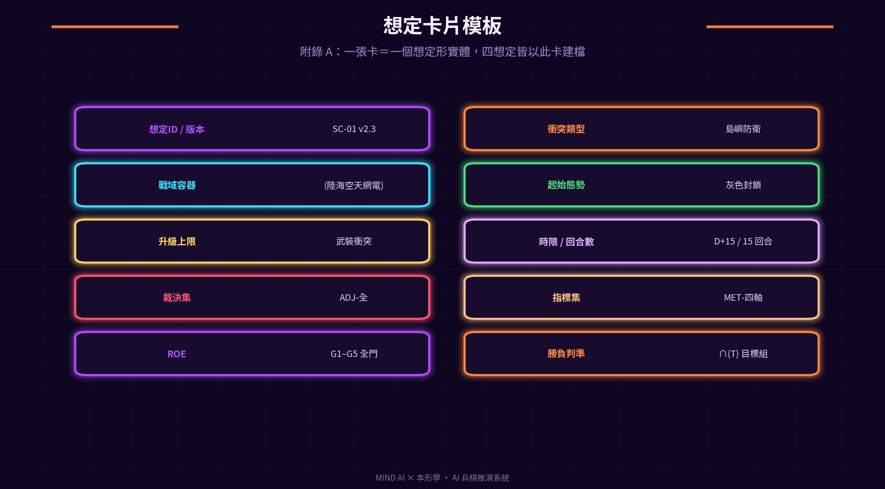

**圖 A-1 想定卡片模板**

| 欄位 | SC-01 島嶼防衛 | SC-02 灰色地帶 | SC-03 海上交通線 | SC-X1 抽象虛構 |
| --- | --- | --- | --- | --- |
| 衝突類型 | 島嶼防衛 | 灰色地帶 | 海上交通線 | 虛構多域對抗 |
| 戰域容器 | 六子域（演練一） | 近岸混合域 | 航線節點鏈 | 虛構戰區 M |
| 起始態勢 | 灰色封鎖 | 低強度摩擦 | 破交襲擾 | 均衡對峙 |
| 升級上限 | 武裝衝突 | 準軍事 | 區域拒止 | 自訂 |
| 時限 | D+15 | D+90 | D+30 | 10 回合 |
| 裁決集 | ADJ-全 | ADJ-灰 | ADJ-海 | ADJ-教 |
| 指標集 | MET-四軸 | MET-灰 | MET-後勤 | MET-教 |
| 勝負判準 | ∩(T) 目標組 | ∩(T) 歸因組 | ∩(T) 維持組 | ∩(T) 教學組 |

**表 A-1 四想定建檔總表**

## 附錄 B 裁決表彙編（節錄）

| 裁決表 | 適用 | 判決軸 | 節錄例 |
| --- | --- | --- | --- |
| ADJ-交戰 | 戰術交戰 | 攻方×防方×地形×天候 | 機械化×塹壕×雨→命中 0.42 |
| ADJ-機動 | 部隊機動 | 部隊×地形×節奏 | 機械化×平原/高速→1 回合到位 |
| ADJ-後勤 | 補給消耗 | 編制×活動強度 | JTF-K 全攻→日耗油 ×1.6 |
| ADJ-電戰 | 電子對抗 | 干擾×感測 | 強干擾×老式雷達→降級 0.5 |
| ADJ-灰 | 灰色地帶 | 合法性×歸因×可逆性 | 海警×存疑→不得升階 |
| ADJ-海 | 海上交通線 | 航路×護航×威脅密度 | 隘口×輕護航→截獲 0.35 |

**表 B-1 裁決表彙編**

| 表行 | 攻方 | 防方 | 條件 | 判決 |
| --- | --- | --- | --- | --- |
| 交戰#37 | 戰機×4 | 戰機×2 | 我電磁優勢 | 紅損2/我損0 |
| 交戰#41 | 艦隊×1 | 反艦飛彈陣 | 無制空 | 攻方損傷 40% |
| 交戰#55 | 無人機群 | 防空群 | 飽和×夜間 | 防方攔截 0.55 |
| 機動#12 | 機械化營 | 河川地 | 雨季 | 到位 +6h |
| 後勤#08 | JTF-K | 補給線中斷 | 累計 3 日 | 維持天數 -4 |
| 電戰#12 | 強干擾 | 老式雷達 | 持續 2h | 識別降級 0.5 |

**表 B-2 裁決表典型判決節錄（示意值）**

完整裁決表數值依各單位戰史與裝備庫校準後入庫；表中數值為示意值，正式推演必須使用校準版。

## 附錄 C 術語對照表

| 中文 | 英文 | 說明 |
| --- | --- | --- |
| 形 | Type | 本形學核心概念；本書不使用 Form |
| 想定形 | ScenarioType | 推演整體設定的形 |
| 戰場形 | BattleSpaceType | 戰域容器的形 |
| 兵力形 | ForceType | 編制與戰力的形 |
| 威脅形 / 目標形 | ThreatType / ObjectiveType | 威脅類別與勝負判準的形 |
| 行動形 / 資源形 | ActionType / ResourceType | 作戰作為與後勤預算的形 |
| 準則形 / 指揮形 | RuleType / CommandType | ROE 與授權鏈的形 |
| 情報形 / 事件形 | IntelType / EventType | 證據與時序觸發的形 |
| 裁決形 / 指標形 / 戰例形 | AdjudicationType / MetricType / LessonType | 判定、評估、學習的形 |
| 交集判準 | ∩(T) | 可判定的類別/裁決規則 |
| 物料清單 / 空間清單 | BOM / SOM | 組成清單 / 結構依存組成 |
| 形驅動推演 | TDDW (Type-Driven Wargaming) | 本書方法論 |
| 行動方案 | COA (Course of Action) | 藍隊方案單位 |
| 推演後檢討 | AAR (After Action Review) | 評估工序 |
| 判斷-決策週期 | OODA | 觀-判-決-動 |
| 戰爭矩陣 | WarMatrix | GE26 啟用的美軍 AI 兵推系統（參照） |

**表 C-1 術語對照表**

## 附錄 D 十四形速查卡

| 組 | 形 | 一句話定義 | 括號 |
| --- | --- | --- | --- |
| 情境 | 想定形 | 推演的表頭與邊界 | — |
| 情境 | 戰場形 | 東西在哪裡（容器） | ( ) |
| 情境 | 事件形 | 時序節點上的觸發器 | — |
| 情境 | 準則形 | 合法的門檻 G1–G5 | — |
| 力量 | 兵力形 | 由什麼組成（結構） | { } |
| 力量 | 威脅形 | 是不是這一類 | [ ] |
| 力量 | 資源形 | 打得起嗎（守恆） | — |
| 力量 | 指揮形 | 誰能拍板（授權鏈） | — |
| 行動 | 目標形 | 怎樣算贏（∩(T) 組） | [ ] |
| 行動 | 行動形 | 做什麼（四約束） | — |
| 行動 | 情報形 | 憑什麼信（來源等級） | — |
| 裁決 | 裁決形 | 這一仗怎麼判（表行號） | — |
| 裁決 | 指標形 | 整場怎麼量（可回放） | — |
| 裁決 | 戰例形 | 下次怎麼更強（複用） | — |

**表 D-1 十四形速查卡**

| 速問 | 判斷對象 | 括號 |
| --- | --- | --- |
| 它在哪裡？身分不隨內容變？ | 容器判斷 | ( ) |
| 拿掉部件，整體還一樣嗎？ | SOM 結構依存判斷 | { } |
| 新東西算不算這一類？ | 抽象 ∩(T) 判斷 | [ ] |
| 這句話在說位置、結構、還是類別？ | 語句類型判別 | 三括號擇用 |

**表 D-2 三括號速問表**

## 附錄 E S 手冊速查索引

| 工序 | 一句話 | 輸出 | 常見失敗 |
| --- | --- | --- | --- |
| S1 | 建想定與變體 | 想定包 | 變體無效差異 |
| S2 | 切戰域容器 | 戰域表 | 邊界不可判定 |
| S3 | 編兵力 BOM/SOM | 編組表 | 清單當結構 |
| S4 | 紅隊研判 | 研判書 | 紅隊污染 |
| S5 | 藍隊 COA | 方案集 | 努力當方案 |
| S6 | 對抗裁決 | 裁決流水 | 裁決無表行號 |
| S7 | 多域協同 | 協同時序表 | 連鎖無備案 |
| S8 | AAR 評估 | AAR 報告 | 指標不可回放 |
| S9 | 自我演化 | 入庫清單 | 改版不留痕 |

**表 E-1 S 手冊速查索引**

| 提示詞關鍵詞 | 作用 | 出處 |
| --- | --- | --- |
| 〔想定ID〕〔戰域名〕 | 佔位替換：實際值 | 全 S 手冊 |
| ∩(T) 五要素 | 判準注入標準 | S1/S4/S6 |
| 結構依存三測試 | SOM 判決 | S3 |
| 欺敵警示 | 紅隊必產欄位 | S4 |
| 四約束 | 行動形合格線 | S5/S7 |
| 一致化三律 | 裁決稽核 | S6 |
| 自檢 5/5 | 輸出收貨線 | 全 S 手冊 |
| 治理四門 | 入庫檢查 | S9 |

**表 E-2 提示詞關鍵詞彙表**

## 附錄 F 推演檢查清單（L1–L4 評量表）

| # | 檢查項 | 判定 | 級別 |
| --- | --- | --- | --- |
| 1 | 想定卡欄位齊全、∩(T) 五要素俱全 | □通過 □退回 | L1 |
| 2 | S 手冊六段式完整、自檢 5/5 | □通過 □退回 | L1 |
| 3 | 速演 SC-X1 三關全過 | □通過 □退回 | L1 |
| 4 | 十四形歸類無「無形之物」 | □通過 □退回 | L2 |
| 5 | 四檢查一次通過率 ≥ 80% | □通過 □退回 | L2 |
| 6 | 證據鏈完整率 ≥ 95% | □通過 □退回 | L2 |
| 7 | 一致化回放一致率 100% | □通過 □退回 | L3 |
| 8 | 多域同步率 ≥ 70% | □通過 □退回 | L3 |
| 9 | 四軸指標全部可回放 | □通過 □退回 | L3 |
| 10 | S9 治理四門紀錄完整 | □通過 □退回 | L4 |
| 11 | 演化提案入庫率 ≥ 60% | □通過 □退回 | L4 |
| 12 | 推演庫版本通過審計門 | □通過 □退回 | L4 |

**表 F-1 推演檢查清單**

| 評量紀錄欄 | 填寫內容 | 評量紀錄欄 | 填寫內容 |
| --- | --- | --- | --- |
| 受評單位 |   | 評量日期 |   |
| 評量方式 | □文件審查 □現場抽演 | 抽演想定 | SC-X1＿＿ |
| 通過項數 | ＿／12 | 判定級別 | □L1 □L2 □L3 □L4 |
| 主要缺口 |   | 升級建議 |   |
| 評量官簽核 |   | 單位主管簽核 |   |

**表 F-2 評量紀錄表**

## 附錄 G 戰例庫與簡報模板

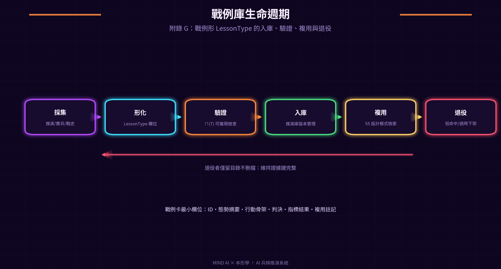

**圖 G-1 戰例庫生命週期**

戰例卡最小欄位：ID・態勢摘要・行動骨架・判決・指標結果・複用註記。戰例庫治理與 S9 治理四門共用規則；退役戰例僅留目錄不刪檔，維持證據鏈完整。

| 欄位 | 範例內容 |
| --- | --- |
| 戰例ID/版本 | LS-023 v1 |
| 態勢摘要 | 電磁權劣勢下遂行防空壓制（SC-01 派生） |
| 行動骨架 | PT-007 扇形掃蕩改寫：干擾扇角 15°→12° |
| 判決 | 突防率 +18%；誤擊風險 +0.05（G1 複核通過） |
| 指標結果 | 目標達成 +0.21；資源效率 0.80 |
| 複用註記 | 適用：電磁均勢以上、地形破碎區；失效：機動雷達 >40% |

**表 G-2 戰例卡範本（示例）**

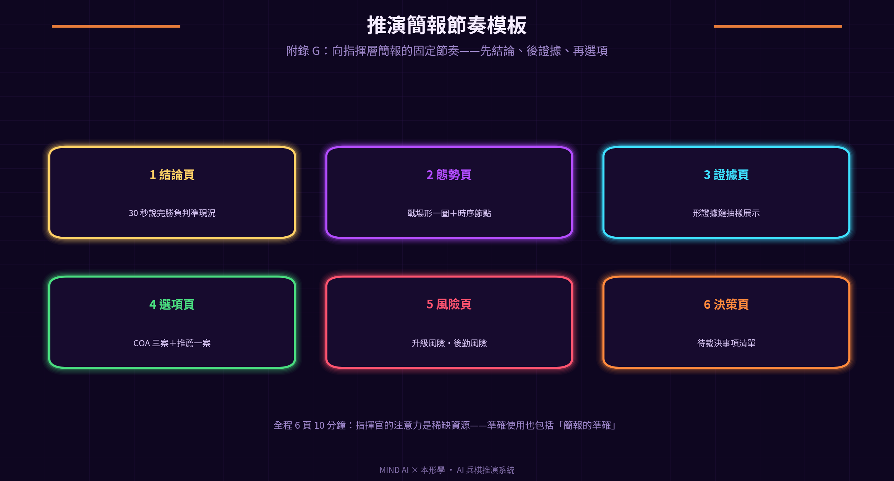

**圖 G-2 推演簡報節奏模板（6 頁 10 分鐘）**

簡報鐵律：**先結論、後證據、再選項**。指揮官的注意力是稀缺資源——準確使用也包括「簡報的準確」。

### 指揮官簡報問答庫

簡報必被問的十個問題，答案要練到不假思索——每個答案都能在三步內指回證據鏈：

| # | 必問問題 | 標準答法骨架 |
| --- | --- | --- |
| 1 | 這個數字怎麼來的？ | 指標計算式＋證據 ID（三步回溯） |
| 2 | 紅方最強的一手是什麼？ | S4 最優解＋穩健性區間 |
| 3 | 我們最脆弱的點？ | SOM 結構依存判決＋風險指標 |
| 4 | 如果前提錯了呢？ | 前提清單＋推翻影響欄 |
| 5 | 升級到下一階的門檻？ | 升級階梯＋臨界線判準 |
| 6 | 後勤撐得住嗎？ | 維持天數＋航次結算表 |
| 7 | 為什麼不用另一案？ | COA 對比估值＋修剪理由 |
| 8 | 什麼時候重新推演？ | 待重驗清單＋觸發條件 |
| 9 | 盟友/外援何時到？ | 時序節點＋容差 |
| 10 | 最大不確定性是什麼？ | 穩健區間跨 1 的項目清單 |

**表 G-1 指揮官簡報問答庫**

## 附錄 H 想定變體生成規則庫

| 變體軸 | 旋鈕 | 效果 | 常用工序 |
| --- | --- | --- | --- |
| 起始態勢 | 均衡／先制／奇襲／誤判 | 掃過初始條件敏感度 | S1 |
| 升級上限 | 準軍事／有限武裝／全面 | 掃過升級管控能力 | S1/S4 |
| 時限 | D+n 縮放 | 掃過節奏韌性 | S1/S6 |
| 戰域 | 主戰域換軸 | 掃過地理敏感度 | S2 |
| 兵力 | 增減 20% 節點件 | 掃過結構依存脆弱點 | S3 |
| 後勤 | 維持天數 ×0.7/×1.3 | 掃過後勤韌性 | S3/S6 |
| 電磁權 | 優勢／均勢／劣勢 | 掃過感測脆弱度 | S6/S7 |
| 盟友介入 | 早／晚／無 | 掃過外援依賴度 | S7 |

**表 H-1 想定變體生成規則庫**

變體生成規則：**每次推演只扭 1–2 個旋鈕**。一次扭太多，結果歸因困難——你不會知道是哪個旋鈕改變了勝負。

| 禁忌組合 | 問題 | 替代做法 |
| --- | --- | --- |
| 升級上限＋時限同調 | 雙變數混雜 | 先固定時限掃升級，再反之 |
| 兵力±20%＋後勤同時改 | 戰力歸因失真 | 兵力軸優先，後勤另場 |
| 起始態勢＋戰域同換 | 空間與時間效應混淆 | 一場一軸，分場掃描 |
| 全旋鈕極值（壓力測試） | 結果不具決策意義 | 極值場僅供韌性測試，結論另標 |

**表 H-2 變體組合禁忌**

## 附錄 I 演練紀錄空白表單

以下表單供推演現場手填或系統匯出，欄位與本書規格一致；影印本可直接帶上推演席。

| 欄位 | 填寫內容 | 欄位 | 填寫內容 |
| --- | --- | --- | --- |
| 推演編號 |   | 想定ID/版本 |   |
| 日期/時段 |   | 主持人 |   |
| 紅隊長 |   | 藍隊長 |   |
| 裁決官 |   | 評估官 |   |
| 推演問題 |   | 成功判準 |   |
| 使用工序 | □S1 □S2 □S3 □S4 □S5 □S6 □S7 □S8 □S9 | 自檢通過率 | ＿/5 |

**表 I-1 推演紀錄表頭**

| 節點 | 事件/行動 | 裁決（表行號） | 狀態變更 | 證據ID |
| --- | --- | --- | --- | --- |
|   |   |   |   |   |
|   |   |   |   |   |
|   |   |   |   |   |
|   |   |   |   |   |
|   |   |   |   |   |
|   |   |   |   |   |

**表 I-2 裁決流水空白表**

| 軸 | 指標 | 數值 | 門檻 | 紅/黃/綠 | 證據 |
| --- | --- | --- | --- | --- | --- |
| 目標達成 |   |   |   |   |   |
| 戰力比 |   |   |   |   |   |
| 風險 |   |   |   |   |   |
| 節奏 |   |   |   |   |   |
| 覆盤三問 | ①判斷出錯處： |   | ②前提不成立處： |   | ③判準要修處： |

**表 I-3 AAR 指標與覆盤空白表**

## 附錄 J 參照與說明

- 參照案例：美國空軍於代號 GE26 兵棋推演活動首次啟用人工智能兵棋推演系統「戰爭矩陣 WarMatrix」。本書以其公開揭示的定位作為對標基準（見 1.2 節）；相關細節以各單位取得之正式資料為準。

- 理論基礎：本形學（Ontypology）空間本形篇、時間本形篇。本書僅載運用，不重述理論原文。

- 平台基礎：Mind AI（Mind Model 演繹推理 × LLM 歸納統計）。本書聚焦準確使用方法，不含系統實作。

- 譯名約定：「形」之英文一律為 Type，不使用 Form。

- 虛構聲明：書中演練想定（SC-01/02/03/X1）與一切兵力、數值、事件均為虛構推演示範，不指向現實情資。

| 版本 | 日期 | 修訂內容 | 修訂人 |
| --- | --- | --- | --- |
| v1.0 | 2026-10 | 初版發行 | Mind AI 推演方法組 |
|   |   |   |   |
|   |   |   |   |

**表 J-1 文件修訂紀錄**

本書的最終目標只有一句話：**讓 AI 兵棋推演的每一個結論，都經得起「你怎麼知道」這個問題。**

## 附錄 K 快速入手三日計畫

第一次使用本系統的單位，依以下三日計畫即可跑出合格的第一場推演。計畫設計原則：**先跑通、再跑多、後跑大**——不要第一天就想跑矩陣推演。

| 日 | 目標 | 作業 | 產出 | 驗收 |
| --- | --- | --- | --- | --- |
| 第 1 日 | 讀懂＋試跑 | 讀第 1–2 章；試跑 S1（小想定） | 試驗想定卡 2 張 | ∩(T) 五要素齊全 |
| 第 2 日 | 全流程走一遍 | S2–S8 走完（速演 SC-X1） | 速演 AAR | 三關全過 |
| 第 3 日 | 演練＋檢討 | 演練一縮編版＋S9 演化提案 | 入庫清單＋檢討表 | 自檢 5/5 全過 |

**表 K-1 快速入手三日計畫**

- 第一場推演的規模建議：4–6 回合、單一戰域、紅方 COA 2 案——小，但形、判準、證據鏈一樣都不能少。

- 失敗預案：速演三關不過，回 6.0 節對照表逐一修正提示詞操作，不怪模型、不跳步驟。

- 第二場起：加入變體（扭一個旋鈕），體驗批次化；第三場起導入演練一全版。

至此，你已掌握 AI 兵棋推演系統的完整準確使用方法：空間本形把戰場切乾淨，時間本形把變化推明白，TDDW 八步驟把流程走紮實，S1–S9 手冊把操作變可複製，四層準確性保證把結論變可信——剩下的，就是開始推演、開始演化、開始變得更強。

[www.longreat.net](http://www.longreat.net)

張長豐 [gamma@livemail.tw](mailto:gamma@livemail.tw)

張楟潁 [mindaiworks@gmail.com](mailto:mindaiworks@gmail.com)
