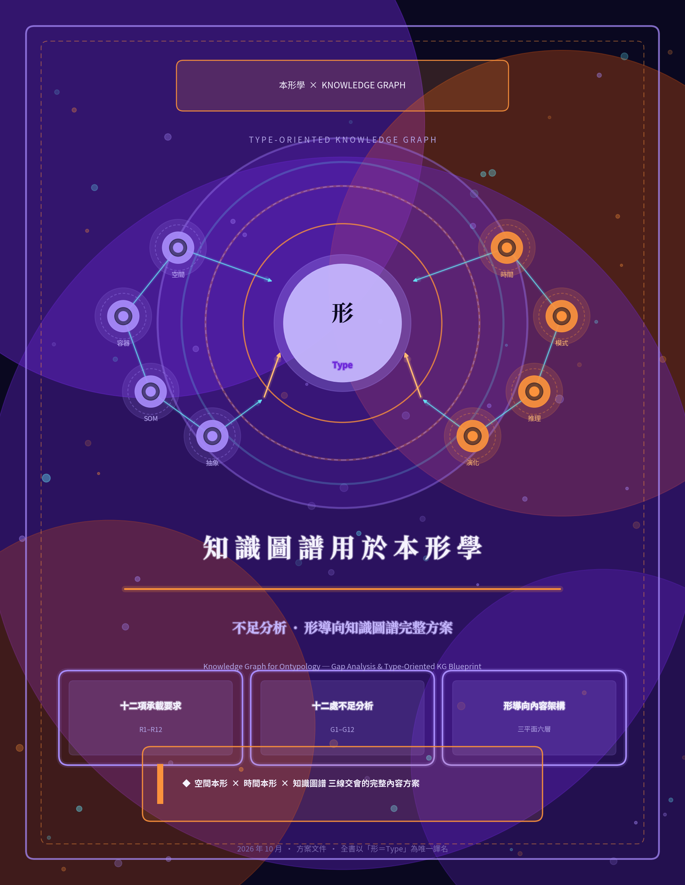

# 文件說明

本文件是「知識圖譜（Knowledge Graph）用於本形學」的完整方案書，全書聚焦兩大任務：其一，系統性分析傳統知識圖譜在承載空間本形與時間本形時的不足之處（G1–G12）；其二，提出一套完整的內容方案——形導向知識圖譜（Type-Oriented Knowledge Graph，以下簡稱 TOKG）的內容架構，涵蓋三平面六層、空間形域、時間形域、判準層、證據層、查詢模式庫、推理規則庫與治理規範。

> **▣ 編輯約定：本文件只「應用」本形學術語、不重述理論內容；「形」的英文一律用 Type；書中不涉及系統實作；亦不設補強方案章節——不足之處直接以第 5–10 章的完整內容架構回應。**

本書的寫作對象是需要為知識密集領域建立知識圖譜的規劃者、架構者與治理者。讀者只需熟悉本形學的基礎語彙——形（Type）、異同與分合、屬性與屬性值、空間容器、BOM／SOM、框架、三括號 ( ) { } [ ]、∩(T) 判準、時間本形的搜尋／推理／設計模式／自我演化——即可順暢閱讀；書中出現的一切理論名詞均視為既定語彙直接使用，不再展開解釋。

## 本書的三個主張

1. **承載要求先行。**知識圖譜不是「先建起來再看能存什麼」，而是先立定知識承載要求（R1–R12），再逐一檢驗技術選型。本書第 1 章即交付這份要求清單。
2. **不足要指名道姓。**「知識圖譜不夠用」必須落實到具體缺口（G1–G12）：哪一個構件缺位、造成什麼知識後果。第 2–4 章以三章篇幅完成這份缺口清冊。
3. **完整方案換底座。**面對十二處缺口，逐點補丁只會把圖譜越補越亂；正確的回應是換一套以形為核心的內容架構。第 5–10 章交付的 TOKG 三平面六層即是這套底座。

## 章節導航

| 篇章 | 章節 | 回答的問題 |
| --- | --- | --- |
| 分析篇 | 第 1 章　緒論：知識圖譜與本形學的交會 | 為什麼要建？拿什麼檢驗？ |
| 分析篇 | 第 2 章　不足處分析Ⅰ：空間本形 | 傳統圖譜在「形的空間面」缺什麼？ |
| 分析篇 | 第 3 章　不足處分析Ⅱ：時間本形 | 傳統圖譜在「形的時間面」缺什麼？ |
| 分析篇 | 第 4 章　不足處分析Ⅲ：查詢・推理・治理 | 系統性不足與總評分 |
| 方案篇 | 第 5 章　TOKG 設計原則與總體架構 | 底座長什麼樣？ |
| 方案篇 | 第 6–8 章　空間形域・時間形域・判準證據層 | 六層的內容怎麼設計？ |
| 方案篇 | 第 9 章　查詢模式庫與推理規則庫 | 圖譜怎麼問、怎麼推？ |
| 方案篇 | 第 10 章　生命週期與治理規範 | 內容怎麼管才不出事？ |
| 應用篇 | 第 11–12 章　領域示例與結語 | 換個領域還成立嗎？最終圖景？ |
| 附錄 | 附錄 A–E | Schema 總表・對應索引・速查卡・術語表・索引 |

# 第 1 章　緒論：知識圖譜與本形學的交會

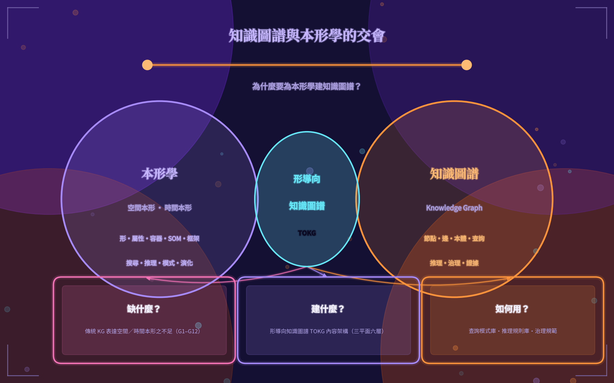

**圖 1-1　知識圖譜與本形學的交會：三線問題意識**

知識圖譜是當代知識工程的主流答案：把知識拆成節點與邊，讓機器可以查詢、可以推理、可以不斷擴充。本形學則給出知識的「形狀」：空間本形告訴我們，任何東西都長在形上——形是共用的問題清單，實體是填值的結果；時間本形告訴我們，知識不只是名詞，還包括搜尋、推理、設計、重構這些「會發生的形」。當兩者交會，一個自然的問題浮上檯面：用知識圖譜承載本形學，夠用嗎？

本書的回答分兩段：先說不夠——而且不夠得很具體，共有十二處（G1–G12）；再說怎麼才夠——一套換掉底座的完整內容方案。本章先立定檢驗的基準：本形學對知識承載的十二項要求（R1–R12），並交代分析方法與全書結構。

## 1.1　為什麼此刻需要為本形學建知識圖譜

本形學的產出已經從「概念」走向「方法」：空間本形給出屬性、容器、BOM／SOM、框架四步驟、三括號與 RDB 映射這條完整的描述鏈；時間本形給出形時間函式搜尋、設計搜尋與萃取、設計模式、邏輯生成、推理、思考法、重構與自我演化這條完整的活動鏈。這兩條鏈若只活在文件裡，就無法被機器檢索、被團隊共用、被審計追責。

知識圖譜正是「讓理論成為可操作知識」的載體。但載體有自己的世界觀——三元組、本體、分類推理——這個世界觀與「形」的世界觀並不重合。把理論直接倒進標準圖譜，形會被降級、時間會被切片、判準會被架空。這就是本書存在的理由：在建圖之前，先弄清楚圖譜必須承載什麼。

- **知識沉澱的需要：**領域知識（設計案例、推理過程、模式卡）需要一個可累積、可檢索的家。
- **準確使用的需要：**沒有承載要求與判準的圖譜，會把「大概對」的知識和「驗證過」的知識混為一談。
- **跨域複用的需要：**同一套形的語彙要能套進 IC 設計、機械設計、中醫等不同領域，圖譜架構必須領域中立。
- **演化留痕的需要：**知識會長大——新增欄、重構、自我演化——每一次長大都必須被記錄與解釋。

## 1.2　知識圖譜的基本形貌

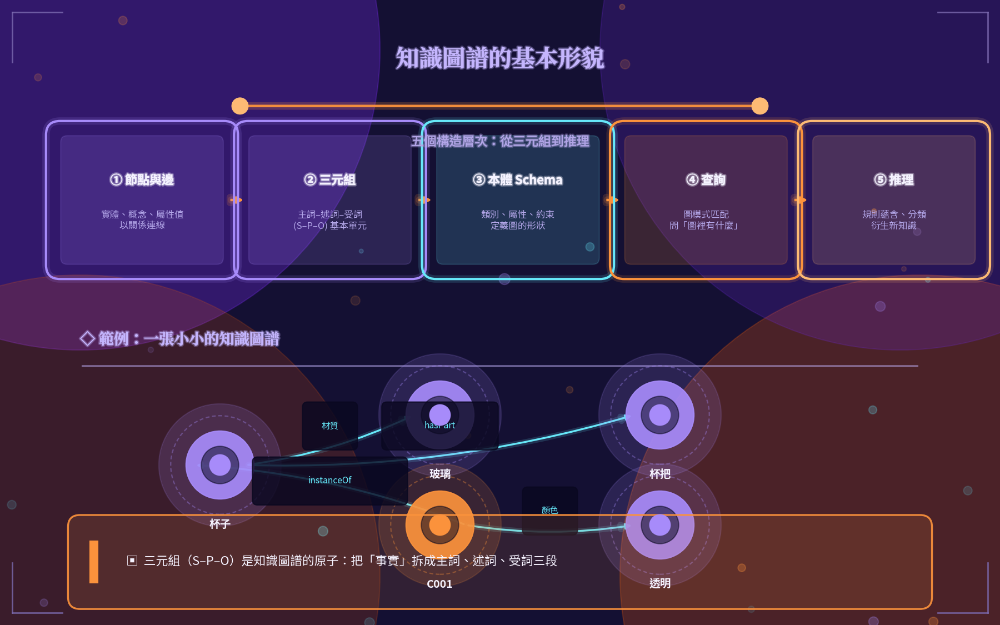

**圖 1-2　知識圖譜的五個構造層次**

為避免術語落差，先用一張圖與一段話把知識圖譜的基本形貌釘牢。知識圖譜由五個構造層次組成：最底層是**節點與邊**——把世界切成「東西」與「東西之間的關係」；往上是**三元組**（主詞–述詞–受詞），它是知識圖譜的原子事實；再往上是**本體 Schema**，定義類別、屬性與約束，決定這張圖「合法的形狀」；最上兩層是**查詢**與**推理**——查詢讓使用者問「圖裡有什麼」，推理讓機器從既有邊衍生新邊。

這五個層次就是本書的「對照組」。第 2–4 章的每一處不足，都會指明是哪一個層次、用現行機制處理本形學的哪一項需求時失靈；第 5 章以後的 TOKG，則會說明新架構在同一個位置放了什麼構件。

| 構造層次 | 標準做法 | 本書的追問 |
| --- | --- | --- |
| 節點與邊 | 實體、概念、屬性值一律是節點 | 形（表頭）與實體（資料列）能分層嗎？ |
| 三元組 | S–P–O 原子事實 | 「屬性是問題」這種兩層次結構壓得進三段式嗎？ |
| 本體 Schema | 類別階層與屬性定義 | 新增欄（形層演化）有協定嗎？ |
| 查　　詢 | 圖模式匹配 | 能問「形怎麼展開」嗎？ |
| 推　　理 | 分類蘊含、規則推導 | ∩(T) 判準在推理裡有位置嗎？ |

## 1.3　本形學對知識承載的十二項要求

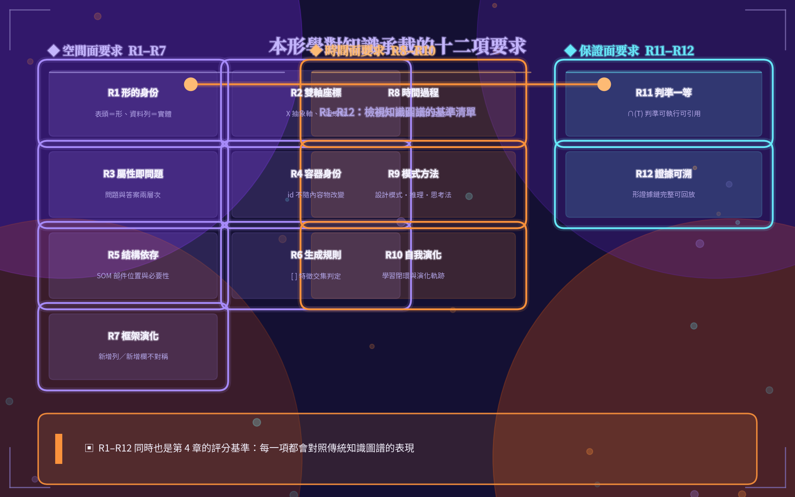

**圖 1-3　十二項承載要求：空間面・時間面・保證面**

本書把本形學對知識載體的要求，收斂成十二項承載要求（Requirements for Knowledge Carrying, R1–R12）。它們分三面：空間面 R1–R7 來自空間本形——形的身份、雙軸座標、屬性即問題、容器身份、結構依存、生成規則、框架演化；時間面 R8–R10 來自時間本形——時間過程、模式方法、自我演化；保證面 R11–R12 是橫跨兩者的正確性要求——判準一等、證據可溯。

| 編號 | 要求 | 一句話展開 | 理論出處（語彙） |
| --- | --- | --- | --- |
| R1 | 形的身份 | 形與實體各有獨立身份，形懸於實體之上 | 表頭＝形、資料列＝實體 |
| R2 | 雙軸座標 | 每筆知識可定位到抽象軸與組成軸 | X 軸抽象、Y 軸組成 |
| R3 | 屬性即問題 | 屬性是問題、屬性值是答案，兩層次不得壓平 | 屬性／屬性值 |
| R4 | 容器身份 | 容器擁有不隨內容物改變的身份 | 空間容器 ( )、id(C) 不變 |
| R5 | 結構依存 | 部件有位置、有必要性、有依存關係 | SOM { }、BOM |
| R6 | 生成規則 | 抽象集合是一條能斷新成員的規則 | 抽象 [ ]、特徵交集 |
| R7 | 框架演化 | 新增列／新增欄的不對稱必須被建模 | 框架四步驟 |
| R8 | 時間過程 | 搜尋、推理、設計、重構皆是一等知識 | 時間本形各活動 |
| R9 | 模式方法 | 設計模式、推理五型、思考法可檢索可重用 | 設計模式／推理／思考法 |
| R10 | 自我演化 | 學習閉環與演化軌跡原生記錄 | 自我演化、持續學習 |
| R11 | 判準一等 | ∩(T) 判準可執行、可引用、可否證 | 交集判準 ∩(T) |
| R12 | 證據可溯 | 每條知識綁定來源、驗證與責任 | 形證據鏈 |

> **◆ R1–R12 是全書的檢驗基準：第 2–4 章用它評分傳統知識圖譜，第 5–10 章用它驗收 TOKG 內容架構——同一把尺，量兩端。**

## 1.4　分析方法與章節導航

本書的分析方法是「要求對照法」：以 R1–R12 為行、以現行知識圖譜技術（RDF／OWL 本體圖譜、屬性圖、時序知識圖譜）為列，逐一檢驗承載能力，把失靈處命名為缺口 G1–G12，再把每一個缺口對應到 TOKG 的一個構件，形成「缺口→構件」的封閉索引（附錄 B 收錄完整對照表）。

| 缺口 | 名稱 | 面 | 對應的 TOKG 構件（章節） |
| --- | --- | --- | --- |
| G1 | 形降級 | 空間 | 形層 Type Layer（6.1） |
| G2 | 類實體鴻溝 | 空間 | 形／例雙層協定（6.1–6.2） |
| G3 | 容器失語 | 空間 | 容器節點＋不變性公理（6.3） |
| G4 | 結構扁平 | 空間 | SOM 依存邊型（6.3） |
| G5 | 問答錯位 | 空間 | 屬性＝問題節點（6.1） |
| G6 | 座標缺失 | 空間 | 雙軸標注 XY-Anchor（6.4） |
| G7 | 生成靜態 | 空間 | 生成規則節點（8.2） |
| G8 | 時間降維 | 時間 | 時間形域 Episode（7.1） |
| G9 | 過程無形 | 時間 | Pattern／Trace／Method（7.2） |
| G10 | 動詞靜態 | 時間 | 活動節點＋軌跡（7.1–7.2） |
| G11 | 演化無痕 | 時間 | 版本三件套（7.4） |
| G12 | 判準缺位 | 保證 | 判準層 Criterion Layer（8.1） |

章節安排上，第 2–4 章是分析篇，第 5–10 章是方案篇，第 11–12 章是應用篇與結語。若時間有限，建議至少讀完第 1 章（基準）、第 4 章 4.5（總評分）與第 5 章（架構總覽），即可掌握全書脈絡。

# 第 2 章　不足處分析Ⅰ：知識圖譜表達空間本形的不足

本章逐一檢驗空間面的七項承載要求（R1–R7）。每一節的結構一致：先說本形學在這一項要求上的「形狀」，再看傳統知識圖譜給出的「形狀」，最後指明知識後果，並把它命名為一個缺口（G1–G7）。

## 2.1　G1 形降級：三元組把形壓成標籤

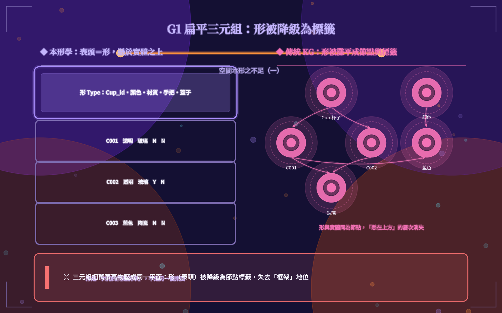

**圖 2-1　形被降級為節點標籤的對照**

R1 要求形懸於實體之上：表頭是一組共用的問題清單，資料列是套用這組清單後的填值結果。表頭不屬於任何一列，卻支配所有列。傳統知識圖譜的做法是把萬事萬物都建成節點——「杯子」是節點、「C001」是節點、「玻璃」也是節點——然後用邊把們連起來。表面上什麼都表達了，實際上**形的「懸空支配」地位消失了**：Cup 類節點與 C001 實體節點在圖結構上是同級公民，「一組共用問題清單」這個層次在三元組世界裡沒有對應物。

知識後果是雙重的：其一，「所有實體共用同一套欄位」這個不變式無處書寫，圖譜無法阻止某些實體長出別的實體沒有的邊；其二，「形先於實體」的生成順序被抹平，讀圖的人無法分辨哪些節點是框架、哪些是內容。這就是 G1 形降級。

## 2.2　G2 類／實體鴻溝：二分法裝不下形的演化

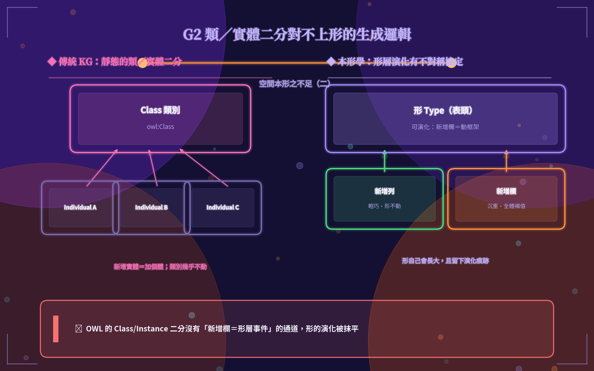

**圖 2-2　靜態類／實體二分 vs. 形層演化協定**

OWL 世界觀把知識切成 Class 與 Individual 兩種存在，這與「表頭／資料列」的區分看似對應，實則有一道關鍵鴻溝：**本形學的形是會長大的**。框架四步驟描述了形如何被「逼」出新維度——當一批新差異與既有維度全部對不上，就必須開新欄位，而且所有既有實體都要跟著補值。這個「新增欄」事件在 OWL 裡只是改一下 class 的 property 定義，沒有版本、沒有觸發原因、沒有全體補值的義務宣告。

更深一層看，「新增列輕巧、新增欄沉重」的不對稱性（R7）在類／實體二分裡根本無法建模：加一個 individual 是日常操作，改一個 class 是罕見操作，但圖譜並不會把後者標記為「形層事件」並走協定。於是形的演化史被壓成匿名的 schema 變更。這就是 G2 類實體鴻溝。

## 2.3　G3 容器失語：身份不變性無處安放

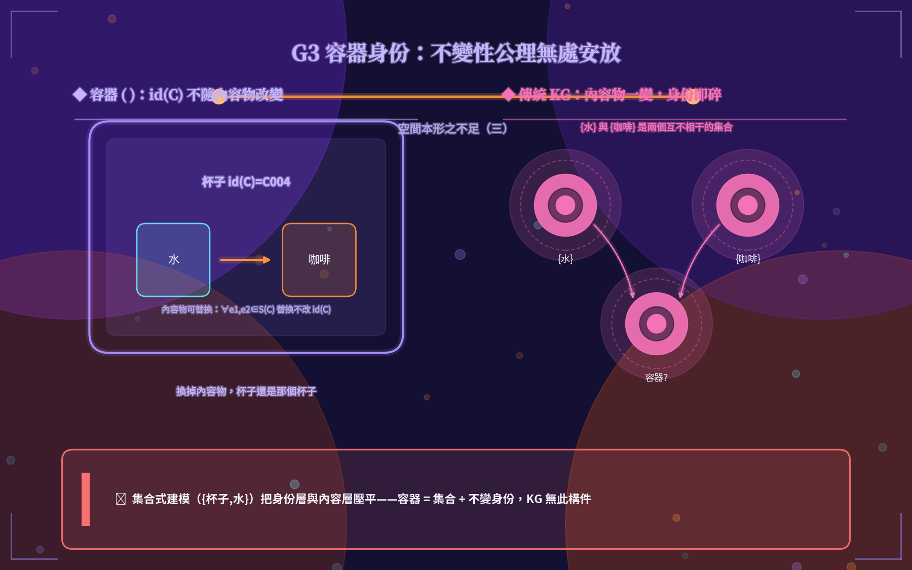

**圖 2-3　容器的身份獨立性缺口**

空間容器的核心是身份獨立性：杯子今天裝水、明天裝咖啡，杯子還是那個杯子——形式化地說，∀e1,e2∈S(C)，替換內容物不改變 id(C)。用集合論建模做不到這件事：{水} 與 {咖啡} 是兩個不同的集合，沒有任何一個「容器」撐住身份。標準知識圖譜同樣做不到：把容器建成節點後，容器與內容物是同級的節點，**「內容物可替換而身份不變」沒有任何邊型可以承載**；若把內容物建成容器的屬性值，則「內部空間本身是一個可清空、可替換的集合」又被壓成槽位。

知識後果：描述「同一台設備換過三批料」「同一個診所換過三組醫師」這類「身份恆定、內容流變」的知識時，圖譜只能不斷複製新節點，把同一個身份的延續性切成互不相干的碎片。這就是 G3 容器失語。

## 2.4　G4 結構扁平：part-of 無序，依存失語

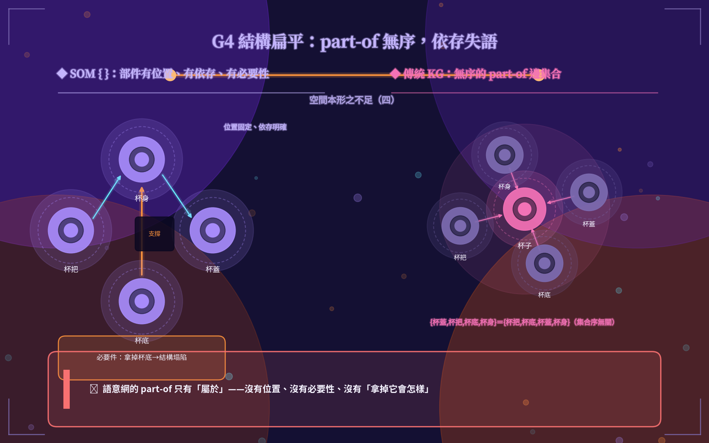

**圖 2-4　SOM 的依存結構與 part-of 的扁平對照**

SOM 是「有結構的部件清單」：部件各有位置、彼此依存、必要性不同——杯底是必要件，拿掉它整體塌陷；杯蓋是選配件，拿掉它只是失去密封。集合論與標準圖譜的 part-of 邊都只能表達「屬於」：{杯蓋,杯把,杯底,杯身} 與 {杯把,杯底,杯蓋,杯身} 完全等價。**位置、必要性、依存、拿掉之後的後果**——這四件事全是 R5 的核心，卻在邊型語意裡缺席。

知識後果：工程圖譜最常問的「拿掉這個部件會怎樣」「哪些部件互相支撐」根本無法回答；「整體的身份被哪些部件決定」也無從判斷。結構被拍平成清單，SOM 退化成 BOM，甚至退化成無序集合。這就是 G4 結構扁平。

## 2.5　G5 問答錯位：屬性不是槽位

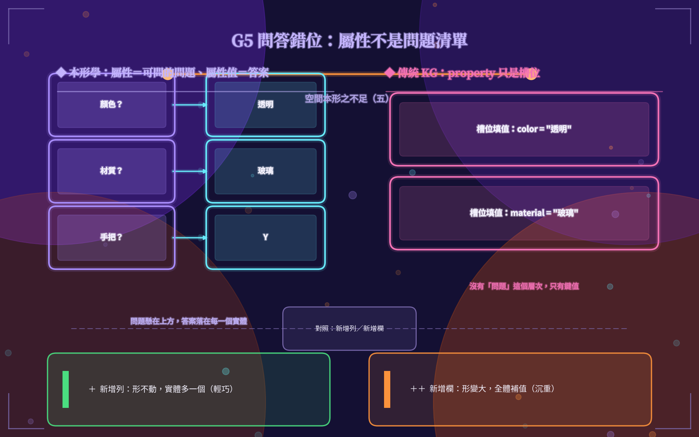

**圖 2-5　問題／答案兩層次的缺口**

R3 的要害是「屬性是一個可以被問的問題」：屬性本身沒有答案，它劃定一個「要問什麼」的範圍；屬性值是這個問題在某個實體上的答案。屬性因此可以「懸空」——它屬於形、支配全部實體。標準知識圖譜的 property 是槽位：color = "透明" 是一個鍵值對，**「問題」這個層次不存在**。槽位只能回答「這件東西的顏色是什麼」，不能回答「這個形總共要問哪幾個問題」。

這一缺口與 G2 互為表裡：既然屬性是槽位，「開新問題」（新增欄）就只是加一個 key，沒有「對照失敗」的觸發條件、沒有全體補值的義務。屬性／問題的兩層次一壓平，R7 的不對稱跟著失真。這就是 G5 問答錯位。

> **✕ 注意 G3、G5 的共性：本形學的「層次」（身份層/內容層、問題層/答案層）在圖上必須是可分辨的結構——而三元組世界觀只有一個層次：節點與邊。**

## 2.6　G6 座標缺失：X 軸與 Y 軸被壓成一條

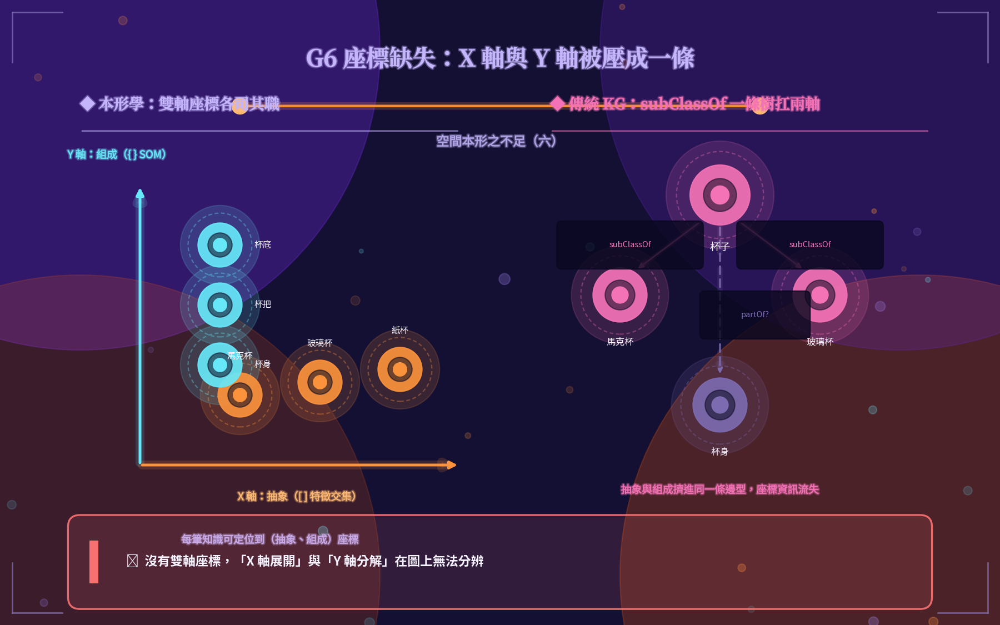

**圖 2-6　雙軸座標與單一階層的對照**

R2 要求每筆知識可以定位到雙軸座標：X 軸是抽象（[ ] 特徵交集，馬克杯→杯子），Y 軸是組成（{ } SOM，杯子→杯身＋杯把＋杯底）。兩軸互相獨立：「馬克杯是杯子」與「杯子由杯身組成」是完全不同方向的兩句話。標準圖譜用一條 subClassOf／partOf 的邊型譜系扛兩軸——兩種關係在語意上被強行並列，**知識一多，抽象與組成就會在圖上互相汙染**：歸納查詢（找杯子的所有子類）會撈到部件，分解查詢（找杯子的組成）會撈到杯種。

知識後果：無法沿 X 軸展開「一個概念的全部具體化」、沿 Y 軸展開「一個物件的全部組成」——雙軸座標是框架與 SOM 能被機器操作的前提。這就是 G6 座標缺失。

## 2.7　G7 生成靜態：分類樹不是生成規則

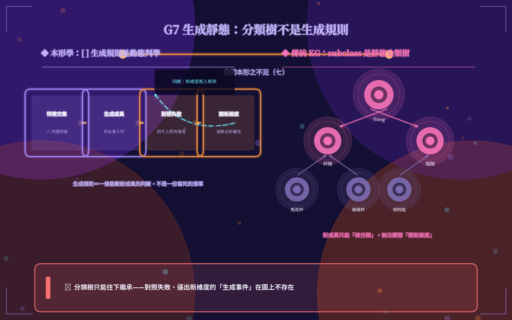

**圖 2-7　生成規則的動態判定 vs. 靜態分類**

R6 要求抽象集合 [ ] 是一條「能斷新成員的規則」：特徵交集定義成員資格；新個體來了，判定入列或拒絕；新差異與既有維度全對不上，觸發開新維度。這是一條有動態判定能力的生成規則。subclass 關係只做靜態分類：新個體被「歸類」到某個節點底下，**沒有判定過程、沒有拒絕分支、更沒有「對照失敗→開新維度」的回饋**。分類樹可以長得很深，卻永遠回答不了「這個新東西為什麼算／不算杯子」。

知識後果：知識圖譜的擴充只能靠人工建模者改 schema，無法在圖上留下「生成判定」的痕跡；抽象的普遍性（框架四步驟第三、四步）完全沒有知識層的對應物。這就是 G7 生成靜態。

## 2.8　空間面不足總表

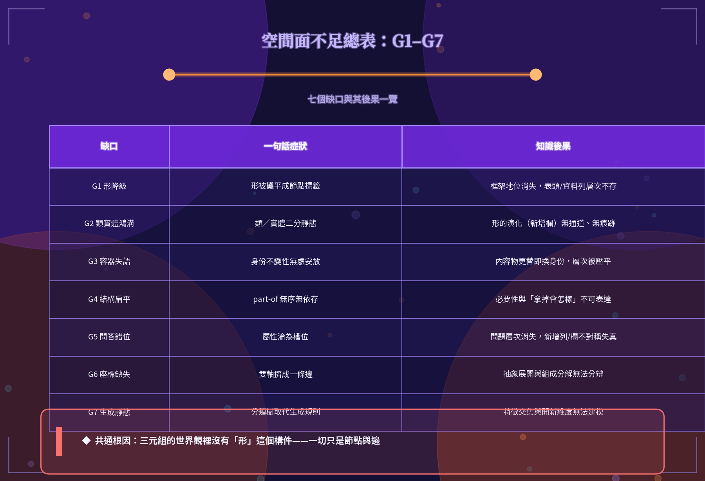

**圖 2-8　空間面七處缺口總表**

把 G1–G7 攤開來看，共通根因只有一個：三元組的世界觀裡沒有「形」這個構件。節點與邊可以描繪世界的「照片」，卻裝不下「表頭支配資料列」的層次、「身份恆定」的公理、「對照失敗」的觸發。要承載空間本形，圖譜必須原生具備形這個構件——這正是 TOKG 形層的設計動機（詳第 6 章）。

# 第 3 章　不足處分析Ⅱ：知識圖譜表達時間本形的不足

空間面說完，輪到時間面。時間本形的知識主體是「活動」：形時間函式搜尋、設計搜尋與萃取、設計模式、邏輯生成、推理、思考法、解題、分析、設計、研發探索、重構與重組、自我演化——每一個都是會發生、會結束、會留下產出的「形」。本章檢驗 R8–R11，得到缺口 G8–G12。

## 3.1　G8 時間降維：過程被切成快照

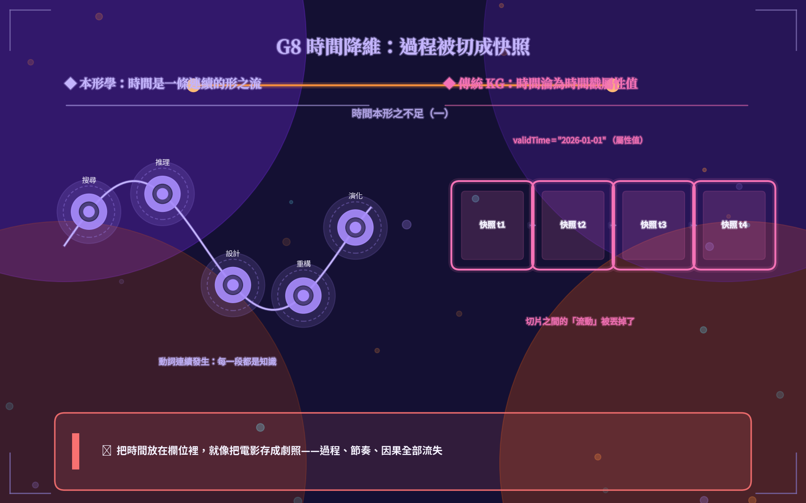

**圖 3-1　連續的形之流 vs. 快照式知識**

時間本形眼中的知識是連續的流：搜尋之後是推理，推理之後是設計，設計之後是重構——每一段都有前因後果、有節奏、有中途轉向。標準知識圖譜處理時間的方式是「欄位化」：給事實掛上 validTime 屬性，或在時序圖譜裡存一個個帶時間戳的快照。時間從**知識的維度**降格成**知識的屬性**——電影被存成了劇照。

知識後果：過程性問題全部答不了——「這次設計中間改過幾次方向」「哪一步推理耗時最久」「哪個環節的產出被後續推翻」。R8 要求時間過程是一等知識，快照模型只能給出「某時刻有某事實」。這就是 G8 時間降維。

## 3.2　G9 過程無形：知識活動沒有家

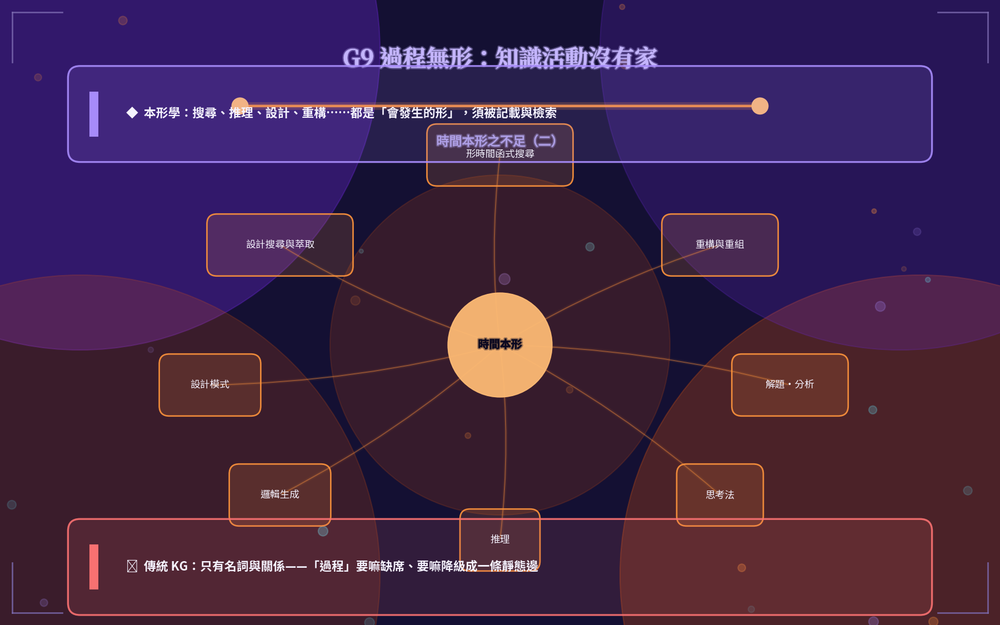

**圖 3-2　時間本形的活動星系與圖譜缺口**

時間本形列出的每一項活動——搜尋、萃取、設計模式、邏輯生成、推理、思考法、解題、重構——在本形學裡都是可指認、可命名、可重現的「形」。設計模式是一張有前提、步驟、產出、判準的模式卡；推理有因果、果因、模擬、統計、逆向五型；思考法有正向、逆向、水準、垂直、第一性原理等類型。標準圖譜的詞彙表裡，**這些「動詞」沒有原生的節點類型**：設計模式最多被建成一個靜態概念節點，推理過程只能壓縮成一條 derivedFrom 邊。

知識後果：R9 的模式方法不可檢索——想找「有沒有處理過類似的設計難題」，圖譜只能給出零散案例，給不出「可重複使用的做法」。活動缺席，時間本形就只剩下名詞。這就是 G9 過程無形。

## 3.3　G10 動詞靜態化：演化被寫成註解

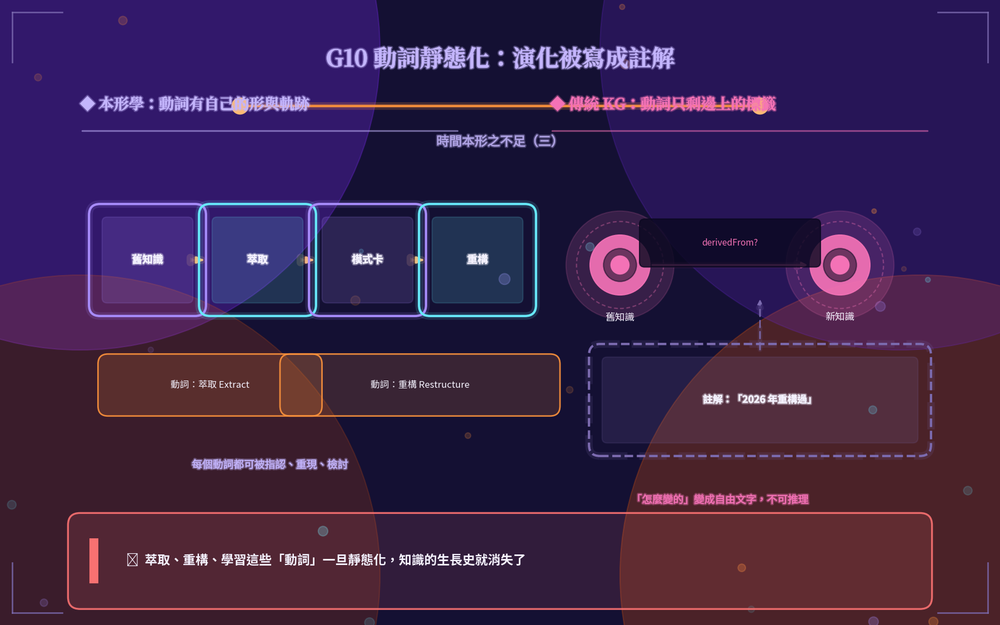

**圖 3-3　動詞的形與軌跡 vs. 邊標籤與註解**

萃取、重構、重組、持續學習——這些「動詞」本來是有起訖、有方法、有產出的活動。在標準圖譜裡，它們的下場有兩種：要么變成一條靜態邊（A derivedFrom B），要么變成一段自由文字註解（「2026 年重構過」）。前者丟掉了過程，後者丟掉了結構——**「怎麼變的」從可推理的知識，降級成不可推理的備註**。

知識後果：知識的生長史無法重放。「這次重構用了哪套思考法」「萃取時參考了哪幾個案例」都無從查起；持續學習（R10）失去素材。這就是 G10 動詞靜態化。

## 3.4　G11 演化無痕：學習閉環沒有原生記錄

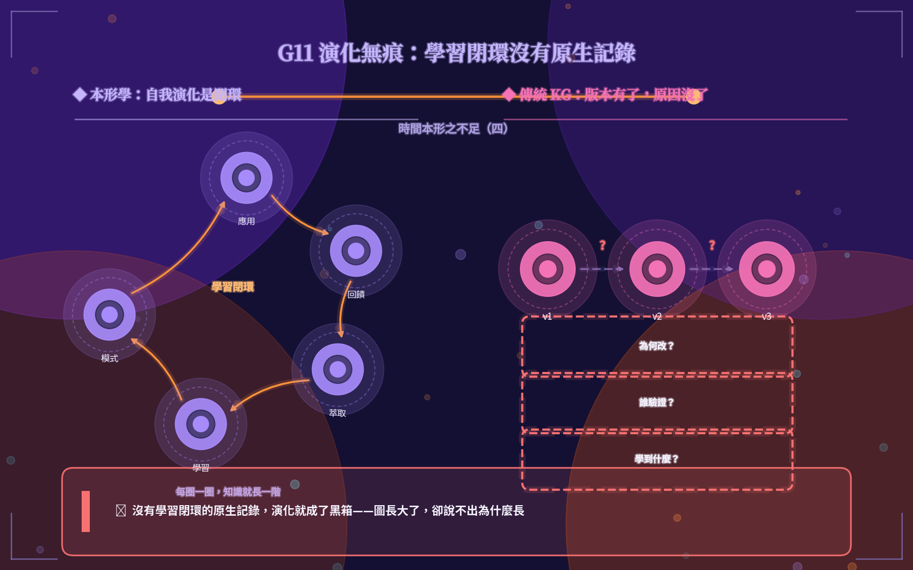

**圖 3-4　學習閉環 vs. 有版本沒原因的演化**

自我演化是一條閉環：應用→回饋→萃取→學習→更新模式→再應用。每繞一圈，知識就長一階。要讓閉環可運作，三件事必須被記錄：版本（現在是哪一版）、原因（為什麼改）、證據（誰驗證過）。標準圖譜的版本機制（圖快照、RDF dataset）只記**「什麼時候變了」**，不記**「為什麼變、學到什麼」**——演化成了一個黑箱。

知識後果：R10 的學習閉環無法在圖上運轉——回饋沒有掛鉤、模式卡的更新沒有依據可查、演化無法被檢討與複用。這就是 G11 演化無痕。

## 3.5　G12 判準缺位：∩(T) 不是一等公民

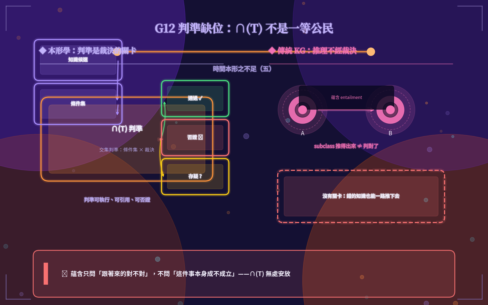

**圖 3-5　∩(T) 判準關卡 vs. 不經裁決的蘊含**

本形學的推理與設計都掛在判準上：∩(T) 交集判準是一組條件加一套裁決邏輯——知識候選經過判準，得到通過、否證、存疑三種裁決，並各自綁定後續動作。標準知識圖譜的推理是蘊含（entailment）：前提真、形式對，結論就跟著來。**蘊含只問「跟著來的對不對」，不問「這件事本身成不成立」**——圖譜裡沒有任何一個構件可以扮演「關卡」。

知識後果：錯的知識只要格式正確就能一路推下去；「驗證過的邊」與「沒驗證的邊」在圖上無法區分。R11 的判準一等地位，是把關卡寫進圖裡的唯一方法。這就是 G12 判準缺位。

## 3.6　時間面不足總表

| 缺口 | 一句話症狀 | 知識後果 |
| --- | --- | --- |
| G8 時間降維 | 時間淪為時間戳屬性值 | 過程、節奏、因果全部流失 |
| G9 過程無形 | 搜尋/推理/模式沒有節點類型 | 「可重複使用的做法」不可檢索 |
| G10 動詞靜態 | 萃取/重構淪為邊標籤或註解 | 知識生長史無法重放 |
| G11 演化無痕 | 有版本、沒原因、沒學到什麼 | 學習閉環在圖上不成立 |
| G12 判準缺位 | 蘊含不經裁決 | 錯誤知識可合法推導到底 |

G8–G12 與 G1–G7 同根同源：三元組的世界觀裡既沒有「形」，也沒有「形的活動」。下一章再往上一層，看查詢、推理與治理三個系統性面向的不足，並以 R1–R12 總評分收束分析篇。

# 第 4 章　不足處分析Ⅲ：查詢・推理・治理的系統性不足

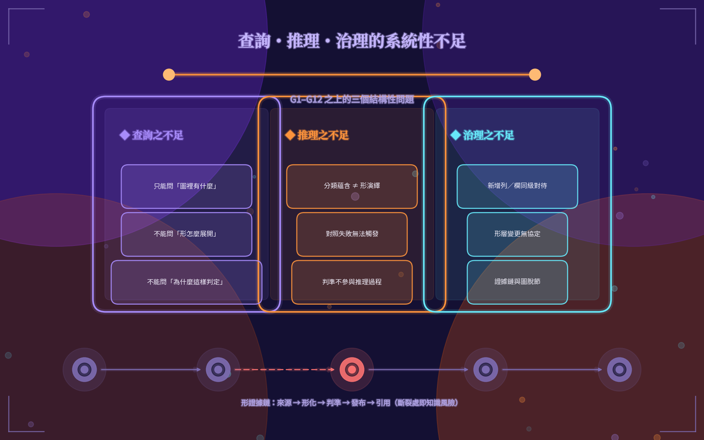

**圖 4-1　查詢・推理・治理三面的結構性問題**

G1–G12 是「表達力」的缺口。但知識圖譜不只是一套表達法，還是一套使用法與一套管理法——查詢怎麼問、推理怎麼推、治理怎麼管。本章把鏡頭拉高一層，檢視這三個面向的系統性不足，最後以 R1–R12 × 三類圖譜技術的總評分矩陣收束分析篇。

## 4.1　查詢之不足：只能問「圖裡有什麼」

圖查詢語言（無論是圖模式匹配還是三元組模式）的語法空間只覆蓋一種問句：「符合這個模式的子圖在哪裡」。這對「找出所有材質為玻璃的杯子」綽綽有餘，對本形學的問題卻全數失靈：**「這個形總共要問哪幾個問題」**（R3）問的是形層本身；**「這件東西的組成怎麼沿 Y 軸展開」**（R2）問的是座標路徑；**「這個新成員算不算杯子」**（R6）問的是生成判定；**「這個結論當初是怎麼推的」**（R12）問的是證據鏈。四類問句的共性是：它們問的是「形」，不是「子圖」。

查詢面的不足不是缺幾個視圖，而是缺一整套以形為中心的查詢模式——這正是第 9 章 Q1–Q12 查詢模式庫的由來。

## 4.2　推理之不足：分類蘊含 ≠ 形演繹

標準圖譜推理的核心機制是分類蘊含：subclass 具傳遞性，property 有定義域與值域，由此衍生新邊。這套機制假設知識世界是一個預先切好的分類格。本形學的推理卻是「形演繹」：沿雙軸座標推進（抽象向上、組成向下）、依判準裁決（∩(T) 通過或否證）、在對照失敗時開新維度、依 SOM 依存傳播影響。**前者推的是「歸類」，後者推的是「形的行為」**——把形演繹硬塞進蘊含框架，等於要求一把尺去量溫度。

| 推理需求（時間本形） | 標準圖譜的近似做法 | 缺口 |
| --- | --- | --- |
| 因果推理 | 有向邊 + 規則 | 無「因之為因」的判準綁定 |
| 果因推理 | 反向查詢 | 推導過程不可重現 |
| 模擬推理 | 無 | 「若…則…」的虛擬演化無處建模 |
| 統計推理 | 外掛圖分析 | 統計結論無證據鏈 |
| 逆向推理 | 無 | 由結果回溯條件的路徑不可表達 |

## 4.3　證據與追溯之不足

溯源（provenance）在標準圖譜裡是可選插件：可以給事實掛上來源標記，但來源與事實的關係是鬆散的註記。本形學要求的形證據鏈是剛性的：每一條邊都得回答「從哪來、怎麼形化、過沒過判準、誰驗證、哪一版」五個問題（R12）。鬆散註記與剛性鏈條的差距，意味著**「這條知識可信嗎」這個問題在標準圖譜上只能主觀回答**。

## 4.4　治理與品質之不足

治理的核心規則其實早在空間本形裡就寫好了：新增列與新增欄是不對稱的兩種變動——前者輕巧、後者沉重且牽動全體。標準圖譜的變更管理把兩者都當成「寫操作」：加一個節點和改一個 class 定義在治理流程上同級。**不對稱被抹平，治理就失去了輕重**：要嘛對日常新增層層設卡，要嘛對形層演化放任自流——通常兩者同時發生。

- **品質困境一：**無判準標記的邊與已驗證的邊混雜，抽樣審計成本極高。
- **品質困境二：**schema 變更無版本協定，舊資料在新 schema 下語意漂移。
- **品質困境三：**命名、層次、歸屬缺乏形級約束，同一概念在圖上長出多個替身。

## 4.5　十二項承載要求總評分

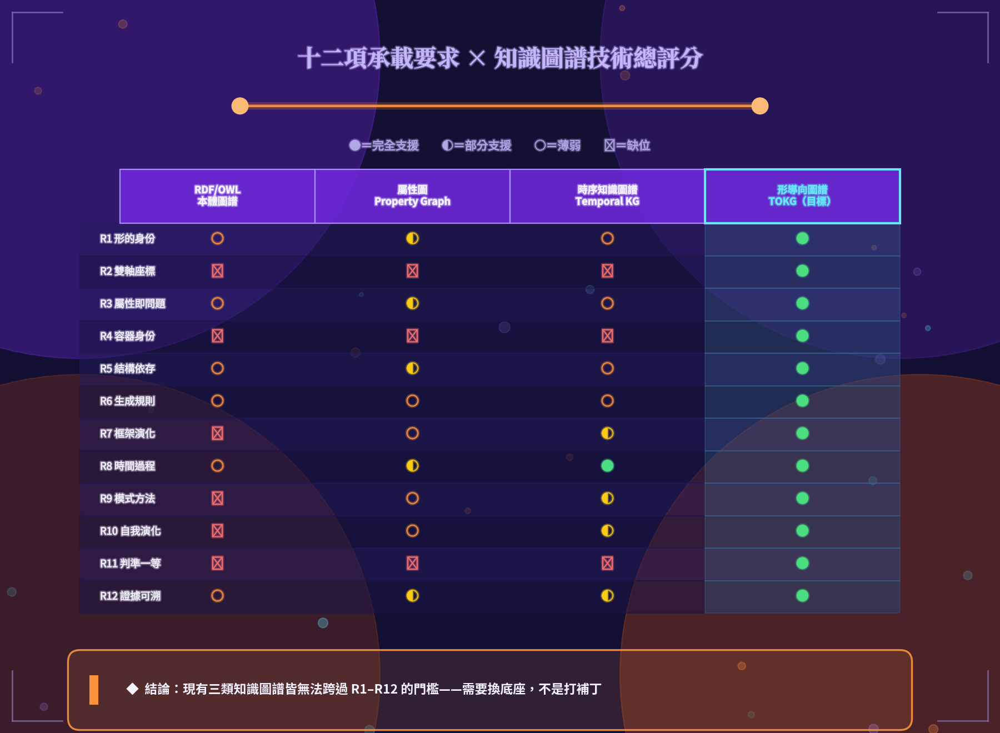

**圖 4-2　R1–R12 × 三類知識圖譜技術總評分矩陣**

把分析篇的結論壓成一張表：RDF／OWL 本體圖譜、屬性圖、時序知識圖譜三類主流技術，在 R1–R12 上無一完整達標——R2 雙軸座標、R4 容器身份、R11 判準一等三項，三類技術全數缺位；其餘各項最好也只是「部分支援」。這不是工程實作不到位，而是世界觀不相容：三元組的世界觀裡沒有形、沒有形的活動、沒有關卡。

> **◆ 分析篇結論：承載本形學需要的不是更好的三元組，而是一個以形為核心構件的圖譜底座——形導向知識圖譜（TOKG）。方案篇由此展開。**

# 第 5 章　形導向知識圖譜 TOKG：設計原則與總體架構

方案篇的任務是回應 G1–G12。本章先立總綱：四項設計原則回答「照什麼價值觀建」，三平面六層架構回答「長什麼樣」，術語對照表回答「怎麼與既有語彙接軌」。第 6–8 章再逐層交付內容設計。

## 5.1　從補洞到換底座

面對十二處缺口，直覺反應是逐點補丁：缺容器就加個容器插件、缺時間就換時序圖譜、缺判準就外掛規則引擎。本書明確反對這條路：十二處缺口共享同一個根因（圖譜世界觀裡沒有形），補丁只會把根因切成十二個互不相認的例外，最後得到一座「十二個插件互相不知道對方存在」的圖譜。正確的回應是換底座——把「形」提升為圖譜的一等構件，讓十二項要求成為架構的原生性質。

## 5.2　四項設計原則

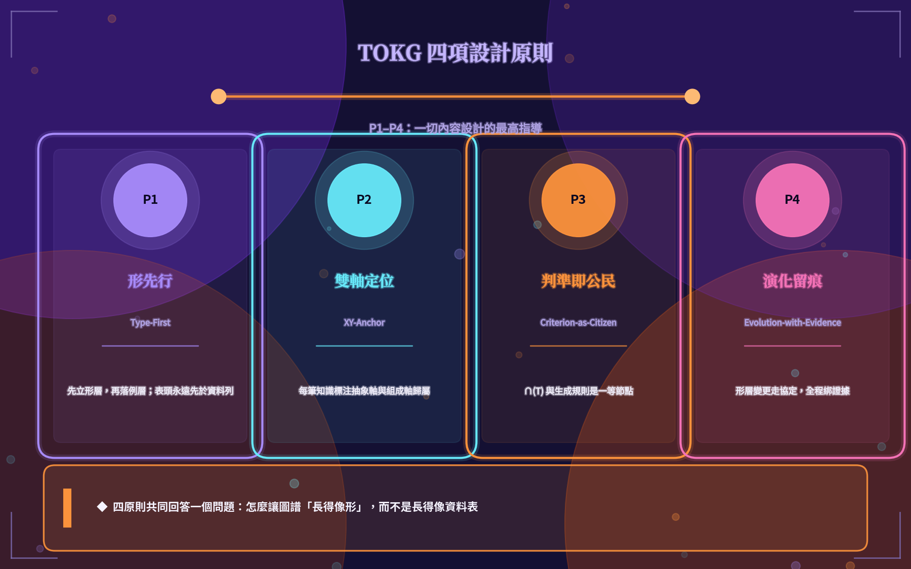

**圖 5-1　TOKG 四項設計原則 P1–P4**

1. **P1 形先行（Type-First）：**先立形層、再落例層；表頭永遠先於資料列。任何知識入圖，第一步都是「它長在哪個形上」。回應 G1、G2、G5。
2. **P2 雙軸定位（XY-Anchor）：**每筆知識標注抽象軸與組成軸歸屬，抽象展開與組成分解在圖上是兩種不同的路徑。回應 G6。
3. **P3 判準即公民（Criterion-as-Citizen）：**∩(T) 判準與生成規則是一等節點，可被任何邊引用、可否證任何候選。回應 G7、G12。
4. **P4 演化留痕（Evolution-with-Evidence）：**形層變更走協定、例層變更走輕量，全程綁定版本、原因、證據三件套。回應 G10、G11。

> **▣ 四原則的共同句法是「先問形，再問圖」：任何圖上操作若說不出它發生在哪個形、沿哪條軸、過哪道判準、留下什麼證據，就不是合法的 TOKG 操作。**

## 5.3　三平面六層總體架構

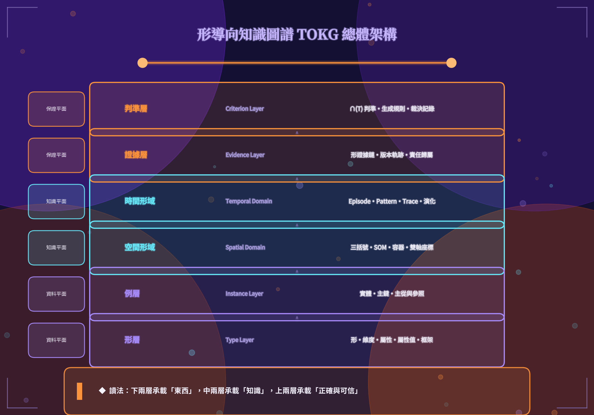

**圖 5-2　TOKG 總體架構：三平面・六層**

TOKG 把內容架構分成三個平面、六個層。資料平面承載「東西」：形層（Type Layer）放形、維度、屬性、屬性值與框架；例層（Instance Layer）放實體、主鍵與主從參照。知識平面承載「知識」：空間形域（Spatial Domain）放三括號、SOM、容器與雙軸座標；時間形域（Temporal Domain）放事件形、模式形、推理鏈與演化。保證平面承載「正確與可信」：判準層（Criterion Layer）放 ∩(T) 判準、生成規則與裁決記錄；證據層（Evidence Layer）放形證據鏈、版本軌跡與責任歸屬。

| 平面 | 層 | 內容單元 | 守住的要求 |
| --- | --- | --- | --- |
| 資料平面 | 形層 Type Layer | 形・維度・屬性・屬性值・框架 | R1・R3・R7 |
| 資料平面 | 例層 Instance Layer | 實體・主鍵・主從參照・填值 | R1・R3 |
| 知識平面 | 空間形域 Spatial Domain | 三括號・SOM・容器・雙軸座標 | R2・R4・R5・R6 |
| 知識平面 | 時間形域 Temporal Domain | Episode・Pattern・Trace・Method・Evolution | R8・R9・R10 |
| 保證平面 | 判準層 Criterion Layer | ∩(T) 判準・生成規則・裁決記錄 | R6・R11 |
| 保證平面 | 證據層 Evidence Layer | 形證據鏈・版本軌跡・責任歸屬 | R10・R12 |

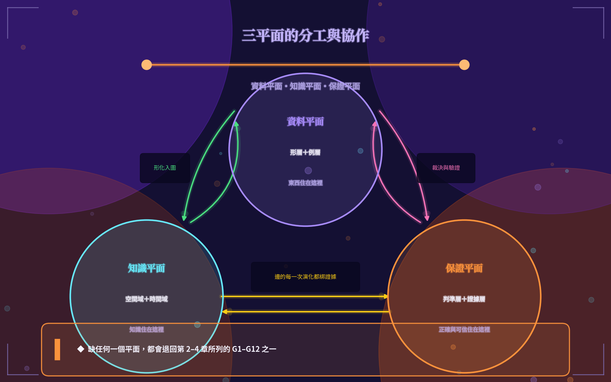

**圖 5-3　三平面的分工與協作**

## 5.4　術語對照與命名規約

為使 TOKG 與既有語彙無縫接軌，全書採用固定命名規約：中文術語沿用本形學語彙，英文一律以 Type 為「形」的對譯（絕不用 Form）；知識圖譜通用語彙以通行英文標注。下表是核心術語的三方對照，完整版見附錄 D。

| 本形學語彙 | TOKG 構件 | 關聯式資料庫對應 |
| --- | --- | --- |
| 形 Type | 形層 Type 節點 | 表頭（欄位清單） |
| 實體（填值結果） | 例層 Entity 節點 | 資料列 |
| 屬性（可問的問題） | Attribute 節點（問題層） | 欄位 |
| 屬性值（答案） | Value 節點（答案層） | 儲存格 |
| 空間容器 ( ) | Container 節點（id(C) 不變式） | 主表（身份層） |
| BOM／SOM { } | hasPart／dependsOn 邊族 | 部件表（主從） |
| 抽象 [ ] | 生成規則 Rule 節點 | （無對應——生成在 RDB 外） |
| 框架四步驟 | 形層演化協定 | Schema Change（新增欄） |
| ∩(T) 判準 | 判準層 Criterion 節點 | 約束／觸發條件（近似） |
| 搜尋・推理・設計模式 | 時間形域活動節點 | （無對應） |
| 自我演化 | Evolution 節點＋版本三件套 | 變更日誌（近似） |

RDB 對應欄的存在，是為了讓讀者用「表頭＝形、資料列＝實體」的既有直覺快速校準；標注「無對應」的三列，恰是 G6、G8–G12 的發源地——關係型資料庫同樣裝不下生成規則、時間活動與自我演化。

# 第 6 章　空間形域內容設計

空間形域是 TOKG 的地基。本章交付形層與例層的本體設計、三括號的圖結構編碼、框架四步驟的圖上協定，以及空間形 Schema 總表——每一項都對準第 2 章的具體缺口。

## 6.1　形層本體：讓形成為一等節點

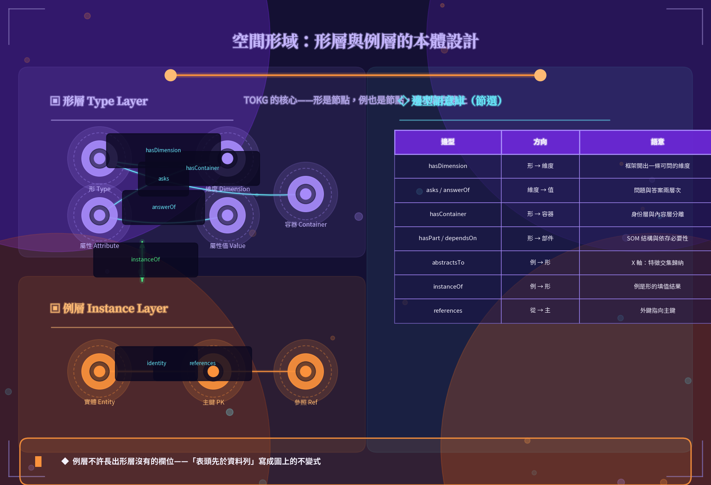

**圖 6-1　形層與例層的本體設計與邊型語意庫**

形層的核心決定只有一個：**形是節點，而且是支配型節點**。Type 節點攜帶 id、名稱、版本與判準集；它透過 hasDimension 擁有維度（Dimension）——維度就是「被命名的問題軸」；維度透過 asks／answerOf 與屬性值相連，把 R3 的「問題／答案兩層次」寫成兩種不同的邊；型版透過 hasContainer 掛容器、透過 hasPart／dependsOn 掛 SOM 結構。

例層（Entity）透過 instanceOf 歸屬於形——歸屬即「照表頭填值」：例層不許長出形層沒有的邊，這是圖上的不變式（IC-1）。每一個實體必有主鍵（PK），主鍵與內容無關、只管指認身份；從表實體透過 references 指向主表主鍵，把「主從與參考」搬進圖上（IC-2）。R1 的「形懸於實體之上」由此成為可檢驗的結構性質。

| 不變式 | 內容 | 對應要求 |
| --- | --- | --- |
| IC-1 | 例層不得擁有形層未宣告的邊型；違反即入圖失敗 | R1・R3 |
| IC-2 | 參照邊必須指向有效主鍵；懸空參照即告警 | R1 |
| IC-3 | 形的每個維度對每個例層實體都要有答案（可暫為空） | R3・R7 |
| IC-4 | 同一形下主鍵唯一且不可變 | R1 |

## 6.2　例層與主從參照

例層回答「有誰」。實體節點只攜帶主鍵與入圖時間，其餘內容一律以「填值邊」掛到形層的維度上——這個設計刻意「麻煩」：它逼著每一筆值都出現在「問題/答案」的層次裡，而不是躲在實體的屬性袋裡。主從關係（杯子表↔部件表）以 references 邊族表達，從表實體的存在性依賴主表實體（R5 在例層的投影）。

## 6.3　三括號的圖結構編碼

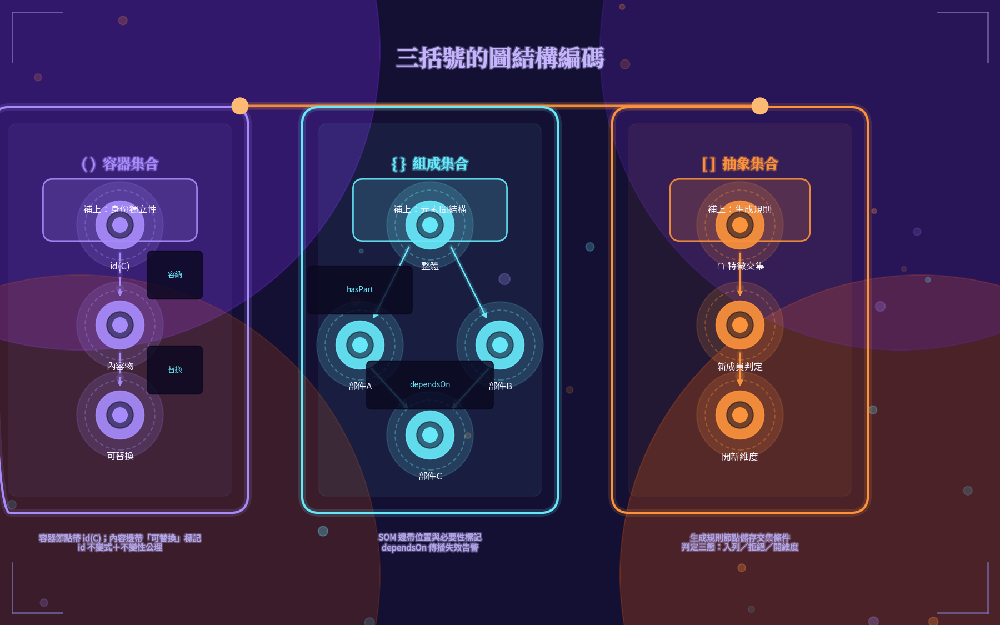

**圖 6-2　( ) { } [ ] 三括號的圖結構編碼**

三括號是空間本形的三種「加值」：( ) 補身份獨立性、{ } 補元素間結構、[ ] 補生成規則。TOKG 給三者各自的圖編碼：

1. **( ) 容器集合：**Container 節點帶 id(C) 與內部空間 S(C)；內容物以「可替換邊」（replaceableContent）掛入，邊上標記替換史。不變性公理（∀e1,e2∈S(C) 替換不改 id(C)）寫成不變式 IC-5，由判準層驗證。
2. **{ } 組成集合：**SOM 結構以 hasPart 邊族表達，每條 hasPart 攜帶位置（slot）與必要性（necessary／optional）兩個標記；dependsOn 邊表達部件間的依存，失效沿邊傳播告警（推理規則 R3）。
3. **[ ] 抽象集合：**抽象集合以 Rule 節點表達——節點裡存特徵交集條件；新成員候選入圖時執行生成判定，結果三態：入列、拒絕、觸發開新維度（對照失敗）。

> **◆ 三括號編碼的共同精神：數學集合只回答「屬不屬於」，TOKG 的三種集合各自多回答一個問題——「還是同一個嗎」（容器）、「怎麼組的」（SOM）、「憑什麼算」（抽象）。**

## 6.4　框架四步驟的圖上協定

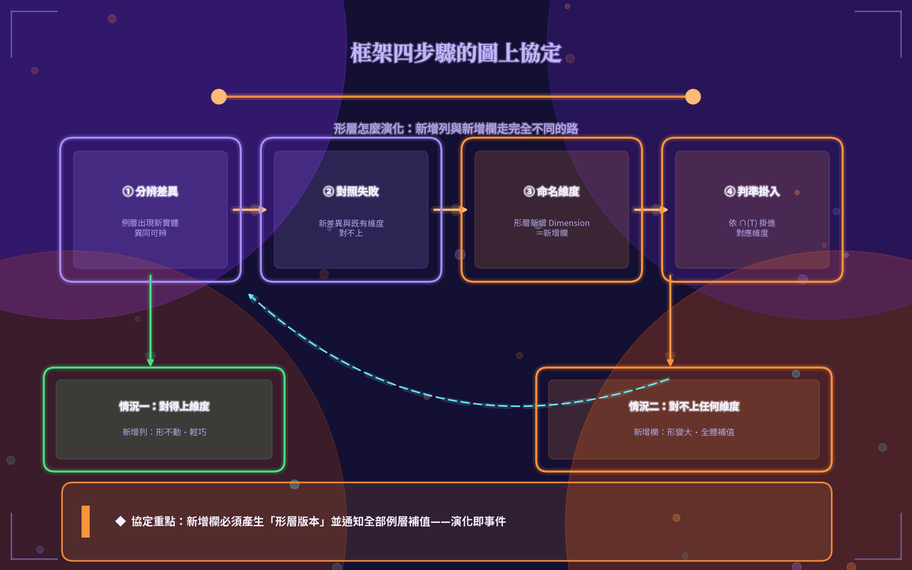

**圖 6-3　框架四步驟的圖上協定：兩種變動、兩條路**

框架四步驟（分辨差異→對照失敗→命名維度→判準掛入）在 TOKG 裡被寫成**形層演化協定**——這是 R7 的核心內容。協定把圖上的變動分成兩路：

1. **新增列（例層變動）：**對得上既有維度的新實體，直接入圖、填值、指認主鍵——形層不動、全程輕量，只留入圖證據。
2. **新增欄（形層變動）：**對不上任何維度的新差異，觸發「開新維度」事件：形層產生新版本、宣告新 Dimension、全體既有實體補值（IC-3 重新生效）、事件記錄進演化軌跡（7.4）。

協定的價值在於把「形怎麼長大」從幕後搬上台面：任何 schema 改動都有觸發原因（對照失敗的記錄）、有波及面宣告（全體補值）、有版本落點。G2 與 G5 在這裡被一併封堵。

## .5　空間形 Schema 總表

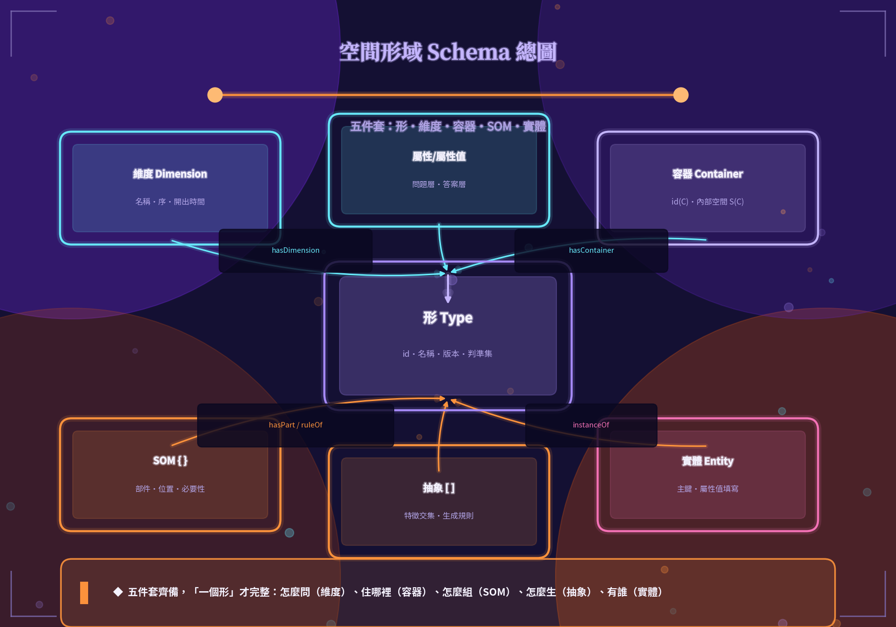

**圖 6-4　空間形域 Schema 總圖：形的五件套**

| 節點／邊 | 關鍵屬性或標記 | 說明 |
| --- | --- | --- |
| Type 形 | id・名稱・版本・判準集 | 支配型節點；表頭的化身 |
| Dimension 維度 | 名稱・序・開出時間・開出原因 | 被命名的問題軸；新增欄即新維度 |
| Attribute 問題 | 問題語句・回答規範 | 維度的提問面（問題層） |
| Value 屬性值 | 值・單位・填寫時間 | 維度的答案面（答案層） |
| Container 容器 | id(C)・S(C)・不變式代碼 | ( ) 身份獨立性 |
| SOM 邊族 | slot 位置・必要性・dependsOn | { } 元素間結構 |
| Rule 生成規則 | 特徵交集條件・三態輸出 | [ ] 生成規則 |
| Entity 實體 | 主鍵・入圖時間 | 例層公民；只由填值邊構成內容 |
| references 參照 | 指向主鍵 | 主從與參考 |
| fillValue 填值 | 形+維度+實體→值 | 問題/答案的三元組之外的第四元：形 |

# 第 7 章　時間形域內容設計

時間形域把「動詞」變成公民。本章交付時間形本體、模式卡與推理鏈的圖結構、時空兩域的掛接機制，以及演化軌跡的版本三件套——逐一回應 G8–G11。

## 7.1　時間形本體：讓活動成為一等節點

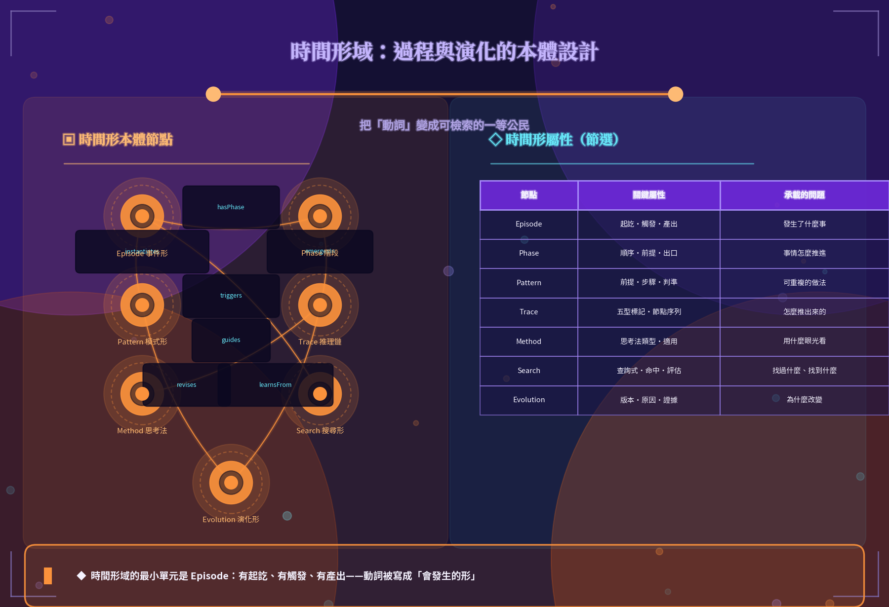

**圖 7-1　時間形域本體設計與關鍵屬性**

時間形域的最小單元是**事件形（Episode）**：有起訖、有觸發、有產出的「一次發生」。Episode 可以細分為 Phase（有順序、有前提、有出口的階段）；可重複的「做法」抽成 Pattern（模式形）；推理的完整過程抽成 Trace（推理鏈）；指導推理的眼光抽成 Method（思考法）；搜尋活動抽成 Search（搜尋形）；圖譜自身的變化抽成 Evolution（演化形）。

這六種節點類型就是 R8 的落地：搜尋、推理、設計、重構不再發生在圖的「外面」，而是與形、實體一樣入圖、被檢索、被引用。每種節點都攜帶起訖時間、觸發者與產出清單，使「發生過什麼」成為可查詢的問題（Q8、Q9）。

## 7.2　模式卡與推理鏈

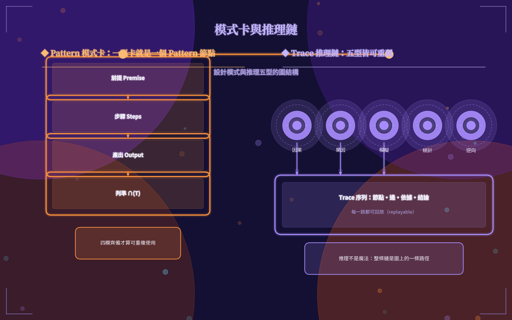

**圖 7-2　Pattern 模式卡與 Trace 推理鏈五型**

設計模式以「模式卡」為內容規格：一張卡四欄——前提（Premise）、步驟（Steps）、產出（Output）、判準（∩(T)）。四欄齊備才算可重複使用的 Pattern 節點；缺判準的卡只能算筆記，不得被推理規則引用（不變式 IC-6）。模式卡之間可組成模式族，支援「由問題形找到模式形」的檢索路徑（Q8）。

推理鏈（Trace）記錄推理五型——因果、果因、模擬、統計、逆向——的完整節點序列。每條 Trace 是圖上的一條**可回放路徑**：每一跳都標注所用前提、所依判準、所產結論。R6 推理五型由此從「推理方式的名單」升格為「可重現的知識資產」；「這個結論怎麼來的」（Q9）由 Trace 直接回答。

## 7.3　時間形 × 空間形的掛接

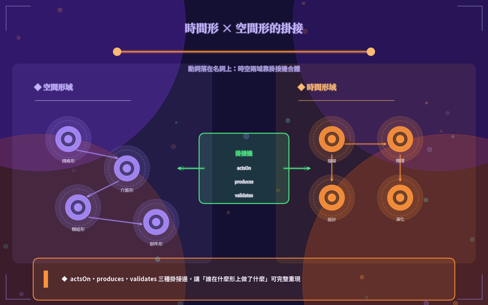

**圖 7-3　時空兩域的掛接邊：動詞落在名詞上**

時間形與空間形靠三種**掛接邊**合體：actsOn（這個活動作用在哪個形／實體上）、produces（這個活動產出了什麼知識）、validates（這個活動驗證了哪條邊）。三種掛接邊把「誰、在什麼形上、做了什麼、留下什麼」縫成完整敘事——重構事件 actsOn 某個形、produces 新版本、validates 修正後的 SOM 依存，一次事件在圖上完整可見。

掛接邊的兩端分別遵守兩域的規則：時間端必須是 Episode 或其子型，空間端必須是已入圖的形／實體——兩域的完整性互相鎖定，避免「活動記錄指向不存在的形」這類懸空敘事。

## 7.4　演化軌跡：版本・原因・證據三件套

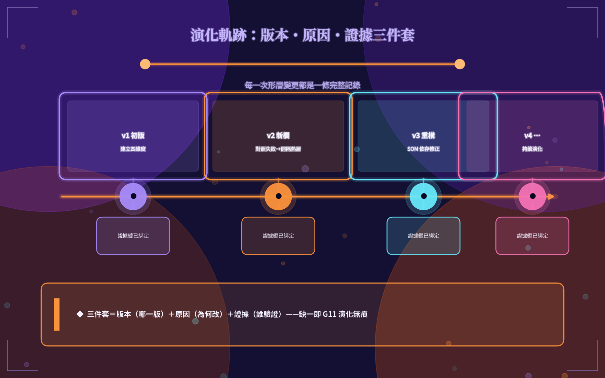

**圖 7-4　演化軌跡：每一次形層變更都是完整記錄**

自我演化（R10）在 TOKG 裡不是抽象能力，而是一組可檢驗的記錄：**版本三件套**——版本（現在是哪一版）、原因（為什麼改：對照失敗、回饋修正、判準更新⋯⋯）、證據（誰驗證、過哪道判準）。每一次形層變更（新增欄、重構）都產生一條 Evolution 記錄，連成演化軌跡；每一條例層變更則只留入圖證據，不動軌跡。

| 三件套 | 內容 | 缺失時的後果 |
| --- | --- | --- |
| 版本 Version | 形層版本號＋變更摘要 | 同名形的多個世代混淆（G11） |
| 原因 Reason | 觸發事件（對照失敗／回饋／判準改版） | 演化成黑箱，無法檢討 |
| 證據 Evidence | 驗證者・判準・通過記錄 | 無法判斷新版是否更可信 |

學習閉環（應用→回饋→萃取→學習→模式更新）沿演化軌跡運轉：回饋指向具體版本、萃取產出模式卡更新、更新再寫入新版本——閉環的每一圈都在圖上留痕，使「圖譜越用越聰明」成為可審計的事實。

## 7.5　時間形 Schema 總表

| 節點／邊 | 關鍵屬性或標記 | 承載的問題 |
| --- | --- | --- |
| Episode 事件形 | 起訖・觸發・產出・掛接 | 發生了什麼事（R8） |
| Phase 階段 | 順序・前提・出口 | 事情怎麼推進（R8） |
| Pattern 模式形 | 前提・步驟・產出・判準 | 可重複的做法（R9） |
| Trace 推理鏈 | 五型標記・節點序列・可回放 | 怎麼推的（R9・R12） |
| Method 思考法 | 類型・適用範圍・案例 | 用什麼眼光看（R9） |
| Search 搜尋形 | 查詢式・命中・評估 | 找過什麼、找到什麼（R8） |
| Evolution 演化形 | 版本三件套 | 為什麼改變（R10） |
| actsOn／produces／validates | 掛接邊 | 動詞與名詞的縫合（R8） |

# 第 8 章　判準層與證據層內容設計

保證平面是 TOKG 區別於一切既有圖譜的關鍵：判準層把 ∩(T) 寫成一等節點，證據層把形證據鏈寫成剛性結構。本章交付兩層的內容設計，回應 G7、G12，並彙整層間契約。

## 8.1　∩(T) 判準作為一等公民

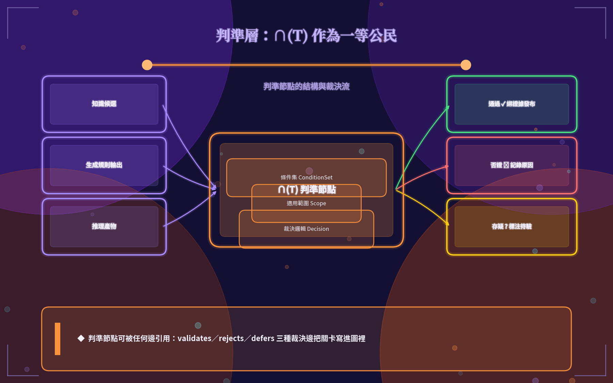

**圖 8-1　判準節點的結構與裁決流**

判準節點（Criterion）的內部結構是「條件集 × 適用範圍 × 裁決邏輯」：條件集列出必須成立的條件，適用範圍聲明這個判準管哪些形／邊，裁決邏輯給出通過／否證／存疑三態的判定規則。任何知識候選——生成規則的輸出、推理的產物、新入圖的邊——都必須經過至少一道判準，裁決結果以**裁決邊**（validates／rejects／defers）寫回圖上。

這個設計的要害是「可引用」：判準不是外掛的檢查腳本，而是圖上的節點——任何邊都可以指向它所通過的判準，任何推理都可以聲明它所依賴的判準。當判準本身改版時，受影響的邊沿引用關係被精確定位（推理規則 R7）。G12 的「判準缺位」由此封堵：圖上從此分得清「驗證過」與「沒驗證」。

## 8.2　生成規則的圖上內容

[ ] 抽象集合的生成規則（R6）在判準層落地為 Rule 節點的判定引擎內容：特徵交集條件、候選評估程序、三態輸出（入列／拒絕／觸發開新維度）。與分類樹的根本差別在於**判定過程本身被記錄**——每個新成員的入列都有一次生成判定記錄可查（「憑什麼算杯子」）；每個「對照失敗」都可能觸發形層演化協定的開新維度事件（6.4）。G7 的靜態分類由此升級為動態生成。

| 輸出態 | 含義 | 後續動作 |
| --- | --- | --- |
| 入列 Admit | 特徵交集滿足 | 成為抽象集合成員，綁生成記錄 |
| 拒絕 Reject | 特徵交集不滿足 | 記錄拒絕理由，候選退回 |
| 開維度 New-Dimension | 與既有維度全數對不上 | 觸發形層演化協定（6.4） |

## 8.3　形證據鏈：五問五章

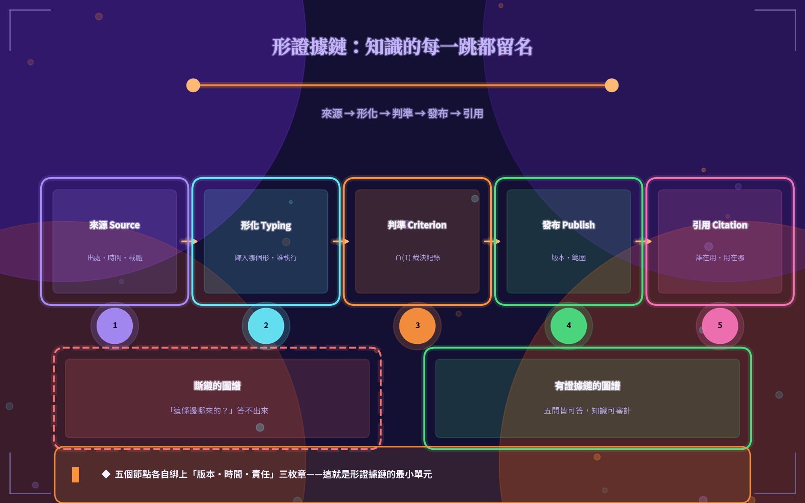

**圖 8-2　形證據鏈：知識的每一跳都留名**

形證據鏈是剛性的五節點鏈條：來源（Source）→形化（Typing）→判準（Criterion）→發布（Publish）→引用（Citation）。每一個節點綁定**版本・時間・責任**三枚章。任何一條邊都必須能沿鏈回答五個問題：從哪來、歸入哪個形、過沒過判準、哪一版發布、被誰引用——五問皆可答，知識才可審計（R12）。

與常見溯源機制的差別在剛性：來源缺失的邊不得發布（不變式 IC-7）；判準缺位的邊只能以「存疑」態存在，不得被推理規則引用（IC-8）。兩條不變式把「圖譜裡的知識」與「路邊的說法」從結構上分開。

## 8.4　層間契約：不變式彙整

| 不變式 | 內容 | 層間關係 |
| --- | --- | --- |
| IC-1 | 例層不得長出形層未宣告的邊 | 形層 → 例層 |
| IC-2 | 參照必須指向有效主鍵 | 例層 → 例層 |
| IC-3 | 維度對每個實體都要有答案（可暫空） | 形層 → 例層 |
| IC-5 | 容器內容物替換不改變 id(C) | 空間形域內部 |
| IC-6 | 缺判準的模式卡不得被推理引用 | 判準層 → 時間形域 |
| IC-7 | 缺來源的邊不得發布 | 證據層 → 全域 |
| IC-8 | 存疑態的邊不得被推理規則引用 | 判準層 → 全域 |
| IC-9 | 形層變更必須走演化協定並產生版本記錄 | 形層 ↔ 證據層 |

> **◆ 不變式不是「建議」而是入圖資格：IC-1～IC-9 由判準層驗證、由證據層記錄——違反者不得入圖，或入圖即標記為存疑態。**

# 第 9 章　查詢模式庫與推理規則庫

圖譜建好之後，價值取決於「問得出來、推得下去」。本章交付 TOKG 的使用面：十二個查詢模式（Q1–Q12）與八條推理規則（R1–R8），並以三則完整情境示範它們協同運作的方式。

## 9.1　查詢模式庫 Q1–Q12

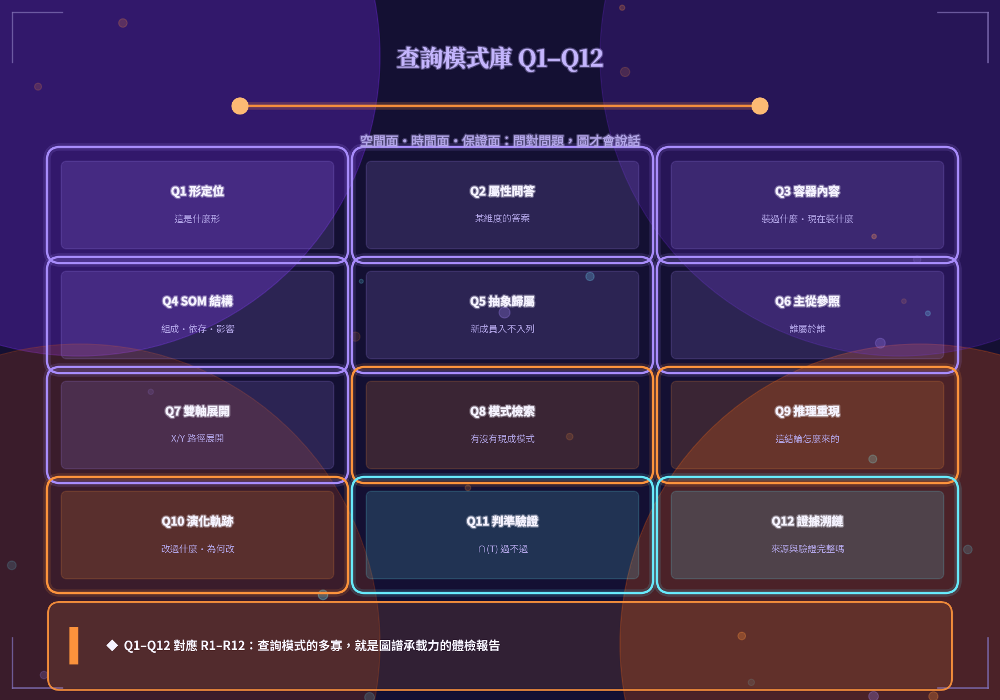

**圖 9-1　查詢模式庫：空間面・時間面・保證面**

Q1–Q12 對應 R1–R12：每一個承載要求都有一個「體檢問句」。查詢模式不是具體語法，而是「問句的形狀」——任何圖查詢語言都可以實作它，但圖譜必須原生存有回答所需的結構。

| 模式 | 問句形狀 | 回答所需的結構 |
| --- | --- | --- |
| Q1 形定位 | 「這是什麼形？」 | instanceOf＋形層索引（R1） |
| Q2 屬性問答 | 「某形在某維度的答案？」 | 問題/答案兩層次（R3） |
| Q3 容器內容 | 「裝過什麼？現在裝什麼？」 | 容器節點＋可替換邊（R4） |
| Q4 SOM 結構 | 「怎麼組的？拿掉會怎樣？」 | hasPart／dependsOn（R5） |
| Q5 抽象歸屬 | 「這個新成員算不算？」 | Rule 節點＋生成記錄（R6） |
| Q6 主從參照 | 「誰屬於誰？誰被誰指？」 | references 邊族（R1） |
| Q7 雙軸展開 | 「沿抽象/組成軸展開」 | XY 標注（R2） |
| Q8 模式檢索 | 「有沒有現成做法？」 | Pattern 模式卡（R9） |
| Q9 推理重現 | 「這結論怎麼來的？」 | Trace 可回放路徑（R9・R12） |
| Q10 演化軌跡 | 「改過什麼？為何改？」 | 版本三件套（R10） |
| Q11 判準驗證 | 「過不過 ∩(T)？」 | 判準節點＋裁決邊（R11） |
| Q12 證據溯鏈 | 「來源與驗證完整嗎？」 | 形證據鏈五節點（R12） |

## 9.2　推理規則庫 R1–R8

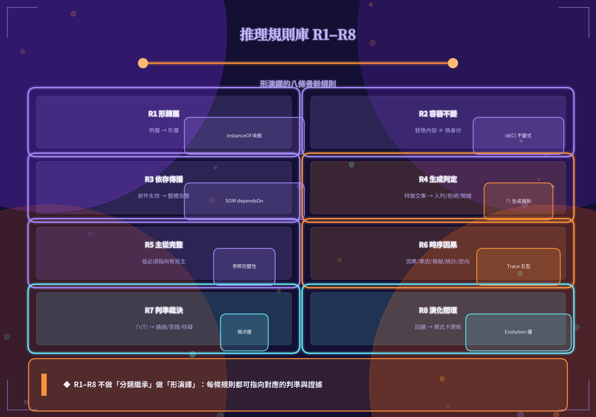

**圖 9-2　推理規則庫：形演繹的八條骨幹**

R1–R8 不做「分類繼承」做「形演繹」：每條規則都指向對應的判準與證據，推導產物一律以 Trace 記錄。八條規則分三組——空間組（R1 形歸屬、R2 容器不變、R3 依存傳播、R5 主從完整）、生成組（R4 生成判定）、時間組（R6 時序因果、R7 判準裁決、R8 演化閉環）。

| 規則 | 形式 | 輸出去向 |
| --- | --- | --- |
| R1 形歸屬 | instanceOf(e,T) ⇒ e 受 T 的全部維度支配 | 例層完整性檢查 |
| R2 容器不變 | replace(c1→c2) ⇒ id(C) 恆等 | 容器身份驗證 |
| R3 依存傳播 | fail(p) ∧ dependsOn(p,q) ⇒ alert(整體) | SOM 告警 |
| R4 生成判定 | features(e) ∩ rule ⇒ Admit／Reject／NewDim | 抽象集合／形層協定 |
| R5 主從完整 | references(f,p) ⇒ exists(PK(p)) | 參照完整性 |
| R6 時序因果 | 五型模板：因果/果因/模擬/統計/逆向 | Trace 生成 |
| R7 判準裁決 | candidate × criterion ⇒ 通過/否證/存疑 | 裁決邊 |
| R8 演化閉環 | feedback(版本) ⇒ pattern 更新 ⇒ 新版本 | Evolution 軌跡 |

## 9.3　三則完整查詢情境

### 情境一：新零件入圖——從形定位到生成判定

一個新零件進來。Q1 先問「這是什麼形」：沿 instanceOf 找不到直接歸屬，觸發 Q5 生成判定——Rule 節點比對特徵交集，判定「入列」並留下生成記錄；若與所有維度對不上，則 R4 轉入「開維度」分支，形層演化協定啟動，Q10 記下原因與版本。**一次入圖事件，動用了 Q1、Q5、Q10 與 R1、R4——這就是形演繹與圖查詢的分工。**

### 情境二：失效追溯——從告警到根因

整體出現失效告警（R3 依存傳播的產物）。Q4 沿 SOM 展開組成、定位失效部件；Q6 沿 references 回溯部件的來源批次；Q11 調出該部件入圖時的判準裁決——發現當年是「存疑態」入圖、判準未更新。Q12 溯鏈確認證據缺口。**從現象到根因的完整路徑，每一跳都是圖上的結構，不是分析師的靈感。**

### 情境三：結論重現——這條推理還算數嗎

半年前的一條設計結論被重新引用。Q9 調出 Trace 重現推理五型的完整路徑；Q10 發現推理所依賴的某個形在兩個月前經歷「新增欄」演化（版本已進兩階）；Q11 重新執行判準裁決——R7 判定舊結論在新版本下「存疑」。**結論不是永恆的：形在演化，結論的資格跟著演化——這正是「知識長在形上」的意義。**

> **▣ 三則情境的共同結構：查詢負責「問出結構」，推理負責「沿結構推進」，判準負責「裁決資格」，證據負責「留下紀錄」——四者缺一，圖譜就退化回資料庫。**

# 第 10 章　知識內容生命週期與治理規範

內容架構決定「長什麼樣」，治理規範決定「不出事」。本章交付形化入圖的六步驟生命週期、品質準則與檢查清單、誤用警語，以及內容完備度檢核——讓 TOKG 的內容維護有章可循。

## 10.1　形化入圖六步驟

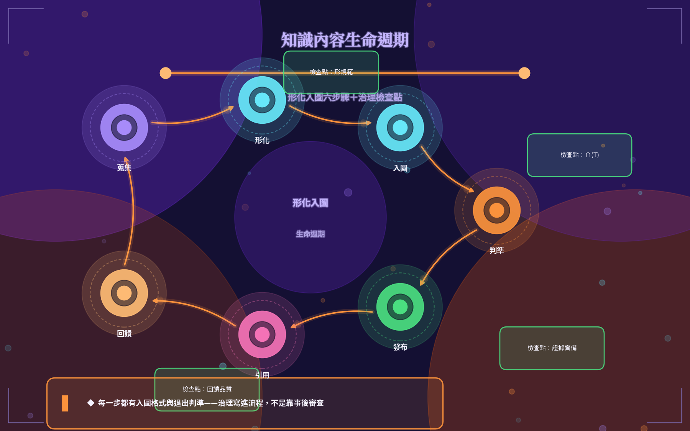

**圖 10-1　知識內容生命週期：六步驟與治理檢查點**

知識從素材變成圖譜內容，走六個步驟，每一步都有入圖格式與退出判準：

1. **蒐集：**確定素材範圍與來源標記（Source 節點先行）。檢查點：來源可追溯。
2. **形化：**判斷素材長在哪個形上；對不上既有形時觸發生成判定或開新維度。檢查點：形歸屬明確。
3. **入圖：**按空間／時間形域的 Schema 寫入節點與邊，填值遵守 IC-1～IC-3。檢查點：Schema 合格。
4. **判準：**知識候選過 ∩(T) 裁決，產生裁決邊；存疑態標注待驗。檢查點：裁決齊備。
5. **發布：**綁定版本與發布範圍，寫入形證據鏈。檢查點：證據五章齊全。
6. **引用與回饋：**使用端的引用與回饋沿掛接邊回流，觸發模式卡更新與演化軌跡。檢查點：回饋可歸因。

> **◆ 六步驟的治理哲學：檢查點寫進流程，而不是靠事後審查——每一步的退出判準都是下一步的入場券。**

## 10.2　品質準則與檢查清單

| 準則 | 檢核問題 | 不通過時 |
| --- | --- | --- |
| 形完整性 | 每個形的五件套（維度/容器/SOM/抽象/實體）齊備嗎？ | 標記缺件，限制發布 |
| 層次純淨 | 例層有沒有偷長形層沒有的邊？ | IC-1 拒入或回退 |
| 判準覆蓋 | 每條邊都過判準了嗎？ | 降為存疑態 |
| 證據齊備 | 形證據鏈五章俱全嗎？ | IC-7 不得發布 |
| 命名一致 | 同義形有沒有替身？ | 合併並記錄 |
| 演化合規 | 形層變更都走協定了嗎？ | IC-9 退回重辦 |

## 10.3　誤用警語

| 誤用 | 症狀 | 正解 |
| --- | --- | --- |
| 把形建成標籤 | 形變成節點的一個 name 欄位 | 形是支配型節點，表頭先於資料列 |
| 把時間建成欄位 | validTime 遍地開花 | 時間活動入圖為 Episode |
| 把判準建成腳本 | 檢查邏輯活在圖外 | ∩(T) 是可引用的一等節點 |
| 把註解當演化 | 「2026 重構過」寫在備註 | Evolution 節點＋版本三件套 |
| 把分類當生成 | subclass 樹無限增生 | Rule 節點＋生成判定三態 |
| 把補丁當架構 | 十二個插件互不相認 | 換底座：TOKG 三平面六層 |

## 10.4　內容完備度檢核

內容完備度以 R1–R12 為檢核清單，分三級：C1 結構完備（六層 Schema 落位、不變式可驗）、C2 內容完備（領域形的五件套齊備、Q1–Q12 全部可答）、C3 信任完備（判準覆蓋率、證據鏈完整率、演化記錄齊全率達標）。三級逐級驗收，缺級不得越級宣稱。

# 第 11 章　領域內容示例庫

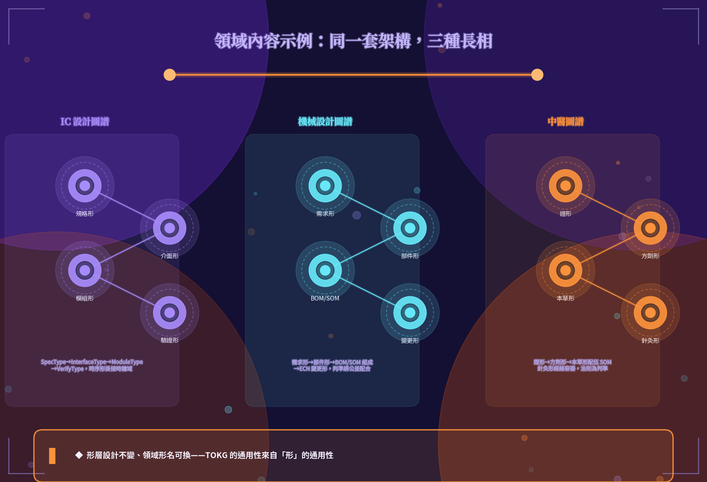

**圖 11-1　三領域圖譜樣貌：同一套架構，三種長相**

TOKG 的通用性來自「形」的通用性：形層設計不變、領域形名可換。本章以 IC 設計、機械設計、中醫三個領域示範「同一套內容架構的三種長相」——重點不在領域知識本身，而在「形如何長在架構上」。

## 11.1　IC 設計知識圖譜樣貌

IC 領域的形譜系以規格形（SpecType）起點，經介面形（InterfaceType）到模組形（ModuleType），由驗證形（VerifyType）收束，時序形（TimingType）掛接在時鐘域上。在 TOKG 裡：SpecType 的規格條目是維度、每條規格的達成狀態是答案；ModuleType 的 SOM 以 hasPart 表達子模組依存；驗證形的每一輪驗證是 Episode、驗證計畫是 Pattern；**「這個 RTL 為什麼長這樣」由 Trace 回答，「這個規格改過幾次」由演化軌跡回答**。

## 11.2　機械設計知識圖譜樣貌

機械領域的形譜系是需求形→部件形→BOM／SOM 組成→變更形（ECN）。BOM 在 TOKG 裡是「清單視角」，SOM 是「結構視角」——同一組部件，前者回答「有什麼」，後者回答「怎麼組、拿掉會怎樣」。公差與配合是判準層的條件集：尺寸答案必須過 ∩(T) 的公差判準才能發布；ECN 是形層演化協定的標準客戶——**每一次變更都走版本三件套，圖譜即 PLM 的知識底層**。

## 11.3　中醫知識圖譜樣貌

中醫領域的形譜系是證形→方劑形→本草形配伍，針灸形掛在經絡容器上。方劑的配伍是教科書級的 SOM：藥物有位置（君臣佐使）、有依存、有必要性；經絡是容器 ( )：身份恆定、其上穴位可多可少；治則與配伍禁忌（如十八反十九畏）是判準層的條件集；**「這個方為什麼這樣組」由 Pattern 模式卡與 Trace 共同回答**——醫案即 Episode，辨證即生成判定。

## 11.4　通用性觀察

- **形名可換、骨架不換：**三領域的節點名稱全然不同，但六層 Schema、不變式 IC-1～IC-9、Q1–Q12、R1–R8 一行不改。
- **判準因域而異、地位不變：**公差、配伍禁忌、時序約束內容各異，但都是一等判準節點、都走裁決邊。
- **活動入圖處處相同：**設計、驗證、辨證在時間形域裡都是 Episode／Pattern／Trace——動詞的形是跨域的。

# 第 12 章　結語：從圖譜回到形

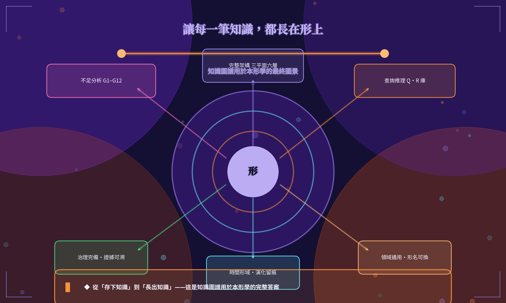

**圖 12-1　讓每一筆知識，都長在形上**

本書走完兩段路：分析篇指出，把本形學倒進傳統知識圖譜，形會被降級（G1）、時間會被切片（G8）、判準會被架空（G12）——十二處缺口，一個根因：三元組的世界觀裡沒有形。方案篇給出回應：形導向知識圖譜 TOKG，以形為一等構件、以三平面六層承載空間與時間、以判準與證據守門、以查詢與推理釋放價值、以生命週期與治理長治久安。

這套方案的最終圖景是：知識不再是「被存進圖裡的資料」，而是**長在形上的活體**——它知道自己屬於什麼形、沿哪條軸展開、過哪道判準、從哪來、怎麼長大的。圖譜從「存下知識」的倉庫，變成「長出知識」的土壤。這就是知識圖譜用於本形學的完整答案。

> **◆ 一句話總結：三元組描繪世界的照片，形承載世界的生長——知識圖譜用於本形學，就是讓圖譜學會生長。**

# 附錄 A　TOKG Schema 總表

| 層 | 節點類型 | 必備屬性 | 主要邊型 |
| --- | --- | --- | --- |
| 形層 | Type | id・名稱・版本・判準集 | hasDimension・hasContainer・hasPart |
| 形層 | Dimension | 名稱・序・開出時間・開出原因 | asks・answerOf |
| 形層 | Attribute／Value | 問題語句／值・單位 | fillValue（經實體） |
| 例層 | Entity | 主鍵・入圖時間 | instanceOf・references・fillValue |
| 空間形域 | Container | id(C)・S(C)・不變式代碼 | replaceableContent |
| 空間形域 | SOM 邊族 | slot・必要性 | hasPart・dependsOn |
| 時間形域 | Episode／Phase | 起訖・觸發・產出 | hasPhase・actsOn・produces |
| 時間形域 | Pattern | 前提・步驟・產出・判準 | instantiates・revises |
| 時間形域 | Trace／Method／Search | 五型・序列／類型／查詢式 | emergesIn・guides・triggers |
| 時間形域 | Evolution | 版本三件套 | learnsFrom・revises |
| 判準層 | Criterion／Rule | 條件集・範圍・裁決邏輯／交集條件 | validates・rejects・defers・ruleOf |
| 證據層 | Source／Chain | 來源・版本・時間・責任 | 五節點鏈（來源→形化→判準→發布→引用） |

# 附錄 B　G1–G12 缺口對應索引

| 缺口 | 名稱 | 根因 | TOKG 回應構件 | 章節 |
| --- | --- | --- | --- | --- |
| G1 | 形降級 | 三元組無形構件 | 形層支配型節點＋IC-1 | 6.1 |
| G2 | 類實體鴻溝 | 類/實體二分靜態 | 形層演化協定＋版本三件套 | 6.4・7.4 |
| G3 | 容器失語 | 集合無身份 | Container＋不變式 IC-5 | 6.3 |
| G4 | 結構扁平 | part-of 無序 | SOM 邊族（slot・必要性・dependsOn） | 6.3 |
| G5 | 問答錯位 | 屬性淪為槽位 | Attribute 問題節點＋fillValue | 6.1 |
| G6 | 座標缺失 | 雙軸擠一條 | XY-Anchor 標注＋兩軸路徑 | 6.4 |
| G7 | 生成靜態 | 分類樹代生成 | Rule 生成判定三態 | 8.2 |
| G8 | 時間降維 | 時間淪為欄位 | Episode 事件形 | 7.1 |
| G9 | 過程無形 | 動詞無節點型 | Pattern／Trace／Method | 7.2 |
| G10 | 動詞靜態 | 演化淪為註解 | 活動節點＋掛接邊 | 7.1・7.3 |
| G11 | 演化無痕 | 版本無原因 | Evolution＋版本三件套 | 7.4 |
| G12 | 判準缺位 | 蘊含不裁決 | Criterion 判準節點＋裁決邊 | 8.1 |

# 附錄 C　查詢模式與推理規則速查卡

## C.1　查詢模式 Q1–Q12 速查

| 模式 | 一問 | 面 |
| --- | --- | --- |
| Q1 形定位 | 這是什麼形？ | 空間 |
| Q2 屬性問答 | 這個維度的答案？ | 空間 |
| Q3 容器內容 | 裝過什麼、現在裝什麼？ | 空間 |
| Q4 SOM 結構 | 怎麼組、拿掉會怎樣？ | 空間 |
| Q5 抽象歸屬 | 新成員算不算？ | 空間 |
| Q6 主從參照 | 誰屬於誰？ | 空間 |
| Q7 雙軸展開 | 沿 X／Y 軸展開什麼？ | 空間 |
| Q8 模式檢索 | 有沒有現成做法？ | 時間 |
| Q9 推理重現 | 結論怎麼推的？ | 時間 |
| Q10 演化軌跡 | 改過什麼、為何改？ | 時間 |
| Q11 判準驗證 | 過不過 ∩(T)？ | 保證 |
| Q12 證據溯鏈 | 來源與驗證完整嗎？ | 保證 |

## C.2　推理規則 R1–R8 速查

| 規則 | 一句話 | 組 |
| --- | --- | --- |
| R1 形歸屬 | 例受形的全部維度支配 | 空間 |
| R2 容器不變 | 換內容物不換身份 | 空間 |
| R3 依存傳播 | 部件失效，整體告警 | 空間 |
| R4 生成判定 | 交集判定三態：入列/拒絕/開維 | 生成 |
| R5 主從完整 | 從必須指向有效主鍵 | 空間 |
| R6 時序因果 | 因果/果因/模擬/統計/逆向五型 | 時間 |
| R7 判準裁決 | 候選×判準⇒通過/否證/存疑 | 保證 |
| R8 演化閉環 | 回饋⇒模式更新⇒新版本 | 時間 |

# 附錄 D　術語對照表（本形學 ↔ TOKG ↔ 知識圖譜 ↔ RDB）

| 本形學 | TOKG | 知識圖譜通用語 | RDB |
| --- | --- | --- | --- |
| 形 Type | Type 節點 | Class／Concept（近似） | 表頭 |
| 實體 | Entity 節點 | Instance／Individual | 資料列 |
| 屬性（問題） | Attribute 節點 | Property（不等價） | 欄位 |
| 屬性值（答案） | Value 節點 | Literal | 儲存格 |
| 空間容器 ( ) | Container | （無對應） | 主表 |
| BOM | hasPart 清單視角 | part-of（扁平） | 部件表 |
| SOM { } | hasPart+dependsOn 結構視角 | （無對應） | 部件表+約束 |
| 抽象 [ ] | Rule 生成規則 | subClassOf（不等價） | （無對應） |
| 框架四步驟 | 形層演化協定 | Schema Evolution（近似） | ALTER TABLE（近似） |
| ∩(T) 判準 | Criterion 節點 | Constraint／SHACL（近似） | CHECK／Trigger |
| 形證據鏈 | 五節點鏈 | PROV-O（近似） | 稽核表（近似） |
| 搜尋/推理/設計模式 | Episode/Trace/Pattern | （無對應） | （無對應） |
| 自我演化 | Evolution+版本三件套 | （無對應） | 變更日誌（近似） |
| 主鍵 | PK（身份） | URI／skos:Concept（近似） | PRIMARY KEY |
| 主從與參考 | references 邊族 | Object Property | FOREIGN KEY |

> **▣ 譯名鐵律：「形」的英文是 Type，不是 Form。SpecType・InterfaceType・ModuleType・Type-Driven 等一律沿此。**

# 附錄 E　名詞索引

| 名詞 | 首次出現 |
| --- | --- |
| 承載要求 R1–R12 | 1.3 |
| 缺口 G1–G12 | 1.4・2–4 章 |
| 形導向知識圖譜 TOKG | 5.1 |
| 三平面六層 | 5.3 |
| 設計原則 P1–P4 | 5.2 |
| 形層／例層 | 5.3・6.1–6.2 |
| 三括號編碼 | 6.3 |
| 形層演化協定 | 6.4 |
| 事件形 Episode／模式形 Pattern／推理鏈 Trace | 7.1–7.2 |
| 掛接邊 | 7.3 |
| 版本三件套 | 7.4 |
| 判準節點 Criterion／裁決邊 | 8.1 |
| 生成判定三態 | 8.2 |
| 形證據鏈五節點 | 8.3 |
| 不變式 IC-1～IC-9 | 6.1・8.4 |
| 查詢模式 Q1–Q12 | 9.1 |
| 推理規則 R1–R8 | 9.2 |
| 形化入圖六步驟 | 10.1 |
| 內容完備度 C1–C3 | 10.4 |

[www.longreat.net](https://www.longreat.net)

張長豐 [gamma@livemail.tw](mailto:gamma@livemail.tw)

張楟潁 [mindaiworks@gmail.com](mailto:mindaiworks@gmail.com)
