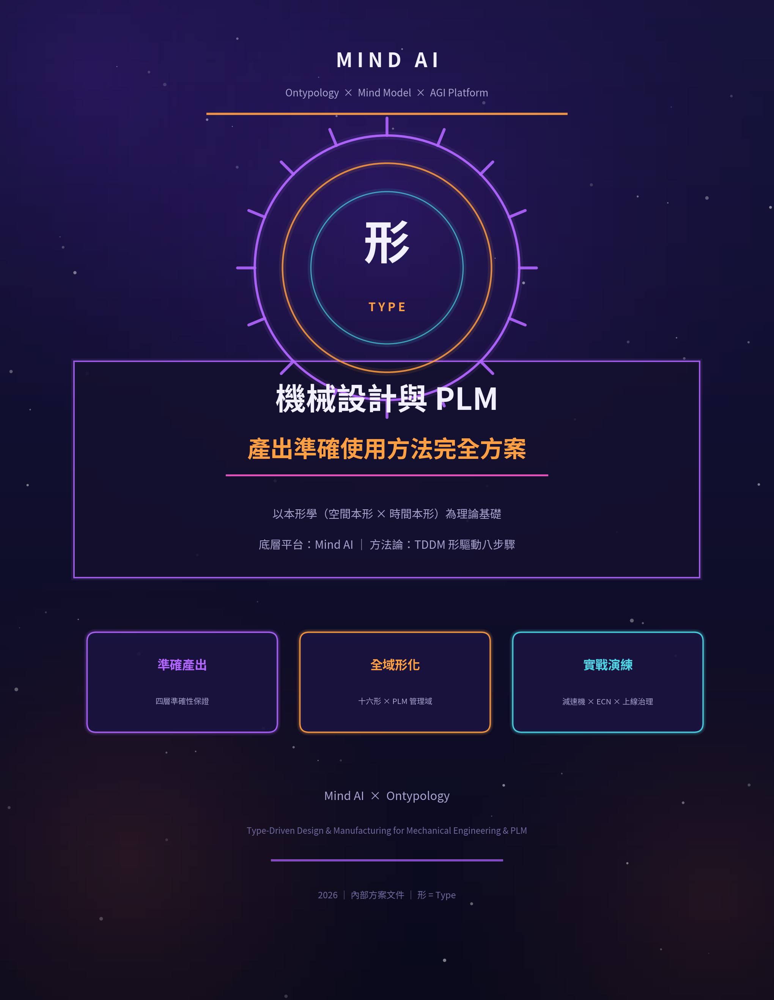

# 目　錄

- **第 1 章　應用定位與雙本形運用總綱**
  - 1.1　本方案的定位與閱讀方式
  - 1.2　空間本形 × 機械設計：運用總綱
  - 1.3　時間本形 × 設計生命週期：運用總綱
  - 1.4　Mind AI 底層平台定位
  - 1.5　四層準確性保證
  - 1.6　術語對照與命名規範
- **第 2 章　空間本形的機械形化工程**
  - 2.1　異同 → 分合 → 形：需求訪談中的形誕生
  - 2.2　X 軸與 Y 軸：零件分類 × 產品結構
  - 2.3　屬性與屬性值：物料主檔與欄位治理
  - 2.4　空間容器：裝配、工位與配置
  - 2.5　BOM 與 SOM：EBOM / MBOM / PBOM / SBOM 全景
  - 2.6　框架四步驟：設計框架與資料框架
  - 2.7　RDB 對應 PLM 資料模型
  - 2.8　三括號形集合與 ∩(T) 交集判準
  - 2.9　形化工程落地檢查表
- **第 3 章　時間本形的設計生命週期運用**
  - 3.1　形時間函式搜尋：設計案例檢索
  - 3.2　設計搜尋與萃取：標竿拆解與專利分析
  - 3.3　設計模式：機構模式庫與標準模組
  - 3.4　推理五型：從 FMEA 到故障樹
  - 3.5　思考法五型：工程創新方法
  - 3.6　解題與分析：工程問題的形化分析
  - 3.7　設計（創造與創新）
  - 3.8　邏輯生成與應用：規則驅動設計檢查
  - 3.9　持續學習・重構與重組・自我演化
- **第 4 章　機械設計 × PLM 知識域全景**
  - 4.1　設計生命週期六域
  - 4.2　PLM 管理八域
  - 4.3　全域形總表：十六形 Schema
  - 4.4　準確產出契約（Output Contract）
  - 4.5　人機授權矩陣
  - 4.6　域間交接規格
- **第 5 章　TDDM 形驅動八步驟**
  - 5.1　TDDM 總覽與共同紀律
  - 5.2　S1 需求形化
  - 5.3　S2 功能展開
  - 5.4　S3 結構合成
  - 5.5　S4 介面與公差
  - 5.6　S5 分析驗證
  - 5.7　S6 工藝與 BOM 轉換
  - 5.8　S7 變更與配置
  - 5.9　S8 證據彙整
  - 5.10　八步驟 × 四層準確性對照
  - 5.11　裁剪指引：依專案規模適配
- **第 6 章　S1–S9 提示詞手冊與實戰演練**
  - 6.1　六段式提示詞共同規範
  - 6.11　演練一 SC-01：行星減速機全流程實跑
  - 6.12　演練二 SC-02：ECN 變更管理實跑
  - 6.13　演練三 SC-03：PLM 上線與資料治理
  - 6.14　常見問答（QA）
- **第 7 章　準確性與品質保證**
  - 7.1　幻覺三關
  - 7.2　一致性檢查
  - 7.3　形證據鏈
  - 7.4　驗證矩陣
  - 7.5　常見誤用警語彙整
  - 7.6　導入成熟度速覽
- **第 8 章　附錄**
  - 附錄 A　S1–S9 速查卡
  - 附錄 B　全域形總表 Schema 速查
  - 附錄 C　檢查清單彙整
  - 附錄 D　術語對照表
  - 附錄 E　空白表單範本
  - 附錄 F　快速入手三日計畫
  - 附錄 G　工程速查表
  - 附錄 H　演練與工作表單
  - 附錄 I　名詞索引（依主題）
  - 附錄 J　提示詞常見錯誤與修正對照
  - 附錄 K　文件使用守則與修訂記錄

# 文件說明

本文件為《機械設計與 PLM 產出準確使用方法完全方案》，以本形學（Ontypology）空間本形與時間本形為理論基礎、以 Mind AI 為底層平台，定義機械設計與產品生命週期管理（PLM）領域的「準確產出使用方法」。文件聚焦於方法的運用：如何把本形學的形（Type）概念正確地套用在需求、設計、BOM、變更、驗證與證據管理之上，並透過 TDDM 形驅動八步驟與 S1–S9 提示詞手冊，讓每一次產出都可判準、可檢核、可回溯。

依文件定位，本方案不重複收錄本形學（空間本形篇、時間本形篇）與 Mind AI 平台的原始內容，僅在運用層引用其術語與架構；平台底層之推理引擎、記憶系統與學習系統由 Mind AI 承擔，本文件定義的是「使用方法」而非系統實作，故不含程式碼與系統建置細節。全文「形」之英文一律為 Type（非 Form）。

> **閱讀對象與使用方式**
> 對象：機械設計工程師、PLM 導入顧問、研發主管、品質與資料治理人員。
> 用法：第 1–4 章建立共同語言與知識域全景；第 5 章為方法論主幹；第 6 章為日常操作核心（提示詞手冊＋演練）；第 7 章為品質保證；第 8 章附錄供速查。
> 裁決原則：AI 負責草擬與計算輔助，工程裁決與核准權責永遠在人（見 4.5 人機授權矩陣）。

# 第 1 章　應用定位與雙本形運用總綱

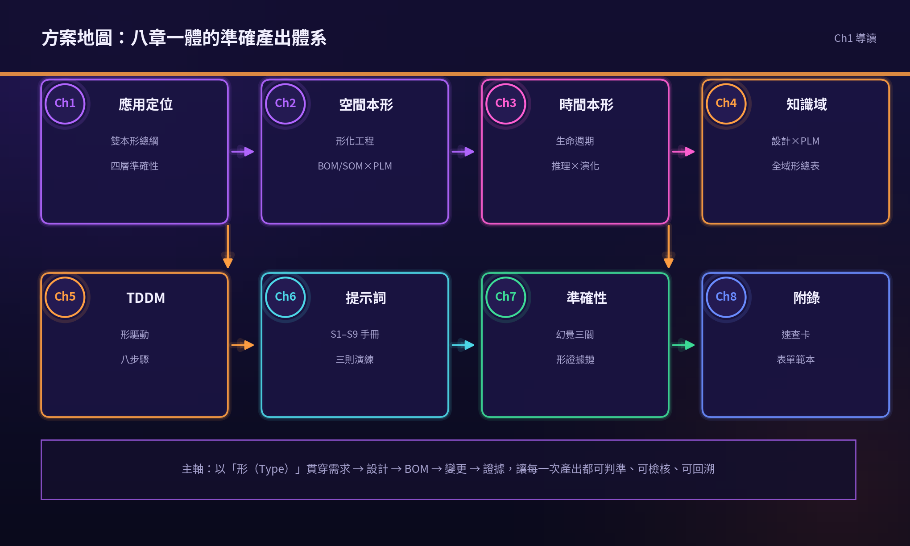

**圖　方案地圖：八章一體的準確產出體系**

## 1.1　本方案的定位與閱讀方式

機械設計與 PLM 領域長年面對一個根本落差：設計知識存在工程師的腦中與散落的檔案裡，而管理系統需要結構化、可比較、可追溯的資料。兩者之間的翻譯成本極高，且每次翻譯都是一次誤差來源。本形學給出的答案是：先把世界「形化」——用異同偵測與分合動作畫出邊界，為每個邊界命名並定義判準，再讓所有產出掛在形的骨架上。如此，「設計的直覺」與「管理的結構」共用同一套語言，翻譯成本趨近於零。

本方案把這套方法完整映射到機械設計與 PLM：空間本形負責回答「設計的結構」——零件如何分類、產品如何組成、BOM 如何分層、資料如何治理；時間本形負責回答「設計的過程」——案例如何檢索、推理如何展開、變更如何演化、知識如何沉澱。兩者交會處，就是準確產出。

### ◆ 本方案七項主張

- 工程知識必須形化：形（Type）是知識的最小受控單位，未形化的知識無法複用、無法稽核。
- 判準先行：先立 ∩(T) 再產出，是準確性的根本順序；事後放寬判準等於宣判產出不準確。
- 生成寬、裁決嚴：候選方案要多、選擇標準要硬；創造與裁決是兩種不同的動作。
- 四份 BOM 同源：EBOM/MBOM/PBOM/SBOM 是同一 SOM 的四種投影，以料號互參、禁止複製。
- 證據即時歸檔：形證據鏈隨步驟建立，結案只做彙整，不做補件。
- 裁決權在人：AI 主導草擬，工程師裁決、主管核准——人機授權矩陣是制度不是建議。
- 形庫即資產：每一次 ECN、8D、模式卡更新都在增值公司的設計智慧，與人員流動無關。

## 1.2　空間本形 × 機械設計：運用總綱

空間本形的核心主張是：世界萬物皆可由形來表達與理解，一個形的完整理解包含「是什麼樣子」（屬性）、「在哪裡」（容器）、「由什麼組成」（BOM/SOM）、「描述方法能否重複套用」（框架）。機械工程其實早已在不自覺地使用這套語言——物料清單就是 BOM、產品結構就是 SOM、物料主檔就是屬性表、選配就是容器、零件分類就是 X 軸。本方案只是把這些「不自覺的用法」升級為「有判準的用法」。

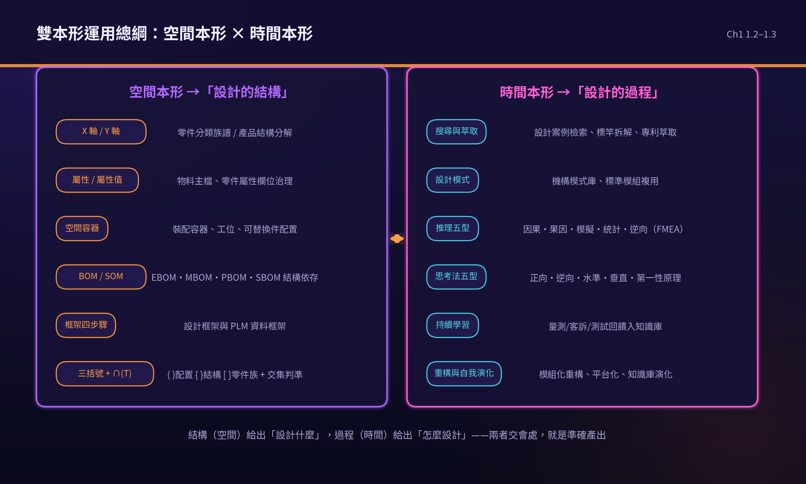

**圖　雙本形運用總綱：空間本形看結構、時間本形看過程**

| 空間本形概念 | 機械設計 × PLM 對應 | 準確產出意義 |
| --- | --- | --- |
| 異同 → 分合 → 形 | 需求訪談中的差異偵測與需求形化 | 需求不是抄寫，是被偵測、分合、命名後成形 |
| X 軸（分類） | 零件族譜、材料分類、標準件庫 | 同一零件可同時屬於多條分類軸，互不衝突 |
| Y 軸（拆解） | 產品結構分解、BOM 樹 | 每一拆解層都是完整獨立、可命名的部件 |
| 屬性 / 屬性值 | 物料主檔、零件屬性欄位 | 欄位是維度、欄位值是刻度；新欄位須回填全部零件 |
| 空間容器 ( ) | 裝配體、工位、配置內容 | 內容物可替換而身份不變，是選配管理的理論基礎 |
| BOM / SOM { } | EBOM・MBOM・PBOM・SBOM | 部件依存與必要性分級，直接對應安全關鍵件管理 |
| 框架四步驟 | 設計框架、PLM 資料 Schema 治理 | 維度先立好，新資料才有安放之處 |
| 抽象 [ ] ∩(T) | 零件族、標準件判定、規範符合性 | 以交集判準動態判定，而非人工查清單 |
| RDB 對應 | PLM 資料模型（表頭=形、料號=主鍵） | 資料庫結構即形的結構，管理即形的治理 |

## 1.3　時間本形 × 設計生命週期：運用總綱

時間本形描述形如何在時間中被操作與演化：形時間函式搜尋、設計搜尋與萃取、設計模式、邏輯生成、持續學習、重構與重組、解題、分析、設計、推理、思考法、研發探索與自我演化。對應到機械工程，這正是「一個設計案從模糊需求走到量產、再從量產回饋到下一代設計」的完整時間軸。

時間本形的運用要點是：每一個設計動作都不是一次性的文字產出，而是形在時間軸上的一次事件——案例檢索是「形的搜尋」，設計評審是「形的裁決」，ECN 是「形的時間分叉」，量產回饋是「形的自我演化」。把事件記錄成形資料，設計知識才會隨專案累積而非隨人員流失。

## 1.4　Mind AI 底層平台定位

本方案的底層平台為 Mind AI。在分工上，LLM 負責語言能力（理解、生成、召回、歸納統計），Mind Model 負責智慧能力（知識統一、演繹推理、長期記憶、自我演化），Mind AI 平台整合推理引擎、記憶系統、學習系統與規劃系統，形成完整智慧架構。

對本方案而言，平台的意義在於：所有「形」（需求形、結構形、BOM 形、變更形……）由 Mind Model 統一表示與演繹推理，所有敘述性文字由 LLM 生成但受演繹骨架約束——這正是四層準確性中「演繹骨架層」的由來。使用者依本方案的提示詞與流程操作 Mind AI，即可得到受判準約束、附證據鏈的工程產出；平台內部實作不在本文件範圍。

在使用姿態上，有一點必須釐清：Mind AI 不是「自動設計機」，而是「形化工作台」。它負責把散亂素材形化、在形的骨架內生成候選、標註證據與缺口；工程師負責立判準、做裁決、扛責任。這個分工與傳統 CAE 工具的定位相同——工具保證計算的可靠，工程師保證決策的正確；唯一的新事是：這次連「文件」本身也被工具保證了。

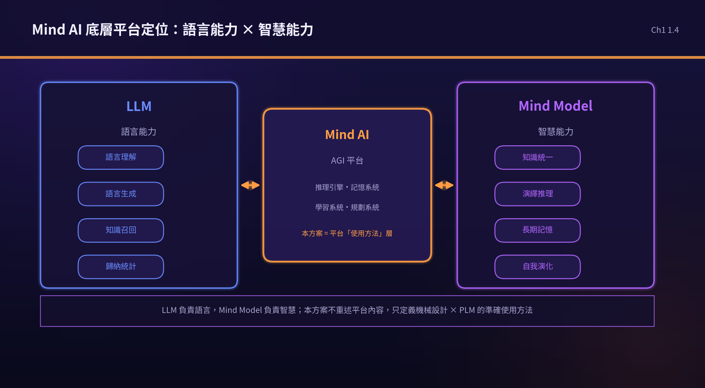

**圖　Mind AI 底層平台定位：LLM 語言能力 × Mind Model 智慧能力**

## 1.5　四層準確性保證

「產出準確」是本方案的第一目標。準確性不依賴生成模型的即時表現，而依賴四層疊加的保證機制——任何一層缺席，產出就會退化為「看似合理的文字」而非「可裁決的工程資產」。

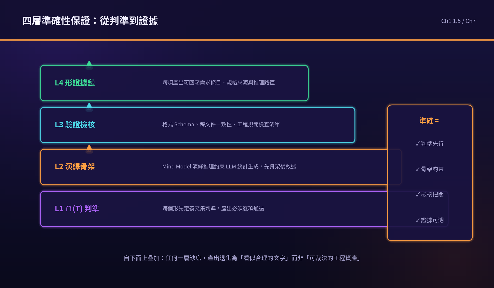

**圖　四層準確性保證：判準 → 骨架 → 檢核 → 證據**

| 層 | 機制 | 運作方式 | 失守後果 |
| --- | --- | --- | --- |
| L1 判準層 | ∩(T) 交集判準 | 每個形先定義特徵集合與判準，產出逐項通過才成立 | 形名存實亡，分類與選型靠感覺 |
| L2 骨架層 | 演繹骨架約束 | Mind Model 先演繹推理骨架，LLM 再於骨架內生成敘述 | 幻覺數值、張冠李戴的規範引用 |
| L3 檢核層 | 驗證檢核清單 | Schema 格式、跨文件一致性、工程規範檢查 | 格式漂移、同物異名、版本錯置 |
| L4 證據層 | 形證據鏈 | 每項產出標註來源、輸入版本、判準結果、裁決人 | 無法稽核、無法追溯、無法複用 |

> **準確的操作性定義：**
>
> 任何一項工程產出，都必須能回答「依據什麼判準、經過什麼推理、由誰裁決、可回溯到哪一條需求」。四問缺一，即為不準確。

## 1.6　術語對照與命名規範

本方案沿用本形學術語體系，並明確規定：「形」的英文為 Type，不是 Form。凡 SpecType、ModuleType 等命名一律以 Type 結尾；文件中「形化」「成形」「形的」等詞皆指 Type 之運作。下表為核心術語對照（完整對照見附錄 D）。

| 本形學術語 | 英文 | 機械設計 × PLM 對應 |
| --- | --- | --- |
| 形 | Type | 需求形、零件形、BOM 形……全域十六形 |
| 屬性 / 屬性值 | Attribute / Value | 欄位 / 欄位值；物料主檔維度 |
| 空間容器 | Space Collections | 裝配體、工位、配置容器 |
| BOM / SOM | Bill of Materials / Space of Materials | 物料清單 / 空間清單（產品結構） |
| 框架 | Framework | 設計框架、PLM 資料框架 |
| 交集判準 | ∩(T) | 標準件判定、規範符合性判準 |
| 主鍵 / 參考 | Primary Key / Reference | 料號 / BOM 父子參考 |
| 形集合三括號 | ( ) { } [ ] | 容器 / 結構 / 抽象（零件族） |

> **本章重點整理**
> 本方案是「使用方法」層：不重述本形學與 Mind AI 原始內容，只定義機械設計 × PLM 的準確用法。
> 空間本形看結構、時間本形看過程；兩者交會處即準確產出。
> 四層準確性：∩(T) 判準 → 演繹骨架 → 驗證檢核 → 形證據鏈，缺一層即退化為文字。
> 命名規範：形 = Type；凡英文命名一律以 Type 結尾。

# 第 2 章　空間本形的機械形化工程

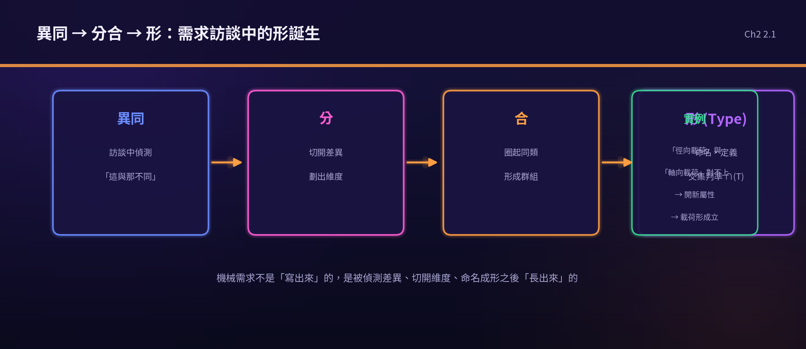

**圖　異同 → 分合 → 形：需求訪談中的形誕生**

## 2.1　異同 → 分合 → 形：需求訪談中的形誕生

形不是天生存在的，是大腦先偵測異同、再以分合動作畫出邊界後的結果。這條認知鏈直接決定了需求工程的正確做法：需求規格不是「把客戶的話抄下來」，而是在訪談與拆解中偵測差異（「這個工況跟那個工況不一樣」），把相異處切開（分）、把相同處圈起（合），最後為每條邊界命名並定義驗收判準——這才是需求形（RequirementType）的誕生過程。

實務上，這條鏈的操作順序是：先蒐集原始敘述（訪談紀錄、法規、標竿規格），逐句標註差異點；把性質相同的差異合併成一條需求條目；為每條條目命名並寫下交集判準 ∩(T)（驗收條件）；凡無法通過判準的條目退回重寫。經過這個流程產出的需求形表，每一個條目都是一條「被畫出邊界的形」，而不是一句含糊的期望。

> **需求形化的三個禁止**
> 禁止直接把訪談逐字稿當規格——那是差異的原料，不是形。
> 禁止只有名稱沒有判準——不能被驗收的條目不是形，是修辭。
> 禁止條目之間邊界重疊——兩條需求若可被同一組測試覆蓋，應當合併或重新切分。

## 2.2　X 軸與 Y 軸：零件分類 × 產品結構

X 軸回答「這是什麼樣的東西」——按共通點分組：材料族（鋼/鋁/塑膠）、工藝族（鑄造/沖壓/切削）、功能族（傳動/支撐/密封）、標準件族（ISO 螺栓/軸承）。同一個零件可以同時出現在多條 X 軸上，互不衝突，這正是零件分類體系（零件族譜）的理論基礎。

Y 軸回答「這個東西由哪幾塊組成」——盯著一個對象往下拆，每一塊拆下來都還是完整可辨識的東西：減速機拆成輸入軸系、行星輪系、輸出軸系、殼體；行星輪系再拆成太陽輪、行星輪、行星架。Y 軸的每一次拆解就是 BOM 的一層，全部層次合起來就是產品結構（SOM）。

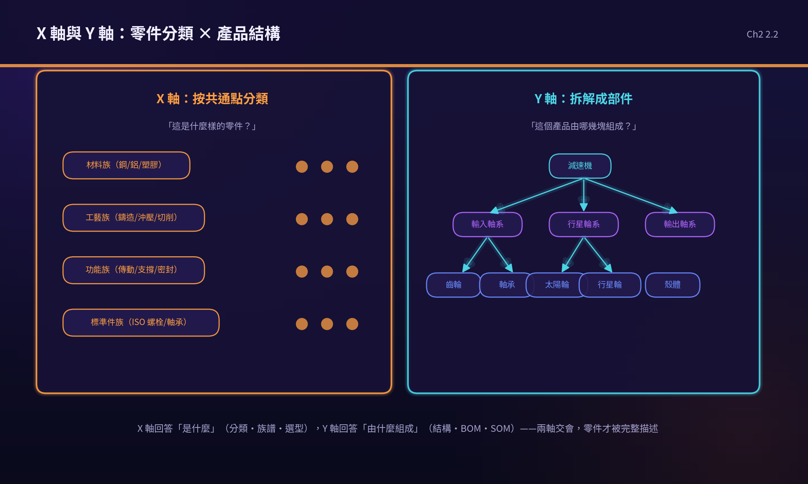

**圖　X 軸（分類・族譜）與 Y 軸（拆解・產品結構）**

兩軸互相擴充：Y 軸拆出的新部件，必須在每一條相關的 X 軸上被分類（行星輪要用什麼材料族？什麼工藝族？）；反過來，X 軸分類時若發現無法歸入任何既有維度，就逼出新的分類維度。實務含義是：產品結構（EBOM）與零件分類（族譜/標準件庫）必須同步維護，只維護一邊就會出現「結構上有這顆零件、分類上查不到」的孤兒件。

> **判斷口訣：**
>
> 問「它是什麼」→ 走 X 軸查分類；問「它裝在哪、由什麼組成」→ 走 Y 軸查結構。兩軸都答完，零件才被完整描述。

## 2.3　屬性與屬性值：物料主檔與欄位治理

屬性是一個「可以被拿來問的問題」（欄位標題），屬性值是具體答案（欄位內容）。屬性的浮現遵循本形學的浮現規則：當一批新差異與既有所有屬性都對不上時，開新屬性並回填所有已存在個體；當差異性質吻合既有屬性時，只在該屬性下加新屬性值。這條規則就是物料主檔欄位治理的鐵則。

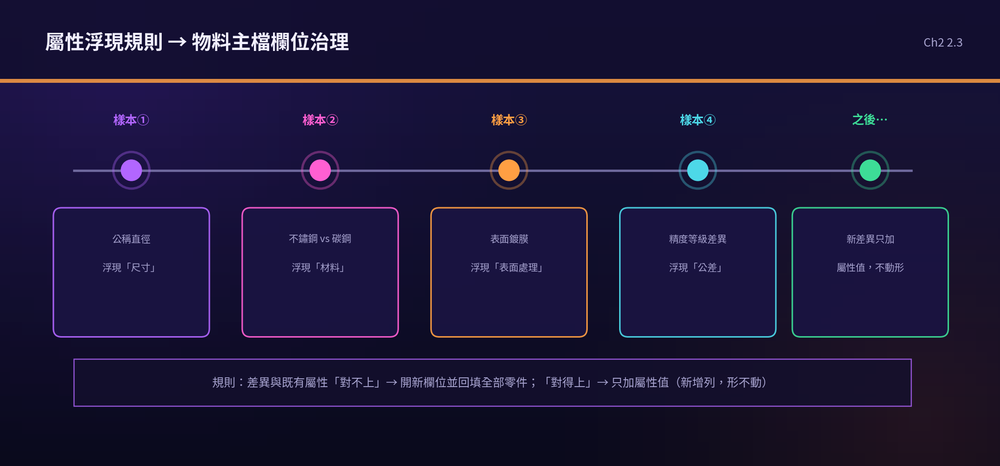

**圖　屬性浮現規則 → 物料主檔欄位治理**

| 情境 | 動作 | 治理等級 | PLM 對應 |
| --- | --- | --- | --- |
| 新零件的差異可由既有欄位描述 | 只加資料列（新料號） | 輕：形不動 | 新品號建檔 |
| 差異與所有欄位對不上 | 開新欄位＋回填全部舊零件 | 重：形變大 | ECR 級資料結構變更 |
| 既有欄位的值域不敷使用 | 該欄位加新屬性值 | 輕：刻度延伸 | 欄位值集維護 |
| 某零件某欄位長期空缺 | 禁止；維度須貫穿全部個體 | 違規 | 資料品質稽核 |

「屬性數量少、屬性值數量多」是健康的形結構特徵：欄位（維度）固定，刻度（值）可延伸。若一家公司的物料主檔動輒上百個欄位、且大量欄位長期空白，通常不是業務複雜，而是維度切分失準——多個性質不同的差異被塞進同一個欄位，或同一性質的差異被拆成多個欄位。此時應以框架四步驟（2.6）重新抽象欄位維度。

### ◆ 維度重切案例：欄位「備註」的解剖

| 原欄位內容 | 差異性質 | 應歸維度 | 處置 |
| --- | --- | --- | --- |
| 「表面鍍鎳」 | 表面處理 | 表面處理（值域） | 移入表面處理欄並回填 |
| 「出口用、需 IP54」 | 防護等級 | 防護等級（新欄） | 開新欄並回填全部機型 |
| 「含編碼器安裝孔」 | 結構特徵 | 介面形（參考） | 改掛介面形記錄 |
| 「客戶 A 指定」 | 來源/客戶 | 客戶別（配置形） | 移入配置形客戶別 |
| 「交期 3 月前」 | 時程 | 時序形 | 移入時序形，非物料屬性 |

上表展示典型的「備註黑洞」：當一個欄位長期收容性質各異的差異，它就不再是屬性，而是垃圾場。維度重切的動作是把每批差異送回它應屬的維度，並依浮現規則回填——重切完成後，備註欄應近乎為空，這正是物料主檔健康的判據。

## 2.4　空間容器：裝配、工位與配置

空間容器三要素是：邊界（區分內外）、內部空間（容納內容物）、獨立身份（不因內容物改變而改變）。機械領域中，容器邏輯無處不在：一個裝配體是容器（換掉選配馬達，它仍是同一個裝配體）；一個工位是容器（換人操作，工位不變）；一個包裝箱是容器（內容物更換，箱號不變）。

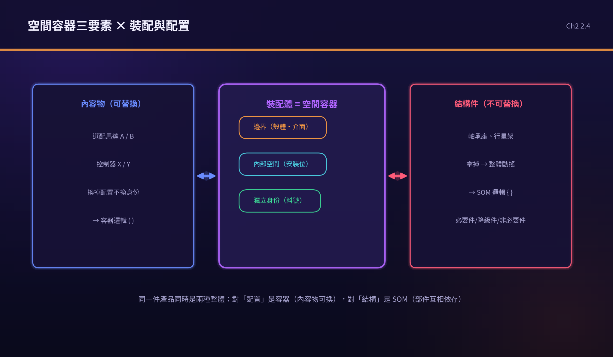

**圖　空間容器 × 裝配與配置：內容物可替換，結構件動搖整體**

容器邏輯與 SOM 邏輯的分野是配置管理的關鍵：容器裡裝的是「可替換的內容物」（選配馬達 A/B、控制器 X/Y），對應 ( ) 邏輯——替換後身份不變，只要更新配置記錄；SOM 裡裝的是「結構性部件」（軸承座、行星架），拿掉一個就動搖整體身份，對應 { } 邏輯——必須走變更流程。誤把結構件當內容物管理（直接替換不走 ECN），是 PLM 實務中最常見、也最危險的資料腐壞來源。

> **配置管理判準：**
>
> 可替換而身份不變者，走配置（選配）；拿掉即動搖整體者，走變更（ECN）。判斷錯邊，輕則帳料不符，重則安全件失控。

## 2.5　BOM 與 SOM：EBOM / MBOM / PBOM / SBOM 全景

BOM 判準只有一條：「拆下來之後，它還認得自己嗎？」能拆下來、拆下後仍是獨立可辨識個體的（軸承、齒輪、殼體）進 BOM；拆不下來、只能描述樣貌的（材料、硬度、表面粗糙度）進屬性。這條判準看似簡單，卻是 BOM 資料品質的第一道關卡——把表面處理寫成「部件」、把子組件寫成「屬性」的混亂 BOM，都是從這條判準失守開始。

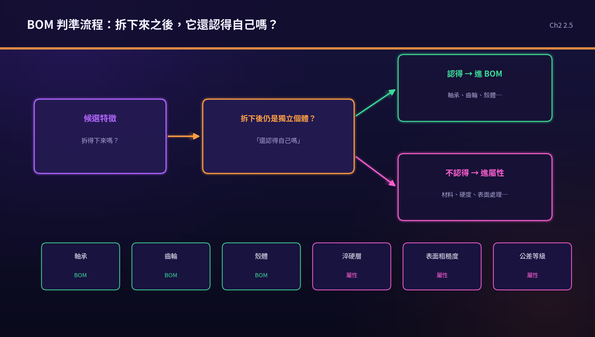

**圖　BOM 判準流程：拆下來之後，它還認得自己嗎**

SOM = BOM + 空間容器：部件不只被列出，還佔據固定空間位置、互相依存。由依存程度可將部件三分：必要件（拿掉後整體同一性喪失）、功能降級件（功能缺損但身份存續）、非必要件（裝飾/消耗件）。這套三分直接對應工程件別管理——必要件即安全關鍵件，變更時須加嚴審查；功能降級件對應可選功能件；非必要件對應裝飾件與消耗件。

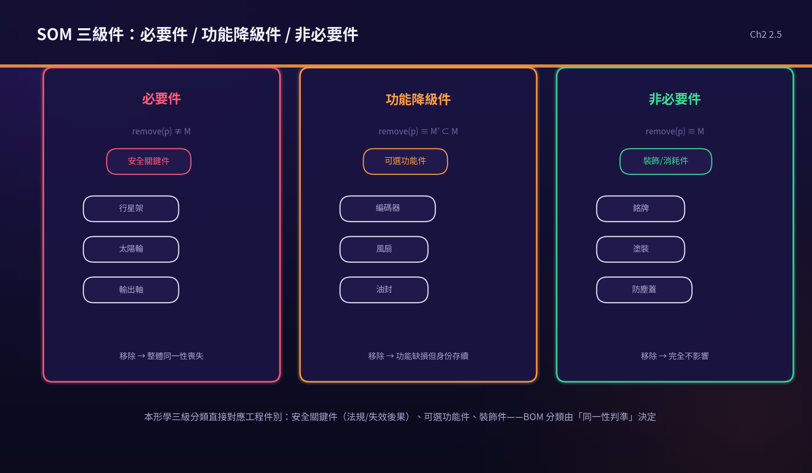

**圖　SOM 三級件分類與工程件別對應**

### ◆ 實例：行星減速機 SOM 結構表（節錄）

| 層級 | 部件 | 件數 | 必要性 | 依存關係 |
| --- | --- | --- | --- | --- |
| 1 | 殼體（含端蓋） | 1 | 必要件 | 承載全部內部件；拿掉 → 整體不存在 |
| 1 | 行星架 | 1 | 必要件 | 輸出扭力中樞；拿掉 → 傳動鏈斷 |
| 2 | 太陽輪 | 1 | 必要件 | 輸入分流節點；固定於輸入軸 |
| 2 | 行星輪 | 4 | 必要件 | 均載依賴行星架孔位置度 |
| 2 | 內齒圈 | 1 | 必要件 | 與殼體固定；反力支點 |
| 2 | 輸入軸系 | 1 | 必要件 | 含軸承 2 件；游隙影響均載 |
| 2 | 輸出軸系 | 1 | 必要件 | 含油封；與 REQ-004/012 相關 |
| 2 | 編碼器 | 1 | 功能降級件 | 拿掉 → 失位置回饋、仍可運轉 |
| 3 | 油封 | 1 | 功能降級件 | 拿掉 → 潤滑流失風險、身份存續 |
| 1 | 銘牌/塗裝 | — | 非必要件 | 裝飾；完全不影響功能 |

同一份產品結構在生命週期中被投影為四份 BOM：EBOM（設計視角）、MBOM（製造視角）、PBOM（計畫視角）、SBOM（服務視角）。本形學對四份 BOM 的治理要求是：它們是「同一個 SOM 的四種 X 軸投影」，必須以料號互相參考，禁止各自複製、各自演化——否則同一顆零件在四份清單裡會長出四種真相。

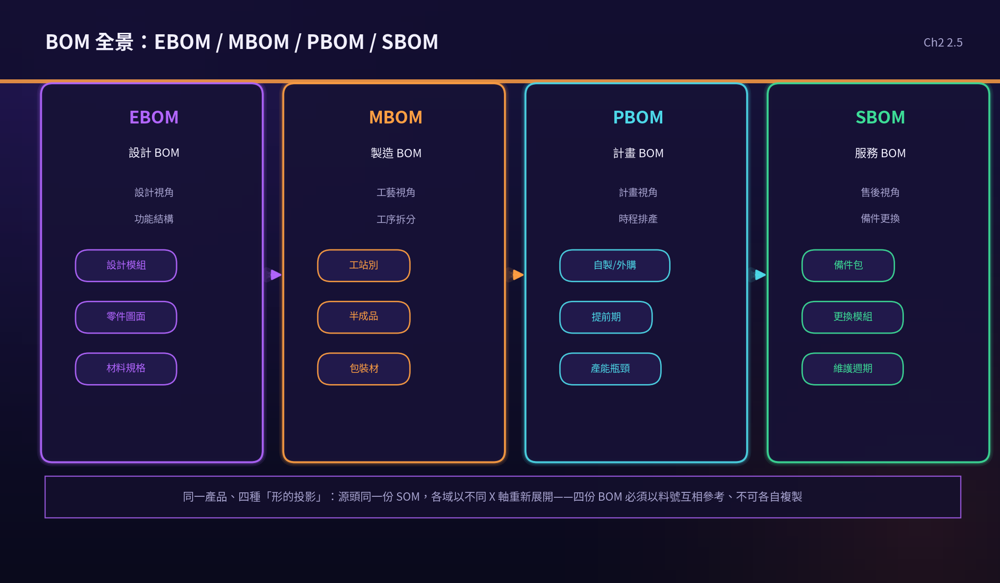

**圖　BOM 全景：同一 SOM、四種投影、料號互參**

| BOM | 視角 | 核心問題 | 常見失準 | 治理判準 |
| --- | --- | --- | --- | --- |
| EBOM | 設計 | 由哪些部件組成 | 與 3D 結構不一致 | EBOM 逐節點對應 CAD 結構樹 |
| MBOM | 製造 | 按工序如何拆分 | 半成品層缺失 | 每個自製件必有工藝路線 |
| PBOM | 計畫 | 何時何量生產 | 提前期不實 | 自製/外購與前置期齊備 |
| SBOM | 服務 | 備件如何更換 | 備件包與實際維修單元不符 | 更換模組邊界=現場更換單元 |

## 2.6　框架四步驟：設計框架與資料框架

框架四步驟把「形如何被建立」抽象成可重複套用的方法：一、先分辨「這個不是那個」；二、出現性質不同的第二批差異且與既有維度對不上時，觸發抽象；三、把兩批差異各自命名成維度；四、新事物加入時先判斷對得上哪個維度——對得上就掛入，對不上就開新維度。

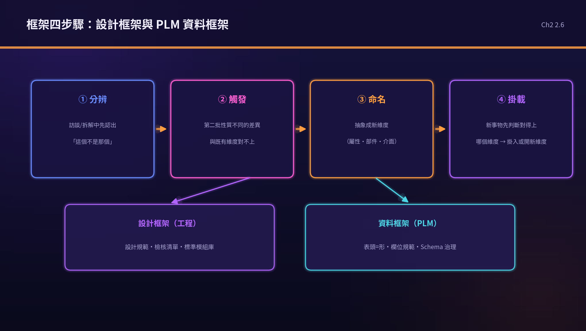

**圖　框架四步驟：從差異偵測到維度治理**

在機械設計中，框架四步驟的產物有兩類。其一是工程上的設計框架：設計規範書、檢核清單、標準模組庫的維度結構——例如把「設計輸入」抽象為載荷、工況、壽命、環境、法規五條維度，任何新專案都在這五條維度上填值。其二是資料上的 PLM 框架：Schema、欄位規範、值域代碼表——任何新料號、新文件、新變更單都必須依 Schema 填寫。兩類框架同步維護，工程語言與資料語言才會是同一套語言。

> **框架的實務效益**
> 新人接手：框架即教材——維度清單告訴他「這個產品要問哪些問題」。
> 跨部門協作：同一框架下，設計說的「精度」與製造說的「精度」是同一條維度。
> AI 操作：框架就是提示詞的輸出 Schema——形定了，生成才有骨架。

## 2.7　RDB 對應 PLM 資料模型

本形學與關聯式資料庫的對應是逐條可翻譯的：表頭是形、資料列是實體、主鍵撐住身份、外鍵主從參考連接形與形。PLM 的資料模型本質上就是形的資料庫化——零件表的表頭（料號、名稱、材料、熱處理、精度）是一組「要問什麼」的問題清單，每一個具體零件是這組問題被填上答案後的實體。

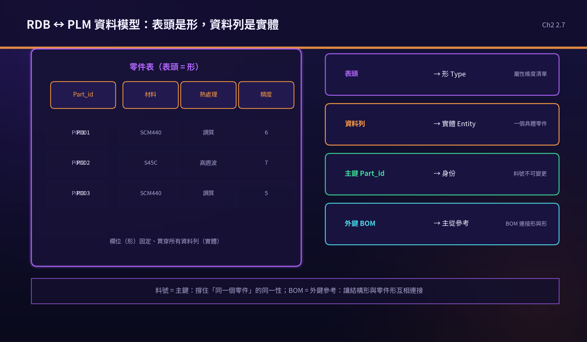

**圖　RDB ↔ PLM 資料模型：表頭是形，料號是主鍵**

兩個推論直接決定了 PLM 的資料紀律。第一，主鍵（料號）一旦指派就不得更改：料號變更會使所有 BOM 參考、圖面連結、變更記錄全部斷裂，因此料號必須用無意義流水碼或受控編碼規則，絕不使用會變的屬性（材料、供應商）編碼。第二，新增列與新增欄是兩種不對稱的變動：新增零件（列）輕巧，改 Schema（欄）沉重且須回填全部舊資料——所以 Schema 變更必須走 ECR 級審查，不得由單一工程師臨時為一顆零件私加欄位。

**圖　新增列 vs 新增欄：兩種不對稱的變動**

### ◆ 實例：零件表與 BOM 表的主從參考

下表左為零件表（主），右為 BOM 表（從）。BOM 表的父項與子項欄位填的都是零件表的主鍵（料號）——這就是「參考」：不複製零件資料，只存指向主鍵的箭頭；查細節時回零件表對應。

| 零件表（主）：Part_id | 名稱 | 材料 | BOM 表（從）：父項 | 子項 | 件數 |
| --- | --- | --- | --- | --- | --- |
| P-1001 | 減速機組件 | — | P-1001 | P-2001 | 1 |
| P-2001 | 行星架 | SCM440 | P-1001 | P-2002 | 4 |
| P-2002 | 行星輪 | SCM440 | P-1001 | P-2003 | 1 |
| P-2003 | 太陽輪 | SCM440 | P-1001 | P-2004 | 1 |
| P-2004 | 殼體 | FC250 | P-2001 | P-3001 | 2 |

注意兩件事：其一，BOM 表的每一列都必須先有父項才有意義（「行星輪 × 4」得先說它是誰的行星輪）——這就是主從關係；其二，P-2001 在兩張表都出現，但零件資料只存在零件表一份，BOM 只存參考——同物一檔，是資料治理的底線。

## 2.8　三括號形集合與 ∩(T) 交集判準

數學集合只回答「屬不屬於」，形集合以三種括號補上三種性質：小括號 ( ) 容器集合補上身份獨立性——( 馬達A, 馬達B ) 是可替換的配置內容；大括號 { } 組成集合補上元素間結構——{ 太陽輪, 行星輪, 行星架, 殼體 } 是有依存關係的產品結構；中括號 [ ] 抽象集合補上生成規則——[ 深溝球軸承 ] 由交集判準 ∩(T)（尺寸系列×游隙×精度）動態判定成員。

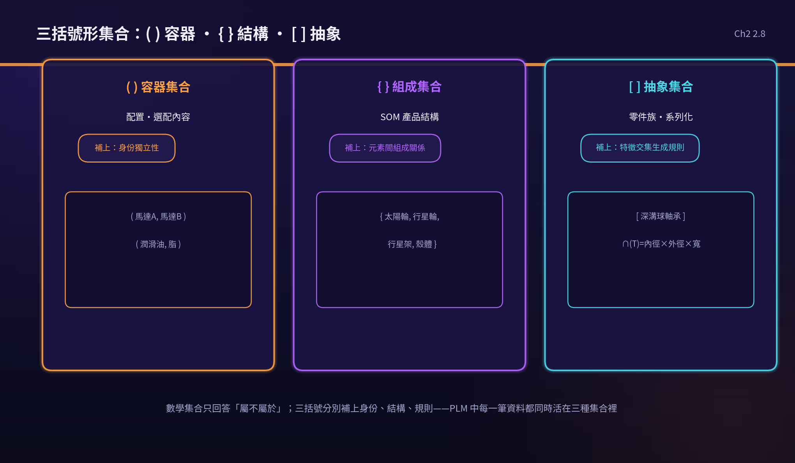

**圖　三括號形集合：容器、結構、抽象**

∩(T) 交集判準是「準確」的最小運作單位：物件 x 屬於形 T，若且唯若 x 通過 F(T) 特徵集合中的每一項檢查。在機械領域，∩(T) 的日常應用就是標準件選型與規範符合性判定——把「查手冊、憑經驗、問老師傅」變成一組可重複、可稽核的特徵檢查；邊界案例（例如特殊游隙的客製軸承）不靠爭論，靠明確標註「∩(T) 中哪一項不通過、由誰特裁決」。

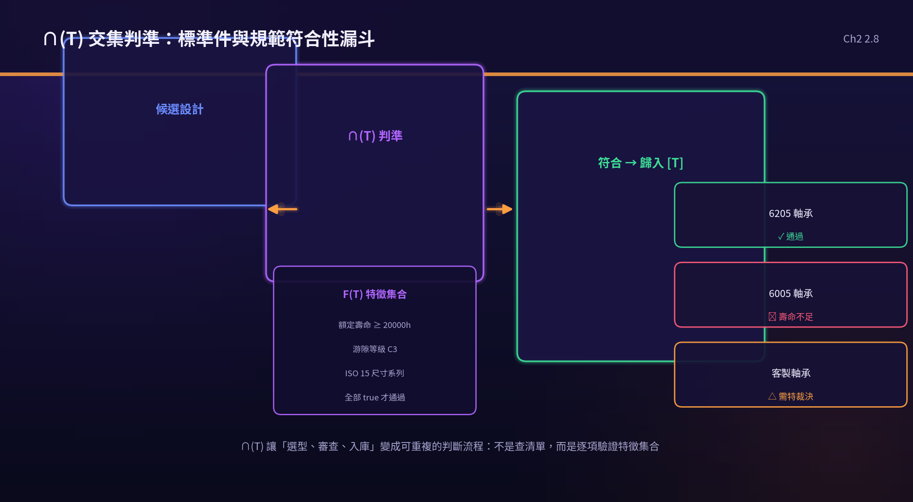

**圖　∩(T) 交集判準漏斗：標準件與規範符合性判定**

∩(T) 的第三個應用場景是驗收：設計完成後的審查，不是「看一遍覺得 OK」，而是把每條需求的判準拿出來逐項打勾。驗收表就是 ∩(T) 的表格化——第 7 章的驗證矩陣（7.4）正是這個機制在驗證域的延伸。當審查會議以判準逐格勾稽代替印象式討論，會議時間縮短、結論可記錄、爭議可追溯。

## 2.9　形化工程落地檢查表

把本章八節收斂成一張可執行的落地檢查表。任何一個機械設計或 PLM 專案在啟動與結案時，都應以此表自評：左欄是形化工程的八個面向，中欄是健康徵狀，右欄是失準警訊。出現任一警訊，即回到對應節次處置。

| 面向 | 健康徵狀 | 失準警訊 |
| --- | --- | --- |
| 需求形化 | 條目皆有 ∩(T)、來源、優先序 | 需求是長段文字、無法驗收 |
| 分類（X 軸） | 每零件可歸族、標準件庫可檢索 | 同件多類、分類靠個人記憶 |
| 結構（Y 軸） | EBOM 與 CAD 結構樹一致 | BOM 與模型各自演化 |
| 屬性治理 | 欄位維度互斥、空白率極低 | 欄位近百、半數空白 |
| 容器/配置 | 選配皆內容物、互斥依賴明確 | 必要件混入選配清單 |
| BOM/SOM | 四份 BOM 料號互參、必要性分級 | 多套 Excel 各自維護 |
| Schema 治理 | 欄位變更走 ECR 級審查 | 工程師私加欄位應急 |
| ∩(T) 判準 | 選型/驗收皆逐項勾稽 | 結論只有一句「經驗判斷」 |

> **本章重點整理**
> 形化不是文書工作，是把工程判斷固化為可重複流程——判準寫一次，百次受益。
> X 軸管分類、Y 軸管結構；屬性管樣貌、BOM 管組成、容器管配置、SOM 管依存。
> RDB 對應讓 PLM 資料紀律有理論依據：主鍵不變、Schema 動則如動土。
> 三括號與 ∩(T) 是日常操作的核心工具：容器 ( )、結構 { }、抽象 [ ]，判準 ∩(T)。

# 第 3 章　時間本形的設計生命週期運用

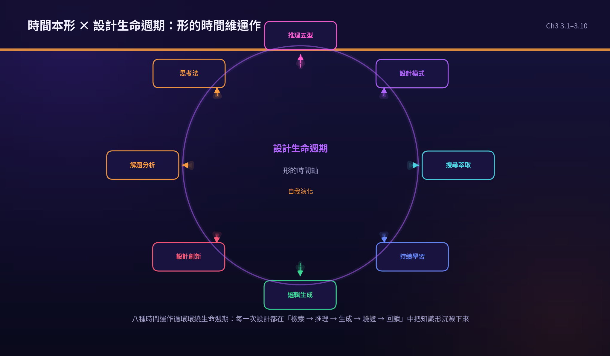

**圖　時間本形八大運作環繞設計生命週期**

## 3.1　形時間函式搜尋：設計案例檢索

形時間函式搜尋，是在時間軸上檢索「曾經出現過的形」。機械設計的第一個動作永遠是找參考：有沒有做過類似的？別人家怎麼做的？過去失效在哪裡？把這些問題形化，就是建立「案例形」的索引——每一個歷史案型被摘要成一組形特徵（輸入功率、傳動比、精度等級、工況、失效模式），新專案的需求形一建立，就能以特徵相似度檢索出候選案例。

實務作法是三層檢索：先以 X 軸特徵（參數區間、工況類型）粗篩；再以 Y 軸結構（機構型式、部件組成）比對結構相似度；最後以時間維（量產年份、失效記錄、ECN 歷史）篩掉教訓不佳的案例。檢索產出不是「一份參考資料」，而是一組可追溯的案例形卡——每個案例標註來源專案、關鍵參數、可用性判斷，供工程師裁決引用。

## 3.2　設計搜尋與萃取：標竿拆解與專利分析

搜尋與萃取是把「別人的形」轉化為「自己的形」的過程。標竿拆解（Benchmarking）運用 Y 軸：把標竿產品拆到部件層，逐件記錄材料、工藝、公差、成本估算；專利分析運用 X 軸：把專利的權利要求拆成特徵維度，繪製技術功效矩陣。兩者萃取出的共同結構，就是設計模式的原料。

| 萃取來源 | 軸向 | 產出形 | 運用場景 |
| --- | --- | --- | --- |
| 標竿產品拆解 | Y 軸結構 | 結構形 + 部件屬性表 | 概念設計階段的方案對標 |
| 專利文獻 | X 軸特徵 | 技術功效矩陣（抽象集合） | 避開既有專利、尋找空白點 |
| 自家歷史案型 | 雙軸 | 案例形卡 + 模式卡 | 設計複用與失效預防 |
| 失效/客訴記錄 | 時間軸 | 失效模式形（FMEA 輸入） | 設計檢核清單的更新來源 |

## 3.3　設計模式：機構模式庫與標準模組

設計模式是時間本形沉澱的最高形式：當一組「結構形＋參數範圍＋介面定義＋失效教訓」在多個專案中被反覆驗證，就凝結為模式卡（PatternType）。行星排模式、諧波減速模式、密封腔模式、快換夾持模式——每個模式卡都是一份「可複用的形」，新專案直接引用，省時且自動繼承歷史教訓。

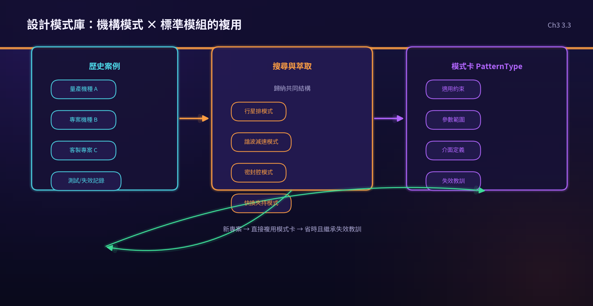

**圖　設計模式庫：案例 → 萃取 → 模式卡 → 複用**

### ◆ 實例：模式卡 PT-0014 行星排減速模式（節錄）

| 欄位 | 內容 |
| --- | --- |
| 模式編號/名稱 | PT-0014　行星排減速模式 |
| 適用約束 ∩(T) | 輸入轉速 ≤ 3000 rpm；扭力 10–500 N·m；比 3–100；壽命 ≥ 10000h |
| 參數範圍 | 行星輪 3–6 個；模數 1–4；精度 ISO 5–7；行星架位置度 ≤ 0.02 |
| 介面定義 | 輸入 ISO 9409-0；輸出 ISO 9409-1 法蘭；安裝面平面度 ≤ 0.01 |
| 失效教訓 | （源自 ECR-0088/8D-021）均載係數 < 0.85 時行星輪偏載磨損；須校核位置度 |
| 來源案例 | PRJ-2019-A / PRJ-2021-C / PRJ-2024-B |
| 版次/更新日 | v2.3 ／ 2026-09-12（依 ECR-0142 教訓更新） |

模式庫的治理規則與物料主檔同源：模式卡是一種形，須有唯一編號、Schema、交集判準（適用約束）與版本記錄；模式卡的失效教訓欄位必須隨 ECN 與客訴持續更新——這正是持續學習與自我演化在模式庫上的體現。模式庫的成熟度，直接決定一家公司「設計是靠傳承還是靠天才」。

## 3.4　推理五型：從 FMEA 到故障樹

時間本形列出五種核心推理：因果、果因、模擬、統計、逆向。機械工程的裁決幾乎全部落在这五型上——因果推理是 FMEA 的骨幹（失效模式 → 後果 → 原因鏈）；果因推理是故障樹的骨幹（頂事件 ← 中間事件 ← 底事件）；模擬推理是 CAE 結果的解讀（邊界條件 → 應力分佈 → 判定）；統計推理是量測與良率分析（SPC、壽命分佈）；逆向推理是客訴反推根因的利器。

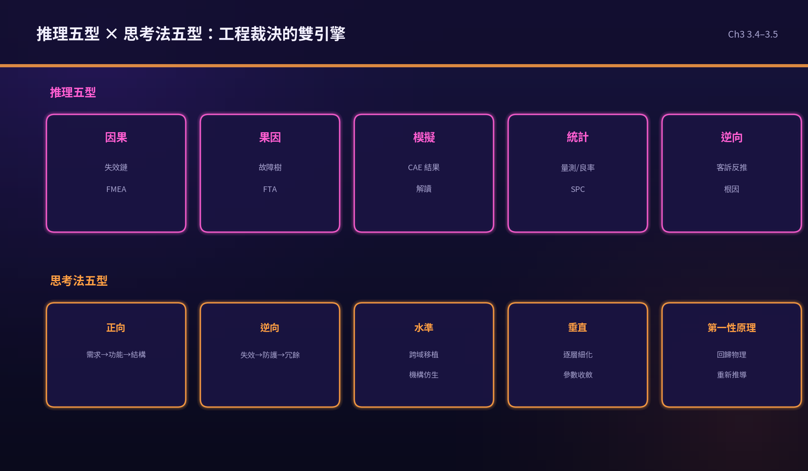

**圖　推理五型 × 思考法五型**

| 推理型 | 方向 | 典型工具 | 準確性要求 |
| --- | --- | --- | --- |
| 因果推理 | 原因 → 後果 | FMEA、失效鏈分析 | 每條因果邊須有機理或數據支持 |
| 果因推理 | 結果 ← 原因 | 故障樹 FTA、8D | 底事件須逐層收斂到可驗證的因子 |
| 模擬推理 | 模型 → 行為 | FEA/CFD、公差蒙地卡羅 | 邊界條件與假設必須顯式列出 |
| 統計推理 | 數據 → 規律 | SPC、壽命分佈、量測系統分析 | 樣本量與信賴水準必須標註 |
| 逆向推理 | 現象 → 根因 | 客訴反推、現場失效分析 | 根因必須可被再現實驗驗證 |

> **五型推理的共同紀律：**
>
> 結論必須標註推理型別與證據類型。「模擬說安全」不等於「實測說安全」——推理型別標註讓裁決者知道結論的強度。

## 3.5　思考法五型：工程創新方法

思考法是推理的方向盤：正向思考（需求 → 功能 → 結構）是常規設計主線；逆向思考（失效 → 防護 → 冗餘）是可靠性設計主線；水準思考（跨域移植、機構仿生）是創新主線——齒輪泵原理移植為計量泵、鳥翼截面移植為葉片；垂直思考（逐層細化、參數收斂）是詳細設計主線；第一性原理（回歸物理重新推導）是突破瓶頸的最後手段——當既有方案全面失效時，回到「力、熱、摩擦、材料」的最基本方程重新合成。

在與 Mind AI 協作時，思考法可以被顯式調度：提示詞中明確指定「以水準思考列出三個跨域移植方案」「以第一性原理重新推導該瓶頸」，比籠統地說「幫我想辦法」產出品質高得多——這就是把時間本形的思考法變成提示詞動詞的價值。

## 3.6　解題與分析：工程問題的形化分析

解題（Problem Analysis）的形化版本是：先把「問題」本身立成形——現象、影響範圍、重現條件、對比基準四個屬性填齊，才開始分析。大量工程爭議之所以曠日廢時，是因為各方描述的「同一個問題」其實是四個不同邊界的形。分析（Analysis）則是對問題形執行拆解（Y 軸）與對比（X 軸）：把問題拆到可量測的因子層，把每個因子與基準/歷史數據對比。

### ◆ 問題形化實例：客訴「異音」

| 屬性 | 原始敘述 | 形化後 |
| --- | --- | --- |
| 現象 | 「有時候會怪怪的聲音」 | 2–4 kHz 高頻嚙合異音，負載 > 70% 時出現 |
| 影響範圍 | 「不少台都有」 | 2026-Q2 批次 300 台中 12 台（4%） |
| 重現條件 | 「跑一陣子才有」 | 連續運轉 > 40 min、油溫 > 65 ℃ |
| 對比基準 | 「以前不會」 | 2026-Q1 批次同工況 0%；差異因子：齒輪供應商 B |

形化之後，「異音」從一個形容詞變成一個可分析的形：頻段指向嚙合衝擊、批次指向供應商變更、油溫指向潤滑膜厚——問題還未解決，分析方向已經被屬性結構收斂。這就是「先立形、後分析」的價值。

## 3.7　設計（創造與創新）

設計是時間本形中的「創造與創新」運作。在 TDDM 體系中，設計不是天馬行空的草圖，而是「在形的骨架內做選擇」：功能形決定了要解決什麼、結構形決定了候選方案空間、介面形與公差形決定了可行邊界、模式形提供了經過驗證的起點。創造發生在候選方案的生成（數量要多），裁決發生在 ∩(T) 判準的檢查（標準要嚴）——生成寬、裁決嚴，是設計創新的正確張力。

## 3.8　邏輯生成與應用：規則驅動設計檢查

邏輯生成與應用，是把工程規範轉寫成可執行規則，讓檢查自動化。DFM（可製造性）、DFA（可組裝性）、公差規則（配合鏈、基準體系）、材料相容性（電偶腐蝕、熱膨脹失配）、法規禁限用物質——這些在傳統流程中靠資深工程師把關的知識，全部可以表達為「條件 → 判定」的規則形，成為每次產出的 L3 檢核層。

| 規則族 | 範例規則 | 觸發時點 | 違反處置 |
| --- | --- | --- | --- |
| DFM | 鑄造件最小壁厚 ≥ 工藝能力值 | S3 結構合成後 | 退回 S3 修改幾何 |
| DFA | 同一工位緊固件規格數 ≤ 3 | S6 工藝轉換時 | 合併規格或標註特裁決 |
| 公差 | 配合鏈累積公差 ≤ 功能需求 | S4 介面公差後 | 收緊公差或改基準體系 |
| 材料 | 異種金屬接觸須有絕緣或鍍層 | S3/S4 | 修改材料或表面處理 |
| 法規 | 禁限用物質逐項檢查 | S1 需求形化即納入 | 換料或取得豁免證明 |

## 3.9　持續學習・重構與重組・自我演化

時間本形的最後三個運作構成知識循環的閉環。持續學習：量測、測試、客訴、產線數據回流入形庫與模式庫——每一張 ECN、每一份 8D 報告都是更新失效模式形與模式卡教訓的機會。重構與重組：當模組庫膨脹或介面混亂時，執行模組化重構——合併重複模組、統一介面形、清理孤兒件，這本身就是 SOM 的定期整頓。

自我演化：當前三者成為制度，形庫就隨時間增值——新專案檢索得到的案例愈準、模式卡覆蓋率愈高、規則庫愈完整，產出準確性隨使用量上升而非衰減。這正是 Mind AI 平台「持續學習・自我演化」能力在機械領域的落地樣貌：LLM 不記住工程知識，記住工程知識的是形庫；演化發生在形庫，而不是模型參數。

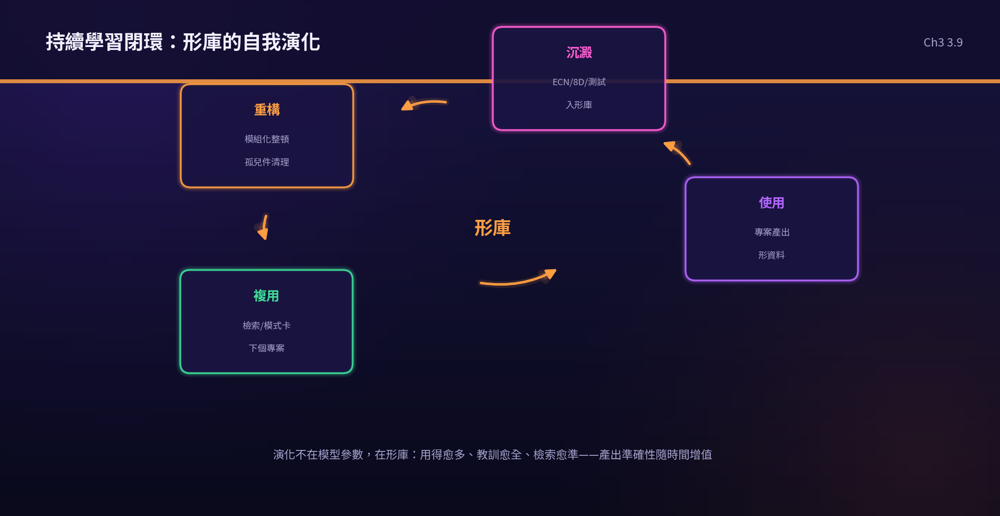

**圖　持續學習閉環：使用 → 沉澱 → 重構 → 複用**

| 回饋管道 | 資料來源 | 更新的形 | 觸發時點 |
| --- | --- | --- | --- |
| 驗證回饋 | 測試報告、CAE 對照實測 | 驗證形判準、公差形 | 每次驗證完成 |
| 變更回饋 | ECN、切換記錄 | 模式卡教訓、失效模式形 | 每次 ECN 關閉 |
| 現場回饋 | 客訴、8D、備件更換數據 | 失效模式形、SBOM 備件包 | 每月彙整 |
| 產線回饋 | 良率、工時、工藝能力 | 工藝形能力參數、DFM 規則 | 每季彙整 |

> **本章重點整理**
> 設計的第一個動作是檢索、最後一個動作是沉澱——兩者都作用在同一個形庫上。
> 五型推理標註證據類型、五種思考法可被提示詞顯式調度——方法變成動詞，產出品質才穩定。
> 模式卡是時間本形的最高形式：可複用的形，附帶失效教訓。
> 學習閉環的三個管道（驗證/變更/現場+產線）必須制度化，形庫才會自我演化。

# 第 4 章　機械設計 × PLM 知識域全景

## 4.1　設計生命週期六域

設計生命週期分為六域：需求域、概念域、設計域、驗證域、製造域、服務域。每域有自己的形與產出契約，域與域的交接處正是誤差滲入的通道——需求到概念的失真、設計到驗證的邊界條件落差、驗證到製造的工藝假設、製造到服務的備件錯置。TDDM 八步驟（第 5 章）的每個步驟都精確落在這些交接點上，用產出契約封住滲漏。

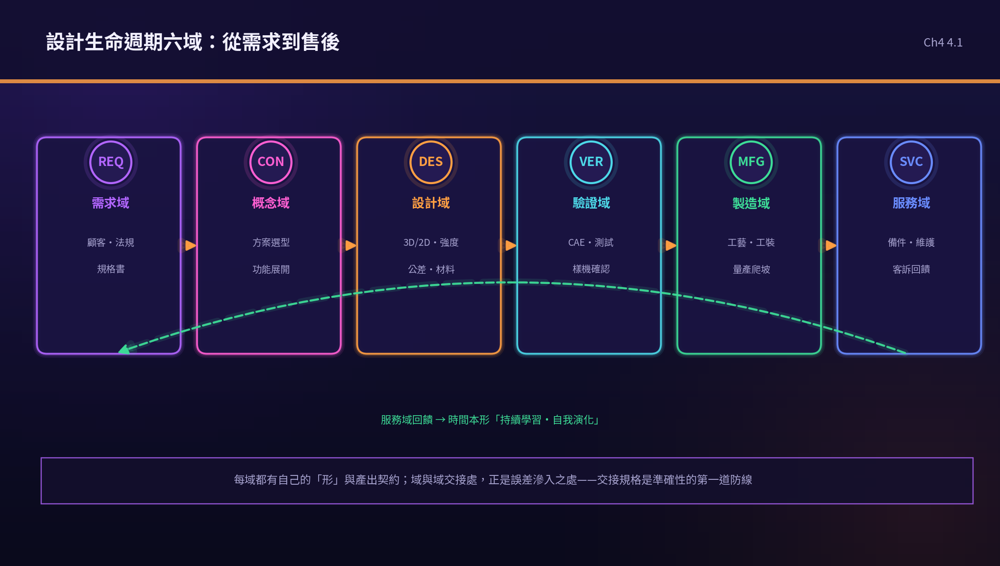

**圖　設計生命週期六域與回饋迴路**

## 4.2　PLM 管理八域

PLM 的管理面分為八域：需求管理、產品結構、文件管理、版本版次、變更管理、配置管理、專案管理、供應鏈協同。用形的語言重新看這八域，它們其實都是「形的治理」：需求管理治理需求形、產品結構治理結構形與清單形、版本版次治理形的時間軸、變更管理治理變更形的發生與關閉、配置管理治理容器形的內容物替換規則。

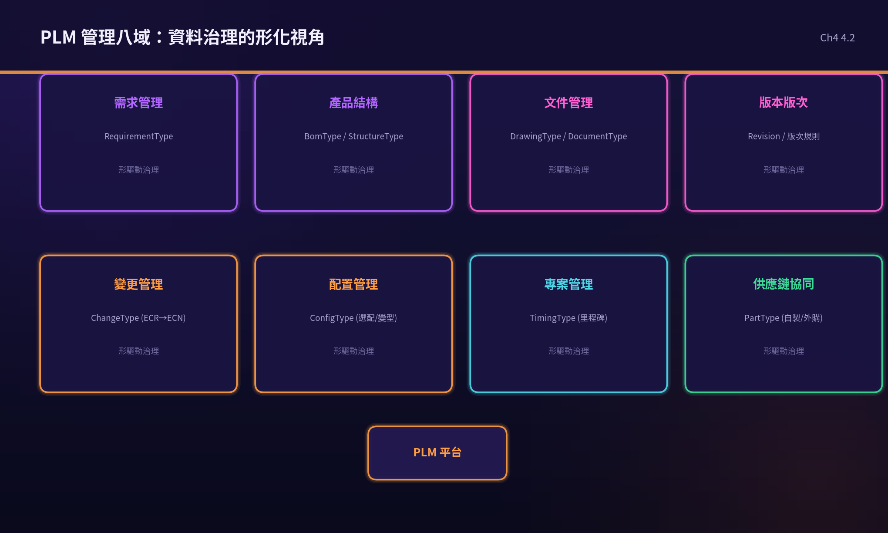

**圖　PLM 管理八域的形化視角**

| 管理域 | 治理的形 | 核心規則 | 常見失準 |
| --- | --- | --- | --- |
| 需求管理 | RequirementType | 每條需求有 ∩(T) 驗收判準 | 需求無判準、無法驗收 |
| 產品結構 | StructureType / BomType | 四份 BOM 料號互參、層級一致 | BOM 複製演化、孤兒件 |
| 文件管理 | DrawingType / DocumentType | 文件即形、Schema 統一 | 同物異名、一物多檔 |
| 版本版次 | 形的時間軸 | 大改升版、小改升次、版版可回溯 | 覆蓋式存檔、無版次 |
| 變更管理 | ChangeType | 無 ECR 不變更、影響面必掃描 | 口頭變更、在製未切換 |
| 配置管理 | ConfigType / 容器 ( ) | 內容物替換不動結構 | 選配寫進結構層 |
| 專案管理 | TimingType | 里程碑綁定產出契約驗收 | 里程碑只對日期不對產出 |
| 供應鏈協同 | PartType | 自製/外購判準、供應商料號映射 | 雙重料號未映射、規格漂移 |

## 4.3　全域形總表：十六形 Schema

綜合生命週期六域與管理八域，本方案定義全域十六形。每形皆有五件套：屬性 Schema、交集判準 ∩(T)、主鍵、主從參考、產出契約。十六形構成機械設計 × PLM 的共同語言——不同部門、不同工具、人與 AI 之間的每一次交換，都以十六形為介面。

| 五件套 | 定義 | 治理要求 |
| --- | --- | --- |
| 屬性 Schema | 形由哪些維度構成（欄位、型別、值域） | 維度互斥、全貫穿；變更走 ECR 級審查 |
| 交集判準 ∩(T) | 成員判定與驗收的特徵集合 | 可操作、可量測；事後不得放寬 |
| 主鍵 | 身份憑證（料號、編號） | 指派後永不變更、永不重用 |
| 主從參考 | 形與形的連接（BOM 父子、掛接） | 以主鍵連接；禁止以文字描述充當連接 |
| 產出契約 | 該形交付時的 Schema/回溯/證據/簽核 | 契約先立、產出後驗 |

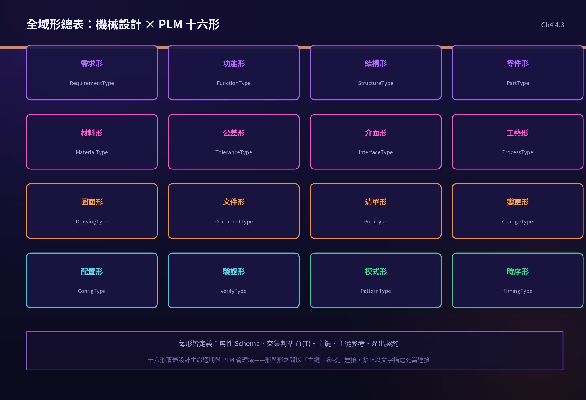

**圖　全域形總表：機械設計 × PLM 十六形**

| 形 | 英文 | 主鍵 | 關鍵屬性（節錄） | 主從參考 |
| --- | --- | --- | --- | --- |
| 需求形 | RequirementType | REQ-編號 | 來源、敘述、∩(T) 驗收、優先序 | → 功能形（追溯） |
| 功能形 | FunctionType | FUN-編號 | 功能敘述、量化指標、約束 | ← 需求形 / → 結構形 |
| 結構形 | StructureType | 節點編號 | 層級、件數、介面、必要性等級 | ← 結構形（父）/ → 零件形 |
| 零件形 | PartType | 料號 | 名稱、材料、工藝、重量、自製/外購 | → 材料形 / 工藝形 |
| 材料形 | MaterialType | 料號 | 牌號、規格、機械性質、供應商 | ← 零件形 |
| 公差形 | ToleranceType | 特徵編號 | 基準體系、公差項目、等級、量法 | ← 零件形 / 介面形 |
| 介面形 | InterfaceType | 介面編號 | 類型、配合、連接、傳動、密封 | 連接兩側結構形 |
| 工藝形 | ProcessType | 工序編號 | 工法、工時、工裝、能力參數 | ← 零件形 / → MBOM |
| 圖面形 | DrawingType | 圖號 | 版次、投影、標題欄、模型連結 | → 零件形 |
| 文件形 | DocumentType | 文號 | 類型、版次、簽核、生效日 | → 相關形（附件） |
| 清單形 | BomType | BOM 編號 | 視角（E/M/P/S）、層級、用量 | 父子以料號參考 |
| 變更形 | ChangeType | ECR/ECN 編號 | 動機、影響面、生效點、切換批 | → 受影響各形 |
| 配置形 | ConfigType | 配置編號 | 選項、互斥、依賴、變型 BOM | ← 結構形（容器） |
| 驗證形 | VerifyType | 試驗編號 | 工況、方法、判據、結果、報告 | ← 需求形 / 功能形 |
| 模式形 | PatternType | 模式編號 | 適用約束、參數範圍、失效教訓 | → 參照結構形 |
| 時序形 | TimingType | 里程碑編號 | 日期、交付物、驗收契約 | → 產出契約 |

## 4.4　準確產出契約（Output Contract）

產出契約是「準確」的合約化：每一份交付物在開工前先定義它必須通過的 Schema、必須回溯的需求、必須附上的證據、必須經過的簽核。契約先立，產出後驗——這是四層準確性在文件層的落點。

| 交付物 | Schema 要求 | 回溯要求 | 證據要求 | 簽核 |
| --- | --- | --- | --- | --- |
| 需求規格書 | 需求形表格式 | 逐條對應訪談/法規來源 | ∩(T) 驗收欄位齊備 | 需求方 + 設計主管 |
| 設計方案書 | 功能形/結構形表 | 功能覆蓋矩陣 | 選型計算書 + 對標案例 | 設計主管 + 審查會 |
| 3D/2D 圖檔 | 圖面形 Schema | 節點對應 EBOM | 公差分析報告 | 校審 + 標準化 |
| BOM（四份） | 清單形 Schema | 父子料號完整 | 與 CAD 結構一致性報告 | 設計 + 工藝 + 計畫 |
| ECN | 變更形 Schema | 影響面掃描清單 | 驗證記錄（必要時） | 四眼原則 + 主管 |
| 驗證報告 | 驗證形 Schema | 對應需求 ∩(T) | 原始數據 + 方法說明 | 測試主管 |

## 4.5　人機授權矩陣

準確產出的最後一環是權責邊界：AI 主導資料蒐集、形化草擬、設計計算與證據歸檔；工程師主導參數裁決、選型定案並與 AI 協同；審查會議負責方案與變更的集體裁決；主管與法規單位握有最終核准權——尤其安全件與法規符合性，裁決權永遠在人。

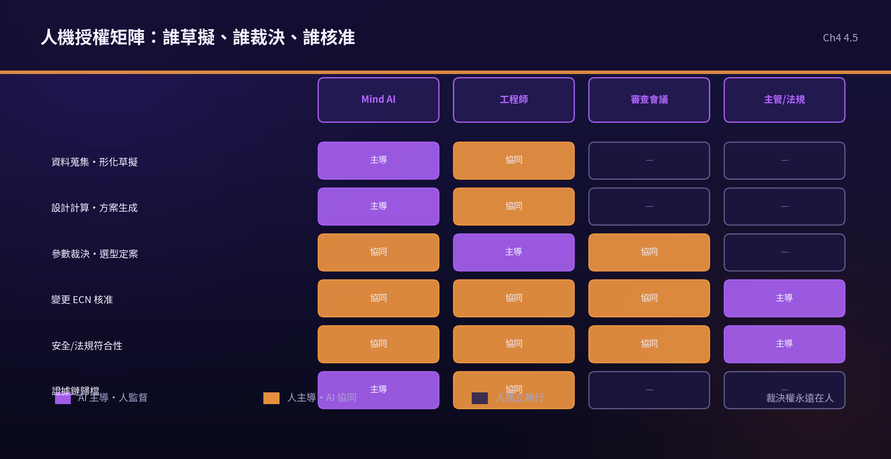

**圖　人機授權矩陣：AI 草擬、工程師裁決、主管核准**

> **授權矩陣的使用方式：**
>
> 每一張提示詞的輸出，都應標註其「產出等級」（草擬/協同/主導），收件人依矩陣決定覆核深度——AI 主導的產出必須經人覆核簽名，方可進入下一環。

## 4.6　域間交接規格

誤差不會憑空出現在域的內部，它從域與域的交接處滲入：需求到概念時被過度解讀、設計到驗證時邊界條件失真、驗證到製造時工藝假設脫節、製造到服務時備件單元錯置。治理方法是為每一個交接點定義「交接規格」——上域產出必須通過產出契約驗收，才允許移交；移交物是受控文件，不是口頭摘要或一封 email。

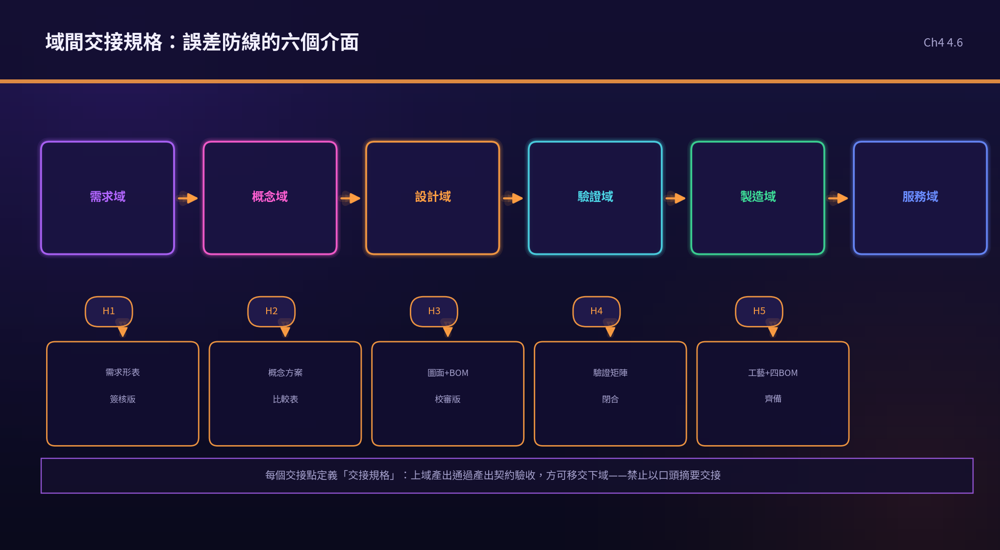

**圖　六域五個交接點：每個交接都有規格與驗收**

| 交接點 | 移交物 | 驗收判準 | 常見滲漏 |
| --- | --- | --- | --- |
| H1 需求→概念 | 需求形表（簽核版） | 全部條目有 ∩(T) 與來源 | 未簽核的需求被口頭加入 |
| H2 概念→設計 | 概念方案比較表 | 候選 ≥ 2、選型理由完整 | 跳過比較直接詳細設計 |
| H3 設計→驗證 | 圖面 + BOM + 公差鏈（校審版） | 校審簽名、公差鏈閉合 | 驗證用圖檔非校審版 |
| H4 驗證→製造 | 驗證矩陣 + 工藝輸入包 | P1 需求矩陣無空格 | 帶著 [缺口] 進量產 |
| H5 製造→服務 | 四份 BOM + 備件策略 | SBOM 更換單元=現場單元 | 備件包與實際維修單元不符 |

> **本章重點整理**
> 六域各有形與產出契約；五個交接點各有交接規格——誤差防線設在交界處。
> PLM 八域即形的治理：需求、結構、文件、版次、變更、配置、專案、供應鏈。
> 十六形五件套（Schema/∩(T)/主鍵/主從參考/產出契約）是跨部門、人機之間的共同介面。
> 產出契約先立後驗；人機授權矩陣決定覆核深度，裁決權永遠在人。

# 第 5 章　TDDM 形驅動八步驟

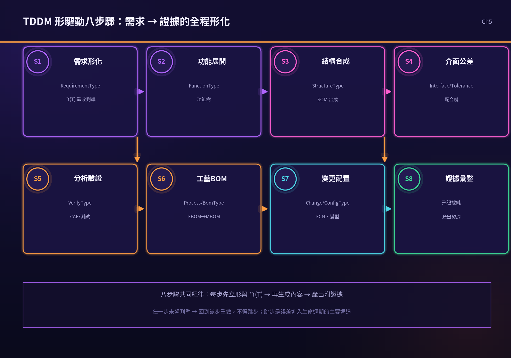

**圖　TDDM：從需求形到形證據鏈的八個步驟**

## 5.1　TDDM 總覽與共同紀律

TDDM（Type-Driven Design & Manufacturing，形驅動機械設計與 PLM 方法論）把前四章的形化工程組織成一條可執行的流程：S1 需求形化 → S2 功能展開 → S3 結構合成 → S4 介面公差 → S5 分析驗證 → S6 工藝與 BOM 轉換 → S7 變更與配置 → S8 證據彙整。八步驟的共同紀律只有三句話：每步先立形與 ∩(T)，再生成內容；產出必須附證據；未過判準就回到該步重做，不得跳步。

八步驟與六域、十六形的關係是：每一步是一次「形的加工」——把上游形加工成下游形。S1 產出需求形，S2 產出功能形，S3 產出結構形與 SOM，S4 產出介面形與公差形，S5 產出驗證形，S6 產出工藝形與四份 BOM，S7 產出變更形與配置形，S8 把全部產出串成形證據鏈。任何一步的產出都能回溯到上游形，這就是流程的可稽核性。

| 步驟 | 所在域 | 輸入形 | 輸出形 | 交接點 |
| --- | --- | --- | --- | --- |
| S1 需求形化 | 需求域 | 原始素材 | RequirementType | H1 |
| S2 功能展開 | 概念域 | RequirementType | FunctionType | H1→H2 |
| S3 結構合成 | 概念/設計域 | FunctionType | StructureType / SOM | H2 |
| S4 介面公差 | 設計域 | StructureType | InterfaceType / ToleranceType | H3 |
| S5 分析驗證 | 驗證域 | Structure/Tolerance | VerifyType | H4 |
| S6 工藝 BOM | 製造域 | StructureType / PartType | ProcessType / BomType×4 | H5 |
| S7 變更配置 | 全域 | ChangeType 輸入 | ChangeType / ConfigType | 各點 |
| S8 證據彙整 | 全域 | S1–S7 產出 | 形證據鏈 | 結案 |

## 5.2　S1 需求形化

| 規格項 | 內容 |
| --- | --- |
| 輸入 | 訪談紀錄、法規清單、標竿規格、歷史客訴 |
| 加工 | 異同偵測 → 分合 → 命名；每條需求立 ∩(T) 驗收判準 |
| 產出 | 需求形表（RequirementType）：條目、來源、判準、優先序 |
| 判準 | 每條可驗收、邊界不重疊、來源可追溯、法規零遺漏 |
| 時程 | 依專案規模 2–10 工作日；變更時機：需求凍結前 |
| 失誤劇本 | 跳過判準直接寫規格 → 驗收階段全面爭議；對策：判準欄空白的條目一律退回 |

## 5.3　S2 功能展開

| 規格項 | 內容 |
| --- | --- |
| 輸入 | 需求形表 |
| 加工 | 逐條需求展開為功能樹（FunctionType）；標註量化指標與約束 |
| 產出 | 功能形樹 + 需求→功能覆蓋矩陣 |
| 判準 | 每條需求至少被一功能覆蓋；每功能至少服務一條需求（無孤兒功能） |
| 時程 | 1–5 工作日 |
| 失誤劇本 | 功能樹抄襲既有產品 → 新需求漏覆蓋；對策：覆蓋矩陣逐格打勾後才放行 |

## 5.4　S3 結構合成

| 規格項 | 內容 |
| --- | --- |
| 輸入 | 功能形樹、模式庫檢索結果 |
| 加工 | 功能 → 結構映射；SOM 合成（部件、依存、空間配置）；標必要性三級 |
| 產出 | 結構形樹 + SOM 結構表 + 候選方案（≥2 概念） |
| 判準 | 每功能有結構承載；必要件/降級件/非必要件分級完成；方案生成寬、裁決嚴 |
| 時程 | 3–15 工作日（含概念比較） |
| 失誤劇本 | 單一方案直上詳細設計 → 後期大改；對策：候選方案未達 2 個不得進入 S4 |

## 5.5　S4 介面與公差

| 規格項 | 內容 |
| --- | --- |
| 輸入 | 結構形樹、配合需求、工藝能力數據 |
| 加工 | 介面形定義（安裝/配合/傳動/密封）；公差形建立（基準體系、配合鏈） |
| 產出 | 介面表 + 公差鏈表 + 累積公差分析 |
| 判準 | 配合鏈閉合；累積公差 ≤ 功能需求；基準體系唯一且可量測 |
| 時程 | 2–10 工作日 |
| 失誤劇本 | 公差孤立給定、未算累積 → 量產干涉；對策：無公差鏈計算書不簽圖 |

## 5.6　S5 分析驗證

| 規格項 | 內容 |
| --- | --- |
| 輸入 | 結構形、公差形、工況載荷（需求形） |
| 加工 | CAE 分析、壽命計算、測試計畫制定；結果對照 ∩(T) |
| 產出 | 驗證形記錄 + 分析報告 + 測試計畫/報告 |
| 判準 | 工況覆蓋需求全部邊界；安全係數達標；假設與邊界條件顯式列出 |
| 時程 | 5–20 工作日（測試另計） |
| 失誤劇本 | 模擬工況窄於實際使用 → 量產失效；對策：工況清單直接引用需求形條目逐項對照 |

## 5.7　S6 工藝與 BOM 轉換

| 規格項 | 內容 |
| --- | --- |
| 輸入 | EBOM、零件形、工藝能力、產能約束 |
| 加工 | EBOM → MBOM 拆分（半成品/工站）；工藝形路線；PBOM 提前期；SBOM 備件包 |
| 產出 | 四份 BOM + 工藝規程 + DFM/DFA 檢查表 |
| 判準 | 四份 BOM 料號互參一致；每個自製件有工藝路線；DFA 規格數 ≤ 上限 |
| 時程 | 5–15 工作日 |
| 失誤劇本 | MBOM 由採購 Excel 另行維護 → 與 EBOM 脫節；對策：MBOM 必須由 EBOM 轉換並保留父子參考 |

## 5.8　S7 變更與配置

| 規格項 | 內容 |
| --- | --- |
| 輸入 | 變更申請（ECR）、配置需求 |
| 加工 | 影響面掃描（SOM 依存 + 四份 BOM 連鎖）；配置矩陣；ECN 發行與追蹤 |
| 產出 | 變更形記錄 + 配置形表 + 變型 BOM |
| 判準 | 無 ECR 不變更；影響面掃描清單完整；生效點與切換批明確 |
| 時程 | 1–10 工作日（依影響面） |
| 失誤劇本 | 口頭變更、在製未切換 → 帳料不符；對策：產線只認 ECN 編號，不認口頭指示 |

## 5.9　S8 證據彙整

| 規格項 | 內容 |
| --- | --- |
| 輸入 | S1–S7 全部產出及其檢核記錄 |
| 加工 | 串接形證據鏈；產出契約逐項驗收；彙整交付包 |
| 產出 | 追溯矩陣 + 產出契約驗收表 + 交付包（含版本快照） |
| 判準 | 每項產出可回溯需求條目；每條因果邊有證據；簽核齊備 |
| 時程 | 1–3 工作日 |
| 失誤劇本 | 結案前一晚補文件 → 證據鏈造假；對策：證據隨步驟即時歸檔，S8 只做彙整不做補件 |

## 5.10　八步驟 × 四層準確性對照

把八步驟與四層準確性交叉，就得到一張完整的準確性責任表：每一格都是該步驟在該層的具體作業。這張表是審查會議的檢查底稿，也是 Mind AI 產出自檢的依據（第 6 章每則提示詞的「檢核」段皆對應此表）。

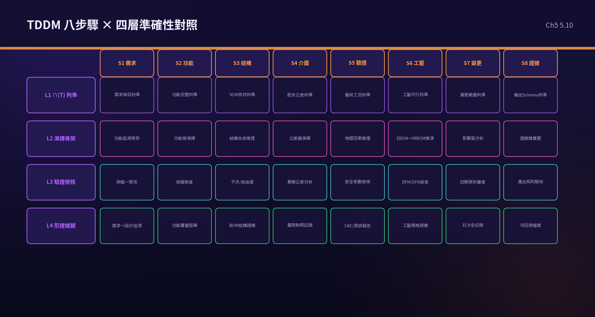

**圖　TDDM 八步驟 × 四層準確性對照矩陣**

> **操作記憶法：**
>
> 任何一份產出被質疑時，先問它在哪一格——是判準沒立、骨架沒走、檢核沒做，還是證據沒留？四格定位之後，補救路徑自然清楚。

## 5.11　裁剪指引：依專案規模適配

八步驟不可跳，但深度可裁剪。裁剪的原則只有一句：可以少做，不可以沒判準；可以簡化，不可以沒證據。下表給出三種專案規模的裁剪基準——裁剪決定必須記錄在專案啟動文件中，由審查會認可，不得事後追溯放寬。

| 步驟 | 小型（治具/零件） | 中型（模組/機構） | 大型（整機/平台） |
| --- | --- | --- | --- |
| S1 | 3–5 條需求、判準齊備即可 | 完整需求形表 | 完整 + 法規/認證矩陣 |
| S2 | 可與 S1 合併作業 | 完整功能樹 | 完整 + 量化指標體系 |
| S3 | 可選既有模式卡直接套用 | ≥ 2 概念比較 | ≥ 3 概念 + 權衡分析 |
| S4 | 關鍵配合點即可 | 全介面 + 公差鏈 | 全介面 + 蒙地卡羅公差分析 |
| S5 | 計算法代替 CAE | CAE + 關鍵測試 | 完整驗證矩陣 + 樣機循環 |
| S6 | EBOM 為主、MBOM 簡化 | 四份 BOM 齊備 | 四份 BOM + 產能/供應鏈驗證 |
| S7 | 簡易變更單 | 完整 ECN | ECN + 配置管理 + 切換演練 |
| S8 | 追溯表即可 | 追溯矩陣 + 契約驗收 | 完整形證據鏈 + 基線管理 |

> **本章重點整理**
> TDDM 是形的接力賽：每步把上游形加工成下游形，產出皆可回溯。
> 共同紀律三句話：先立判準再生成、產出必附證據、未過判準回步重做。
> 裁剪只裁深度、不裁判準；裁剪決定記入啟動文件。

# 第 6 章　S1–S9 提示詞手冊與實戰演練

## 6.1　六段式提示詞共同規範

本章是全方案的操作核心。S1–S9 九則提示詞分別對應 TDDM 八步驟與證據彙整，每則採統一的六段式結構：角色（Role）、任務（Mission）、輸入（Input）、約束（Constraints）、輸出規格（Output）、檢核（Checks）。六段式的目的不只是產出品質，更是讓提示詞本身成為受控文件——可版本化、可稽核、納入形證據鏈。

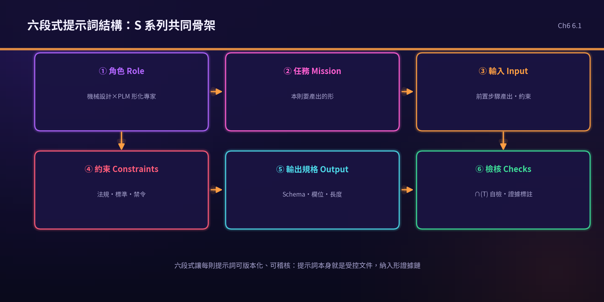

**圖　六段式提示詞結構**

| 段 | 作用 | 撰寫要點 |
| --- | --- | --- |
| ① 角色 | 界定專業視角 | 指明領域與形化專家身分，限定輸出語言 |
| ② 任務 | 界定本則產出的形 | 明確指名形（如 RequirementType）與產出件數 |
| ③ 輸入 | 界定上游 | 列出前置步驟產出與其版本；缺件即停止 |
| ④ 約束 | 界定邊界 | 法規、標準、公司禁令；明確列出「不可做」 |
| ⑤ 輸出規格 | 界定 Schema | 欄位、格式、長度、表格樣式 |
| ⑥ 檢核 | 界定自檢 | ∩(T) 逐項自檢、證據標註、缺口聲明 |

> **使用紀律**
> 每則提示詞的輸入必須是「上一則的正式產出」，不得以口頭摘要代替。
> 產出中的每一個數值與規範，必須帶證據標註（來源：需求條目/手冊/計算）。
> 凡標註「[缺口]」之處，表示資料不足——這是正確產出的一部分，禁止用猜測填補。
> 提示詞本體若修改，須升版並記入形證據鏈；同專案內使用同一版次。

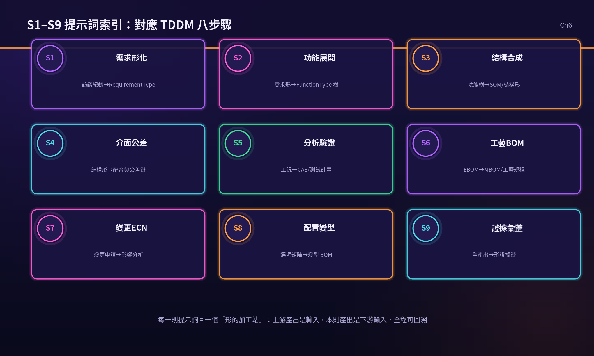

**圖　S1–S9 提示詞索引**

### ◆ S 系列 × 產出等級對照（依 4.5 授權矩陣）

| 提示詞 | AI 產出等級 | 必經裁決 | 可直接歸檔？ |
| --- | --- | --- | --- |
| S1 需求形化 | 草擬 | 需求方 + 設計主管 | 否 |
| S2 功能展開 | 草擬 | 設計主管 | 否 |
| S3 結構合成 | 協同 | 審查會議（方案選型） | 否 |
| S4 介面公差 | 協同 | 工程師 + 校審 | 否 |
| S5 分析驗證 | 協同 | 測試/分析主管 | 否（數據需簽名） |
| S6 工藝 BOM | 草擬 | 工藝 + 計畫 | 否 |
| S7 變更 ECN | 草擬 | 四眼原則 + 主管（必要件加嚴） | 否 |
| S8 配置變型 | 草擬 | 產品 + 設計 | 否 |
| S9 證據彙整 | 主導（彙整） | 專案主管（契約驗收） | 驗收通過後可 |

### ◆ S1　需求形化提示詞

▣ 六段式提示詞全文

> **角色：** 你是機械設計×PLM 需求形化專家，精通本形學形化方法（異同→分合→形）。全程使用繁體中文（術語保留英文）。
> 任務：將下方【輸入素材】加工為需求形表（RequirementType）。先做異同偵測與分合，再為每條需求命名並定義 ∩(T) 驗收判準。輸出 8–15 條需求形條目。
> 輸入：【輸入素材】：訪談紀錄、法規清單、標竿規格、歷史客訴摘要（由使用者貼上）。若素材不足以支撐某類需求，標註 [缺口]。
> 約束：不得抄錄逐字稿充當需求；每條需求必須可驗收；條目之間邊界不得重疊；法規需求不得省略；不得替使用者做商業取捨（標註建議即可）。
> 輸出規格：表格欄位：需求編號（REQ-001 起）｜來源｜敘述（一句話）｜∩(T) 驗收判準（可量測）｜優先序（P1/P2/P3）｜備註。結尾附「分合說明」小節（哪些差異被合併、哪些被切開）。
> 檢核：逐條自檢：可驗收？來源可溯？無重疊？法規全覆蓋？在每條後標註 ✓/✗ 與檢核說明；最後列出 [缺口] 清單與建議補件。

### ◆ 輸出範例（節錄）

| 需求編號 | 來源 | 敘述 | ∩(T) 驗收判準 | 優先序 |
| --- | --- | --- | --- | --- |
| REQ-001 | 訪談-A | 額定輸出扭力滿足負載需求 | T ≥ 95 N·m @ 額定轉速，實測達成 | P1 |
| REQ-002 | 訪談-A | 總減速比為 100 | i = 100 ± 2% | P1 |
| REQ-003 | 法規-CE | 噪音符合機械指令 | LpA ≤ 70 dB(A) @ 1m | P1 |
| REQ-004 | 客訴-042 | 輸出軸油封不得滲漏 | 2000h 耐久後滲漏量 = 0 | P1 |
| REQ-005 | 訪談-B | 使用壽命 | L10h ≥ 20000 h @ 額定工況 | P2 |

### ◆ S2　功能展開提示詞

▣ 六段式提示詞全文

> **角色：** 你是機械設計功能分析專家，擅長功能樹展開與需求追溯。
> 任務：將【需求形表】展開為功能樹（FunctionType）：主功能 → 子功能 → 量化指標。產出功能形樹與「需求→功能覆蓋矩陣」。
> 輸入：【需求形表】（S1 正式產出，含版次）。不得使用未標版次的需求表。
> 約束：每條需求至少被一功能覆蓋；不得出現服務任何需求的孤兒功能；功能敘述用動詞＋受詞（如「傳遞扭力」），不得抄需求原文。
> 輸出規格：①功能樹（層級表：功能編號 FUN-001 起｜父功能｜敘述｜量化指標｜服務需求編號）；②覆蓋矩陣（列=需求、欄=功能、✓ 表承載）；③缺口說明。
> 檢核：自檢：覆蓋矩陣無空白列、無空白欄？量化指標可量測？標註 ✓/✗ 並列出未覆蓋需求（若有，回到 S1 补件或標 [缺口]）。

### ◆ 輸出範例（節錄）

| 功能編號 | 父功能 | 敘述 | 量化指標 | 服務需求 |
| --- | --- | --- | --- | --- |
| FUN-001 | — | 傳遞扭力 | T ≥ 95 N·m | REQ-001 |
| FUN-002 | FUN-001 | 分流扭力至行星輪 | 均載係數 ≥ 0.9 | REQ-001 |
| FUN-003 | FUN-001 | 降低轉速比 | i = 100 ± 2% | REQ-002 |
| FUN-004 | FUN-001 | 支撐旋轉軸系 | 徑向游隙 ≤ 0.02 mm | REQ-005 |
| FUN-005 | — | 密封潤滑腔 | 滲漏量 = 0 @ 2000h | REQ-004 |
| FUN-006 | — | 回饋輸出位置 | 解析度 ≤ 0.01°（選配） | REQ-006 |

### ◆ S3　結構合成提示詞

▣ 六段式提示詞全文

> **角色：** 你是機械結構設計專家，精通 SOM 合成（部件、依存、空間配置）與必要性三級分類。
> 任務：將【功能樹】映射為結構：產出至少 2 個候選概念方案；每方案以 SOM 描述（部件清單、依存關係、空間配置）；標註必要件/功能降級件/非必要件。
> 輸入：【功能樹】（S2 產出）、【模式庫檢索結果】（若有）、約束條件（尺寸、成本、工藝）。
> 約束：候選方案 < 2 個時不得輸出結論；必要性分級必須依「remove(p) 後整體是否同一」判準；不引用未經驗證的專利方案而不標註。
> 輸出規格：①概念方案比較表（方案｜機構型式｜部件數｜優劣｜風險）；②入選方案 SOM 表（部件｜層級｜件數｜必要性等級｜承載功能）；③模式卡引用清單。
> 檢核：自檢：每功能有結構承載？分級合乎判準？兩概念差異真實存在？標註 ✓/✗；聲明選型理由與放棄理由。

### ◆ SOM 表輸出範例（節錄）

| 部件 | 層級 | 件數 | 必要性 | 承載功能 |
| --- | --- | --- | --- | --- |
| 行星架 | 1 | 1 | 必要件 | FUN-001 傳遞扭力 |
| 太陽輪 | 2 | 1 | 必要件 | FUN-002 分流扭力 |
| 行星輪 | 2 | 4 | 必要件 | FUN-002 分流扭力 |
| 編碼器 | 2 | 1 | 功能降級件 | FUN-006 位置回饋 |
| 銘牌 | 1 | 1 | 非必要件 | — |

### ◆ S4　介面與公差提示詞

▣ 六段式提示詞全文

> **角色：** 你是公差分析與介面設計專家，精通基準體系、配合鏈與 GD&T。
> 任務：為【SOM 入選方案】定義介面形（安裝/配合/傳動/密封）與公差形；建立配合鏈並計算累積公差。
> 輸入：【SOM 表】（S3 產出）、功能量化指標（間隙、精度、壽命）、工藝能力數據。
> 約束：基準體系唯一且可量測；公差不得超出工藝能力而未標註特裁決；密封介面必須指定洩漏判準。
> 輸出規格：①介面表（介面編號｜類型｜兩側部件｜配合/連接規格｜約束）；②公差鏈表（環｜名義｜上下偏｜貢獻）；③累積公差結果與結論。
> 檢核：自檢：每條功能的精度需求有對應公差環？累積結果 ≤ 需求？量測方法可行？標註 ✓/✗。

### ◆ 公差鏈表輸出範例（節錄：輸出背隙鏈）

| 環 | 名義值 | 上下偏 | 貢獻量 | 備註 |
| --- | --- | --- | --- | --- |
| 齒輪嚙合側隙 | 0.08 | +0.03 / −0.01 | 0.04 | ISO 1328 等級 6 |
| 軸承游隙 C3 | 0.02 | +0.01 / −0.01 | 0.02 | 選型受控 |
| 行星架孔位置度 | 0 | ±0.015 | 0.03 | 位置度公差 |
| 軸承座同軸度 | 0 | ±0.01 | 0.02 | 基準 A-B |
| 累積（RSS） | — | — | 0.058 ≤ 0.10 | 結論：通過 ✓ |

### ◆ S5　分析驗證提示詞

▣ 六段式提示詞全文

> **角色：** 你是結構分析與驗證專家，精通 FEA/壽命計算/測試規劃，嚴格區分模擬、統計與實測證據。
> 任務：為【SOM + 公差鏈】制定分析與驗證計畫：工況矩陣、CAE 項目、壽命計算、測試計畫；並解讀已有分析結果對照 ∩(T)。
> 輸入：【SOM 表】【公差鏈表】、工況載荷（源自需求形條目）、既有分析結果（若有）。
> 約束：工況必須逐項對應需求形條目；每個分析必須顯式列出假設與邊界條件；模擬結論不得表述為實測結論。
> 輸出規格：①工況矩陣（需求編號｜工況｜載荷｜判據）；②分析計畫（項目｜方法｜假設｜輸出）；③測試計畫（項目｜方法｜樣本數｜判據）；④結果解讀表（結論｜推理型別｜證據類型｜對照 ∩(T)）。
> 檢核：自檢：工況覆蓋全部 P1 需求？安全係數達標？假設全數列出？標註 ✓/✗；明示模擬與實測的證據強度差。

### ◆ 結果解讀表輸出範例（節錄）

| 結論 | 推理型別 | 證據類型 | 對照 ∩(T) | 強度 |
| --- | --- | --- | --- | --- |
| 齒面接觸應力 1180 MPa | 模擬（FEA） | 模擬證據 | < 許用 1500 ✓ | 中（待實測） |
| 齒根安全係數 1.6 | 因果（計算法） | 計算證據 | ≥ 1.5 ✓ | 中高 |
| L10h = 22400 h | 統計（壽命分佈） | 計算證據 | ≥ 20000 ✓ | 中（待耐久） |
| 噪音預估 68 dB(A) | 模擬（經驗式） | 估算證據 | ≤ 70 △ | 低（T-03 主證） |

### ◆ S6　工藝與 BOM 轉換提示詞

▣ 六段式提示詞全文

> **角色：** 你是製造工程與 BOM 治理專家，精通 EBOM→MBOM 轉換、DFM/DFA 與四份 BOM 一致性治理。
> 任務：將【EBOM/結構形】轉換為 MBOM、PBOM、SBOM；產出工藝形路線；執行 DFM/DFA 檢查。
> 輸入：【SOM 表】【零件形屬性】、工藝能力、產能約束、維修更換策略。
> 約束：四份 BOM 一律以料號互相參考、禁止複製演化；半成品層必須有邊界定義；DFA 同工位緊固件規格數不得超上限（預設 3）。
> 輸出規格：①MBOM（層級｜料號｜件數｜工站｜半成品標記）；②工藝路線表（零件｜工序｜工法｜工裝｜能力參數）；③PBOM 欄位補齊（自製/外購｜提前期）；④SBOM 備件包；⑤DFM/DFA 檢查表（規則｜結果｜處置）。
> 檢核：自檢：四份 BOM 層級一致？每個自製件有工藝路線？孤兒件為零？標註 ✓/✗。

### ◆ S7　變更 ECN 提示詞

▣ 六段式提示詞全文

> **角色：** 你是變更管理專家，精通 ECN 影響面分析、版次規則與切換管理。
> 任務：將【變更申請 ECR】加工為完整變更包：影響面掃描（SOM 依存 + 四份 BOM 連鎖）、風險分級、切換計畫、ECN 草稿。
> 輸入：【ECR 內容】、【現行 SOM/四份 BOM】、在製與庫存狀態。
> 約束：無 ECR 編號不受理；必要件變更一律標註「加嚴審查」；版次規則：大改升版、小改升次；生效點與切換批必須明確。
> 輸出規格：①影響面清單（受影響形｜類型｜數量｜處置）；②風險分級表（失效後果｜可能性｜等級）；③切換計畫（生效點｜在製處理｜庫存消化｜供應商通知）；④ECN 草稿（依變更形 Schema）。
> 檢核：自檢：影響面掃描覆蓋四份 BOM？安全件走加嚴審查？切換計畫可執行？標註 ✓/✗；聲明掃描方法與局限。

### ◆ 影響面清單輸出範例（節錄）

| 受影響形 | 類型 | 數量 | 處置 |
| --- | --- | --- | --- |
| 軸承 BRG-6205 | 零件形（必要件） | 2/台 | 換材驗證 + 加嚴審查 |
| EBOM 節點 | 清單形 | 1 處 | 升版 A→B |
| MBOM 工站 OP30/OP50 | 工藝形 | 2 站 | 工裝確認 + 作業規範更新 |
| PBOM 在製批 | 時序形 | 300 台 | 100 維持舊料 / 200 改領 |
| SBOM 備件包 SV-02 | 清單形 | 2 项 | 備件料號同步 + 供應商映射更新 |

### ◆ S8　配置與變型提示詞

▣ 六段式提示詞全文

> **角色：** 你是配置管理專家，精通選項矩陣、變型 BOM 與容器邏輯（內容物替換不動結構）。
> 任務：為【產品結構】建立配置形：選項矩陣（互斥/依賴）、變型 BOM 展開規則、配置與變更的邊界聲明。
> 輸入：【SOM 表】、行銷選項需求、客戶定制需求。
> 約束：選配項目必須是容器內容物（可替換不動搖身份）；結構件不得進選配；互斥與依賴關係必須完整聲明。
> 輸出規格：①選項矩陣（選項｜選值｜互斥｜依賴｜影響部件）；②變型 BOM 展開表（變型代碼｜差異件）；③邊界聲明（哪些是配置、哪些必須走 ECN）。
> 檢核：自檢：選配皆為內容物？互斥無遺漏？變型 BOM 可由矩陣自動推導？標註 ✓/✗。

### ◆ S9　證據彙整提示詞

▣ 六段式提示詞全文

> **角色：** 你是形證據鏈管理專家，負責產出契約驗收與交付包彙整。
> 任務：彙整 S1–S8 全部產出，串接形證據鏈，產出追溯矩陣與產出契約驗收表；不做補件、不做重寫，只做彙整與缺口聲明。
> 輸入：S1–S8 正式產出及其檢核記錄、產出契約（第 4.4 節）。
> 約束：缺證據不得補寫；每項產出標註來源提示詞、輸入版本、∩(T) 檢核結果、裁決人；缺口顯式列出。
> 輸出規格：①追溯矩陣（需求→功能→結構→驗證→BOM→變更，逐級編號連結）；②產出契約驗收表（交付物｜Schema｜回溯｜證據｜簽核｜結果）；③缺口與風險聲明；④交付包目錄（含版次快照）。
> 檢核：自檢：追溯矩陣無斷鏈？契約逐項有結果？簽核欄有負責人？標註 ✓/✗。

## 6.11　演練一 SC-01：行星減速機全流程實跑

本演練以「行星減速機」為標的，走完 S1→S8 全流程（S9 彙整於結尾節錄），示範提示詞在真實專案中的接力方式。演練情境：某自動化設備商需要一款輸出扭力 95 N·m、減速比 100、壽命 2 萬小時、支援選配編碼器的行星減速機，用於搬運手臂關節。

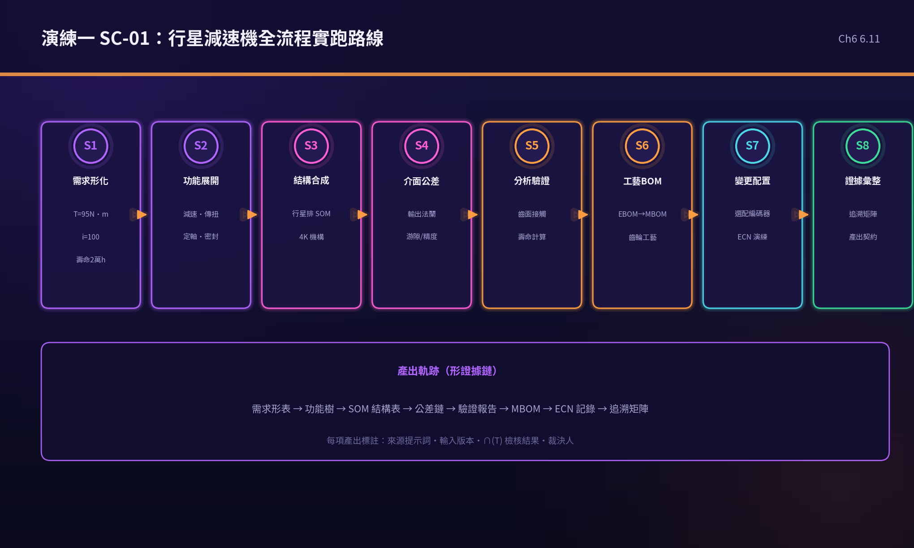

**圖　SC-01 全流程實跑路線與產出軌跡**

### ◆ SC-01 需求形表（S1 完整產出節錄）

| 需求編號 | 來源 | 敘述 | ∩(T) 驗收判準 | 優先序 |
| --- | --- | --- | --- | --- |
| REQ-001 | 訪談-A | 額定輸出扭力 | T ≥ 95 N·m @ 額定轉速 | P1 |
| REQ-002 | 訪談-A | 總減速比 | i = 100 ± 2% | P1 |
| REQ-003 | 法規-CE | 噪音 | LpA ≤ 70 dB(A) @ 1m | P1 |
| REQ-004 | 客訴-042 | 輸出軸油封不滲漏 | 2000h 耐久滲漏量 = 0 | P1 |
| REQ-005 | 訪談-B | 使用壽命 | L10h ≥ 20000 h | P1 |
| REQ-006 | 訪談-C | 選配編碼器介面 | 法蘭規格 ISO 9409-1 | P2 |
| REQ-007 | 訪談-A | 輸入轉速 | n_in ≤ 3000 rpm | P1 |
| REQ-008 | 標竿-X | 重量 | ≤ 12 kg | P2 |
| REQ-009 | 法規-CE | 防護等級 | IP54 以上 | P2 |
| REQ-010 | 訪談-B | 工作溫度 | −10 ~ +40 ℃ | P2 |
| REQ-011 | 客訴-037 | 安裝同心度容差 | ≤ 0.05 mm | P1 |
| REQ-012 | 訪談-C | 維護便利性 | 油封可不拆機更換 | P3 |

| 步驟 | 關鍵產出（節錄） | ∩(T) 檢核結果 |
| --- | --- | --- |
| S1 需求形化 | REQ-001~012：T≥95N·m、i=100±2%、L10h≥20000h、噪音≤70dB(A)、防滲漏、選配編碼器介面 | 12 條全數可驗收；法規 CE 涵蓋 ✓ |
| S2 功能展開 | FUN-001 傳遞扭力／FUN-002 分流／FUN-003 減速／FUN-004 定軸／FUN-005 密封／FUN-006 位置回饋 | 覆蓋矩陣 12×6 無空白 ✓ |
| S3 結構合成 | 兩概念：行星排 vs 諧波；入選行星排 SOM（行星架、太陽輪×1、行星輪×4、內齒圈、殼體、輸出軸系…） | 兩概念差異真實；分級完成 ✓ |
| S4 介面公差 | 輸出法蘭 ISO 9409-1；軸承游隙 C3；齒輪精度 ISO 6；公差鏈：背隙 ≤ 1 arcmin | 累積 0.8 arcmin ≤ 1 ✓ |
| S5 分析驗證 | 齒面接觸應力 1180 MPa < 許用 1500；齒根彎曲安全係數 1.6；L10h 計算 22400 h | 假設 3 項全列；P1 工況全覆蓋 ✓ |
| S6 工藝 BOM | EBOM 42 件 → MBOM 含 3 個半成品層；DFA：同工位螺栓規格由 5 種合併為 2 種 | 孤兒件 0；自製件路線全齊 ✓ |
| S7 變更配置 | 選配編碼器走配置（內容物）；ECR-0001：油封供應商變更 → 影響面 3 件、加嚴審查 | 配置/變更邊界聲明完成 ✓ |
| S8 證據彙整 | 追溯矩陣 REQ→FUN→SOM→Verify→BOM 全鏈閉合；交付包含 8 份產出與版次快照 | 無斷鏈；缺口 0 ✓ |

演練要點其一：S3 的兩概念比較是全流程的品質槓桿——行星排以體積小、比扭力高勝出，諧波以零背隙勝出但壽命與成本劣勢被 REQ-005 與成本約束否決，放棄理由被完整記錄，這就是「生成寬、裁決嚴」。其二：S7 中選配編碼器正確地走了配置（容器內容物替換），而油封供應商變更走了 ECN（涉及密封功能與壽命驗證），配置與變更的邊界判準在實務中第一次被真正用到。

## 6.12　演練二 SC-02：ECN 變更管理實跑

本演練示範量產階段的變更管理。情境：量產中的減速機接獲供應商通知，原軸承鋼材供應中斷，需由 SCM440 切換為等效材質 SAE 4140；同時客戶端要求提前 4 週交貨，變更需兼顧切換成本與交期。

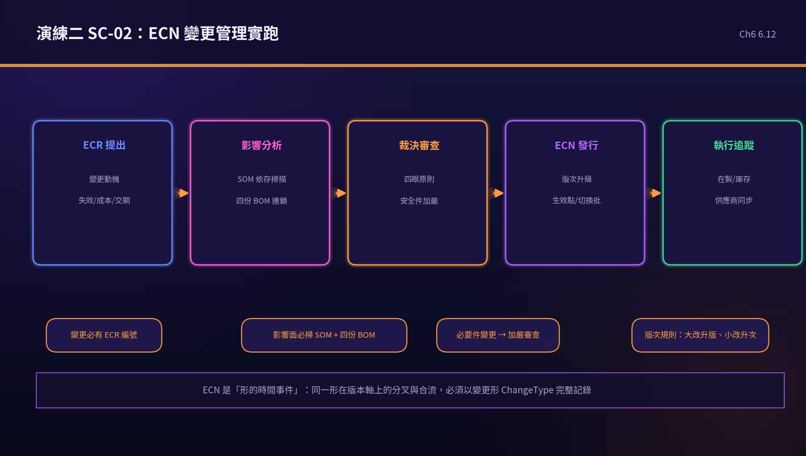

**圖　SC-02 ECN 五階段實跑**

| 階段 | 動作 | 關鍵產出 |
| --- | --- | --- |
| ECR 提出 | S7 提示詞加工 ECR-0002：動機（供應中斷）+ 期望（等效替代） | ECR-0002 形化完成 |
| 影響分析 | SOM 依存掃描：軸承為必要件（承載核心）；四份 BOM 連鎖：EBOM 1 件、MBOM 2 工站、PBOM 在製 300 台、SBOM 備件包 2 项 | 影響面清單 8 項 |
| 裁決審查 | 必要件變更 → 加嚴審查：材質等效性證明（機械性質對照 + 疲勞測試計畫）+ 四眼原則簽核 | 審查記錄 + 測試報告 |
| ECN 發行 | ECN-0142：升版 A→B；生效點＝新供應批；切換批＝第 22 批 | ECN-0142 + 版次升級 |
| 執行追蹤 | 在製 300 台：100 台維持舊料（已領料）、200 台改領新料；庫存舊料消化至第 21 批；供應商映射表更新 | 切換執行記錄 |

### ◆ ECN-0142 草稿（S7 產出節錄）

| 欄位 | 內容 |
| --- | --- |
| ECN 編號 | ECN-0142（承 ECR-0002） |
| 變更對象 | BRG-6205 軸承（零件形・必要件） |
| 變更內容 | 材質 SCM440 → SAE 4140（供應中斷等效替代） |
| 影響面 | EBOM 1 處 / MBOM 2 工站 / PBOM 在製 300 台 / SBOM 備件 2 项 |
| 審查等級 | 加嚴審查（必要件）：材質等效性證明 + 疲勞測試計畫 |
| 版次 | A → B（小改升次：A→A.1 → 因材料牌號變更升版 B） |
| 生效點/切換批 | 新供應批起 ／ 第 22 批 |
| 簽核 | 草擬：AI（S7）→ 裁決：設計主管 → 核准：研發主管 + 品保 |

> **演練要點**
> 必要件判定決定了審查強度——軸承是 remove(p) ≢ M 的必要件，所以等效性證明必須有疲勞測試，不能只憑材質表。
> 影響面掃描的完整性來自四份 BOM 互參——若 SBOM 是獨立維護的 Excel，備件包就會漏改，舊料備件會繼續流入市場。
> 版次與切換批的明確，讓產線「只認 ECN 編號」——口頭變更在制度上不可能發生。

## 6.13　演練三 SC-03：PLM 上線與資料治理

本演練示範 PLM 上線前的資料治理，是形化工程在存量資料上的應用。情境：某機械廠 20 年存量資料（Excel 物料主檔、掃描圖檔、四套不一致的 BOM）準備遷入 PLM，需先治理再遷移。

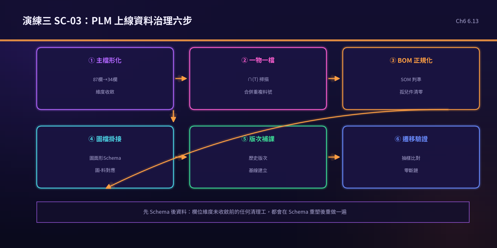

**圖　SC-03 資料治理六步：先 Schema、後資料**

| 步驟 | 形化作業 | 判準 | 常見結果 |
| --- | --- | --- | --- |
| 物料主檔形化 | 以框架四步驟重建欄位維度：對不上維度的差異開新欄並回填，能對上的只加值 | 欄位維度互斥、全貫穿 | 欄位由 87 收斂為 34，空白率 < 2% |
| 一物一檔檢查 | ∩(T) 判準掃描重複料號（同名異碼、同碼異名） | 同物一檔、異物異檔 | 合併重複料號約 12% |
| BOM 正規化 | 四套 BOM 依 SOM 判準統一：層級修正、孤兒件處理、父子參考重建 | 料號互參、層級單一真相 | 孤兒件清零、層級差異 40 處修正 |
| 圖檔掛接 | 圖面形 Schema 標註（圖號/版次/機密）並掛接零件形 | 圖-料一一對應 | 掃描檔 OCR + 人工覆核 |
| 版次補課 | 依版次規則回溯標註歷史版次，建立可回溯基線 | 版版可回溯 | 建立 3 個歷史基線 |
| 遷移驗證 | 產出契約驗收：抽樣 5% 全欄位比對 + 100% 關聯完整性檢查 | 零斷鏈、零遺漏 | 驗收報告 + 差異清單 |

演練要點：存量資料治理是最能體現「新增欄沉重、新增列輕巧」的場景——87 個欄位的收斂是 Schema 重塑（ECR 級大工程），而合併 12% 重複料號只是資料清理（輕工程）。治理順序必須先 Schema 後資料：欄位維度沒收斂前做的任何清理工，都會在 Schema 重塑後重做一遍。

### ◆ SC-03 治理前後對照（量產驗證後節錄）

| 指標 | 治理前 | 治理後 | 手法 |
| --- | --- | --- | --- |
| 物料主檔欄位數 | 87（半數空白） | 34（空白率 < 2%） | 框架四步驟重切維度 |
| 重複料號率 | 約 12% | 0.3%（待觀察） | ∩(T) 一物一檔掃描 |
| BOM 版本數 | 4 套各自演化 | 1 份真相 + 3 投影 | SOM 判準重構 + 料號互參 |
| 孤兒件 | 約 340 件 | 0 | 父子參考重建 |
| 圖-料對應率 | 61% | 99.2% | 圖面形 Schema + OCR 掛接 |
| 可回溯版次 | 無 | 3 個歷史基線 | 版次補課 + 基線管理 |

## 6.14　常見問答（QA）

| 問題 | 回答 |
| --- | --- |
| 需求只有半頁，也要走 S1 全流程嗎？ | 要，但可裁剪：8–15 條可縮為 3–5 條，唯「判準、來源、無重疊」三要素不可省。形化流程的價值不在長度，在邊界。 |
| AI 產出的公差數值可以直接入圖嗎？ | 不可以。AI 產出是草擬級（見 4.5 矩陣），公差必須經工程師依工藝能力裁決、校審簽名後方可入圖。 |
| 歷史 BOM 有 5 個版本，S6 應以哪個為 EBOM？ | 都不應直接採用。先以 SOM 判準重建單一真相（演練三做法），再做轉換——多版本 BOM 直接轉換只會得到五份 MBOM。 |
| 提示詞輸出出現 [缺口] 怎麼辦？ | [缺口] 是正確產出的一部分：表示資料不足。補件後重跑該則，禁止用推測填補缺口。 |
| 配置和變更總是判斷錯，有沒有更簡單的問法？ | 問：「拿掉/換掉它，產品還是同一個產品嗎？」是 → 配置（容器）；否 → 變更（SOM 結構）。拿不準時一律走變更，安全側優先。 |
| 小專案要不要跑八步驟？ | 八步驟不可跳，但深度可裁剪：S5 可用計算法代替 CAE、S6 可省 PBOM；唯一不可裁的是 S1 判準與 S8 證據。 |
| S3 要求 ≥ 2 概念，資源不夠怎麼辦？ | 第二概念可以是「最簡可行方案」或「沿用既有模式卡」——重點不是兩個都做深，而是逼出選型裁決的對照組與放棄理由。 |
| 提示詞產出的表格欄位跟公司範本不合？ | 在提示詞的「輸出規格」段貼入公司範本欄位即可覆蓋預設 Schema；範本本身就是公司的形，應受控並升版。 |
| 量產中的 ECN 一定要走 S7 全流程嗎？ | 依影響面裁剪：純文檔勘誤可簡化；涉及必要件、四份 BOM 或法規者必須全走，裁剪決定記錄於 ECR。 |
| 如何判斷 AI 檢索到的案例可不可信？ | 案例形卡必須標註來源專案與年份；無來源案例視為未檢索到，回到自建模式卡路徑。 |

> **本章重點整理**
> 六段式提示詞是受控文件：角色、任務、輸入、約束、輸出規格、檢核，缺一段即不受控。
> S1–S9 是形的加工站接力：上游產出即本則輸入，[缺口] 是正確產出的一部分。
> 三則演練分別覆蓋新設計（SC-01）、變更（SC-02）、存量治理（SC-03）三種真實場景。
> 生成寬、裁決嚴：候選要多、判準要硬、證據要真。

# 第 7 章　準確性與品質保證

## 7.1　幻覺三關

LLM 時代的「準確」問題，本質上是幻覺治理問題。本方案以三關防線把幻覺擋在工程產出之外：來源關（每個數值與規範必須標註來源，無來源拒收）、判準關（產出逐項通過 ∩(T) 特徵檢查，未通過重做）、證據關（推理路徑可回溯、形證據鏈完整，斷鏈補證）。三關都是流程性的——不依賴模型自覺，依賴檢查節點。

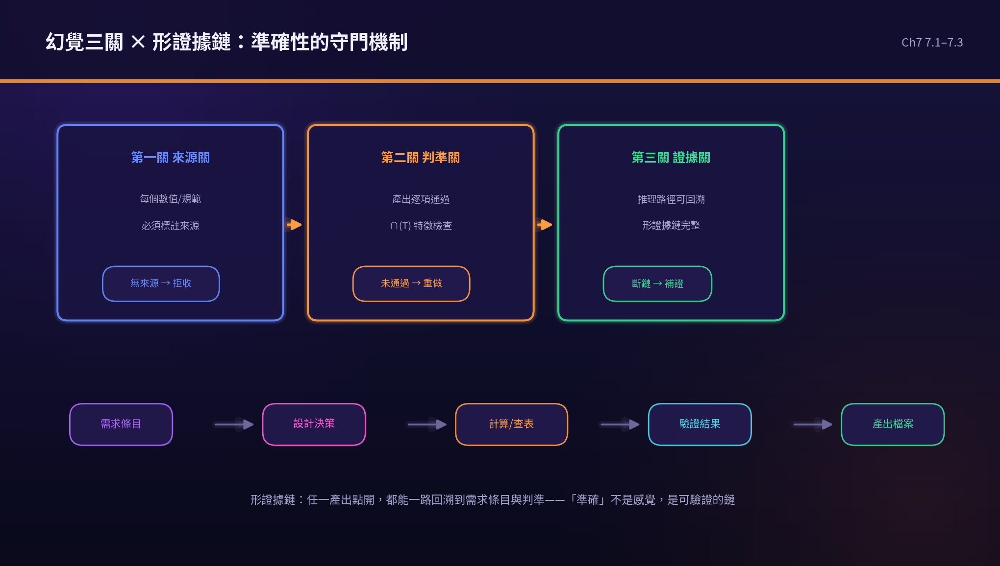

**圖　幻覺三關與形證據鏈**

| 關 | 檢查點 | 檢查動作 | 不通過處置 |
| --- | --- | --- | --- |
| 來源關 | 每則提示詞輸出後 | 抽取全部數值/規範，逐項核對標註來源 | 無標註項目整段拒收重跑 |
| 判準關 | 每步驟產出前 | ∩(T) 特徵逐項自檢 + 人工抽驗 | 退回該步重做，不得改判準遷就產出 |
| 證據關 | S8 彙整時 | 追溯矩陣斷鏈掃描 + 簽核完整性 | 補證或顯式聲明缺口，禁止補寫 |

## 7.2　一致性檢查

一致性是跨文件、跨 BOM、跨版次的橫向檢查。誤差最常藏在交界處：同一顆零件在需求書叫「輸出軸」、在 BOM 叫「OUT-SHAFT」、在圖面叫「零件 3」——同物異名讓一切追溯失效。一致性檢查以形為單位：每一個形在所有文件中的編號、名稱、屬性必須一致；四份 BOM 的同一料號資料必須一致；所有文件引用的版次必須是現行有效版。

| 一致性類型 | 檢查內容 | 工具化程度 | 頻率 |
| --- | --- | --- | --- |
| 命名一致性 | 同物同名、異物異名；名稱對照表受控 | 可規則化掃描 | 每次產出後 |
| 編號一致性 | 料號、圖號、文號唯一且格式合規 | 可規則化掃描 | 每次建檔時 |
| BOM 一致性 | 四份 BOM 同料號屬性一致、層級對應 | 需比對引擎 | 每版 BOM 發行時 |
| 版次一致性 | 引用文件皆現行有效版；無過期版混用 | 可規則化掃描 | 每份交付前 |
| 數值一致性 | 跨文件同參數同值；單位一致 | 半自動＋人工 | 審查會議前 |

### ◆ 命名對照表示例（受控）

| 標準名稱 | 別名（歷史/口語） | 歸屬形 | 處置 |
| --- | --- | --- | --- |
| 輸出軸 | OUT-SHAFT、法蘭軸、主軸 | 零件形 P-2005 | 別名全部登入對照表 |
| 行星架 | 轉臂、曲柄架 | 零件形 P-2001 | 文件一律用標準名 |
| 油封 | 骨架油封、TC 封 | 零件形 P-3001 | 規格另記於材料形 |
| 減速機 | 減速箱、行星箱 | 結構形-組件 | 口語別名僅存於對照表 |

名稱對照表本身也是受控形資料：別名不消滅（歷史文件需要它），但現行文件只允許標準名。AI 在 S 系列提示詞產出時自動套用標準名，是將同物異名問題從「事後整理」變成「事前防範」的最省力做法。

## 7.3　形證據鏈

形證據鏈是準確性的最終憑證：任何一項產出點開，都能一路回溯到需求條目與判準。鏈的五個環節固定為：需求條目 → 設計決策 → 計算/查表 → 驗證結果 → 產出檔案；每個環節標註四件事——來源提示詞、輸入版本、∩(T) 檢核結果、裁決人。鏈的品質用兩個指標衡量：斷鏈率（無法回溯到需求的產出佔比，目標 0%）與裁決覆蓋率（經人簽名裁決的產出佔比，目標 100%）。

> **證據鏈的管理原則：**
>
> 證據隨步驟即時歸檔。任何「結案前補文件」的行為本身即是斷鏈——因為補寫的證據無法證明它產於決策之前。

## 7.4　驗證矩陣

驗證矩陣把「需求是否被驗證」變成一張可逐格勾稽的表：列是需求條目（REQ），欄是驗證手段（分析 A / 測試 T / 檢驗 I / 文件審查 D），格內填驗證項目編號與結果。矩陣的空格即風險——P1 需求若有空格，不得結案。

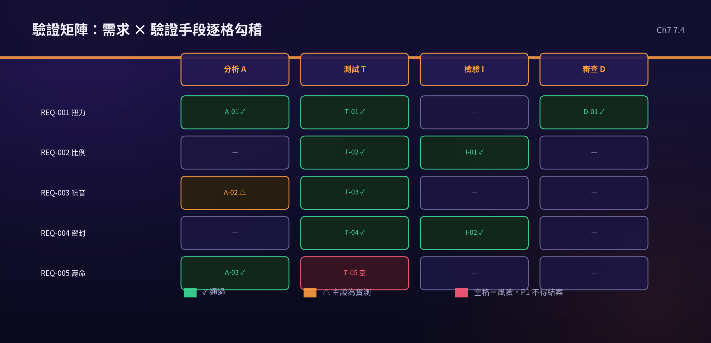

**圖　驗證矩陣：空格即風險，P1 不得結案**

| 需求 | 分析 A | 測試 T | 檢驗 I | 審查 D | 結論 |
| --- | --- | --- | --- | --- | --- |
| REQ-001 扭力 | A-01 齒輪強度 ✓ | T-01 台架扭力 ✓ | — | D-01 方案審查 ✓ | 通過 |
| REQ-002 比例 | — | T-02 轉速比測定 ✓ | I-01 齒數檢驗 ✓ | — | 通過 |
| REQ-003 噪音 | A-02 NVH 模擬 △ | T-03 噪音實測 ✓ | — | — | 通過（實測主證） |
| REQ-004 密封 | — | T-04 滲漏試驗 ✓ | I-02 油封檢驗 ✓ | — | 通過 |
| REQ-005 壽命 | A-03 L10h 計算 ✓ | T-05 耐久 [缺口] | — | — | 待 T-05 補證 |

矩陣同時是 AI 協作的接口：S5 提示詞直接以驗證矩陣為輸出格式之一，缺口即 [缺口] 聲明。人與 AI 對著同一張矩陣工作，「驗證做完了沒有」不再是一場感覺的對話。

## 7.5　常見誤用警語彙整

本節彙整導入過程中最常見的誤用型態，供使用者自我對照。每則誤用皆附「正確做法」，詳見各章對應節次。

| 誤用 | 徵狀 | 正確做法 | 見章節 |
| --- | --- | --- | --- |
| 把逐字稿當需求 | 需求條目冗長、無法驗收 | 異同偵測 → 分合 → 命名 → 判準 | 2.1 |
| 結構件當選配 | 選配清單出現必要件 | remove(p) 判準；拿不準一律走變更 | 2.4 |
| 四份 BOM 各自維護 | 同料號四種真相 | SOM 單一真相、料號互參、禁止複製 | 2.5 |
| 料號含意義編碼 | 改材料即改料號、參考斷裂 | 流水碼/受控碼；主鍵永不變更 | 2.7 |
| 跳步直上詳細設計 | 後期大改、需求漏覆蓋 | 八步驟不跳步；候選方案 ≥ 2 | 5.3 |
| 模擬說成實測 | 報告結論強度虛高 | 推理型別與證據類型顯式標註 | 3.4 |
| AI 產出直接入圖 | 未經裁決的公差入圖 | 草擬級產出必須人工裁決簽名 | 4.5 |
| 結案前補證據 | 證據鏈時序矛盾 | 證據即時歸檔；S8 只彙整不補件 | 5.9 |
| 用 [推測] 填缺口 | 虛假完整度 | [缺口] 是產出的一部分，補件重跑 | 6.1 |
| 為遷就產出改判準 | ∩(T) 被事後放寬 | 判準先立；產出不過就重做 | 7.1 |

## 7.6　導入成熟度速覽

導入不必一步到位。成熟度分四級，判準不在工具多強，而在「形庫受控程度」與「證據鏈完整度」：L1 試用（單專案試點、S1–S3 局部使用）→ L2 常規（全流程 TDDM、S1–S9 完整跑通）→ L3 治理（形庫與模式庫受控、與 PLM 主數據接軌）→ L4 演化（持續學習閉環、跨專案複用）。

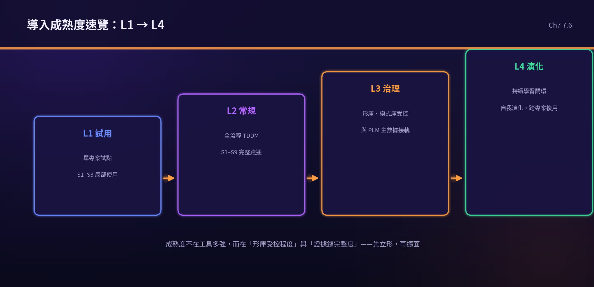

**圖　導入成熟度 L1 → L4**

| 級 | 特徵 | 升級門檻 | 常見卡關與解法 |
| --- | --- | --- | --- |
| L1 試用 | 單專案、S1–S3 局部 | 至少一專案產出形證據鏈 | 卡關：工程師嫌麻煩 → 解法：只裁剪深度、不裁剪判準 |
| L2 常規 | 全流程 TDDM | 八步驟全跑 + 驗證矩陣閉合 | 卡關：跨部門不交資料 → 解法：產出契約寫進部門 KPI |
| L3 治理 | 形庫/模式庫受控 | Schema 受控、∩(T) 全覆蓋 | 卡關：Schema 頻繁變動 → 解法：ECR 級審查集中窗口 |
| L4 演化 | 學習閉環、跨專案複用 | 模式卡覆蓋率 > 60%、斷鏈率 0% | 卡關：回饋不入庫 → 解法：每張 ECN 強制檢附模式卡更新 |

> **本章重點整理**
> 幻覺三關（來源、判準、證據）全是流程性檢查節點，不依賴模型自覺。
> 一致性檢查的重點在交界處：同物同名、料號唯一、四份 BOM 互參、版次有效。
> 形證據鏈兩指標：斷鏈率 0%、裁決覆蓋率 100%；證據即時歸檔，禁止結案補件。
> 成熟度看形庫受控度與證據完整度，先立形、再擴面。

# 第 8 章　附錄

## 附錄 A　S1–S9 速查卡

| 編號 | 名稱 | 輸入 | 核心產出 | 最常失守 |
| --- | --- | --- | --- | --- |
| S1 | 需求形化 | 訪談/法規/客訴 | 需求形表 + ∩(T) | 判準欄空白 |
| S2 | 功能展開 | 需求形表 | 功能樹 + 覆蓋矩陣 | 孤兒功能 |
| S3 | 結構合成 | 功能樹 + 模式庫 | SOM 表 + 概念比較 | 單方案直上 |
| S4 | 介面公差 | SOM + 工藝能力 | 介面表 + 公差鏈 | 未算累積公差 |
| S5 | 分析驗證 | SOM + 公差鏈 + 工況 | 驗證矩陣 + 報告 | 工況窄於需求 |
| S6 | 工藝 BOM | EBOM + 零件形 | 四份 BOM + 工藝路線 | MBOM 脫節 |
| S7 | 變更 ECN | ECR + 現行資料 | 影響面 + ECN 草稿 | 影響面漏掃 |
| S8 | 配置變型 | SOM + 選項需求 | 選項矩陣 + 變型 BOM | 結構件進選配 |
| S9 | 證據彙整 | S1–S8 產出 | 追溯矩陣 + 驗收表 | 補件充當證據 |

## 附錄 B　全域形總表 Schema 速查

十六形五件套（Schema・∩(T)・主鍵・主從參考・產出契約）速查，詳細欄位見 4.3。凡新建形資料，先查此表定義 Schema，再填值；Schema 變更一律走 ECR 級審查。

| 形 | ∩(T) 判準要點 | 產出契約要件 |
| --- | --- | --- |
| 需求形 | 可驗收・來源可溯・無重疊 | 需求形表 + 分合說明 |
| 功能形 | 全覆蓋・無孤兒・可量測 | 功能樹 + 覆蓋矩陣 |
| 結構形 | 功能有承載・必要性分級 | SOM 表 + 概念比較 |
| 零件形 | 屬性齊備・自製/外購明確 | 零件卡 + 分類歸族 |
| 材料形 | 牌號受控・性質齊備 | 材質證明 + 對照表 |
| 公差形 | 基準唯一・累積達標 | 公差鏈計算書 |
| 介面形 | 兩側明確・判準可量 | 介面表 |
| 工藝形 | 能力覆蓋・工裝齊備 | 工藝規程 |
| 圖面形 | 圖料對應・版次正確 | 簽核圖檔 |
| 文件形 | Schema 統一・簽核完備 | 受控文件 |
| 清單形 | 料號互參・層級單一真相 | 四份 BOM |
| 變更形 | 無 ECR 不變更・影響面全掃 | ECN 包 + 切換計畫 |
| 配置形 | 內容物替換・互斥依賴全 | 選項矩陣 + 變型 BOM |
| 驗證形 | 工況覆蓋・假設顯式 | 驗證報告 + 原始數據 |
| 模式形 | 適用約束明確・教訓更新 | 模式卡 |
| 時序形 | 里程碑綁產出契約 | 時程表 + 驗收記錄 |

## 附錄 C　檢查清單彙整

### ◆ C-1　需求形檢查清單

- 每條需求有 ∩(T) 驗收判準且可量測
- 每條需求標註來源（訪談/法規/客訴/標竿）
- 條目間邊界不重疊（同一測試不得覆蓋兩條以上需求）
- 法規需求逐項對照無遺漏
- 優先序 P1/P2/P3 賦予完成

### ◆ C-2　設計產出檢查清單

- 功能覆蓋矩陣無空白列（需求全覆蓋）、無空白欄（無孤兒功能）
- 候選概念方案 ≥ 2，選型與放棄理由記錄
- 必要件/功能降級件/非必要件分級完成
- 公差鏈閉合、累積公差 ≤ 功能需求
- 分析假設與邊界條件顯式列出

### ◆ C-3　BOM 與變更檢查清單

- 四份 BOM 料號互參、無孤兒件、層級一致
- 每個自製件有工藝路線；DFA 規格數合規
- ECN 影響面掃描覆蓋 SOM 依存 + 四份 BOM
- 必要件變更附加嚴審查記錄
- 生效點、切換批、在製/庫存處置明確

### ◆ C-4　交付前總檢查

- 驗證矩陣 P1 需求無空格
- 追溯矩陣無斷鏈（斷鏈率 0%）
- 全部數值/規範有來源標註
- [缺口] 清單顯式聲明並有補件計畫
- 簽核齊備（裁決覆蓋率 100%）

## 附錄 D　術語對照表

| 本形學 | 英文（Type 體系） | 機械設計 × PLM | 備註 |
| --- | --- | --- | --- |
| 形 | Type | 需求形/零件形/… | 英文一律 Type，不用 Form |
| 屬性/屬性值 | Attribute / Attribute Value | 欄位/欄位值 | 維度固定、刻度可延伸 |
| 空間容器 | Space Collections | 裝配體/工位/配置 | ( ) 身份獨立性 |
| BOM | Bill of Materials | 物料清單 | 拆下來仍認得自己 |
| SOM | Space of Materials | 產品結構 | { } = BOM + 容器 |
| 抽象 | Abstraction | 零件族/標準件判定 | [ ] + ∩(T) |
| 交集判準 | ∩(T) | 驗收/選型判準 | 特徵集合 F(T) 全通過 |
| 框架 | Framework | 設計框架/資料 Schema | 四步驟建立維度 |
| 主鍵 | Primary Key | 料號/編號 | 身份憑證、永不變更 |
| 主從參考 | Master-Detail Reference | BOM 父子/文件掛接 | 外鍵指向主鍵 |
| 需求形 | RequirementType | 需求條目 | S1 產出 |
| 功能形 | FunctionType | 功能樹節點 | S2 產出 |
| 結構形 | StructureType | SOM 節點 | S3 產出 |
| 公差形 | ToleranceType | 公差環/基準體系 | S4 產出 |
| 驗證形 | VerifyType | 分析/測試記錄 | S5 產出 |
| 工藝形 | ProcessType | 工序/工藝路線 | S6 產出 |
| 變更形 | ChangeType | ECR/ECN | S7 產出 |
| 配置形 | ConfigType | 選項矩陣/變型 BOM | S8 產出 |
| 模式形 | PatternType | 模式卡/標準模組 | 時間本形沉澱 |
| 時序形 | TimingType | 里程碑/時程 | 時間軸事件 |

## 附錄 E　空白表單範本

### ◆ E-1　需求形表（空白）

| 需求編號 | 來源 | 敘述 | ∩(T) 驗收判準 | 優先序 | 狀態 |
| --- | --- | --- | --- | --- | --- |
| REQ-___ | | | | P_ | □草擬 □已裁決 |
| REQ-___ | | | | P_ | □草擬 □已裁決 |
| REQ-___ | | | | P_ | □草擬 □已裁決 |
| REQ-___ | | | | P_ | □草擬 □已裁決 |

### ◆ E-2　變更申請 ECR（空白）

| 欄位 | 填寫內容 |
| --- | --- |
| ECR 編號 | ECR-____（無編號不受理） |
| 變更動機 | □失效 □成本 □交期 □法規 □客戶 □其他 |
| 變更描述 | （形化敘述：哪個形、哪個屬性、從什麼到什麼） |
| 影響面初判 | □必要件 □功能降級件 □非必要件；四份 BOM 連鎖：□是 □否 |
| 期望生效點 | （批次/日期） |
| 提出人/日期 | |

### ◆ E-3　產出契約驗收表（空白）

| 交付物 | Schema | 回溯 | 證據 | 簽核 | 結果 |
| --- | --- | --- | --- | --- | --- |
| | □合 □否 | □完整 □缺口 | □齊 □缺 | | □收 □退 |
| | □合 □否 | □完整 □缺口 | □齊 □缺 | | □收 □退 |
| | □合 □否 | □完整 □缺口 | □齊 □缺 | | □收 □退 |
| | □合 □否 | □完整 □缺口 | □齊 □缺 | | □收 □退 |

## 附錄 F　快速入手三日計畫

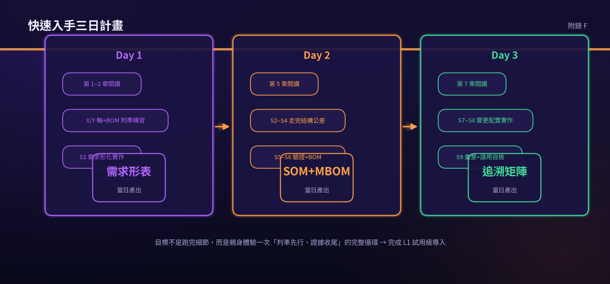

**圖　三日計畫：體驗一次「判準先行、證據收尾」的完整循環**

| 日 | 上午 | 下午 | 當日產出 |
| --- | --- | --- | --- |
| Day 1 | 讀第 1–2 章；以自家一顆零件練習 X/Y 軸與 BOM 判準 | 以 S1 提示詞形化一個真實專案需求 | 需求形表 + 分合說明 |
| Day 2 | 讀第 5 章；以 S2–S4 走完功能/結構/公差 | S5–S6：驗證計畫 + EBOM 轉換 | SOM 表 + 公差鏈 + MBOM 初稿 |
| Day 3 | 讀第 7 章；跑 S7–S8（演練二情境） | S9 彙整 + 對照 7.5 誤用表自檢 | 追溯矩陣 + 產出契約驗收表 |

三日計畫的目標不是跑完全部細節，而是親身體驗一次「判準先行、證據收尾」的完整循環。完成後，把三日產出與附錄 C 檢查清單對照一遍，即完成 L1 試用級導入；下一個專案以 TDDM 八步驟完整運行，即向 L2 常規級邁進。

## 附錄 G　工程速查表

本附錄彙整形化作業中最常查用的工程基礎數據，供 S3–S6 提示詞的約束段引用。表列為常用範圍節錄，實際選用一律以現行國家標準與廠內受控規範為準。

### ◆ G-1　標準公差等級（IT，節錄）

| 公差等級 | IT6 | IT7 | IT8 | IT9 | 典型應用 |
| --- | --- | --- | --- | --- | --- |
| 0.6–3 mm | 6 | 10 | 14 | 25 | 精密配合軸徑 |
| 3–6 mm | 8 | 12 | 18 | 30 | 軸承座孔 |
| 6–10 mm | 9 | 15 | 22 | 36 | 一般機械零件 |
| 10–18 mm | 11 | 18 | 27 | 43 | 中型軸徑 |
| 18–30 mm | 13 | 21 | 33 | 52 | 一般軸徑 |
| 50–80 mm | 19 | 30 | 46 | 74 | 大型殼體孔 |

### ◆ G-2　常用配合制度（基孔制 H7，節錄）

| 配合 | 軸偏差 | 孔偏差 | 性質 | 範例 |
| --- | --- | --- | --- | --- |
| H7/g6 | g6（滑動） | H7 | 轉動配合、油膜潤滑 | 齒輪孔-軸 |
| H7/h6 | h6 | H7 | 滑動配合、可拆卸 | 定位銷 |
| H7/k6 | k6 | H7 | 過渡配合、輕打裝配 | 聯軸器輪轂 |
| H7/n6 | n6 | H7 | 過渡/輕壓入 | 軸承外圈-座孔 |
| H7/p6 | p6 | H7 | 壓入配合 | 襯套壓裝 |

### ◆ G-3　常用結構材料（節錄）

| 牌號 | 類別 | 抗拉強度 | 典型用途 | 熱處理 |
| --- | --- | --- | --- | --- |
| S45C | 中碳鋼 | ≥ 590 MPa | 軸類、一般結構件 | 調質/高週波 |
| SCM440 | 鉻鉬鋼 | ≥ 980 MPa | 高強度軸、齒輪 | 調質+滲碳 |
| SUS304 | 不鏽鋼 | ≥ 520 MPa | 耐蝕結構、食品機械 | 固溶化 |
| ADC12 | 鋁合金壓鑄 | ≥ 230 MPa | 殼體、散熱件 | — |
| 6061-T6 | 鋁合金 | ≥ 290 MPa | 面板、支架 | T6 人工時效 |
| FC250 | 灰鑄鐵 | ≥ 250 MPa | 機座、箱體 | 退火 |
| POM / PA66 | 工程塑膠 | — | 輕載齒輪、絕緣件 | — |

### ◆ G-4　表面處理與防鏽選用（節錄）

| 處理 | 膜厚/等級 | 防鏽能力 | 適用 | 注意 |
| --- | --- | --- | --- | --- |
| 鍍硬鉻 | 20–50 μm | 優 | 軸類耐磨面 | 氫脆風險（高強鋼需除氫） |
| 無電解鎳 | 10–25 μm | 優 | 複雜形狀均勻鍍層 | 成本高 |
| 發黑（氧化） | 1–3 μm | 弱（油膜配合） | 室內零件、外觀件 | 須塗防鏽油 |
| 達克羅 | 6–10 μm | 良 | 緊固件、彈簧 | 無氫脆、耐鹽霧 |
| 粉體烤漆 | 60–120 μm | 良 | 機架、外殼 | 屏蔽配合面需遮蔽 |
| 陽極處理（鋁） | 5–20 μm | 良 | 鋁件防蝕+絕緣 | 封孔品質決定防蝕 |

### ◆ G-5　常用緊固件強度等級（節錄）

| 等級 | 公稱抗拉 | 屈服比 | 典型用途 | 對應牌號範例 |
| --- | --- | --- | --- | --- |
| 4.8 | 400 MPa | 0.8 | 一般結構、非關鍵 | SWRCH 系 |
| 8.8 | 800 MPa | 0.8 | 機械一般緊固 | SCM435 |
| 10.9 | 1040 MPa | 0.9 | 高強度、預載關鍵 | SCM435/440 |
| 12.9 | 1220 MPa | 0.9 | 安全關鍵連接 | SCM440（需除氫） |
| A2-70 | 700 MPa | — | 不鏽鋼耐蝕 | SUS304 |

## 附錄 H　演練與工作表單

### ◆ H-1　SC-01 想定對照表（空白）

| 步驟 | 計畫產出 | 實際產出 | ∩(T) 結果 | 裁決人 |
| --- | --- | --- | --- | --- |
| S1 需求形化 | | | □過 □退 | |
| S2 功能展開 | | | □過 □退 | |
| S3 結構合成 | | | □過 □退 | |
| S4 介面公差 | | | □過 □退 | |
| S5 分析驗證 | | | □過 □退 | |
| S6 工藝 BOM | | | □過 □退 | |
| S7 變更配置 | | | □過 □退 | |
| S8 證據彙整 | | | □過 □退 | |

### ◆ H-2　追溯矩陣（空白）

| 需求 | 功能 | 結構/零件 | 驗證 | BOM/變更 | 斷鏈 |
| --- | --- | --- | --- | --- | --- |
| REQ-___ | FUN-___ | | | | □無 □有 |
| REQ-___ | FUN-___ | | | | □無 □有 |
| REQ-___ | FUN-___ | | | | □無 □有 |
| REQ-___ | FUN-___ | | | | □無 □有 |
| REQ-___ | FUN-___ | | | | □無 □有 |

### ◆ H-3　模式卡（空白）

| 欄位 | 填寫內容 |
| --- | --- |
| 模式編號/名稱 | PT-____　／ |
| 適用約束（∩(T)） | （載荷、轉速、溫度、壽命等適用範圍） |
| 參數範圍 | （幾何、材料、公差的推薦區間） |
| 介面定義 | （與其他模組的連接、配合、傳動介面） |
| 失效教訓 | （歷史 ECN、8D、客訴的教訓摘要） |
| 來源案例 | （專案編號、年份） |
| 版次/更新日 | |

## 附錄 I　名詞索引（依主題）

本索引依主題群組列出全書關鍵名詞與對應節次，供快速查閱；英文命名一律 Type 體系。

| 主題 | 名詞 | 節次 |
| --- | --- | --- |
| 形化基礎 | 形（Type）、異同→分合→形、X 軸、Y 軸 | 1.2、2.1–2.2 |
| 屬性治理 | 屬性/屬性值、浮現規則、物料主檔、新增列/新增欄 | 2.3、2.7 |
| 容器與配置 | 空間容器、邊界、內部空間、獨立身份、配置形 | 2.4、4.3 |
| BOM 體系 | BOM 判準、SOM、必要件/功能降級件/非必要件、EBOM/MBOM/PBOM/SBOM | 2.5 |
| 框架與判準 | 框架四步驟、Schema、∩(T)、F(T)、三括號 ( ) { } [ ] | 2.6、2.8 |
| 資料模型 | 表頭=形、資料列=實體、主鍵、主從參考、RDB | 2.7 |
| 時間本形 | 形時間函式搜尋、案例形卡、搜尋與萃取、設計模式、模式卡 | 3.1–3.3 |
| 推理與思考 | 推理五型、思考法、FMEA、故障樹、第一性原理 | 3.4–3.5 |
| 學習演化 | 持續學習、重構與重組、自我演化、形庫 | 3.9 |
| 知識域 | 六域、八域、交接規格 H1–H5、全域十六形 | 4.1–4.3、4.6 |
| 產出治理 | 產出契約、人機授權矩陣、草擬/協同/主導 | 4.4–4.5 |
| 方法論 | TDDM、八步驟 S1–S8、裁剪指引 | 5.1–5.11 |
| 提示詞 | 六段式、S1–S9、[缺口]、輸出規格、檢核段 | 6.1–6.10 |
| 演練 | SC-01 減速機、SC-02 ECN、SC-03 上線治理 | 6.11–6.13 |
| 品質保證 | 幻覺三關、一致性檢查、形證據鏈、驗證矩陣、斷鏈率 | 7.1–7.4 |
| 導入 | 誤用警語、成熟度 L1–L4、三日計畫 | 7.5–7.6、附錄 F |
| 工程速查 | 公差等級、配合制度、材料、表面處理、緊固件等級 | 附錄 G |
| 表單 | 需求形表、ECR、產出契約驗收表、追溯矩陣、模式卡 | 附錄 E、H |
| 使用守則 | 提示詞錯誤修正、文件守則、修訂記錄 | 附錄 J、K |

## 附錄 J　提示詞常見錯誤與修正對照

使用 S 系列提示詞時，最常見的操作錯誤與其修正寫法對照如下。原則一以貫之：輸入不正式就停、約束不具體就空、檢核不寫就漂。

| 錯誤寫法 | 問題 | 修正寫法 |
| --- | --- | --- |
| 「幫我把需求整理一下」 | 未指名形與判準，輸出漂移 | 貼入 S1 六段式全文，明示產出需求形表與 ∩(T) 欄位 |
| 輸入貼口頭摘要 | 來源不可溯，違反來源關 | 貼 S1 正式產出（含版次），或明示 [缺口] |
| 「公差盡量寬鬆一點」 | 以偏好干預判準 | 約束段寫明工藝能力與功能需求，判準由 ∩(T) 決定 |
| 要求「一次給我全部」 | 跳步，骨架崩壞 | 依 S1→S9 逐則接力；每則只產出本步形 |
| 只說「要專業一點」 | 約束空洞 | 列出具體標準（ISO、廠規、禁限用物質清單） |
| 忽視檢核段 | 產出無自檢、缺口隱形 | 檢核段必留；要求逐條 ✓/✗ 與 [缺口] 清單 |
| 修改提示詞不升版 | 同專案多版本混用、無法稽核 | 提示詞升版並記入形證據鏈 |
| 把 AI 草擬直接歸檔 | 跳過裁決，違反授權矩陣 | 標註產出等級，經人覆核簽名後歸檔 |

## 附錄 K　文件使用守則與修訂記錄

### ◆ K-1　本方案文件的使用守則

- 本方案本身即受控文件：引用時標註章節版次；改編提示詞須另立版次並記錄。
- S1–S9 提示詞原文可複製使用於 Mind AI 平台；公司化改編時保留六段式結構。
- 附錄表單（E/H）可直接轉入公司 PLM/表單系統；欄位增減視為 Schema 變更。
- 與公司既有標準（ISO、廠規）衝突時，以法規與標準為準，並回饋修訂本方案。

### ◆ K-2　修訂記錄

| 版次 | 日期 | 修訂內容 | 備註 |
| --- | --- | --- | --- |
| V1.0 | 2026-10-17 | 初版發行：八章 + 附錄 A–K；S1–S9 手冊與三則演練 | 本形學×Mind AI 底層 |
| | | | |
| | | | |

> **最後的提醒**
> 準確不是一次做到的，是靠判準、骨架、檢核、證據四層日日疊加出來的。
> 形庫是公司的智慧資產：每一次 ECN、每一份 8D、每張模式卡，都在讓下一個專案更準。
> 裁決權永遠在人——AI 讓工程師更像工程師，而不是替代工程師。
