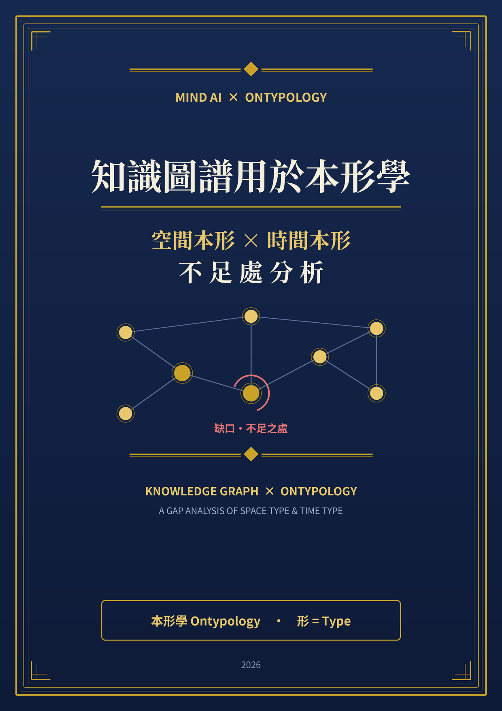

# 總　目　錄

❖ ────────── ✦ ────────── ❖

- 寫在前面　三個約定
- 導讀　兩套語言的落差
- 第一章　知識圖譜的三樣配備
  - 1.1　節點、邊、屬性
  - 1.2　三元組：一句一句地說世界
  - 1.3　擅長與不擅長的分界線
- 空間篇・四個不足
- 第二章　不足一・括號壓平
  - 2.1　三種括號，三種語義
  - 2.2　壓平的現場：杯蓋的三重身分
  - 2.3　語義流失的三個後果
- 第三章　不足二・身份漂移
  - 3.1　身份錨 id(C)：內容可換，身份不換
  - 3.2　四個漂移現場
  - 3.3　不變性公理缺席的代價
- 第四章　不足三・圖不會判
  - 4.1　判斷是漏斗，不是查表
  - 4.2　查表與規則的分別
  - 4.3　remove 三級：反事實寫不進邊
- 第五章　不足四・生成失憶
  - 5.1　形的生成鏈
  - 5.2　框架四步驟：維度是被「逼」出來的
  - 5.3　只存結果的三個代價
- 時間篇・三個不足
- 第六章　不足五・動詞消失
  - 6.1　時間本形＝動詞＝函式＝招式
  - 6.2　一個招式要有「做」的全部
  - 6.3　退化成標籤之後
- 第七章　不足六・推理缺席
  - 7.1　五種推理，五條「圖上沒有」的路
  - 7.2　「有關」不等於「所以」
  - 7.3　圖走舊路，推理開新路
- 第八章　不足七・演化缺席
  - 8.1　自我演化：知識帶著時間流動
  - 8.2　圖不會自己長大
  - 8.3　三個具體的「長不大」
- 第九章　合觀・兩本形之間
  - 9.1　七不足全景圖
  - 9.2　同一個落差的七張臉
  - 9.3　誤用對照：五種「以為圖能做」
  - 9.4　檢查清單：哪些問題不要交給圖
- 回顧　帶著落差感離開
  - R-1　三句話總結
  - R-2　本書沒有的東西（再提醒一次）
  - R-3　這份分析怎麼用
- 附錄　術語與落差速查

# 寫在前面　三個約定

BEFORE WE BEGIN

這是一本只做一件事的書：把**知識圖譜**（Knowledge Graph, KG）用在**本形學**（Ontypology）——空間本形（Space Type）與時間本形（Time Type）——的時候，它說不清楚、存不下來、判不動、跟不上的那些地方，一處一處拆開來看清楚。換句話說：本書是**不足之處的分析**，不是知識圖譜的教科書，也不是本形學的重述。

為了讓這場分析乾淨俐落，出發之前先立三個約定：

> **約定一・形 = Type**
>
> 「形」的英文一律用 Type，不用 Form。
> 空間本形 = Space Type、時間本形 = Time Type、單位形 = Unit Type。

> **約定二・不重述本形學**
>
> 本書假定你已讀過本形學的空間本形與時間本形。
> 括號、判準、公理等術語只在分析需要處「點名式」引用，不重新教學。

> **約定三・只分析不足**
>
> 本書不提補強方案、不做系統實作、不畫未來藍圖。
> 每一章只回答一個問題：這裡，知識圖譜到底少了什麼？

**表 0-1　任務地圖：七個不足與篇章對照**

| 篇 | 章 | 不足 | 一句話 |
| --- | --- | --- | --- |
| 起點 | 第一章 | KG 能力底線 | 先量一量知識圖譜口袋裡有什麼配備 |
| 空間篇 | 第二章 | 括號壓平・三種關係一種邊 | 三種關係被壓成一種邊 |
| 空間篇 | 第三章 | 身份漂移・圖無身份錨 | 圖沒有身份錨可守 |
| 空間篇 | 第四章 | 圖不會判・查表非判斷 | 查表不等於判斷 |
| 空間篇 | 第五章 | 生成失憶・只存結果 | 只存結果，不存過程 |
| 時間篇 | 第六章 | 動詞消失・招式成標籤 | 招式退化成標籤 |
| 時間篇 | 第七章 | 推理缺席・圖走舊路 | 圖走舊路，推理開新路 |
| 時間篇 | 第八章 | 演化缺席・圖不長大 | 圖不會自己長大 |
| 合觀 | 第九章 | 七不足總體診斷 | 同一個落差的七張臉 |
| 回顧 | 回顧 | 檢查清單 | 帶著清單離開，才知道圖能用在哪 |

# 導讀　兩套語言的落差

INTRODUCTION

**知識圖譜與本形學都在「描述世界」，但它們的語言天生不一樣。**

知識圖譜的語言是名詞與關係：把世界說成一句一句的陳述——「杯子的材質是玻璃」「杯蓋屬於杯子」「桌子上有杯子」。節點記東西，邊記關係，屬性記標籤。這套語言的強項是**記住與連結**：成千上萬的陳述疊成一張網，查找飛快。

本形學的語言是形與判準：空間本形用三種括號說三種完全不同的關係——[ ] 說「是類別」、{ } 說「是部件」、( ) 說「裝在裡面」；每一種關係背後都掛著自己的判準（交集判準、remove 判準、不變性公理）。時間本形則換一套語言：動詞、函式、方法、招式——它說的是「怎麼做」，不是「有什麼」。

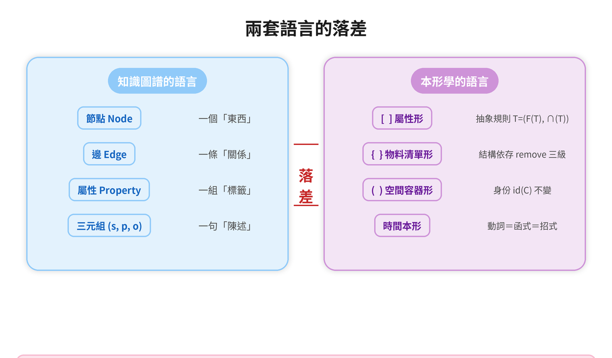

**圖 D-1　兩套語言的落差：KG 存說出來的結果，本形學問畫出來的過程**

把這兩套語言並排放，落差立刻現形：本形學問「這個形是怎麼畫出來的」「這個身份為什麼是同一個」「這個判斷怎麼做」；知識圖譜回答的是「我這裡有一條邊」「我查給你看」。**落差不是 bug，是語言的邊界**——本書接下來的七章，就是沿著這條邊界，把不足之處一處一處標出來。

> **本書的走法**
>
> 第一章先量 KG 的能力底線；第二到第五章走空間本形的四個不足；
> 第六到第八章走時間本形的三個不足；第九章合觀收攏；最後給檢查清單。

# 第一章　知識圖譜的三樣配備

CHAPTER 1 · WHAT A KG CARRIES

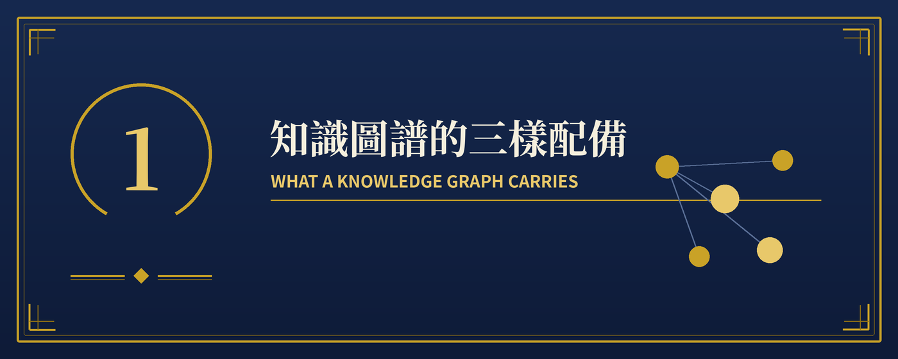

要談不足，得先盤點家底。知識圖譜出門做生意，身上只帶三樣配備：**節點、邊、屬性**。所有它做得好做不好的事，最後都溯回到這三樣東西。

## 1.1　節點、邊、屬性

節點（Node）是世界上的「東西」：一個人、一隻杯子、一個城市。邊（Edge）是東西之間的「關係」：認識、屬於、位於。屬性（Property）是東西身上的「標籤」：顏色＝白、材質＝玻璃。三樣配備疊起來，世界被說成一張網。

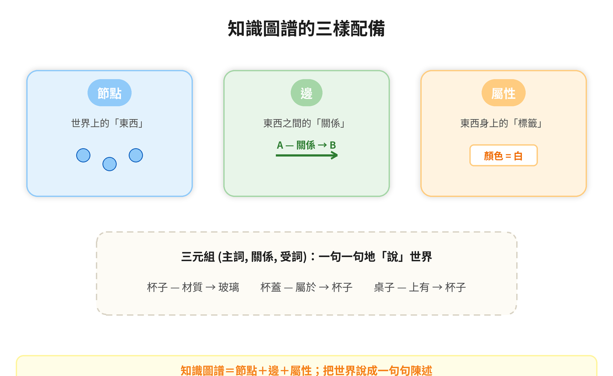

**圖 1-1　知識圖譜的三樣配備：節點、邊、屬性**

**表 1-1　三樣配備 × 本形學的對應語義**

| KG 配備 | KG 的語義 | 本形學的對應 | 落差預告 |
| --- | --- | --- | --- |
| 節點 Node | 一個「東西」 | 一個形（Unit Type）的實例 | 形有身份與判準，節點只有指標 |
| 邊 Edge | 一條「關係」 | 三種括號：[ ]、{ }、( ) | 三種語義被壓成一種（第二章） |
| 屬性 Property | 一組「標籤」 | 屬性形：抽象規則 T=(F(T), ∩(T)) | 標籤是死的，規則是活的（第四章） |

## 1.2　三元組：一句一句地說世界

三樣配備的最小單位是**三元組**（主詞, 關係, 受詞）——一句可以判真假的陳述。整張知識圖譜，就是億萬句這樣的陳述疊起來的。它的表達哲學很樸素：**能說成句子的，才存得下來**。這個哲學成就了 KG 的可查詢性，也種下了本書七個不足的共同根源——有些東西，天生說不成句子。

## 1.3　擅長與不擅長的分界線

把 KG 的能力沿著「存取」與「判斷・生成・行動」切一刀，分界線非常清楚：左邊是它的王國，右邊是它的邊境。

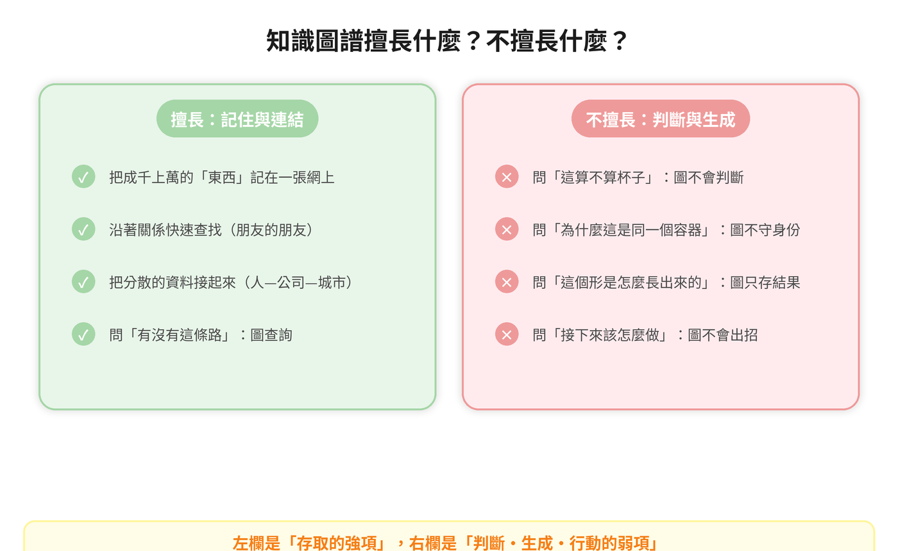

**圖 1-2　知識圖譜擅長什麼？不擅長什麼？**

本書要分析的七個不足，全部落在右邊那塊邊境地上。它們不是「KG 沒做好」，而是「KG 的語言裡沒有這種句子」。帶著這把尺，進空間篇。

# 空間篇・四個不足

PART I · SPACE TYPE

> 空間本形回答「是什麼・有什麼・在哪裡」——屬性 [ ]、物料清單 { }、空間容器 ( ) 三條軸，撐起一張形的座標系。知識圖譜要用一張網接住這三條軸，第一個撞上的就是括號。

空間篇四章，按撞牆的順序排：先是最直觀的**結構**（括號被壓平），接著是**身份**（id(C) 無處安放），然後是**判斷**（∩(T) 查不出來），最後是**生成**（形怎麼長出來的沒人記得）。四者層層遞進——前一個不足，往往是後一個不足的溫床。

# 第二章　不足一・括號壓平

CHAPTER 2 · THE BRACKETS FLATTENED

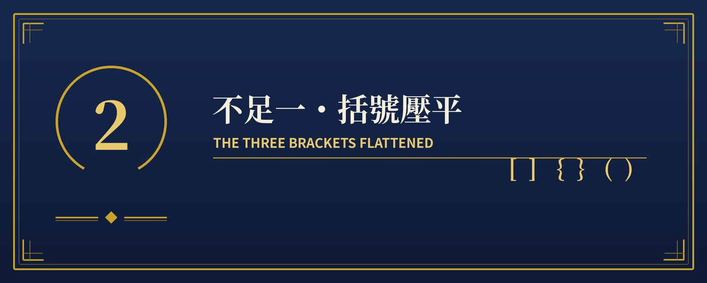

## 2.1　三種括號，三種語義

空間本形的三條軸，各掛一種括號。三種括號不是裝飾，是三種**完全不同的關係**：[ ] 說的是「抽象」——特徵交集的類別；{ } 說的是「組成」——物料清單的結構；( ) 說的是「容器」——空間裡的裝載。三者各有判準：抽象靠交集判準 ∩(T) 驗，組成靠 remove 判準分級，容器靠不變性公理守身份。

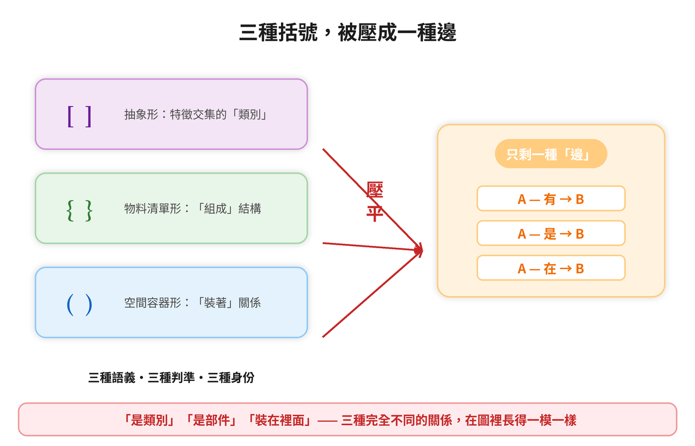

**圖 2-1　三種括號，被壓成一種邊**

**表 2-1　三括號語義 × 單一種邊**

| 括號 | 關係語義 | 掛載的判準 | 壓平後剩下的 |
| --- | --- | --- | --- |
| [  ] | 抽象：是這類別的成員 | 交集判準 ∩(T) | 一條無差別的「有／是」邊 |
| {  } | 組成：是整體的部件 | remove 三級判準 | 同上——邊上寫不下「拆掉會怎樣」 |
| (  ) | 容器：裝在身份的裡面 | 不變性公理 id(C) | 同上——邊上寫不下「換掉也不變」 |

## 2.2　壓平的現場：杯蓋的三重身分

拿杯蓋做現場。問三句話：杯蓋「屬於」杯蓋類嗎？杯蓋「組成」杯子嗎？杯蓋「裝在」杯子裡嗎？三句話三種關係、三種判準、三種驗證方式。但壓成一種邊之後，圖上只剩「杯蓋—有一條邊—杯子」。查詢分不出來是哪一種，判斷做不出來該用哪條規則。

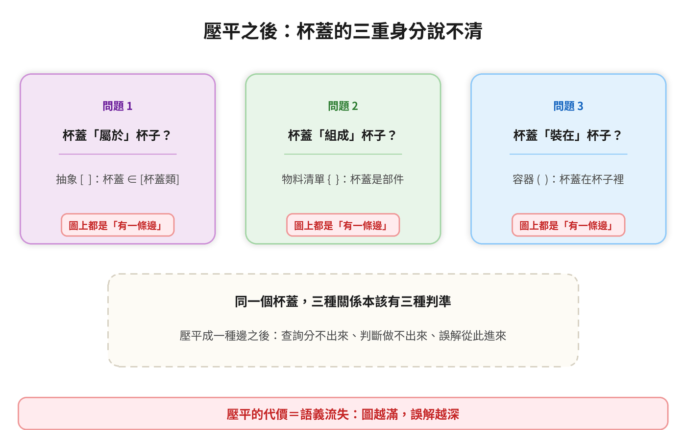

**圖 2-2　壓平之後：杯蓋的三重身分說不清**

**表 2-2　壓平後的語義流失對照**

| 要問的問題 | 該用的語言 | 壓平後的圖能回答嗎 |
| --- | --- | --- |
| 水壺算不算杯子？ | [ ]＋∩(T) 當場驗證 | 不能——邊上沒有規則可驗 |
| 方向盤是哪一級部件？ | { }＋remove 三級 | 不能——邊上沒有級別可分 |
| 換了內容還是同一個嗎？ | ( )＋不變性公理 | 不能——邊上沒有身份可守 |

## 2.3　語義流失的三個後果

- **查詢混淆**：同一條邊承載三種問法，查回來的答案對不上題目。
- **判斷不能**：判準原本掛在括號上；括號壓平，判準失聯（第四章專章處理）。
- **誤解進來**：讀圖的人用自己的語意補空白——圖越滿，補出來的誤解越多。

> **三種語義 → 一種邊：結構資訊不是被「簡化」了，是被「丟掉」了**

# 第三章　不足二・身份漂移

CHAPTER 3 · THE DRIFTING IDENTITY

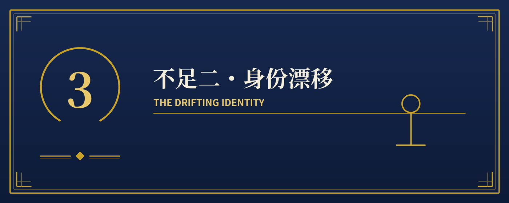

## 3.1　身份錨 id(C)：內容可換，身份不換

空間容器形的核心是**身份**。容器 C = ( id(C), S(C) )：內容 S(C) 隨便換，身份 id(C) 一動不動。杯子裡從水換成咖啡，杯子還是那個杯子——不變性公理把這件事寫成了公理：∀ e1, e2 ∈ S(C)，替換 e1 為 e2 不改變 id(C)。這是容器存在的底氣。

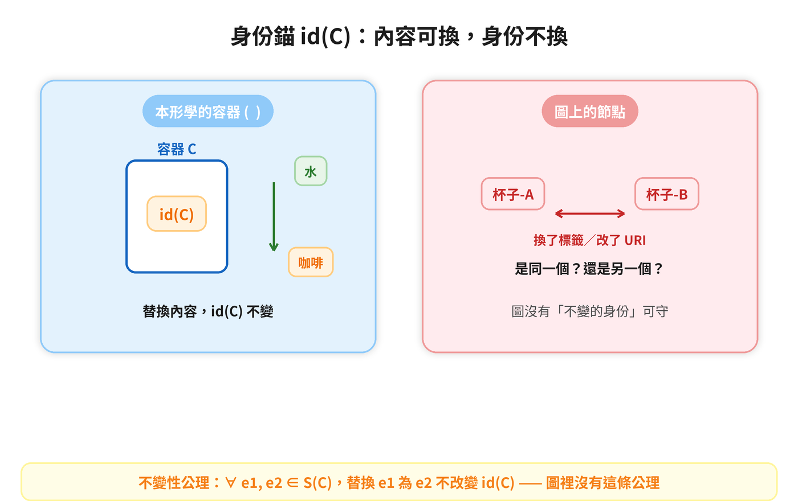

**圖 3-1　身份錨 id(C)：內容可換，身份不換**

**表 3-1　身份的兩種寫法**

| 面向 | 本形學的寫法 | KG 的寫法 |
| --- | --- | --- |
| 身份錨 | id(C)：顯式、不隨內容變動 | 節點 URI／標籤：只是指標 |
| 不變性 | 公理：替換內容不改身份 | 無對應語義——變了就變了 |
| 嵌套 | 容器一層套一層，各守各的 id | 子圖歸屬靠邊，沒有「內外」語義 |

## 3.2　四個漂移現場

沒有身份錨，編輯就是災難。四個現場反覆出現：**改名**——標籤一換，舊名字下的關係全斷成孤島；**合併**——兩個節點合為一個，各自的舊關係不知道跟誰走；**拆分**——一個節點劈成兩個，屬性不知道分給誰；**版本**——更新覆寫，前一版的它在圖上憑空消失。

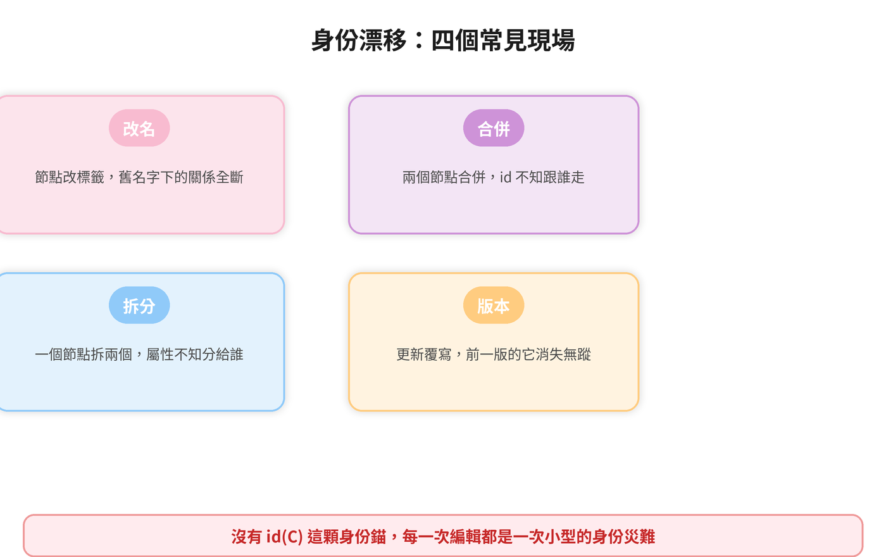

**圖 3-2　身份漂移：四個常見現場**

## 3.3　不變性公理缺席的代價

更深一層看：漂移不只是「工程上難維護」，而是**語義上無法判同一**。本形學問「換了內容，它還是它嗎」有一條公理墊底；KG 問同一個問題，手邊只有 URI 相不相等。URI 相等是「指標沒改」，不是「身份沒改」——指標是人掛上去的，身份是形自己帶的。把指標當身份，就是漂移的根源。

> **id(C) 是形的身份錨；URI 只是圖的指標牌 —— 指標牌可以重掛，身份錨不會漂**

# 第四章　不足三・圖不會判

CHAPTER 4 · A GRAPH CANNOT JUDGE

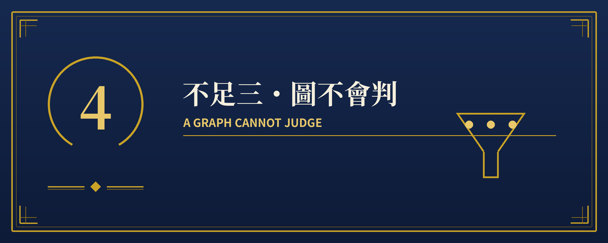

## 4.1　判斷是漏斗，不是查表

本形學的判斷是**漏斗**：新物件進來，過 ∩(T) 的每一道特徵——能裝液體嗎？能被手持喝嗎？全過，才屬於 [杯子]。這是一條開放規則：名單上沒有的新成員，規則一視同仁當場驗。

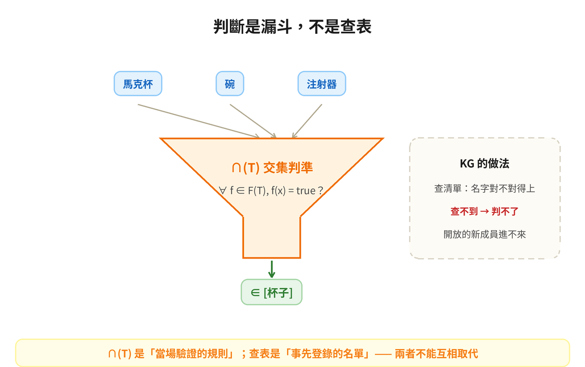

**圖 4-1　判斷是漏斗，不是查表**

**表 4-1　∩(T) 當場驗證 × KG 查詢**

| 面向 | ∩(T) 判斷 | KG 查詢 |
| --- | --- | --- |
| 機制 | 對特徵逐條驗證 | 對既有邊逐條查找 |
| 新成員 | 開放——規則一視同仁 | 封閉——查不到就判不了 |
| 邊界案例 | F(T) 完備度決定命運 | 沒有「邊界」概念，只有有無 |
| 產出 | 一個「屬於／不屬於」的判斷 | 一批「有關」的陳述 |

## 4.2　查表與規則的分別

KG 不是完全不能做分類——本體（Ontology）裡也有類別層級。但類別層級存的是「已承認的歸屬」，相當於一張事先登錄的名單；∩(T) 存的是「可驗證的規則」，是當場開考的考卷。名單查得到的，名單有用；名單查不到的——比如一個從沒見過的吸管杯——名單沉默，規則開口。**查表回答「有沒有登錄過」，判斷回答「算不算這類」。**

## 4.3　remove 三級：反事實寫不進邊

組成軸的判準更刁：remove 判準問的是**反事實**——「把部件拿掉，會怎樣？」必要件：拿掉後同一性喪失；功能降級件：拿掉後功能缺但身份存續；非必要件：拿掉後毫髮無傷。三級分類，全靠這句假設性的提問撐起來。

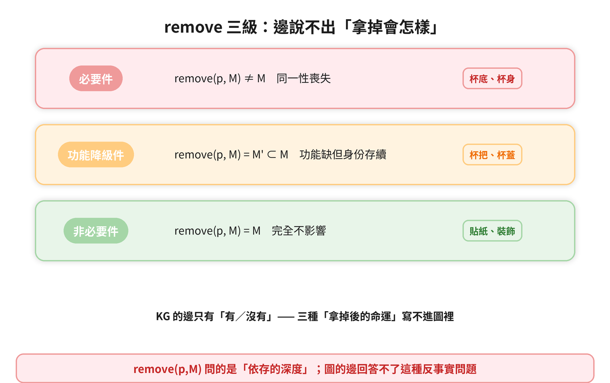

**圖 4-2　remove 三級：邊說不出「拿掉會怎樣」**

**表 4-2　remove 三級 × 邊的表達力**

| 級別 | remove(p, M) 的結果 | 例子 | 一條邊能表達嗎 |
| --- | --- | --- | --- |
| 必要件 | ≠ M　同一性喪失 | 杯底、杯身 | 不能——邊沒有「後果」欄 |
| 功能降級件 | = M' ⊂ M　功能降級 | 杯把、杯蓋 | 不能——邊沒有「程度」欄 |
| 非必要件 | = M　毫無影響 | 貼紙、裝飾 | 不能——邊沒有「假設」欄 |

三句「不能」指向同一件事：KG 的邊是**已發生的陳述**，remove 問的是**未發生的假設**。陳述存進圖裡是資料，假設得在判準裡跑——圖不會判，因為判準本來就不在圖的語言裡。

> **查詢走的是「已存在的邊」；判斷跑的是「還沒驗證的規則」—— 兩者不在同一個語言層**

# 第五章　不足四・生成失憶

CHAPTER 5 · AMNESIA OF GENERATION

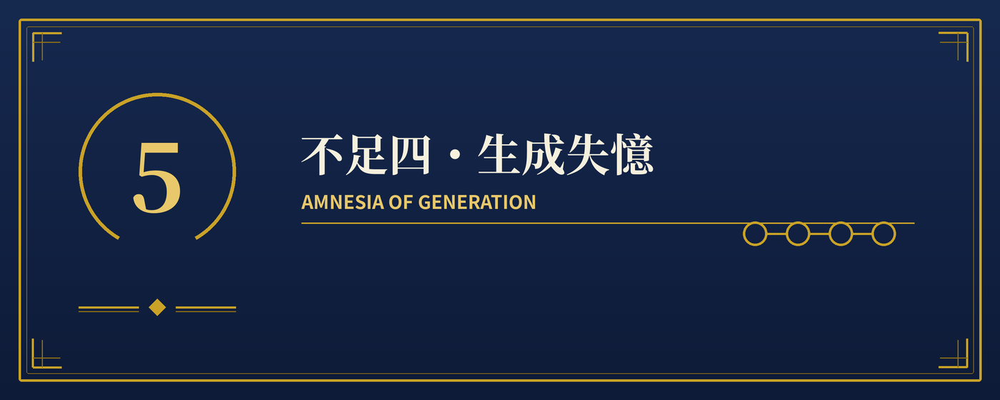

## 5.1　形的生成鏈

形不是天生的。本形學把形的誕生寫成一條鏈：**異同 → 分合 → 形 → 名**。先看出「這個和那個不一樣」，才圈得出邊界；邊界畫出來，形才現身；形有了名字，才進得了知識的世界。這條鏈是認知的產線——形是它的產品。

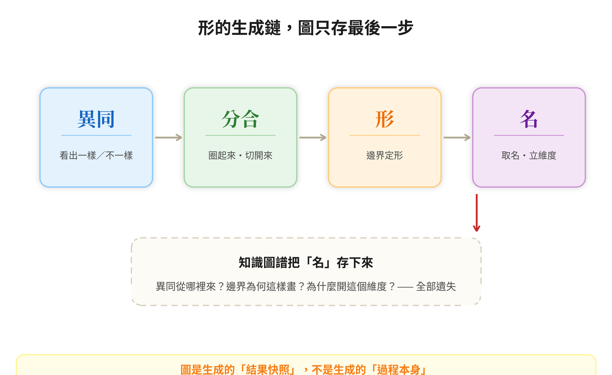

**圖 5-1　形的生成鏈，圖只存最後一步**

**表 5-1　生成鏈四步 × 圖的存留**

| 步驟 | 認知在做什麼 | KG 存得下嗎 |
| --- | --- | --- |
| 異同 | 偵測差異：一樣／不一樣 | 不能——差異是感受，不是陳述 |
| 分合 | 圈起來・切開來：畫邊界 | 不能——邊界是動作，不是資料 |
| 形 | 邊界定形：認出「一個東西」 | 半能——只存定形後的節點 |
| 名 | 取名・立維度 | 能——名稱標籤是 KG 的本行 |

## 5.2　框架四步驟：維度是被「逼」出來的

再往深看一層：連「維度」本身都是生成的產物。框架四步驟說維度的誕生：分辨異同、**對照失敗**、命名維度、判斷歸屬。前三個杯子只有顏色的差異；第四個杯子帶來「蓋子」——和顏色軸對不上、和材質軸也對不上，**對照失敗**逼著認知另立一條新軸。「蓋子」這條維度，是被失敗逼出來的。

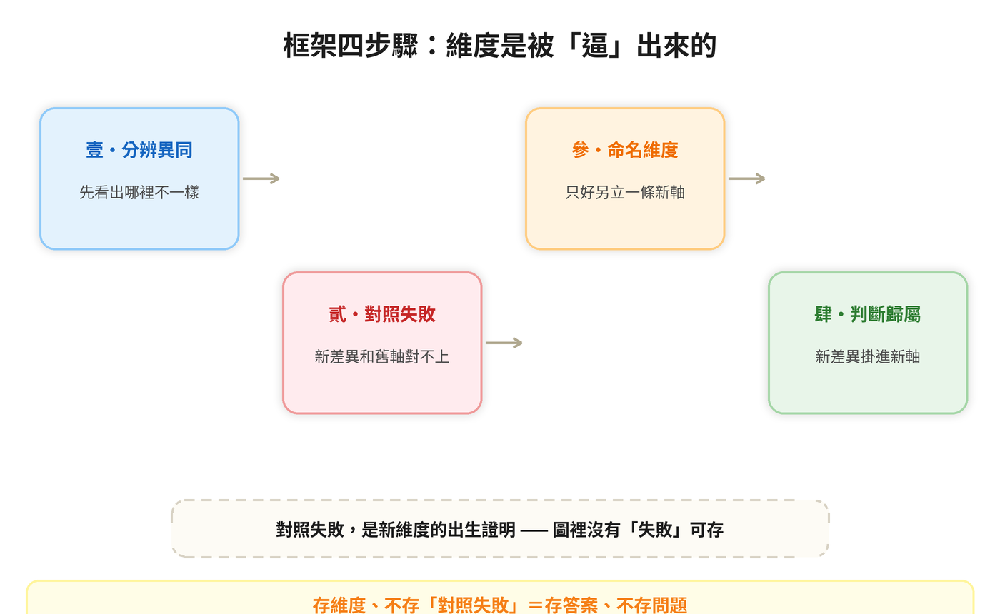

**圖 5-2　框架四步驟：維度是被「逼」出來的**

KG 的模式（Schema）裡當然也有屬性、也有類別。但 Schema 裡的每一條欄位都以「已成立」的姿態出現——圖裡找不到任何一筆「這個維度為什麼存在」的帳。**對照失敗**這張維度的出生證明，沒有地方存。

## 5.3　只存結果的三個代價

- **說不出道理**：為什麼是這幾個維度？圖只能攤手——維度是繼承來的，不是解釋出來的。
- **接不住新差異**：新差異對不上舊軸時，人該開新軸；圖只會把它塞進最近的舊欄位。
- **回不了頭**：形畫錯了要回溯「哪一步圈錯邊界」；圖裡沒有步驟，無從回溯。

> **圖是生成的「結果快照」；生成的「過程」——異同、分合、對照失敗——全部遺失**

# 時間篇・三個不足

PART II · TIME TYPE

> 時間本形 = 動詞 = 函式 = 方法 = 招式 = function = 服務 = 法門。空間本形回答「是什麼」，時間本形回答「怎麼做」——搜尋、萃取、設計模式、邏輯生成、持續學習、重構重組、解題、分析、設計、推理、思考法、研發探索、自我演化，每一個都是一套可執行的方法。

知識圖譜是靜態的名詞世界。時間篇三章對準它的三個軟肋：**動詞存不住**（招式退化成標籤）、**推理走不了**（圖只走舊路）、**演化跟不上**（圖不會自己長大）。三者一層比一層深——從「表達不了」到「運算不了」到「生長不了」。

# 第六章　不足五・動詞消失

CHAPTER 6 · THE VANISHING VERB

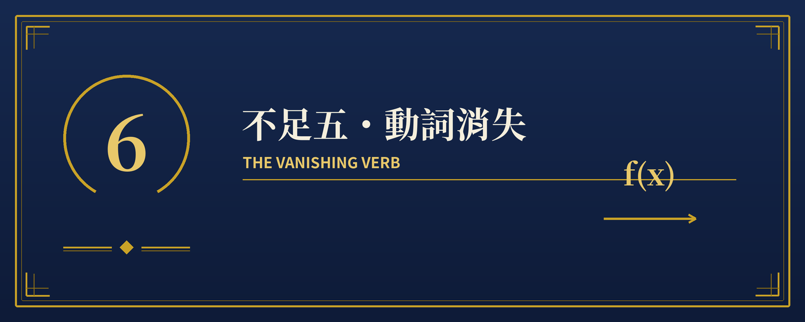

## 6.1　時間本形＝動詞＝函式＝招式

先點名時間本形的本體：它不是「事件」也不是「時間戳」，而是**動詞**——一組同義詞把它的身份說盡了：動詞＝函式＝方法＝招式＝服務＝法門。形時間函式搜尋、設計搜尋與萃取、設計模式、邏輯生成與應用、持續學習、重構與重組、解題、分析、設計、推理、思考法、研發與探索、自我演化——十三個名字，十三套可執行的方法。

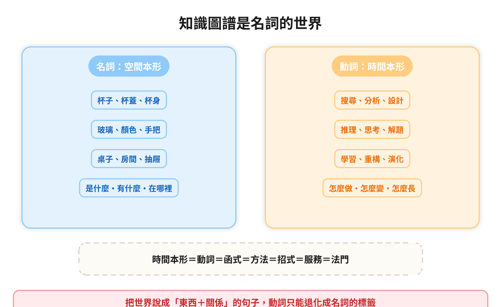

**圖 6-1　知識圖譜是名詞的世界**

**表 6-1　時間本形的家底（點名式）**

| 時間本形 | 它是什麼「做」 | 被存成標籤後剩下什麼 |
| --- | --- | --- |
| 形時間函式搜尋 | 帶著判準去找形 | 一條「搜尋」節點，無判準可跑 |
| 設計模式 | 可重用的出招模板 | 一篇描述，沒有「用法」 |
| 邏輯生成與應用 | 生成規則再套用規則 | 幾條陳述，沒有「生成」 |
| 推理（因果・果因・模擬・統計・逆向） | 沿方向走出新結論 | 「相關」一條邊，無方向可走 |
| 思考法（正向・逆向・水準・垂直・第一性原理） | 換角度重看同一個問題 | 「用了第一性原理」一句話 |
| 解題・分析・設計 | 帶著方法把未知變已知 | 「解決了」的結論，沒有過程 |
| 持續學習・重構重組・自我演化 | 自己改自己、自己長大 | 「版本 2」，改了什麼無從問 |

## 6.2　一個招式要有「做」的全部

招式與標籤的差別，拆開看最清楚。一個完整的時間本形要帶三件套：**輸入**（帶著什麼問題進來）、**方法**（按什麼步驟展開）、**輸出**（帶著什麼答案出去）。三件套齊了，招式才「跑得起來」。

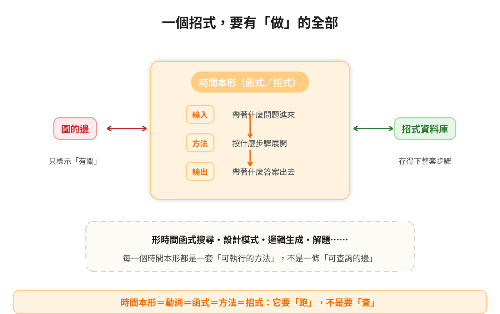

**圖 6-2　一個招式，要有「做」的全部**

**表 6-2　函式三件套 × 邊的表達力**

| 招式的部件 | 它承載什麼 | 一條邊／一個節點能給嗎 |
| --- | --- | --- |
| 輸入 | 問題的形狀：帶著什麼進來 | 不能——邊不分輸入端與輸出端 |
| 方法 | 展開的步驟：先做什麼再做什麼 | 不能——步驟是序列，邊是靜態 |
| 輸出 | 答案的形狀：帶著什麼出去 | 不能——陳述不分「做了」與「做到」 |

## 6.3　退化成標籤之後

當招式被存成「某某—是—設計模式」這樣一條邊，三件套全部蒸發：輸入輸出對不齊，步驟沒有人記得，可執行性歸零。留下的只是一個**名字**——圖能告訴你「有這個招式」，不能幫你「使出這個招式」。動詞進了名詞的圖書館，就被要求只做一張書卡。

> **時間本形要「跑」：輸入 → 方法 → 輸出；圖只能「查」：主詞 → 關係 → 受詞**

# 第七章　不足六・推理缺席

CHAPTER 7 · REASONING IN ABSENTIA

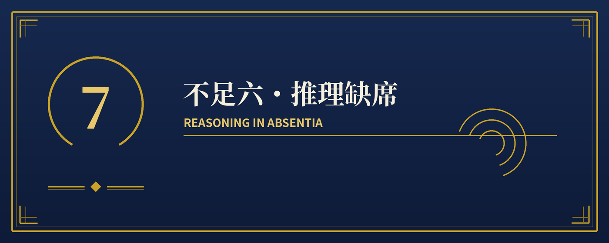

## 7.1　五種推理，五條「圖上沒有」的路

推理是時間本形的心臟。本形學點名五種：**因果推理**（從因推到果）、**果因推理**（從果倒推因）、**模擬推理**（在腦中試跑一遍）、**統計推理**（從分布看機率）、**逆向推理**（反著走一遍）。加上思考法一族——正向、逆向、水準、垂直、第一性原理——人類「想事情」的全部招式都掛在時間本形底下。

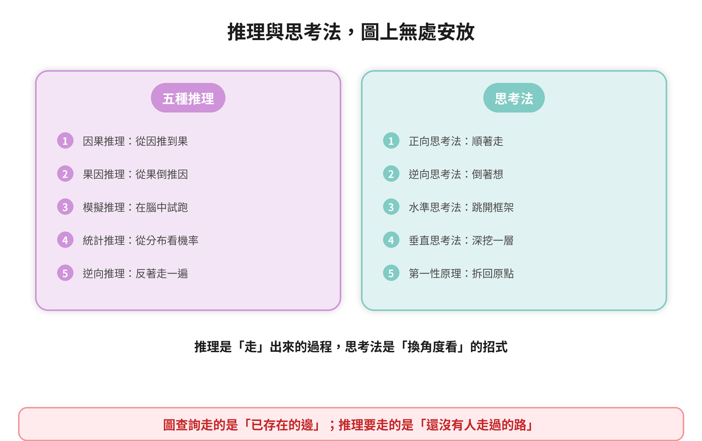

**圖 7-1　推理與思考法，圖上無處安放**

**表 7-1　五種推理 × KG 的表達力**

| 推理 | 它要走的路 | KG 能給什麼 |
| --- | --- | --- |
| 因果 | 因 → 果：方向＋機制 | 無向的「相關」邊，沒有機制 |
| 果因 | 果 → 因：倒著溯因 | 邊不區分方向的語義，溯因無從走 |
| 模擬 | 假設一變，世界跟著變 | 圖是快照，沒有「變了會怎樣」可跑 |
| 統計 | 從分布與頻率看機率 | 圖存個體，不存分布 |
| 逆向 | 反事實：本來可以怎樣 | 陳述只有「是什麼」，沒有「本來可以」 |

## 7.2　「有關」不等於「所以」

拿一個經典現場。圖上「公雞叫」和「天亮」常常連在一起——這是**相關**，圖的本行。但推理要問的是**因果**：誰使誰發生？答案是地球自轉使天亮，公雞叫只是同時發生。把相關當因果，是拿圖推理最常見的翻車；而圖本身沒有任何欄位提醒你「這條邊沒有因果方向」。

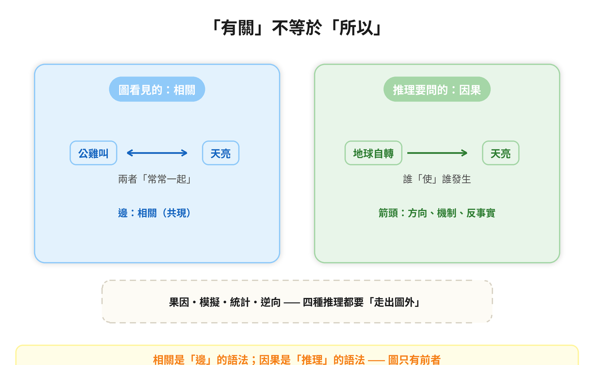

**圖 7-2　「有關」不等於「所以」**

## 7.3　圖走舊路，推理開新路

把差距說到底：**圖查詢走的是已存在的邊**——查詢的每一步都是別人（或別的流程）先鋪好的；**推理走的是還沒有人走過的路**——因果的下一步、模擬的下一幕、逆向的另一個世界，都不在圖裡，得由推理「開」出來。這就是為什麼推理不能外包給查詢：查詢的極限是圖的邊界，而推理的本職是越過邊界。

- **思考法同理**：水準思考要跳開框架、第一性原理要拆回原點——都是「換一張圖」的動作，不是「走這張圖」的動作。
- **因果同理**：箭頭要帶方向與機制；KG 的邊只帶「有關係」三個字。
- **結論**：推理缺席不是功能沒做，是語言沒這句話。

> **查詢回答「圖上有什麼」；推理回答「世界會怎樣」—— 問題不同層，答案不同種**

# 第八章　不足七・演化缺席

CHAPTER 8 · EVOLUTION IN ABSENTIA

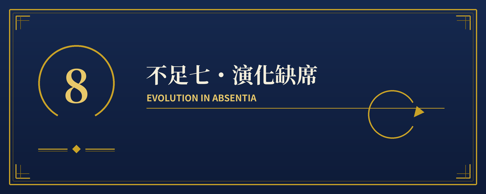

## 8.1　自我演化：知識帶著時間流動

時間本形的頂點是**自我演化**。它的循環四站：**持續學習**（新經驗進來）、**重構與重組**（把舊知識重新安放）、**研發與探索**（往未知推進）、**自我演化**（下一個版本的自己）。四站首尾相接，知識不再是一件「存好的東西」，而是一條「流動的河」。

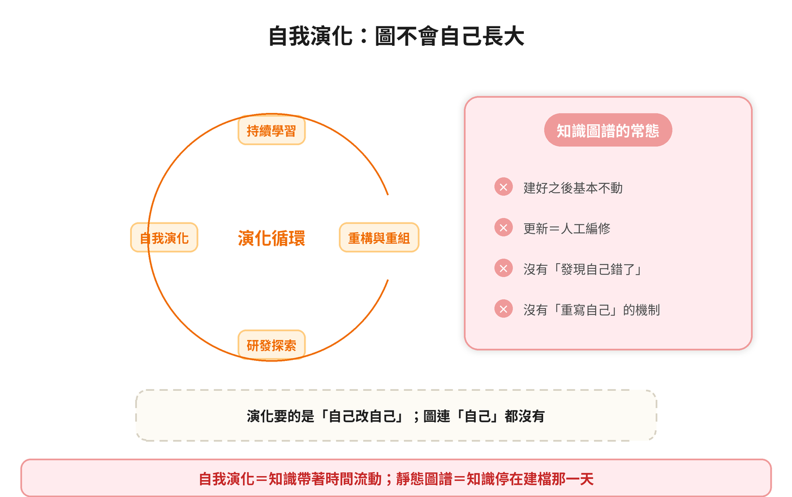

**圖 8-1　自我演化：圖不會自己長大**

**表 8-1　演化四站 × KG 的常態**

| 演化站 | 它要求什麼 | KG 的常態 |
| --- | --- | --- |
| 持續學習 | 新知識自動進來、自動歸位 | 建檔後基本不動，更新靠人工 |
| 重構與重組 | 舊知識重新安放、換結構 | 改結構＝重建工程，沒有「重構」語義 |
| 研發與探索 | 往未知推進、容許失敗 | 圖只收「已確認」，不收「在路上」 |
| 自我演化 | 自己改自己、留下演化軌跡 | 沒有「自己」可改，沒有軌跡可留 |

## 8.2　圖不會自己長大

演化缺席比前兩個不足更深一層：動詞消失是**表達不了**，推理缺席是**運算不了**，演化缺席是**生長不了**。前兩者還可以說「換個系統來做」；演化缺席則指向知識載體本身的性質——一本不會自己改自己的書，裝不下一條會流動的河。

## 8.3　三個具體的「長不大」

- **發現不了自己錯了**：自我演化要「察覺誤差」；圖沒有判準，無從察覺。
- **重寫不了自己**：重構是換骨架；圖的骨架（Schema）由人鎖死。
- **記不下成長**：演化要留軌跡——從 v1 到 v2 改了什麼、為什麼改；圖只有現狀。

> **靜態圖譜＝知識停在建檔那一天；自我演化＝知識帶著時間流動**

# 第九章　合觀・兩本形之間

CHAPTER 9 · BETWEEN SPACE AND TIME

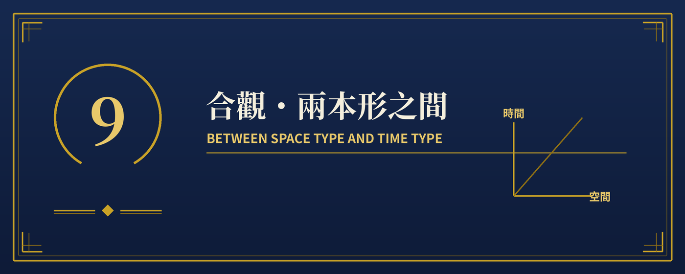

## 9.1　七不足全景圖

把七個不足放回空間與時間的座標系：橫軸是空間本形——四個不足沿著「結構 → 身份 → 判斷 → 生成」一路往深處走；縱軸是時間本形——三個不足沿著「表達 → 推理 → 演化」一路往高處走。兩軸的交會處，就是形的生成與招式的執行交織的地方，也是最深的一道缺口。

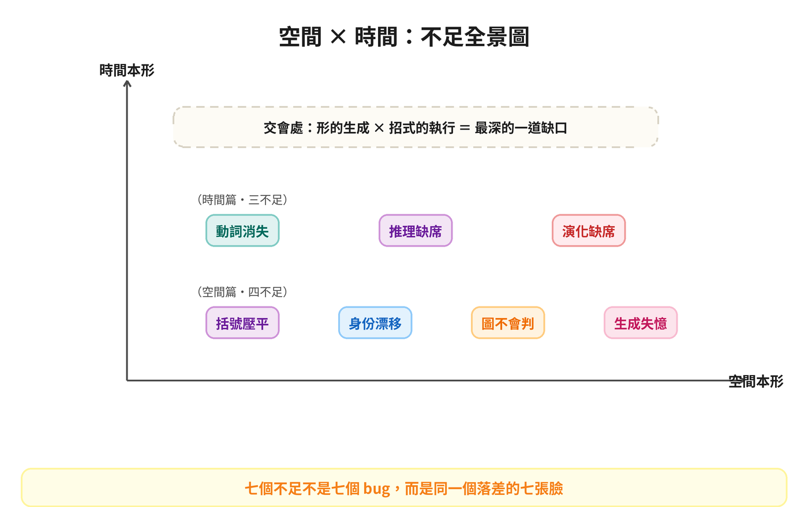

**圖 9-1　空間 × 時間：不足全景圖**

**表 9-1　七不足總表**

| # | 不足 | 本形學要的 | KG 給的 | 深度 |
| --- | --- | --- | --- | --- |
| 1 | 括號壓平 | 三種關係・三種判準 | 一種邊 | 結構層 |
| 2 | 身份漂移 | id(C)＋不變性公理 | URI／標籤 | 身份層 |
| 3 | 圖不會判 | ∩(T)・remove・三層判斷 | 查表 | 判斷層 |
| 4 | 生成失憶 | 異同→分合→形→名 | 結果快照 | 生成層 |
| 5 | 動詞消失 | 函式：輸入→方法→輸出 | 標籤 | 表達層 |
| 6 | 推理缺席 | 五種推理・思考法 | 圖查詢 | 運算層 |
| 7 | 演化缺席 | 學習→重構→探索→演化 | 靜態圖 | 生長層 |

## 9.2　同一個落差的七張臉

七個不足不是七個獨立的 bug。把底片翻過來看，它們共享同一個根源：**知識圖譜的語言是「陳述」，本形學的語言是「形與招式」**。陳述是「說出來的結果」；形要的是「畫出來的過程」，招式要的是「跑起來的方法」。三句話總結這道落差：

- 空間篇的四個不足：**形的過程**在陳述裡找不到位置——括號、身份、判準、生成，全是過程的產物。
- 時間篇的三個不足：**招式的方法**在陳述裡跑不起來——動詞、推理、演化，全是方法的運作。
- 合觀：把世界存成「陳述」是 KG 的選擇；這個選擇成就了查詢，也註定了七個不足。

## 9.3　誤用對照：五種「以為圖能做」

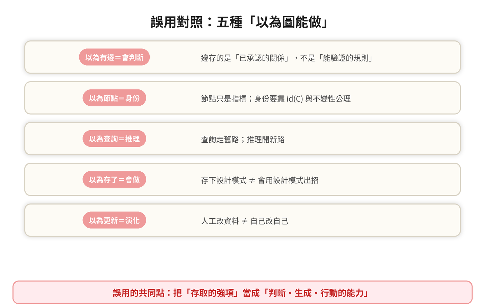

**圖 9-2　誤用對照：五種「以為圖能做」**

**表 9-2　誤用對照表**

| 誤用 | 為什麼不成立 | 對應不足 |
| --- | --- | --- |
| 以為有邊＝會判斷 | 邊存「已承認的關係」，判準要「當場驗證的規則」 | 不足一・三 |
| 以為節點＝身份 | 節點是指標；身份要 id(C) 與不變性公理 | 不足二 |
| 以為查詢＝推理 | 查詢走舊路；推理開新路 | 不足六 |
| 以為存了＝會做 | 存下設計模式 ≠ 會用設計模式出招 | 不足五 |
| 以為更新＝演化 | 人工改資料 ≠ 自己改自己 | 不足七 |

## 9.4　檢查清單：哪些問題不要交給圖

最後把七個不足翻成八個實用的問句。拿圖做任何事之前，先過一遍這張清單——問中越多，越不該把這件事交給知識圖譜。

**表 9-3　檢查清單（八問）**

| # | 問句 | 背後的不足 |
| --- | --- | --- |
| 1 | 這件事要分辨「是類別、是部件、還是裝在裡面」嗎？ | 不足一・括號壓平 |
| 2 | 要判斷「換了內容，它還是它嗎」嗎？ | 不足二・身份漂移 |
| 3 | 要對沒見過的新東西「當場判斷」嗎？ | 不足三・圖不會判 |
| 4 | 要回答「拿掉這個會怎樣」嗎？ | 不足三・remove |
| 5 | 要解釋「這個形是怎麼生出來的」嗎？ | 不足四・生成失憶 |
| 6 | 要「使出一個招式／跑一個方法」嗎？ | 不足五・動詞消失 |
| 7 | 要「從已知推出未知」或「反事實思考」嗎？ | 不足六・推理缺席 |
| 8 | 要讓知識「自己長大、自己修正」嗎？ | 不足七・演化缺席 |

# 回顧　帶著落差感離開

REVIEW

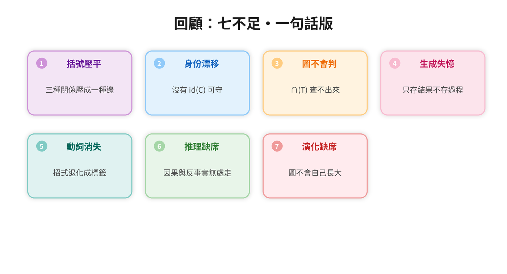

**圖 R-1　七不足・一句話版**

## R-1　三句話總結

- **知識圖譜的語言是陳述**：節點、邊、屬性三樣配備，把世界說成一句一句的話。
- **本形學的語言是形與招式**：空間本形要「畫形的過程」，時間本形要「跑招式的方法」。
- **七個不足是同一道落差的七張臉**：過程與方法，在陳述的世界裡找不到位置。

## R-2　本書沒有的東西（再提醒一次）

依三個約定：本書不重述本形學原文、不做系統實作、不提補強方案。看到這裡若你腦中開始冒出「那不然改用……」——先停：把不足看清楚，是分析；急著補，會把落差又看糊塗。

## R-3　這份分析怎麼用

- **選型時**：要做的事撞上檢查清單（表 9-3）越多的項目，越不該交給 KG。
- **建模時**：看到「用邊表示……」的念頭，先過一遍表 9-2 的誤用對照。
- **讀圖時**：圖給你「有關」，你要自己補「所以」——補的那一刀，就是不足所在。

# 附錄　術語與落差速查

APPENDIX

**表 A-1　術語速查（本形學 ↔ 知識圖譜）**

| 本形學術語 | 英文 | KG 近似物 | 落差所在 |
| --- | --- | --- | --- |
| 形 | Type | 類別／節點類型 | 形帶判準與生成，類型只帶名字 |
| 空間本形 | Space Type | （無對應） | 空間三軸＝三種關係＋三種判準 |
| 時間本形 | Time Type | （無對應） | 動詞＝函式＝招式，要「跑」 |
| 屬性形 | [ ]  AttributeType | 屬性／類別 | 開放規則 vs 封閉名單 |
| 物料清單形 | { }  BOMType | 組成關係 | remove 三級寫不進邊 |
| 空間容器形 | ( )  ContainerType | 包含關係 | id(C) 與不變性公理缺席 |
| 交集判準 | ∩(T) | （無對應） | 當場驗證的規則，不是查詢 |
| 特徵集合 | F(T) | 屬性清單 | F(T) 的完備度是立場，標籤不是 |
| remove 判準 | remove(p,M) | （無對應） | 反事實問題：拿掉會怎樣 |
| 身份識別 | id(C) | URI／主鍵 | 指標可重掛，身份不會漂 |
| 不變性公理 | Invariance | （無對應） | 替換內容不改身份 |
| 異同→分合→形→名 | Generation Chain | Schema／建模 | 圖存結果，不存過程 |
| 對照失敗 | Failed Contrast | （無對應） | 維度的出生證明無處可存 |
| 形時間函式搜尋 | Time Function Search | 圖遍歷 | 帶著判準找形 vs 沿邊走路 |
| 設計模式 | Design Patterns | 模式節點 | 模板要可執行，描述不能使 |
| 推理 | Reasoning | 圖查詢／推理機 | 開新路 vs 走舊路 |
| 思考法 | Methods of Thinking | （無對應） | 換角度是換圖，不是走路 |
| 自我演化 | Self-evolution | 版本更新 | 自己改自己 vs 人工改資料 |

> 形回答「是什麼」，時間本形回答「怎麼做」。知識圖譜記下了形的影子，卻放走了形的生成、身份、判準與招式。看清楚這七個不足，才知道一張圖的邊界在哪裡——這是分析的起點，不是終點。

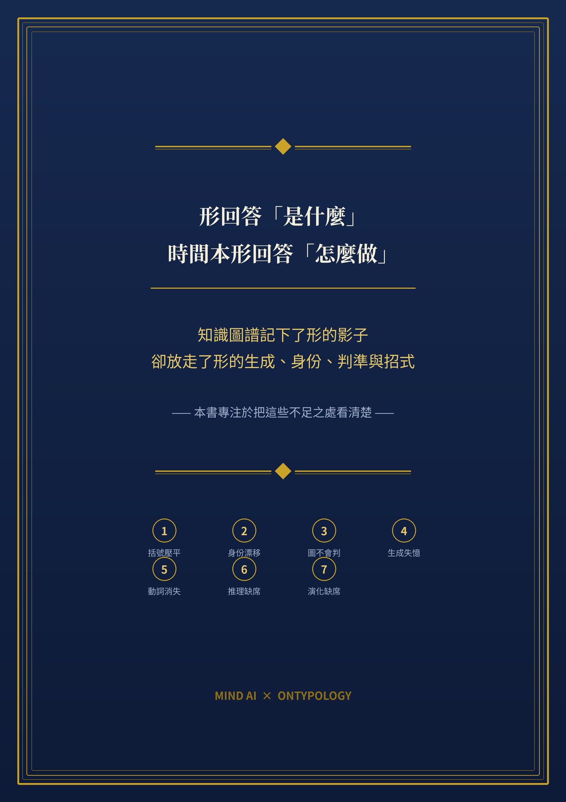
