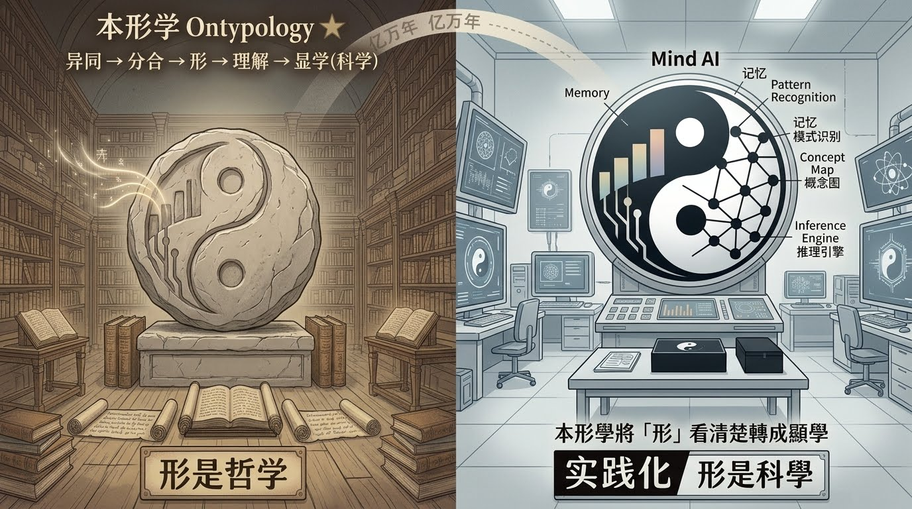

# :star:本形學　Ontypology:star:

  <a href="https://github.com/mindaiworks">🏠 Home</a> ｜ 
  <a href="https://github.com/mindaiworks/Paper">Mind AI</a>

從異同到分合，從分合到形，從形到理解這條路，大腦走了億萬年。

邏輯學百年前是哲學，當看清楚後是顯學(科學) 。

今探討「形」(大腦概念) 是哲學，本形學將「形」，看清楚轉成顯學(科學) ，並實踐化 Mind AI 。

李飛飛：數字寒武紀的爆發

她講到在遙遠的寒武紀時代，一切都是漆黑的，有一種三葉蟲的生物首先感知到光，感知到光以後發展出了神經系統，接下來就是「理解思考」最後執行。這就是生物發展的規律。

----------------------------------------

# 空間本形 Space Type

-----------------------------------------------

## [簡介 (Space Type)](本形學-空間本形)

## [形与数 (TypeNumber)](本形學-空間本形/1.形與數)

💻橫式<a href="https://youtu.be/dANUjKB41GU"> 1 </a><a href="https://youtu.be/sslkKIcFPBc"> 2 </a> ｜📱直式 <a href="https://v.douyin.com/aR9I8UDoZRs"> 1 </a> <a href="https://v.douyin.com/1jMENGp2mf8"> 2 </a>  <a href="https://v.douyin.com/WkOxsMUuxLI"> 3 </a> ｜<a href="https://youtu.be/oCr2rVOkBkE">⏯️簡報視頻1</a>｜<a href="https://youtu.be/jlnhAv5dJsg">⏯️簡報視頻2</a>

## [單位形與集合邏輯](本形學-空間本形/3.單位形與集合邏輯)｜ <a href="https://youtu.be/QVqy1opdjss">🎥視頻</a>｜<a href="https://youtu.be/s5X7Bbj-13I">⏯️簡報視頻</a>
 
## [空间框架 (FrameWork)](本形學-空間本形/空間框架)｜ <a href="https://youtu.be/88jBFuNgHU8">🎥視頻</a>｜<a href="https://youtu.be/jJOFxT0Ltr8">⏯️簡報視頻1</a>｜<a href="https://youtu.be/fbFrKmbyt4A">⏯️簡報視頻2</a>

## [數學證明](本形學-空間本形/5.數學證明)｜ <a href="https://youtu.be/t4HXf0Vs_q4">🎥視頻</a>｜<a href="https://youtu.be/Boe2Yufg3cs">⏯️簡報視頻</a>

## [形集合的運算式](本形學-空間本形/形集合的運算式)｜ <a href="https://youtu.be/chFXFGJR1bA">🎥視頻</a>｜<a href="https://youtu.be/EzcFTYrraRA">⏯️簡報視頻</a>

## [關聯式資料庫與形的關係 (RDB and Type)](本形學-空間本形/RDB與形)｜  <a href="https://youtu.be/VPQ2FZP5Kis">🎥視頻</a>｜<a href="https://youtu.be/jhgfOCtmwww">⏯️簡報視頻1</a>｜<a href="https://youtu.be/ZJiNyYRnpag">⏯️簡報視頻2</a>

# 🔑[時間本形 Time Type](本形學-時間本形)🔑

-----------------------------------------------

# 系统 System

## [Mind RAG](本形學/MindRAG)

## [Mind AI](https://github.com/mindaiworks/Paper)

## [知識圖譜物料清單 (Knowledge Graph Bill of Materials)](https://github.com/mindaiworks/Paper/tree/main/Knowledge%20Graph%20Bom)

## [LLM vs Mind Model(物理AI, 工業級AI,世界模型)](https://github.com/mindaiworks/Paper/tree/main/MindAI/LLM%20vs%20Mind%20Model)｜<a href="https://youtu.be/F-DhYt2M48s">💻視頻</a>｜<a href="https://youtu.be/57KQ8G8-ib4">⏯️簡報視頻</a>

# 理論應用  Theoretical Application

## [本體論與本形學 Ontology × Ontypology](本形學/本體論與本形學)｜<a href="https://youtu.be/gQByZajS710">🎥視頻</a>｜<a href="https://youtu.be/WGKERBAyIbM">⏯️簡報視頻</a>

## [Palantir&Mind_AI](Applications/Palantir&Mind_AI) ｜ <a href="https://youtu.be/V57dv-1wx08">🎥視頻</a> ｜<a href="https://youtu.be/EhSBUK-2gx0">⏯️簡報視頻</a> 

## [知識圖譜不足處](Applications/知識圖譜不足處)｜<a href="https://youtu.be/m1HNeISyntU">🎥視頻</a>｜<a href="https://youtu.be/CI8vtaPVOlg">⏯️簡報視頻</a> 

## [液態神經網路與本形學](本形學/液態神經網路與本形學)｜<a href="https://youtu.be/o11Vq2fEokg">🎥視頻</a>｜<a href="https://youtu.be/wHe54kbREp0">⏯️簡報視頻</a>

## [物理證明](本形學/物理證明)｜<a href="https://youtu.be/zl0EPwxPLXQ">🎥視頻</a> ｜<a href="https://youtu.be/4YA2uC_COvk">⏯️簡報視頻</a>

## [化學證明](本形學/化學證明)｜<a href="https://youtu.be/25qIfZ2X4Wc">🎥視頻</a> ｜<a href="https://youtu.be/X1rkkMnZiJA">⏯️簡報視頻</a>

## [數學建模 ](本形學/數學建模)｜<a href="https://youtu.be/1gOrfC5qvG0">🎥視頻</a> ｜<a href="https://youtu.be/m7LahSqSvzs">⏯️簡報視頻</a>

-----------------------------------------------

# 模型應用  Model Application

## [世界模型的大腦1 (Brain of the World Model)](Applications/世界模型大腦)｜<a href="https://youtu.be/Kmxf8XTeBes">🎥視頻</a> ｜<a href="https://youtu.be/LFr9uee2QTM">⏯️簡報視頻</a> 

## [世界模型的大腦2 (Brain of the World Model)](本形學/世界模型大腦2)｜<a href="https://youtu.be/FO8IzAv1vtQ">🎥視頻</a> ｜<a href="https://youtu.be/9kuA74_uWoQ">⏯️簡報視頻</a> 

-----------------------------------------------

# 商業應用  Business Applications

## [AI中醫問診與開方](Applications/AI中醫問診與開方) ｜ <a href="https://youtu.be/_Dx45ApAG_c">🎥視頻</a> ｜<a href="https://youtu.be/WPI_nBU5eZg">⏯️簡報視頻</a> 

## [AI西醫問診與開藥](Applications/AI西醫問診與開藥) ｜ <a href="https://youtu.be/nlClo5scKX0">🎥視頻</a> ｜<a href="https://youtu.be/EJ1irXLCDJo">⏯️簡報視頻</a> 

## [AI生物實驗大腦](Applications/AI生物實驗大腦) ｜ <a href="https://youtu.be/CFisdQ_WGlE">🎥視頻</a> ｜<a href="https://youtu.be/l3bcPg_P8Ok">⏯️簡報視頻</a> 

## [AI藥物研發大腦](Applications/AI藥物研發大腦) ｜ <a href="https://youtu.be/npZXEc4Mdys">🎥橫式</a> ｜<a href="https://youtu.be/P88hL20XGDg">⏯️簡報視頻</a> 

## [AI基因研發大腦](Applications/AI基因研發大腦) ｜ <a href="https://youtu.be/YRcJ2yX8vgE">🎥橫式</a>｜<a href="https://youtu.be/5vnmFimvmOQ">⏯️簡報視頻</a> 

## [全基因組關聯分析 GWAS × Mind AI](Applications/GWAS) ｜ <a href="https://youtu.be/SU7UyVcoaCk">🎥視頻</a>  ｜<a href="https://youtu.be/exJlOLYe6yI">⏯️簡報視頻</a> 

----------------------------------------
## [AI無人機大腦](Applications/AI無人機大腦)｜<a href="https://youtu.be/5oetNhZFoYY">⏯️簡報視頻</a> 

## [IC 芯片設計大腦(IC Design)](Applications/IC設計) ｜ <a href="https://youtu.be/3OLwhGjTLpQ">🎥視頻</a>｜<a href="https://youtu.be/8_0LRqNv-wQ">⏯️簡報視頻</a> 

## [機械設計與PLM(Mechanical Design and PLM)](Applications/機械設計PLM)｜ <a href="https://youtu.be/VhAspRtJHmk">🎥視頻</a>｜<a href="https://youtu.be/Rg4TCR1PzPo">⏯️簡報視頻</a>

## [兵棋大脑(Wargames Brain)](Applications/兵棋大腦) ｜ <a href="https://youtu.be/z5pUGrlPcpU">🎥視頻</a>｜<a href="https://youtu.be/hl8j0xcxKeo">⏯️簡報視頻</a>

## [AI企業資訊系統整合](Applications/AI企業資訊系統整合) ｜ <a href="https://youtu.be/ScG4KOw30-8">🎥視頻</a>｜<a href="https://youtu.be/jcprsTsHRjE">⏯️簡報視頻</a>

## [AI 資訊安全](Applications/AI資訊安全) ｜ <a href="https://youtu.be/_IXwbzEHUpc">🎥視頻</a>｜<a href="https://youtu.be/KUGqLBAEfLg">⏯️簡報視頻</a>

 

----------------------------------------

## 聯繫資訊 Contact Information
張長豐 gamma@livemail.tw

張楟潁 mindaiworks@gmail.com

## www.longreat.net

  

