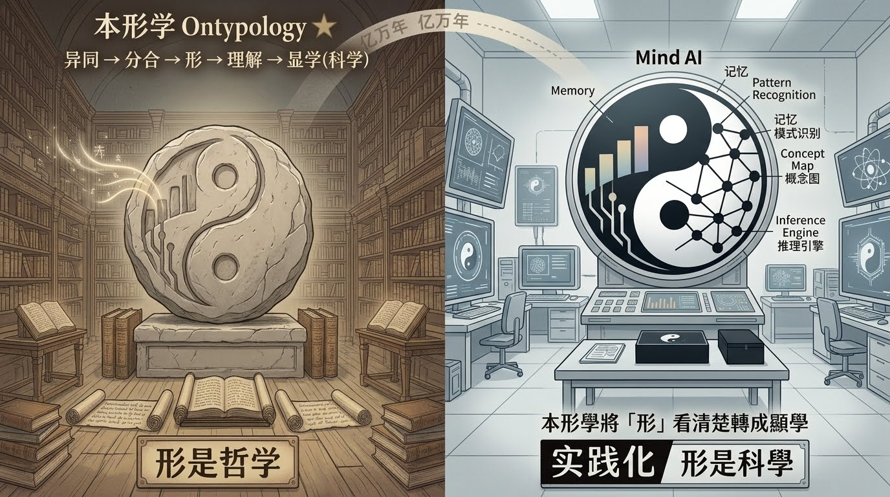

# :star:本形學　Ontypology:star:

  <a href="https://github.com/mindaiworks">🏠 Home</a> ｜ 
  <a href="https://github.com/mindaiworks/Paper">Mind AI</a>

從異同到分合，從分合到形，從形到理解這條路，大腦走了億萬年。

邏輯學百年前是哲學，當看清楚後是顯學(科學) 。

今探討「形」(大腦概念) 是哲學，本形學將「形」，看清楚轉成顯學(科學) ，並實踐化 Mind AI 。

李飛飛：數字寒武紀的爆發

她講到在遙遠的寒武紀時代，一切都是漆黑的，有一種三葉蟲的生物首先感知到光，感知到光以後發展出了神經系統，接下來就是「理解思考」最後執行。這就是生物發展的規律。

----------------------------------------

#空間本形 Space Type
-----------------------------------------------

##[簡介 (Space Type)](本形學-空間本形)

##[形与数 (TypeNumber)](本形學-空間本形/1.形與數)｜💻橫式<a href="https://youtu.be/dANUjKB41GU"> 1 </a><a href="https://youtu.be/sslkKIcFPBc"> 2 </a> 
｜📱直式 <a href="https://v.douyin.com/aR9I8UDoZRs">1</a> <a href="https://v.douyin.com/1jMENGp2mf8">2</a>  <a href="https://v.douyin.com/WkOxsMUuxLI">3</a> 

##[單位形與集合邏輯](本形學-空間本形/3.單位形與集合邏輯)｜ <a href="https://youtu.be/QVqy1opdjss">💻橫式</a>
 
##[空间框架 (FrameWork)](本形學-空間本形/空間框架)｜ <a href="https://youtu.be/88jBFuNgHU8">💻橫式</a> 

##[數學證明](本形學-空間本形/5.數學證明)｜ <a href="https://youtu.be/t4HXf0Vs_q4">💻橫式</a>

##[形集合的運算式](本形學-空間本形/形集合的運算式)｜ <a href="https://youtu.be/chFXFGJR1bA">💻橫式</a>

##[關聯式資料庫與形的關係 (RDB and Type)](本形學-空間本形/RDB與形)｜  <a href="https://youtu.be/VPQ2FZP5Kis">💻視頻</a>｜<a href="https://youtu.be/jhgfOCtmwww">⏯️簡報視頻</a>

##[記憶管理 (Memory Management)--暫不開放]

#[時間本形 Time Type](本形學-時間本形/RAEDME.md)
-----------------------------------------------

#相關應用  Related Applications

-----------------------------------------------

##[Mind AI](https://github.com/mindaiworks/Paper)

##[知識圖譜物料清單 (Knowledge Graph Bill of Materials)](https://github.com/mindaiworks/Paper/tree/main/Knowledge%20Graph%20Bom)

-----------------------------------------------

##[世界模型的大腦1 (Brain of the World Model)](Applications/世界模型大腦)｜<a href="https://youtu.be/Kmxf8XTeBes">💻橫式</a>

##[世界模型的大腦2 (Brain of the World Model)](本形學/世界模型大腦2)｜<a href="https://youtu.be/FO8IzAv1vtQ">💻橫式</a>

-----------------------------------------------

##[本體論與本形學 Ontology × Ontypology](本形學/本體論與本形學)｜<a href="https://youtu.be/gQByZajS710">💻視頻</a>｜<a href="https://youtu.be/WGKERBAyIbM">⏯️簡報視頻</a>

##[Palantir&Mind_AI](Applications/Palantir&Mind_AI) ｜ <a href="https://youtu.be/V57dv-1wx08">💻視頻</a> ｜<a href="https://youtu.be/EhSBUK-2gx0">⏯️簡報視頻</a> 

##[知識圖譜不足處](Applications/知識圖譜不足處)｜<a href="https://youtu.be/m1HNeISyntU">💻橫式</a>

##[液態神經網路與本形學](本形學/液態神經網路與本形學)｜<a href="https://youtu.be/o11Vq2fEokg">💻橫式</a>

-----------------------------------------------

##[AI中醫問診與開方](Applications/AI中醫問診與開方) ｜ <a href="https://youtu.be/_Dx45ApAG_c">💻視頻</a> ｜<a href="https://youtu.be/xQdtWS-4bFA">⏯️簡報視頻</a> 

https://youtu.be/xQdtWS-4bFA

##[AI西醫問診與開藥](Applications/AI西醫問診與開藥) ｜ <a href="https://youtu.be/nlClo5scKX0">💻橫式</a>

##[AI生物實驗大腦](Applications/AI生物實驗大腦) ｜ <a href="https://youtu.be/CFisdQ_WGlE">💻橫式</a>

##[AI藥物研發大腦](Applications/AI藥物研發大腦) ｜ <a href="https://youtu.be/npZXEc4Mdys">💻橫式</a>

##[AI基因研發大腦](Applications/AI基因研發大腦) ｜ <a href="https://youtu.be/YRcJ2yX8vgE">💻橫式</a>

##[IC 芯片設計大腦(IC Design)](Applications/IC設計) ｜ <a href="https://youtu.be/3OLwhGjTLpQ">💻橫式</a>

##[機械設計與PLM(Mechanical Design and PLM)](Applications/機械設計PLM)｜ <a href="https://youtu.be/VhAspRtJHmk">💻橫式</a>

##[兵棋大脑(Wargames Brain)](Applications/兵棋大腦) ｜ <a href="https://youtu.be/z5pUGrlPcpU">💻視頻</a>｜<a href="https://youtu.be/hl8j0xcxKeo">⏯️簡報視頻</a>

##[AI企業資訊系統整合](Applications/AI企業資訊系統整合) ｜ <a href="https://youtu.be/ScG4KOw30-8">💻橫式</a>

##[AI 資訊安全](Applications/AI資訊安全) ｜ <a href="https://youtu.be/_IXwbzEHUpc">💻橫式</a>

 

----------------------------------------

## 聯繫資訊 Contact Information
張長豐 gamma@livemail.tw

張楟潁 mindaiworks@gmail.com

## www.longreat.net

  

