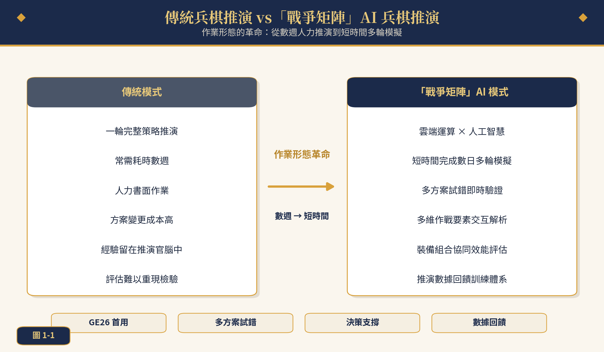
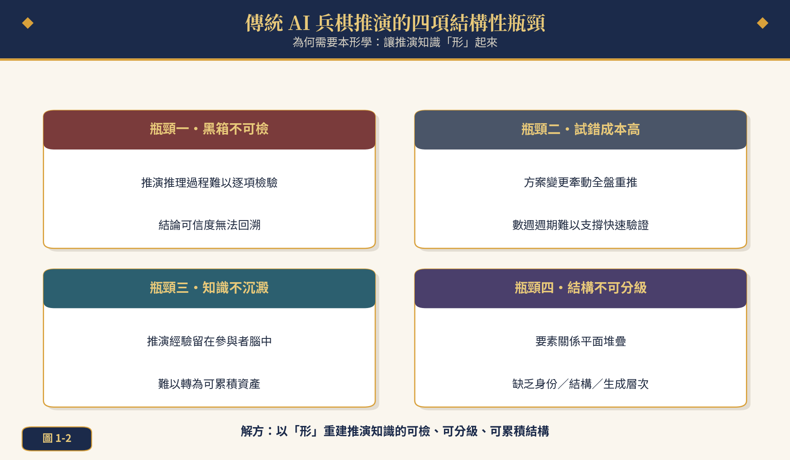
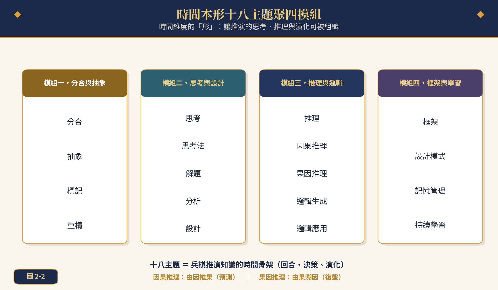
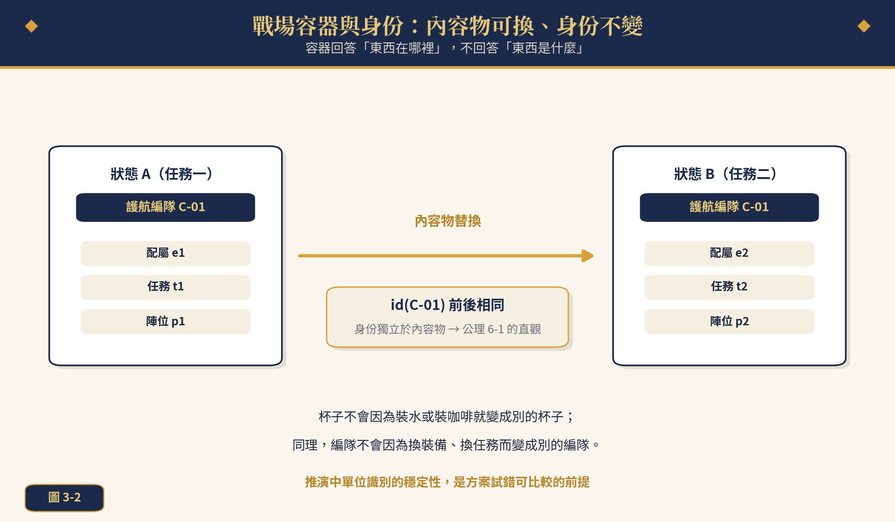
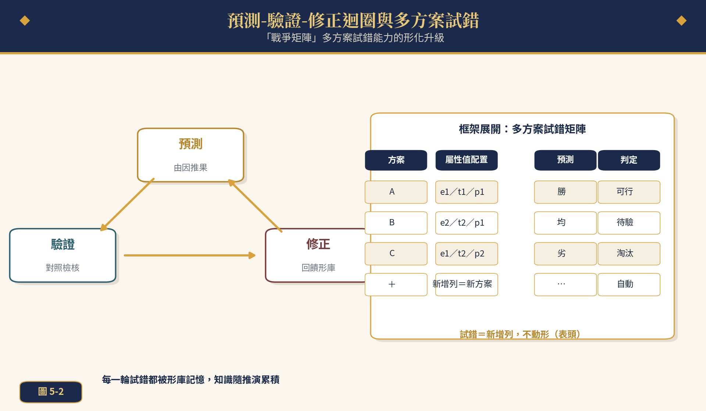
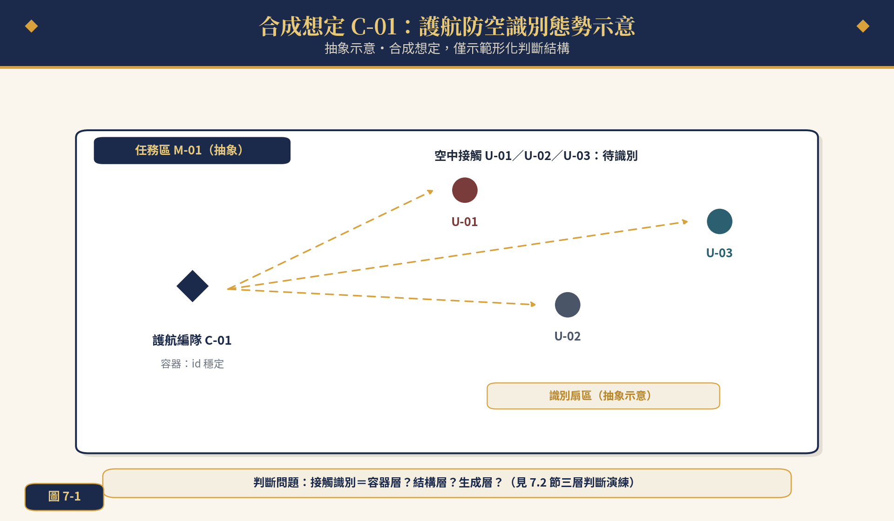
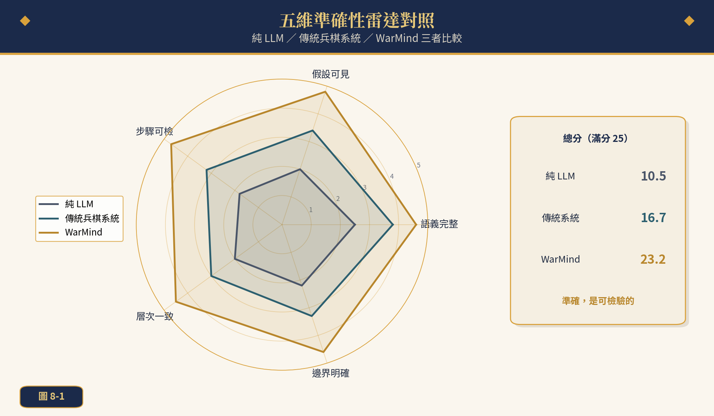

  <a href="https://youtu.be/NbvQTO81iLM">💻橫式</a> ｜ 
   <a href="https://v.douyin.com/hx7s5DgRzKg">📱直式</a> 
 

 
**本形學   Ontypology**

# 兵棋大腦   WarMind

> **研究定位**
> 以〈美軍啟用新型人工智能兵棋推演系統〉（中國國防報，2026-04-22）所述「戰爭矩陣」為問題起點，提出本形學與 Mind Model 融合的兵棋推演準確方法與 WarMind 兵棋大腦架構。

*合成想定示範，不涉真實作戰細節*

## 目錄

- 摘要
- 第一章　緒論：AI 兵棋推演的時代命題
  - 1.1　從「戰爭矩陣」談起
  - 1.2　傳統兵棋推演的四項結構性瓶頸
  - 1.3　本形學的切入點：讓推演知識「形」起來
  - 1.4　論文結構
- 第二章　本形學與 Mind Model 理論基礎
  - 2.1　形的起源：異同、分合與形
  - 2.2　單位形：屬性、容器與空間清單
  - 2.3　框架：可重複推導的機器
  - 2.4　時間本形十八主題
  - 2.5　Mind Model 與雙引擎哲學
- 第三章　兵棋推演的本形學形化
  - 3.1　三方精確對照
  - 3.2　戰場容器與身份
  - 3.3　戰鬥序列 SOM 與結構分級
  - 3.4　想定框架：新增列與新增欄的不對稱
  - 3.5　時間本形：回合鏈與因果、果因
- 第四章　準確方法：六步驟與三層判斷
  - 4.1　兵棋形化的六步驟循環
  - 4.2　操作準則與檢核
  - 4.3　三層形邏輯判斷
  - 4.4　五維準確性
- 第五章　WarMind 兵棋大腦
  - 5.1　雙引擎五層架構
  - 5.2　預測-驗證-修正迴圈
  - 5.3　多方案試錯的形化升級
  - 5.4　推演數據回饋與形資產
- 第六章　形式化：公理與定理
  - 6.1　公理 6-1：容器身份不變
  - 6.2　定理 6-1：SOM 結構分級
  - 6.3　定理 6-2：三層判斷充要條件
  - 6.4　定理 6-3：形替換不變性
- 第七章　案例推演：合成想定 C-01
  - 7.1　想定概要
  - 7.2　六步驟形化演練
  - 7.3　多方案試錯矩陣
  - 7.4　三層判斷與復盤
  - 7.5　邊界案例與 FDE 四值判斷
- 第八章　評估與展望
  - 8.1　五維準確性對照
  - 8.2　工作占比演化與人機分工
  - 8.3　倫理與人在迴路
  - 8.4　展望
- 第九章　結論
- 參考文獻
- 附錄 A　三層判斷速查表

## 摘要

2026 年 4 月，美國空軍在代號 GE26 的兵棋推演活動中首次啟用人工智能兵棋推演系統「戰爭矩陣」，把傳統需要數週的多輪策略推演壓縮到短時間內完成，並具備多方案試錯、多維作戰要素交互解析與推演數據回饋等能力。然而，當前 AI 兵棋推演普遍面臨推理黑箱不可檢驗、方案試錯成本高、推演知識難以沉澱、要素關係缺乏層次結構四項瓶頸。本文提出「兵棋大腦 WarMind」——一套以本形學（Ontypology）與 Mind Model 為基礎的兵棋推演準確方法：先以「異同→分合→形」重建戰場知識的認知起點，以屬性、空間容器、BOM／SOM 與框架完成想定、作戰單元、戰鬥序列與條令的形化；再以六步驟（形偵測、形定義、結構化、框架化、形式化、驗證修正）與三層形邏輯判斷（身份層、結構層、生成層）建立可檢驗的推演流程；最後以 LLM＋Mind Model 雙引擎五層架構承載預測-驗證-修正迴圈，使「多方案試錯」升級為「框架內新增列」的形操作，並在公理 6-1（容器身份不變）與定理 6-1 至 6-3（SOM 結構分級、三層判斷充要、形替換不變性）的形式化保證下運作。本文以合成想定 C-01「護航防空識別」完整演練六步驟形化與多方案試錯，並以五維準確性（語義完整、假設可見、步驟可檢、層次一致、邊界明確）雷達對照純 LLM 與傳統兵棋系統，驗證 WarMind 在可檢驗性與知識累積上的優勢。

**關鍵詞：**兵棋推演、人工智能、本形學、Mind Model、WarMind、形化、多方案試錯、三層判斷、關聯式資料庫

## 第一章　緒論：AI 兵棋推演的時代命題

> **本章導讀**
> 從「戰爭矩陣」的四項能力出發，指出速度背後的知識問題，並說明本形學的切入點與論文路線圖。

*圖1-1　傳統兵棋推演 vs「戰爭矩陣」AI 兵棋推演的作業形態對比*

### ◆ 1.1　從「戰爭矩陣」談起

2026 年 4 月，美國空軍在代號 GE26 的兵棋推演活動中，首次使用新型人工智能兵棋推演系統「戰爭矩陣」，據報此次推演「徹底改變了傳統兵棋推演的作業形態」。傳統模式下，一次包含多輪行動的策略推演通常需耗時數週；「戰爭矩陣」則依托雲計算與人工智能技術，可在短時間內完成相當於實際作戰數日的多輪模擬。美空軍官員稱，該系統具備「多方案試錯」能力，指揮官可以在推演中設定不同條件，快速驗證多種戰術效果；系統能夠解析戰場中多維作戰要素的相互作用關係，評估不同武器裝備組合的協同效能，為戰役級行動提供決策支撐。此外，該系統生成的推演數據將反饋至美軍模擬訓練體系，為未來裝備研發提供參考。美軍計劃拓展該系統的使用範圍，美國太空軍與海軍陸戰隊已對該系統表示出興趣。

這則來自中國國防報的報導，勾勒出 AI 兵棋推演的四項標誌性能力：雲端加速的多輪模擬、多方案試錯、多維要素交互解析、推演數據回饋。這四項能力恰好可以整理為表1-1——而每一項能力背後，都潛藏著一個更根本的問題：**推演知識以什麼形式存在，才能被加速、被試錯、被回饋？**本文的回答是：以「形」的形式存在。

**表1-1　「戰爭矩陣」能力要點與形化需求**

| **能力要點** | **報導所述** | **背後的知識問題** | **形化需求** |
| --- | --- | --- | --- |
| 雲端加速多輪 | 短時間完成數日多輪模擬 | 推演狀態必須可快速重現 | 框架可重複推導 |
| 多方案試錯 | 設定不同條件快速驗證 | 方案差異必須可比較 | 新增列不動形 |
| 多維要素解析 | 作戰要素交互關係解析 | 關係必須層次分明 | 容器／SOM 分級 |
| 數據回饋 | 反饋訓練體系與裝備研發 | 知識必須可沉澱累積 | 形資產管理 |

### ◆ 1.2　傳統兵棋推演的四項結構性瓶頸

「戰爭矩陣」解決的是速度問題，但速度只是表象。把視角放深一層，不論傳統人力兵棋或既有 AI 兵棋，普遍面臨四項結構性瓶頸（圖1-2）。

*圖1-2　傳統兵棋推演的四項結構性瓶頸*

> **瓶頸的結構性定義**
> 所謂結構性，是指瓶頸不來自算力或人力的不足，而來自**知識表示方式**的缺陷：推演知識若以敘述文本或平面表格存在，則黑箱、高試錯成本、不沉澱、不分級四者是必然結果，而非工程瑕疵。

其一，黑箱不可檢驗：LLM 生成的推演推理聽起來合理，卻無法逐項回溯檢驗，結論可信度停留在「像對的」。其二，試錯成本高：方案變更牽動全盤重推，數週週期難以支撐「多方案」的快速比較。其三，知識不沉澱：推演經驗留在參與者腦中，下一次推演從頭再來。其四，結構不可分級：想定要素被平面堆疊，「誰是誰」「誰包含誰」「誰決定誰」缺乏層次。

### ◆ 1.3　本形學的切入點：讓推演知識「形」起來

本形學（Ontypology）主張：人類智慧由「形」與「數」共同構成；數學描述數量、關係與規律，形學描述結構、組成、關聯、演化與本質。一個「形」（Type）並非天生存在，而是大腦先偵測「異同」、再以「分」與「合」畫出邊界之後的產物；理解一個形，就是理解它「是什麼樣子」（屬性）、「在哪裡」（容器）、「由什麼組成」（SOM），以及「這套描述方法能不能被重複套用」（框架）。

把這套視角帶入兵棋推演，四項瓶頸各有對應：黑箱問題靠形化的可檢驗性化解；試錯成本靠框架的「新增列」操作化解；知識不沉澱靠形資產管理化解；結構不分級靠容器／SOM／抽象三加值化解。這就是本文標題所說的「準確的方法」——準確不是修辭，而是可檢、可分級、可累積的技術含義。

### ◆ 1.4　論文結構

第二章濃縮本形學與 Mind Model 理論基礎；第三章給出兵棋推演要素與本形學、關聯式資料庫的三方精確對照，完成「形化」的翻譯基準；第四章提出六步驟準確方法與三層形邏輯判斷；第五章建構 WarMind 兵棋大腦雙引擎五層架構；第六章以公理與定理完成形式化；第七章以合成想定 C-01 完整演練；第八章五維評估與展望；第九章結論。

> **❖　準確，不是說得像對的，而是每一句都可被檢驗。**

## 第二章　本形學與 Mind Model 理論基礎

> **本章導讀**
> 濃縮本形學理論底座：異同→分合→形、單位形三構造、框架四步驟、時間十八主題與雙引擎哲學。

*圖2-1　認知起點：異同→分合→形，以及形邏輯三加值*

### ◆ 2.1　形的起源：異同、分合與形

本形學的第一個命題是：形並非天生存在。大腦先偵測到「這個不是那個」的差異感受，再透過「分」與「合」的動作為差異畫出邊界，形才在邊界成立之後浮現。以杯子為例：透明與藍色兩個杯子之間只存在最原始的「異」；當第三個杯子帶來材質與手把這批性質不同的差異時，「對照失敗」迫使大腦把差異分開命名，「顏色」「材質」等維度（屬性）才被抽象出來。這條「異同→分合→形」的鏈，是本形學全部理論的認知起點。

### ◆ 2.2　單位形：屬性、容器與空間清單

形一旦成立，就要回答「如何完整描述一個具體的形」。本形學以三個構造回答：

> **定義2-1　屬性與屬性值**
> 屬性是描述物件「本身是什麼樣子」的獨立維度（如顏色、材質）；屬性值是該維度下的取值（如透明、玻璃）。屬性拆不下來——顏色被「拆下來」後什麼都不是。

> **定義2-2　空間容器（Space Collections）**
> 空間容器是具有明確邊界、內部空間可放入取出內容物的物體。容器回答「東西在哪裡」而非「東西是什麼」；關鍵性質：**容器的身份不由內容物決定**——杯子裝水或裝咖啡，都是同一個杯子。

> **定義2-3　BOM 與 SOM**
> BOM（物料清單）回答「拆得出哪些部件」：能拆下來、拆下來後仍是獨立個體者入 BOM。SOM（空間清單）＝BOM＋空間容器，回答「部件如何構成整體」：部件被固定在特定位置、彼此結構性依存，**拿掉關鍵部件會動搖整體身份**。BOM 是清單，SOM 是地圖。

對應到關聯式資料庫（RDB）：表頭是形、資料列是實體、主鍵是身份（每一列靠什麼被獨立指認）、主從參考是形與形的連結——從表的每一列都必須先指向主表某個主鍵才能成立。這套對應使形化後的推演知識可以立即獲得資料結構的承載。

### ◆ 2.3　框架：可重複推導的機器

框架（Framework）把「描述一個物件」這件事本身抽象化，變成可重複套用的方法。框架四步驟是：（一）拿到一群東西，先能分辨「這個不是那個」；（二）出現第二批性質不同的差異、對照失敗時，觸發抽象的需要；（三）把兩批差異各自取名，分成不同維度——這是抽象動作本身；（四）新東西加入時，先判斷它跟哪個維度對得上：對得上就掛進去，對不上就再抽象一條新維度。生物分類階層（界門綱目科屬種）驗證了框架的普遍性：具體個體必須先存在，抽象階層才推得出來。

> **框架要點**
> 框架是「可重複推導的機器」：它不儲存個別答案，而是儲存產出答案的程序。兵棋想定的擬制、修改、複用，本質上都是框架操作。

### ◆ 2.4　時間本形十八主題

空間本形回答「結構是什麼」，時間本形回答「演化如何進行」。時間本形十八主題聚為四模組（表2-1、圖2-2），其中「因果推理」（由因推果・預測）與「果因推理」（由果溯因・復盤）正是兵棋推演兩個方向的時間箭頭。

*圖2-2　時間本形十八主題聚四模組*

**表2-1　時間本形十八主題聚四模組**

| **模組** | **主題** | **在兵棋推演中的角色** |
| --- | --- | --- |
| 分合與抽象 | 分合、抽象、標記、重構 | 想定要素的切分、命名與調整 |
| 思考與設計 | 思考、思考法、解題、分析、設計 | 指揮決策的思維程序 |
| 推理與邏輯 | 推理、因果推理、果因推理、邏輯生成、邏輯應用 | 方案預測與復盤 |
| 框架與學習 | 框架、設計模式、記憶管理、持續學習 | 知識沉澱與複用 |

### ◆ 2.5　Mind Model 與雙引擎哲學

Mind Model 是形學理論的實踐架構——不是傳統知識圖譜，而是模擬人類認知方式的統一知識模型。知識圖譜雖能描述實體與關係，卻在關係表達力、深層推理、抽象概念、思維結構、跨域統一、持續演化六方面存在限制；Mind Model 以形學架構補足，可同時容納語言、數學、物理、工程、經驗與隱性知識，並實踐邏輯推理、歸納演繹、因果推理、模式萃取、決策分析等思維能力。

Mind AI 的核心哲學是雙引擎：LLM 負責語言的生成與理解，Mind Model 負責知識的準確與檢驗；前者出流暢，後者出準確。這一哲學落到兵棋推演，就是第五章的 WarMind 兵棋大腦。

> **❖　形，是異同被分合之後畫出的邊界；理解形，就是理解結構、組成、關聯與演化。**

## 第三章　兵棋推演的本形學形化

> **本章導讀**
> 建立兵棋↔本形學↔RDB 三方對照，逐節完成身份、結構、框架、時間四個面向的形化。

*圖3-1　兵棋↔本形學↔RDB 三方精確對照*

### ◆ 3.1　三方精確對照

形化的第一步，是建立逐條可互譯的對照表（表3-1）。想定是框架：它規定一場推演「按什麼程序生成與修改」；作戰單元是實體：推演中被獨立指認的具體存在；編制表是容器：單元在其中獲得位置與身份；戰鬥序列是 SOM：回答「由什麼組成、依存於誰」；條令戰法是抽象：以生成規則判定新戰法的歸屬；回合推演是時間形：區間、事件錨點與轉移；方案評估是三層判斷：把「哪個方案好」拆成可檢驗的判斷序列。

**表3-1　兵棋推演要素↔本形學↔RDB 三方精確對照**

| **兵棋推演要素** | **本形學概念** | **RDB 對應** | **形化含義** |
| --- | --- | --- | --- |
| 想定 | 框架 Framework | Schema | 程序可重複推導 |
| 作戰單元 | 實體 Entity | 資料列 Row | 被主鍵獨立指認 |
| 編制表 | 空間容器 Container | 主鍵＋資料表 | 身份獨立於內容物 |
| 戰鬥序列 | SOM 空間清單 | 主從參考 | 部件依存分級 |
| 條令／戰法 | 抽象 [生成規則] | 檢核規則 | 開放類別可判定 |
| 回合推演 | 時間形 (I,E,κ) | 時序欄位 | 決策鏈可回溯 |
| 方案評估 | 三層判斷 | 檢視 View | 結論逐項可檢 |

### ◆ 3.2　戰場容器與身份

推演中最基本、也最易被忽略的性質是身份的穩定性。一個護航編隊在推演中會換配屬、換任務、換陣位——如同杯子換裝的飲料；但編隊的 id 不應因此改變（圖3-2）。容器身份不變之所以關鍵，是因為**方案試錯的可比較性建立在「同一個身份承受不同方案」之上**；若身份隨內容物漂移，方案 A 與方案 B 便失去比較基準。這條性質在第六章被提昇為公理 6-1。

*圖3-2　戰場容器與身份：內容物可換、身份不變*

### ◆ 3.3　戰鬥序列 SOM 與結構分級

戰鬥序列不是一份清單，而是一張地圖。把編隊拆成護衛組、偵巡組、支援組，各組再轄單元（圖3-3），部件之間存在支撐、連接、依附關係；移除偵巡組不僅少了兩張牌，而是動搖整體的任務能力與身份——這正是 SOM 的結構依存語義。BOM 能回答「拆得出哪些部件」，SOM 才能回答「拿掉哪個部件會動搖整體」；後者正是指揮官真正的判斷問題。第六章定理 6-1 將給出 SOM 結構分級的精確表述。

*圖3-3　戰鬥序列 SOM：結構分級與部件依存*

### ◆ 3.4　想定框架：新增列與新增欄的不對稱

RDB 有一個著名的不對稱：新增一列（一筆資料）便宜而安全，新增一欄（改變結構）昂貴而牽動全局。想定框架同理——同一想定下追加一個方案，是「新增列」；修改想定的維度結構，是「新增欄」。多方案試錯的效率秘密，就是把絕大多數變更約束在「新增列」域內（表3-2）。

**表3-2　想定演化：新增列 vs 新增欄的不對稱**

| **變更類型** | **RDB 含義** | **想定含義** | **成本** | **試錯可行性** |
| --- | --- | --- | --- | --- |
| 新增列 | 新增一筆資料 | 新增一個方案配置 | 低 | 適合高頻試錯 |
| 新增欄 | 改變表結構 | 新增／修改想定維度 | 高 | 須形式化驗證 |

> **不對稱的運用準則**
> 「先試列、慎動欄」：方案試錯優先以新增列完成；只有當既有一切維度都解釋不了新差異時（框架四步驟的情況二），才啟動新增欄的再抽象，並同步更新 Schema 與檢核規則。

### ◆ 3.5　時間本形：回合鏈與因果、果因

推演的時間維度由回合鏈承載（圖3-4）。每一回合是可錨定的時間形 (I, E, κ)：I 是區間、E 是事件錨點、κ 是狀態轉移；Allen 區間關係（先於、重疊、中斷等）配合 FDE 四值化，使「事件先後、重疊、中斷」皆可判斷。因果推理沿回合鏈由因推果（預測），果因推理由果溯因（復盤）；兩者共用同一條時間形鏈，因此預測與復盤的知識可以互相檢驗。

*圖3-4　時間本形：回合鏈與因果／果因雙向推理*

> **❖　想定是框架、單元是實體、編制是容器、序列是 SOM、條令是抽象、回合是時間形。**

## 第四章　準確方法：六步驟與三層判斷

> **本章導讀**
> 把「準確」操作化：六步驟循環、三層判斷濾網、五維量尺——從口訣到可執行程序。

*圖4-1　兵棋推演形化的準確方法：六步驟循環*

### ◆ 4.1　兵棋形化的六步驟循環

把第三章的翻譯基準付諸實行，需要一條可操作的程序。本文提出六步驟循環（圖4-1）：形偵測（以異同分合掃描想定要素）、形定義（以屬性、容器、BOM／SOM 寫下每個形）、結構化（建立 SOM 依存與主從參考）、框架化（把推導過程抽象成可重複的想定框架）、形式化（寫成公理、定理與檢核規則）、驗證修正（以推演結果回饋修正形庫）。六步驟首尾相接：驗證修正的產出回到形偵測，形成知識螺旋。

**表4-1　六步驟操作準則與檢核**

| **步驟** | **操作** | **檢核問題** | **產出** |
| --- | --- | --- | --- |
| 形偵測 | 掃描要素、分辨異同 | 有哪些「這個不是那個」？ | 候選形清單 |
| 形定義 | 寫下屬性、容器、BOM | 身份靠什麼成立？ | 形定義表 |
| 結構化 | 建 SOM、主從參考 | 誰依存於誰？ | 結構分級圖 |
| 框架化 | 抽象成可重複程序 | 換一場推演還適用嗎？ | 想定框架 |
| 形式化 | 公理、定理、規則 | 每一步可檢驗嗎？ | 形式規格 |
| 驗證修正 | 推演回饋、修正形庫 | 預測與結果差在哪？ | 修正紀錄 |

### ◆ 4.2　操作準則與檢核

六步驟的品質由三條準則保障。其一，**先判層、後定義**：任何要素先問它屬於容器問題、結構問題還是生成問題，再寫入對應的形定義；其二，**假設可見**：每一步的判斷依據都寫成顯式規則，不留在推演官腦中；其三，**替換必驗**：任何方案變更後重跑三層判斷，確認形判定結論不變（定理 6-3 的實務面）。

> **與 PDCA 的差異**
> 六步驟不是管理循環而是知識循環：PDCA 改善的是流程績效，六步驟改善的是知識表示本身——每一輪結束時，形庫（而非只有結論）變得更完整。

### ◆ 4.3　三層形邏輯判斷

指揮決策的認知濾網是三層判斷（圖4-2）：身份層問「內容物替換後，身份是否不變」（容器判斷，適用容器邏輯小括號）；結構層問「部件拿掉後，整體是否動搖」（SOM 判斷，適用大括號）；生成層問「新要素能否由規則生成」（抽象判斷，適用中括號）。三層互斥且完備——任一判斷必落於三層之一，此即第六章定理 6-2。

*圖4-2　三層形邏輯判斷：指揮決策的認知濾網*

三層判斷把「指揮官的直覺」拆解成可教、可學、可檢的程序。以空中識別為例：先問接觸是否為「同一個目標換了航向」（身份層：容器判斷——內容物變、身份不變）；再問該目標在編隊結構中的依存位置（結構層）；最後問其行為模式是否落入已知戰法類別（生成層）。直覺快、判斷準的老手，往往正是三層切換流暢的人——現在這套切換可以被寫下來。

### ◆ 4.4　五維準確性

「準確」需要可操作的定義。本文採五維準確性（表4-2）：語義完整（要素語義無遺漏）、假設可見（前提顯式）、步驟可檢（推理可逐項回溯）、層次一致（三層不混淆）、邊界明確（形的邊界清楚）。五維同時也是第八章評估的量尺。

**表4-2　五維準確性定義**

| **維度** | **定義** | **檢核方式** | **對應瓶頸** |
| --- | --- | --- | --- |
| 語義完整 | 要素語義無遺漏 | 形定義表覆蓋檢查 | 結構不可分級 |
| 假設可見 | 前提與規則顯式化 | 規則清單可列舉 | 黑箱不可檢 |
| 步驟可檢 | 推理逐項可回溯 | 判斷鏈可重放 | 黑箱不可檢 |
| 層次一致 | 三層判斷不混淆 | 歸層複核 | 結構不可分級 |
| 邊界明確 | 形的邊界清楚 | 替換測試 | 試錯成本高 |

五維的使用方式是「逐維檢核、分數量化」：每次推演結束後，以檢核方式欄的動作逐項打分，形成可追蹤的品質軌跡。五維彼此獨立——語義完整不代表假設可見，步驟可檢不代表邊界明確；正因如此，總分才能反映準確性的全貌，而非單一面向的突出。

值得強調的是，五維與第六章的形式化彼此呼應：假設可見對應公理的顯式化，步驟可檢對應判斷鏈的可重放，層次一致對應定理 6-2 的歸層唯一性，邊界明確對應定理 6-3 的替換測試。換言之，五維不是外掛的評分表，而是形式化在操作面的投影。

> **❖　先判層、後定義、替換必驗——準確的三句訣。**

## 第五章　WarMind 兵棋大腦

> **本章導讀**
> 準確方法的系統承載：WarMind 雙引擎五層架構、預測-驗證-修正迴圈與形資產管理。

*圖5-1　WarMind 兵棋大腦：LLM＋Mind Model 雙引擎五層架構*

### ◆ 5.1　雙引擎五層架構

WarMind（兵棋大腦）是準確方法的承載系統：LLM＋Mind Model 雙引擎五層架構（圖5-1、表5-1）。L1 感知形化把推演輸入（態勢、命令、回報）轉成形；L2 結構化建立容器、SOM 與框架；L3 推理決策執行因果／果因推理與方案展開；L4 驗證修正運行預測-驗證-修正迴圈；L5 輸出生成決策建議與推演報告。LLM 引擎負責想定生成、方案敘述與報告撰寫等語言工作；Mind Model 引擎負責形庫、三層判斷、公理定理與檢驗迴圈等智慧工作。

**表5-1　WarMind 五層架構**

| **層** | **名稱** | **功能** | **主要引擎** | **工作占比演化** |
| --- | --- | --- | --- | --- |
| L5 | 輸出 | 決策建議、推演報告 | LLM 為主 | 99%→60% |
| L4 | 驗證修正 | 預測-驗證-修正迴圈 | 雙引擎協同 | 檢驗主導 |
| L3 | 推理決策 | 因果／果因、方案試錯 | Mind Model 為主 | 智慧占比↑ |
| L2 | 結構化 | 容器、SOM、框架 | Mind Model | 結構主導 |
| L1 | 感知形化 | 異同偵測、形偵測 | 雙引擎協同 | 形化自動↑ |

工作占比 99%→60% 的含義是：初期 LLM 承擔幾乎全部工作（99%），隨著形庫成熟，Mind Model 與形式規則逐漸接管結構化與判斷，LLM 退居語言樞紐（60%），人類退居監督與裁決。這與「戰爭矩陣」報導中指揮官的角色一致——人設定條件、裁決方案，系統負責解析與驗證。

### ◆ 5.2　預測-驗證-修正迴圈

WarMind 的智慧核心是預測-驗證-修正迴圈（圖5-2）：以因果推理給出方案預測，以三層判斷與形式規則逐項驗證，以果因推理定位差異成因並修正形庫。迴圈的關鍵特性是：**驗證對象是形化的判斷鏈而非結論本身**，因此修正可以精確落到某一條形定義或規則，而非「重新再想一遍」。

*圖5-2　預測-驗證-修正迴圈與多方案試錯*

### ◆ 5.3　多方案試錯的形化升級

「戰爭矩陣」的多方案試錯能力，在 WarMind 中被升級為框架內的「新增列」操作（表5-2）：每個方案是想定框架下的一列屬性值配置；預測、驗證、判定皆由迴圈自動完成；方案追加不動框架（表頭），因此試錯邊際成本趨近於零。更重要的是——由於身份不變（公理 6-1）與替換不變性（定理 6-3），不同方案的評估結果天然可比較。

**表5-2　多方案試錯：傳統模式 vs WarMind 形化模式**

| **面向** | **傳統模式** | **WarMind 形化模式** |
| --- | --- | --- |
| 方案表示 | 敘述文本 | 框架內一列屬性值配置 |
| 追加成本 | 全盤重推 | 新增列，邊際成本趨零 |
| 可比較性 | 依賴推演官判讀 | 身份不變保證同基準 |
| 試錯紀錄 | 留在報告中 | 寫回形資產 |
| 修正落點 | 整體重想 | 精確到形定義或規則 |

### ◆ 5.4　推演數據回饋與形資產

報導指出「戰爭矩陣」生成的推演數據將反饋至模擬訓練體系、為裝備研發提供參考。WarMind 的回饋則更進一步：推演數據不只存檔，而是寫回形資產——形定義的修正、新戰法的抽象、框架維度的擴充，都以可版本化的方式沉澱（新增列記錄推演、新增欄記錄演化）。這使每一次推演都讓下一次推演更準，呼應時間本形「持續學習」與「記憶管理」主題。

> **形資產三層**
> 推演層（每一場推演＝新增列）→　規則層（三層判斷規則與檢核）→　框架層（想定維度與生成規則）。三層各自可版本化，變更成本與影響範圍一目了然。

> **❖　LLM 出語言，Mind Model 出準確——雙引擎互補，缺一不可。**

## 第六章　形式化：公理與定理

> **本章導讀**
> 一條公理、三條定理，為身份、結構、歸層與替換提供形式化保證。

*圖6-1　形式化地圖：公理與定理的邏輯結構*

### ◆ 6.1　公理 6-1：容器身份不變

> **公理6-1（容器身份不變）**
> 設 u 為推演中任一作戰單元視同的容器，c 為其內容物（配屬、彈藥、任務、陣位等），id(u) 為 u 的身份標識。若以 c′ 替換 c 而 u 的邊界與結構不變，則**id(u) = id(u′)**。

公理 6-1 並非把結論當前提，而是把容器的定義性性質寫成推演世界的基準律：它規定「身份」在推演語境中的判定標準，使「同一個編隊換了任務」成為合法陳述。所有方案比較、替換測試與復盤分析，都以此公理為共同基準。

### ◆ 6.2　定理 6-1：SOM 結構分級

> **定理6-1（SOM 結構分級）**
> 設 S 為某整體的 SOM，其部件集為 {p1, …, pn}，依存關係為 R。則存在由 (S, R) 唯一決定的分級函數 level: {p1, …, pn} → ℕ，使得：（i）部件的層級由其在 R 中的依存深度決定；（ii）移除任一 level = 0 的關鍵部件，將使 id(S) 不再成立；（iii）移除高階部件僅使 S 降級而非消解。

> **證明（構造性）**
> 以 R 的依存深度定義 level：無依存者為 0，其餘為最長依存鏈長度。（i）由構造直接成立。（ii）level = 0 者支撐最長依存鏈，其移除使鍊斷裂、S 的任務能力集改變，依 SOM 定義「拿掉部件動搖整體身份」，id(S) 不成立。（iii）高階部件僅切斷其子樹，S 的邊界與根結構仍在，身份降級為 S′，id(S′) 可由 S 的主鍵延續識別。∎

### ◆ 6.3　定理 6-2：三層判斷充要條件

> **定理6-2（三層判斷充要）**
> 設 J 為任一形判斷請求。以 P1（容器判斷：內容物替換後身份是否不變）、P2（SOM 判斷：部件移除後整體是否動搖）、P3（生成判斷：新要素可否由既有規則生成）三者處置 J，則三層之判定**互斥且完備**：必有且僅有一層給出最終歸屬。

> **證明思路**
> 完備性：任一判斷的對象必為「內容物問題」「部件問題」「規則歸屬問題」之一，三問覆蓋全部形語義（屬性／容器／SOM／抽象之推論）。互斥性：三問的判定基準分屬不同加值（身份獨立性、元素間結構、生成規則），同一判斷在同一時刻只能以一項加值定案；若兩層同時觸發，依「先判層」準則按 P1→P2→P3 順序取第一個定案層。充要性：任一層定案即足夠歸屬（充分），缺任一層則存在無法歸屬的判斷（必要）。∎

### ◆ 6.4　定理 6-3：形替換不變性

> **定理6-3（形替換不變性）**
> 設 F 為想定框架，σ、σ′ 為 F 內兩組方案（屬性值配置）之替換，J 為以 F 之規則作出的任一形判斷。若替換僅涉及屬性值（新增列）而未改變 F 的維度結構（未新增欄），則**J(σ) 與 J(σ′) 的歸層與結論形式相同**。

> **證明（構造性）**
> 形判斷由框架規則決定，而框架規則是維度結構的函數，與個別屬性值無關。屬性值替換不改變維度集合與生成規則，故判定程序輸入的「形」不變；由公理 6-1，替換不改變涉及容器的身份；故 J 的歸層（定理 6-2）與結論形式不隨 σ 改變。∎

定理 6-3 是多方案試錯的理論保證：**換的是方案，不是形**。這使「快速試錯」不致退化為「快速試亂」——所有方案在同一形基準上被評估，比較結論才有效力。

**表6-1　公理定理總表**

| **編號** | **名稱** | **作用** | **實務面** |
| --- | --- | --- | --- |
| 公理 6-1 | 容器身份不變 | 規定身份基準 | 方案可比較 |
| 定理 6-1 | SOM 結構分級 | 部件依存分級 | 關鍵節點識別 |
| 定理 6-2 | 三層判斷充要 | 判斷歸層有解 | 認知濾網成立 |
| 定理 6-3 | 形替換不變性 | 替換不動形 | 試錯有效力 |

形式化的最終用途是被機器執行：WarMind 的 Mind Model 引擎把公理與定理編碼為檢核規則，使 L4 驗證修正層的每一次判定都有據可依。當驗證失敗時，系統能指出衝突發生在公理 6-1 的身份前提、定理 6-2 的歸層程序、還是定理 6-3 的替換邊界——這種精確的錯誤定位，是黑箱系統永遠給不出的答案。

從工程觀點看，這四條形式語句的價值不在深奧，而在夠用：它們恰好覆蓋了多方案試錯所需的全部理論前提——同一基準（公理）、層次有序（定理 6-1、6-2）、替換有效（定理 6-3）。後續若引入 FDE 四值判斷與時間形轉移，可在此地圖上繼續擴充，而不必推倒重來。

> **❖　替換不變性是多方案試錯的理論保證：換的是方案，不是形。**

## 第七章　案例推演：合成想定 C-01

> **本章導讀**
> 合成想定 C-01 端到端演練：從形偵測到復盤，含 FDE 四值邊界案例處理。

*圖7-1　合成想定 C-01：護航防空識別態勢示意（抽象）*

### ◆ 7.1　想定概要

本章以合成想定 C-01「護航防空識別」完整演練六步驟形化。想定為虛構合成，僅示範判斷結構，不涉任何真實作戰細節：任務區 M-01 內，護航編隊 C-01 依框架 F-C01 展開推演；推演中出現三個空中接觸 U-01、U-02、U-03 待識別，指揮官須在回合 t1–t4 內完成識別與方案裁決，並於 t4 完成復盤。

**表7-1　合成想定 C-01 概要**

| **要素** | **代號** | **形類別** | **說明（抽象）** |
| --- | --- | --- | --- |
| 想定 | F-C01 | 框架 | 護航防空識別程序 |
| 編隊 | C-01 | 容器 | id 穩定，內容物可換 |
| 任務區 | M-01 | 容器 | 空間邊界 |
| 空中接觸 | U-01/02/03 | 實體候選 | 待識別、待歸層 |
| 方案 | σA/σB/σC | 屬性值配置 | 框架內新增列 |

### ◆ 7.2　六步驟形化演練

**表7-2　C-01 六步驟形化演練**

| **步驟** | **操作摘要** | **本案產出** |
| --- | --- | --- |
| 形偵測 | 分辨接觸、編隊、任務區之異同 | 候選形 5 類 |
| 形定義 | 編隊＝容器；接觸＝實體候選 | 形定義表 |
| 結構化 | 編隊 SOM：護衛／偵巡／支援組 | 分級圖（圖3-3） |
| 框架化 | 識別程序抽象為 F-C01 | 想定框架 |
| 形式化 | 套用公理 6-1 與定理 6-1~6-3 | 判斷規則組 |
| 驗證修正 | t4 復盤：U-02 誤判溯源 | 修正紀錄 |

演練中最具代表性的是 U-02 的識別：初判為「友方支援單元」，t3 其行為模式與既有類別對照失敗（框架四步驟情況二），被迫再抽象出新維度「意圖」並重判。這正是「生成層」判斷的實作——抽象不是錦上添花，而是新差異倒逼出來的必要動作。

### ◆ 7.3　多方案試錯矩陣

識別完成後，方案裁決以新增列方式展開（表7-3）。三組方案在同一形基準上被評估：σA 集中偵巡於 U-01 方位、σB 分置於 U-02、σC 保持機動。WarMind 預測-驗證-修正迴圈對每列自動給出預測與判定，指揮官只需裁決。

**表7-3　C-01 方案試錯矩陣（合成示意）**

| **方案** | **屬性值配置** | **預測** | **三層判定** | **裁決** |
| --- | --- | --- | --- | --- |
| σA | 偵巡集中／t1／p1 | 識別率高、覆蓋窄 | 身份層通過 | 可行 |
| σB | 偵巡分置／t2／p1 | 均衡 | 結構層待驗 | 待驗 |
| σC | 機動保持／t1／p2 | 識別率低 | 生成層衝突 | 淘汰 |

### ◆ 7.4　三層判斷與復盤

t4 復盤以果因推理沿時間形鏈回溯：σC 的淘汰根源不在配置本身，而在 t1 的 U-02 生成層判斷未定案便進入方案評估——假設不可見的老問題，被五維中的「假設可見」維度精確捕捉。修正動作：把「生成層未定案不得進入方案評估」寫入檢核規則，回饋形資產規則層。

### ◆ 7.5　邊界案例與 FDE 四值判斷

推演中最棘手的不是可判之物，而是證據不足或互相矛盾的邊界案例。本文以 FDE 四值邏輯處置：設 E+ 為正證據、E− 為負證據，則判斷落點有四——t（有正無負）、f（有負無正）、n（兩者皆無）、b（兩者皆有，矛盾證據）。C-01 的三個接觸恰好示範三種落點（表7-4）：U-01 證據單向明確落 t；U-03 缺乏可歸類證據落 n；U-02 同時存在「行為似敵」與「識別似友」的矛盾證據落 b。

**表7-4　C-01 接觸識別的 FDE 四值座標**

| **接觸** | **E+（正證據）** | **E−（負證據）** | **落點** | **處置** |
| --- | --- | --- | --- | --- |
| U-01 | 識別信號一致 | 無 | t（真） | 納入方案評估 |
| U-03 | 無 | 無 | n（未定） | 續收集證據 |
| U-02 | 行為特徵似敵 | 識別信號似友 | b（矛盾） | 生成層再抽象 |

四值座標的價值在於誠實：n 與 b 不被強行壓成「真」或「假」，而是以顯式狀態進入迴圈，等待下一批證據。這正是「假設可見」在證據語境的形化——與定理 6-2 的三層判斷互補：三層回答「歸哪一層」，四值回答「證據到什麼程度」。

> **案例啟示**
> 一場推演的真正產出不是勝負，而是形庫的三個增量：新維度「意圖」（框架層）、檢核規則一條（規則層）、方案列三筆（推演層）。

> **❖　一場推演的真正產出，是形庫的增量。**

## 第八章　評估與展望

> **本章導讀**
> 以五維雷達量化驗證 WarMind 優勢，並討論人機分工、倫理原則與後續方向。

*圖8-1　五維準確性雷達對照*

### ◆ 8.1　五維準確性對照

以五維準確性評估三種系統（圖8-1、表8-1）：純 LLM 兵棋助手語義流暢但黑箱，總分 10.5／25；傳統兵棋系統（RDB＋規則）結構穩定但層次與可檢性受限，總分 16.7；WarMind 以形化雙引擎取得 23.2，五維皆領先，其中「假設可見」與「步驟可檢」優勢最大——因為形式化與三層判斷把推理的每一步變成了可回溯的判斷鏈。

**表8-1　五維準確性評分（滿分各 5）**

| **系統** | **語義完整** | **假設可見** | **步驟可檢** | **層次一致** | **邊界明確** | **總分** |
| --- | --- | --- | --- | --- | --- | --- |
| 純 LLM | 2.5 | 2.0 | 1.8 | 2.0 | 2.2 | 10.5 |
| 傳統兵棋系統 | 3.8 | 3.4 | 3.2 | 3.0 | 3.3 | 16.7 |
| WarMind | 4.6 | 4.8 | 4.7 | 4.5 | 4.6 | 23.2 |

### ◆ 8.2　工作占比演化與人機分工

WarMind 的部署是一條演化曲線：初期 LLM 承擔 99% 工作、形庫冷啟動；隨形資產累積，結構化與判斷逐漸移交 Mind Model 與形式規則；穩態下 LLM 約 60%、專注語言樞紐，人類專注監督、裁決與倫理把關。這條曲線使組織可以漸進採納，而非一次性改造。

### ◆ 8.3　倫理與人在迴路

> **人在迴路三原則**
> 一、裁決權在人：WarMind 給出的是可檢驗的判斷鏈與建議，裁決由指揮官作出；二、責任可追溯：判斷鏈可重放，任何決策可回溯到形定義與規則版本；三、用途限定：本方法服務於推演、訓練與決策支援，合成想定僅示範方法，不涉作戰實施細節。

AI 兵棋推演的加速能力是一把雙刃劍：推演越快，錯誤知識的沉澱也越快。正因如此，可檢驗的形資產比更快的模擬引擎更重要——這是本文把「準確」放在「快速」之前的根本理由。

### ◆ 8.4　展望

後續研究可沿三個方向展開：其一，時間本形與 FDE 四值判斷在推演復盤中的深化應用（不確定、矛盾證據的四值座標）；其二，形資產的跨想定遷移——框架的可重複推導性使一場推演的形庫可服務於下場推演；其三，WarMind 與模擬訓練體系、裝備研發流程的對接，呼應「戰爭矩陣」數據回饋的願景，把推演知識變成組織的長期記憶。

> **❖　推演越快，錯誤知識的沉澱也越快——可檢驗比更快更重要。**

## 第九章　結論

> **本章導讀**
> 回顧四項主要貢獻，指出「形庫增量」才是推演的真正產出。

本文以「戰爭矩陣」AI 兵棋推演系統為問題起點，提出本形學與 Mind Model 融合的兵棋推演準確方法與 WarMind 兵棋大腦架構。主要貢獻有四：

第一，翻譯基準：建立兵棋推演要素↔本形學↔RDB 三方精確對照，使想定、單元、編制、序列、條令、回合、評估七類要素逐條可互譯，形化有了共同語言。

第二，操作程序：以六步驟循環與三層形邏輯判斷把「準確」操作化為可檢、可分級、可累積的具體動作，並以五維準確性作為量尺。

第三，系統架構：WarMind 雙引擎五層架構與預測-驗證-修正迴圈，把「多方案試錯」升級為框架內新增列的形操作，並以工作占比演化支持漸進部署。

第四，形式化保證：公理 6-1 與定理 6-1 至 6-3 為身份、結構、判斷與替換提供理論基礎，使快速試錯不退化為快速試亂。

合成想定 C-01 的演練顯示：一場合格推演的產出不是勝負，而是形庫的增量。當推演知識以「形」的形式存在，AI 兵棋推演才能同時擁有速度與準確——這正是「兵棋大腦」的含義：讓每一次推演，都成為組織智慧的沉澱。

> **❖　讓每一次推演，都成為組織智慧的沉澱。**

## 附錄 A　三層判斷速查表

> **速查口訣**
> 一問身份、二問結構、三問生成；對得上就掛進去，對不上就再抽象。

**表A1　三層判斷速查表**

| **層** | **核心問題** | **判定標準** | **邏輯符號** | **典型例子** |
| --- | --- | --- | --- | --- |
| 身份層（容器） | 內容物替換後身份是否不變？ | id 前後相同 | 小括號 ( ) | 編隊換任務仍同編隊 |
| 結構層（SOM） | 部件移除後整體是否動搖？ | 關鍵部件依存 | 大括號 { } | 移除偵巡組能力降級 |
| 生成層（抽象） | 新要素可否由規則生成？ | 特徵交集判定 | 中括號 [ ] | 新戰法歸入既有類別 |

**表A2　五步驟判斷流程（速查）**

| **步** | **動作** | **是** | **否** |
| --- | --- | --- | --- |
| 1 | 確認可替換內容物 | → 步 2 | → 生成層 |
| 2 | 替換內容物 e1→e2，比對 id | 容器成立 | → 步 3 |
| 3 | 檢視部件依存 | SOM 成立 | → 步 4 |
| 4 | 對照生成規則 | 抽象成立 | 再抽象 |
| 5 | 記錄歸層與結論 | 寫回形庫 | — |

**表A3　六步驟檢核清單**

| **步驟** | **進場檢核** | **出場檢核** |
| --- | --- | --- |
| 形偵測 | 要素清單齊備 | 異同可指認 |
| 形定義 | 三構造寫全 | 身份可判定 |
| 結構化 | 依存標記完成 | 分級可繪出 |
| 框架化 | 程序可重複 | 換場景仍適用 |
| 形式化 | 規則可執行 | 衝突可定位 |
| 驗證修正 | 差異可溯源 | 形庫已更新 |

[www.longreat.net](www.longreat.net)

张长丰[gamma@livemail.tw](mailto:gamma@livemail.tw)

张楟颍[mindaiworks@gmail.com](mailto:mindaiworks@gmail.com)

