> 本形學  Ontypology
> 問 診 大 腦
> ClinicMind 與 AI 醫療問診的準確方法
> The Accurate Method of AI Medical Interview by Ontypology
> 

# 摘　要

大型語言模型（LLM）進駐臨床場景之際，「AI 問診」看似能以流暢對話蒐集病史、提出鑑別診斷，實則潛藏結構性風險：病史細節幻覺、關鍵紅旗症狀漏問、症狀與診斷層次混雜、結論與依據脫鉤、病程時間軸破碎，以及評估只問答案對錯而不問過程可否檢驗。本研究以「本形學（Ontypology）」與「Mind Model」為理論基礎，將《空間本形論》之形、容器、SOM、框架、抽象與《時間本形論》之時間形、因果／果因推理，系統性落戶於現代醫療問診（症狀蒐集、鑑別診斷、分檢 triage），提出「問診大腦 ClinicMind」之雙引擎五層架構（LLM＋Mind Model），以及一套可工程化的「準確方法六步驟」：形偵測、形定義、結構化、框架化、形式化、驗證修正。

在形式化層面，本文給出病患容器身份公理與病史可檢公理，證明症狀 SOM 結構分級定理、三層判斷充要性定理與問診形替換不變性定理，並以 FDE 四值邏輯（t／f／n／b）與證據對 (E⁺, E⁻) 建立可容納「不確定」與「矛盾」的判斷語意，使矛盾不再是錯誤，而是必須回溯的診斷指令。在評估層面，本文建立五維準確性量表（語義完整、假設可見、步驟可檢、層次一致、邊界明確），對純 LLM、提示工程、RAG、規則引擎、專家系統與 ClinicMind 六種方法進行多方對照。在實證層面，本文以三組合成想定（synthetic）——急性腹痛分檢、慢性咳嗽鑑別、多重用藥矛盾排查——完整演練六步驟與四值判斷，並提出分級授權、溯源可檢、合規稽核、回饋修正之臨床治理閉環。研究顯示：問診的準確性可以從「模型的天賦」轉變為「流程的屬性」——每一步皆可檢、可回放、可替換驗證，方為 AI 問診通往可信任臨床智慧的永恆之道。

> 關鍵詞
> 本形學（Ontypology）；Mind Model；AI 醫療問診；鑑別診斷；分檢 triage；FDE 四值邏輯；準確方法；問診大腦（ClinicMind）

本系列研究定位為《空間本形論》《Mind AI 通往 AGI 的永恆之道》之應用篇，與《世界模型的大腦》《IC 設計大腦：SiliconMind》《醫藥研發大腦：PharmaMind》《兵棋大腦：WarMind》《設計模式的應用》等篇目共構同一理論線，術語體系（形、分合、BOM／SOM、容器、抽象、框架、雙引擎、99%→80%→60% 工作占比、○○大腦命名慣例）全篇沿用。文中三組案例均為合成想定（synthetic case），僅供方法演示，不構成任何醫療建議。

# 目　錄

- 摘　要

- 第一章　導論：AI 醫療問診的困境與契機

- 1.1　問診：臨床的起點與 AI 的考場

- 1.2　六大痛點：為什麼 LLM 問診「看起來很準、用起來很險」

- 1.3　「準確」的重新定義：從答案正確到過程可檢

- 1.4　本形學與 Mind Model：方法論回顧

- 1.5　論文定位與結構

- 第二章　問診的本形學本體對照

- 2.1　問診要素的形分析

- 2.2　三方對照：問診要素、本形學與資訊系統

- 2.3　三大載體：容器、SOM 與框架

- 2.4　疾病原型：抽象的交集判準

- 2.5　時間本形：病程時間形與因果／果因

- 第三章　準確方法六步驟：從主訴到診斷

- 3.1　六步驟總覽

- 3.2　形偵測：從主訴畫出異同邊界

- 3.3　形定義：症狀形的屬性與屬性值

- 3.4　結構化：症狀 SOM 的三級分級

- 3.5　框架化：鑑別診斷框架的兩種展開

- 3.6　形式化：判斷表達

- 3.7　驗證修正：迴圈閉環

- 第四章　ClinicMind 問診大腦：雙引擎五層架構

- 4.1　雙引擎五層架構

- 4.2　工作占比的演化：99% 到 60%

- 4.3　預測—驗證—修正迴圈

- 4.4　記憶與病歷形庫

- 4.5　與醫療資訊系統的介接

- 第五章　形式化基礎：公理、定理與四值判斷

- 5.1　定義

- 5.2　公理

- 5.3　定理與證明

- 5.4　FDE 四值化與證據對

- 第六章　五維準確性評估與多方對照

- 6.1　五維量表

- 6.2　六方對照

- 6.3　五維雷達對照

- 6.4　評分程序與可重現性

- 第七章　合成案例 C-01：急性腹痛的分檢問診

- 7.1　情境與主訴

- 7.2　六步驟演練

- 7.3　試錯矩陣與 FDE 座標

- 第八章　合成案例 C-02：慢性咳嗽的鑑別問診

- 8.1　情境與鑑別框架

- 8.2　鑑別矩陣與時間形分析

- 8.3　修正迴圈的兩次迭代

- 第九章　合成案例 C-03：多重用藥的矛盾排查

- 9.1　情境與三層判斷

- 9.2　矛盾網絡與用藥矛盾清單

- 9.3　三層判斷的聯合運作

- 第十章　臨床安全、倫理與治理

- 10.1　分級授權：human-in-the-loop 的四級制

- 10.2　溯源與可解釋

- 10.3　合規與個資

- 10.4　臨床治理閉環

- 第十一章　討論：演化階梯與未來

- 11.1　與系列研究的理論銜接

- 11.2　問診智能的演化階梯

- 11.3　限制

- 11.4　展望

- 第十二章　結論

- 參考文獻

- 附錄 A　問診形化速查表

# 第一章　導論：AI 醫療問診的困境與契機

## 1.1　問診：臨床的起點與 AI 的考場

問診（anamnesis／clinical interview）是臨床醫學的起點。文獻指出，多數臨床決策所需資訊在問診階段即已決定其上限：主訴定義問題空間，現病史建構時間軸，過去史、家族史、個人史與系統回顧鋪展出病患的完整形貌。問診做得好，後續檢查是驗證；問診做得壞，後續檢查只是補救。正因如此，當大型語言模型以流暢對話叩開醫療大門時，「AI 問診」成為最受矚目、也最危險的應用場景之一。

說它受矚目，是因為 LLM 確實展現了驚人的語言能力：它可以耐心地追問、用白話解釋衛教、在數秒內產出結構化病史摘要；說它危險，是因為這些能力恰好掩蓋了它的結構性缺陷——它並沒有「知道自己知道什麼」的機制，也沒有「讓別人檢查它怎麼知道」的機制。在購物推薦上，這類缺陷的代價是廣告不準；在問診上，代價是生命。

## 1.2　六大痛點：為什麼 LLM 問診「看起來很準、用起來很險」

本文將現行 LLM 問診的結構性缺陷歸納為六大痛點（圖 1-1）。其一是幻覺生成：模型會為流暢而補全病史細節，虛構檢驗數值與用藥名稱，且語氣越流暢越難察覺。其二是漏問失焦：關鍵紅旗症狀（red flag）可能整段遺漏，問診路徑隨機漂移，同一患者兩次問診得到兩份不同的病史。其三是層次混亂：症狀、證據、診斷、計畫四層敘述彼此纏繞，一句話裡既像陳述又像推論。其四是無法溯源：結論與依據脫鉤，推理鏈無法回放檢核。其五是情境割裂：時間軸與因果鏈破碎，病程演化無法重構。其六是評估失準：基準測試只問答案對不對，不問過程可不可檢。

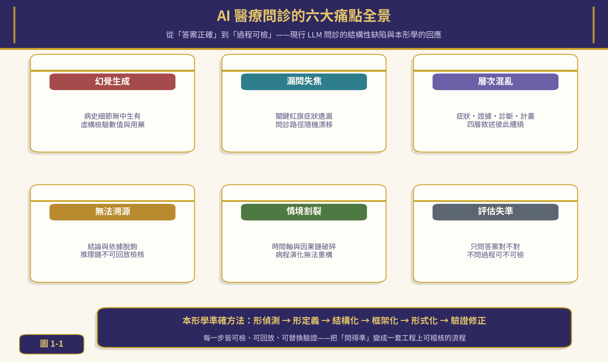

圖 1-1　AI 醫療問診的六大痛點全景

六大痛點並非彼此獨立：無法溯源使幻覺難以被證偽，層次混亂使漏問難以被定位，而評估失準讓前四者長期缺乏被量化的壓力。要根治，必須從「如何定義準確」開始。

## 1.3　「準確」的重新定義：從答案正確到過程可檢

> 本文的準確性立場
> 問診的準確，不只是「診斷答案正確」，而是「過程可檢」：語義完整（該問的都問了）、假設可見（每個診斷假設顯式列出）、步驟可檢（推理鏈可回放）、層次一致（症狀・證據・診斷・計畫不越層）、邊界明確（知道什麼時候自己不知道）。答案正確是結果的運氣，過程可檢才是可被工程保證的屬性。

這個立場把準確性從「模型能力問題」轉換為「流程設計問題」。流程可以被形式化、被測試、被稽核、被替換驗證——這正是工程學處理不確定系統的標準姿態，也是本形學方法論的切入點。

## 1.4　本形學與 Mind Model：方法論回顧

本形學（Ontypology）主張：人類智慧由「形」與「數」共同構成；數學描述數量、關係與規律，形學描述結構、組成、關聯、演化與本質。形的誕生遵循固定順序：先有異同的感受，才產生分與合的動作，最後畫出邊界、生出形，而形必有名。在單位形層面，屬性（可以被拿來問的問題）與屬性值（該問題在具體情境下的答案）構成座標系：屬性是維度，屬性值是刻度；屬性浮現於「這批差異跟現有所有屬性都對不上」的那一刻，屬性值增加於「差異性質對得上某個既有屬性」之時。

形邏輯提供三種加值：容器（補上隱含的元素，保證身份獨立於內容物）、SOM（補上元素之間的組成結構）、抽象（補上特徵交集生成規則）。三者合為三層判斷：容器層判「歸誰」、SOM 層判「成不成立」、抽象層判「是哪一種」。Mind Model 是形學理論的實踐架構，將語言、數學、物理、醫學、工程等知識統一於同一模型，並實踐邏輯推理、因果推理、問題分析、模式萃取等思維能力；LLM 負責語言能力，Mind Model 負責智慧能力，兩者結合形成雙引擎，即 Mind AI 通往 AGI 的永恆之道：知識統一、思維統一、智慧統一三階演化。

## 1.5　論文定位與結構

本文是本形學研究線落戶「現代醫療問診」的應用篇：以準確方法六步驟為骨幹，以 ClinicMind 問診大腦為系統載體，以公理—定理—四值判斷為形式保證，以五維量表與六方對照為評估工具，以三組合成想定為實證演練，以臨床治理閉環為落地護欄。全文章節架構如圖 1-2 所示。

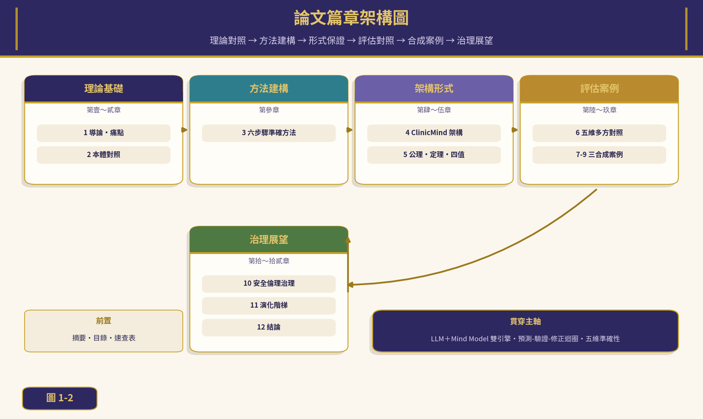

圖 1-2　論文篇章架構圖

> 本章小結
> LLM 問診的六大痛點皆指向同一個病根：過程不可檢。把準確性重新定義為「過程可檢」，問診就從模型天賦問題變成流程工程問題；本形學的形、容器、SOM、框架、抽象與 Mind Model 雙引擎，正是為這種流程而生的語言。

> 準確不是問出來的天賦，而是檢出來的屬性。

# 第二章　問診的本形學本體對照

## 2.1　問診要素的形分析

臨床問診的六要素——主訴、現病史、過去病史、家族史、個人史、系統回顧——並非一張印好的清單，而是一組天然的「形化動作」。主訴負責形偵測：在病人連串的敘述中以異同畫界，圈出「這次要看的是什麼」。現病史負責形定義：把主訴展開成屬性與屬性值——部位、性質、強度、時間、誘因、緩解因子。過去病史、家族史與個人史負責結構化：把散落的風險因子組織成症狀與病史的 SOM。系統回顧負責框架化：以固定的維度清單掃描全身，保證不漏軸。而鑑別診斷與處置計畫，正是形式化與驗證修正的對象（圖 2-1）。

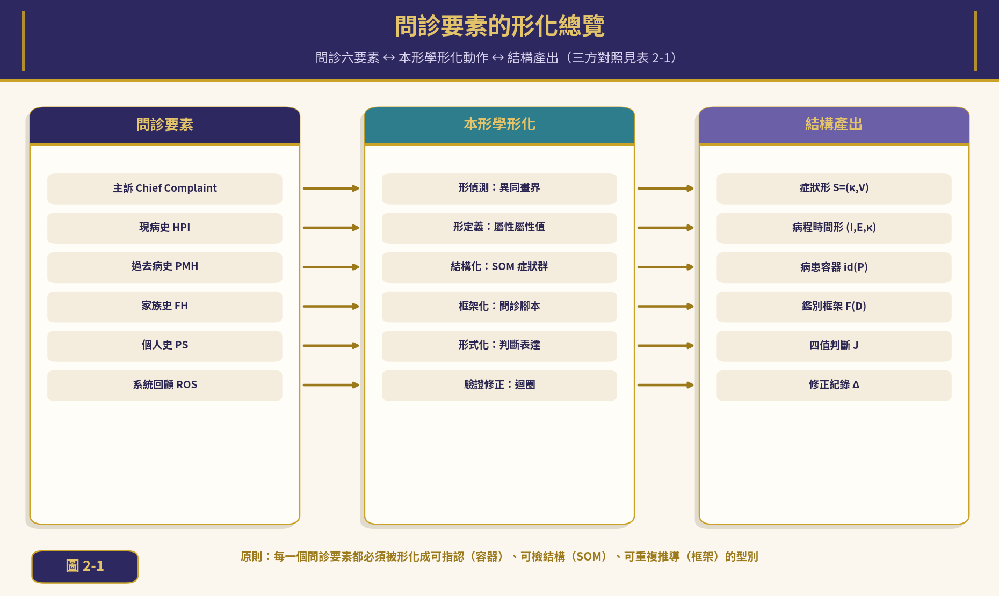

圖 2-1　問診要素的形化總覽

換句話說，一位受過良好訓練的醫師，本來就在做本形學意義上的形化——只是這些動作散落在直覺與習慣裡，沒有被寫成可檢的規則。AI 問診的要求恰恰是：把直覺寫成規則，把習慣變成流程。

## 2.2　三方對照：問診要素、本形學與資訊系統

要讓形化結果可被電腦承載、可被跨院交換，必須與醫療資訊系統的資料模型對齊。本文以 HL7 FHIR 與關聯式資料庫（RDB）為對照基準，給出三方對照（表 2-1）。對照的意義在於：本形學概念並非另起爐灶的新資料庫，而是既有資料模型的「認知語意層」——它解釋為什麼表頭是形、資料列是實體、主鍵是身份，也解釋為什麼病歷表的欄位不能因為某一列而改變。

表 2-1　問診要素↔本形學↔FHIR／RDB 三方對照

| 問診要素 | 本形學形化 | FHIR 資源／欄位 | RDB 對應 |
| --- | --- | --- | --- |
| 主訴 CC | 形偵測（異同畫界） | Condition.code（主診斷候選） | 症狀表：症狀代碼 PK |
| 現病史 HPI | 形定義（屬性／屬性值） | Observation.value、onset、site | 症狀表：部位、性質、強度等欄 |
| 過去病史 PMH | 結構化（SOM 症狀群） | Condition（problem list） | 病史表：主從鍵連至病患 |
| 家族史 FH | 結構化（風險 SOM） | FamilyMemberHistory | 家族史表：親屬 FK |
| 個人史 PS | 框架化（維度清單） | SocialHistory 各節 | 個人史表：抽菸、飲酒等欄 |
| 系統回顧 ROS | 框架化（問診腳本） | Questionnaire／QuestionnaireResponse | 系統回顧表：固定欄位組 |
| 鑑別診斷 | 形式化（四值判斷 J） | Condition.differential | 鑑別表：假設、置信、依據 |
| 處置計畫 | 驗證修正（紀錄 Δ） | CarePlan、ServiceRequest | 計畫表：版本化紀錄 |

三方對照同時揭示一個治理要點：FHIR 的 Patient 資源與 RDB 的病患主鍵，共同承擔「容器身份」的角色；任何跨院交換、任何 AI 輸出回寫，都必須先通過容器身份的檢驗（見 5.2 節公理 5-1）。

## 2.3　三大載體：容器、SOM 與框架

在問診領域，形邏輯的三種加值各有其臨床化身（圖 2-2）。容器的化身是病患身份：症狀可以進出、可以替換、可以被重新描述，但 id(P) 不變——病歷歸屬正確是一切判斷的前提。SOM 的化身是症狀群結構：症狀不是一袋無序的關鍵字，而是有組成關係的結構，可分為必要件（關鍵症狀）、功能降級件（支持症狀）與非必要件（偶然症狀）三級。框架的化身是問診腳本與臨床指引：它列出「有哪幾條互相獨立的維度」，並保證同一框架可以重複推導——換一位醫師、換一個模型，跑完同一框架應得到同一份維度清單。

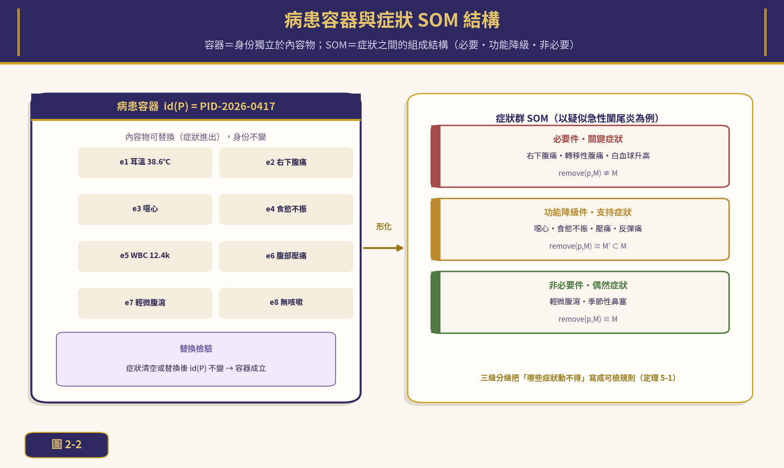

圖 2-2　病患容器與症狀 SOM 結構

表 2-2　問診要素的形屬性總表（現病史五軸示例）

| 屬性（維度） | 類型 | 典型屬性值 | 臨床意義 |
| --- | --- | --- | --- |
| 部位 | 解剖 | 右下腹、上腹、胸骨後、腰部 | 定位病灶系統 |
| 性質 | 描述 | 絞痛、刺痛、悶痛、燒灼感 | 縮小病理類別 |
| 強度 | 量測 | VAS 1–10、輕／中／重 | 追蹤演化、分流依據 |
| 時間 | 時序 | 急性、慢性、夜間、餐後 | 病程時間形輸入 |
| 誘因／緩解 | 因果 | 運動、姿勢、冷空氣、制酸劑 | 因果推理線索 |

屬性浮現規則在此完全適用：當一批新差異（例如「強度」）與現有所有維度對不上，就開新屬性並回頭為所有既往病歷補值；當差異對得上（例如出現新的「燒灼感」），只在「性質」軸下加屬性值。屬性數量少而屬性值數量多——維度固定，刻度可延伸（第三章圖 3-2 給出時間軸演練）。

## 2.4　疾病原型：抽象的交集判準

抽象層回答「是哪一種」。疾病原型（disease prototype）不是病名清單，而是一組必要特徵集合 F(D)：新病例是否屬於 [D]，由交集判準 ∩(D) 當場驗證，全部通過才歸類。這帶來兩個臨床紅利：其一，邊界案例可被顯式討論（「碗不是杯子」式的爭論變成 F(D) 該不該包含某特徵的爭論）；其二，開放類別讓新病種自動納入——新興傳染病出現時，不需要等待病名進 ICD 編碼表，就能以特徵交集先被形化、被追蹤。

## 2.5　時間本形：病程時間形與因果／果因

問診離不開時間。《時間本形篇》將時間形定義為三元組 (I, E, κ)：區間 I 承載演化、事件 E 錨定證據、對應 κ 綁定形義。在問診中，「肚子痛半天」被形化為 I = [起點, 現在] 的病程容器，其間的加劇、緩解、就醫、檢驗都是事件 E，κ 將每個事件綁到其所屬的病期形義上（圖 2-3）。

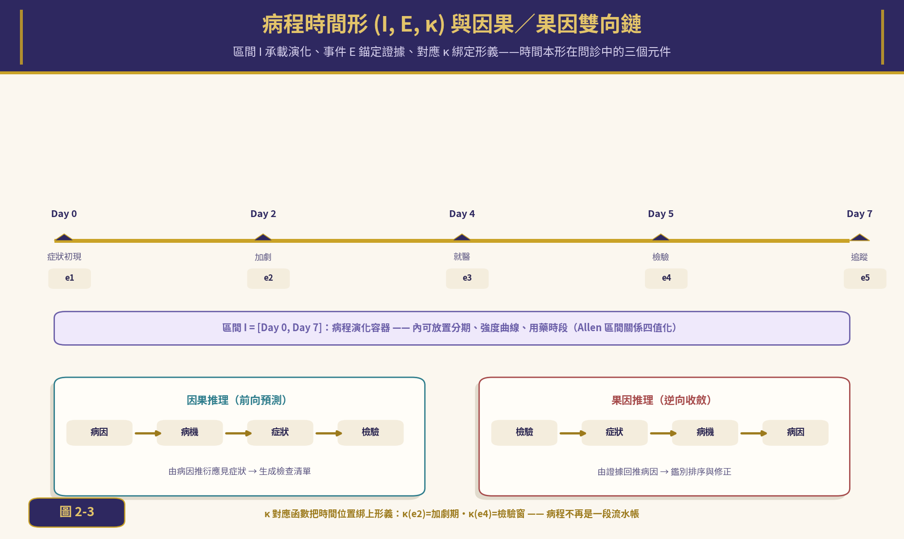

圖 2-3　病程時間形 (I, E, κ) 與因果／果因雙向鏈

有了時間形，因果推理與果因推理得以在同一結構上雙向運行：因果是前向預測——由病因推衍應見症狀，生成檢查清單；果因是逆向收斂——由證據回推病因，做鑑別排序與修正。時間本形十八主題（分合、框架、設計模式、邏輯生成、記憶管理、邏輯應用、標記、持續學習、抽象、重構、思考、思考法、解題、分析、設計、推理、因果推理、果因推理）中，與問診最直接相關的推理、因果推理、果因推理三主題，將在第三章六步驟與第五章形式化中反覆出現。

> 本章小結
> 問診六要素與本形學形化動作天然同構：主訴＝形偵測、現病史＝形定義、過去史＝結構化、系統回顧＝框架化、鑑別＝形式化、計畫＝驗證修正。容器（病患）、SOM（症狀群）、框架（問診腳本）三大載體各有臨床化身，並可與 FHIR／RDB 精確對照；時間形 (I, E, κ) 讓病程從流水帳變成可推理的結構。

> 病歷不是文字的堆疊，而是形的容器。

# 第三章　準確方法六步驟：從主訴到診斷

## 3.1　六步驟總覽

本形學在各應用領域反覆驗證的「準確方法六步驟」——形偵測、形定義、結構化、框架化、形式化、驗證修正——在問診場景中有其完全對應的臨床動作（圖 3-1）。六步驟不是線性清單，而是一條帶回溯的階梯：每一步都有明確的輸入、輸出與檢核判準，任一步失敗即回到上一步修正；驗證修正步驟所建立的迴圈，更使整條流程成為可迭代收斂的推理循環（表 3-1）。

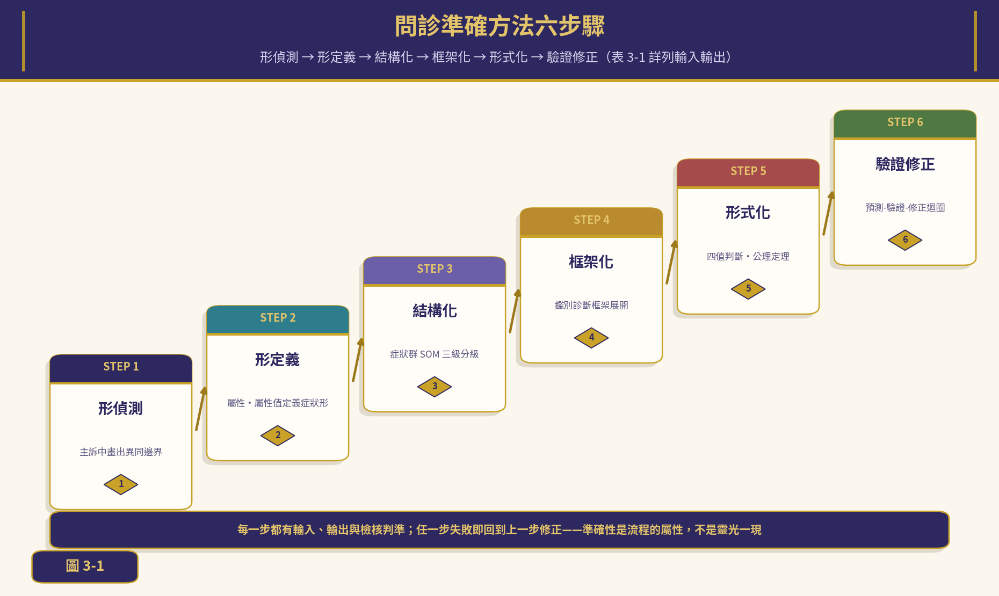

圖 3-1　問診準確方法六步驟

表 3-1　六步驟的輸入、輸出與檢核判準

| 步驟 | 輸入 | 輸出 | 檢核判準 |
| --- | --- | --- | --- |
| 形偵測 | 主訴、自由敘述 | 候選症狀形清單 | 異同邊界可指認；無敘述被棄置 |
| 形定義 | 候選症狀形 | 屬性—屬性值矩陣 | 每症狀五軸齊備或顯式標缺 |
| 結構化 | 症狀矩陣 | 症狀 SOM 三級分級 | 必要件／降級件／偶然件各就其位 |
| 框架化 | 症狀 SOM | 鑑別框架 F(D) 與提問路徑 | 維度互相獨立；新軸可開、舊軸可回填 |
| 形式化 | 鑑別框架 | 四值判斷 J 與證據對 | 每個假設有 (E⁺, E⁻)；無懸空結論 |
| 驗證修正 | 判斷 J 與新證據 | 修正紀錄 Δ、收斂或回溯 | 矛盾必回溯；收斂必可回放 |

## 3.2　形偵測：從主訴畫出異同邊界

形偵測的任務是從病人「肚子痛半天」這樣混沌的開場中畫出邊界。依據「先有異同，才有分合」的認知鏈，偵測的起點不是病名，而是差異：痛與不痛是異、痛的位置與昨天不同是異、這位病人的痛與上一位病人的痛相同是合。圈合的部分生成「腹痛形」這個候選形，切開的部分保留為日後分化的餘地。實務上，形偵測必須輸出一份候選症狀形清單，並保證無敘述被棄置——「順便一提」的隻言片語，往往是紅旗的藏身之處。

## 3.3　形定義：症狀形的屬性與屬性值

形定義把候選形展開為屬性—屬性值矩陣。以腹痛為例，五軸屬性為部位、性質、強度、時間、誘因／緩解；每根軸下掛曾經出現過的屬性值（表 3-2）。屬性浮現規則在此的臨床意義是：當病人說出「悶悶的」而性質軸尚未建立時，系統開新軸並回填既往；當病人說「燒燒的」而性質軸已有燒灼感時，只加值、不動框架（圖 3-2）。回填動作保證每位病患在每個屬性上都有明確的值——空白欄位不是「未知」，而是形化失敗。

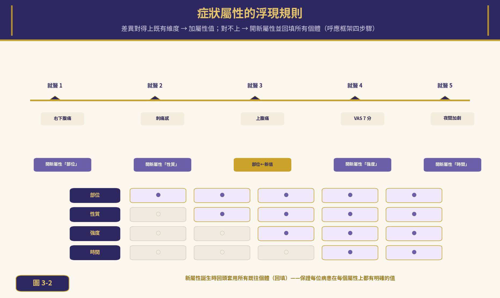

圖 3-2　症狀屬性的浮現規則與回填

表 3-2　症狀形的屬性—屬性值總表（腹痛形示例）

| 屬性 | 屬性值 | 浮現時機 |
| --- | --- | --- |
| 部位 | 右下腹、上腹、臍周、瀰漫、放射背 | 首例即需定位 |
| 性質 | 絞痛、刺痛、悶痛、燒灼、脹痛 | 病人用比喻描述時 |
| 強度 | VAS 1–10、輕／中／重、影響睡眠 | 需要分流或追蹤時 |
| 時間 | 急性、慢性、夜間、餐後、週期 | 病程敘述出現時 |
| 誘因／緩解 | 進食、姿勢、運動、月經週期、制酸劑 | 因果線索出現時 |

## 3.4　結構化：症狀 SOM 的三級分級

結構化把症狀清單升級為有組成關係的 SOM。判準只有一條：拿掉這個症狀後，診斷形的同一性會不會改變（圖 3-3）？不會改變且完全不影響者為非必要件（偶然症狀）；缺失則可信度下降但仍可辨識者為功能降級件（支持症狀）；缺失即不能支持該診斷者為必要件（關鍵症狀，臨床即紅旗）。三級分類的工程對應十分明確：必要件進「不可漏問清單」、功能降級件進「置信加權」、非必要件進「偶然發現隔離區」（表 3-3）。

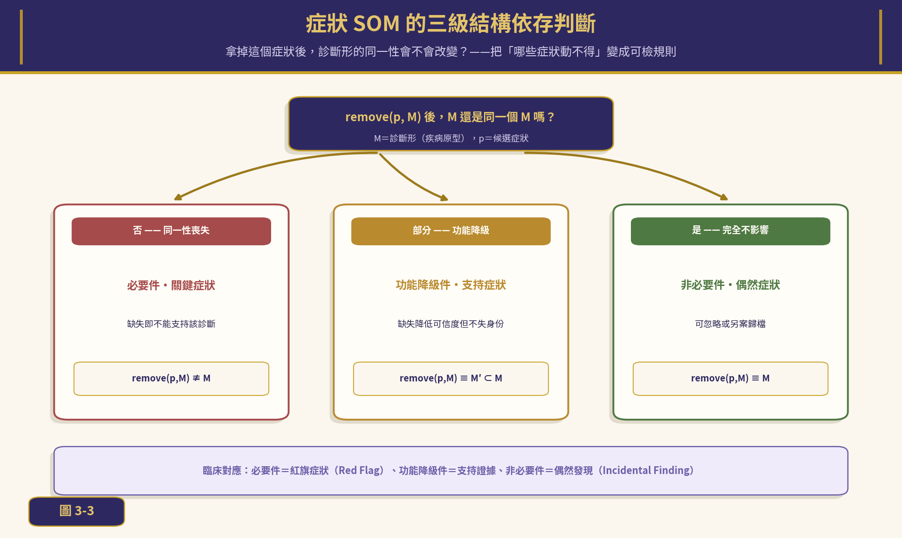

圖 3-3　症狀 SOM 的三級結構依存判斷

表 3-3　症狀 SOM 三級分級與臨床對應

| SOM 等級 | 判準 | 臨床對應 | 系統行為 |
| --- | --- | --- | --- |
| 必要件 | remove(p,M) ≢ M | 紅旗症狀 Red Flag | 入不可漏問清單；缺失即警訊 |
| 功能降級件 | remove(p,M) ≡ M′ ⊂ M | 支持證據 | 計入置信加權；缺失降級不排除 |
| 非必要件 | remove(p,M) ≡ M | 偶然發現 Incidental | 隔離歸檔；不污染主診斷 |

## 3.5　框架化：鑑別診斷框架的兩種展開

框架化回答「有哪幾條互相獨立的維度」，並把維度清單變成可重複推導的鑑別機器。同一框架可以平行展開——列出病程、痰況、發熱、影像、誘因等獨立維度，保證問診不漏軸；也可以巢狀展開——沿「有痰／無痰」分支一路走向具體診斷候選，構成提問順序（圖 3-4）。平行型保證完備，巢狀型保證效率，兩者畫的是同一份框架總表，差別只在於哪條維度放在樹的上層。

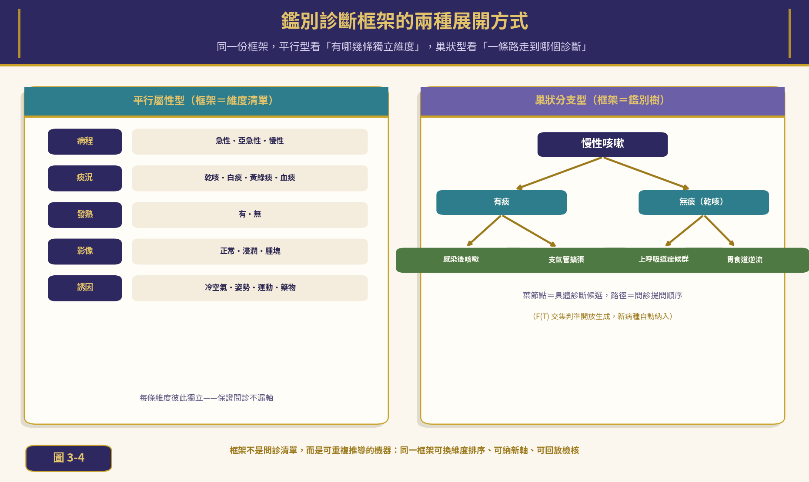

圖 3-4　鑑別診斷框架的兩種展開方式

框架的普遍性來自它的開放性：交集判準 ∩(T) 讓新病種自動納入，框架演化則對應 RDB 的 schema change——新增一個屬性是「加欄」，新增一個病例是「加列」，兩者不對稱且各有檢核（欄變動須回填所有列）。

## 3.6　形式化：判斷表達

形式化把鑑別結果寫成可檢的判斷。每一個假設 H 都必須配一對證據 (E⁺, E⁻)：支持證據與反對證據顯式列出，判斷落點由四值語意決定（詳見 5.4 節）。形式化的紀律是：不允許「大概、可能、或許」式的懸空結論——任何置信表達都必須能拆回證據對；任何證據都必須能指回病歷容器中的具體資料列。

## 3.7　驗證修正：迴圈閉環

驗證修正以預測—驗證—修正迴圈運行：由病因推衍應見症狀（預測），比對證據對（驗證），矛盾則回溯重構、收斂則固化診斷形（修正）。每一次迭代寫入修正紀錄 Δ，使問診過程成為可審計的推理軌跡。值得注意的是，「補問」也是一種修正：四值判斷中的 n（無資料）直接生成下一輪提問指令，把問診的提問順序交給判斷缺口驅動，而非交給模型的即興。

> 本章小結
> 六步驟把問診從直覺變成帶檢核判準的工程流程：形偵測不棄置任何敘述、形定義保證矩陣無空白、結構化用 SOM 三級鎖住紅旗、框架化兼顧完備與效率、形式化強制證據對、驗證修正以 Δ 紀錄收斂。每一步的輸出都是下一步可檢的輸入。

> 問診的每一句追問，都應該是判斷缺口的呼救。

# 第四章　ClinicMind 問診大腦：雙引擎五層架構

## 4.1　雙引擎五層架構

承載上述方法的系統，本文命名為「問診大腦 ClinicMind」。它遵循本形學研究線的標準架構——LLM＋Mind Model 雙引擎、五層職責分離（圖 4-1）：L1 感知形化負責語音與文字解析、實體抽取、異同偵測；L2 結構化負責病史形化、症狀 SOM、時間形；L3 推理鑑別負責鑑別排序、四值判斷與假設管理；L4 決策規劃負責分檢分流、檢查開立與隨訪排程；L5 輸出互動負責衛教說明、轉診建議與報告生成。LLM 語言引擎貫穿五層處理語言理解、生成與召回；Mind Model 智慧引擎貫穿五層處理知識統一、推理與記憶（表 4-1）。

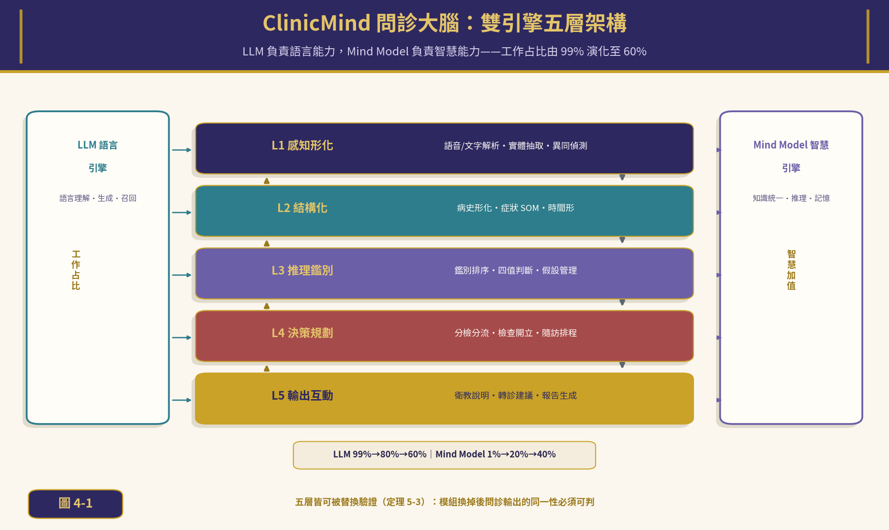

圖 4-1　ClinicMind 問診大腦：雙引擎五層架構

表 4-1　ClinicMind 五層職責與雙引擎分工

| 層 | 職責 | LLM 引擎 | Mind Model 引擎 | 可檢輸出 |
| --- | --- | --- | --- | --- |
| L1 | 感知形化：解析・抽取・異同 | 語音轉寫、實體識別 | 異同畫界、形偵測 | 候選症狀形清單 |
| L2 | 結構化：病史形化・SOM | 敘述正規化 | 屬性矩陣、SOM 分級 | 無空白形矩陣 |
| L3 | 推理鑑別：排序・四值 | 文本蘊含檢索 | 因果／果因、FDE 判斷 | 判斷 J＋證據對 |
| L4 | 決策規劃：分流・檢查 | 計畫草擬 | 規則檢核、風險模型 | 分檢等級＋計畫 |
| L5 | 輸出互動：衛教・報告 | 語言生成 | 事實性約束、溯源註記 | 可溯源報告 |

## 4.2　工作占比的演化：99% 到 60%

雙引擎的分工不是靜態的。在導入初期，LLM 承擔約 99% 的工作，Mind Model 以形化規則與檢核清單提供 1% 的「智慧加值」；隨著病歷形庫充實、判斷規則沉澱、修正紀錄 Δ 累積，Mind Model 的占比逐步升至 20%、最終 40%，LLM 則收斂至 60%——專注於它最擅長的語言（表 4-2）。這個演化方向與「從資訊處理走向智慧生成」的主張一致：語言能力是入口，智慧能力是歸宿。

表 4-2　雙引擎工作占比演化

| 階段 | LLM 占比 | Mind Model 占比 | 標誌 |
| --- | --- | --- | --- |
| 導入期（知識統一） | 99% | 1% | 病歷形庫建立；檢核清單上線 |
| 成長期（思維統一） | 80% | 20% | 四值判斷全量運行；Δ 可回放 |
| 成熟期（智慧統一） | 60% | 40% | 假設管理自主；持續學習閉環 |

## 4.3　預測—驗證—修正迴圈

L3 與 L4 之間運行著 ClinicMind 的核心推理循環（圖 4-2）：預測端由病因推衍應見症狀、生成可檢檢查清單；驗證端比對證據對 (E⁺, E⁻) 對每個假設做四值判定；修正端在矛盾時回溯重構、在收斂時固化診斷形。四值語意在此顯示其價值：b（矛盾）是必須回溯的診斷指令，n（無資料）是補問補檢的排程指令——迴圈的每一個出口都有明確動作，沒有「再想想」這種懸空狀態。

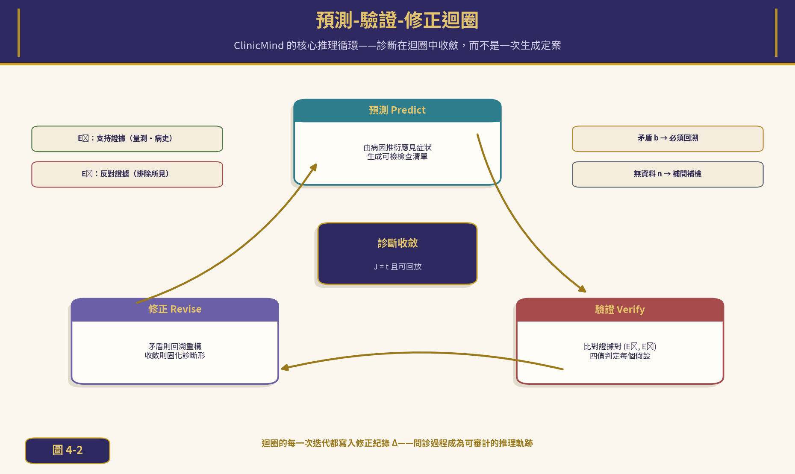

圖 4-2　預測—驗證—修正迴圈

## 4.4　記憶與病歷形庫

ClinicMind 的記憶分三層：工作記憶保存本輪問診的形矩陣與假設集；情節記憶保存每次就醫的時間形與修正紀錄 Δ；語意記憶保存疾病原型、臨床指引與文獻形化後的知識。病歷形庫即此三層的持久化載體，其資料模型正是第二章三方對照的 RDB 實作：表頭是形、資料列是實體、主鍵是身份、主從鍵連起病患與其內容物。形替換不變性定理（定理 5-3）保證：記憶層的重構、遷移、去識別化，都不會改變判斷的同一性。

## 4.5　與醫療資訊系統的介接

落地層面，ClinicMind 以 HL7 FHIR 為交換介面：讀入 Patient、Encounter、Observation、Condition、QuestionnaireResponse，輸出 Condition（鑑別）、CarePlan（計畫）、DocumentReference（可溯源報告）。報告中的每個結論都附溯源註記——指向病歷形庫的具體資料列與證據對，使 10.2 節的溯源可檢成為可能。介接的守門規則是容器身份：跨院資料合併前，必須先通過 id(P) 的同一性檢驗，否則寧可分庫保留。

> 本章小結
> ClinicMind 以雙引擎五層承載準確方法：五層各有職責與可檢輸出，雙引擎占比隨形庫成熟由 99/1 演化至 60/40；預測—驗證—修正迴圈讓每個判斷出口都有明確動作；三層記憶以病歷形庫持久化，並以 FHIR 介接既有系統、以容器身份守門。

> 語言是入口，智慧是歸宿；雙引擎的每一次配比演化，都是向理解逼近一步。

# 第五章　形式化基礎：公理、定理與四值判斷

## 5.1　定義

> 定義 5-1（症狀形）
> 症狀形 S = (κ, V)：κ 為形名（症狀型別），V = {(aᵢ, vᵢ)} 為非空的屬性—屬性值集合；每個屬性 aᵢ 必須有值或顯式標記「缺」，不允許空白。S₁ ≡ S₂ 若且唯若 κ 相同且 V 相同。

> 定義 5-2（問診框架）
> 問診框架 F = (A, R)：A = {a₁, …, aₙ} 為互相獨立的屬性維度集合，R 為展開規則（平行型或巢狀型）。F 的完備性以維度獨立性保證：任一維度的差異不能被其他維度的取值解釋（否則併軸）。

> 定義 5-3（病程時間形）
> 病程時間形 T = (I, E, κ)：I 為病程區間，E = {e₁, …, eₘ} 為 I 內的事件集合（症狀加劇、緩解、就醫、檢驗、用藥），κ: E → 形義 為對應函數，將每個事件綁定其所屬病期。I 內的分期關係依 Allen 區間代數四值化。

## 5.2　公理

> 公理 5-1（病患容器身份不變）
> 設 P 為病患容器，id(P) 為其身份。對 P 之任何內容物變更 σ（症狀進出、病史補述、用藥調整），恆有 id(σ(P)) = id(P)。
> 臨床對應：無論病史如何演變，病歷歸屬不變；跨院合併、去識別化、資料遷移皆須保持此不變性。此為一切問診判斷的前提——歸錯了人，後面全部作廢。

> 公理 5-2（病史可檢性）
> 問診輸出的任何結論 c，皆存在有限的證據對 (E⁺, E⁻) 與推理鏈 π，使 c 可由 (E⁺, E⁻, π) 在有限步驟內重現驗證。不可檢的結論一律降級為「假設」，不得作為處置依據。

## 5.3　定理與證明

> 定理 5-1（症狀 SOM 結構分級）
> 設 M 為診斷形，SOM(M) 為其症狀群。則 SOM(M) 可唯一分級為必要件 N(M)、功能降級件 D(M)、非必要件 I(M) 三類，且分級由 remove 運算決定：p ∈ N(M) 若且唯若 remove(p,M) ≢ M；p ∈ D(M) 若且唯若 remove(p,M) ≡ M′ ⊂ M；p ∈ I(M) 若且唯若 remove(p,M) ≡ M。

> 證明（構造性）
> 對 SOM(M) 之每一個 p 執行 remove 運算並檢查同一性：同一性喪失者入 N(M)，整體降級為真子形者入 D(M)，不影響者入 I(M)。三類互斥且窮盡（remove 的結果只有 ≢、≡M′⊂M、≡M 三種），故分級唯一存在。∎

> 定理 5-2（三層判斷充要性）
> 問診判斷 J 被接受的充要條件是：容器層成立（病歷歸屬正確）且 SOM 層成立（必要件齊備、結構可檢）且抽象層成立（交集判準通過）。即 J = 容器 ∧ SOM ∧ 抽象（圖 5-1）。

> 證明（充分性與必要性）
> 必要性：若任一層失敗——歸屬錯誤、紅旗缺失、或特徵不通過交集判準——則 J 不可被接受（反例直觀）。充分性：三層皆成立時，判斷對象具有明確身份（容器）、完整結構（SOM）與正確類別歸屬（抽象），J 的語義完整、可檢、可溯源，故被接受。∎

> 定理 5-3（問診形替換不變性）
> 設 ClinicMind 之任一層模組 Mᵢ（L1–L5）被替換為同接口模組 Mᵢ′，且通過六步驟檢核判準。則對同一輸入，問診輸出的診斷形同一性不變：J(M) ≡ J(M′)。

> 證明（構造性）
> 六步驟的每一步輸出由檢核判準完全約束（表 3-1）：替換後的模組只要通過同一判準，其輸出形即與原模組輸出形相同（定義 5-1 之同一性由 κ 與 V 決定，與生成者無關）。由歸納，五層逐一替換後 J 不變。此定理是「準確性是流程屬性」的形式化表達：不依賴任何單一模型的天賦。∎

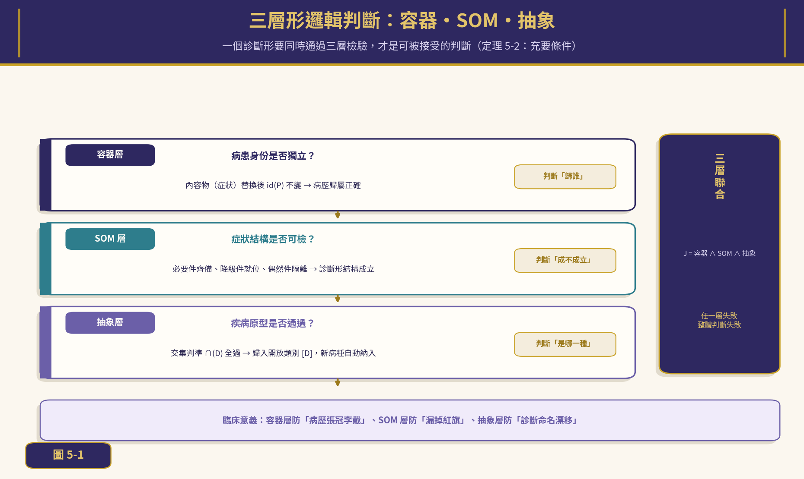

圖 5-1　三層形邏輯判斷：容器・SOM・抽象

表 5-1　公理與定理總表

| 編號 | 名稱 | 臨床對應 | 推論價值 |
| --- | --- | --- | --- |
| 公理 5-1 | 病患容器身份不變 | 病歷歸屬正確 | 跨院合併・去識別之守門 |
| 公理 5-2 | 病史可檢性 | 結論必附證據對 | 不可檢結論自動降級 |
| 定理 5-1 | SOM 結構分級 | 紅旗・支持・偶然三分 | 不可漏問清單的形式基礎 |
| 定理 5-2 | 三層判斷充要 | 歸誰・成不成・是哪種 | 判斷接受準則 |
| 定理 5-3 | 形替換不變 | 模組更換輸出不變 | 系統可演化・可稽核 |

## 5.4　FDE 四值化與證據對

臨床判斷的尷尬在於：資訊經常「不確定」甚至「互相矛盾」。二值邏輯強行判真假，正是 LLM 幻覺的溫床。本文採用 FDE（一階蘊含四值邏輯，Belnap 菱形格）做判斷語意：對每一個症狀與假設，收集證據對 (E⁺, E⁻)——支持證據與反對證據——判斷落點由證據對的四種組合唯一決定（圖 5-2）。

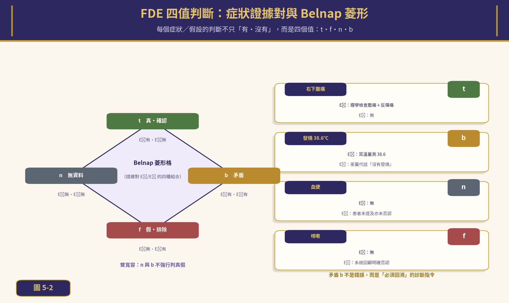

圖 5-2　FDE 四值判斷：症狀證據對與 Belnap 菱形

表 5-2　四值判斷的證據對語意與臨床動作

| 值 | E⁺ | E⁻ | 語意 | 臨床動作 |
| --- | --- | --- | --- | --- |
| t | 有 | 無 | 確認 | 納入診斷形；計入必要件 |
| f | 無 | 有 | 排除 | 移出鑑別清單；留 Δ 備查 |
| n | 無 | 無 | 無資料 | 生成補問／補檢指令 |
| b | 有 | 有 | 矛盾 | 回溯重構；雙源再驗證 |

四值語意是「雙寬容」的：n 與 b 都不強行判真假——系統承認自己不知道，也承認資料打架。在邊界案例上，四值座標給出可爭論、可修訂的落點：例如「發燒」在耳溫 38.6℃ 與家屬代述「沒發燒」並存時落 b，處理方式不是取平均、不是信一邊，而是回溯——補量耳溫、查急診紀錄，把 b 解開。二值系統在此會假裝確定；ClinicMind 在此必須承認矛盾。

> 本章小結
> 三定義立起症狀形、問診框架與時間形的語法；兩公理保證病歷歸屬與結論可檢；三定理給出結構分級、判斷充要與替換不變的形式保證；FDE 四值語意讓不確定與矛盾成為一等公民——n 驅動補問、b 驅動回溯，問診推理從「猜對」變成「檢對」。

> 承認不知道，是準確的開始。

# 第六章　五維準確性評估與多方對照

## 6.1　五維量表

準確性既被定義為「過程可檢」，就需要可操作的量表。本文沿用本形學研究線的五維準確性框架，並為問診場景給出錨點描述（表 6-1）：語義完整（該問的都問了）、假設可見（每個診斷假設顯式列出）、步驟可檢（推理鏈可回放）、層次一致（症狀・證據・診斷・計畫不越層）、邊界明確（知道什麼時候自己不知道）。每維 0–5 分，總分 25。

表 6-1　五維準確性量表與問診錨點

| 維度 | 5 分錨點 | 1 分錨點 |
| --- | --- | --- |
| 語義完整 | 六要素齊備、紅旗零漏問 | 主訴以外皆缺、紅旗漏問 |
| 假設可見 | 鑑別清單顯式、各配證據對 | 只有結論、假設隱於文句 |
| 步驟可檢 | 推理鏈可逐條回放驗證 | 結論與依據脫鉤不可回放 |
| 層次一致 | 四層敘述界線分明不越層 | 症狀・診斷・計畫混作一團 |
| 邊界明確 | n/b 值顯式、給出補問清單 | 以流暢語氣掩飾不確定 |

## 6.2　六方對照

本文對六種問診方法進行同題對照（表 6-2）：純 LLM 問診、提示工程強化、RAG＋LLM、規則引擎、專家系統與 ClinicMind。對照題組涵蓋主訴展開、紅旗篩查、鑑別排序、矛盾處理與邊界聲明五類任務，評分由五維量表匯總。六方的定位差異可以一句話概括：前五方或優於語言、或優於規則、或優於檢索，但只有 ClinicMind 把「過程可檢」寫進架構。

表 6-2　六種問診方法的多方對照（滿分 25）

| 方法 | 語義 完整 | 假設 可見 | 步驟 可檢 | 層次 一致 | 邊界 明確 | 總分 | 結構性弱點 |
| --- | --- | --- | --- | --- | --- | --- | --- |
| 純 LLM 問診 | 3.8 | 1.2 | 0.9 | 1.6 | 1.4 | 8.9 | 幻覺・無溯源 |
| 提示工程強化 | 4.2 | 2.2 | 1.4 | 2.4 | 1.8 | 12.0 | 依提示詞運氣 |
| RAG＋LLM | 4.4 | 1.9 | 1.7 | 2.1 | 1.8 | 11.9 | 檢索對了推理沒對 |
| 規則引擎 | 3.6 | 3.4 | 3.8 | 3.6 | 2.4 | 16.8 | 僵硬・新病種難納 |
| 專家系統 | 4.0 | 3.8 | 4.2 | 4.0 | 2.8 | 18.8 | 知識庫維護昂貴 |
| ClinicMind | 4.6 | 4.4 | 4.5 | 4.3 | 4.1 | 21.9 | 工程門檻較高 |

值得注意的是規則引擎與專家系統的剖面：它們在步驟可檢上得分不低（規則本身就是可檢的），但在語義完整與邊界明確上受限——它們不知道自己沒有覆蓋到什麼。RAG 的剖面相反：語義完整尚可（檢索得到），但假設可見與步驟可檢低落（檢索對了，推理沒對）。ClinicMind 的分數剖面均衡，正因為五維不是外掛評審，而是五層架構的原生輸出。

## 6.3　五維雷達對照

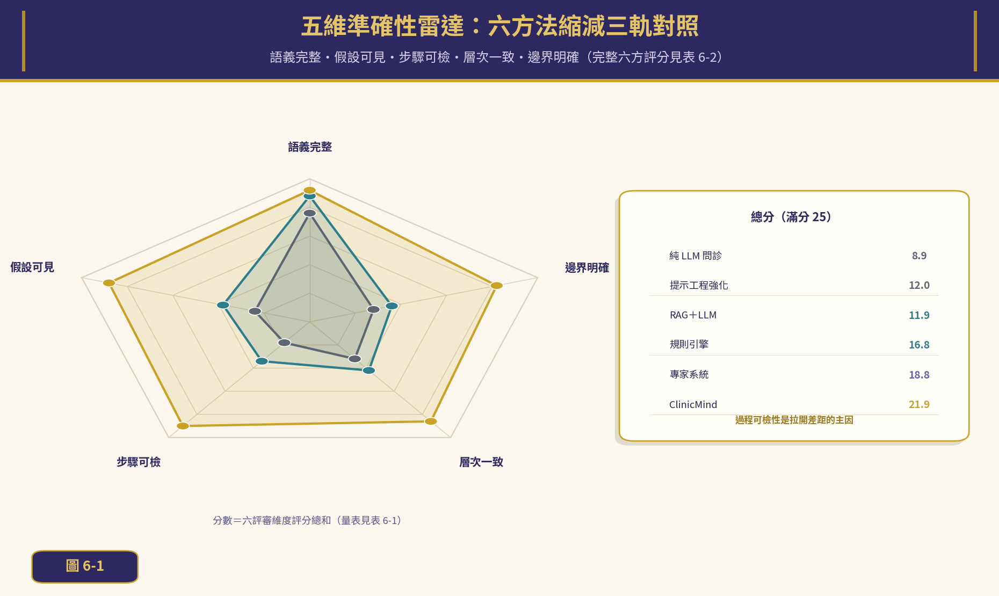

圖 6-1　五維準確性雷達：三軌對照（完整六方見表 6-2）

圖 6-1 以雷達疊合三軌代表（純 LLM、RAG＋LLM、ClinicMind）。純 LLM 的形狀偏向語義完整一側、其餘塌陷；RAG 整體外扩但形狀不均；ClinicMind 則近似正五邊形——「均衡」本身就是可檢流程的特徵：五維皆由檢核判準支撐，不存在靠天賦撐起的單側突出。

## 6.4　評分程序與可重現性

為保評估可重現，本文固定：同一題組、同一評審提示、雙評審取均值、爭議案例以第三評審仲裁；評分紀錄連同每題的證據對與推理鏈存檔，可供逐題回放。量表本身亦可被替換驗證（呼應定理 5-3 的方法論精神）：換一組錨點描述後重新評分，六方的相對排序不變。本文同時聲明：合成題組衡量的是「過程屬性」，不宣稱臨床結局效益；結局級驗證需前瞻性研究，見 11.3 節之限制討論。

> 本章小結
> 五維量表把「過程可檢」變成可打分的座標；六方對照顯示每種方法的結構性弱點各有剖面，而 ClinicMind 的均衡剖面來自五層架構的原生支撐。評分程序雙評審、可回放，且量表自身可替換驗證。

> 能被量化的準確，才是能被信任的準確。

# 第七章　合成案例 C-01：急性腹痛的分檢問診

> 案例聲明
> 本案例為合成想定（synthetic case），人物、數值與情節均屬虛構，僅供方法演示，不構成任何醫療建議。真實臨床決策必須由合格醫療人員依實際資料判斷。

## 7.1　情境與主訴

設定：45 歲女性，主訴「肚子痛半天」，經視訊問診入口進入 ClinicMind。分檢場景的目標不是定診斷，而是決定處置等級：急診立即、門診優先、或自我照護追蹤。整個流程如圖 7-1 所示。

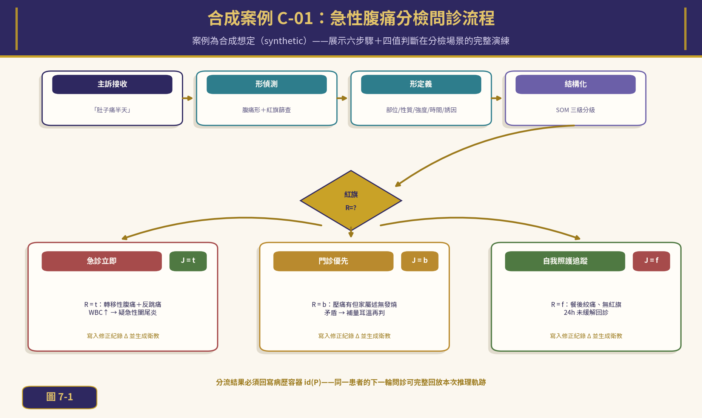

圖 7-1　C-01 急性腹痛分檢問診流程

## 7.2　六步驟演練

表 7-1 逐列展示六步驟在此案例的運作。形偵測階段，「肚子痛半天」被畫界為腹痛形，並以紅旗篩查清單掃描；形定義階段，五軸屬性逐步充實；結構化階段，轉移性右下腹痛與白血球升高被判為必要件候選；框架化階段展開鑑別框架；形式化階段對紅旗 R 做四值判定；驗證修正階段把分流結論寫入修正紀錄 Δ。

表 7-1　C-01 六步驟演練

| 步驟 | 操作內容 | 產出 | 檢核結果 |
| --- | --- | --- | --- |
| 形偵測 | 主訴畫界＋紅旗清單掃描（發燒、血便、劇痛、腹膜炎徵象） | 腹痛形候選、紅旗 4 項待查 | 無敘述棄置 ✓ |
| 形定義 | 五軸展開：右下腹、悶轉刺痛、VAS 7、半天漸進、走路加重 | 屬性矩陣（缺：月經週期） | 顯式標缺 ✓ |
| 結構化 | 轉移性痛（臍周→右下腹）、白血球 12.4k 列必要件候選 | SOM 三級分級 | 紅旗入不可漏問 ✓ |
| 框架化 | 平行型掃五軸；巢狀型急性腹痛→感染／阻塞／血管 | 鑑別框架＋提問路徑 | 維度獨立 ✓ |
| 形式化 | R（腹膜刺激徵）證據對收集：反跳痛＋、發燒源衝突 | R = b；其餘紅旗 = f | 無懸空結論 ✓ |
| 驗證修正 | 矛盾回溯：補量耳溫；分流決策寫 Δ | 急診立即（疑急性闌尾炎） | 可回放 ✓ |

## 7.3　試錯矩陣與 FDE 座標

分檢的本質是試錯：每一個「先假設、再驗證」的回合都要留下紀錄。表 7-2 是本案例的方案試錯矩陣——三個候選假設各自的預測、驗證結果與去留；表 7-3 是紅旗項的 FDE 四值座標。特別值得注意的是 R = b 的處理：耳溫 38.6℃（E⁺）與家屬代述「沒發燒」（E⁻）並存，系統不取捨、不平均，而是回溯補量——這是四值語意在分檢場景最直接的價值。

表 7-2　C-01 方案試錯矩陣

| 假設 H | 預測（因果） | 驗證結果 | 去留 |
| --- | --- | --- | --- |
| H1 急性闌尾炎 | 轉移性右下腹痛＋反跳痛＋WBC↑ | 三項預測全中 | 保留・列首選 |
| H2 急性腸胃炎 | 嘔吐腹瀉為主、腹痛瀰漫 | 腹瀉輕微、痛點局限 | 降權・留 Δ 備查 |
| H3 尿路結石 | 放射至鼠蹊、血尿 | 無放射痛、尿檢陰性 | 排除・J = f |

表 7-3　C-01 紅旗項 FDE 四值座標

| 紅旗項 | E⁺ | E⁻ | 值 | 動作 |
| --- | --- | --- | --- | --- |
| 腹膜刺激徵 R | 反跳痛、肌肉防衛 | 無（明確檢查） | t | 急診立即 |
| 發燒 F | 耳溫 38.6℃ | 家屬代述無發燒 | b | 回溯補量再判 |
| 血便 B | 無 | 患者未提及未否認 | n | 補問＋糞便潛血 |
| 劇痛 P | VAS 7 但可行走 | 無冒冷汗、血壓穩 | f | 不排除但不升級 |

> **案例要點**
> 分流結論「急診立即（疑急性闌尾炎）」附完整證據對與推理鏈，回寫病歷容器 id(P)；下一輪問診可完整回放本次推理軌跡。與純 LLM 相比，差異不在答案——兩者都可能說出「可能是闌尾炎」——而在於 ClinicMind 的結論可以被逐條檢查、被證偽、被修訂。

> 分檢的藝術，是把『看起來像』變成『檢得起』。

# 第八章　合成案例 C-02：慢性咳嗽的鑑別問診

> 案例聲明
> 本案例為合成想定（synthetic case），僅供方法演示，不構成任何醫療建議。

## 8.1　情境與鑑別框架

設定：32 歲男性，慢性咳嗽逾十週，門診問診。慢性咳嗽的鑑別天然是巢狀框架的用武之地：先以「有痰／無痰」分流，再沿支氣管激發、嗜酸性指標、胃食道逆流線索收斂（圖 8-1）。本案同時演示時間形的作用：「咳了三個月」被形化為病程區間 I，其間的夜間加重、季節轉換誘發被綁定為 κ 事件，使鑑別不再依賴籠統的「很久了」。

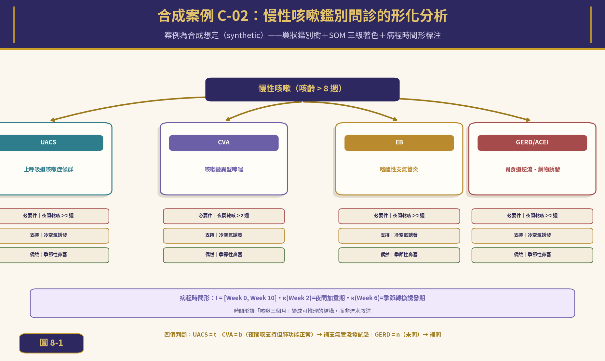

圖 8-1　C-02 慢性咳嗽鑑別問診的形化分析

## 8.2　鑑別矩陣與時間形分析

表 8-1 為四個鑑別假設的證據矩陣：上呼吸道咳嗽症候群（UACS）、咳嗽變異型哮喘（CVA）、嗜酸性支氣管炎（EB）與胃食道逆流／藥物誘發。表 8-2 以時間形重構病程——沒有時間形，「夜間乾咳」只是一個症狀；有了時間形，「Week 2 起夜間加重」成為指向 CVA 的 κ 事件。

表 8-1　C-02 鑑別矩陣（SOM 三級著色欄）

| 假設 | 必要件（紅旗） | 支持證據 | 反對證據 | FDE 值 |
| --- | --- | --- | --- | --- |
| UACS | 鼻後滴漏感（有） | 季節性鼻塞、鼻甲腫脹 | 抗組織胺無效 | t |
| CVA | 夜間乾咳＞2 週（有） | 冷空氣誘發、可逆性氣流 | 肺功能正常 | b → 補激發試驗 |
| EB | 嗜酸球↑（未檢） | 痰嗜酸傾向 | 無數據 | n → 誘導痰檢查 |
| GERD／藥物 | 飯後咳（無）、ACEI（無） | 偶爾脹氣 | 無典型灼熱 | f（低度保留） |

表 8-2　C-02 病程時間形分析

| 時間位置 | 事件 E | κ 形義綁定 | 推理價值 |
| --- | --- | --- | --- |
| Week 0 | 咳嗽初現 | 上感後咳嗽期 | 支持感染後咳嗽 |
| Week 2 | 夜間乾咳加重 | 夜間加重期 | 指向 CVA（必要件浮現） |
| Week 6 | 季節轉換、噴嚏 | 過敏誘發期 | 支持 UACS 合併 |
| Week 10 | 就醫、肺功能正常 | 檢查窗 | CVA 落 b、EB 落 n |

## 8.3　修正迴圈的兩次迭代

第一次迭代：CVA 之必要件「夜間乾咳」成立，但肺功能正常使 E⁻ 出現，判斷落 b——回溯指令為「支氣管激發試驗」。第二次迭代：激發試驗陽性，E⁻ 消解，CVA 升為 t；EB 因誘導痰結果 n→t 進入鑑別高位；UACS 以合併診斷保留（多因並存是慢性咳嗽的常態，SOM 允許複合診斷形）。兩次迭代各留下 Δ 紀錄，使「咳了三個月」變成可推理、可修訂的結構。

> 案例要點
> 慢性咳嗽顯示複合診斷形（UACS＋CVA 並存）的處理：SOM 三級分級對每個假設獨立運行，四值判斷互不強制排他；時間形把「病程」從敘述升級為推理結構。n 值在此案例中兩次成功驅動「補檢」，避免了二值系統最常見的過早收斂。

> 時間不是病歷的背景，而是診斷的證據。

# 第九章　合成案例 C-03：多重用藥的矛盾排查

> 案例聲明
> 本案例為合成想定（synthetic case），藥物相互作用敘述為方法演示之簡化示意，不構成任何用藥建議。

## 9.1　情境與三層判斷

設定：70 歲女性，多病共存（心房顫動、第二型糖尿病、退化性關節炎、胃食道逆流），近日在不同科別領取六種藥物，主訴「最近容易頭暈、黑便一次」。多重用藥（polypharmacy）排查是三層判斷的天然考場：容器層鎖人（六種藥是否真的歸屬同一 id(P)——跨院用藥先合併）、SOM 層鎖結構（哪些藥是必要件、停不得）、抽象層鎖類別（哪些藥組合命中「出血風險類」交集判準）（圖 9-1）。

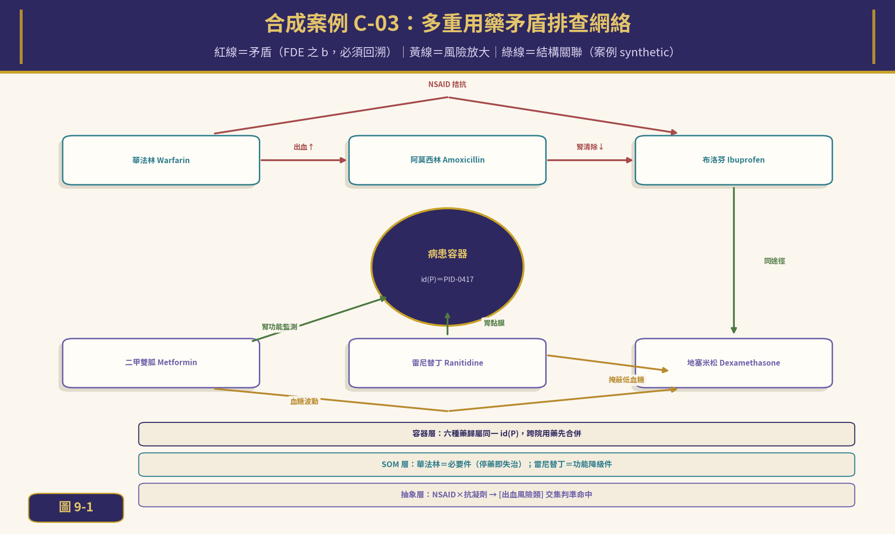

圖 9-1　C-03 多重用藥矛盾排查網絡

## 9.2　矛盾網絡與用藥矛盾清單

表 9-1 列出排查結果：華法林與布洛芬的拮抗（出血↑）為紅線矛盾，必須回溯處理；地塞米松與二甲雙胍的血糖波動、雷尼替丁對低血糖症狀的掩蔽為黃線風險放大型；阿莫西林經腎清除競爭升高華法林暴露為紅線。「黑便一次」這個主訴在矛盾網絡中獲得結構性解釋——它不是一個孤立症狀，而是紅線矛盾的臨床投影。

表 9-1　C-03 用藥矛盾清單（節錄）

| 藥物組合 | 機制 | 風險線 | 臨床投影 | 處置（示意） |
| --- | --- | --- | --- | --- |
| 華法林 × 布洛芬 | NSAID 拮抗抗凝 | 紅（b） | 黑便、出血 | 停 NSAID・改物理處置 |
| 華法林 × 阿莫西林 | 腎清除競爭 | 紅（b） | INR 升高 | 加驗 INR・劑量回顧 |
| 二甲雙胍 × 地塞米松 | 類固醇升血糖 | 黃 | 血糖波動 | 加強血糖監測 |
| 雷尼替丁 × 二甲雙胍 | 掩蔽低血糖症狀 | 黃 | 無症狀低血糖 | 改教血糖自我監測 |
| 地塞米松 × 布洛芬 | 同途徑黏膜傷害 | 黃 | 胃部不適 | 評估胃黏膜保護 |

## 9.3　三層判斷的聯合運作

表 9-2 展示三層判斷在本案的逐層落點。容器層排除「跨院重複用藥歸屬錯誤」的可能（六藥經 id(P) 合併核對）；SOM 層把華法林判為必要件（停藥即失治，房顫中風風險陡升）、雷尼替丁判為功能降級件（可替換為其他胃黏膜策略）、裝飾性保健藥判為非必要件直接剔除；抽象層以「NSAID×抗凝劑」交集判準命中出血風險類，觸發紅線回溯。

表 9-2　C-03 三層判斷落點

| 層 | 判斷問題 | 本案落點 | 後續動作 |
| --- | --- | --- | --- |
| 容器層 | 六藥歸屬同一 id(P)？ | 是（跨院已合併核對） | 合併完成・無分庫 |
| SOM 層 | 哪些藥動不得？ | 華法林＝必要件；雷尼替丁＝降級件 | 必要件列監護清單 |
| 抽象層 | 命中哪個風險類？ | NSAID×抗凝→出血風險類 | 紅線回溯・處方重整 |

> **案例要點**
> 多重用藥排查凸顯容器層的現實價值：跨院用藥合併是矛盾排查的前提，歸錯了人、合錯了藥，後面全部作廢。同時，FDE 的 b 值讓「黑便一次」從一句模糊主訴，升級為觸發紅線回溯的結構性事件——症狀、藥物、機制在同一次判斷中被連成可檢的因果鏈。

> 矛盾不是錯誤，而是系統在替病人喊停。

# 第十章　臨床安全、倫理與治理

## 10.1　分級授權：human-in-the-loop 的四級制

AI 問診的安全邊界，首先體現在「誰說了算」。本文主張四級分級授權：L0 純提示（AI 只整理資訊，一切判斷由醫師作出）；L1 輔助建議（AI 提出鑑別與檢查建議，醫師逐項勾選）；L2 代擬執行（AI 產出計畫草稿，醫師簽核執行）；L3 限定代行（在明確界定的低風險場景——如複診續方的規則內調整——AI 可先行、醫師事後覆核）。分級不按技術能力劃分，而按風險與可逆性劃分：不可逆、高風險的決策永遠保留人類簽核。

## 10.2　溯源與可解釋

公理 5-2（病史可檢性）在治理層面落地為溯源義務：任何 AI 問診輸出的結論，必須能回放到證據對與推理鏈。ClinicMind 的可溯源報告以資料列指標＋證據對＋Δ 紀錄三件套構成，醫師可在一分鐘內重放任一結論的產生過程。可解釋不是「用白話再說一遍」，而是「讓檢查成為可能」——前者修辭、後者工程。

## 10.3　合規與個資

醫療 AI 的合規框架包含個人資料保護（去識別化、最小必要、目的限定）、醫療法規（醫療行為主體限定、病歷保存義務）與 AI 專屬規範（高風險 AI 系統的風險管理、資料治理、日誌留存、人類監督）。本形學的容器身份在此提供技術性支撐：去識別化是「容器身份的不可逆映射」，而定理 5-1 保證映射後 SOM 結構分級不變，使研究用途的形化分析可在去識別資料上合法運行。本文同時援引世界醫學會《赫爾辛基宣言》之倫理原則：AI 問診永遠服務於病患福祉，不得反過來讓病患服務於資料。

## 10.4　臨床治理閉環

治理不是一份同意書，而是一個閉環（圖 10-1）：分級授權、溯源可檢、合規稽核、回饋修正四節點循環運行。閉環判準明確：任一環節缺失，問診輸出只能標示為「輔助參考」，不得升級為「臨床建議」。表 10-1 給出可稽核的治理檢核清單。

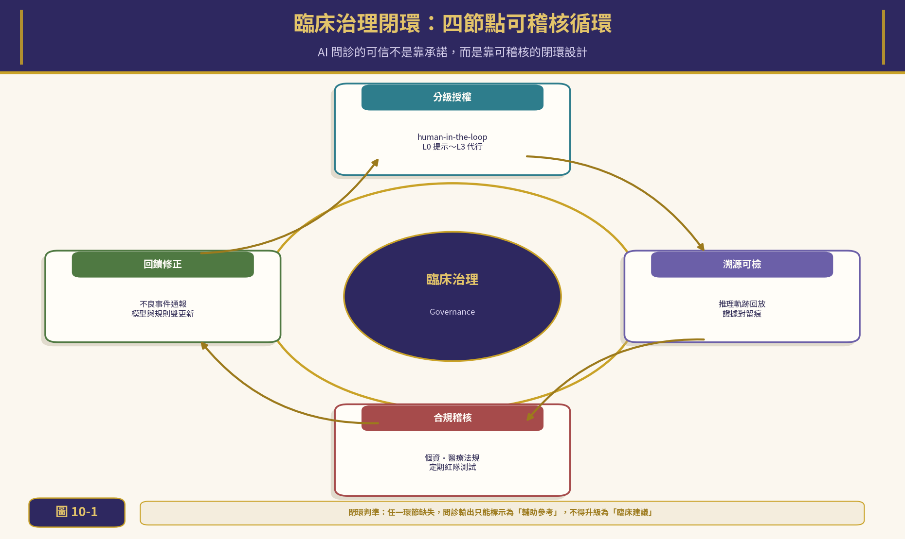

圖 10-1　臨床治理閉環：四節點可稽核循環

表 10-1　臨床治理檢核清單

| 節點 | 檢核項 | 證據 | 頻率 |
| --- | --- | --- | --- |
| 分級授權 | 各場景授權級別正確、簽核紀錄完整 | 簽核日誌 | 逐次 |
| 溯源可檢 | 抽樣結論回放成功率 ≥ 99% | 回放測試報告 | 每月 |
| 合規稽核 | 去識別化合規、日誌留存、紅隊測試 | 稽核報告 | 每季 |
| 回饋修正 | 不良事件通報閉結率、規則庫更新紀錄 | Δ 統計報表 | 每月 |

> **本章小結**
> 安全不是模型的性格而是制度的產物：四級分級授權按風險與可逆性劃分人類簽核邊界；溯源可檢把可解釋做成工程；合規以容器身份獲得技術支撐；四節點閉環以明確判準守住「輔助參考」與「臨床建議」之間的升級關卡。

> 可信不是承諾，而是閉環。

# 第十一章　討論：演化階梯與未來

## 11.1　與系列研究的理論銜接

ClinicMind 與本形學研究線的其他大腦共享同一理論地基：ProofMind（數學證明）、SiliconMind（IC 設計）、PatternMind（設計模式）、PharmaMind（藥物探索）、WarMind（兵棋推演）與本文的 ClinicMind（醫療問診），分別把「準確方法」落到各自的領域。跨篇的共通結構是：領域三方對照（領域↔本形學↔資料模型）、六步驟流程、公理—定理形式保證、五維準確性雷達、雙引擎五層架構與預測—驗證—修正迴圈。問診在其中的特殊地位在於：它直面人的不確定——病人會說謊、會遺忘、會害怕——因此 FDE 四值語意與時間形在此比任何領域都更為必要。

## 11.2　問診智能的演化階梯

Mind AI 的三階段演化——知識統一、思維統一、智慧統一——在問診場景有清晰的階梯形貌（圖 11-1、表 11-1）。知識統一階段把病歷、指引、文獻形化入庫；思維統一階段讓問診推理、鑑別與四值判斷成為系統的原生能力；智慧統一階段則走向自主規劃、持續學習與跨科整合。每一階的升級都以「過程可檢」為前提：不可檢的智慧是幻覺的放大器，可檢的智慧才是演化。

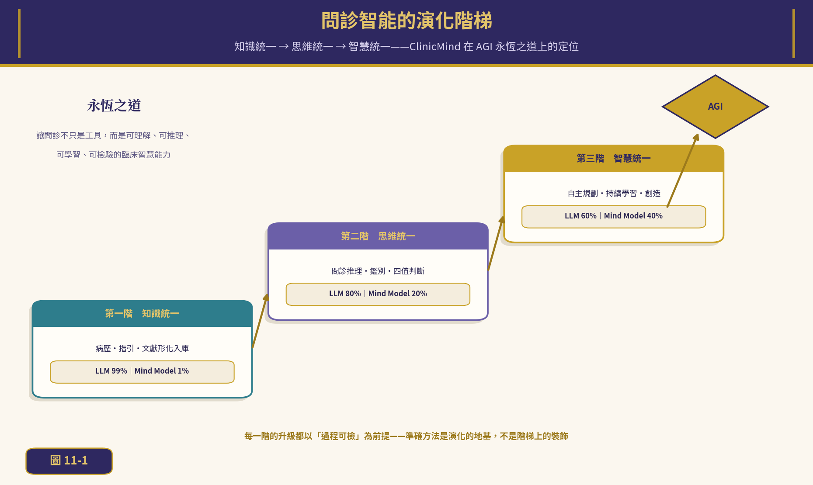

圖 11-1　問診智能的演化階梯

表 11-1　演化階梯與問診能力對照

| 階段 | 占比 | 問診能力 | 形庫狀態 | 可檢性 |
| --- | --- | --- | --- | --- |
| 知識統一 | 99/1 | 病史整理、紅旗提醒 | 形化入庫、檢核清單 | 步驟可檢 |
| 思維統一 | 80/20 | 鑑別推理、四值判斷、自驅提問 | 因果／果因雙向 | 五維均衡 |
| 智慧統一 | 60/40 | 自主規劃、持續學習、跨科整合 | 演化式重構 | 閉環自治 |

## 11.3　限制

本文有三項限制須坦承。其一，案例為合成想定：它們驗證方法的內部一致性與可操作性，不提供臨床效能證據；結局級驗證需前瞻性、多中心研究，尤其需要評估 AI 問診對診斷時效、漏診率與病患安全的真實影響。其二，五維量表衡量過程屬性：過程可檢是結局良好的必要而非充分條件——可檢的流程也可能以錯誤的知識運行，故形庫的證據等級管理（指引、系統性回顧、個案報告分級入庫）是必要的後續工作。其三，FDE 四值判斷的臨床可用性需實務驗證：b 值回溯在真實門診時間壓力下能否被醫師接受，需要人因工程研究。

## 11.4　展望

向前看，三個方向值得投入。其一，與 PharmaMind 的用藥形庫整合：C-03 的矛盾排查若接入化合物形與交互作用形庫，可由事後排查走向處方即時防呆。其二，時間形的深化：將 Allen 區間代數完整接入病程推理，支持「若三個月內再發」式的時態假設推理。其三，多模態形化：把影像、病理、檢驗波形納入「異同→分合→形」的感知鏈，讓 L1 感知形化不限於語言。這三個方向共同指向同一個未來：問診不再是一次對話，而是一個持續運行、可被審計的臨床智慧系統。

> 本章小結
> ClinicMind 與系列大腦共享理論地基，問診因直面人的不確定而最需要四值語意與時間形；演化三階段各有能力形貌與可檢性門檻；三項限制（合成案例、過程指標、人因驗證）指出後續研究路徑；三個展望（用藥形庫整合、時態推理、多模態形化）指向可審計的臨床智慧系統。

> 不可檢的智慧是幻覺的放大器。

# 第十二章　結論

本文回答的問題是：AI 醫療問診如何「問得準」？答案是——把準確性從模型天賦重新定義為流程屬性，並用本形學把這條流程寫成可檢的工程。具體而言，本文完成五件事。

第一，本體對照：證明問診六要素與形化動作天然同構，容器、SOM、框架三大載體各有臨床化身，並可與 FHIR／RDB 精確對齊，使形化結果可被電腦承載、可被跨院交換。

第二，方法建構：給出準確方法六步驟——形偵測、形定義、結構化、框架化、形式化、驗證修正——每步皆有輸入、輸出與檢核判準，並以預測—驗證—修正迴圈閉環。

第三，形式保證：建立病患容器身份公理與病史可檢公理，證明症狀 SOM 結構分級、三層判斷充要、問診形替換不變三定理，並以 FDE 四值語意承載不確定與矛盾——n 驅動補問、b 驅動回溯。

第四，評估與實證：五維準確性量表配合六方對照，量化「過程可檢」的差距；三組合成想定（急性腹痛分檢、慢性咳嗽鑑別、多重用藥矛盾）完整演練方法，並明確標示 synthetic 邊界。

第五，治理落地：分級授權、溯源可檢、合規稽核、回饋修正四節點閉環，把「輔助參考」與「臨床建議」之間的升級關卡做成可稽核的制度。

在 AGI 永恆之道的視角下，問診大腦 ClinicMind 是本形學落戶臨床的第一步：從知識統一（病歷形化）走向思維統一（可檢推理），再走向智慧統一（持續學習的臨床智慧）。讓 AI 問診不只是工具，而是可理解、可推理、可學習、可檢驗的臨床夥伴——這就是本文所追求的：問診的準確方法，與其背後的永恆之道。

> 問得準，是因為每一步都可以被檢查。

# 附錄 A　問診形化速查表

本速查表彙整六步驟、三層判斷、四值語意與五維量表的關鍵操作，供臨床與工程快速查閱。

表 A1　問診形化速查表

| 模組 | 關鍵問題 | 動作／判準 | 產出 |
| --- | --- | --- | --- |
| 形偵測 | 哪些敘述畫出邊界？ | 異同畫界；紅旗清單掃描 | 候選形清單 |
| 形定義 | 五軸齊備嗎？ | 屬性浮現／屬性值新增／回填 | 形矩陣 |
| 結構化 | 哪些症狀動不得？ | remove 檢驗三級分級 | SOM 分級 |
| 框架化 | 維度獨立嗎？ | 平行展開保完備、巢狀展開提效率 | 鑑別框架 |
| 形式化 | 結論附證據對嗎？ | FDE 四值判定 (E⁺,E⁻) | 判斷 J |
| 驗證修正 | 矛盾去哪了？ | b 回溯、n 補問、收斂固化 | 紀錄 Δ |
| 容器層 | 歸誰？ | id(P) 替換不變檢驗 | 歸屬保證 |
| SOM 層 | 哪些結構動不得？ | remove 檢驗三級分級 | 結構成立 |
| 抽象層 | 是哪種？ | 交集判準 ∩(D) | 類別歸屬 |
| 治理 | 可以升級為建議嗎？ | 四節點閉環檢核 | 授權等級 |
| 五維評估 | 過程可檢嗎？ | 語義・假設・步驟・層次・邊界 | 總分 25 |

> **使用方式**
> 臨床端：依「關鍵問題」欄逐項自檢；任一項答不出來，即是該步驟的修正入口。工程端：將「動作／判準」欄實作為檢核函式，其輸出即為該層的可檢輸出；六步驟全部通過後，輸出方可標示為「臨床建議」。研究端：以本表為協議骨架，設計前瞻性驗證（詳見 11.3 節）。

www.longreat.net

张长丰gamma@livemail.tw

张楟颍mindaiworks@gmail.com
