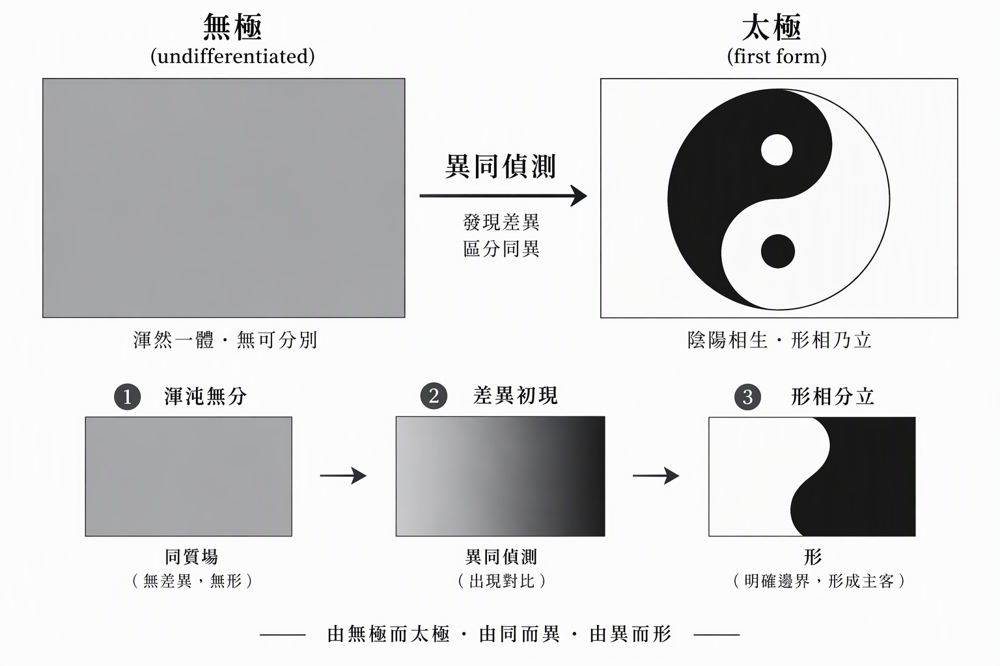

# 本形學-空間本形   Ontology-Space

# 形與數 TypeNumber

**為什麼先有形，才有數？**

*── 從異同到太極，從格式塔到數學符號的認知鏈 ──*

**❝  形，回答的是「是什麼」；數，回答的是「有多少」。  ❞**

## 目　錄

- **第一章**　序論：從寒武紀的那道光說起

- **第二章**　形從何而來：異同 → 分合 → 形 → 名

- **第三章**　思想實驗：一維世界裡的一顆感應器

- **第四章**　數的誕生：先合，才能數

- **第五章**　形的疊加：形與子形

- **第六章**　案例：3 + 2 = 5 背後沒被寫出來的步驟

- **第七章**　結論：先有形，才有數

- **附錄**　概念速查表

> **導讀 ・ 這一章在說什麼**
>
> 這一章要回答一個看似簡單、其實極為根本的問題：「形」與「數」，哪一個先出現？我們將從一維世界裡的一顆感應器出發，一步步推導出兩條核心命題——「有合必有形」與「數＝形裡面的小形・次比較」，最後得到整章的結論：先有形，才有數。這條路，大腦走了億萬年；把它看清楚，是本形學（Ontypology）要走的路。

## 第一章　序論：從寒武紀的那道光說起

### 形從何而數來

形也就是我們認得出來的「東西」，不是天生就存在的。它的誕生遵循一個固定的順序：先有「異同」的感受，才產生「分」與「合」的動作，最後才生出「形」，而形必有名。

用白話來說，大腦必須先感覺到「這個和那個不一樣」或「這個和那個一樣」，然後才會把相同的部分圈起來（合）、把不同的部分切開來（分）。這個「圈起來／切開來」所畫出的邊界，就是我們所謂的「形」。

試想一個世界裡只存在兩種東西的情境：大腦其實不需要為它們命名，只需要知道「有一個東西」跟「沒有東西（或另一個不一樣的東西）」是不一樣的，這就是最原始的「異」。若把這個情境推到極端，一個眼前只有全黑一片、什麼都分不出來的觀察者（例如視覺上完全無法辨色的人），會因為沒有「差異」可供大腦畫界，而永遠停留在無形的狀態。

由此可以歸納出一條最基本的認知鏈：

> 異同 → 大腦畫出邊界（合）→ 產生兩個形 → 分別命名為「有」和「無」（也可以想成 X 跟 Y、黑跟白）

這條鏈其實呼應道家「無極生太極」的說法：在什麼都還沒分化之前是「無極」；一旦分出「有／無」「黑／白」這種最基本的兩極，「太極」（最初的形）便誕生了。

從認知科學的角度來看，這條鏈對應的是格式塔（Gestalt）心理學中的「圖與地」（Figure-Ground）原則：人類視覺系統天生就會把感知到的訊息分成「前景」（圖）和「背景」（地），而這個「分」的動作，正是「異同→分合→形」鏈條中最原始的起點。當背景是均勻的、前景是突顯的，大腦就能輕易畫出邊界；反之，當眼前一片均質（例如全黑），大腦就無從畫界，「形」便無法誕生。

此外，發展心理學的研究也指出，嬰兒在出生後數週內就能分辨「熟悉」與「陌生」的面孔，這表示「異同偵測」的能力是先天的、不需要學習的；但要能把「媽媽的臉」從所有臉中獨立出來、賦予一個穩定的身份（命名），則需要時間和經驗的累積。這正好呼應了本文的主張：異同是先天的，分合是自然發生的，但「形」的誕生需要邊界被畫出來，而邊界的畫出需要足夠的差異刺激。

### ▍1-1　數字寒武紀的爆發

李飛飛講過一個故事：在遙遠的寒武紀，世界一片漆黑，什麼都看不見。直到有一種三葉蟲，首先感知到了光。感知到光之後，牠發展出了神經系統；有了神經系統，接下來就是「理解思考」，最後是執行。這就是生物發展的規律。

這個故事的關鍵不在光，而在「差異」。一片漆黑的世界裡沒有任何差異，什麼都不會發生；光是第一個被偵測到的差異——明與暗的差異。有了差異，神經系統才有東西可以傳遞；有了傳遞，才談得上理解；有了理解，才談得上行動。

*圖 1-1　寒武紀認知鏈：感知 → 神經 → 理解 → 執行*

### ▍1-2　一條被數學省略的路

邏輯學百年前是哲學，當人們把它看清楚之後，它變成了顯學（科學）。今天我們探討「形」——大腦裡的概念——還屬於哲學的範圍；本形學（Ontypology）要做的，就是把「形」看清楚，轉成顯學，並實踐化為 Mind AI。

為什麼要從「形與數」下手？因為人類的數學雖然精緻，卻有一個先天習慣：它直接跳過「形」的判斷，只保留「數」的結果。每一條算式的合法性，其實都依賴一個沒有被寫出來的步驟。本章的任務，就是把這個被省略的步驟攤開在陽光下。

> **本章核心命題（兩句話貫穿整章）**
>
> 一、有合必有形：把原本各自獨立的東西圈成同一個整體，這個動作本身就會產生一個新的、更高層次的形。
> 二、數＝形裡面的小形・次比較：在同一個形之下，計算它的子形出現了幾次——數，永遠依附在已被辨識出來的形之上。

## 第二章　形從何而來：異同 → 分合 → 形 → 名

### ▍2-1　形不是天生就存在的

形——也就是我們認得出來的「東西」——不是天生就存在的。它的誕生遵循一個固定的順序：先有「異同」的感受，才產生「分」與「合」的動作，最後才生出「形」，而形必有名。

用白話來說：大腦必須先感覺到「這個和那個不一樣」或「這個和那個一樣」，然後才會把相同的部分圈起來（合）、把不同的部分切開來（分）。這個「圈起來／切開來」所畫出的邊界，就是我們所謂的「形」。

試想一個世界裡只存在兩種東西的情境：大腦其實不需要為它們命名，只需要知道「有一個東西」跟「沒有東西（或另一個不一樣的東西）」是不一樣的，這就是最原始的「異」。若把這個情境推到極端——一個眼前只有全黑一片、什麼都分不出來的觀察者（例如視覺上完全無法辨色的人），會因為沒有「差異」可供大腦畫界，而永遠停留在無形的狀態。

**由此可以歸納出一條最基本的認知鏈：**

> **認知鏈**
>
> 異同 → 大腦畫出邊界（合）→ 產生兩個形 → 分別命名為「有」和「無」（也可以想成 X 跟 Y、黑跟白）

這條鏈其實呼應道家「無極生太極」的說法：在什麼都還沒分化之前是「無極」；一旦分出「有／無」「黑／白」這種最基本的兩極，「太極」（最初的形）便誕生了。

*圖 2-1　異同 → 分合 → 形 → 名 的推導鏈，及其與「無極生太極」的對照*

### ▍2-2　認知科學的佐證：格式塔「圖與地」

從認知科學的角度來看，這條鏈對應的是格式塔（Gestalt）心理學中的「圖與地」（Figure-Ground）原則：人類視覺系統天生就會把感知到的訊息分成「前景」（圖）和「背景」（地），而這個「分」的動作，正是「異同 → 分合 → 形」鏈條中最原始的起點。當背景是均勻的、前景是突顯的，大腦就能輕易畫出邊界；反之，當眼前一片均質（例如全黑），大腦就無從畫界，「形」便無法誕生。

*圖 2-2　格式塔「圖與地」原則：均質無形，突顯有形；以及發展心理學的佐證*

此外，發展心理學的研究也指出，嬰兒在出生後數週內就能分辨「熟悉」與「陌生」的面孔，這表示「異同偵測」的能力是先天的、不需要學習的；但要能把「媽媽的臉」從所有臉中獨立出來、賦予一個穩定的身份（命名），則需要時間和經驗的累積。這正好呼應本章的主張：異同是先天的，分合是自然發生的，但「形」的誕生需要邊界被畫出來，而邊界的畫出需要足夠的差異刺激。

## 第三章　思想實驗：一維世界裡的一顆感應器

### ▍3-1　實驗設定

假設一個只有一維的世界，裡面只有一個感應器——它每秒感覺一次顏色，沒有其他功能。整個宇宙的歷史，就是這顆感應器一格一格的感應紀錄。接下來，我們在這個最極簡的世界裡，看「形」與「數」是如何先後誕生的。

### ▍3-2　情境 A：永遠是同一個顏色

如果這個感應器每一秒感覺到的顏色都一樣（例如永遠是黑色），那麼它看到的每一次結果都相同、都一樣長。在這種情況下，不會有空間，也不會有時間——因為沒有任何「差異」可以被辨識出來，一切都只是同一件事的重複。世界等於靜止在一格裡面。

### ▍3-3　情境 B：顏色開始交替

當「差異」出現時（這裡的差異，是指感官能分辨的差異），情況就完全不同了。假設這一秒感應器看到黑色，下一秒看到白色，再下一秒又看到黑色，依此類推——空間、時間就會同時出現。

值得注意的一個洞察是：時間，其實是從空間的變化中衍生出來的；因為有了先後不同的狀態，才有了「時間」這個概念。同時，因為狀態開始有規律地交替，Pattern（規律／模式）也隨之產生。

*圖 3-1　一維感應器思想實驗：無差異則無時空，有差異則時空與 Pattern 同時誕生*

### ▍3-4　第一個「形」，是一個布林值

黑色與白色，是兩個不同的狀態。當感應器能夠分辨「這是黑色」與「這不是黑色（是白色）」，這個「異／同」的判斷本身，就是第一個「形」的產生。

這裡的形，本質上是一個布林值（bool）——「有」或「無」、「是」或「不是」、「異」或「同」。它是最原初的辨識動作，還沒有涉及到「數量」或「多少」。

*圖 3-2　黑 ≠ 白 ≠ 黑：第一個「形」＝異同判斷 ＝ 布林值*

## 第四章　數的誕生：先合，才能數

### ▍4-1　一次與兩次

當黑白交替的方式變得更複雜時，數才開始出現。例如：這一秒是黑色，下一秒是白色，再下一秒又是白色——連續出現兩次白色。這時候，感應器就會發現：黑色出現的時間比較短，白色出現的時間比較長。也就是說，黑色只出現一次，白色卻出現了兩次。

**這個「一次」與「兩次」的分辨，就是第一個「數」的產生，也因此有了新的 Pattern。**

### ▍4-2　「合」在背後默默做的事

要能數出「白色出現兩次」，前提是這兩次白色必須先被判斷成「同一種東西」——也就是先經過一次「合」的動作，把兩個各自獨立的瞬間，圈成「同一個形的兩個實例」，才有辦法把它們當成同一個單位去疊加計數。如果每一次看到的白色都被當成完全不同的、獨立的東西，那就只有「異」，沒有「同」，也就無從計數。

換句話說：數，不只是「計次」的動作，它還預設了「哪些東西可以被視為同一個單位」這個判斷，而這個判斷，正是「合」在背後默默做的事。

*圖 4-1　數的誕生：先「合」成同一單位，才能計數出「白 = 2 次」*

### ▍4-3　形與數的關鍵差異

形與數的分界，就在這裡浮現：

- **形，**回答的是「是什麼／不是什麼」（異同的辨識）。沒有形，就無法辨識出「這是一個獨立的狀態」。它是更原初、更底層的認知動作——形可以不需要數就存在。

- **數，**回答的是「多少／幾次」（在形之上，進一步的計量）。數是在已經能辨識形的基礎上，才進一步去計算「這樣的形出現了幾次」——數不能脫離形而單獨存在。

|  | 形 | 數 |
|---|---|---|
| 回答的問題 | 是什麼／不是什麼 | 多少／幾次 |
| 認知動作 | 異同的辨識（畫出邊界） | 對已辨識的形進行計量 |
| 存在條件 | 可以不需要數就存在 | 不能脫離形而單獨存在 |

假設把「黑色」定義為 A，「黑色白色」定義為 B，「白色」定義為 C。A、B、C 之間，可以透過「異同」判斷彼此是不同的形——這是形的層次。但當進一步去問「A 出現了幾次」「B 和 C 誰出現得比較多」時，我們就從「形的辨識」跨入了「數的計量」。

**這說明一件事：數不能脫離形而單獨存在，但形可以不需要數就存在。形是更原初、更底層的認知動作；數，則是建立在形之上的次一層抽象——是「對已被辨識出來的形，進行計量」的結果。**

## 第五章　形的疊加：形與子形

### ▍5-1　內外分合，就是最基本的形

先看最基本的狀態：一個圓。這個圓，內外分合，它就是一個基本形——它存在、有邊界、可以被辨識出「這是一個東西（一體）」。

接著，把好幾個這樣的圓放在一起、合成一群。這個「合」的動作，本身就產生一件新的事情：這些原本各自獨立的圓，現在被看作同一個整體。也就是說，我們不再只看到「三個各自分開的圓」，而是看到了「一個包含著三個圓的、更大的形」。

**有合必有形。**這個「更大的形」不是原本就存在的，它是因為「合」這個動作才產生出來的。在合之前，只有三個各自獨立的基本形；合之後，多了一個新的、層次更高的形——一個能把「這些東西是同一群」這件事本身表達出來的形。

*圖 5-1　從基本形到形與子形：合的動作產生新的、更高層次的形*

當這個新的、更大的形出現之後，可以區分出兩個層次：

- 最大的圓，也就是那個把其他圓都包起來的邊界，稱之為「形」。

- 被包在裡面的每一個小圓，相對於這個大的形而言，稱為「子形」。

「形包含子形」這件事，回答的問題仍然是「是什麼」——這是一個歸屬、包含的關係（子形屬於這個形），而不是「有幾個」的問題。

### ▍5-2　分、合、形的白話定義

- **分：**看出這些東西「彼此不一樣」的地方。

- **合：**在這些不一樣的東西裡，再找出「其實可以算同一類」的部分。

- **形：**分合所畫出的邊界；我們最終認得出來、並能命名的「東西」。

### ▍5-3　無限疊加：數在每一層被重新提問

大腦的分類方式會逐漸從「整體」細緻化到「特徵」。一開始只有兩個東西時不需要計數；但第二個東西出現時，「數」的概念便誕生了，因為此時開始需要區分「這個」「那個」「還有一個」。

這個結構其實可以無限往下疊：一個子形底下，也可以再包含更小的子子形。也就是說，形的疊加，是形自身不斷延伸、不斷長出新層次的過程，這整個過程都還屬於形的範疇。

但是，每當我們在其中任何一層，停下來去問「這一層底下有幾個」，數就會在那一層重新產生一次。換句話說：

- 形的疊加，是結構上的延伸；

- 數的產生，是在某一層結構上，對其子形進行計數的結果。

數不會憑空出現，它永遠依附在某一層已經被辨識出來的形之上。沒有先把子形一個個分辨清楚，就不會有「幾個」這個問題可以被問出來。

兩個場景的共同點是：辨識永遠發生在計數之前——

- **黑白交替：**先能分辨黑與白（形），再進一步去數「黑出現幾次、白出現幾次」（數）。

- **形與子形：**先能分辨「哪些小圓屬於這個大形」（形），再進一步去數「這個大形底下有幾個子形」（數）。

*圖 5-2　形的無限疊加：疊加是結構延伸；數在每一層被重新提問*

## 第六章　案例：3 + 2 = 5 背後沒被寫出來的步驟

### ▍6-1　一道小學題目

有三顆蘋果、兩顆馬鈴薯和兩顆水蜜桃，請問水果共有幾顆？多數人給出的答案，只會是一個算式：3 + 2 = 5。

但這個算式能夠成立，其實已經預先發生一個沒有被寫出來的步驟：大腦必須先判斷「蘋果」和「水蜜桃」都屬於「水果」這個更高層的類別，兩者才能被視為同一個單位，放進同一個加法算式裡相加。

*圖 6-1　3 + 2 = 5 的隱形前提：蘋果 ∈ 水果、水蜜桃 ∈ 水果*

### ▍6-2　數學語言跳過了什麼

蘋果是一個具體的形（像 A），水蜜桃是另一個具體的形（像 B），而「水果」就是把 A、B 圈起來、給它們一個共同名字的抽象形（X）。如果沒有先完成「蘋果 ∈ 水果」「水蜜桃 ∈ 水果」這個歸屬判斷，3 跟 2 根本不能相加——因為「3 顆蘋果」和「2 顆水蜜桃」原本是兩種不同單位下的數，必須先在更高的抽象層（水果）上，把它們統一成同一個單位，加法才有意義。

換句話說，3 + 2 = 5 這個算式，表面上只呈現了「數」的層次，但它能夠成立，是因為背後已經悄悄跑完了一次「形」的判斷（蘋果、水蜜桃 → 合併為水果），只是這個過程在數學符號裡完全沒有被寫出來——數學語言直接跳過了「形」，只保留了「數」的結果。

> **關鍵句**
>
> 能不能相加，取決於能不能先找到一個形，把兩者合併成同一個單位——這一步，正是數學符號從來不寫出來的部分。

## 第七章　結論：先有形，才有數

把整章的推導收攏起來，就是一句話：

**先有形，才有數。**

*圖 7-1　結論：形是基本個體，數是形的重複；先有形，才有數*

### ▍7-1　對 Mind AI 的意義

這條推導鏈對人工智慧有一個直接的啟示：一個只會處理「數」的系統——無論是統計模型還是向量空間——如果沒有先把「形」（實體、邊界、歸屬關係）辨識出來，它的所有計算都是無根的。真正的理解，必須先完成「異同 → 分合 → 形」這一段：把世界切成一個個可指認、可命名、可歸屬的單位，然後才能在這些單位之上進行計量與推理。

從知識統一，到思維統一，最終邁向智慧統一。這就是 LonGreat 所追求的 AGI 永恆之道——讓人工智慧不只是工具，而是真正具備理解、推理、學習與創造能力的智慧生命體系。

### ▍7-2　全章推導回顧

- 異同是先天的：沒有差異，就沒有一切（全黑的世界無形）。

- 分與合自然發生：把相同的圈起來、不同的切開，邊界隨之畫出。

- 形＝邊界，形必有名：第一個形是一個布林值（異／同）。

- 有合必有形：合的動作本身，就會長出更高一層的新形。

- 數＝形裡面的小形・次比較：數依附在已辨識的形之上，每一層被重新提問。

- 數學跳過了「形」：3 + 2 = 5 的合法性，建立在看不見的歸屬判斷之上。

> **一句話總結**
>
> 異同 → 分合 → 形 → 名；形可無限疊加而仍是形；數，是在任何一層上問「有幾個」的結果。辨識永遠發生在計數之前——所以，先有形，才有數。

## 附錄　概念速查表

| 概念 | 一句話定義 |
|---|---|
| 異同 | 感覺到「這個和那個不一樣／一樣」。最原始、先天的認知火花。 |
| 分 | 看出這些東西「彼此不一樣」的地方——切開的動作。 |
| 合 | 在不一樣的東西裡，找出「可以算同一類」的部分——圈起來的動作。 |
| 形 | 分合所畫出的邊界；我們認得出來、並能命名的「東西」。第一個形是布林值。 |
| 名 | 形被穩定指認、可以重複稱呼的標籤。 |
| 子形 | 被包在更大形裡面的每一個小形；兩者是歸屬關係，回答「是什麼」。 |
| 數 | 在同一個形之下，計算子形出現了幾次——形裡面的小形・次比較。 |
| (模式)Pattern | 狀態規律交替所形成的模式；隨差異與時間一同誕生。 |
