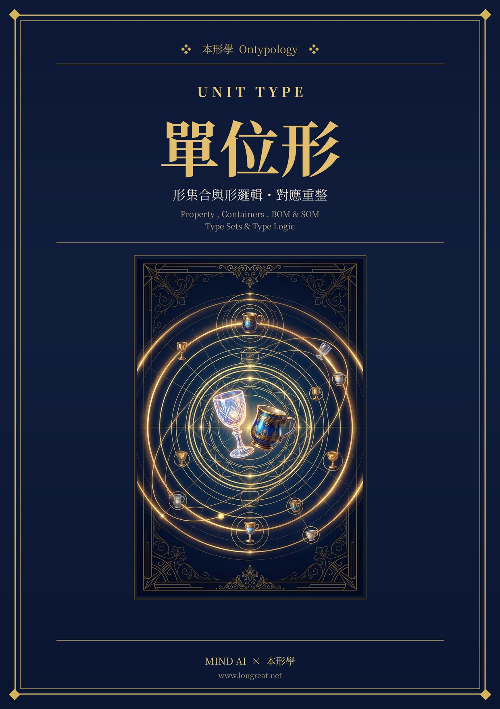

# 目　錄

- ◆　寫在前面——兩文對應與重整
- ◆　導讀——單位形的三個描述面向
- ◆　第一章　屬性 Property——抽象集合 [ ]（X 軸）
  - 1.1　屬性與屬性值：可以被拿來問的問題
  - 1.2　屬性如何逐步浮現——以杯子為例
  - 1.3　屬性浮現的規則
  - 1.4　抽象：從封閉的清單到開放的規則
- ◆　第二章　物料清單 BOM——組成集合 { }（Y 軸）
  - 2.1　BOM：打開來看，由什麼組成
  - 2.2　BOM 判準：拆下來之後，它還認得自己嗎？
  - 2.3　部件的三級分類：remove 判準
  - 2.4　BOM 的逐步浮現與分工
- ◆　第三章　空間容器——容器集合 ( )（Z 軸）
  - 3.1　容器：身份不隨內容物改變
  - 3.2　容器的三要素
  - 3.3　容器的形式化與層次
  - 3.4　容器的嵌套
- ◆　第四章　形集合——單位形的完整表記
  - 4.1　數學集合的侷限：被省略的三層資訊
  - 4.2　單位形 ＝ 形集合
  - 4.3　三種加值的疊加
  - 4.4　同一句話，三層意義
- ◆　第五章　形邏輯——三層判斷與應用
  - 5.1　容器判斷：身份是否獨立於內容物？
  - 5.2　物料清單判斷：拿掉部件後，整體還是同一個東西嗎？
  - 5.3　抽象判斷：新物件是否符合類別規則？
  - 5.4　三層聯合判斷：智慧型手機
  - 5.5　判斷練習：六題問答
  - 5.6　判斷的理論意義
- ◆　回顧——要點總整理與自我檢查

**理解一個形 ＝ 理解它是什麼樣子、在哪裡、由什麼組成、部件如何依存。**

# 寫在前面——兩文對應與重整

本書由兩份文件對應重整而成：《單位形》立起描述一個形的三條軸——屬性、物料清單、空間容器；《形集合與形邏輯》則為同樣的三件配備補上集合論的語言、形式化定義與判斷流程——同一個對象的兩面：一面是「怎麼描述」，一面是「怎麼表記與怎麼判斷」。

重整的方式是「以單位形為主」：沿著 X 軸、Y 軸、Z 軸三條主幹展開章節，把形集合與形邏輯的對應內容——三種括號、三種加值、交集判準、remove 判準、不變性公理、三層判斷——一一融入它所屬的軸線；最後兩章再把「形集合的完整表記」與「形邏輯的判斷應用」整體收攏。全書循著一隻杯子前進，每一章同時給你描述的語言、表記的括號、判斷的準則。

| 《單位形》 | 《形集合與形邏輯》 | 本書對應位置 |
| --- | --- | --- |
| 導讀——三個描述面向 | 5.1 數學集合的侷限 | 導讀＋4.1 |
| 第一章 屬性 Property（X 軸） | 5.4 抽象：特徵交集生成 | 第一章 屬性 [ ] |
| 第二章 物料清單 BOM（Y 軸） | 5.3 物料清單：組成結構 | 第二章 物料清單 { } |
| 第三章 空間容器（Z 軸） | 5.2 容器：不變的身份 | 第三章 空間容器 ( ) |
| —— | 三種加值與形集合表記 | 第四章 形集合 |
| —— | 5.5 邏輯應用判斷範例 | 第五章 形邏輯 |
| 本章要點回顧 | 5.6 小結 | 回顧 要點總整理 |

**表 0-1　兩份來源文件與本書章節的對應**

> **閱讀本書的三個約定**
>
> ◆ 約定一：「形」的英文一律用 Type。SpecType、ModuleType、Type-Driven Design——不是 Form。
> ◆ 約定二：三種括號各有專屬職務。大括號 { } 是組成集合（物料清單）、中括號 [ ] 是抽象集合（屬性）、小括號 ( ) 是容器集合（空間容器）。
> ◆ 約定三：全書以一隻杯子貫穿。杯子既是日常物件，也是一個「單位形」最忠實的標本。

**理解一個形 ＝ 理解它是什麼樣子、在哪裡、由什麼組成、部件如何依存。**

# 導讀——單位形的三個描述面向

> **本章地圖**
>
> ◆ 本章以一隻「杯子」貫穿全書，依序回答關於一個單位形的四個基本問題。
> ◆ 它是什麼樣子？——「屬性與屬性值」（第一章）。
> ◆ 它由哪些部件組成？——「物料清單」（第二章）。
> ◆ 它把東西放在哪裡？——「空間容器」（第三章）。
> ◆ 部件如何依存？——「結構依存判準」（第二章、第五章）。

把一隻杯子放在桌上，它看起來只是一個簡單的日常物件。但當我們試著「完整地描述」這隻杯子時，會發現描述自然地沿著三個方向展開：它的顏色、材質是什麼樣子？它由杯身、杯把哪些部件組成？它把水裝在哪裡？這三個問題，恰好對應三種不同的「描述面向」，也對應空間中的三條軸——X 軸、Y 軸、Z 軸。

三個面向各自回答一種問題，彼此不能互相替代。顏色說不出杯子由什麼組成；部件清單說不出杯子把水裝在哪裡；而「裝著水」這件事也說不出杯子是白色還是藍色。唯有三者齊備，一個單位形才算被完整地描述。

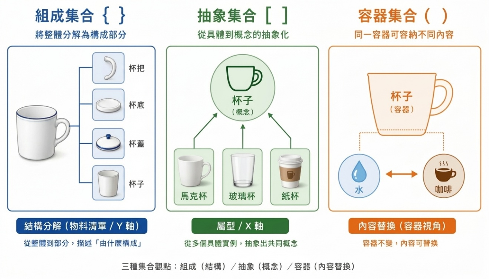

**圖 D-1　三種集合觀點並列：組成（Y 軸）、抽象（X 軸）、容器（Z 軸）**

這三個面向在形邏輯中各有專屬的括號：組成集合用大括號 { }、抽象集合用中括號 [ ]、容器集合用小括號 ( )。三種括號不是裝飾性的記號，而是三種不同的「加值」——它們分別把數學集合省略掉的三層資訊補回來：部件的結構、生成的規則、不變的身份。

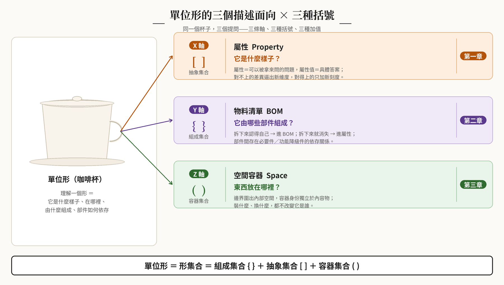

**圖 D-2　單位形的三個描述面向 × 三種括號**

| 集合別 | 括號 | 範例 | 對應軸 | 描述面向 | 本書章節 |
| --- | --- | --- | --- | --- | --- |
| 抽象集合 | [  ] | [ 白色, 黑色, 黃色 ] | X 軸 | 它是什麼樣子？ | 第一章 |
| 組成集合 | {  } | { 杯把, 杯底, 杯蓋, 杯身 } | Y 軸 | 它由什麼組成？ | 第二章 |
| 容器集合 | (  ) | ( 水, 咖啡 ) | Z 軸 | 東西在哪裡？ | 第三章 |

**表 D-1　三種括號對應表**

單位形，就是這三種集合的合體。一隻咖啡杯可以完整地表記為：

**單位形 ＝ 形集合 ＝ 咖啡杯：{ 杯把, 杯底, 杯蓋, 杯身, (咖啡), [白色] }**

這條式子將在第四章獲得完整的解釋。此刻只需要記住它的讀法：大括號裡是拆得開的部件、小括號裡是裝進去的內容物、中括號裡是說出來的屬性。一個單位形，就是這樣一組「部件＋內容＋樣子」的穩定結構。

# 第一章　屬性 Property——抽象集合 [ ]（X 軸）

**章節意象・屬性之軸——維度與刻度**

X 軸回答的是第一個問題：它是什麼樣子？描述「樣子」的語言由「屬性」與「屬性值」構成——屬性是一個維度，屬性值是維度上的刻度。本章先建立屬性與屬性值的分別，再以杯子為例，看屬性如何在比較中一步步浮現，最後把這套描述接到形邏輯的「抽象」：一條能夠自動判斷新成員的開放規則。

## 1.1　屬性與屬性值：可以被拿來問的問題

屬性是一個「可以被拿來問的問題」，它本身沒有答案，只是劃定一個「要問什麼」的範圍；屬性值則是這個問題在某個具體情境下的實際答案，是屬性底下被圈出來的一個個選項。打個比方：屬性像是一張空白表格的欄位標題，寫著「材質」；屬性值則是這個欄位底下實際被填進去的內容，比如「陶瓷」。標題本身不會變，但底下能填的答案，會隨著具體物件而不同。

|   | 屬性 | 屬性值 |
| --- | --- | --- |
| 定位 | 可以被拿來問的問題 | 問題在具體情境下的實際答案 |
| 比喻 | 表格的欄位標題（「材質」） | 欄位底下實際填入的內容（「陶瓷」） |
| 變動 | 標題本身不會變 | 隨著具體物件而不同 |

**表 1-1　屬性與屬性值的對照**

這個區別在集合的語言裡就是抽象集合 [ ]：屬性定義了集合的「座標軸」，屬性值則是軸上的「刻度」。當我們說 [ 白色, 黑色, 黃色 ]，我們正在列舉的，是「顏色」這個問題的候選答案。

## 1.2　屬性如何逐步浮現——以杯子為例

屬性不是一次到位的。它是「被差異逼出來」的。讓我們把杯子一只一只放上桌，看屬性如何在比較中現身。

### 第一步：兩個杯子——第一個屬性現身

兩個杯子擺在一起，偵測異同，發現差異只落在一個地方：透明跟藍色。此階段唯一浮現的屬性是「顏色」，屬性值是 { 透明, 藍色 }。

### 第二步：第三個杯子——逼出「材質」與「手把」

第三個杯子（陶瓷、藍色、有手把）加入。先看顏色：藍色，既有的顏色軸已經有這個選項，直接掛入，顏色軸不需要變動。但這個杯子同時帶來兩批新差異：材質從「玻璃」變成「陶瓷」，這批差異跟顏色這個維度對不上，於是逼出第二個屬性「材質」；此外這個杯子有手把，前兩個杯子完全沒有可比對的東西，差異同樣跟顏色、材質都對不上，於是又逼出第三個屬性「手把」。

一旦「材質」「手把」成立，前兩個杯子也必須回填這兩個屬性的值：材質填「玻璃」（本來就是玻璃，只是先前不需要說出來），手把填「N」（本來就沒有，只是先前沒有東西可以比較）。屬性一旦被抽出來，就必須套用在所有已經出現過的個體上——屬性是一個維度，維度要能貫穿全部的個體，才能拿來互相比較。

### 第三步：第四個杯子——逼出「蓋子」

第四個杯子（玻璃、透明、有手把、有蓋子）加入。顏色、材質、手把都能對上既有的軸，唯獨「蓋子」這項差異前三個杯子都沒有可對照的東西，於是逼出第四個屬性「蓋子」，同樣為前三個杯子回填「N」。

### 第四步：以後的杯子——只加刻度，不開新軸

此後持續加入的杯子，不論顏色變成金色、銀色、米色、卡其色、白色、灰色，材質變成不鏽鋼或紙，這些差異全部都能對上顏色、材質這兩個既有維度，因此只需要在對應屬性底下新增屬性值，完全不需要再開新屬性；手把、蓋子也持續以 Y／N 記錄，不會再冒出第五個新屬性，因為目前觀察到的所有差異都已能被這四個維度收容。

**圖 1-2　屬性隨杯子逐步加入而浮現的時間軸**

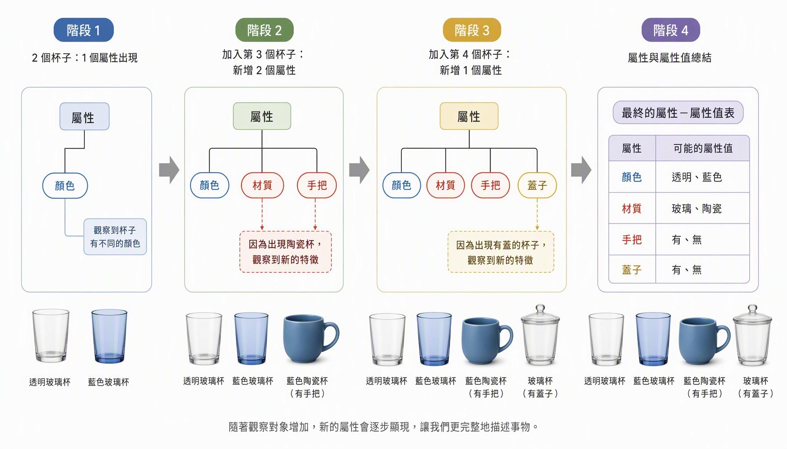

**圖 1-3　屬性浮現四階段與屬性—屬性值總表彙整**

最終彙整成一張完整的屬性—屬性值總表：

| 屬性 | 屬性值 |
| --- | --- |
| 材質 | 不鏽鋼、陶瓷、紙、玻璃 |
| 顏色 | 透明、藍色、金色、銀色、米色、卡其色、白色 |
| 手把 | Y／N |
| 蓋子 | Y／N |

**表 1-2　屬性—屬性值總表**

## 1.3　屬性浮現的規則

從杯子的實驗可以歸納出一條規則：屬性浮現的時間點，永遠是「這批差異跟現有所有屬性都對不上」的那一刻；屬性值增加的時間點，只要「差異的性質對得上某個現有屬性」，就直接放進去。而且每次屬性浮現，都伴隨著把這個新維度回頭套用到所有已經存在的個體上，讓每個個體在每一個屬性上都有明確的值，這套結構才會完整、不漏洞。

這條規則可以用一個判斷流程來形式化：當一個新物件被拿來跟既有物件比較時，先問「這批差異的性質，跟現有的哪個屬性吻合？」如果答案是「某個屬性吻合」，那就直接在該屬性底下新增一個屬性值，不需要動到框架；如果答案是「跟所有現有屬性都對不上」，那就必須開一個新屬性，並且回頭為所有已經存在的個體補上這個新屬性。

> **屬性浮現規則（總結）**
>
> ◆ 差異與現有屬性都對不上 → 開新屬性，並回填所有已存在個體。
> ◆ 差異性質吻合既有屬性 → 只在該屬性下加新屬性值。
> ◆ 屬性數量少、屬性值數量多；維度固定，刻度可延伸。

這個機制也解釋了為什麼屬性的數量通常遠少於屬性值的數量：屬性是「維度」，代表差異的「種類」；屬性值是「選項」，代表同一種差異裡的各種可能。在我們的杯子例子中，只有 4 個屬性（顏色、材質、手把、蓋子），但屬性值卻隨著杯子數量增加而不斷擴充（顏色從 2 個值成長到 7 個以上）。這就像一個座標系統：軸的數量是固定的（二維就是二維），但每條軸上的刻度可以無限延伸。這就是 X 軸——屬性之軸——的本性：維度決定你能問什麼，刻度決定你已經知道什麼。

## 1.4　抽象：從封閉的清單到開放的規則

馬克杯、玻璃杯、紙杯、保溫杯⋯⋯這些都是具體、各自不同的實際物件。把它們的共同特徵抽出來——「一個容器，加上一個能讓人手持或就口的開口結構」——就得到一個新的東西：「杯子」這個類別本身。這一步操作在形邏輯中稱為抽象（見《形集合與形邏輯》5.4）：它補上的，是數學集合裡最欠缺的東西——一條能夠不斷生出新成員的規則，而不是一份寫死的清單。

用來判斷新成員的那條規則，形邏輯稱為「交集判準」，記作 ∩(T)。一個抽象類別 T 由兩樣東西決定：特徵集合 F(T)（這個類別要求哪些特徵），以及交集判準 ∩(T)（每個特徵都通過，才算屬於）。

| 面向 | 封閉集合 { } | 開放類別 [ ] |
| --- | --- | --- |
| 成員來源 | 手動列舉 | 規則自動判斷 |
| 新成員 | 不在清單上就不屬於 | 符合規則即自動屬於 |
| 時間性 | 靜態、固定 | 動態、可擴展 |
| 例子 | { 馬克杯, 玻璃杯, 紙杯 } | [x｜x 能裝液體 ∧ x 能被拿起來喝] |

**表 1-3　封閉清單與開放規則的對照**

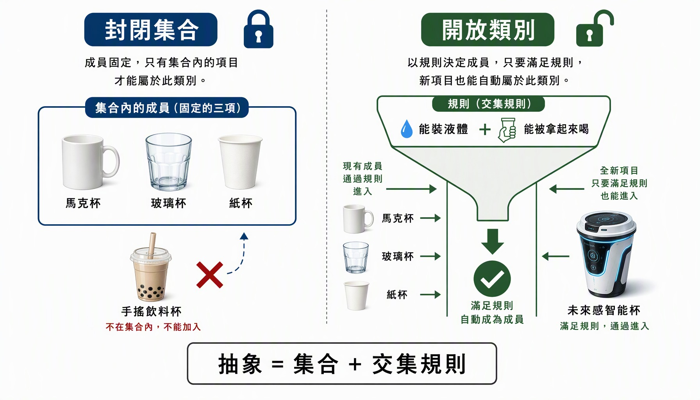

**圖 1-4　抽象：從「封閉的清單」到「開放的規則」**

> **抽象的形式化定義**
>
> ◆ 抽象類別 T = ( 特徵集合 F(T), 交集判準 ∩(T) )。
> ◆ 交集判準 ∩(T)：物件 x 屬於 T ⟺ ∀ fᵢ ∈ F(T), fᵢ(x) = true。
> ◆ 開放性：T 的成員不由列舉決定，而由 ∩(T) 動態生成——連尚未出現的設計，也能被正確歸類。

屬性與抽象，是 X 軸的一體兩面：屬性負責「把樣子說清楚」——每個個體在每個維度上有明確的刻度；抽象負責「把類別判清楚」——用特徵的交集，圈出一個開放、能自動生出新成員的類別。到了第五章，這條 ∩(T) 將成為三層判斷中「抽象判斷」的引擎。

> **本章重點**
>
> ◆ 屬性＝可以被拿來問的問題（維度）；屬性值＝具體答案（刻度）。
> ◆ 屬性浮現規則：差異對不上 → 開新屬性並回填所有個體；對得上 → 只加新屬性值。
> ◆ 抽象＝開放規則：T = ( F(T), ∩(T) )，特徵全數通過才入類——連尚未出現的設計也能自動歸類。

# 第二章　物料清單 BOM——組成集合 { }（Y 軸）

**章節意象・結構藍圖——部件的爆炸圖**

Y 軸回答的是第二個問題：它由哪些部件組成？回答這個問題的工具叫作物料清單（BOM, Bill of Materials）——它是一份「拆開來看」的清單，記載一個東西打開以後，裡面是由哪些更小的東西組成。本章建立 BOM 的判準、部件的三級分類，以及 BOM 與屬性之間那條清楚的界線。

## 2.1　BOM：打開來看，由什麼組成

物料清單回答的是「這個東西打開來看，裡面是由哪些更小的東西組成」。杯子是由杯身、杯耳、杯蓋組成。要得到物料清單，只需拿一個個體本身拆開，不需要跟任何其他個體比較；就算世界上只存在這一個杯子，只要它有手把、有蓋子，依然可以把它拆成「杯身＋杯底＋杯耳＋杯蓋」。這件事不靠比較，靠拆解。

在形集合的記法裡，BOM 就是組成集合 { }。前面那隻咖啡杯的組成集合寫作 { 杯把, 杯底, 杯蓋, 杯身 }。組成集合於形集合內無需額外括號——形集合本身沿用大括號 { }，部件直接列舉在其中。

## 2.2　BOM 判準：拆下來之後，它還認得自己嗎？

判斷一個特徵該不該被列進 BOM，標準只有一個：它能不能被拆下來，而且拆下來之後，自己仍然是一個有獨立身分、可以被辨識的東西。用這個標準檢查杯子身上的幾個特徵：

| 特徵 | 判定 | 說明 |
| --- | --- | --- |
| 杯耳（手把） | 算 BOM | 可以拆下來，拆下來後仍是「一個杯耳」。 |
| 杯蓋 | 算 BOM | 可以拿下來，拿下來後仍是「一個蓋子」。 |
| 顏色 | 屬性 | 不能被拆下來，拿掉顏色不會剩下「一份被拆出來的顏色」，顏色只是消失。 |
| 材質 | 屬性 | 同樣不能被拆下來，材質是杯身「是用什麼做的」，不是杯身「裡面裝了什麼」。 |

**表 2-1　BOM 判準檢核表——「拆下來之後，它還認得自己嗎？」**

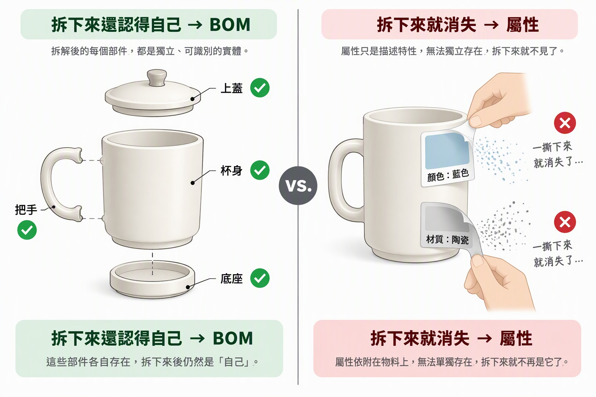

**圖 2-2　BOM 與屬性的界線：拆得下來的進 BOM，拆不下來的進屬性**

這個判準可以用一個更簡潔的方式表達：「拆下來之後，它還認得自己嗎？」如果答案是「認得」（例如杯蓋拆下來仍然是一個蓋子），那就進 BOM；如果答案是「不認得」（例如顏色被「拆下來」後什麼都不是），那就進屬性。這個標準不僅適用於杯子，也適用於任何物件：汽車的引擎、輪胎、車門可以拆下來後仍然是「一個引擎」「一個輪胎」「一扇車門」，所以它們是汽車 BOM 的項目；但汽車的顏色、品牌、出廠年份拆不下來，它們是汽車的屬性。

## 2.3　部件的三級分類：remove 判準

確認了部件清單之後，下一個問題是：每個部件對「整體是不是同一個東西」有多大的影響？形邏輯用一個 remove 判準來回答：把部件 pᵢ 從整體 M 中移除，觀察移除後的結果（見《形集合與形邏輯》5.3、5.5.2）。

| 等級 | 判斷結果 | 定義 | 杯子範例 | 手機範例 |
| --- | --- | --- | --- | --- |
| 必要件 | 移除後同一性喪失 | remove(pᵢ,M) ≢ M | 杯底、杯身 | 主機板、電池 |
| 功能降級件 | 功能缺失但身份存續 | remove(pᵢ,M) ≡ M' ⊂ M | 杯把、杯蓋 | 相機模組、喇叭 |
| 非必要件 | 移除後完全不影響 | remove(pᵢ,M) ≡ M | 貼紙、裝飾 | 保護貼、掛飾 |

**表 2-2　部件的三級分類與 remove 判準**

以杯子為例：杯底、杯身是必要件——移除後杯子不成杯子，同一性喪失；杯把、杯蓋是功能降級件——拿掉杯把，杯子仍能裝水、仍被認出是杯子，但失去了手持的功能；貼紙、裝飾則是非必要件，移除後完全不影響。這個三級分類在工程上有直接的對應：必要件對應「安全關鍵件」，功能降級件對應「可選功能件」，非必要件對應「裝飾件／消耗件」。

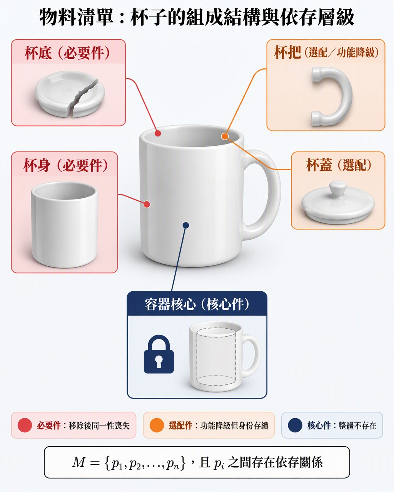

**圖 2-3　物料清單：杯子的組成結構與依存層級**

## 2.4　BOM 的逐步浮現與分工

BOM 也隨觀察樣本增加而逐步浮現。第一個杯子（玻璃、透明、無手把、無蓋）整體是連續的玻璃，拿掉任何一部分都不會剩下可獨立命名的東西，此階段 BOM 只有杯身、杯底兩項；第二個杯子（陶瓷、藍色、有手把、無蓋）多了手把可拆下，BOM 增為三項；第三個杯子（玻璃、透明、有手把、有蓋子）又多了蓋子，BOM 增為四項。部件的清單，跟屬性的維度一樣，是被「新出現的可拆物」一步步撐開的。

到這裡，Y 軸與 X 軸的分工已經完全清楚：BOM 負責回答「這個東西打開來看，由哪些可以獨立辨識的部件組成」；屬性負責回答「這個東西（不管是整體，還是 BOM 裡的某個部件）本身是什麼樣子」。BOM 決定樹狀結構往下分幾支，屬性決定每一支、每一個節點自己的樣貌。兩者合在一起，才能把一個個體完整、無遺漏地描述出來。

> **本章重點**
>
> ◆ BOM 判準：拆下來認得自己 → 進 BOM；拆下來就消失 → 進屬性。
> ◆ remove 判準三級分類：必要件（同一性喪失）／功能降級件（功能缺、身份存）／非必要件。
> ◆ BOM 是樹狀結構的分枝，屬性是每個節點的樣貌——兩者缺一不可。

# 第三章　空間容器——容器集合 ( )（Z 軸）

**章節意象・容器之光——邊界與內部空間**

Z 軸回答的是第三個問題：東西在哪裡？回答這個問題的是空間容器——一個在空間中具有明確邊界的物體，邊界圍出一塊內部空間，讓其他東西可以被放進、也可以被拿出。本章建立容器的三要素、容器的形式化定義與不變性公理，並看容器如何一層一層嵌套。

## 3.1　容器：身份不隨內容物改變

空間容器指的是：一個在空間中具有明確邊界的物體，這個邊界圍出一塊「內部空間」，讓其他東西可以被放進、也可以被拿出，而容器本身不會因為內部空間裡有沒有東西、裝的是什麼東西，而改變自己是誰。簡而言之，容器回答的是「東西在哪裡」的問題，而不是「東西是什麼」的問題。杯子不會因為裡面裝的是水還是咖啡，就變成不同的東西——它自始至終都是同一個杯子。

這跟一般集合的身份很不一樣（見《形集合與形邏輯》5.2）：{ 水 } 拿掉水、換成 { 咖啡 }，已經是「另一個集合」，沒有一個「杯子」可以撐住這個身份，讓它在內容物變動之後還被認出是同一個東西。容器多做了一件數學集合不做的事：它讓這個集合擁有一個獨立於元素之外的「自己」。

**容器 ＝ 集合 ＋ 一個不隨元素變動而改變的身份。**

## 3.2　容器的三要素

一個空間容器包含三個要素：邊界、內部空間、獨立的身份。

### （一）邊界

邊界是容器最核心的部分，功能是區分「裡面」和「外面」。杯壁、碗身、房間的牆、書包的布料、口袋的縫線都是邊界；邊界不一定要是實體固體，水面、一條用粉筆畫出來的線，只要能明確劃出「進去了」跟「還沒進去」的差別，都可以構成邊界。邊界可以是封閉的（如密封的保溫瓶），也可以是開放的（如沒有蓋子的杯子），開放與否會影響東西能不能「掉出去」，但不影響容器本身是不是容器。

### （二）內部空間

內部空間是邊界圍出來、實際用來容納其他物體的那塊空間，其大小與形狀決定容器能裝什麼、能裝多少。內部空間可以是空的（空杯子仍然是杯子），也可以同時容納多種不同的東西（杯子裡可以同時有水跟冰塊）。

### （三）獨立的身份

這是空間容器最關鍵、也最容易被忽略的性質：容器的身份不由它裝的內容物決定，而是由它自己的邊界和結構決定。因為身份獨立於內容物，容器才能經歷「裝東西 → 拿出來 → 裝別的東西」這整個過程，而每一次都仍被認出是同一個容器。這跟一般東西的身份很不一樣：如果把一杯水的「水」換成「咖啡」，我們不會說「這杯水變成了咖啡」，而是說「杯子裡的東西換了」「換的是內容物」，而「容器沒有變」——這個語感其實已經反映出容器身份獨立於內容物的性質。

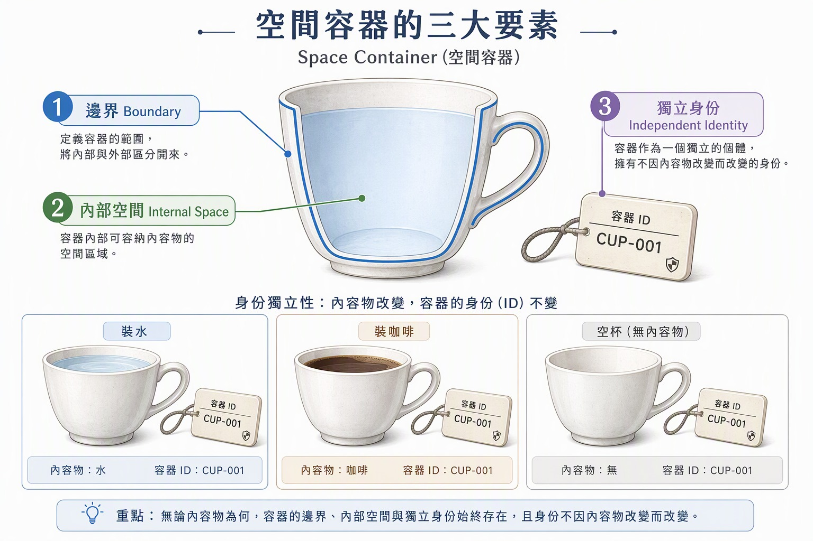

**圖 3-2　空間容器的三大要素：邊界、內部空間、獨立身份**

| 要素 | 功能 | 杯子的例子 | 開放性 |
| --- | --- | --- | --- |
| 邊界 | 區分裡面與外面 | 杯壁 | 可封閉、可開放 |
| 內部空間 | 容納內容物 | 杯中空間 | 可空、可同時容多物 |
| 獨立身份 | 內容物替換後仍是自己 | CUP-001 的 ID | 不隨內容物改變 |

**表 3-1　空間容器的三要素**

## 3.3　容器的形式化與層次

形邏輯把容器寫成一個二元組（見《形集合與形邏輯》5.2）：

> **容器的形式化定義**
>
> ◆ 容器 C = ( 身份識別 id(C), 內部空間 S(C) )。
> ◆ 身份識別 id(C)：一個不隨 S(C) 中元素變動而改變的標記。
> ◆ 內部空間 S(C)：一個可以容納元素的集合，其內容可替換、可清空。
> ◆ 不變性公理：∀ e₁, e₂ ∈ S(C)，替換 e₁ 為 e₂ 不改變 id(C)。

這裡的關鍵在於「層次」。杯子與水其實是兩個不同層次的東西：杯子是那個保持不變的身份，水是可以被替換的內容物。如果只用集合的語言寫，這兩層會被壓平成同一層——{ 杯子, 水 } 裡的兩個元素地位完全相等，看不出誰是身份、誰是內容物。日常語言卻從不含糊：我們說「杯子裡有水」時，從不曾把杯子和水當成同一種東西。

這個區別在工程與資料建模中尤其關鍵。在關聯式資料庫裡，「杯子表」和「內容物表」是兩張不同的表，內容物表透過外鍵參考杯子表的主鍵，這種主從關係本身就體現了「層次」的概念——主鍵是 id(C)，外鍵指向的是「被裝進哪個身份裡」。Z 軸教會我們的事，正是：先確定身份，再談內容。

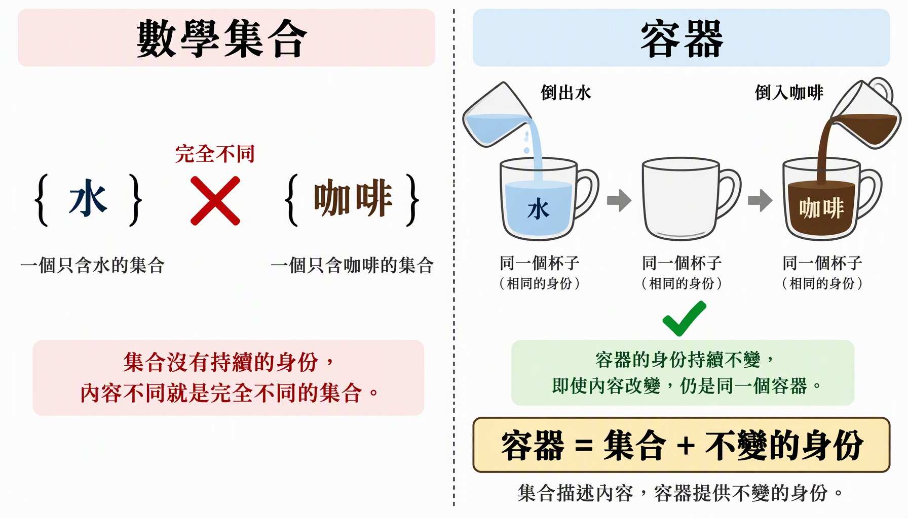

**圖 3-3　容器：身份不隨內容物改變——容器 ( ) 與純集合的對比**

## 3.4　容器的嵌套

由此延伸出容器與內容物的關係：內容物是可替換的、可移除的，也不會反過來定義容器；容器可以有大小限制，這也是容器區別於「無邊界的空間」的地方。此外，容器還可以互相嵌套：杯子可以放進袋子裡，袋子可以放進箱子裡，箱子可以放進房間裡；每一層容器都各自獨立成立，各自遵守「邊界、內部空間、獨立身份」這三個基本要素。

**圖 3-4　容器的嵌套：杯入袋、袋入箱、箱入房，每一層各自獨立成立**

嵌套是空間結構的常態，也是「單位形」可以組合成更複雜系統的關鍵：每一個容器都是一個穩定的身份，而它可以成為上一層容器的內容物。到這裡，三條軸都已就位——X 軸給它樣子、Y 軸給它部件、Z 軸給它身位。下一步，就是把三條軸合起來：第四章的形集合，給出單位形的完整表記。

> **本章重點**
>
> ◆ 容器 ＝ 集合 ＋ 不隨元素變動而改變的身份（不變性公理）。
> ◆ 三要素：邊界（區分內外）、內部空間（容納內容物）、獨立身份（id(C) 恆定）。
> ◆ 層次：容器是身份、內容物是元素；容器可嵌套，層層各自成立。

# 第四章　形集合——單位形的完整表記

前三章各佔一條軸：X 軸的抽象 [ ]、Y 軸的組成 { }、Z 軸的容器 ( )。本章把三者合流，回答一個問題：如何用一套記號，把一個單位形「完整地表記」下來？答案是形集合——在數學集合這個最小核心之上，疊加三種加值，補回被省略的三層資訊。

## 4.1　數學集合的侷限：被省略的三層資訊

數學集合本來就只回答一個問題：「屬不屬於」。這套語言極度精簡——它假設得最少，因此也描述得最少。當我們說「水屬於杯子裡裝的東西」，集合論能精確地用「水 ∈ S」來表達這個關係；但它同時也把另外三層在日常語言中自然攜帶的資訊全部省略掉了（見《形集合與形邏輯》5.1）：

◆ 身份的獨立性：杯子不會因為裝了水或咖啡就變成別的東西。

◆ 元素之間的結構：杯把、杯底、杯蓋不是隨便擺放的，它們彼此依存、各有位置。

◆ 生成規則：「杯子」這個類別不是一份寫死的清單，而是一條可以判斷新成員的規則。

形邏輯要做的，就是把這三層被省略掉的資訊逐一補回來。為此，我們引入三種不同的括號系統，分別對應三種不同的「加值」：

| 集合別 | 括號別 | 範例 | 補上的資訊 |
| --- | --- | --- | --- |
| 組成集合 | 大括號 { } | { 杯把, 杯底, 杯蓋, 杯身 } | 物料清單——元素之間的組成結構 |
| 抽象集合 | 中括號 [ ] | [ 白色, 黑色, 黃色 ] | 屬性——特徵交集的生成規則 |
| 容器集合 | 小括號 ( ) | ( 水, 咖啡 ) | 容器——不隨內容物改變的身份 |

**表 4-1　三種括號與三種加值**

數學集合 = { 杯把, 杯底, 杯蓋, 杯身, 咖啡, 白色 }——六個元素並列，層次被壓平。形集合則把三層資訊各歸其位。

## 4.2　單位形 ＝ 形集合

把三種括號合在一起，就得到單位形的完整表記。形集合沿用大括號 { } 作為外框，組成集合於形集合內無需額外括號；內容物以 ( )、屬性以 [ ] 標示在其中：

**單位形 ＝ 形集合 ＝ 咖啡杯：{ 杯把, 杯底, 杯蓋, 杯身, (咖啡), [白色] }**

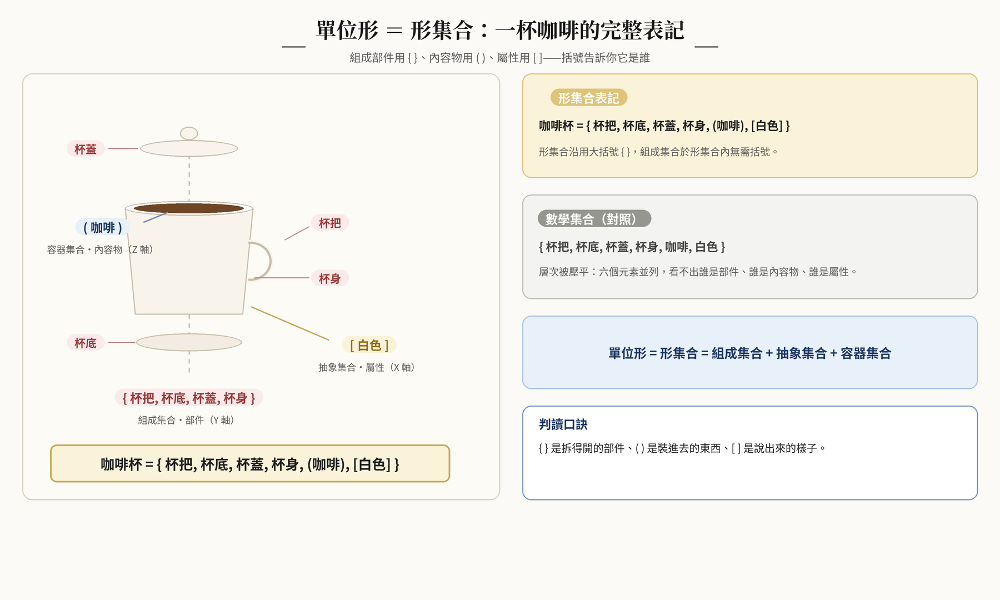

**圖 4-2　單位形 ＝ 形集合：一杯咖啡的完整表記**

這條式子值得慢慢讀。{ 杯把, 杯底, 杯蓋, 杯身 } 是組成集合——回答「由什麼組成」，是 Y 軸的產物；( 咖啡 ) 是容器集合——回答「裝著什麼」，是 Z 軸的產物；[ 白色 ] 是抽象集合——回答「是什麼樣子」，是 X 軸的產物。三種括號在一個大括號裡各安其位，一個單位形就被完整地表記了。

對照之下，數學集合 { 杯把, 杯底, 杯蓋, 杯身, 咖啡, 白色 } 把六個元素壓平成同一層：看不出誰是部件、誰是內容物、誰是屬性。括號的差異，正是層次的差異；形集合用括號把層次寫進了記號裡。

## 4.3　三種加值的疊加

三種加值可以理解為三個疊加的步驟（見《形集合與形邏輯》5.1、5.6）：以數學集合為底，先補上組成 { } 的部件結構，再補上屬性 [ ] 的類別規則，最後補上容器 ( ) 的不變身份——每疊加一層，就補回一層被數學集合省略的資訊。

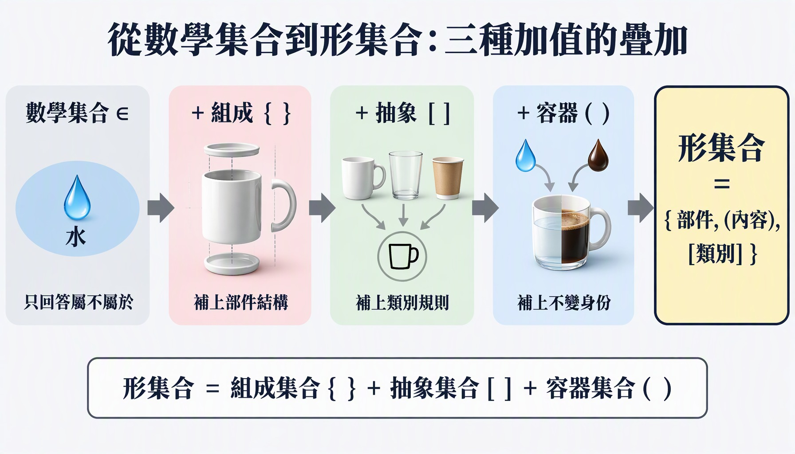

**圖 4-1　從數學集合到形集合：三種加值的疊加**

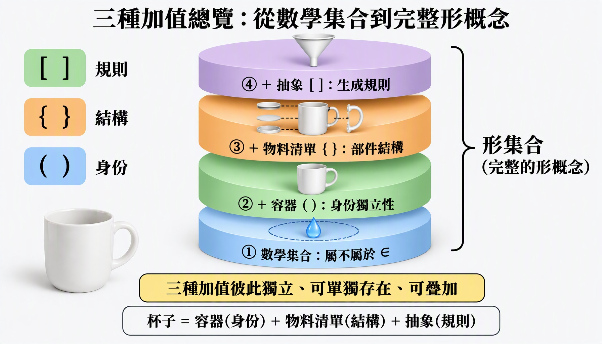

**圖 4-4　三種加值總覽：從數學集合到完整形概念**

| 加值類型 | 補上的性質 | 核心貢獻 | 括號 |
| --- | --- | --- | --- |
| 容器 | 身份的獨立性 | 讓集合裡多了一個不隨元素變動的「自己」 | (  ) |
| 物料清單 | 元素間的結構 | 讓集合裡的元素不再只是並列，而是有了依存關係 | {  } |
| 屬性 | 抽象生成規則 | 讓集合從一份寫死的清單變成一條可以自動判斷新成員的準則 | [  ] |

**表 4-2　三種加值總覽**

這三種加值彼此獨立，可以單獨存在，也可以疊加在一起。一個「杯子」同時擁有容器的身份獨立性、BOM 的部件結構、以及抽象的類別規則，這三者共同構成了我們對「杯子」這個概念的完整理解。

## 4.4　同一句話，三層意義

當我們說「杯子裡有水」，我們同時在說三件事：一、集合關係（水 ∈ 杯子裡裝的東西）；二、容器的加值（杯子有一個不隨內容物改變的身份）；三、容器的可替換性（倒掉水、換成咖啡，杯子還是那個杯子）。數學集合只捕捉了第一層，但日常認知其實同時運作著全部三層。

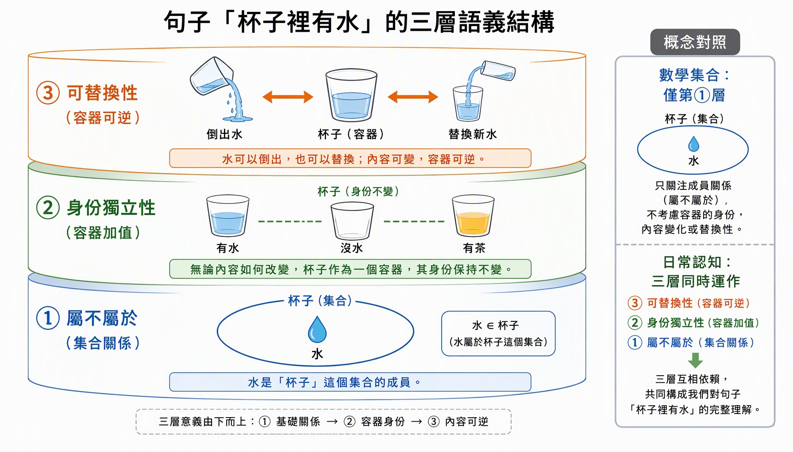

**圖 4-3　同一句話，三層意義**

「杯子由杯把、杯底、杯蓋組成」也一樣：除了表達「這些部件都屬於杯子」，還預設了部件之間有固定的接合關係；「保溫杯也是杯子」除了表達「保溫杯屬於杯子這個集合」，還預設了一條可以不斷生出新成員的判斷規則。日常語言裡的每一句話，都同時壓縮了這三層資訊——數學集合只保留了最前面那一句「屬不屬於」，其餘三層都被省略掉了。

數學集合之所以好用，正是因為它把「一群東西構成整體」這件事濃縮到只剩下「屬不屬於」。形集合的價值，則是在這個最小核心之上，系統性地疊加三種加值，讓「形」的概念從一個抽象的數學工具，變成一個能夠完整描述現實世界的認知框架。

> **本章重點**
>
> ◆ 數學集合只答「屬不屬於」；省略的三層＝身份獨立性、組成結構、生成規則。
> ◆ 單位形 ＝ 形集合 ＝ { 部件, (內容), [類別] }——三種括號，三種加值，三條軸。
> ◆ 三種加值彼此獨立、可疊加；同一句日常語言，同時承載三層意義。

# 第五章　形邏輯——三層判斷與應用

前四章建立的是「靜態的知識結構」——怎麼描述一個形、怎麼表記一個形。本章把這套結構轉化為「動態的認知操作」：面對一個具體物件，如何運用三條軸的判準做出判斷（見《形集合與形邏輯》5.5）。三層判斷各有各的問題：容器判斷問「身份是否獨立於內容物？」物料清單判斷問「拿掉部件後，整體還是同一個東西嗎？」抽象判斷問「新物件是否符合類別規則？」——最後以三層聯合判斷與六則練習，展示形邏輯如何在實際物件上完整運作。

## 5.1　容器判斷：身份是否獨立於內容物？

當我們面對一個「裝了東西的整體」時，第一個要判斷的問題是：這個整體有沒有一個不隨內容物改變的身份？

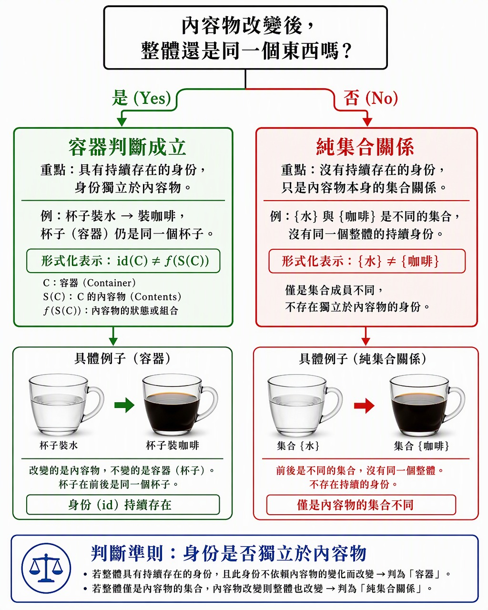

**圖 5-1　容器判斷流程：內容物改變後，整體還是同一個東西嗎？**

| 步驟 | 操作 | 判斷標準 |
| --- | --- | --- |
| 1 | 確認整體包含可替換的內容物 | 內容物能被取出、更換、清空 |
| 2 | 替換內容物 | 將 e₁ 換為 e₂ |
| 3 | 檢查身份 | id(整體) 在替換前後是否相同？ |
| 4a | 相同 → 容器判斷成立 | 適用容器邏輯 ( ) |
| 4b | 不同 → 純集合關係 | 僅適用數學集合 ∈ |

**表 5-1　容器判斷的四個步驟**

實作範例：書包放入課本或換成筆袋，書包仍是同一個書包 → 容器 ✓；電腦資料夾裡的檔案可以增刪改，資料夾本身不變 → 容器 ✓；{ 蘋果, 香蕉 } 拿掉蘋果換成橘子，變成另一個集合 → 純集合 ✗。

## 5.2　物料清單判斷：拿掉部件後，整體還是同一個東西嗎？

確認了一個整體具有結構性部件之後，下一步要判斷：每個部件對整體的同一性有多大的影響？這正是第二章 remove 判準的判斷版本——沿著「移除後會怎樣」這條問題，把部件分為必要件、功能降級件、非必要件三級。

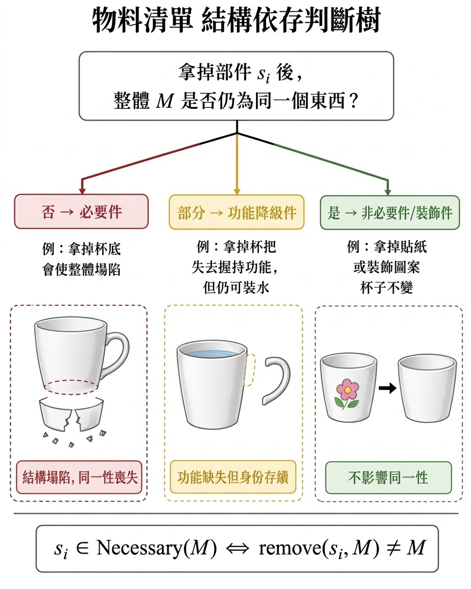

**圖 5-2　物料清單結構依存判斷樹**

判斷樹從根問題「remove(pᵢ,M) 是否仍 ≡ M？」分出三條路徑：否 → 必要件（移除後同一性喪失）；部分 → 功能降級件（功能缺失但身份存續）；是 → 非必要件。以智慧型手機為例，三級分類一目了然：

| 部件 | 移除後結果 | 分類 |
| --- | --- | --- |
| 主機板 | 無法開機，功能完全喪失 | 必要件 |
| 電池 | 無法供電，功能喪失 | 必要件 |
| 螢幕 | 無法顯示／觸控 | 必要件 |
| 相機模組 | 無法拍照，通話／上網正常 | 功能降級件 |
| 喇叭 | 無法外放，耳機可用 | 功能降級件 |
| 保護貼 | 完全不影響功能 | 非必要件 |

**表 5-2　智慧型手機的部件三級分類**

值得注意的是：物料清單判斷關心的是「結構角色」，不是「實現方式」。這一點在第五章的電動車例裡會再出現——只要部件扮演的角色不變，換一種實現方式不影響判斷。

## 5.3　抽象判斷：新物件是否符合類別規則？

當我們需要判斷一個新出現的物件是否屬於某個類別時，不是去查清單，而是用交集判準 ∩(T) 當場驗證。

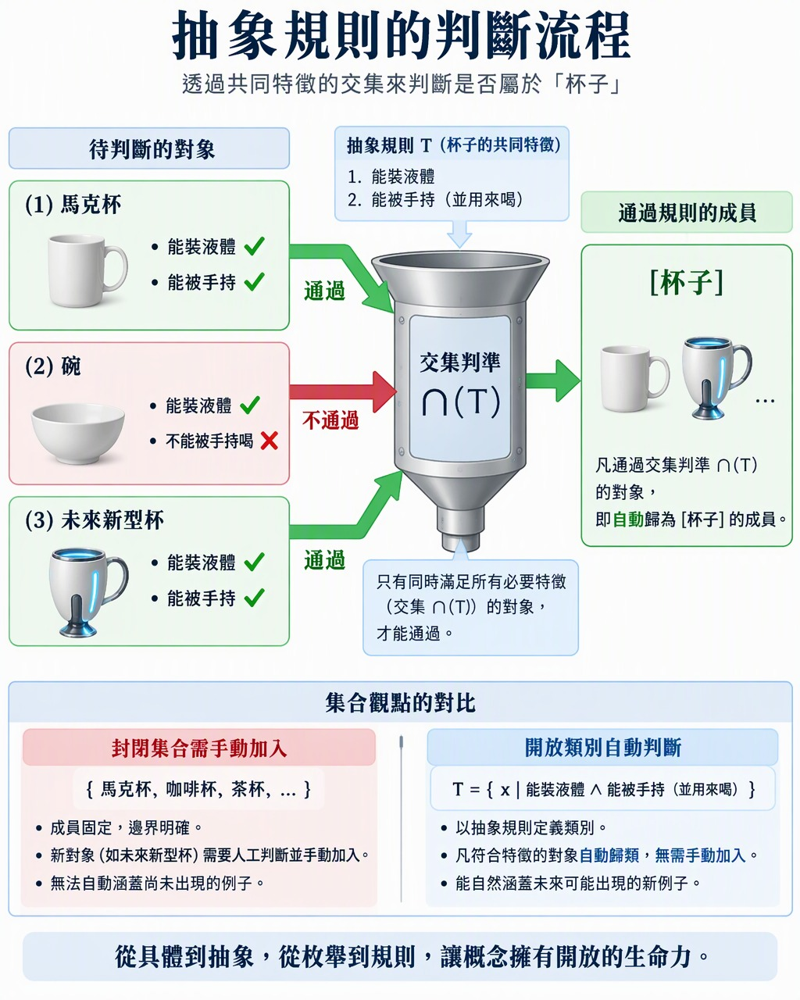

**圖 5-3　抽象規則的判斷流程：三個待判斷對象通過交集判準漏斗**

| 步驟 | 操作 | 說明 |
| --- | --- | --- |
| 1 | 確定類別 T 的必要特徵集合 F(T) | 例如 F(杯子) = { 能裝液體, 能被手持喝 } |
| 2 | 逐一檢驗新物件 o 的每個特徵 | fᵢ(o) = true / false |
| 3 | 取交集 | ∩(T)(o) = ∀ fᵢ ∈ F(T), fᵢ(o) = true? |
| 4a | 全部通過 → o ∈ [T] | 自動歸類，不需手動加入 |
| 4b | 任一失敗 → o ∉ [T] | 不屬於此類別 |

**表 5-3　抽象判斷的四個步驟**

邊界案例最能考驗規則的精確度。碗：能裝液體 ✓，但不能被手持喝 ✗ → 不屬於 [ 杯子 ]；吸管杯：能裝液體 ✓，透過吸管喝 ✓ → 屬於 [ 杯子 ]；注射器：能裝液體 ✓，能被手持 ✓，但用途不是「喝」→ 取決於 F(T) 是否包含「用於飲用」。這個邊界案例說明了：規則的精確度取決於特徵集合 F(T) 的完備度——特徵清單的選擇本身，就是對概念的理解與立場表達。

## 5.4　三層聯合判斷：智慧型手機

現在把三層判斷合在一起，用「智慧型手機」作為測試對象，展示形邏輯如何在實際物件上完整運作。

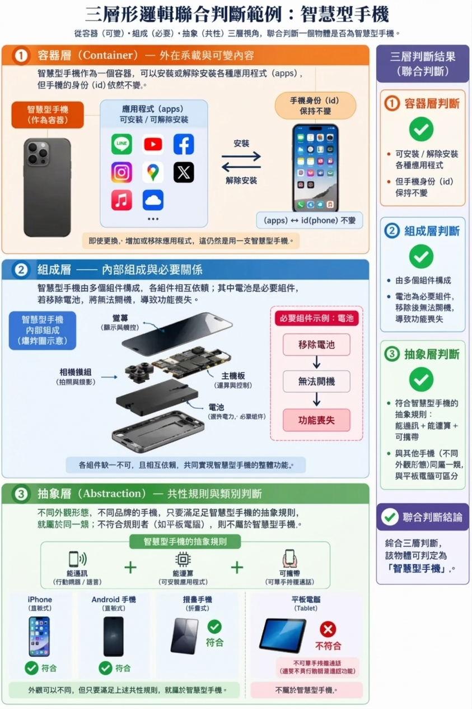

**圖 5-4　三層形邏輯聯合判斷範例：智慧型手機**

### 第一層：容器判斷

手機是否有可替換的內容物？✓ App 可安裝／移除。替換內容物後身份是否不變？✓ 裝 LINE 或卸載 YouTube，手機仍是同一支。容器判斷成立——手機 ＝ 容器( App )。

### 第二層：物料清單結構依存判斷

主機板、電池、螢幕為必要件（見表 5-2）；相機模組、喇叭為功能降級件；保護貼為非必要件。部件結構與依存關係明確。

### 第三層：抽象規則判斷

F(智慧型手機) = { 能通訊, 能運算, 可攜帶 }，逐一檢驗：

| 測試物件 | 能通訊 | 能運算 | 可攜帶 | 結果 |
| --- | --- | --- | --- | --- |
| iPhone | ✓ | ✓ | ✓ | ∈ [智慧型手機] |
| Android 手機 | ✓ | ✓ | ✓ | ∈ [智慧型手機] |
| 折疊手機 | ✓ | ✓ | ✓ | ∈ [智慧型手機] |
| 平板電腦 | ✗ | ✓ | ✓ | ∉ [智慧型手機] |
| 智慧手錶 | ✓ | ✓ | ✗ | ∉ [智慧型手機] |

**表 5-4　F(智慧型手機) 的特徵檢驗**

> **聯合判斷結論**
>
> ◆ 智慧型手機同時滿足三層判斷：容器層 ✓（App 的容器，身份獨立）、組成層 ✓（明確的部件結構與依存關係）、抽象層 ✓（符合「能通訊 ∧ 能運算 ∧ 可攜帶」）。
> ◆ 三層缺一不可：只看容器層，平板也是手機；只看組成層，計算器也是手機；只看抽象層，對講機也是手機。只有三層同時通過，才能精確界定「智慧型手機」。

## 5.5　判斷練習：六題問答

以下六組判斷練習題，涵蓋容器、物料清單、抽象三層以及聯合判斷。每題先給出問題情境，再逐步展開解答過程。

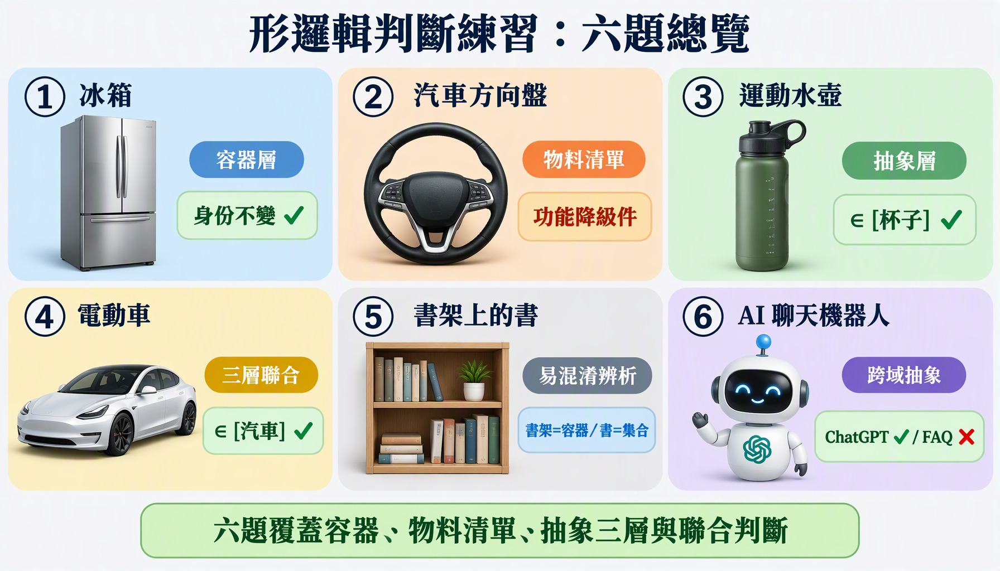

**圖 5-5　形邏輯判斷練習：問題與解答**

### 問題一：冰箱是容器嗎？（容器層判斷）

問題：冰箱可以放入各種食物，也可以把食物全部取出。當內容物改變時，冰箱還是同一個冰箱嗎？

解答：步驟 1 確認可替換內容物 ✓（食物可放入／取出／更換）；步驟 2 執行替換（牛奶換蔬菜）；步驟 3 檢查身份：冰箱前後仍是「同一台冰箱」，id 不變；步驟 4 容器判斷成立 ✓。

延伸思考：如果把壓縮機拆掉，它還是不是「冰箱」？這不再是容器層問題，而是物料清單層——壓縮機是必要件，移除後同一性喪失。容器層只關心「內容物替換」，不關心「結構部件移除」。

### 問題二：汽車的方向盤是哪一級部件？（物料清單層判斷）

解答：方向盤移除後，汽車仍能辨識為汽車（外觀／車身／引擎都在），但無法轉向駕駛 → 功能降級件。對照：引擎是必要件（無法啟動，不再是可行駛的汽車）；空調是功能降級件（仍能正常行駛，只是不舒適）；音響與車標是非必要件（完全不影響行駛與安全）。

### 問題三：水壺屬於 [ 杯子 ] 嗎？（抽象層判斷）

問題：F(杯子) = { 能裝液體, 能被手持喝 }。運動水壺（750ml、有吸管口）是否 ∈ [ 杯子 ]？

解答：能裝液體 ✓ ＋ 能被手持喝（透過吸管口）✓ → ∩(T) ✓ → ∈ [ 杯子 ]。對比：保溫壺（2L、需倒出才能喝）：能裝液體 ✓ ＋ 不能被手持喝 ✗ → ∉ [ 杯子 ]，但 ∈ [ 容器 ]。關鍵洞察：不同 F(T) 定義不同類別，同一物件可能屬於上層類別但不屬於下層子類別。

### 問題四：電動車是 [ 汽車 ] 嗎？（三層聯合判斷）

問題：Tesla Model 3 沒有內燃機，改用電池與電動馬達。它還算「汽車」嗎？

第一層（容器）：乘客／貨物可上下車 ✓，載不同的人仍是同一台車 ✓ → 容器成立。第二層（物料清單）：電池組＝必要件（取代引擎角色）、電動馬達＝必要件、中控螢幕＝功能降級件、自動駕駛感測器＝功能降級件——物料清單關心結構角色而非實現方式。第三層（抽象）：F(汽車) = { 能在道路行駛, 能載運人貨, 有動力系統, 可被駕駛操控 }，Tesla 全部通過 → ∈ [ 汽車 ]。

聯合結論：三層全通過 → 是汽車。規則寫「有動力系統」而非「有內燃機」，所以電力驅動不影響判斷——開放類別捕捉功能本質而非實現細節。

### 問題五：書架上的書是容器關係還是集合關係？（易混淆辨析）

| 判斷對象 | 身份是否持續 | 判斷結果 |
| --- | --- | --- |
| 書架（物理結構） | ✓ 不管放什麼書，書架不變 | 有容器 ( ) |
| 「書架上的書」（書的組合） | ✗ 換書就換了組合 | 容器內集合 { } |
| 書架＋書（展示單元） | 視語境而定 | 有容器與有內容物 |

**表 5-5　同一個物理場景中的不同判斷對象**

重要原則：同一個物理場景，取決於你關注的「整體」是什麼，可能同時涉及不同的判斷類型。判斷之前，先問「我正在判斷的對象是哪一個整體」。

### 問題六：AI 聊天機器人是 [ 對話系統 ] 嗎？（跨域抽象判斷）

問題：F(對話系統) = { 能接收自然語言輸入, 能產生自然語言回應, 能維持對話上下文 }。FAQ 機器人 vs ChatGPT？

| 特徵 | FAQ 機器人 | ChatGPT |
| --- | --- | --- |
| 能接收自然語言輸入 | ✓ | ✓ |
| 能產生自然語言回應 | △ 只能輸出預設回覆 | ✓ 自由生成 |
| 能維持對話上下文 | ✗ 每次獨立處理 | ✓ 多輪對話有上下文 |
| ∩(T) | ✗ | ✓ |
| 結果 | ∉ [對話系統] | ∈ [對話系統] |

**表 5-6　FAQ 機器人與 ChatGPT 的特徵對照**

FAQ 機器人不屬於 [ 對話系統 ]，但屬於更寬泛的 [ 資訊檢索工具 ]。調整 F(T) 的寬嚴度會改變判斷結果。與 AI 發展的關聯：形邏輯提供清晰思路——不要問「它是不是真的對話系統」這種本體主義問題，而是明確列出 F(T) 逐項檢驗。特徵清單的選擇本身就是對概念的理解與立場表達。

| 題號 | 覆蓋面向 | 教學目的 |
| --- | --- | --- |
| Q1 冰箱 | 容器層基本判斷 | 建立「身份 vs 內容物」直覺 |
| Q2 汽車方向盤 | 物料清單三級分類 | 區分必要件／功能降級件／非必要件 |
| Q3 水壺 vs 杯子 | 抽象規則邊界 | 體驗 F(T) 完備度如何影響結果 |
| Q4 電動車 | 三層聯合判斷 | 展示三層互補、缺一不可 |
| Q5 書架上的書 | 易混淆辨析 | 區分同一場景中不同判斷對象 |
| Q6 AI 聊天機器人 | 跨域應用 | 將形邏輯應用到非物理對象 |

**表 5-7　判斷練習的設計原則**

這些練習的共同特點：答案不是靠直覺猜的，而是靠走完判斷流程得出的。即使直覺對了，走完流程能讓你理解「為什麼對」；即使直覺錯了，走完流程能讓你發現「錯在哪一層」。這就是形邏輯作為認知工具的價值——它給你一套可重複、可檢驗、可辯論的判斷方法。

## 5.6　判斷的理論意義

從描述到判斷的跨越。前幾章建立的定義解決「怎麼描述一個形」的問題；本章的判斷流程解決「怎麼在實際情境中運用這些描述去做決策」的問題。前者是靜態的知識結構，後者是動態的認知操作。

三層判斷的互補性。每一層單獨使用時都有盲點：容器判斷無法區分結構差異，物料清單判斷無法處理內容替換，抽象判斷無法捕捉身份持續性。三層聯合使用時，盲點互相補足，形成完整的認知濾網。

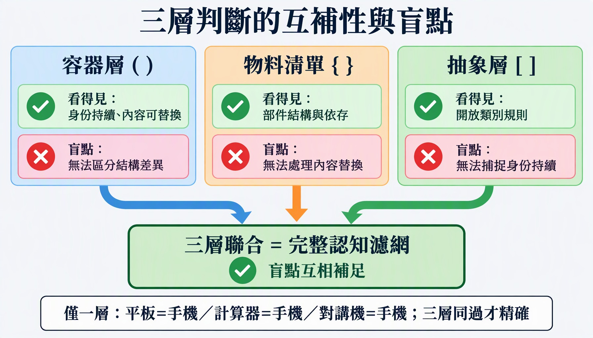

**圖 5-6　三層判斷的互補性與盲點**

與 AI 分類系統的對應。現代 AI 的分類系統本質上是在做抽象層的判斷。但它通常缺乏容器層（身份持續性追蹤）和組成層（結構依存分析）的能力。形邏輯的三層框架，恰好指出了當前 AI 分類能力的缺口，以及未來世界模型需要補上的維度。

> **本章重點**
>
> ◆ 三層判斷：容器判斷（身份 vs 內容物）、物料清單判斷（remove 三級）、抽象判斷（∩(T) 當場驗證）。
> ◆ 聯合判斷缺一不可：三層同時通過，才能精確界定一個類別。
> ◆ 判斷流程的價值：可重複、可檢驗、可辯論——答案從流程中得出，而不是靠直覺猜。

# 回顧——要點總整理與自我檢查

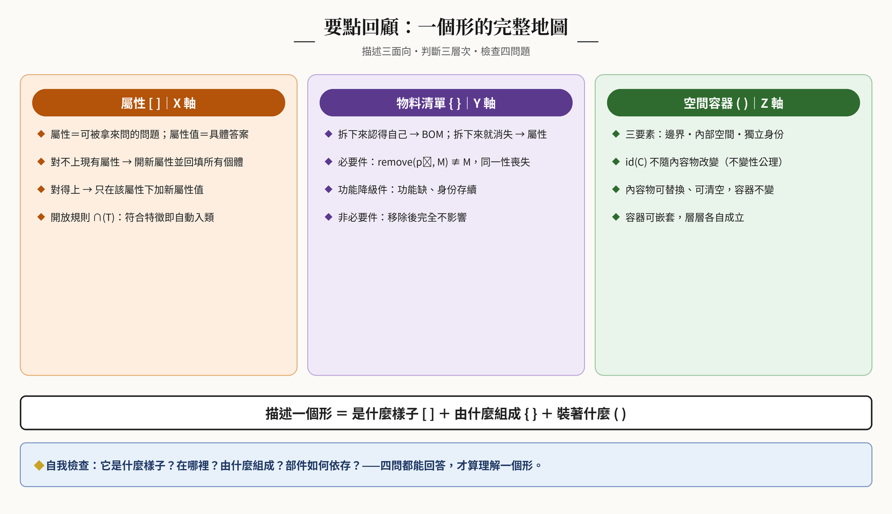

**圖 R-1　要點回顧：一個形的完整地圖**

R-1　三條軸，三種括號，三種加值。X 軸的屬性 [ ] 給一個形「樣子」——維度是屬性、刻度是屬性值，差異逼出新維度，對上就加新刻度；Y 軸的物料清單 { } 給一個形「部件」——拆下來認得自己就進 BOM，remove 判準再分必要件、功能降級件、非必要件；Z 軸的空間容器 ( ) 給一個形「身位」——邊界圍出內部空間，id(C) 不隨內容物改變。

R-2　描述與表記是一體兩面。理解一個形 ＝ 理解它是什麼樣子、在哪裡、由什麼組成、部件如何依存；表記一個形 ＝ { 部件, (內容), [類別] }。數學集合只回答「屬不屬於」，形集合把省略的三層——身份獨立性、組成結構、生成規則——逐一補回。

R-3　判斷是描述的動態運用。容器判斷看身份是否獨立於內容物、物料清單判斷看 remove 之後同一性是否存續、抽象判斷用 ∩(T) 當場驗證；三層聯合，盲點互補，形成完整的認知濾網。

| 自我檢查問題 | 你應該能回答的內容 |
| --- | --- |
| 它是什麼樣子？ | 列出關鍵屬性與屬性值；說明哪些屬性是被哪批差異逼出來的 |
| 它由什麼組成？ | 給出 BOM；每個部件通過「拆下來認得自己嗎」的檢核；標出必要件 |
| 東西放在哪裡？ | 指出容器的邊界、內部空間、id(C)；說明內容物替換後身份為何不變 |
| 部件如何依存？ | 用 remove(pᵢ,M) 判準把部件分為三級；說明移除後的具體影響 |
| 它屬於哪個類別？ | 寫出 F(T) 與 ∩(T)；逐項檢驗邊界案例（碗、吸管杯、保溫壺⋯⋯） |
| 三層判斷一致嗎？ | 以聯合判斷驗證：三層全通過，才下判斷結論 |

**表 R-1　自我檢查清單**

從一隻杯子出發，我們得到了一整套描述世界的語言：三條軸、三種括號、三層判斷。杯子是一個最小的標本，但這套方法適用於任何單位形——一只手錶、一台手機、一座城市、一個系統。把任何一個形放到桌上，問它那四個問題，你就已經站在形邏輯的起點上。

**理解一個形 ＝ 理解它是什麼樣子、在哪裡、由什麼組成、部件如何依存。**
