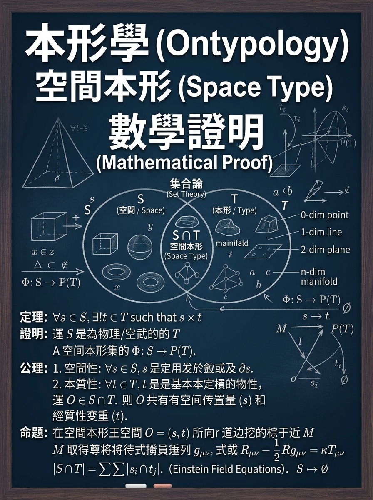

# 目　錄

- 寫在前面——補足篇的任務
- 導讀——證明的兩種語言
- 第一章　數學證明在集合論裡做什麼
  - 1.1　證明的三件套：定義、判準、推理
  - 1.2　純集合語言做得到什麼
  - 1.3　三處缺口：規則、身份、結構
- 第二章　補足規則：[ ] 把類別寫成規則
  - 2.1　定義一個類別：T = (F(T), ∩(T))
  - 2.2　交集判準漏斗：從特徵到歸類
  - 2.3　邊界案例：把定義磨利
  - 2.4　證明示範：類別歸屬
- 第三章　補足身份：( ) 把不變寫成公理
  - 3.1　容器 C = (id(C), S(C)) 與不變性公理
  - 3.2　證明中的「不變量」
  - 3.3　不變量五步驟
  - 3.4　證明示範：替換與同一性
- 第四章　補足結構：{ } 把依存寫成判準
  - 4.1　BOM 判準：拆下來認得自己嗎？
  - 4.2　remove 判準：三級分類
  - 4.3　證明示範：部件分級
- 第五章　準確使用方法——把三種補足裝回證明
  - 5.1　證明六步驟
  - 5.2　完整入門範例：一則小定理
  - 5.3　誤用對照：五種常見錯誤
  - 5.4　交出證明前的檢查清單
- 回顧——要點總整理與自我檢查
  - R-1　三種補足，三處缺口
  - R-2　證明三件套，一條主軸
  - R-3　準確，是可複核的準
- 附錄　術語與記號速查

# 寫在前面——補足篇的任務

這本小書是《單位形與集合邏輯》的補足篇。原書立起描述一個形的三條軸——屬性、物料清單、空間容器——並用三種括號，把一個形完整地表記下來。但「看得懂表記」和「寫得出證明」之間，還差一步：當你要用數學語言、以集合論的記號寫下一個證明時，這套工具怎麼用才準？本書補的正是這一步。

具體地說，本書做三件事。第一，把數學證明在集合論裡的現場看清楚：一個證明靠什麼站穩？純集合語言在哪裡不夠用？第二，給出三種「補足」——用 [ ] 補規則、用 ( ) 補身份、用 { } 補結構——每一種都配上可以直接寫進證明的用法。第三，收攏成一套「準確使用方法」：六步驟、三層檢查、誤用對照與檢查清單，讓你寫完證明後能自己驗收。

> **閱讀本書的二個約定**
>
> ◆　約定一：三種括號各有專屬職務。大括號 { } 是組成集合（物料清單）、中括號 [ ] 是抽象集合（屬性）、小括號 ( ) 是容器集合（空間容器）。
>
> ◆　約定二：全書沿用原書的杯子。杯子既是日常物件，也是練習證明最忠實的標本。

| **證明中的缺口** | **補足工具** | **用到的判準** | **章節** |
| --- | --- | --- | --- |
| 規則被省略——類別寫成死清單 | [ ] 抽象集合 | T = (F(T), ∩(T)) | 第二章 |
| 身份被省略——內容一換就散 | ( ) 容器集合 | C = (id(C), S(C))、不變性公理 | 第三章 |
| 結構被省略——部件只是並列 | { } 組成集合 | BOM 判準、remove 三級 | 第四章 |
| 三者合流——裝回同一個證明 | 六步驟＋三層檢查 | ∩(T)・id(C)・remove 聯合 | 第五章 |

**表 0-1　補足地圖：證明的三處缺口與三種補足**

**證明寫得準，是因為每一層資訊都寫在它該在的位置上。**

# 導讀——證明的兩種語言

數學證明幾乎都用集合論的語言寫成。純集合語言的優點是極精簡：它只回答「屬不屬於」，x ∈ S 或 x ∉ S，一翻兩瞪眼。正因為假設得最少，它也省略得最多——身份、結構、規則三層資訊，在「{ 杯把, 杯底, 杯蓋, 杯身, 咖啡, 白色 }」這樣的清單裡全部被壓平。

形集合語言以純集合為核心，加上三種加值：{ } 補回部件的組成結構、( ) 補回不隨內容改變的身份、[ ] 補回可以自動判斷新成員的生成規則。兩種語言不是互相取代，而是疊加——證明的骨架用純集合寫，證明的完整度靠三種補足。

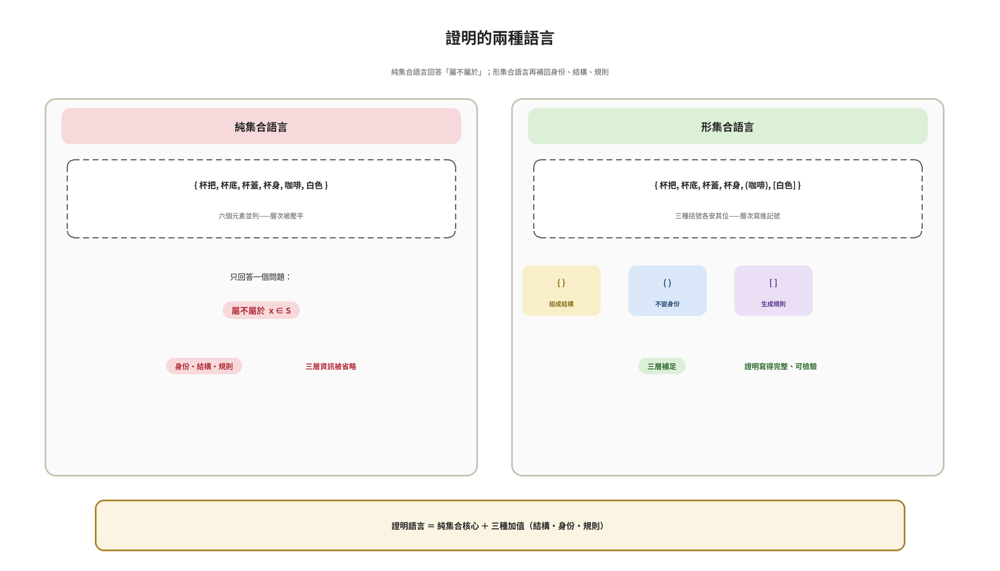

**圖 D-1　證明的兩種語言：純集合核心與三種加值**

| **集合別** | **括號** | **範例** | **證明中的職務** | **章節** |
| --- | --- | --- | --- | --- |
| 抽象集合 | [ ] | [ 白色, 黑色, 黃色 ] | 寫下類別規則，逐項驗證 | 第二章 |
| 組成集合 | { } | { 杯把, 杯底, 杯蓋, 杯身 } | 寫下部件結構與依存 | 第四章 |
| 容器集合 | ( ) | ( 水, 咖啡 ) | 寫下不變的身份 | 第三章 |

**表 D-1　三種括號速覽**

> **一句話，拆三層**
>
> ◆　「杯子裡有水」在證明裡應該拆成三層：集合關係（水 ∈ S(C)）、身份恆定（id(C) 不變）、內容可替換（e1 換成 e2）。
>
> ◆　純集合只寫下第一層；三種補足把後兩層補回來，證明才算完整。

# 第一章　數學證明在集合論裡做什麼

**章節意象・證明之門——定義、判準、推理**

寫一個證明之前，先弄清楚證明本身靠什麼站穩。這一章拆解證明的三件套，看看純集合語言能做到什麼、又在哪三處留下缺口——缺口在哪，補足就往哪去。

## 1.1　證明的三件套：定義、判準、推理

任何一個數學證明，翻開來都是三樣東西的組合。定義：先說清楚你在談的對象是誰——「杯子」這個類別包含什麼、不包含什麼。判準：給出可以逐項驗證的標準——怎麼算「屬於」、怎麼算「還是同一個」。推理：從已知的定義與判準出發，一步一步走向結論，每一步都能被檢驗。

三件套缺一不可。沒有定義，證明沒有對象；沒有判準，證明只能靠感覺；沒有推理，只有結論沒有過程。集合論之所以成為數學證明的通用語言，正是因為它把「定義」與「判準」寫得格外精確。

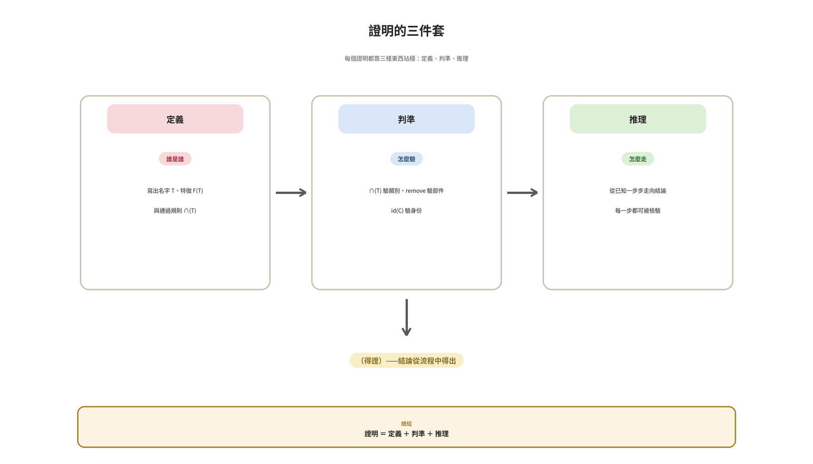

**圖 1-1　證明的三件套：定義、判準、推理**

但精確有代價。純集合語言把「屬不屬於」寫到極致，其餘的資訊就只能被省略。要看清省略了什麼，先看它做得到什麼。

## 1.2　純集合語言做得到什麼

純集合語言的核心記號是大括號 { } 與屬於號 ∈。「水 ∈ S」表達「水屬於集合 S」，「A ⊆ B」表達 A 的每個元素都屬於 B。這套語言可以精確地陳述成員關係、子集關係、交集與聯集——大部分數學證明的骨架，都可以用這幾個記號搭起來。

| **記號** | **讀法** | **證明中的用途** |
| --- | --- | --- |
| { a, b, c } | 集合，列舉成員 | 寫出對象的範圍 |
| x ∈ S／x ∉ S | 屬於／不屬於 | 陳述歸屬 |
| A ⊆ B | 子集 | 陳述包含關係 |
| A ∩ B／A ∪ B | 交集／聯集 | 合併條件 |

**表 1-1　純集合記號與它在證明中的能力**

對數學證明來說，這已經夠用——前提是，你只需要回答「屬不屬於」。一旦證明裡需要追問「它由什麼組成」「換了內容還是同一個嗎」「新物件算不算成員」，純集合就開始省略。

## 1.3　三處缺口：規則、身份、結構

參考文件 4.1 指出：數學集合把三層日常語言自然攜帶的資訊省略掉了。落在證明上，就是三處具體的缺口。

缺口一，規則。{ 馬克杯, 玻璃杯, 紙杯 } 是一份寫死的清單——新出現的保溫杯算不算「杯子」？清單回答不了。證明裡凡是需要「判斷新成員」的地方，都需要一條開放的生成規則。

缺口二，身份。{ 水 } 拿掉水換成 { 咖啡 }，已經是另一個集合。可是日常說「杯子裡換裝咖啡」時，杯子還是那個杯子。證明裡凡是需要「在變動中保持同一」的地方，都需要一個不隨內容改變的身份。

缺口三，結構。{ 杯把, 杯底, 杯蓋, 杯身 } 四個元素並列，看不出誰依存於誰。可是拆掉杯底和拆掉杯把，後果完全不同。證明裡凡是需要「分清主次」的地方，都需要部件的依存結構。

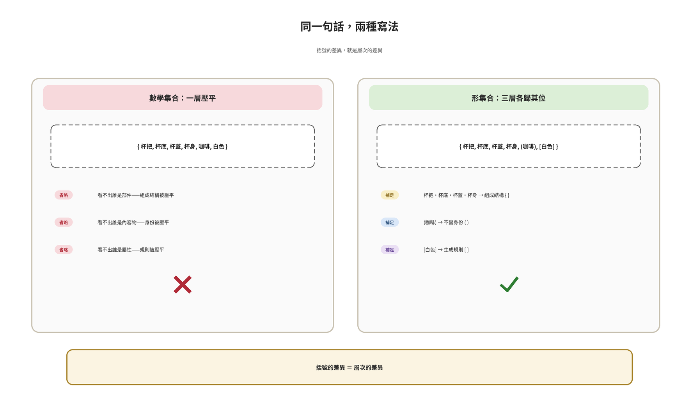

**圖 1-2　同一句話，兩種寫法：層次被壓平與各歸其位**

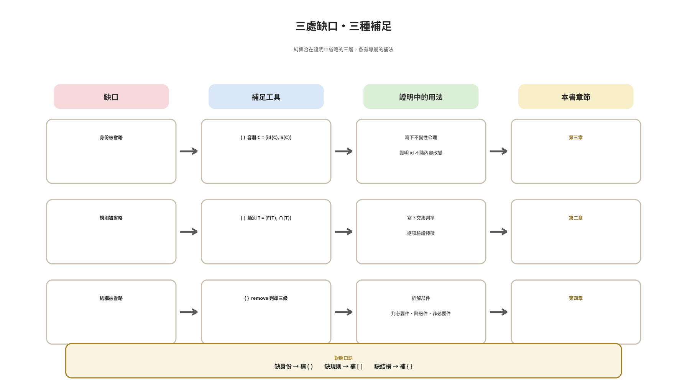

**圖 1-3　補足地圖：三處缺口各有專屬的補法**

| **缺口** | **純集合的寫法** | **補足後的寫法** | **工具** |
| --- | --- | --- | --- |
| 規則 | { 馬克杯, 玻璃杯, 紙杯 }（封閉清單） | [ x｜x 通過 ∩(T) ]（開放規則） | [ ] |
| 身份 | { 水 } → { 咖啡 }（換了集合） | (水) → (咖啡)，id(C) 不變 | ( ) |
| 結構 | { 杯把, 杯底, 杯蓋, 杯身 }（並列） | remove(p,M) 三級分類 | { } |

**表 1-2　三處缺口與三種補足**

> **本章重點**
>
> ◆　證明三件套：定義（對象是誰）、判準（怎麼驗）、推理（怎麼走）。
>
> ◆　純集合語言精確回答「屬不屬於」，其餘三層全部省略。
>
> ◆　三處缺口——規則（寫死的清單）、身份（內容一換就散）、結構（部件只是並列）——各由 [ ]、( )、{ } 補足。

# 第二章　補足規則：[ ] 把類別寫成規則

**章節意象・規則之光——交集判準的漏斗**

第一處缺口是規則。這一章把類別從「寫死的清單」升級成「開放的規則」：定義怎麼寫、交集判準怎麼用、邊界案例怎麼把定義磨利，最後用一個證明示範「類別歸屬」的完整寫法。

## 2.1　定義一個類別：T = (F(T), ∩(T))

形邏輯定義抽象類別的方式是二元組：T = ( 特徵集合 F(T), 交集判準 ∩(T) )。F(T) 列出這個類別要求的特徵；∩(T) 規定每個特徵都通過，才算屬於。以杯子為例，F(杯子) = { 能裝液體, 能被手持喝 }。

這個寫法的好處是「可驗證」。判斷一個新物件 x 是不是 [杯子]，不用問直覺，只要把 x 放進 F(T) 的每一項逐一檢查：每個特徵 f(x) 都為真，x ∈ [杯子]；任何一項為假，x ∉ [杯子]。證明裡的「歸屬判斷」，從此有了一條可以逐步書寫的軌道。

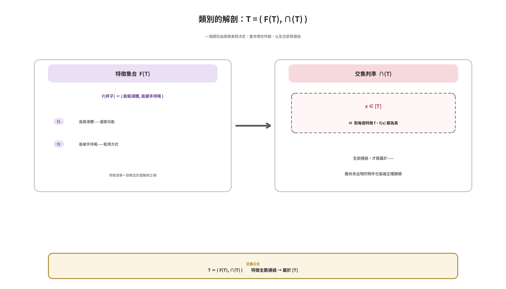

**圖 2-1　類別的解剖：特徵集合與交集判準**

> **定義（抽象類別）**
>
> ◆　抽象類別 T = ( 特徵集合 F(T), 交集判準 ∩(T) )。
>
> ◆　x ∈ [T]，若且唯若對每個特徵 f 屬於 F(T)，f(x) 都為真。
>
> ◆　開放性：T 的成員不由列舉決定，而由 ∩(T) 動態生成——連尚未出現的物件，也能被正確歸類。

## 2.2　交集判準漏斗：從特徵到歸類

∩(T) 可以想像成一只漏斗：待判斷的物件從上方進入，每一項特徵是一道篩網，全部通過才從下方落到 [T] 裡。漏斗的一邊收通過者，一邊攔失敗者——判定永遠可以拆成一連串可以複核的步驟。

| **步驟** | **操作** | **說明** |
| --- | --- | --- |
| 1 | 確定類別 T 的特徵集合 F(T) | 例如 F(杯子) = { 能裝液體, 能被手持喝 } |
| 2 | 逐一檢驗新物件 x 的每個特徵 | f(x) = true／false |
| 3 | 取交集 | ∩(T)(x) = 所有 f(x) 都為真？ |
| 4a | 全部通過 → x ∈ [T] | 自動歸類，不需手動加入 |
| 4b | 任一失敗 → x ∉ [T] | 不屬於此類別 |

**表 2-1　抽象判斷的四個步驟**

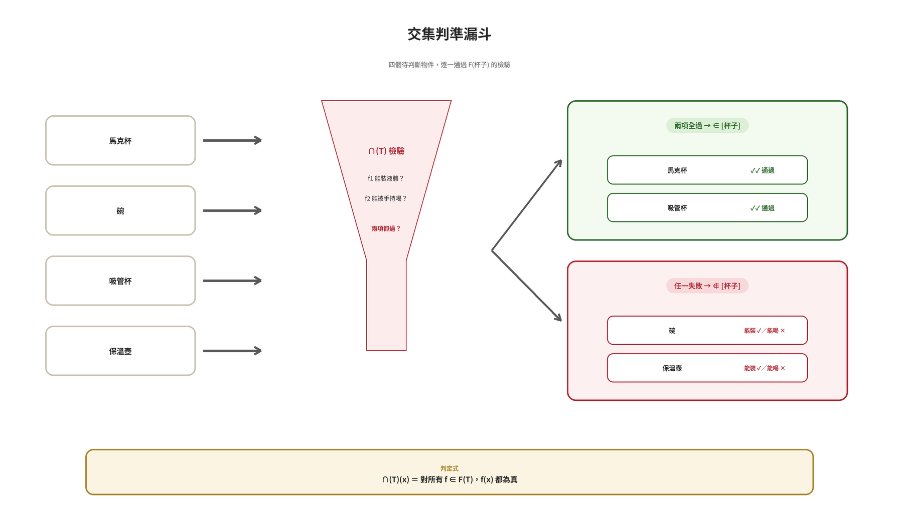

**圖 2-2　交集判準漏斗：四個待判斷物件的判定過程**

在證明裡使用漏斗有個要領：把「每個特徵通過」寫成一個可以獨立驗證的小句子，再用「且」（∧）把它們串起來。這樣，審閱你證明的人只要逐句打勾，就能重現你的判斷。

## 2.3　邊界案例：把定義磨利

規則寫得好不好，邊界案例一試就知道。碗能裝液體，但不能被手持喝；吸管杯兩項都過；注射器能裝、能手持，卻不是為了飲用——它算不算 [杯子]，取決於 F(T) 有沒有把「用於飲用」列進特徵。

| **物件** | **f1 能裝液體** | **f2 能被手持喝** | **判決** |
| --- | --- | --- | --- |
| 碗 | ✓ | × | ∉ [杯子] |
| 吸管杯 | ✓ | ✓ | ∈ [杯子] |
| 注射器 | ✓ | ✓ | 視 F(T) 是否含「用於飲用」 |

**表 2-2　邊界案例判決表**

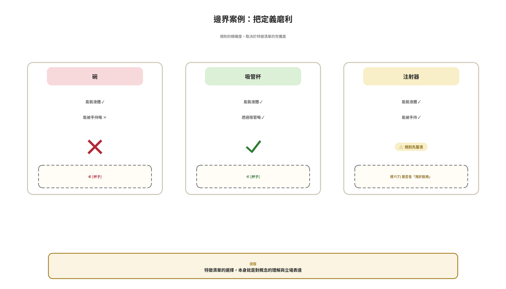

**圖 2-3　邊界案例：把定義磨利**

這裡要特別留意一件事：特徵清單的選擇本身，就是對概念的理解與立場表達。寫證明時，F(T) 一定要在證明開頭就寫清楚——不是為了省事，而是為了讓讀者知道你的「杯子」是哪一個杯子。

## 2.4　證明示範：類別歸屬

現在把 2.1 到 2.3 的配備，裝進一個最小的證明。

> **證明示範**
>
> **【定理】**吸管杯 ∈ [杯子]。
>
> **【證明】**
>
> (1) 寫出定義：T = 杯子，F(T) = { 能裝液體, 能被手持喝 }，∩(T) 為「兩項特徵皆通過」。
>
> (2) 逐項檢驗吸管杯：f1——吸管杯可盛裝液體，通過；f2——可透過吸管手持飲用，通過。
>
> (3) 由 ∩(T)，所有特徵皆為真，故吸管杯 ∈ [杯子]。（得證）
>
> **【對照】**碗：f2 不通過，故碗 ∉ [杯子]——同一條規則，同一次審核。

這個證明小，但五臟俱全：定義在前、判準居中、推理在後。更大的證明，只是把同一件事多做幾遍。

> **本章重點**
>
> ◆　定義類別用二元組：T = (F(T), ∩(T))——特徵全數通過才入類。
>
> ◆　∩(T) 是漏斗：每個特徵是一道可以獨立驗證的篩網。
>
> ◆　邊界案例磨利定義；F(T) 的選擇就是立場——證明開頭就要寫明。

# 第三章　補足身份：( ) 把不變寫成公理

**章節意象・不變之環——身份恆定的容器**

第二處缺口是身份。內容物一換，純集合就散了；可是證明裡常需要「在變動中保持同一」的對象。這一章用容器 ( ) 補上身份，把「不變」寫成公理與不變量，再用一個證明示範「替換」的寫法。

## 3.1　容器 C = (id(C), S(C)) 與不變性公理

形邏輯把容器寫成二元組：C = ( 身份識別 id(C), 內部空間 S(C) )。id(C) 是一個不隨 S(C) 中元素變動而改變的標記；S(C) 是可以容納元素的集合，內容可替換、可清空。不變性公理說：對任意 e1, e2 屬於 S(C)，替換 e1 為 e2，不改變 id(C)。

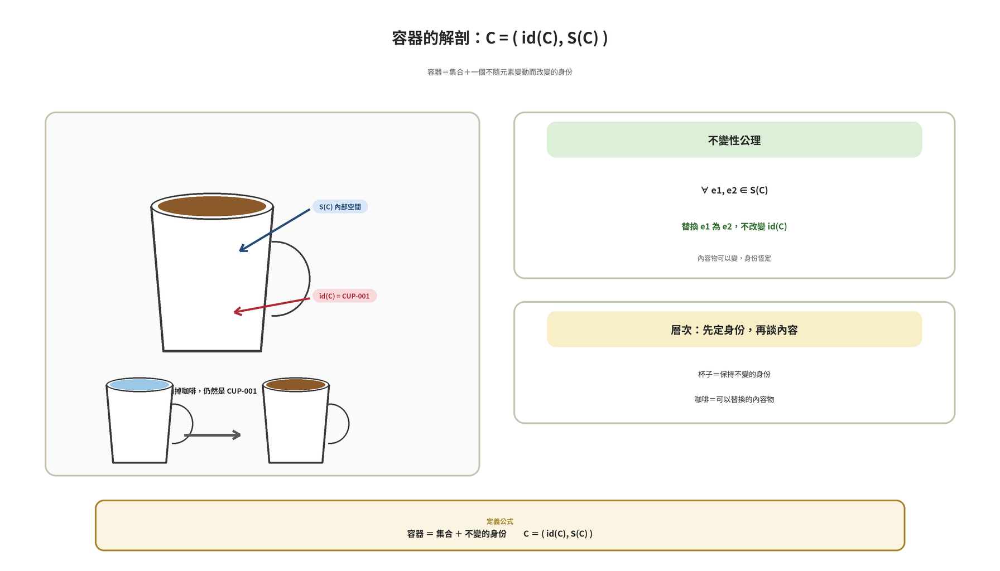

**圖 3-1　容器的解剖：身份識別與內部空間**

> **定義（容器）**
>
> ◆　容器 C = ( 身份識別 id(C), 內部空間 S(C) )。
>
> ◆　id(C)：不隨 S(C) 元素變動而改變的標記。
>
> ◆　不變性公理：對任意 e1, e2 ∈ S(C)，替換 e1 為 e2 不改變 id(C)。
>
> ◆　層次：容器是身份、內容物是元素——先定身份，再談內容。

## 3.2　證明中的「不變量」

不變性公理在證明裡的化身叫不變量：一個在某類變動下保持成立的性質。杯子換水、換咖啡，id(CUP-001) 不變——這就是杯子的不變量。數學證明裡的大量技巧，本質上都是先找到不變量，再證明它在每一步變動後仍然成立。

反過來用也成立：當你要證明「兩個東西是同一個」時，最省力的路徑往往是找到撐住身份的不變量，而不是逐一比對內容。

## 3.3　不變量五步驟

把不變量寫進證明，固定走五步：

| **步驟** | **操作** | **杯子範例** |
| --- | --- | --- |
| 1　定身份 | 寫出 id(C) | CUP-001 |
| 2　列可變內容 | 寫出 S(C) 裡哪些元素可以動 | 水、咖啡⋯⋯ |
| 3　寫不變式 | 陳述變動中保持成立的性質 | id(C) 不變 |
| 4　逐步替換檢查 | 每一次替換後驗證不變式 | 水 → 咖啡，id 仍是 CUP-001 |
| 5　下結論 | 由不變性公理收攏 | 容器判斷成立 |

**表 3-1　不變量五步驟**

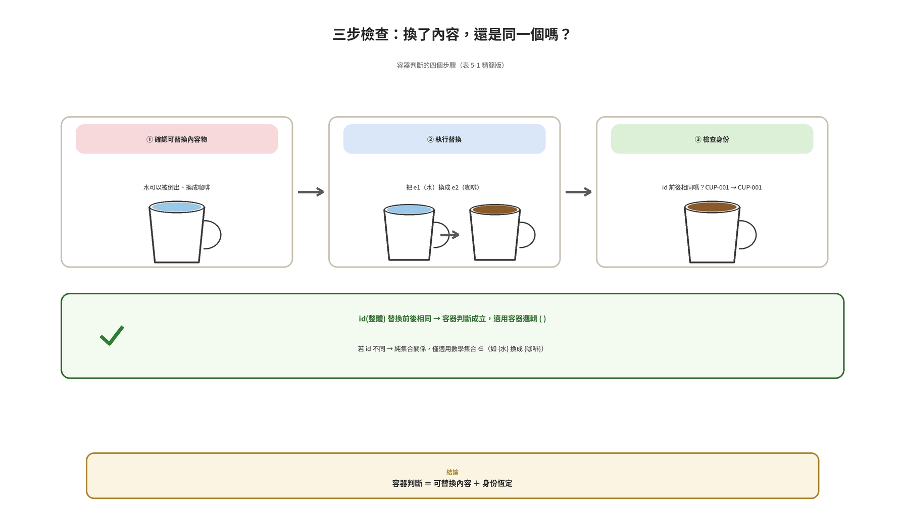

**圖 3-2　三步檢查：換了內容，還是同一個嗎？**

## 3.4　證明示範：替換與同一性

> **證明示範**
>
> **【定理】**設 C 為容器，e1, e2 ∈ S(C)。將 e1 替換為 e2 後，C 仍是同一個容器。
>
> **【證明】**
>
> (1) 寫出結構：C = (id(C), S(C))，其中 id(C) 為身份識別。
>
> (2) 列變動：本次變動是 S(C) 中的元素替換 e1 → e2，未觸及 id(C)。
>
> (3) 引用不變性公理：對任意 e1, e2 ∈ S(C)，替換 e1 為 e2 不改變 id(C)。
>
> (4) 故替換後 id(C) 依舊相同——容器是同一個容器。（得證）
>
> **【對照】**{ 水 } 換成 { 咖啡 } 是另一個集合；(水) 換成 (咖啡) 還是同一個容器。差別不在元素，在身份。

> **本章重點**
>
> ◆　容器 C = (id(C), S(C))——身份是標記，內容是元素。
>
> ◆　不變性公理：內容替換，id(C) 不變——證明中的「不變量」由此而來。
>
> ◆　不變量五步驟：定身份 → 列可變 → 寫不變式 → 逐步檢查 → 下結論。

# 第四章　補足結構：{ } 把依存寫成判準

**章節意象・結構藍圖——部件的爆炸圖**

第三處缺口是結構。部件清單人人會列，但證明要的是「依存」：誰少了就不成整體、誰少了只是降級、誰少了沒影響。這一章用 BOM 判準與 remove 三級，把依存寫成可以推理的判準。

## 4.1　BOM 判準：拆下來認得自己嗎？

判斷一個特徵該不該進 BOM，標準只有一個：拆下來之後，它還認得自己嗎？杯蓋拆下來仍是一個蓋子，進 BOM；顏色拆下來什麼都不是，進屬性。這條界線把「組成」與「樣子」分開——證明裡談結構時只談 BOM，談外觀時才談屬性。

## 4.2　remove 判準：三級分類

確認部件清單後，用 remove 判準分級：把部件 p 從整體 M 移除，看結果。remove(p,M) ≢ M，同一性喪失，p 是必要件；remove(p,M) ≡ M′ ⊂ M，功能缺了但身份還在，p 是功能降級件；remove(p,M) ≡ M，完全不影響，p 是非必要件。

| **等級** | **判斷結果** | **杯子範例** | **證明中的用法** |
| --- | --- | --- | --- |
| 必要件 | remove(p,M) ≢ M | 杯底、杯身 | 證「少了它就不成整體」 |
| 功能降級件 | remove(p,M) ≡ M′ ⊂ M | 杯把、杯蓋 | 證「功能缺、身份存」 |
| 非必要件 | remove(p,M) ≡ M | 貼紙、裝飾 | 證「移除後完全不影響」 |

**表 4-1　remove 三級判準**

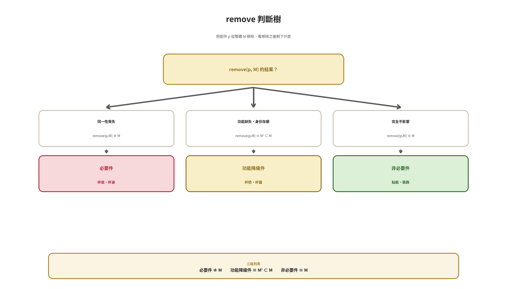

**圖 4-1　remove 判斷樹：三級分類的判定過程**

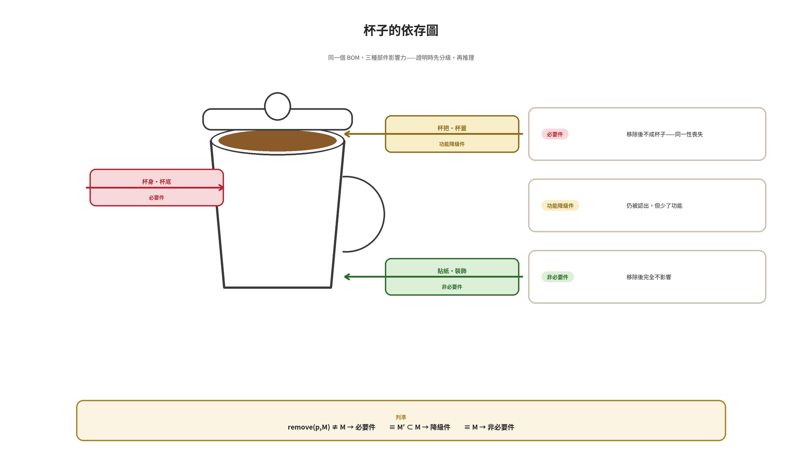

**圖 4-2　杯子的依存圖：三種部件影響力**

在證明裡，remove 判準的價值是把「重要」這個模糊的字眼，翻譯成三種可以逐一驗證的陳述。與 3.1 的不變性公理對照：不變性公理守的是容器的內容替換，remove 判準守的是整體的部件移除——一內一外，層次分明。

## 4.3　證明示範：部件分級

> **證明示範**
>
> **【定理】**杯底是杯子的必要件；杯把是杯子的功能降級件。
>
> **【證明】**
>
> (1) 定整體：M = 杯子，BOM = { 杯把, 杯底, 杯蓋, 杯身 }（全數通過「拆下來認得自己」檢核）。
>
> (2) 考慮 remove(杯底, M)：移除杯底後，杯身無法盛裝液體，「杯子」的同一性喪失，remove(杯底,M) ≢ M——杯底是必要件。
>
> (3) 考慮 remove(杯把, M)：移除杯把後，杯子仍能裝水、仍被認出是杯子，但失去手持功能，remove(杯把,M) ≡ M′ ⊂ M——杯把是功能降級件。（得證）
>
> **【對照】**貼紙：remove(貼紙, M) ≡ M，是非必要件——三級各安其位，結構才算寫完。

> **本章重點**
>
> ◆　BOM 判準：拆下來認得自己 → 進 BOM；拆下來就消失 → 進屬性。
>
> ◆　remove 三級：必要件（≢ M）／功能降級件（≡ M′ ⊂ M）／非必要件（≡ M）。
>
> ◆　不變性公理守「內容替換」，remove 判準守「部件移除」——內外分明。

# 第五章　準確使用方法——把三種補足裝回證明

**章節意象・六步階梯——走向（得證）**

三種補足都已就位。最後一章把它們裝回同一個流程：證明六步驟、一個完整的入門範例、五種誤用對照，以及交出證明前的檢查清單。

## 5.1　證明六步驟

面對一個要寫成證明的命題，固定走六步。第一步認明整體——先問「我證明的對象是哪一個整體」，同一個物理場景可能有好幾個判斷對象。第二步分軸描述——X 屬性、Y 組成、Z 容器各寫一次。第三步寫形集合——用 { 部件, (內容), [類別] } 把對象表記下來。第四步選定命題——要證的是歸屬、不變，還是分級？第五步判準推理——對應的判準（∩(T)、不變性公理、remove）一步步走。第六步三層檢查——容器、組成、抽象三層聯合驗證後，收攏結論。

| **步驟** | **操作** | **產出** | **常用工具** |
| --- | --- | --- | --- |
| 1　認明整體 | 指認證明的判斷對象 | 一句話：M 是什麼 | —— |
| 2　分軸描述 | 三條軸各描述一次 | 屬性表、BOM、容器 | 三括號 |
| 3　寫形集合 | 完整表記 | { 部件, (內容), [類別] } | 形集合 |
| 4　選定命題 | 選歸屬／不變／分級 | 定理一句 | —— |
| 5　判準推理 | 用對判準逐步推理 | 證明正文 | ∩(T)、id(C)、remove |
| 6　三層檢查 | 三層聯合檢查 | 結論（得證） | 三層判斷 |

**表 5-1　證明六步驟操作表**

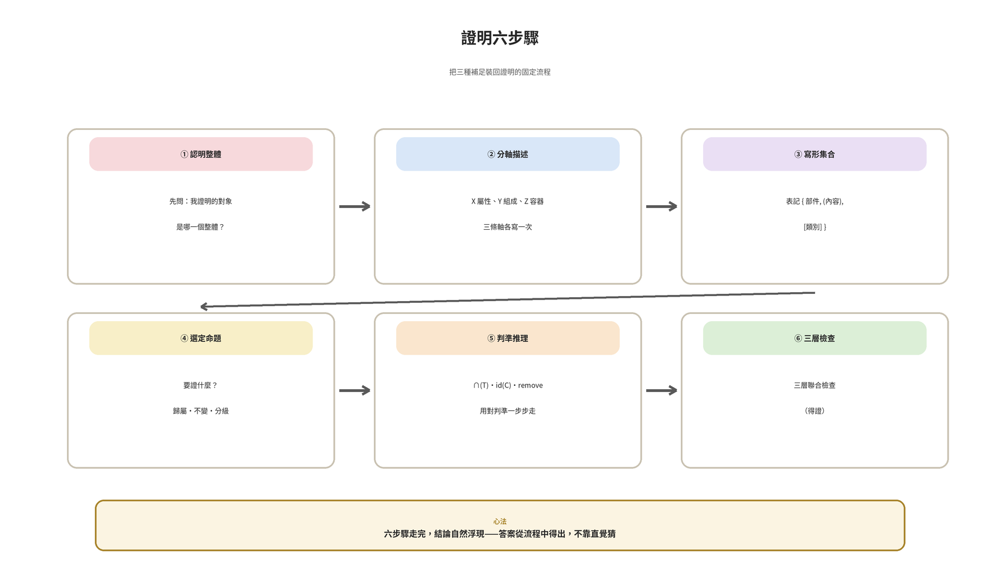

**圖 5-1　證明六步驟**

## 5.2　完整入門範例：一則小定理

用一則定理把六步驟走完整。

> **證明示範**
>
> **【定理】**保溫杯 ∈ [杯子]。
>
> **【證明】**
>
> (1) 認明整體：判斷對象是保溫杯，M = 保溫杯。
>
> (2)(3) 分軸描述與表記：BOM = { 杯蓋, 杯身, 杯底 }；S(M) = (熱水)；外觀特徵依 F(T) 檢驗。
>
> (4) 選定命題：本題證「歸屬」——保溫杯是否 ∈ [杯子]。
>
> (5) 判準推理：F(杯子) = { 能裝液體, 能被手持喝 }。f1 通過——保溫杯能盛裝液體；f2 通過——杯身可手持、就口飲用。由 ∩(T)，保溫杯 ∈ [杯子]。
>
> (6) 三層檢查：容器層 ✓（倒掉水換茶，id 不變）；組成層 ✓（杯蓋為降級件、杯底為必要件，remove 分級明確）；抽象層 ✓（∩(T) 全過）。三層全通過——保溫杯 ∈ [杯子]。（得證）

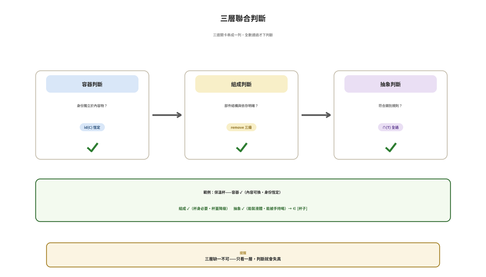

**圖 5-2　三層聯合判斷：三道關卡串成一列**

## 5.3　誤用對照：五種常見錯誤

| **#** | **誤用** | **問題所在** | **正確寫法** |
| --- | --- | --- | --- |
| 1 | 把 ( ) 當一般集合用 | (水) 被寫成 { 水 }，身份消失 | 內容物用 ( )，標上 id(C) |
| 2 | 把 [ ] 寫成封閉清單 | 新成員無法歸類 | 用 T = (F(T), ∩(T)) 開放規則 |
| 3 | 用比較代替拆解 | 屬性靠比較、BOM 靠拆解，方法混用 | 進不進 BOM 只問「拆下來認得自己嗎」 |
| 4 | 內容一換就說是別的東西 | 混淆容器與內容物的層次 | 先定身份，再談內容 |
| 5 | 只做一層判斷就下結論 | 三層各有盲點 | 三層聯合判斷後才收結論 |

**表 5-2　五種常見誤用與正確寫法**

五種誤用的共同根源，都是「層次」沒寫清楚：括號的層次、容器與內容的層次、判斷的層次。寫證明時時刻刻問自己一句話——這一筆資訊，該在哪一層？

## 5.4　交出證明前的檢查清單

| **#** | **檢查問題** | **通過標準** |
| --- | --- | --- |
| 1 | 對象認明了嗎？ | 「我證的是哪個整體」一句話說得出來 |
| 2 | F(T) 寫明了嗎？ | 類別定義在證明開頭，特徵可逐項驗證 |
| 3 | 括號用對了嗎？ | { } 部件、( ) 內容、[ ] 類別，各安其位 |
| 4 | id(C) 標出來了嗎？ | 涉及容器時，身份標記明確 |
| 5 | remove 分級做了嗎？ | 談部件影響時，三級各有歸屬 |
| 6 | 邊界案例想到了嗎？ | 至少一個邊界案例被規則正確判決 |
| 7 | 每一步可檢驗嗎？ | 讀者能逐句打勾重現推理 |
| 8 | 三層聯合檢查了嗎？ | 容器・組成・抽象三層都過，才寫（得證） |

**表 5-3　檢查清單：交出證明前的八個問題**

八個問題全過，證明才算「寫準」。這份清單不只是格式——它就是三種補足的驗收標準。

> **本章重點**
>
> ◆　六步驟：認明整體 → 分軸描述 → 寫形集合 → 選定命題 → 判準推理 → 三層檢查。
>
> ◆　誤用五種的共同根源：層次沒寫清。
>
> ◆　檢查清單八問，就是三種補足的驗收標準。

# 回顧——要點總整理與自我檢查

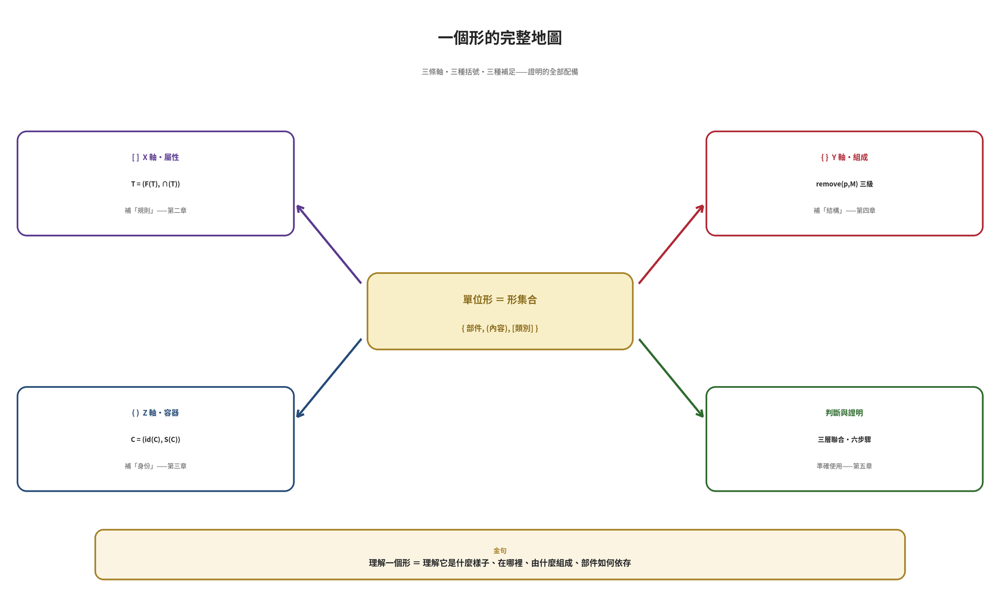

**圖 R-1　要點回顧：一個形的完整地圖**

## R-1　三種補足，三處缺口

[ ] 把寫死的清單換成開放規則——T = (F(T), ∩(T))；( ) 把散掉的內容收在不變身份之下——C = (id(C), S(C)) 與不變性公理；{ } 把並列的部件排成依存結構——remove 三級。缺口在哪，括號就補到哪。

## R-2　證明三件套，一條主軸

定義在前、判準居中、推理在後；六步驟只是把三件套在一個對象上按順序做完。純集合語言是骨架，三種補足是血肉——疊加使用，證明才完整。

## R-3　準確，是可複核的準

判斷不靠直覺靠流程：∩(T) 逐項驗、id(C) 前後比、remove 三級分；三層聯合檢查後才下結論。讀者能逐句打勾重現你的推理，這才是「準確」兩個字的意思。

| **自我檢查問題** | **你應該能回答的內容** |
| --- | --- |
| 類別怎麼定義？ | 寫出 T = (F(T), ∩(T))，並用邊界案例試過 |
| 身份怎麼保住？ | 寫出 id(C) 與不變性公理，指認不變量 |
| 結構怎麼分級？ | 用 remove 判準把部件分成必要件・降級件・非必要件 |
| 證明怎麼起步？ | 六步驟走一遍：從認明整體到（得證） |
| 誤用怎麼避開？ | 對照五種誤用逐一自查，層次寫清 |
| 準確怎麼驗收？ | 檢查清單八問全過，讀者可逐句複核 |

**表 R-1　自我檢查清單**

**證明寫得準，是因為每一層資訊都寫在它該在的位置上。**

# 附錄　術語與記號速查

| **術語** | **英文／記號** | **一句話定義** |
| --- | --- | --- |
| 形 | Type | 一個被完整描述的對象（不是 Form） |
| 單位形 | Unit Type | 三種集合的合體：{ 部件, (內容), [類別] } |
| 形集合 | Type Set | 單位形的完整表記 |
| 屬性・屬性值 | Property・Value | 維度與刻度 |
| 抽象類別 | T = (F(T), ∩(T)) | 由特徵與判準決定的開放類別 |
| 特徵集合 | F(T) | 類別要求的特徵清單 |
| 交集判準 | ∩(T) | 特徵全數通過才算屬於 |
| 容器 | C = (id(C), S(C)) | 集合＋不變的身份 |
| 身份識別 | id(C) | 不隨內容變動的標記 |
| 內部空間 | S(C) | 可容納・可替換的元素集合 |
| 不變性公理 | ∀ e1, e2 ∈ S(C) | 替換內容不改變 id(C) |
| 物料清單 | BOM | 拆開來看的組成清單 |
| remove 判準 | remove(p,M) | 移除部件，看同一性是否存續 |
| 三層判斷 | 容器・組成・抽象 | 三層聯合檢查的判斷流程 |

**表 A-1　術語速查**

| **記號** | **讀法** | **用法** |
| --- | --- | --- |
| { } | 大括號 | 組成集合（部件） |
| ( ) | 小括號 | 容器集合（內容物） |
| [ ] | 中括號 | 抽象集合（類別） |
| ∈／∉ | 屬於／不屬於 | 歸屬陳述 |
| ∀ | 對所有 | 全稱量詞 |
| ∧ | 且 | 條件連結 |
| ⇔ | 若且唯若 | 定義等價 |
| ≢／≡ | 不同一／同一 | remove 判準用語 |
| T = (F(T), ∩(T)) | 抽象類別 | 類別定義 |
| C = (id(C), S(C)) | 容器 | 容器定義 |

**表 A-2　記號速查**

**理解一個形 ＝ 理解它是什麼樣子、在哪裡、由什麼組成、部件如何依存。**

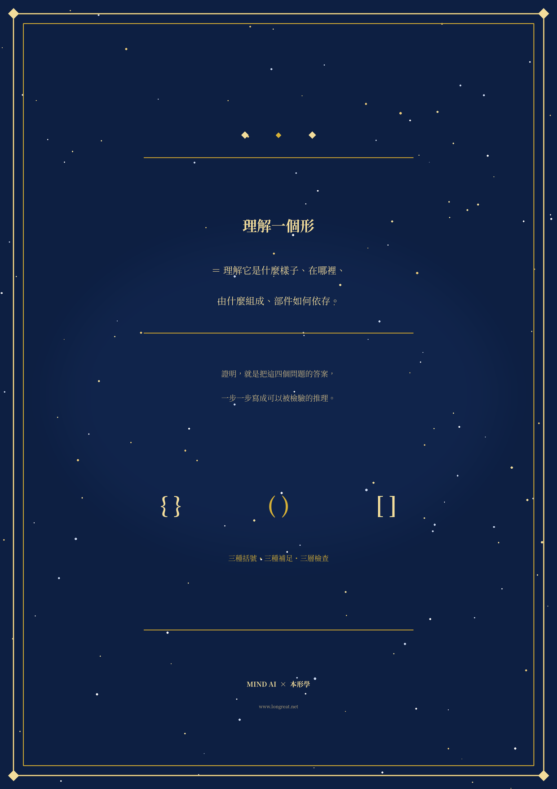
