

  <a href="https://youtu.be/GB96818ERBw">💻橫式</a> ｜ 
 <a href="https://v.douyin.com/Pc-qeLbf-IU">📱直式</a> 
 

# 本形學   Ontypology

# 空間本形 Space

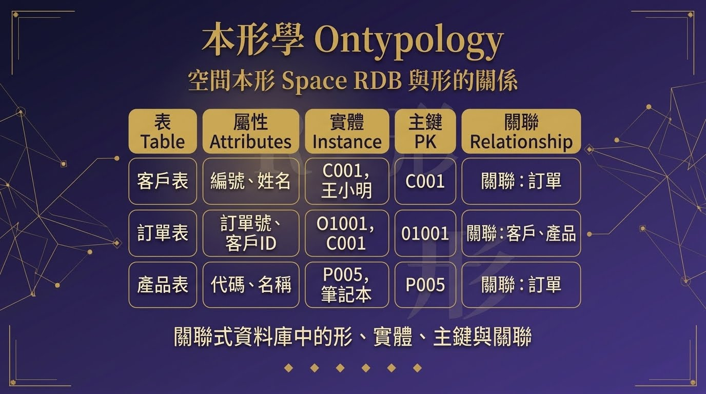

**RDB 與形的關係**

關聯式資料庫中的形、實體、主鍵與關聯

◆ **導讀　形，在工程世界裡的樣子**

若說第二章回答了「形是什麼」，本章要回答的是：**形在工程世界裡長什麼樣子**。關聯式資料庫（Relational Database，下簡稱 RDB）是當代軟體工業最普及的資料組織方式，而它的核心結構——表（Table）——竟然與「形／實體」的區分一一對應，對應得如此工整，以至於我們幾乎可以說：RDB 是形的邏輯被機械化之後的樣子。

本章沿著五步展開：先確認「表頭是形、資料列是實體」的基本對應（4.1）；再看「新增資料」在兩個層次上的不對稱代價（4.2）；接著說明欄位為什麼必須貫穿所有資料列（4.3）；然後進入主鍵——實體的同一性如何被固定下來（4.4）；最後看表與表之間如何靠「參考」連成網路（4.5）。全章以「杯子」為貫穿例子，每一步都配有圖解。

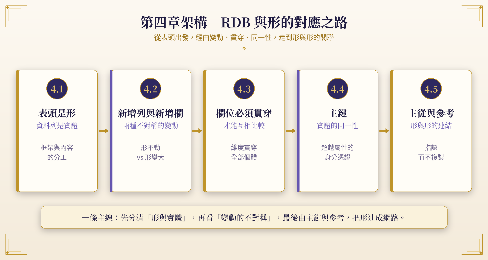

**圖4-1　**本章架構圖：從表頭到關聯的五步之路

| ◆ **閱讀本章的鑰匙**每當看到「表」，就把它讀成「形＋實體」的複合體：表頭是形，資料列是實體。其餘所有概念——欄位、主鍵、外鍵、關聯——都是從這個基本對應長出來的。 |
|---|

◆ **4.1　表頭是形，資料列是實體**

一張資料庫的表，天生分成兩個部分，而這兩個部分剛好對應到第二章一開頭就講過的區分：屬性是一個「可以被拿來問的問題」，它本身沒有答案，只是劃定一個「要問什麼」的範圍；屬性值是這個問題在某個具體情境下的實際答案。

把這個對應套到一張表上，一切就清楚了：表格最上面那一列欄位名稱（**表頭**）就是**形**。它是一組「要問什麼」的清單，本身不是任何一個具體東西的答案，而是所有資料列共用的框架。表頭底下每一列實際的資料，就是**實體**——形被填上具體答案之後的結果，一個可以被指認、獨立存在的東西。

| **Cup_id** | **顏色** | **材質** | **手把** | **蓋子** |
|---|---|---|---|---|
| **C001** | 透明 | 玻璃 | N | N |
| **C002** | 透明 | 玻璃 | Y | N |
| **C003** | 藍色 | 陶瓷 | N | N |
| **C004** | 透明 | 玻璃 | Y | Y |

表4-1　杯子表：表頭（形）與四個杯子（實體），Cup_id 為主鍵欄位

表頭那一行（Cup_id、顏色、材質、手把、蓋子）不屬於 C001，也不屬於 C002；它是懸在所有杯子之上、被所有杯子共用的一套問題清單。這正是「形」的樣子：一個框架，本身沒有內容，但規定了「內容要長在哪裡」。底下每一列，是這套問題清單套在一個具體杯子身上被填出來的實際答案。這正是「實體」的樣子：具體、獨立、可以被指認（有自己的 Cup_id），但它的樣貌完全是照著表頭那套問題長出來的，不能自己憑空長出表頭沒有的欄位。

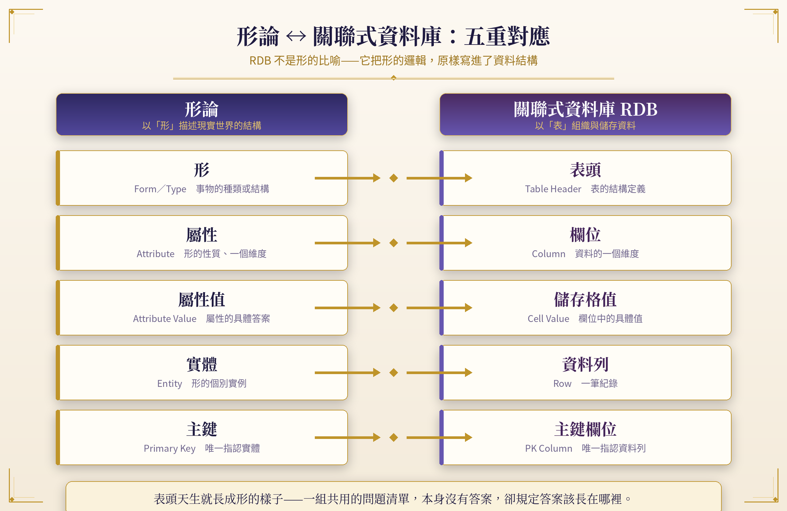

**圖4-2　**形論與關聯式資料庫的五重對應

| ◆ **形不是比喻**表頭天生就長成形的樣子：一組共用的問題清單，本身沒有答案，卻規定答案該長在哪裡。RDB 與形論之間不是類比，而是同一個結構在兩個領域的現身。 |
|---|

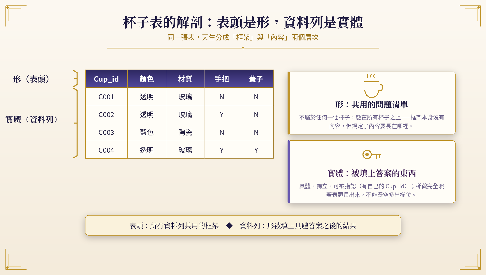

**圖4-3　**杯子表的解剖：表頭是形，資料列是實體

◇ **先有形，才有實體**

值得留意這個對應的「方向性」：是先有形，才有實體；不是先堆疊實體，再歸納出形。資料庫工程師建表的第一步是定義表頭——先把「要問什麼」決定下來，世界才開始以資料列的形式進來。這與第二章的主張完全一致：形先於個體的描寫，屬性先於屬性值的填寫。

表頭一旦定案，就成為這一類東西的「入場規格」：任何想進入這張表的個體，都必須用這套問題把自己描述一遍，交出每一個欄位的答案，才取得一列的位置。這也正是古老哲學直覺的資料庫版本——個體之所以是某種東西，不是因為它恰好長那樣，而是因為它站在某個形之下、用那個形的問題交出了答案。

◆ **4.2　新增列與新增欄：兩種不對稱的變動**

這個對應關係，最能被驗證的地方，是「新增資料」在這兩個層次上代表完全不同的事情：

◇ **新增一列：形不動，實體多一個**

新增一列（新增實體），隨時可以發生，而且很輕巧。第五個杯子進來，不管顏色材質是什麼，只要能填進既有的欄位（顏色、材質、手把、蓋子），就直接多加一列，表頭完全不用動。這對應第二章講的：持續加入的杯子，若差異的性質跟既有屬性吻合，只需要在對應的屬性底下新增屬性值，完全不需要再開新的屬性。新加的這個杯子，只是安安靜靜地多佔一列，**不會驚動表頭上的任何一個欄位**——整個形保持不動，世界只是多了一個實例。

◇ **新增一欄：形自己變大，所有實體補值**

新增一欄（新增形的維度），只在「這批差異跟現有問題清單都對不上」的時候才發生，而且是動到框架本身。如果有一天出現一種杯子，帶有前面四個欄位都解釋不了的差異——比如「有沒有隔熱層」——這時候不是填一個值進既有欄位就能解決，而是要在表頭本身開一個新問題：多開一欄「隔熱層」。這動作對應第二章講的「逼出新屬性」的那一刻：既有維度解釋不了新的差異，於是必須開一個新維度。

| **新增列：形不動、實體多一個（輕巧）。新增欄：形自己變大、所有實體都要跟著補值（沉重）。** |
|---|

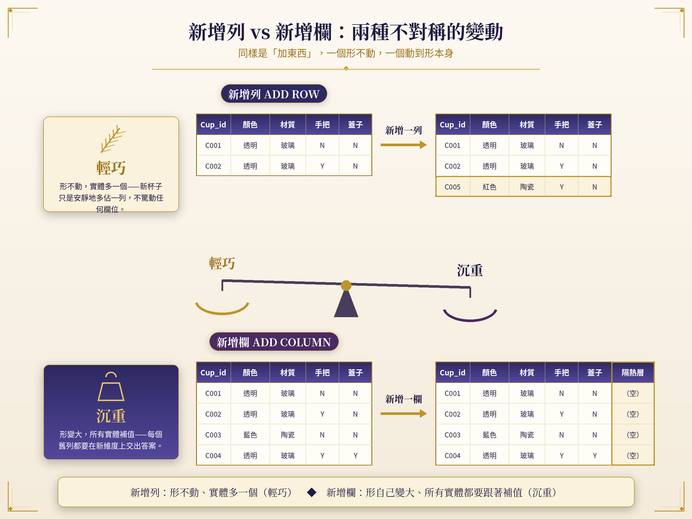

**圖4-4　**新增列與新增欄：兩種不對稱的變動

而且，正如前文強調的「屬性一旦被抽出來，就必須套用在所有已經出現過的個體上」，開新欄位這件事，資料庫會自動幫所有已經存在的舊資料列，在這個新欄位補上一個預設的空值，逼著每一個已存在的實體，都要在這個新的形的維度上交出一個答案——哪怕答案暫時是「空」。

這個自動補值的動作看似只是工程細節，其實是形論原則的機械式兌現：**維度屬於形**。一旦形長出新維度，所有分有這個形的實體都必須在新維度上有位置——一個都不能漏。

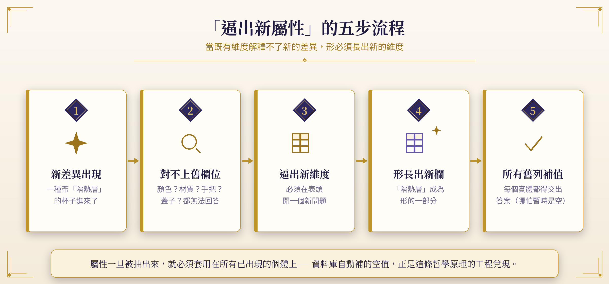

**圖4-5　**「逼出新屬性」的五步流程

◇ **正規化理論中的精確對應**

這個不對稱性，在資料庫設計的正規化（Normalization）理論中有一個精確的對應：第一正規化（1NF）要求每個欄位只能存一個值，不能把多個值塞進同一個欄位，這正是「屬性是一個維度，每個個體在這個維度上只能有一個明確的值」的資料庫版本。而當我們需要新增一個欄位時，代表「形」本身變了，這在資料庫實務中對應的是「表結構的變更」（Schema Change）——一個比新增資料列更為重大、需要審慎評估的動作。

| **動作** | **動到的層次** | **形論的對應** | **代價** |
|---|---|---|---|
| 新增資料列 | 內容層 | 形不動，實體多一個 | 輕：結構完全不動 |
| 新增欄位 | 結構層 | 形長出新維度 | 重：所有實體都要補值 |
| 更改主鍵 | 身分層 | 實體的同一性被破壞 | 極重：整個關聯網路斷裂 |

表4-2　三種「變動」的層次與代價（第三種留待 4.4 展開）

此外，主鍵的概念也呼應了哲學中「同一性」（Identity）的討論：一個物件的同一性，不取決於它的屬性值——杯子可以換顏色、換材質——而取決於一個超越所有屬性、專門用來指認身份的標記。這個洞察將在 4.4 展開；在此之前，我們要先處理一個更基本的規矩：欄位必須貫穿所有的列。

◆ **4.3　為什麼欄位不能因為某一列而改變**

表頭這個「形」，有一個看起來很嚴格、但其實很自然的規矩：同一張表，所有列共用同一套欄位，不能有的杯子多一欄、有的杯子少一欄。這件事換成第二章的語言講，就是「屬性是一個維度，維度要能貫穿全部的個體，才能拿來互相比較」。

如果允許每一列自己決定要不要有某個欄位，災難立刻發生：「顏色」這個問題對某些杯子存在、對某些杯子不存在，「比較所有杯子的顏色」這件事就直接做不下去——沒辦法問「所有透明色的杯子有哪些」，因為**根本不確定每一列有沒有「顏色」這個答案可以查**。

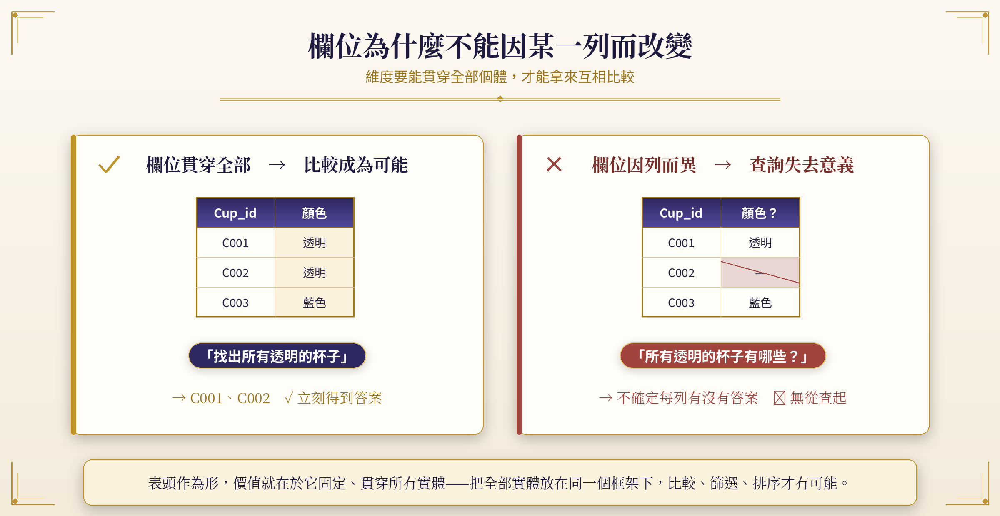

**圖4-6　**欄位貫穿，比較才成為可能

◇ **維度的公共性**

維度的本質是公共的。一把尺要能用來量每一樣東西，它就不能只對某些東西存在；一個問題要能拿來比較所有個體，它就必須向所有個體開放。表頭作為形，它的價值就在於它是固定的、貫穿所有實體的——這樣才能把所有實體放在同一個框架下互相比較、篩選、排序。

資料庫裡的「查詢」（Query）之所以強大，正是建立在這個承諾上：每一列都有同一套欄位可查。「找出所有透明的杯子」這句話之所以能被執行成一個精確的操作，是因為「顏色」這個維度向每一列開放，無一例外。欄位貫穿，是資料庫對「可比較性」的承諾。

| ◆ **比較的前提**比較的前提，是「同一個問題問遍所有個體」。欄位因列而異的表格，看似更靈活，實際上是讓整個框架失去互相比較的能力。 |
|---|

◆ **4.4　主鍵：每一列靠什麼被獨立指認**

前面講「表頭是形、資料列是實體」，但這裡漏了一件事：一列資料要能被獨立指認、被其他表指過來，得先有一個只屬於這一列、跟其他任何欄位內容都無關的欄位——這就是主鍵。杯子表裡的 Cup_id，就是這張表的主鍵。它不是杯子的顏色、材質，也不是任何一個屬性，它純粹是一個身分代號，唯一的功能就是「指出這是哪一個杯子」。

就算兩個杯子顏色、材質、手把、蓋子完全一樣，只要 Cup_id 不同，資料庫就知道這是兩個不同的實體，不會混成同一個。主鍵之所以要跟內容無關，是因為它要撐住「同一個形」這件事：如果杯子換了顏色，主鍵不能跟著變，不然資料庫會以為換色之後變成了一個全新的杯子。主鍵是實體身分最底層的憑證——屬性可以隨便換，主鍵不能換。

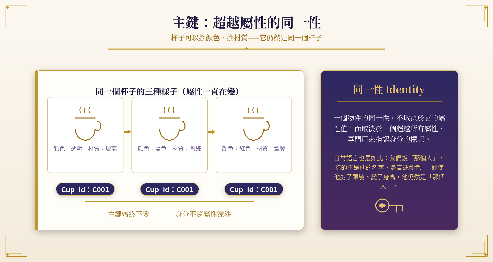

**圖4-7　**主鍵：超越屬性的同一性

◇ **同一性：日常語言裡的指認**

這個設計原則，在哲學中有一個熟悉的面孔：「同一性」（Identity）的討論。一個物件的同一性，不取決於它的屬性值，而取決於一個超越所有屬性、專門用來指認身份的標記。我們說「那個人」的時候，指的不是他的名字、身高或髮色，而是「就是那個特定的人」——即使他剪了頭髮、變了身高，他仍然是「那個人」。資料庫的主鍵，就是把這種日常的「指認」能力，用一個欄位的形式固定下來。

在形論的語言裡，可以說得更精確：實體是「被指認的那一個」，而主鍵就是**「指認」這個動作本身的結構化殘留**。屬性描述實體的樣貌，主鍵承載實體的身分；樣貌屬於內容層，身分屬於框架層——這正是形與實體之分再一次的現身。

◇ **主鍵不可變：關聯網路的穩定性**

這個原則在實務上有一個重要的含義：主鍵的值一旦被指派，就不應該再被更改。如果 Cup_id = C001 的杯子被改名為 C009，所有曾經參考 C001 的從表記錄（例如部件表裡「所屬杯子 = C001」的那些列）都會變成指向一個不存在的東西，整個關聯網路就會斷裂。

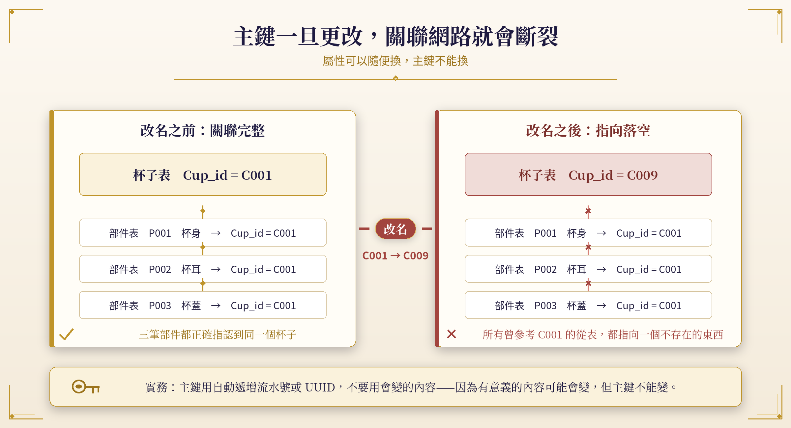

**圖4-8　**主鍵一旦更改，關聯網路就會斷裂

這就是為什麼在實務上，主鍵通常使用自動遞增的流水號或隨機產生的 UUID，而不是使用有意義的內容（如顏色或材質）——因為有意義的內容可能會變，但主鍵不能變。用一個「永遠無意義」的代號，來承載「永遠不變」的身分，是工程上對同一性最謹慎的守護。

| ◆ **身分與樣貌**屬性可以隨便換，主鍵不能換——因為換掉的是樣貌，不能換掉的是「是誰」。實體的同一性，是整個關聯網路唯一的錨點。 |
|---|

◆ **4.5　主從與參考：杯子表與部件表怎麼靠形連起來**

有了主鍵，表跟表之間才有辦法互相指認、互相連接。用杯子表跟部件表來看這件事怎麼運作：

| **Cup_id（主鍵）** | **名稱** |
|---|---|
| C004 | 杯子 |

表4-3　杯子表（主）

| **部件id（主鍵）** | **Cup_id（外鍵）** | **部件名稱** | **材質** |
|---|---|---|---|
| P001 | C004 | 杯身 | 玻璃 |
| P002 | C004 | 杯耳 | 玻璃 |
| P003 | C004 | 杯蓋 | 玻璃 |

表4-4　部件表（從，同時是自己的主）：Cup_id 欄參考杯子表的主鍵

◇ **主：形的源頭；從：依附而成立**

主從關係，講的是哪一張表的形，是哪一張表所依附的。杯子表是「主」，部件表是「從」——部件表裡的每一列，都得先屬於某一個杯子才有意義（「杯耳」這一列，得先講清楚它是哪一個杯子的杯耳），不能憑空存在一筆部件記錄卻不知道它屬於哪個杯子。這跟屬性值的道理完全一樣：屬性值也得先依附在一個具體的形上，不能有一筆「顏色＝透明」卻不知道是哪個杯子的顏色。**從表的每一列，都必須先參考主表裡的某一個形，才能成立**。

◇ **參考：指認，而不複製**

參考，講的是從表裡怎麼知道自己屬於哪個主表的形。部件表裡的「所屬杯子」這一欄，填的不是杯子的名稱、顏色這些內容，而是杯子的主鍵——這欄位存在的唯一功能，就是指向杯子表裡的某一個形，不多做別的事。這就是「參考」：不是把整份資料複製過來，而是存一個指向另一個形的主鍵，需要細節時再回頭去對應的主表裡查。

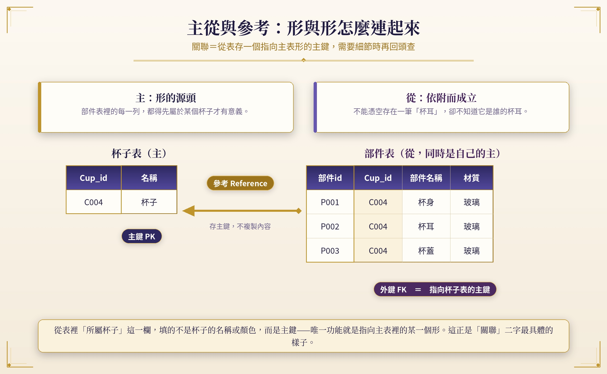

**圖4-9　**主從與參考：靠主鍵把形與形接在一起

這正是關聯式資料庫「關聯」二字最具體的樣子：形跟形之間不是靠內容綁在一起，而是靠從表裡的一個欄位——存一個指向主表某個形的主鍵——把兩者接在一起。內容會變，指認不變；因此建築在指認上的關聯，比任何複製都更穩固。整個資料庫就是這樣一張**「由主鍵織成的網」**：每一個形負責自己的內容，彼此之間只交換指認。

| ◆ **關聯的定義**關聯＝在從表存一個指向主表主鍵的欄位。指認，而不複製——需要細節時，再回頭去主表裡查。 |
|---|

◆ **要義　本章要義**

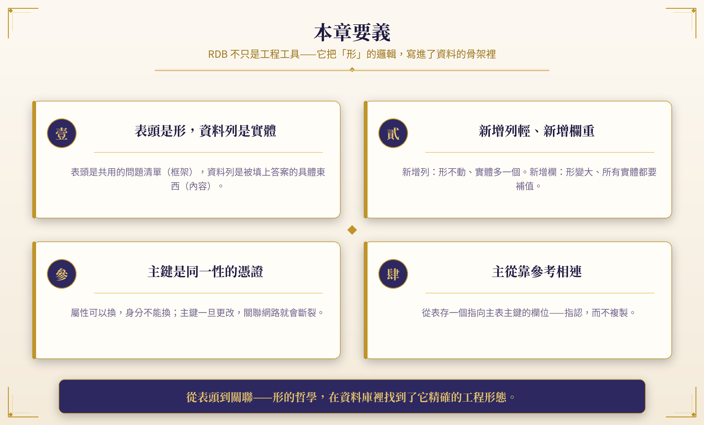

**圖4-10　**本章要義：四個必須記住的對應

**重點回顧**

- **表頭是形，資料列是實體：**表頭是共用的問題清單（框架），資料列是被填上答案的具體東西（內容）。
- **新增列輕、新增欄重：**新增列形不動、實體多一個；新增欄形變大、所有實體補值。
- **主鍵是同一性的憑證：**屬性可以換，身分不能換；主鍵一旦更改，關聯網路就會斷裂。
- **主從靠參考相連：**從表存一個指向主表主鍵的欄位——指認，而不複製。

| **從表頭到關聯——形的哲學，在資料庫裡找到了它精確的工程形態。RDB 不只是工程工具；它是一個把「形」的邏輯每天執行數十億次的機器。** |
|---|

—  第 四 章 終  —

[www.longreat.net](www.longreat.net)

张长丰[gamma@livemail.tw](mailto:gamma@livemail.tw)

张楟颍[mindaiworks@gmail.com](mailto:mindaiworks@gmail.com)
