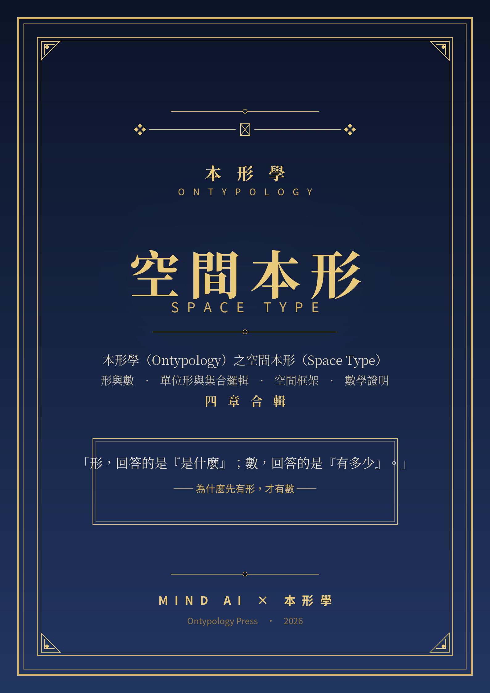

# 空間本形簡介

本形學 Ontypology 之空間本形 Space Type

# 書籍簡介

❖ ────────── ✦ ────────── ❖

> **「形，回答的是『是什麼』；數，回答的是『有多少』。」**
>
> 本書是本形學（Ontypology）的空間本形（Space Type）卷。四章是一條完整的鏈：先證「形先於數」，再為形立起可表記的結構，把推導固化成可重複的方法，最後把描述與判斷寫成可複核的數學證明。

## 四章一覽

| 章 | 主題 | 一句話 |
| --- | --- | --- |
| **第一章** | 形與數 | 先有形，才有數——數藏在形裡，認知從異同開始 |
| **第二章** | 單位形與集合邏輯 | 三條軸、三種括號——描述、表記、判斷的完整工具箱 |
| **第三章** | 空間框架 | 把一次推導固化成可重複套用的做法 |
| **第四章** | 數學證明 | 集合論的補足篇——讓「準確」成為可複核的準 |

## 閱讀路線

| 入門路線　第一章 → 第三章 先建立「形先於數」的直覺，再看框架如何把推導固化成方法。 | 主線路線　第一章 → 第二章 → 第四章 沿三條軸與三種括號一路向下，走到可書寫、可複核的證明。 |
| --- | --- |
| **應用路線　第二章 → 第三章** 取用形集合表記與框架四步驟，落到自己的領域：描述、分類、判斷。 | **工具路線　第二章 → 第四章** 直接取用判準與證明工具：屬性、BOM、容器判準＋證明六步驟。 |

# 第一章　形與數——為什麼先有形，才有數

> ◆ **有合必有形；數＝形裡面的小形・次比較。**

**圖 1-1　寒武紀認知鏈：感知 → 神經 → 理解 → 執行**

認知從「異同」開始：有了差異，大腦才畫得出邊界；邊界一合，「形」就誕生，形必有名。思想實驗把這條鏈推到極致——一維世界裡的一顆感應器，第一個認出的「形」其實是一個布林值。要數，先得把東西「合」成同一個單位：3 + 2 = 5 之所以成立，是因為蘋果與水蜜桃都被判定為「水果」。數學把這個前提藏了起來，本章把它攤在陽光下——先有形，才有數。

> **本章要點**
>
> - 異同 → 分合 → 形 → 名：認知的第一條鏈
> - 無差異則無形：「形」是被畫出來的邊界
> - 有合必有形：合的動作必然產出新的形
> - 3 + 2 = 5 的隱形前提：同形才能相加

# 第二章　單位形與集合邏輯——三條軸、三種括號

> ◆ **一個形＝屬性 [ ] ＋組成 { } ＋容器 ( )。**

**圖 2-1　章節意象・屬性之軸——維度與刻度**

用一隻杯子當標本，把「描述一個形」拆成三條可操作的軸：屬性回答「它是什麼樣子」，以 [ ] 抽象集合把問題立成維度；物料清單回答「它由什麼組成」，以 { } 組成集合記下部件與依存；空間容器回答「東西在哪裡」，以 ( ) 容器集合守護不隨內容物改變的身份。三軸疊加成形集合，就是單位形的完整表記；形邏輯的三層判斷——容器、物料清單、抽象——再把靜態的表記轉成面對實物時可執行的判準。

> **本章要點**
>
> - 三條軸：屬性（X）、BOM（Y）、容器（Z）
> - 三種括號：[ ] 規則、{ } 結構、( ) 身份
> - 形集合＝單位形的完整表記
> - 形邏輯三層判斷：身份 → 結構 → 歸類

# 第三章　空間框架——把推導變成可重複套用的做法

> ◆ **框架，是框架運作完之後留下的成果。**

**圖 3-1　章節意象・框架之舵——把推導變成可重複的航線**

維度不是天生就在那裡，而是被「對照失敗」一步步逼出來的。框架把整個推導過程抽出來，變成不管對杯子、衣服、生物都能重複套用的做法：分辨異同 → 對照失敗觸發抽象 → 各自取名成維度 → 新差異判斷歸屬。同一份屬性總表，可以長成平行屬性型或巢狀分支型等不同的樹；界門綱目科屬種與杯子四屬性是同一個道理——具體個體先存在，抽象階層才推得出來。

> **本章要點**
>
> - 框架四步驟：異同 → 對照失敗 → 取名 → 歸屬
> - 對不上既有維度，就是新維度的誕生點
> - 同一份總表，切入角度決定樹的長相
> - 具體先於抽象：種是原始材料

# 第四章　數學證明——集合論的補足篇

> ◆ **準確，是可複核的準。**

**圖 4-1　章節意象・證明之門——定義、判準、推理**

以集合論的記號寫證明，純集合只答「屬不屬於」——類別的規則、身份的不變、部件的依存，三處資訊都被省略。[ ] 把類別寫成規則 T = (F(T), ∩(T))，( ) 把不變寫成公理 C = (id(C), S(C))，{ } 把依存寫成判準（BOM 判準、remove 三級）。三種補足裝回「證明六步驟」：認明整體 → 分軸描述 → 寫形集合 → 選定命題 → 判準推理 → 三層檢查——寫完證明，自己就能驗收。

> **本章要點**
>
> - 證明三件套：定義、判準、推理
> - 三處缺口：規則、身份、結構
> - 三種補足 [ ] ( ) { } 對號入座
> - 證明六步驟＋檢查清單，準確可複核

❖ ────── ✦ ────── ❖

**四章是一條完整的鏈：從「是什麼」出發，走到「證明給你看」。**

**規格**　A4・106 頁・四章＋附錄二・插圖與表格百餘幅　｜　**適合讀者**　想把「概念」看清楚、想讓描述與判斷可形式化的人。

[www.longreat.net](http://www.longreat.net)

张长丰 [gamma@livemail.tw](mailto:gamma@livemail.tw)

张楟颍 [mindaiworks@gmail.com](mailto:mindaiworks@gmail.com)
