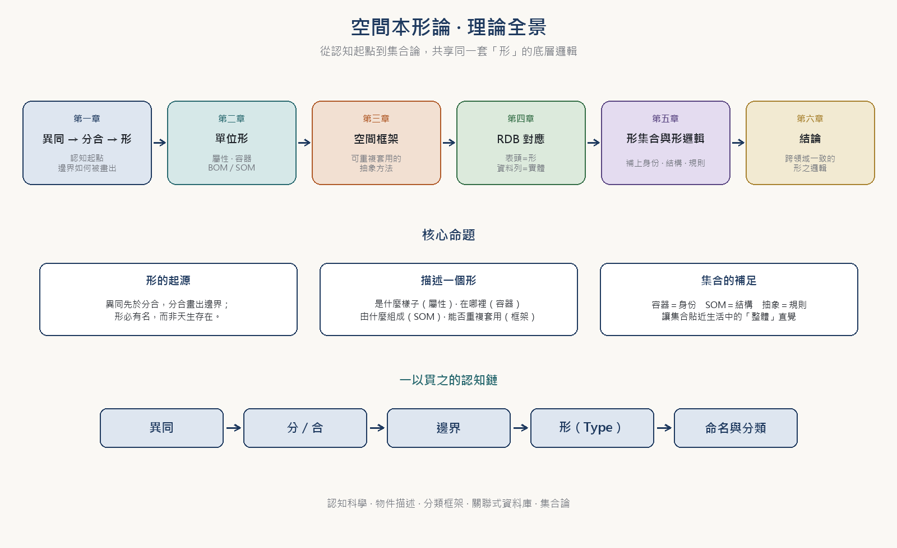
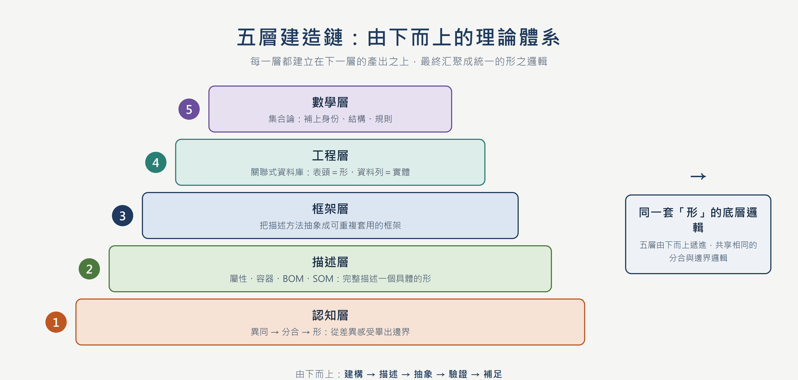
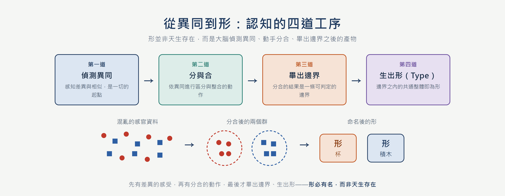
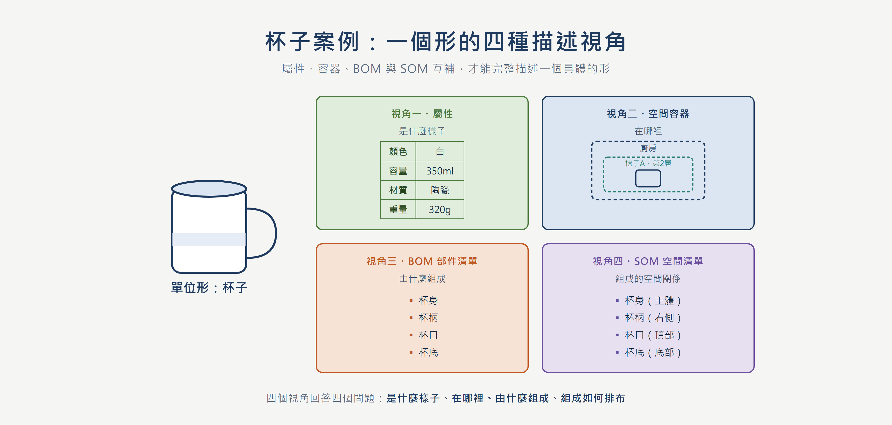
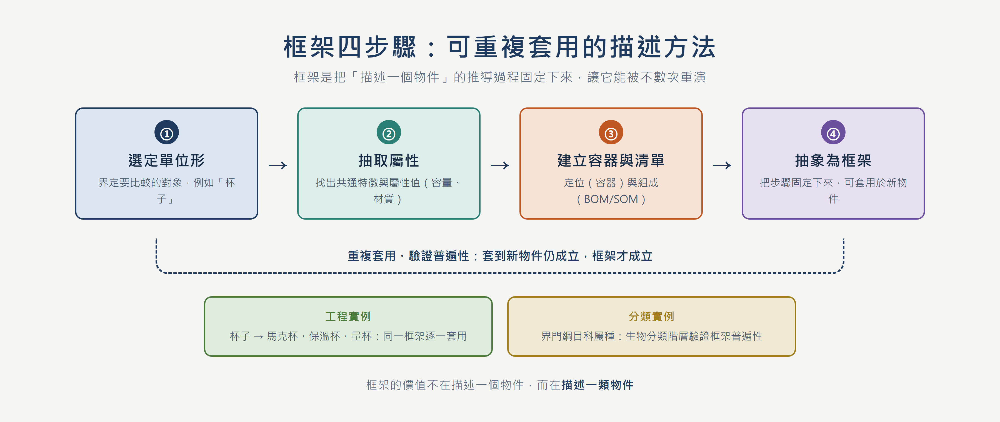
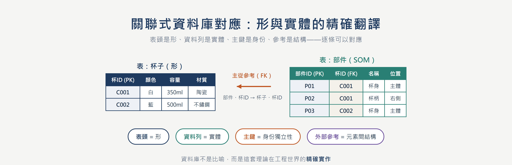
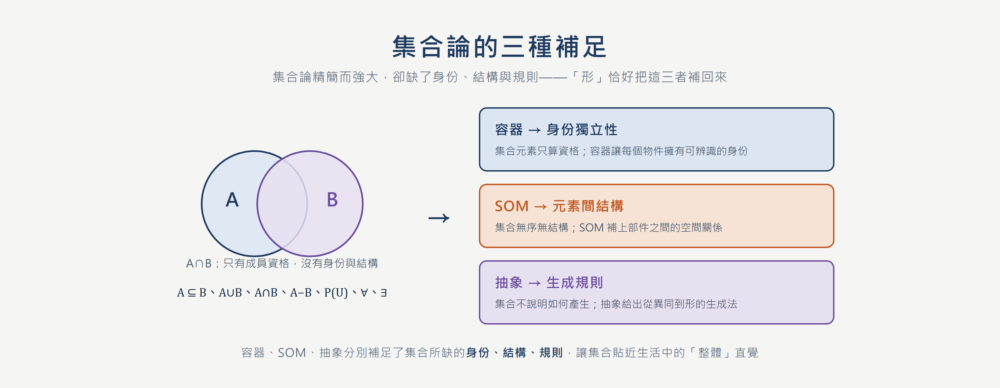
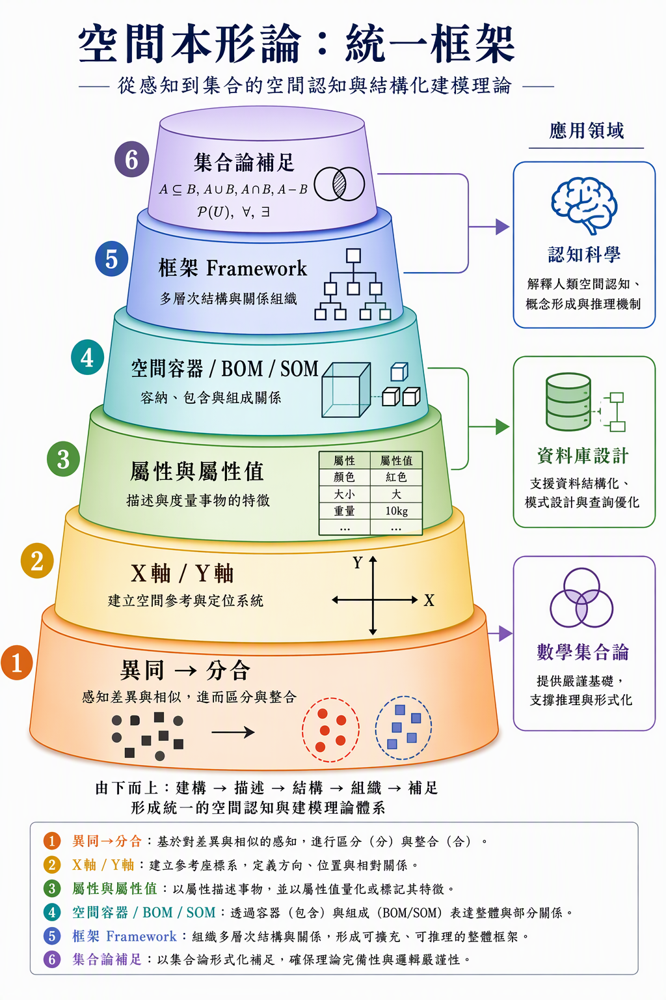

 

  <a href="https://youtu.be/zBdZ4OqzbOI">youtube</a> ｜ 
 

# 本形學　Ontology
## 空間本形　Space
### 從異同分合到形式邏輯的一套理論框架

---

## 摘要

本文提出一套從認知起點出發、逐層建構「形」（Type）概念的理論框架。文章首先說明「形」並非天生存在，而是大腦先偵測到「異同」，再透過「分」與「合」的動作畫出邊界之後才產生的結果；接著以「屬性與屬性值」為核心，說明「單位形」如何在具體物件（以杯子為例）的比較過程中逐步浮現，並延伸出「空間容器」（Space Collections）與「空間清單」（BOM／SOM）兩種描述物件的互補視角；再進一步指出「框架」（Framework）是把這套推導過程抽象成可重複套用的方法，類似生物分類階層（界門綱目科屬種）驗證其普遍性；隨後將整套理論對應到關聯式資料庫（Relational Database）的表格結構，說明表頭（形）與資料列（實體）、主鍵、主從參考之間的邏輯關係；最後回到數學集合論，指出容器、SOM、抽象分別補足了數學集合所缺乏的「身份獨立性」「元素間結構」與「生成規則」三種性質。

全文共六章，依「認知 → 描述 → 框架 → 工程 → 數學 → 統合」的順序推進，每章皆以一張資訊圖總覽其結構。全文試圖說明：從認知、物件描述、資料結構到集合論，其實共享同一套「形」的底層邏輯。

**關鍵詞：** 形、分合、屬性、空間容器、空間清單、框架、關聯式資料庫、集合論

---

## 緒論

本文提出一套從認知起點出發、逐層建構「形」（Type）概念的理論框架。「形」並非天生存在，而是大腦先偵測到「異同」，再透過「分」與「合」的動作畫出邊界之後才產生的結果。從認知、物件描述、資料結構到集合論，其實共享同一套「形」的底層邏輯。

之所以需要一套統一的「形」論，是因為各個領域早已各自發展出描述「形」的語言，卻彼此不通：認知科學談概念形成，資料庫談模式（schema），工程談部件清單，數學談集合。這些語言描述的是同一件事——如何把混亂的世界切分成可指認、可描述、可推理的單位——卻因術語隔閡而無法互相驗證。本文的目標，正是提供一個足夠底層、足夠中立的詞彙表，讓這些領域的結論可以互相翻譯。

方法上，本文不採公理化的演繹，而採「認知起點＋交叉驗證」：先從一個任何人都能重演的思想實驗出發（面對一堆雜物，我們如何說出「這是一個杯子」），得到最小的一組概念；再把這組概念拿到物件描述、資料結構與集合論三個領域去檢驗，凡是不通過檢驗的概念就修正，凡是三個領域都需要的性質就保留。

全文結構如下：第一章建立認知起點；第二章發展描述一個形的四種視角；第三章把描述方法抽象為框架；第四章以關聯式資料庫做工程驗證；第五章回到集合論補足數學缺口；第六章總結跨領域的一致性並展望應用。

*圖 1　空間本形論・理論全景：從認知起點到集合論的六章鏈結*

### 如何閱讀這套理論

這套理論可以被看成一條由下而上的建造鏈。最底層是認知科學的問題：「形」究竟從哪裡來？答案不是先有名詞、再有東西，而是先有差異的感受，再有分合的動作，最後才畫出邊界、生出形。一旦有了形，第二層要問的便是：如何完整描述一個具體的形？於是屬性、容器、部件清單（BOM）與空間清單（SOM）被逐一建立。

第三層把「描述一個物件」這件事本身抽象化，變成可以重複套用的「框架」；第四層驗證這套框架在工程與資料世界裡的精確對應——關聯式資料庫的表頭、資料列、主鍵與主從參考，幾乎可以逐條翻譯成本文的術語。第五層再退回數學，指出集合論的精簡雖然強大，卻缺少身份、結構與生成規則，而「形」恰好把這三者補回來。

> **一句話總結**
> 理解一個形，就是理解它「是什麼樣子」（屬性）、「在哪裡」（容器）、「由什麼組成」（SOM），以及「這套描述方法能不能被重複套用」（框架）。

| 章節 | 核心問題 | 關鍵產出 |
| --- | --- | --- |
| 形與數 | 形從何而來？ | 異同 → 分合 → 形；X 軸與 Y 軸 |
| 單位形 | 如何描述一個具體物件？ | 屬性、空間容器、BOM、SOM |
| 空間框架 | 描述方法如何可重複套用？ | 框架四步驟、多種展開、普遍性 |
| RDB | 如何映射到資料結構？ | 表頭=形、資料列=實體、主鍵與參考 |
| 形集合 | 集合論少了什麼？ | 身份、結構、規則三種加值 |
| 結論 | 跨領域為何一致？ | 共享同一套「形」的底層邏輯 |

*圖 2　五層建造鏈：由下而上的理論體系*

---

## 一、認知起點：從異同到形

### 1.1 異同先於分合

任何描述都預設了一個已經被切分好的世界，但切分本身從何而來？本文的答案是：來自「異同」的偵測。當視線掃過桌面，我們並不需要先知道「杯子」這個詞，就能感覺到某個區域的顏色、質地與周圍不同；這種差異感先於任何命名，也先於任何分類。換言之，異同不是比較兩個已知物件的結果，而是讓物件得以成為「可比較者」的前提。

與異同同時出現的是相似：差異讓一個區域從背景中浮出，相似則讓區域內的諸多個別感覺被當成「同一團」。異與同是一枚硬幣的兩面，缺一不可——只有異，世界是碎裂的點；只有同，世界是無差別的一片。

### 1.2 分合畫出邊界

有了異同，還需要有動作把它固定下來，這個動作就是「分」與「合」。分，是把感覺上不同者排除到邊界之外；合，是把感覺上相似者納入邊界之內。分合不是一次完成，而是反覆微調：先粗分出一團，再依新的差異細分，再依新的相似合併，直到邊界穩定。

邊界一旦穩定，就產生了一個關鍵轉變：邊界之內的諸多感覺不再是個別的雜訊，而被當成一個可以整體指認的單位。這個「被邊界圈出來的共通整體」，本文稱之為「形」（Type）。因此形不是被發現的，而是被畫出來的；先有邊界，後有形。

### 1.3 形必有名

形一旦成立，就會要求一個名字。名字不是裝飾，而是把邊界固定下來的必要手段：沒有名字，邊界在下一次注意轉移後就會消散；有了名字，邊界才能被重複召喚、被溝通、被累積。這就是「形必有名」的含義——名與形是同一個認知動作的兩端。

> **核心命題**
> 異同先於分合，分合畫出邊界；邊界之內生出形，形必有名——形並非天生存在。

*圖 3　從異同到形：認知的四道工序*

---

## 二、描述一個形：屬性、容器與清單

有了形，下一個問題是：如何完整描述一個具體的形？本文給出四種互補的視角：屬性、空間容器、BOM 與 SOM。四者分別回答「是什麼樣子」「在哪裡」「由什麼組成」「組成如何排布」，缺任何一個，描述就不完整。

### 2.1 屬性與屬性值

屬性是形的可度量面向，屬性值是該面向上的具體讀數。把兩個杯子並排，我們之所以能說「它們都是杯子但不同」，正是因為它們共享同一組屬性（顏色、容量、材質、重量），而在屬性值上彼此差異。屬性因此是比較得以進行的座標系：先有共通的屬性框架，差異才能被說清楚。

值得注意的是，屬性框架本身也是形的產物：我們之所以知道要比「容量」而不是比「心情」，是因為「杯子」這個形已經預設了哪些面向是相關的。屬性與形互為前提，這正是單位形（unit type）的含義——一個帶著預設屬性框架的最小描述單位。

### 2.2 空間容器

屬性回答了「是什麼樣子」，卻沒有回答「在哪裡」。空間容器（Space Collections）補上這一維：任何具體的形都佔有位置，也都被更大的位置所包含。廚房包含櫃子，櫃子包含層板，層板包含杯子——容器是一層層嵌套的「在哪裡」，讓形可以被定位、被找回。

### 2.3 BOM 與 SOM

描述一個形還需要打開它看內部。BOM（Bill of Materials，部件清單）回答「由什麼組成」：杯身、杯柄、杯口、杯底。但僅有清單不夠——同樣四個部件，裝配關係不同就是不同的東西。SOM（Space Object Model，空間清單）在清單之上補上空間關係：杯柄在杯身右側、杯口在頂部、杯底在底部。BOM 給組成，SOM 給組成的排布。

> **四視角互補**
> 屬性＝是什麼樣子；容器＝在哪裡；BOM＝由什麼組成；SOM＝組成如何排布。四者合起來，才是一個形的完整描述。

*圖 4　杯子案例：一個形的四種描述視角*

| 視角 | 回答的問題 | 關鍵產出 | 生活直覺 |
| --- | --- | --- | --- |
| 屬性 | 是什麼樣子？ | 屬性與屬性值表 | 「長什麼樣」 |
| 容器 | 在哪裡？ | 嵌套容器定位 | 「放在哪」 |
| BOM | 由什麼組成？ | 部件清單 | 「由什麼做的」 |
| SOM | 組成如何排布？ | 帶位置的清單 | 「怎麼組起來」 |

---

## 三、框架：可重複套用的描述方法

描述一個物件只是個案；把「如何描述」本身固定下來，才是方法。框架（Framework）正是這個層次的產物：它把第二章的四種視角組織成一套可重複套用的步驟。

### 3.1 框架四步驟

框架由四個步驟構成：第一，選定單位形，界定要比較的對象；第二，抽取屬性，找出共通特徵與屬性值；第三，建立容器與清單，完成定位與組成描述；第四，抽象為框架，把上述步驟固定下來，使它能套用到新的物件上。四步走完，我們得到的不是一個物件的描述，而是一類物件的描述法。

### 3.2 多種展開與普遍性

框架的價值要靠「套用到新物件仍成立」來驗證。工程上，杯子框架可以逐一套用到馬克杯、保溫杯、量杯；分類學上，界門綱目科屬種的階層正是同一套框架在生物領域的展開——每一層都是一次選定單位形與抽取屬性的動作。當一套框架能在多個領域展開而不破裂，我們就說它具有普遍性。

> **框架的價值**
> 框架的價值不在描述一個物件，而在描述一類物件；能被重複套用，框架才成立。

*圖 5　框架四步驟：可重複套用的描述方法*

---

## 四、工程驗證：關聯式資料庫對應

一套理論是否精確，最好的檢驗是看它能否被工程世界逐條翻譯。關聯式資料庫（Relational Database）提供了這樣一面鏡子。

### 4.1 表頭與資料列：形與實體

在關聯式資料庫中，表頭（schema）定義了有哪些欄位，資料列則是一筆筆具體記錄。這正好對應本文的區分：表頭是「形」——它規定屬性框架；資料列是「實體」——它是形的一個具體實例。沒有表頭，資料列無從解釋；沒有形，實體無從描述。

### 4.2 主鍵與參考：身份與結構

更細的對應同樣成立：主鍵（Primary Key）讓每一列擁有可辨識的身份，對應容器賦予的身份獨立性；外部參考（Foreign Key）讓一列指向另一列，對應 SOM 所描述的元素間結構。資料庫設計者早已在實務中發明了本文理論所主張的兩種加值，只是沒有把它們統一到一個認知起點之下。

> **精確翻譯**
> 表頭＝形、資料列＝實體、主鍵＝身份、外部參考＝結構——資料庫不是比喻，而是這套理論的精確實作。

*圖 6　關聯式資料庫對應：形與實體的精確翻譯*

| 本形學術語 | RDB 對應 | 說明 |
| --- | --- | --- |
| 形 | 表頭（schema） | 規定屬性框架 |
| 實體 | 資料列（row） | 形的具體實例 |
| 身份獨立性 | 主鍵（PK） | 可辨識的唯一身份 |
| 元素間結構 | 外部參考（FK） | 列與列的指向關係 |
| 容器 | 資料庫／模式（schema 層級） | 定位與包含 |
| SOM | 子表＋參考 | 組成的排布 |

---

## 五、數學補足：集合論的三種加值

最後退回數學。集合論以極少的概念（成員、子集、聯集、交集）支撐了整個數學，但它的精簡也正是它的缺口：集合只關心「誰是成員」，不關心成員的身份、成員之間的結構、以及集合如何被生成。

### 5.1 集合的精簡與缺口

在集合論中，{a, b} 與 {b, a} 是同一個集合，元素沒有順序也沒有位置；元素是否「同一」只由成員資格決定，沒有獨立身份；集合也不說明自己是如何被構造出來的。這些缺口在純數學中無傷大雅，但一旦要描述真實世界中有身份、有結構、有來歷的物件，就必須補足。

### 5.2 三種加值

本文的三種構造恰好補上這三個缺口：容器賦予身份獨立性——容器中的物件即使屬性相同仍是可區分的個體；SOM 賦予元素間結構——部件之間的位置與裝配關係被明確記錄；抽象賦予生成規則——從異同到形的推導過程說明了這個整體是如何被構造出來的。

> **三種加值**
> 容器補身份、SOM 補結構、抽象補規則——補足之後，集合才貼近生活中「整體」的直覺。

*圖 7　集合論的三種補足*

---

## 六、跨領域的一致性與展望

回顧全文，認知科學、物件描述、資料結構與集合論四個領域，表面上術語各異，實際上共享同一套底層邏輯：都從差異出發，都靠分合畫出邊界，都需要名字與身份，都需要結構與生成規則。這種一致性不是巧合，而是因為它們面對的是同一個問題——如何把混亂的世界切分成可指認、可描述、可推理的單位。

展望應用，這套框架至少有三條路徑：在認知科學上，它為概念形成與分類推理提供了一個可計算的描述層；在資料庫與知識工程上，它為模式設計與本體（ontology）建構提供了認知基礎；在人工通用智慧（AGI）的世界模型上，它提供了一個從感知到結構的統一建模語言——讓機器不只是儲存資料，而是像人一樣「畫出邊界、生出形」。

*圖 8　空間本形論：統一框架與應用領域*

> **一句話總結全文**
> 理解一個形，就是理解它「是什麼樣子」（屬性）、「在哪裡」（容器）、「由什麼組成」（SOM），以及「這套描述方法能不能被重複套用」（框架）。

---

## 結語

本文從一個最樸素的認知動作出發——感覺到差異、動手分合、畫出邊界——逐層建構出形、屬性、容器、清單、框架，並在資料結構與集合論中完成驗證。我們希望這套詞彙表能成為跨領域對話的共同底層：無論你來自認知科學、工程還是數學，當你說「形」的時候，我們說的是同一件事。

---

## 附錄：術語對照表

為便於跨領域閱讀與後續章節引用，此處統一列出全文核心術語及其定義。

| 術語 | 英文 | 定義 |
| --- | --- | --- |
| 形 | Type | 邊界之內的共通整體，描述的基本單位 |
| 異同 | Difference & Similarity | 差異與相似的感受，認知的起點 |
| 分合 | Split & Merge | 畫出邊界的動作 |
| 屬性／屬性值 | Attribute / Value | 形的可度量面向與其讀數 |
| 空間容器 | Space Collections | 嵌套的「在哪裡」，賦予身份與定位 |
| BOM | Bill of Materials | 部件清單，回答由什麼組成 |
| SOM | Space Object Model | 空間清單，回答組成如何排布 |
| 框架 | Framework | 可重複套用的描述方法 |
| 單位形 | Unit Type | 帶著預設屬性框架的最小描述單位 |
