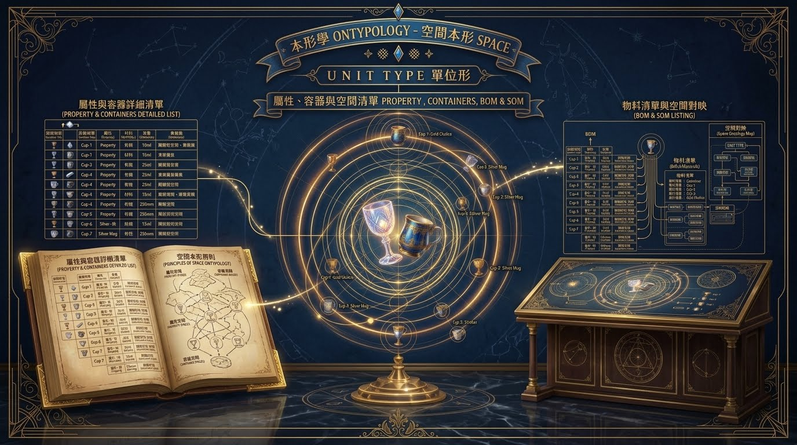
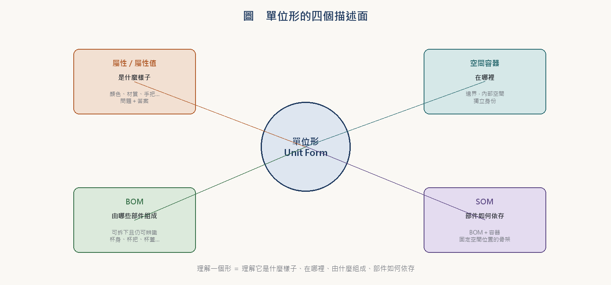
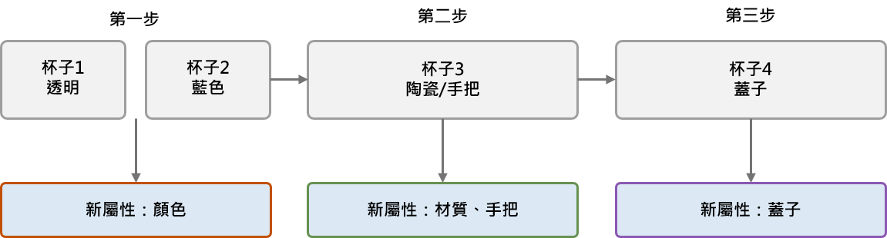
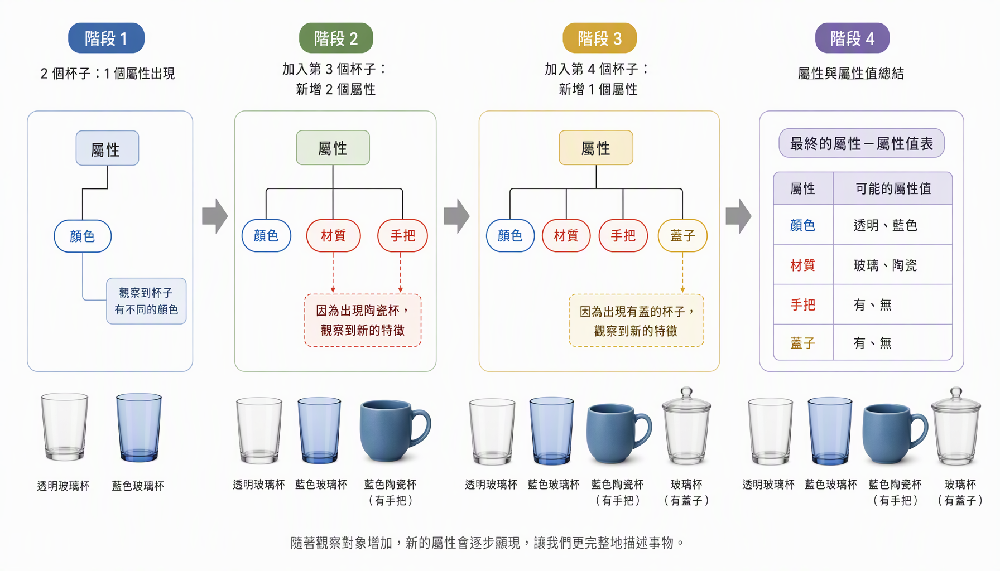
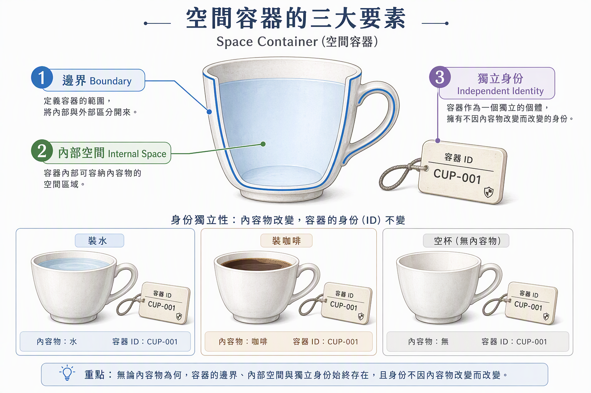
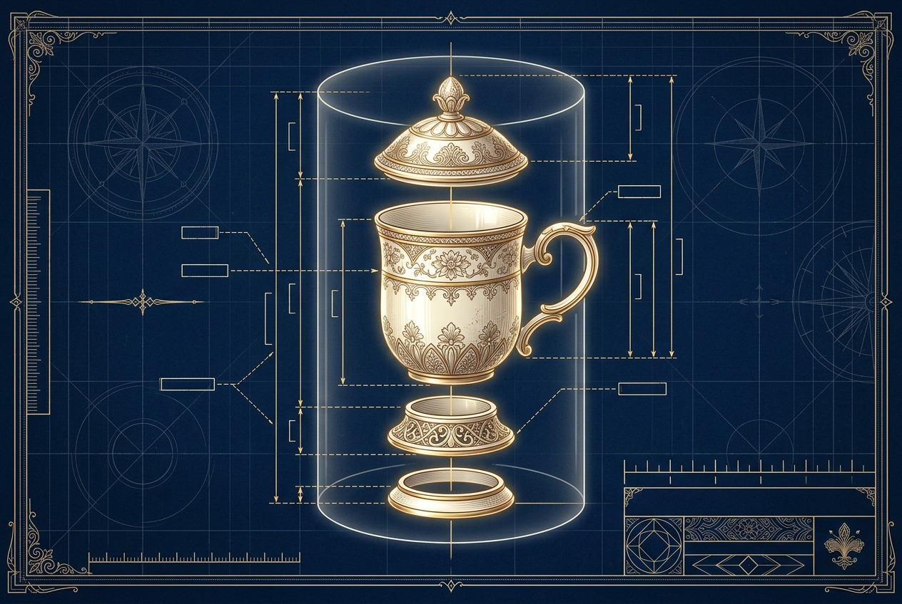
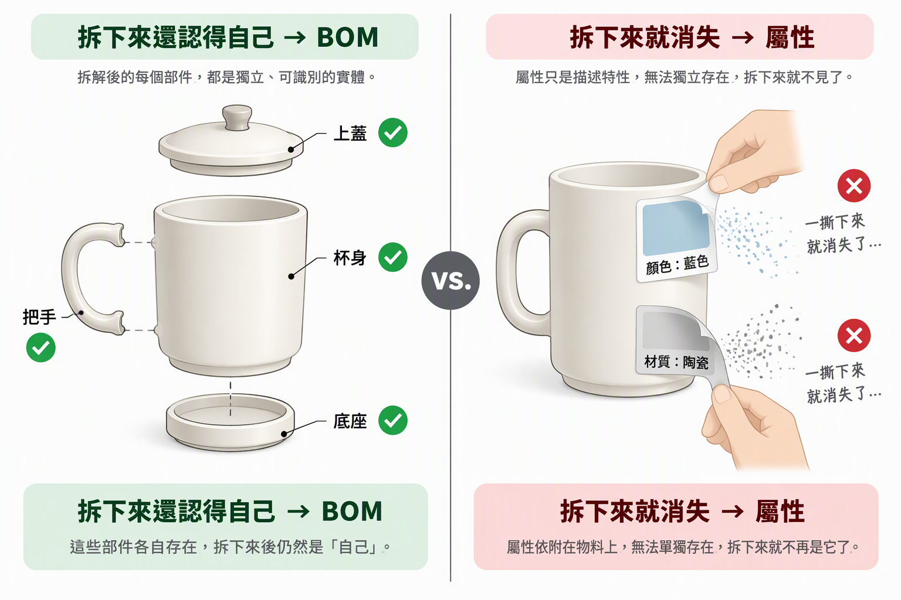
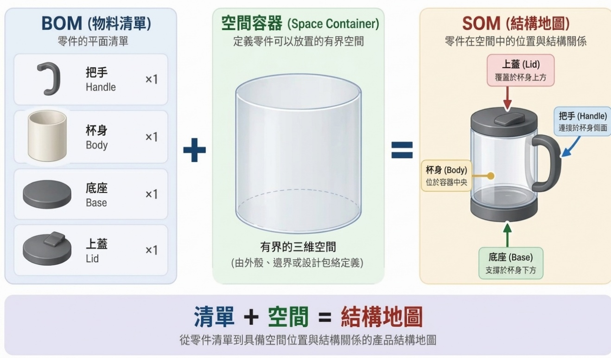
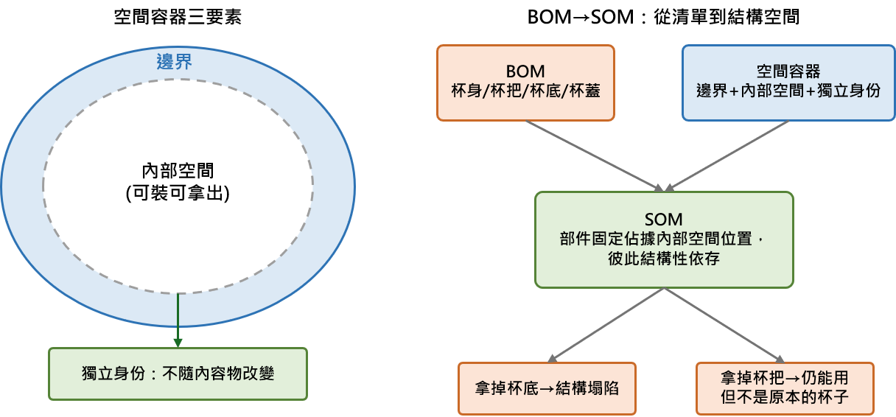

  <a href="https://youtu.be/6y4EZyKeGhk">🎞️youtube</a> ｜ 
 <a href="https://v.douyin.com/Z6qcrkO2J5U">📽️抖音</a> 
 

# 本形學   Ontypology

# 空間本形 Space

**單位形  UNIT TYPE**

**屬性、容器與空間清單**

*Property , Containers, BOM &amp; SOM*

## 目　錄

**❖　導讀——單位形的四個描述面向**

**◆　第一章　屬性與屬性值**

**◆** 1.1　屬性如何逐步浮現——以杯子為例

**◆　第二章　空間容器（Space Collections）**

**◆　第三章　空間清單：BOM 與 SOM**

**◆** 3.1　BOM（Bill of Materials，物料清單）

**◆** 3.2　SOM（Space of Materials，空間清單）

**❖　本章要點回顧**

*理解一個形 ＝ 理解它是什麼樣子、在哪裡、由什麼組成、部件如何依存*

## 導讀——單位形的四個描述面向

> **本章地圖**
>
> **◆** 本章以一隻「杯子」貫穿全章，依序回答關於一個單位形的四個基本問題。
>
> **◆** 它是什麼樣子？——「屬性與屬性值」（第一章）。
>
> **◆** 它把東西放在哪裡？——「空間容器」（第二章）。
>
> **◆** 它由哪些部件組成？——「BOM 物料清單」（第三章）。
>
> **◆** 部件如何相互依存？——「SOM 空間清單」（第三章）。

> **圖1-1** 單位形的四個描述面向

## 第一章　屬性與屬性值

> *章節意象・屬性之軸——維度與刻度*

屬性是一個「可以被拿來問的問題」，它本身沒有答案，只是劃定一個「要問什麼」的範圍；屬性值則是這個問題在某個具體情境下的實際答案，是屬性底下被圈出來的一個個選項。打個比方：屬性像是一張空白表格的欄位標題，寫著「材質」；屬性值則是這個欄位底下實際被填進去的內容，比如「陶瓷」。標題本身不會變，但底下能填的答案，會隨著具體物件而不同。

**表1-1　屬性與屬性值的對照**

|  | **屬性** | **屬性值** |
| --- | --- | --- |
| **定位** | 可以被拿來問的問題 | 問題在具體情境下的實際答案 |
| **比喻** | 表格的欄位標題（「材質」） | 欄位底下實際填入的內容（「陶瓷」） |
| **變動** | 標題本身不會變 | 隨著具體物件而不同 |

### 1.1　屬性如何逐步浮現——以杯子為例

**第一步：**兩個杯子擺在一起，偵測異同，發現差異只落在一個地方透明跟藍色。此階段唯一浮現的屬性是「顏色」，屬性值是 {透明，藍色}。

**第二步：**第三個杯子（陶瓷、藍色、有手把）加入。先看顏色藍色，既有的顏色軸已經有這個選項，直接掛入，顏色軸不需要變動。但這個杯子同時帶來兩批新差異：材質從「玻璃」變成「陶瓷」，這批差異跟顏色這個維度對不上，於是逼出第二個屬性「材質」；此外這個杯子有手把，前兩個杯子完全沒有可比對的東西，差異同樣跟顏色、材質都對不上，於是又逼出第三個屬性「手把」。

一旦「材質」「手把」成立，前兩個杯子也必須回填這兩個屬性的值材質填「玻璃」（本來就是玻璃，只是先前不需要說出來），手把填「N」（本來就沒有，只是先前沒有東西可以比較）。屬性一旦被抽出來，就必須套用在所有已經出現過的個體上，不能只有新來的物件才有，其餘保持空白，因為屬性是一個維度，維度要能貫穿全部的個體，才能拿來互相比較。

**第三步：**第四個杯子（玻璃、透明、有手把、有蓋子）加入。顏色、材質、手把都能對上既有的軸，唯獨「蓋子」這項差異前三個杯子都沒有可對照的東西，於是逼出第四個屬性「蓋子」，同樣為前三個杯子回填「N」。

**第四步：**此後持續加入的杯子，不論顏色變成金色、銀色、米色、卡其色、白色、灰色，材質變成不鏽鋼或紙，這些差異全部都能對上顏色、材質這兩個既有維度，因此只需要在對應屬性底下新增屬性值，完全不需要再開新屬性；手把、蓋子也持續以 Y／N 記錄，不會再冒出第五個新屬性，因為目前觀察到的所有差異都已能被這四個維度收容。

> **圖1-2** 屬性隨杯子逐步加入而浮現的時間軸

> **圖1-3** 屬性浮現四階段與屬性—屬性值總表彙整

最終彙整成一張完整的屬性—屬性值總表：

**表1-2　屬性—屬性值總表**

| **屬性** | **屬性值** |
| --- | --- |
| 材質 | 不鏽鋼、陶瓷、紙、玻璃 |
| 顏色 | 透明、藍色、金色、銀色、米色、卡其色、白色 |
| 手把 | Y／N |
| 蓋子 | Y／N |

由此可以歸納出一條規則：屬性浮現的時間點，永遠是「這批差異跟現有所有屬性都對不上」的那一刻；屬性值增加的時間點，只要「差異的性質對得上某個現有屬性」，就直接放進去。而且每次屬性浮現，都伴隨著把這個新維度回頭套用到所有已經存在的個體上，讓每個個體在每一個屬性上都有明確的值，這套結構才會完整、不漏洞。

這條規則可以用一個判斷流程來形式化：當一個新物件被拿來跟既有物件比較時，先問「這批差異的性質，跟現有的哪個屬性吻合？」如果答案是「某個屬性吻合」，那就直接在該屬性底下新增一個屬性值，不需要動到框架；如果答案是「跟所有現有屬性都對不上」，那就必須開一個新屬性，並且回頭為所有已經存在的個體補上這個新屬性。這個流程確保了屬性結構的完整性：每一個個體在每一個屬性上都有明確的值，不會出現「某個杯子在某個屬性上是空白的」這種漏洞。

這個機制也解釋了為什麼屬性的數量通常遠少於屬性值的數量：屬性是「維度」，代表差異的「種類」；屬性值是「選項」，代表同一種差異裡的各種可能。在我們的杯子例子中，只有 4 個屬性（顏色、材質、手把、蓋子），但屬性值卻隨著杯子數量增加而不斷擴充（顏色從 2 個值成長到 7 個以上）。這就像一個座標系統：軸的數量是固定的（二維就是二維），但每條軸上的刻度可以無限延伸。

> **屬性浮現規則（總結）**
>
> **◆** 差異與現有屬性都對不上 → 開新屬性，並回填所有已存在個體。
>
> **◆** 差異性質吻合既有屬性 → 只在該屬性下加新屬性值。
>
> **◆** 屬性數量少、屬性值數量多；維度固定，刻度可延伸。

## 第二章　空間容器（Space Collections）

> *章節意象・容器之光——邊界與內部空間*

空間容器指的是：一個在空間中具有明確邊界的物體，這個邊界圍出一塊「內部空間」，讓其他東西可以被放進、也可以被拿出，而容器本身不會因為內部空間裡有沒有東西、裝的是什麼東西，而改變自己是誰。簡言而之，容器回答的是「東西在哪裡」的問題，而不是「東西是什麼」的問題，杯子不會因為裡面裝的是水還是咖啡，就變成不同的東西，它自始至終都是同一個杯子。

一個空間容器包含三個要素：

#### （一）邊界

邊界是容器最核心的部分，功能是區分「裡面」和「外面」。杯壁、碗身、房間的牆、書包的布料、口袋的縫線都是邊界；邊界不一定要是實體固體，水面、一條用粉筆畫出來的線，只要能明確劃出「進去了」跟「還沒進去」的差別，都可以構成邊界。邊界可以是封閉的（如密封的保溫瓶），也可以是開放的（如沒有蓋子的杯子），開放與否會影響東西能不能「掉出去」，但不影響容器本身是不是容器。

#### （二）內部空間

內部空間是邊界圍出來、實際用來容納其他物體的那塊空間，其大小與形狀決定容器能裝什麼、能裝多少。內部空間可以是空的（空杯子仍然是杯子），也可以同時容納多種不同的東西（杯子裡可以同時有水跟冰塊）。

#### （三）獨立的身份

這是空間容器最關鍵、也最容易被忽略的性質：容器的身份不由它裝的內容物決定，而是由它自己的邊界和結構決定。因為身份獨立於內容物，容器才能經歷「裝東西 → 拿出來 → 裝別的東西」這整個過程，而每一次都仍被認出是同一個容器。這跟一般東西的身份很不一樣：如果把一杯水的「水」換成「咖啡」，我們不會說「這杯水變成了咖啡」，而是說「杯子裡的東西換了」「換的是內容物」，而「容器沒有變」，這個語感其實已經反映出容器身份獨立於內容物的性質。

> **圖2-1** 空間容器的三大要素：邊界、內部空間、獨立身份

由此延伸出容器與內容物的關係：內容物是可替換的、可移除的，也不會反過來定義容器；容器可以有大小限制，這也是容器區別於「無邊界的空間」的地方。此外，容器還可以互相嵌套杯子可以放進袋子裡，袋子可以放進箱子裡，箱子可以放進房間裡；每一層容器都各自獨立成立，各自遵守「邊界、內部空間、獨立身份」這三個基本要素。

> **圖2-2** 容器的嵌套：杯入袋、袋入箱、箱入房，每一層各自獨立成立

## 第三章　空間清單：BOM 與 SOM

> *章節意象・結構藍圖——部件的爆炸圖*

### 3.1　BOM（Bill of Materials，物料清單）

BOM 回答的是「這個東西打開來看，裡面是由哪些更小的東西組成」，杯子是由杯身、杯耳、杯蓋組成。要得到 BOM，只需拿一個個體本身拆開，不需要跟任何其他個體比較；就算世界上只存在這一個杯子，只要它有手把、有蓋子，依然可以把它拆成「杯身＋杯底＋杯耳＋杯蓋」這件事不靠比較，靠拆解。

判斷一個特徵該不該被列進 BOM，標準只有一個：它能不能被拆下來，而且拆下來之後，自己仍然是一個有獨立身分、可以被辨識的東西。用這個標準檢查杯子身上的幾個特徵：

**表3-1　BOM 判準檢核表——「拆下來之後，它還認得自己嗎？」**

| **特徵** | **判定** | **說明** |
| --- | --- | --- |
| **杯耳（手把）** | **算 BOM** | 可以拆下來，拆下來後仍是「一個杯耳」。 |
| **杯蓋** | **算 BOM** | 可以拿下來，拿下來後仍是「一個蓋子」。 |
| **顏色** | **屬性** | 不能被拆下來，拿掉顏色不會剩下「一份被拆出來的顏色」，顏色只是消失。 |
| **材質** | **屬性** | 同樣不能被拆下來，材質是杯身「是用什麼做的」，不是杯身「裡面裝了什麼」。 |

> **圖3-1** BOM 與屬性的界線：拆得下來的進 BOM，拆不下來的進屬性

這條標準清楚劃出 BOM 與屬性的界線：能拆下來、拆下來後還是獨立個體的，進 BOM；只能用來描述「這個東西本身是什麼樣子」、拆不下來的，進屬性。

這個判準可以用一個更簡潔的方式表達：「拆下來之後，它還認得自己嗎？」如果答案是「認得」（例如杯蓋拆下來仍然是一個蓋子），那就進 BOM；如果答案是「不認得」（例如顏色被「拆下來」後什麼都不是），那就進屬性。這個標準不僅適用於杯子，也適用於任何物件：汽車的引擎、輪胎、車門可以拆下來後仍然是「一個引擎」「一個輪胎」「一扇車門」，所以它們是汽車 BOM 的項目；但汽車的顏色、品牌、出廠年份拆不下來，它們是汽車的屬性。

以杯子為例，BOM 隨著觀察樣本增加而逐步浮現：第一個杯子（玻璃、透明、無手把、無蓋）整體是連續的玻璃，拿掉任何一部分都不會剩下可獨立命名的東西，此階段 BOM 只有杯身、杯底兩項；第二個杯子（陶瓷、藍色、有手把、無蓋）多了手把可拆下，BOM 增為三項；第三個杯子（玻璃、透明、有手把、有蓋子）又多了蓋子，BOM 增為四項。

BOM 負責回答「這個東西打開來看，由哪些可以獨立辨識的部件組成」；屬性負責回答「這個東西（不管是整體，還是 BOM 裡的某個部件）本身是什麼樣子」。BOM 決定樹狀結構往下分幾支，屬性決定每一支、每一個節點自己的樣貌。 兩者合在一起，才能把一個個體完整、無遺漏地描述出來。

### 3.2　SOM（Space of Materials，空間清單）

**SOM ＝ BOM ＋ 空間容器**（Space Collections）

BOM 能告訴你「拆得出哪些部件」，但不會告訴你這些部件在空間裡怎麼排列、彼此依不依存、拿掉哪個部件會動搖整體，BOM 是一份「清單」，不是一張「地圖」。空間容器則相反：它能告訴你「有邊界、有內部空間」，但內部空間裝的東西被當成可以任意替換的內容物（水換咖啡沒差），沒辦法呈現「部件之間位置固定、互相依存」這件事。SOM 要處理的，正是這兩者都做不到、只有疊加起來才能回答的問題：這個物體佔據了什麼空間，而這塊空間裡的東西是不是可以隨便拿掉。

SOM 描述的是：一個物體同時具備空間容器的「邊界、內部空間」，但它內部空間裡裝的東西，不是可以隨意替換的內容物，而是被固定在特定空間位置、彼此結構性依存、共同構成這個物體本身的部件。換句話說，SOM 是一個「容器」，但容器裡裝的不是水，而是這個容器自己的骨架。

**SOM 的性質，一半繼承自空間容器，一半繼承自 BOM：**

**表3-2　SOM 的繼承結構**

| **繼承來源** | **繼承的性質** |
| --- | --- |
| **從空間容器繼承** | 邊界（區分「這個物體的範圍」跟「範圍之外」）、內部空間（部件實際佔據、存在的地方）、獨立的身份（作為一個整體有自己的身份，而非單純部件的堆疊清單）。 |
| **從 BOM 繼承** | 結構性部件（內部空間裡的東西不是隨便什麼都可以裝，而是構成這個整體所必要的部分）、部件之間的依存關係（部件彼此有支撐、連接、依附的關係，不是互相獨立、地位平等的）、拿掉部件會動搖整體的身份（跟容器不同，SOM 拿掉一個部件，很可能就不再是「同一個東西」了）。 |

以杯子為例來看 SOM：內部空間（來自空間容器）是邊界所圍出的空間，裡面不是空的，而是填滿結構性部件；結構性部件（來自 BOM）是杯身、杯把、杯底、杯蓋各自佔據內部空間中的一塊，而且彼此位置固定，杯把長在側邊中段，杯底在最下方，不能隨意調換位置；依存關係（來自 BOM）則表現在杯底若消失，整個結構會塌陷、杯子不成杯子，杯把若消失，杯子還能裝水，但已不是原本那個「有把手的杯子」。

> **圖3-2** SOM ＝ BOM ＋ 空間容器：從零件清單到結構地圖

這跟前面單獨講的「杯子作為容器」（裝水、裝咖啡）是完全不同層次的描述裝水的杯子，是把杯子當空間容器在看；杯子本身怎麼由杯身杯把杯底構成，是把杯子當 SOM 在看。兩者可以同時成立，只是分別回答「裡面裝了什麼客人」跟「這個東西本身是怎麼長成的」兩個不同問題。SOM 是把「結構」這個原本抽象的關係，重新放回「空間」這個具體的舞台上，讓部件與部件之間的依存關係，不只是邏輯上的描述，而是能夠被看見、被定位、被實際佔據空間的存在。

> **圖3-3** 空間容器三要素，以及 BOM 如何與空間容器結合成 SOM

本章要點回顧

| **❖ 屬性／屬性值**  差異對不上既有維度，就開新屬性並回填所有已存在個體；差異吻合既有屬性，就只在該軸下新增屬性值。維度少而固定，刻度多而可延伸。 | **❖ 空間容器**  邊界區分裡外，內部空間容納內容物，獨立身份不隨內容物改變。容器可以層層嵌套，每一層各自獨立成立。 |
| --- | --- |
| **❖ BOM 物料清單**  拆得下來、拆下來後仍認得自己的，才是部件。顏色、材質拆不下來，屬於屬性而非 BOM。 | **❖ SOM 空間清單**  SOM ＝ BOM ＋ 空間容器。部件固定佔據空間位置、彼此結構性依存，拿掉部件會動搖整體的身份。 |

[www.longreat.net](www.longreat.net)

张长丰 [gamma@livemail.tw](mailto:gamma@livemail.tw)

张楟颍 [mindaiworks@gmail.com](mailto:mindaiworks@gmail.com)

ss
