**本形學 Ontypology**

# 形集合的運算式

**Type Set Expressions**

*從「表記」到「運算」——把形集合推導成一組可複核的式子*

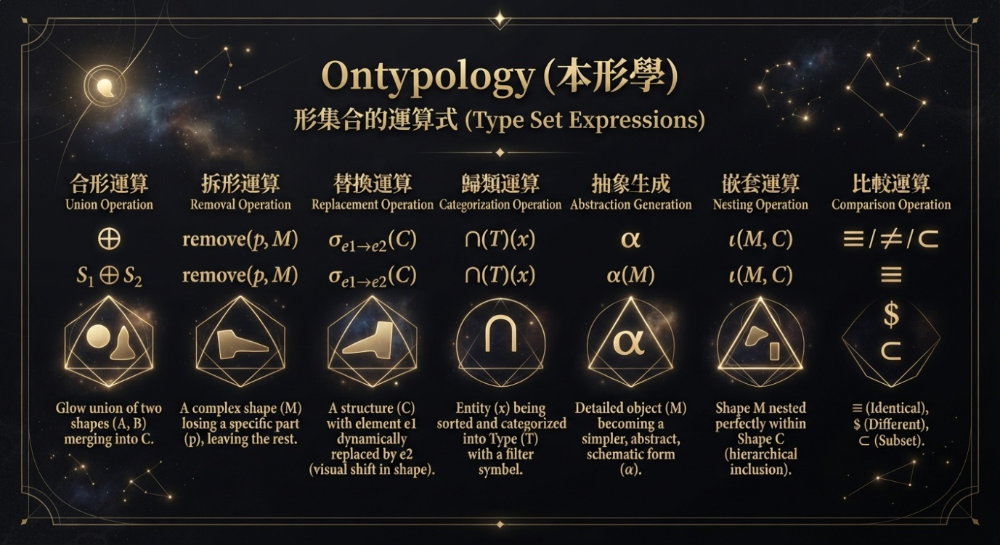

# 目　錄

- 寫在前面　本冊的任務
- 導讀　運算式的世界
  - 0.1　什麼是運算式
  - 0.2　為什麼形集合需要自己的運算
  - 0.3　推導路線圖
- 第一章　運算的舞台：形集合骨幹速覽
  - 1.1　三條軸・三種括號
  - 1.2　兩個二元組、一條公理、一條判準
  - 1.3　形集合表記解剖
  - 1.4　三件套：定義、判準、推理
- 第二章　運算式的語法：對象、層次、記號
  - 2.1　一般形式：形進形出
  - 2.2　三類運算對象
  - 2.3　括號即層次：運算的作用範圍
  - 2.4　本冊運算符號一覽
- 第三章　合形運算 ⊕：把部件合成一個形
  - 3.1　定義與封閉性推導
  - 3.2　運算律推導：結合律成立，交換律成立
  - 3.3　例：咖啡杯與兩個對照
- 第四章　拆形運算 remove：移除部件，三級判準
  - 4.1　定義與三級判準式
  - 4.2　運算律推導
  - 4.3　例：手機三級與兩個對照
- 第五章　替換運算 σ：換的是內容，不動的是身份
  - 5.1　定義
  - 5.2　保身份定理
  - 5.3　運算律：交換、複合、清空
  - 5.4　例：杯子與兩個對照
- 第六章　歸類運算 ∩(T) 與抽象生成 α：把類別寫成規則
  - 6.1　歸類運算的定義與推導
  - 6.2　抽象生成 α：特徵萃取
  - 6.3　F(T) 單調反變定理
  - 6.4　例：吸管杯與兩個對照
- 第七章　嵌套運算 ι：形入容器，層層各持身份
  - 7.1　定義
  - 7.2　嵌套鏈層次定理
  - 7.3　ι 與 σ 交換、不可壓平反例
  - 7.4　例：杯入袋入箱與兩個對照
- 第八章　比較運算 ≡／≢／⊂：哪一層的同一
  - 8.1　三種同一
  - 8.2　降級式與比較的層次選擇
  - 8.3　例：三個領域的比較
- 第九章　複合運算與運算律總表
  - 9.1　運算律總表
  - 9.2　反例推導三則
  - 9.3　複合式推導示範
- 第十章　三層判斷的運算式化：三式連立
  - 10.1　三條判斷式
  - 10.2　完整推導示範：智慧型手機
  - 10.3　判斷式的推導價值
- 第十一章　形進形出：運算式與時間本形接上軌
  - 11.1　一切運算都是形進形出
  - 11.2　高階複合：時間本形函式庫
  - 11.3　兩庫對照
- 第十二章　準確使用方法：運算式推導版
  - 12.1　推導六步驟
  - 12.2　八問檢查清單
  - 12.3　誤用對照五種
  - 12.4　完整案例：一組式從定義推到得證
- 第十三章　內容完整方案：學・練・用・教・建
  - 13.1　學練用教建五段路線
  - 13.2　八週學習路線
  - 13.3　情境選路：何時用哪個運算
  - 13.4　驗收標準
- 回顧　要點總整理與自我檢查
  - R-1　五式三律一判斷
  - R-2　表記與運算是一體兩面
  - R-3　準確是可複核的準
- 練習篇　參考答案
- 附錄 A　運算符號總表
- 附錄 B　術語記號速查
- 附錄 C　推導模板速查

# 寫在前面　本冊的任務

這本冊子只做一件事：把形集合從「表記」推到「運算」。

在《單位形與集合邏輯》裡，一個形已經可以被完整地表記——{ 部件, ( 內容 ), [ 類別 ] }，三種括號各司其職，三條軸各答一問。在《數學證明》裡，這套表記已經可以被寫進證明——三種補足把規則、身份、結構一一補回，證明六步驟讓每一步都可複核。可是「表記得完整」和「證明得嚴謹」之後，還有一步沒走完：形與形之間怎麼運算？部件怎麼合、怎麼拆？內容怎麼換？類別怎麼判？形怎麼入位、怎麼比較？

這一步，就是「運算式推導」。本冊把形集合的運算一條一條推導出來：先立語法，再逐式定義、逐式推導運算律，然後合流成判斷式與方法。每條運算式都遵守同一條標準——可逐步書寫、可逐項複核、可被反例檢驗。

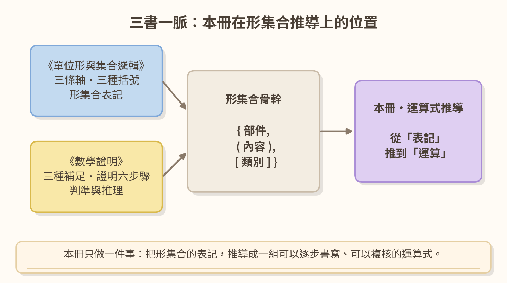

**圖 D-1　三書一脈：本冊在形集合推導上的位置**

**【注】兩書對應與本冊位置**

| 來源骨幹 | 已經建立 | 本冊的推導位置 |
| --- | --- | --- |
| 三軸三括號・形集合表記 | 怎麼描述、怎麼表記一個形 | 第一章：運算的舞台 |
| 二元組與判準 | T=(F(T),∩(T))、C=(id(C),S(C))、remove 三級、不變性公理 | 第三至八章：逐式推導 |
| 三層判斷 | 容器／物料清單／抽象怎麼判 | 第十章：判斷的運算式化 |
| 證明六步驟 | 證明怎麼寫得準 | 第十二章：推導六步驟 |

**表 0-1　兩書骨幹與本冊推導位置的對應**

全書案例多領域並列：杯子、智慧型手機、電動車、程式模組、組織部門輪番上場。每一個運算式都配一張圖、一個例子、一則練習——一式一圖一例一練，是本冊的編排約定。

> **【重點】一句話**
>
> 表記是靜態的形，運算是動態的形；本冊把兩者接上軌。

# 導讀　運算式的世界

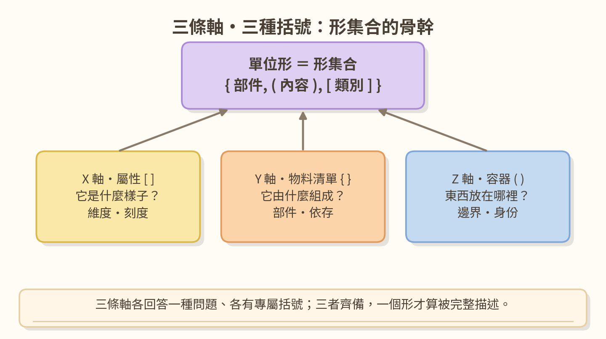

**圖 B-1　藍圖總覽：形集合的運算式——從「靜態表記」到「動態運算」**

## 0.1　什麼是運算式

運算式，是一條寫得出來、逐步可複核的式子。它不只是記號的裝飾，而是一組承諾：只要照著式子走，任何人都能得到同樣的結果，並檢查你的每一步。

數學的集合論有自己的運算：聯集 ∪、交集 ∩、補集——它們回答「屬不屬於」，精確而簡潔。但形集合在數學集合之上疊加了三種加值：{ } 補上部件的組成結構、( ) 補上不隨內容改變的身份、[ ] 補上自動判斷新成員的生成規則。既然表記有三層加值，運算就不能只有一層——合一個形、拆一個形、換一個內容、判一個類別、嵌一個身位，都需要各自的運算式，也各自需要各自的運算律。

## 0.2　為什麼形集合需要自己的運算

> **【推導】三個理由**
>
> 一、層次要守得住。數學集合把層次壓平：{ 杯子, 水 } 裡杯子和水地位相同。形集合的運算必須寫在正確層次上——σ 只動內容、⊕ 只動部件、∩(T) 只問類別。
>
> 二、身份要守得住。內容換了，容器還是同一個容器——這條不變性公理必須在運算式裡成立，σ 的保身份定理就是它的直接推論。
>
> 三、推導要能被複核。每一條運算律都必須標明「成立」或「不成立」，不成立的要有反例——反例畫出運算式合法使用的邊界。

## 0.3　推導路線圖

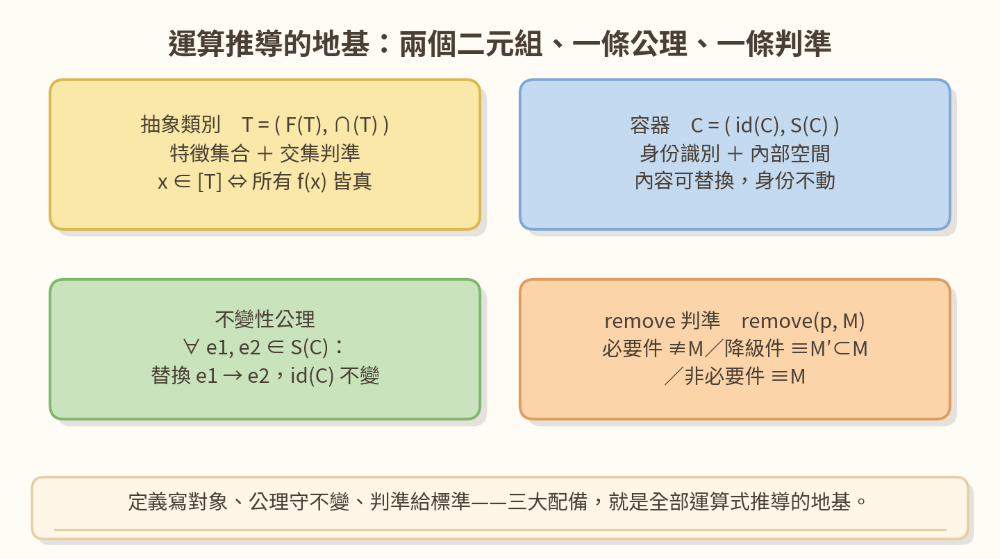

**圖 D-2　推導路線圖：從骨幹到運算式**

全書分三段推進。上篇立骨幹：把兩書的地基整理成運算的舞台（第一、二章）。中篇逐式推導：五大運算加比較，一式一章，每章走「定義 → 運算律推導 → 例 → 練習」（第三至八章）。下篇合流：運算律總表與反例、三層判斷的運算式化、形進形出與時間本形接軌，再收束成準確使用方法與內容完整方案（第九至十三章）。

> **【重點】閱讀方式**
>
> 想快讀的人，讀每章的定義框與重點框就能掌握骨幹；想推導到底的人，跟著推導框一步一步走，再到練習裡寫出自己的式子。

**【注】藍圖卡導覽**

| 圖號 | 藍圖卡 | 內容一覽 | 位置 |
| --- | --- | --- | --- |
| 圖 B-1 | 藍圖總覽 | 全書藍圖：五大運算與實踐框架 | 導讀開頭 |
| 圖 B-2 | 運算的舞台 | 三條軸、三種括號、四大基石、op: Type → Type | 第一章末 |
| 圖 B-3 | 合形 ⊕ | 組裝為具備層次的整體、運算律狀態、對照警示 | 第三章末 |
| 圖 B-4 | 拆形 remove | 三級同一性判準、冪等性、拆合不對稱 | 第四章末 |
| 圖 B-5 | 替換 σ | 保身分定理、同層交換、層次對照 | 第五章末 |
| 圖 B-6 | 歸類 ∩(T)／抽象 α | 特徵萃取與規則檢驗漏斗、F(T) 單調反變 | 第六章末 |
| 圖 B-7 | 嵌套 ι | 嵌套鏈層次定理、與 σ 交換、層次不可壓平 | 第七章末 |
| 圖 B-8 | 比較 ≡／≢／⊂ | 三種同一：容器層／組成層／抽象層、降級符號 | 第八章末 |
| 圖 B-9 | 運算律總表 | 綠燈區成立、紅燈區反例與操作邊界 | 第九章末 |
| 圖 B-10 | 三式連立 | 三層安檢閘門 J = J_C ∧ J_B ∧ J_T、單層盲點對照 | 第十章末 |
| 圖 B-11 | 時間本形接軌 | 從空間本形走向時間本形的管線、果因推理推演 | 第十一章末 |
| 圖 B-12 | 六步驟與八問 | 可複核的推導六步驟、八問自檢表精華 | 12.2 節末 |
| 圖 B-13 | 誤用與對策 | 高頻誤用的避錯指南 | 12.3 節末 |
| 圖 B-14 | 咖啡杯三重檢驗 | 實戰推導：換茶／拆蓋／保溫杯三問 | 12.4 節末 |
| 圖 B-15 | 學練用教建 | 從學到建的演化、可複核的準 | 13.1 節末 |
| 圖 B-16 | 落地路線 | 五階段漏斗與情境選路指南 | 13.3 節末 |
| 圖 B-17 | 巨集藍圖 | The Master Blueprint 全景總結 | 回顧末 |

**表 0-2　藍圖卡導覽：一卡一章，圖文相應**

**上篇・立骨幹**

先把運算的舞台搭起來：形集合的骨幹，與運算式的語法

# 第一章　運算的舞台：形集合骨幹速覽

這一章不重講兩書的理論，只把「運算要作用在什麼東西上」講清楚。三條軸、三種括號、兩個二元組、一條公理、一條判準——五樣配備，就是全部運算式推導的舞台。

## 1.1　三條軸・三種括號

**圖 1-1　三條軸・三種括號：形集合的骨幹**

X 軸的屬性 [ ] 回答「它是什麼樣子」——維度是屬性、刻度是屬性值；Y 軸的物料清單 { } 回答「它由什麼組成」——拆下來認得自己就進 BOM；Z 軸的容器 ( ) 回答「東西放在哪裡」——邊界圍出內部空間，身份不隨內容改變。三條軸各有專屬括號，各有專屬判準，也將各有專屬運算。

## 1.2　兩個二元組、一條公理、一條判準

**圖 1-2　運算推導的地基**

> **【定義】運算推導的地基**
>
> 抽象類別　T = ( F(T), ∩(T) )　——　特徵集合加交集判準；x ∈ [T] ⇔ 所有 f(x) 皆真。
>
> 容器　C = ( id(C), S(C) )　——　身份識別加內部空間；內容可替換，身份不動。
>
> 不變性公理　∀ e1, e2 ∈ S(C)：替換 e1 → e2，id(C) 不變。
>
> remove 判準　remove(p, M)：必要件 ≢M／功能降級件 ≡M′⊂M／非必要件 ≡M。

這四條就是本冊全部推導的出發點。之後每一條定理，都是從這四條加上「形集合表記」推出來的——沒有任何一條需要新的假設。

## 1.3　形集合表記解剖

**圖 1-3　形集合表記解剖**

形集合 M = { 部件, ( 內容 ), [ 類別 ] } 是運算的對象。{ } 裡是拆得開的部件，( ) 裡是裝進去的內容，[ ] 裡是說出來的類別。括號不是裝飾，而是層次的記號——這一點在第二章會成為運算語法的第一條規則。

## 1.4　三件套：定義、判準、推理

運算式推導沿用證明的三件套：定義先說清楚對象是誰，判準給出可以逐項驗證的標準，推理從定義與判準一步步走向結論。本冊每一條運算律的推導都遵循同一格式——寫定義、引判準、走推理、找反例。

> **【重點】本章重點**
>
> ◆　運算的舞台＝三軸三括號＋兩個二元組＋不變性公理＋remove 判準。
>
> ◆　形集合 M = { 部件, ( 內容 ), [ 類別 ] } 是一切運算的對象。
>
> ◆　推導三件套：定義、判準、推理——每一式都按此格式走。

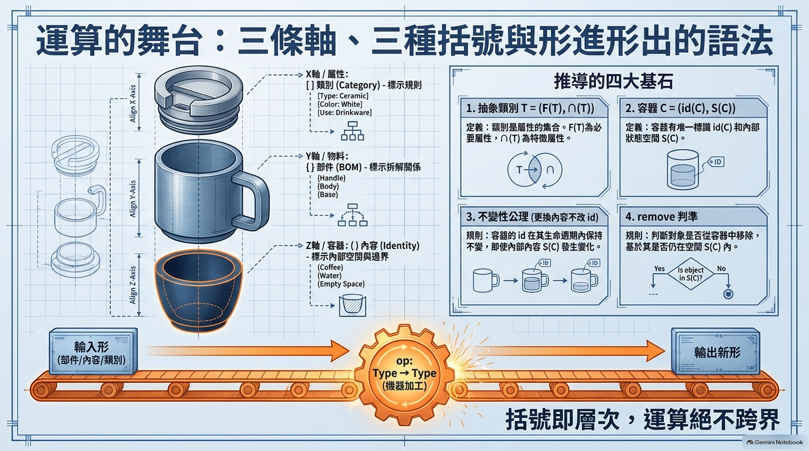

**圖 B-2　藍圖卡：運算的舞台——三條軸、三種括號與形進形出的語法**

# 第二章　運算式的語法：對象、層次、記號

在推導任何一條運算式之前，先立語法：運算的一般形式是什麼？運算作用在哪三種對象上？括號如何決定運算的作用範圍？

## 2.1　一般形式：形進形出

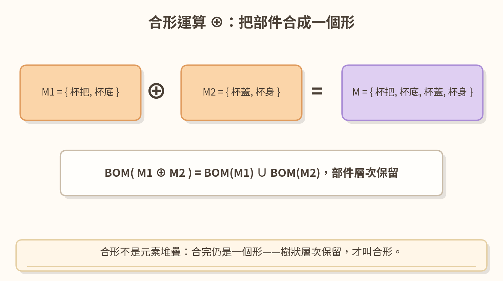

**圖 2-1　運算式的一般形式：形進形出**

> **【定義】運算式的一般形式**
>
> 任何運算式都是一個從形到形的映射：op: Type → Type。吃進一個形，吐出一個形——輸入的可能是部件形、內容形或類別形，產出的也是一個可再被運算的形。

這個形式看似簡單，卻是本冊與《時間本形篇》的接軌點：時間本形（動詞、函式、方法）的本質就是形進形出。到第十一章我們會看到，五大運算是基本款，時間本形函式庫的高階函式是複合款——兩者在同一條軌道上。

## 2.2　三類運算對象

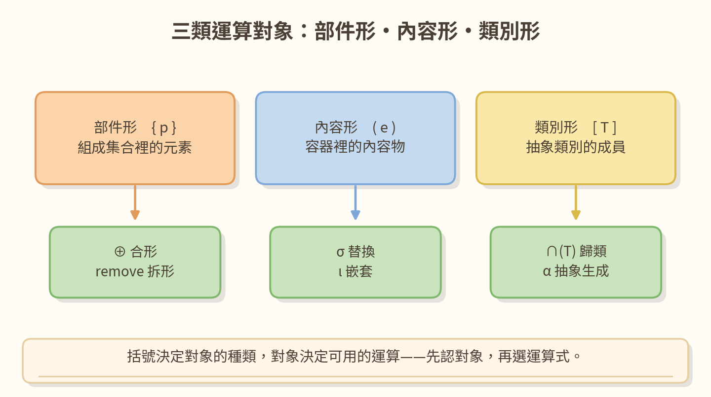

**圖 2-2　三類運算對象**

括號的種類決定對象的種類，對象的種類決定可用的運算：部件形 { p } 由 ⊕ 與 remove 操作；內容形 ( e ) 由 σ 與 ι 操作；類別形 [ T ] 由 ∩(T) 與 α 操作。認錯對象是運算式誤用最常見的原因——把內容形拿去合形、把部件形拿去替換，式子寫得再順也推不出對的結果。

## 2.3　括號即層次：運算的作用範圍

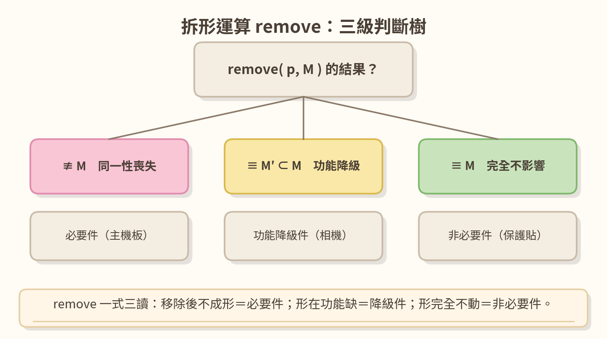

**圖 2-3　括號即層次**

運算式寫進括號範圍內才有效：⊕ 與 remove 只在 { } 的範圍內動部件；σ 只在 ( ) 的範圍內動內容；∩(T) 只在 [ ] 的範圍內問類別。括號寫清楚，運算範圍就不會錯——這條規則看似平凡，卻是後面所有「不成立」運算律的共同根源：凡是跨層次、越範圍的式子，一律要另立條件或改寫。

## 2.4　本冊運算符號一覽

| 運算 | 符號 | 作用對象 | 一句話 | 推導章節 |
| --- | --- | --- | --- | --- |
| 合形運算 | ⊕ | 部件形 { p } | 把部件合成一個形，層次保留 | 第三章 |
| 拆形運算 | remove(p, M) | 部件形 { p } | 移除部件，看同一性存續 | 第四章 |
| 替換運算 | σ_{e1→e2}(C) | 內容形 ( e ) | 換內容，身份不動 | 第五章 |
| 歸類運算 | ∩(T)(x) | 類別形 [ T ] | 特徵全數通過才入類 | 第六章 |
| 抽象生成 | α | 一群形 → 類別 | 萃取特徵，生成類別 | 第六章 |
| 嵌套運算 | ι(M, C) | 形入容器 | 確立身位，層層各自成立 | 第七章 |
| 比較運算 | ≡／≢／⊂ | 形與形 | 哪一層的同一？降級記 ⊂ | 第八章 |

**表 2-1　本冊運算符號一覽**

> **【例】例：認對象，選運算**
>
> 情境：「杯子裡的水換成咖啡」該用哪個運算？
>
> 分析：水與咖啡是內容形 ( e )，杯子是容器 C = (id(C), S(C))——「換」的是內容、不動的是身份，因此用 σ_{水→咖啡}(C)。
>
> 對照：若問「杯蓋拆掉後還是杯子嗎」，動的是部件形，該用 remove(杯蓋, M)；若問「保溫杯算不算杯子」，問的是類別形，該用 ∩(杯子)(保溫杯)。

> **【練習】練習**
>
> P01（對象辨認）：下列三句話各該用哪個運算式？① 把書包裡的課本換成筆記本；② 手機的相機模組拆下來；③ 判斷吸管杯是不是杯子。
>
> P02（語法判斷）：為什麼「⊕ 只動部件、σ 只動內容、∩(T) 只問類別」這條規則，能擋掉大部分誤用？各舉一個誤用的後果。

**中篇・逐式推導**

五大運算加比較：一式一圖一例一練習，每式走「定義 → 運算律 → 例 → 練習」

# 第三章　合形運算 ⊕：把部件合成一個形

第一個運算，作用在部件形 { p } 上：把兩個（或多個）形的部件合成一個形。合形是所有結構的起點——沒有合形，BOM 只是一份清單；有了合形，部件才成為一個整體。

## 3.1　定義與封閉性推導

**圖 3-1　合形運算 ⊕**

> **【定義】定義 3-1（合形）**
>
> 設 M1、M2 為形集合，合形 M1 ⊕ M2 定義為一個新形 M，滿足：
>
> （一）BOM(M) = BOM(M1) ∪ BOM(M2)——部件全數收納；
>
> （二）部件之間的層次與依存關係保留（樹狀結構）；
>
> （三）M 的內容 ( ) 與類別 [ ]，依構成情境另行設定。

> **【定理】定理 3-1（封閉性）：合形仍是一個形**
>
> 推導：① 依定義，M1 ⊕ M2 的部件全數進入 BOM(M)；② 層次與依存保留，部件不再只是並列；③ 內容與類別各有其位。三者合觀，M 滿足形集合的完整表記 { 部件, ( 內容 ), [ 類別 ] }——故合形的產出仍是一個形。（得證）

封閉性保證了 ⊕ 可以連續使用：合形的結果還能再被合形——這正是複雜的形一層一層建立起來的方式。

## 3.2　運算律推導：結合律成立，交換律成立

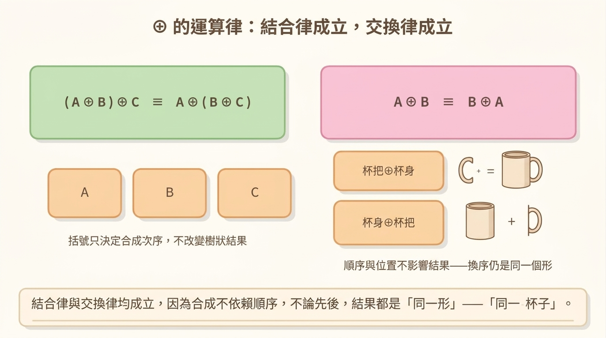

**圖 3-2　⊕ 的運算律**

> **【定理】定理 3-2（交換律）**
>
> A ⊕ B ≡ B ⊕ A

> **【定理】定理 3-3（結合律）**
>
> ( M1 ⊕ M2 ) ⊕ M3　≡　M1 ⊕ ( M2 ⊕ M3 )

> **【推導】結合律推導**
>
> ① 兩式展開後的 BOM 都是 BOM(M1) ∪ BOM(M2) ∪ BOM(M3)——聯集本身具結合性；
>
> ② 部件的層次與依存由「誰接在誰上」的結構決定，與合形的括號次序無關；
>
> ③ 依形同一的比較基準（BOM 與依存結構相同，見第八章），兩式 ≡。（得證）

另外，若 M2 沒有任何部件（BOM 為空），則 M1 ⊕ M2 ≡ M1——「無部件形」扮演單位元的角色。這條性質在「先立骨架、再填部件」的建構流程裡很常用。

## 3.3　例：咖啡杯與兩個對照

> **【例】例 3-1**
>
> 咖啡杯 = 杯把 ⊕ 杯底 ⊕ 杯蓋 ⊕ 杯身。
>
> 推導：四部件逐一合形——(杯把 ⊕ 杯底) ⊕ (杯蓋 ⊕ 杯身)，依結合律可任意加括號；合形後 BOM = { 杯把, 杯底, 杯蓋, 杯身 }，杯把依存杯身、杯蓋蓋住杯身——層次保留，咖啡杯的形成立。
>
> 對照一（組織部門）：業務部 ⊕ 行政部組成一個處——部門各有職掌與彙報關係（依存），順序調換、關係重接，就是另一個組織形。

> **【練習】練習**
>
> P03（合形推導）：寫出「一支智慧型手機」的合形式（主機板、電池、螢幕、相機模組至少四部件），並標出其中一組依存關係。
>
> P04（反例尋找）：在你的生活或工作裡找一個「⊕ 交換律成立」的例子，寫出 A ⊕ B 與 B ⊕ A 的差別在哪一層。

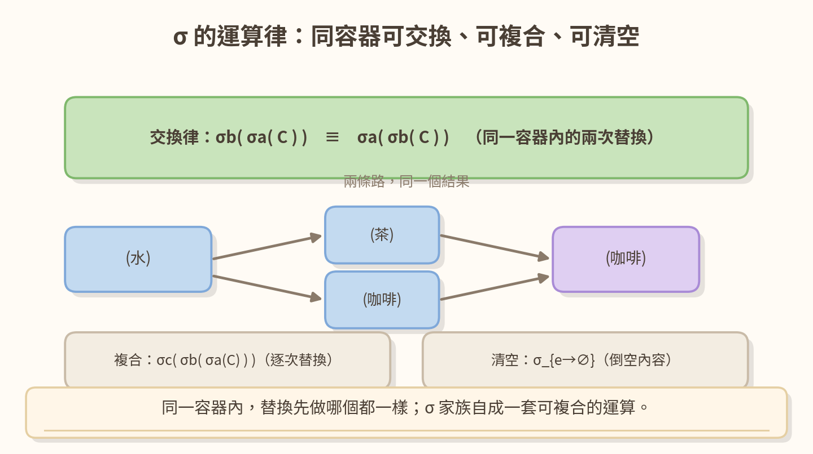

**圖 B-3　藍圖卡：運算一 ⊕ 合形——把零件組裝為具備層次的整體**

# 第四章　拆形運算 remove：移除部件，三級判準

合形的反面是拆形。但「拆」不是簡單的逆操作——拆掉杯把和拆掉杯底，後果完全不同。remove 運算把這種差異寫成可以逐項驗證的判準式。

## 4.1　定義與三級判準式

**圖 4-1　remove 判斷樹**

> **【定義】定義 4-1（拆形）**
>
> remove(p, M)：把部件 p 從形 M 移除的運算。移除後的結果依同一性分三支：
>
> 必要件——remove(p, M) ≢ M：同一性喪失，M 不再是 M（解形）；
>
> 功能降級件——remove(p, M) ≡ M′ ⊂ M：形在、功能缺，記降級式；
>
> 非必要件——remove(p, M) ≡ M：形完全不動。

三級判準式的推導是直接的：它就是 remove 判準本身，只是改寫成運算式的語言。重要的是「推導出的用法」——三級各給出一種關於整體同一性的陳述，證明時對號入座即可。

## 4.2　運算律推導

> **【定理】定理 4-1（幂等性）：remove( p, remove(p, M) ) ≡ remove(p, M)**
>
> 推導：① 第一次 remove 後，p 已不在 BOM 之中；② 第二次 remove 找不到 p，不改變 BOM、層次與依存；③ 兩次結果的形同一。（得證）

> **【定理】定理 4-2（分支分配）**
>
> 若 p 只屬於 M2 的 BOM，則 ( M1 ⊕ M2 ) remove p　≡　M1 ⊕ ( M2 remove p )。
>
> 推導：① remove 只作用在 p 所在的分支 M2；② M1 分支的 BOM 與層次不受影響；③ 由 ⊕ 的封閉性，兩邊都仍是形，且 BOM 與依存相同。（得證）

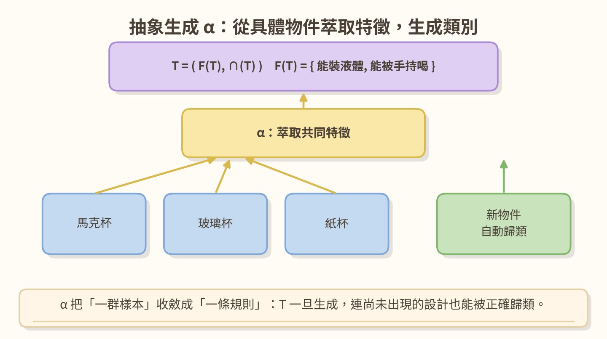

**圖 4-2　remove 與 ⊕ 的關係**

> **【誤用】反例 4-1（拆合不對稱）**
>
> 「先合再拆」不能回到合前的原點：合形時建立的依存關係已經存在，拆除部件只會留下斷口，不會取消「曾合過」的結構。
>
> 更極端的是 remove(必要件, M)：同一性喪失，產出的不再是任何原有的形——這叫解形。拆形不是合形的逆運算，兩者各自獨立。

## 4.3　例：手機三級與兩個對照

> **【例】例 4-1**
>
> M = 智慧型手機：remove(主機板, M) ≢ M（必要件，解形）；remove(相機模組, M) ≡ M′ ⊂ M（功能降級件，失去拍照）；remove(保護貼, M) ≡ M（非必要件）。
>
> 對照一（汽車）：方向盤是功能降級件——移除後仍認得是汽車，但無法轉向；引擎是必要件，移除即解形。
>
> 對照二（組織）：裁撤必要部門（如財務）等於解形——組織不再成其為組織；裁撤可選部門（如某一產品線）是降級；裁撤臨時專案小組是非必要件移除。

> **【練習】練習**
>
> P05（三級分類）：把「一台筆記型電腦」的部件至少六項，用 remove 判準式分成三級，每級至少一項，寫出推導式。
>
> P06（分支分配）：設 M = 書架 ⊕ 書，書架上有一本不重要的雜誌 p。用定理 4-2 寫出 (M) remove p 的兩種等價寫法，並說明 p 為何是非必要件。

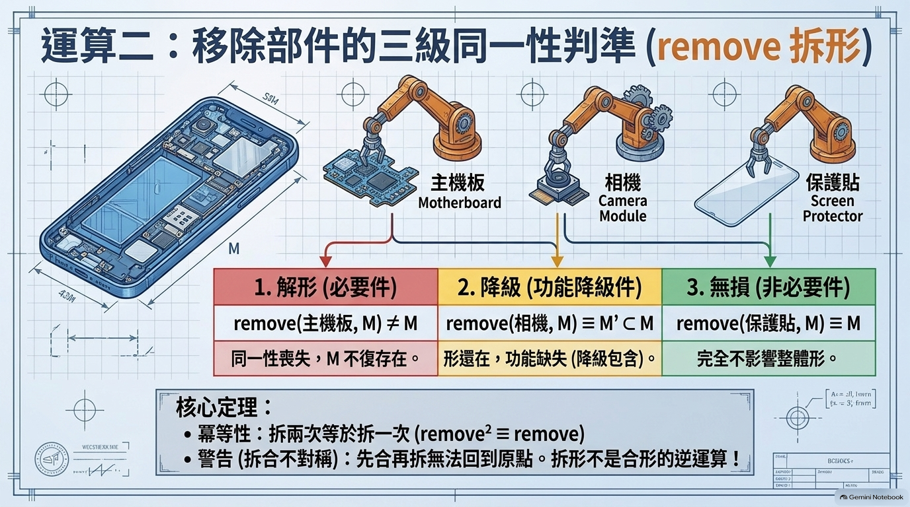

**圖 B-4　藍圖卡：運算二 remove 拆形——移除部件的三級同一性判準**

# 第五章　替換運算 σ：換的是內容，不動的是身份

第三個運算離開部件，進入 ( ) 的層次：內容替換。它是容器邏輯的心臟——也是不變性公理在運算式裡的第一個化身。

## 5.1　定義

**圖 5-1　σ 與不變性公理**

> **【定義】定義 5-1（替換）**
>
> 設 C = ( id(C), S(C) )，e1 ∈ S(C)。替換運算 σ_{e1→e2}(C) 把 S(C) 中的 e1 換為 e2，產出 C′。
>
> 約定：σ 只動 ( ) 範圍內的內容，不碰 id(C)，也不碰部件 { } 與類別 [ ]。

## 5.2　保身份定理

> **【定理】定理 5-1（保身份）：id( σ_{e1→e2}(C) ) = id(C)**
>
> 推導：① 依定義，σ 只改動 S(C) 裡的元素；② 由不變性公理——∀ e1, e2 ∈ S(C)，替換 e1 為 e2 不改變 id(C)；③ 故替換後 id(C) 恆定，σ(C) ≡ C（容器層的同一）。（得證）

這條定理是「換了內容，還是同一個杯子」的運算式寫法。它同時給出一個判斷工具：當你想確認「這是不是同一個東西」時，檢查變動是否只落在 σ 的範圍內——若是，身份由公理守住；若動到了 id 或部件，就要改用 remove 或比較來分析。

## 5.3　運算律：交換、複合、清空

**圖 5-2　σ 的運算律**

> **【定理】定理 5-2（交換律）**
>
> 同一容器內的兩次替換可交換：σb( σa( C ) ) ≡ σa( σb( C ) )（a、b 互不為對方的替換目標）。
>
> 推導：① 兩次替換都只作用於 S(C)；② 集合元素的兩次獨立改動與次序無關；③ 兩式的 S(C) 終態相同、id(C) 皆未動，故 ≡。（得證）

複合與清空是 σ 家族的另外兩款：σc( σb( σa(C) ) ) 是逐次替換，可以先合併成一條式；σ_{e→∅} 把內容清空——空杯子還是杯子，id(C) 依舊不變。

> **【誤用】對照 5-1（層次差異）**
>
> { 水 } 換成 { 咖啡 }：純集合換了元素，成為另一個集合——兩者 ≢。
>
> ( 水 ) 換成 ( 咖啡 )：容器換內容，id(C) 不變——兩者 ≡。
>
> 同一句話「水換成咖啡」，寫在 { } 和 ( ) 裡是兩個不同的運算——括號決定層次，層次決定結果。

## 5.4　例：杯子與兩個對照

> **【例】例 5-1**
>
> C = ( CUP-001, (水) )：σ_{水→咖啡}(C) = ( CUP-001, (咖啡) )。推導：σ 只動 S(C) → 由定理 5-1，id 不變 → 容器層 ≡。
>
> 對照一（資料夾）：資料夾是容器，檔案是內容——把報告.docx 換成簡報.pptx，資料夾還是那個資料夾，σ 成立。
>
> 對照二（職位）：職位是容器，人是內容——甲離職乙接任，職位的職責、編制、編號不變，σ_{甲→乙}(職位) 的 id 不變；但若連職位的職掌都改了，動的就是部件與類別，不再是 σ。

> **【練習】練習**
>
> P07（保身份推導）：用定理 5-1 寫出「錢包裡的鈔票換成另一張」的完整推導式，並指出哪一條公理在第二步被引用。
>
> P08（σ 邊界）：「把杯子換成碗，碗裡裝水」是不是 σ？為什麼？（提示：動的是內容還是容器本身？）

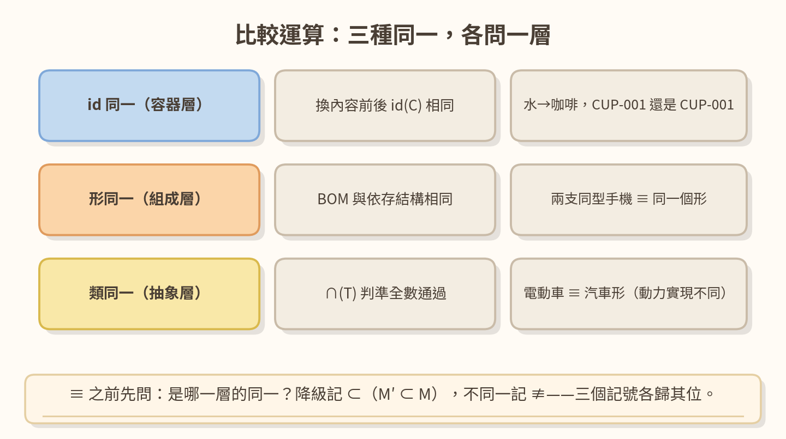

**圖 B-5　藍圖卡：運算三 σ 替換——換的是內容，不動的是身份**

# 第六章　歸類運算 ∩(T) 與抽象生成 α：把類別寫成規則

第四個運算離開部件與內容，進入 [ ] 的層次。歸類問「x 算不算 T」，抽象問「T 怎麼生出來」——一判一生，是類別層的一對互逆。

## 6.1　歸類運算的定義與推導

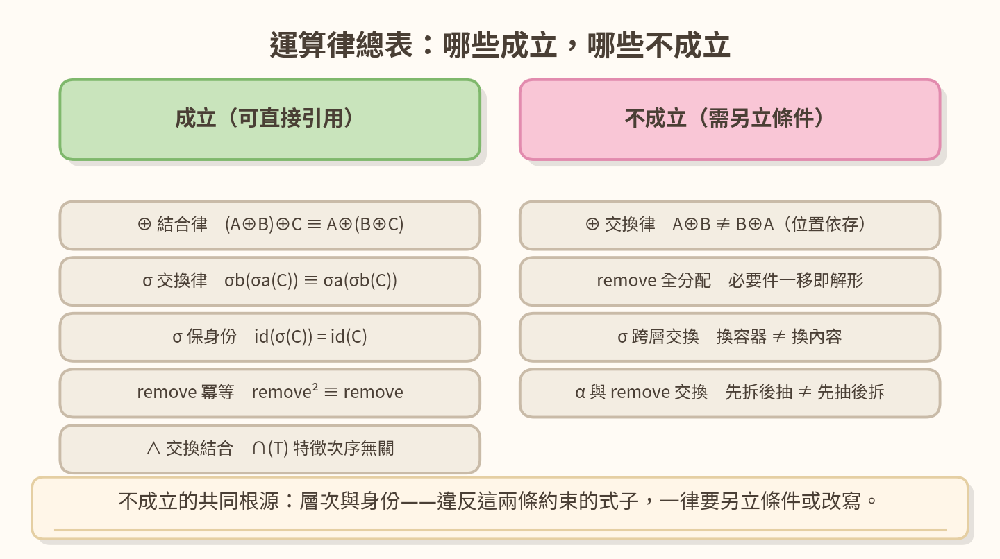

**圖 6-1　∩(T) 交集判準漏斗**

> **【定義】定義 6-1（歸類）**
>
> 設 T = ( F(T), ∩(T) )，F(T) = { f1, f2, ..., fn }。歸類運算定義為：
>
> ∩(T)( x ) = f1(x) ∧ f2(x) ∧ ... ∧ fn(x)。
>
> x ∈ [T] ⇔ ∩(T)(x) = true；任一特徵失敗即 x ∉ [T]。

> **【定理】定理 6-1（特徵次序無關）**
>
> ∩(T)(x) 的判定結果與特徵的檢查次序無關。
>
> 推導：① 歸類式是特徵的合取（∧）；② 合取具交換律與結合律；③ 故 f1、f2 檢查先後不影響結果——判定永遠可以拆成一串可獨立複核的小步驟。（得證）

這條定理看似明顯，卻是「逐項打勾」檢查表的理論保證：審閱者可以按任何順序重現你的歸類判斷。

## 6.2　抽象生成 α：特徵萃取

**圖 6-2　α 抽象生成**

> **【定義】定義 6-2（抽象生成）**
>
> α( x1, x2, ..., xk ) → T：從一群具體形萃取共同特徵，生成抽象類別 T = ( F(T), ∩(T) )。
>
> 屬性浮現規則（承《單位形與集合邏輯》）：差異與現有屬性都對不上 → 開新屬性並回填；對得上 → 只加新屬性值。

α 是「從樣本到規則」的運算：馬克杯、玻璃杯、紙杯 → α →「杯子」這個類別。T 一旦生成，連尚未出現的保溫杯、吸管杯，也能被 ∩(T) 自動正確歸類——這正是封閉清單做不到的事。

## 6.3　F(T) 單調反變定理

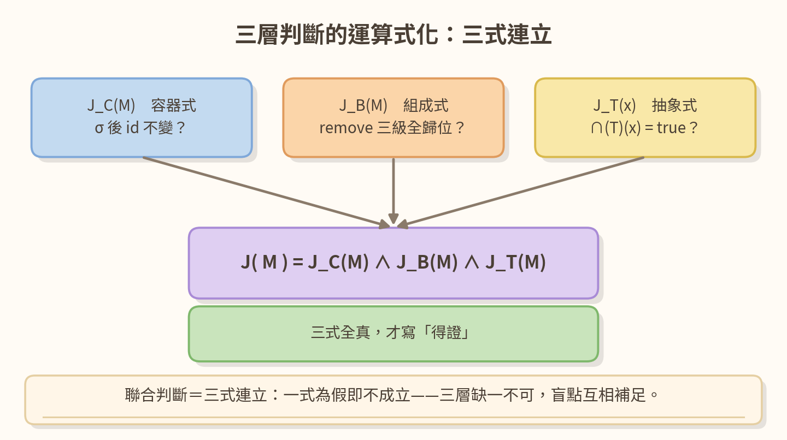

**圖 6-3　F(T) 單調反變**

> **【定理】定理 6-2（單調反變）**
>
> 若 F(T) ⊆ F(T′)，則 [T′] ⊆ [T]。
>
> 推導：① F(T′) 要求通過的特徵比 F(T) 更多；② x ∈ [T′] 表示 x 通過 T′ 的全部特徵，自然也通過 T 的全部特徵；③ 故 x ∈ [T]，即 [T′] ⊆ [T]。（得證）

特徵是「加入」，類別是「收緊」——方向相反，所以叫單調反變。這條定理直接可用在「規則修訂」上：想讓類別變嚴，加特徵；想讓類別變寬，減特徵——改動的效果可以事先推導，不必逐例重驗。

## 6.4　例：吸管杯與兩個對照

> **【例】例 6-1**
>
> F(杯子) = { 能裝液體, 能被手持喝 }。吸管杯：f1 通過、f2 通過（透過吸管手持飲用）→ ∩(杯子)(吸管杯) = true → 吸管杯 ∈ [杯子]。
>
> 邊界案例：碗 f2 不通過 → ∉；注射器兩項都過但 F(T) 若含「用於飲用」則排除——特徵清單的選擇就是對概念的立場。
>
> 對照一（程式介面）：一個模組算不算「可插拔介面」？F = { 有明確輸入輸出, 可替換實作 }——逐項檢驗比籠統爭論有效。
>
> 對照二（組織職掌）：某專案組算不算「研發單位」？F(研發) = { 從事原型開發, 產出技術文件 }——歸類式讓資格審查變成可複核的流程。

> **【練習】練習**
>
> P09（歸類推導）：設 F(電動車) = { 能在道路行駛, 能載運人貨, 有動力系統, 可被駕駛操控 }，用歸類式逐項推導 Tesla Model 3 ∈ [電動車]，寫出每一步的 f(x) 判定。
>
> P10（單調反變）：若把 F(杯子) 加上一條特徵「容量 500ml 以下」，用定理 6-2 推導 [T′] 的變化，並舉一個原本入類、後來被排除的物件。

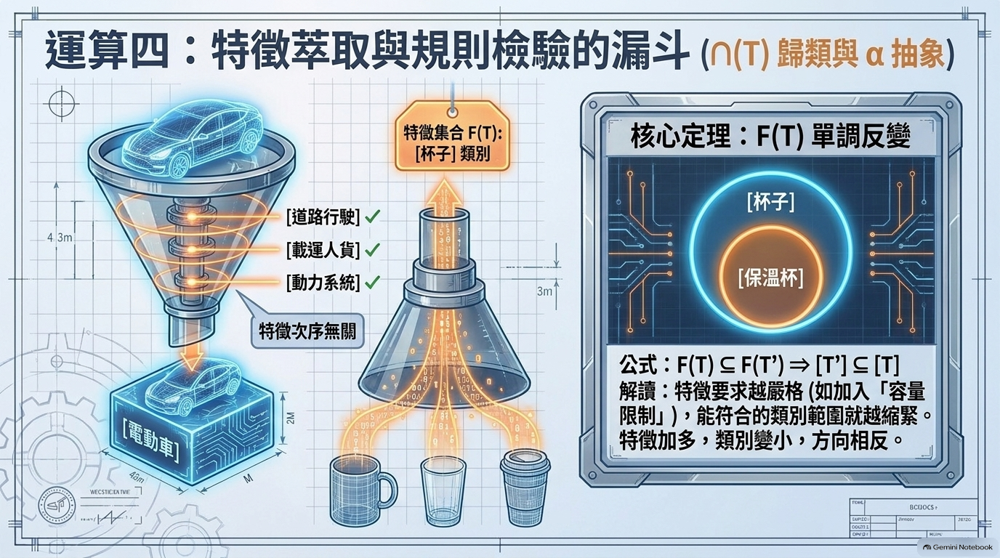

**圖 B-6　藍圖卡：運算四 ∩(T) 歸類與 α 抽象——特徵萃取與規則檢驗的漏斗**

# 第七章　嵌套運算 ι：形入容器，層層各持身份

第五個運算把形放進容器——確立「身位」。嵌套是空間結構的常態：杯入袋、袋入箱、箱入房；形的組合世界，靠嵌套一層一層長出來。

## 7.1　定義

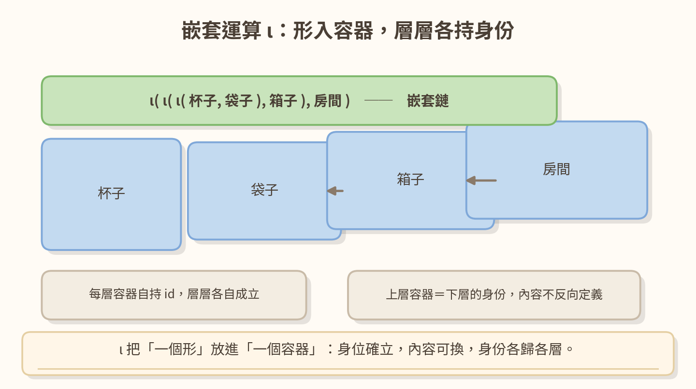

**圖 7-1　ι 嵌套鏈**

> **【定義】定義 7-1（嵌套）**
>
> ι( M, C )：把形 M 放入容器 C 的內部空間 S(C)，M 成為 C 的內容物。
>
> 嵌套鏈：ι( ι( ι( 杯子, 袋子 ), 箱子 ), 房間 )——每一層都是一個「容器＋內容」的結構。

## 7.2　嵌套鏈層次定理

> **【定理】定理 7-1（層層各持身份）**
>
> 嵌套鏈中的每一層容器各自保持自己的 id，不因上下層的內容變動而改變。
>
> 推導：① 每一層 ι 只建立「容器──內容」一組關係；② 依不變性公理，本層內容的變動不改變本層 id(C)；③ 下層的 id 是本層內容的一部分，其變動仍落在 σ 的範圍內；④ 由歸納，全鏈各層 id 各自恆定。（得證）

這條定理給了嵌套一個乾淨的讀法：上層容器是下層的「身份」，內容不反向定義容器——先確定身份，再談內容，一層一層都是如此。

## 7.3　ι 與 σ 交換、不可壓平反例

> **【定理】定理 7-2（ι 與 σ 可交換）**
>
> 在正確層次上，「先嵌套再換內容」與「先換內容再嵌套」等價：ι( σ_{e1→e2}(M), C ) ≡ σ_{e1→e2}( ι(M, C) )（替換發生在 M 的內部）。
>
> 推導：① σ 作用於 M 的 S(M)；② ι 只把整體 M 放入 C，不觸碰 M 的內部；③ 兩式終態的層次與 id 全數相同。（得證）

**圖 7-2　反例：層次不可壓平**

> **【誤用】反例 7-1（層次不可壓平）**
>
> { 杯子, 水 } 把「容器」與「內容」壓平成並列元素——換掉水就成為「另一個集合」，身份散掉。
>
> ( CUP-001, ( 水 ) ) 保留兩層：容器是身份、內容是元素——σ 運算才有作用的空間。
>
> 結論：層次壓平後，σ 與 ι 全部失去意義——運算式必須寫在正確層次上。

## 7.4　例：杯入袋入箱與兩個對照

> **【例】例 7-1**
>
> ι(杯子, 袋子)：杯子成為袋子的內容；杯子的 id 不因入袋而變，袋子的 id 也不因裝了杯子而變。
>
> 對照一（資料目錄）：檔案 ι 資料夾 ι 硬碟——每一層各自是容器，移動檔案（換層）不改變檔案本身，也不改變任何一層資料夾的 id。
>
> 對照二（組織層級）：員工 ι 部門 ι 事業群——員工是內容、部門是容器；調動員工是 σ（換內容），部門編制不變；部門的層次不與員工壓平成同一張名單。

> **【練習】練習**
>
> P11（嵌套推導）：用嵌套鏈寫出「手機 ι 保護套 ι 快遞箱 ι 貨車」的完整式，並用定理 7-1 說明貨車換了一台，手機的身份為何不變。
>
> P12（壓平辨析）：「全班 30 位學生的名單」是一個形嗎？它缺少哪一層，才無法套用 σ 與 ι？（提示：名單是 { } 還是 ( )？）

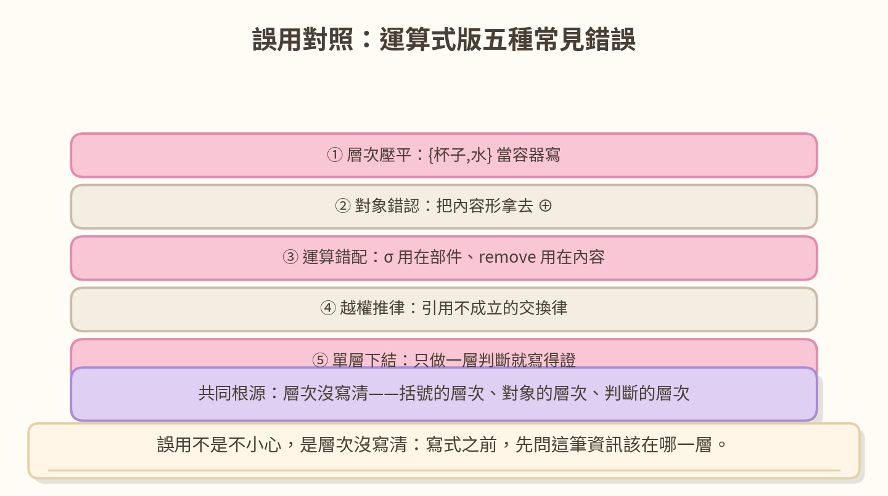

**圖 B-7　藍圖卡：運算五 ι 嵌套——形入容器，層層各持身分**

# 第八章　比較運算 ≡／≢／⊂：哪一層的同一

最後一個運算不是造形，而是比較兩形。但「同一」有三種：id 的同一、形的同一、類的同一——比較之前，先問是哪一層。

## 8.1　三種同一

**圖 8-1　比較運算：三種同一**

> **【定義】定義 8-1（三種同一）**
>
> id 同一（容器層）：σ 前後 id(C) 相同——水換咖啡，CUP-001 還是 CUP-001。
>
> 形同一（組成層）：BOM 與依存結構相同——兩支同型手機 ≡ 同一個形。
>
> 類同一（抽象層）：∩(T) 判準全數通過——電動車與燃油車 ≡ 汽車形。

## 8.2　降級式與比較的層次選擇

降級用 ⊂ 記：remove(功能降級件) 的結果記 M′ ⊂ M——M′ 還是 M 的形，但功能少了一塊。比較運算的完整記號集是：≡（同一）、≢（不同一）、⊂（降級包含）——三個記號各歸其位，不混用。

> **【推導】推導示範：電動車 ≡ 汽車形**
>
> ① 認明比較對象：Tesla Model 3 與「汽車」形；② 選層次：本題比較的是類同一（歸類層）；③ 引判準：F(汽車) = { 能在道路行駛, 能載運人貨, 有動力系統, 可被駕駛操控 }；④ 逐項：全部通過，∩(汽車)(Tesla) = true；⑤ 結論：電動車 ≡ 汽車形——動力實現方式（內燃機或電動馬達）不在 F(T) 裡，不影響形的同一。（得證）

> **【誤用】對照 8-1（比較層次選錯）**
>
> 「書架上的書」：書架是容器（換書不換書架，id 同一）；「書架上的書」這組合是 { } 的集合（換書就換組合，≢）；
>
> 同一個物理場景，比較對象不同，層次就不同——比較之前，先問「我正在比較的是哪一個整體」。

## 8.3　例：三個領域的比較

> **【例】例 8-1**
>
> 杯子：(水) 與 (咖啡) 在容器層 ≡（同一個 CUP-001）；兩個白瓷杯在形同一層 ≡；馬克杯與紙杯在類同一層 ≡（都是杯子）。
>
> 程式：同一個服務換了資料庫實作——介面與職責不變，類同一 ≡；微服務拆成兩個——BOM 改變，≢。
>
> 組織：公司更名——id 不變（同一法人），id 同一 ≡；併購後部門重組——BOM 與依存全變，≢。

> **【練習】練習**
>
> P13（層次選擇）：「同一位員工換了座位」是哪一層的同一？寫出推導式並指出比較層次。
>
> P14（降級式）：汽車拿掉空調，寫出 M′ ⊂ M 的完整判斷式，並說明為何記 ⊂ 而不記 ≢。

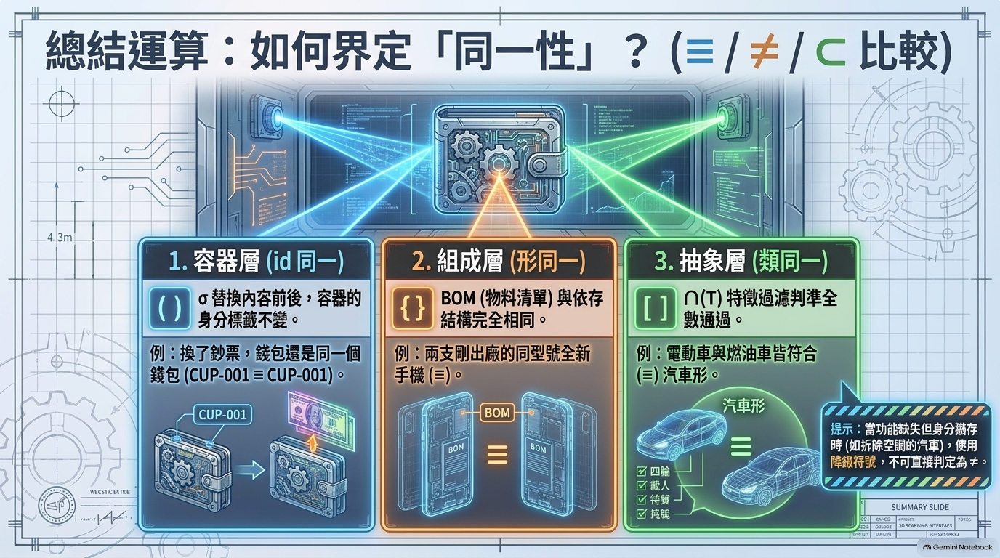

**圖 B-8　藍圖卡：比較運算 ≡／≢／⊂——如何界定「同一性」**

**下篇・合流**

把五式收攏：運算律總表、判斷式連立、形進形出與時間本形接軌

# 第九章　複合運算與運算律總表

五大運算逐一推導完畢。這一章把它們放在一起：哪些運算律可以放心引用、哪些必須另立條件、不成立的反例長什麼樣——一張總表收攏全部推導成果。

## 9.1　運算律總表

**圖 9-1　運算律總表**

| 運算律 | 式 | 狀態 | 條件／理由 |
| --- | --- | --- | --- |
| ⊕ 結合律 | (A⊕B)⊕C ≡ A⊕(B⊕C) | 成立 | 聯集結合，層次與括號無關 |
| ⊕ 單位元 | M ⊕ ε ≡ M | 成立 | ε = 無部件形 |
| ⊕ 交換律 | A⊕B ≡ B⊕A | 成立 | 不依存順序是形的一部分 |
| remove 冪等 | remove² ≡ remove | 成立 | 第二次找不到 p |
| remove 分支分配 | (M1⊕M2) remove p ≡ M1⊕(M2 remove p) | 成立 | p 只在 M2 時 |
| remove 全分配 | remove(必要件) → 解形 | 不成立 | 解形後非原有形 |
| σ 交換律 | σb(σa(C)) ≡ σa(σb(C)) | 成立 | 同一容器、互不為目標 |
| σ 保身份 | id(σ(C)) = id(C) | 成立 | 不變性公理 |
| σ 跨層交換 | 換容器 ≠ 換內容 | 不成立 | 動 id 即出 σ 範圍 |
| ∩(T) 次序 | 特徵檢查次序無關 | 成立 | 合取交換結合 |
| F(T) 單調反變 | F(T) ⊆ F(T′) ⇒ [T′] ⊆ [T] | 成立 | 特徵加多、類別收緊 |
| α 與 remove 交換 | 先拆後抽 ≢ 先抽後拆 | 不成立 | 樣本變了，規則跟著變 |
| ι 與 σ 交換 | ι(σ(M),C) ≡ σ(ι(M,C)) | 成立 | 替換在 M 內部時 |

**表 9-1　運算律總表：五成立、四不成立、二成立附條件**

## 9.2　反例推導三則

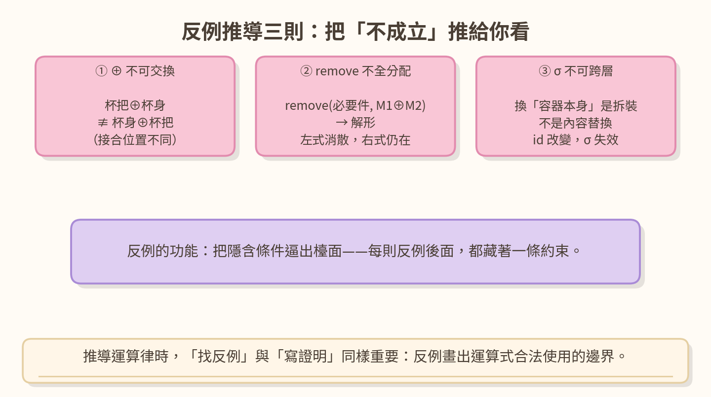

**圖 9-2　反例推導三則**

> **【誤用】反例推導的功能**
>
> ① ⊕ 不可交換：杯把⊕杯身 ≢ 杯身⊕杯把——接合位置不同，依存結構不同。
>
> ② remove 不全分配：remove(必要件, M1⊕M2) 直接解形——左式消散，右式 M1⊕(M2 remove p) 還在，兩邊不等。
>
> ③ σ 不可跨層：把「容器本身」換掉是拆裝（動 id），不是內容替換——σ 的前提被破壞。
>
> 每一則反例後面，都藏著一條約束：層次與身份。凡是違反這兩條的式子，一律要另立條件或改寫。

## 9.3　複合式推導示範

> **【推導】推導示範：σ 與 ⊕ 的複合**
>
> 情境：咖啡杯 M = { 杯把, 杯底, 杯蓋, 杯身, (咖啡), [白色] }，把內容換成茶，並加裝杯墊。
>
> ① 換內容：σ_{咖啡→茶}(M) = { 杯把, 杯底, 杯蓋, 杯身, (茶), [白色] }——只動 ( )；
>
> ② 加部件：M′ = σ(M) ⊕ 杯墊 = { 杯把, 杯底, 杯蓋, 杯身, 杯墊, (茶), [白色] }——只動 { }；
>
> ③ 檢查：兩步分屬不同層次，互不干擾（層次獨立性），結果唯一確定。（得證）

複合式的推導要領只有一條：一次只動一層。層次獨立性保證不同層的運算互不干擾——這是複雜式子可以拆成一串簡單式子的根本原因。

> **【練習】練習**
>
> P15（運算律判定）：下列式子哪些成立？① (M1⊕M2)⊕M3 ≡ M1⊕(M3⊕M2)（提示：交換律）；② σ 後再 σ；③ remove(p, M) ⊕ p ≡ M（提示：拆合不對稱）。
>
> P16（反例自造）：為「α 與 remove 交換不成立」造一個具體反例（提示：先拆掉樣本的一部分，萃取的特徵會怎樣？）。

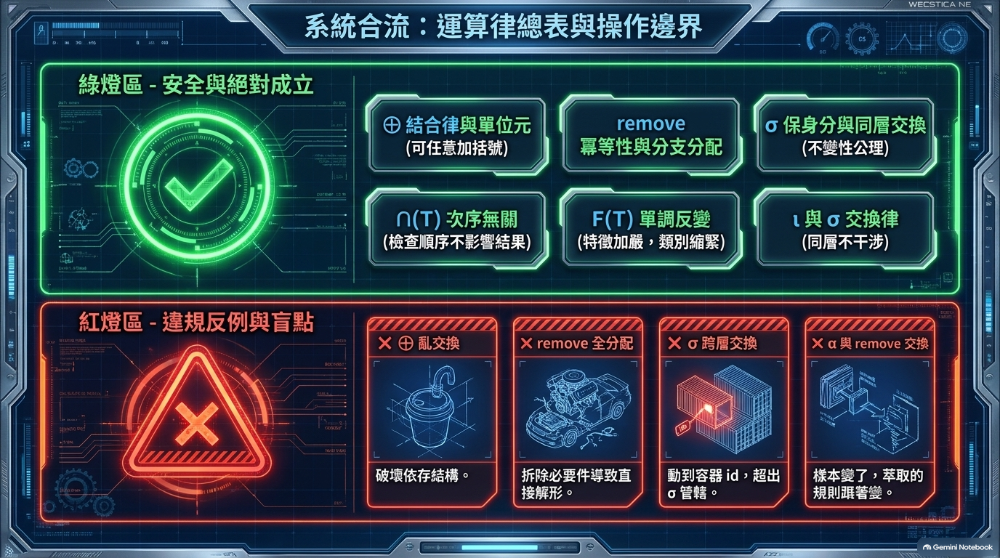

**圖 B-9　藍圖卡：系統合流——運算律總表與操作邊界**

# 第十章　三層判斷的運算式化：三式連立

形邏輯的三層判斷——容器判斷、物料清單判斷、抽象判斷——現在可以寫成三條運算式，再連立成一個判斷。判斷從「走流程」升級為「推式子」。

## 10.1　三條判斷式

**圖 10-1　三式連立**

> **【定義】定義 10-1（三層判斷式）**
>
> 容器式　J_C(M)：存在內容替換 σ 使 id 不變？——J_C = true ⇔ 容器判斷成立。
>
> 組成式　J_B(M)：BOM 通過「拆下來認得自己」檢核，且每個部件的 remove 三級全數歸位？
>
> 抽象式　J_T(x)：∩(T)(x) = true？
>
> 聯合判斷　J( M ) = J_C(M) ∧ J_B(M) ∧ J_T(M)——三式全真，才寫「得證」。

三式的分工與三層的盲點互補完全一致：J_C 守身份、J_B 守結構、J_T 守規則。任何一式為假即不成立——這就是「三層缺一不可」的運算式版本。

## 10.2　完整推導示範：智慧型手機

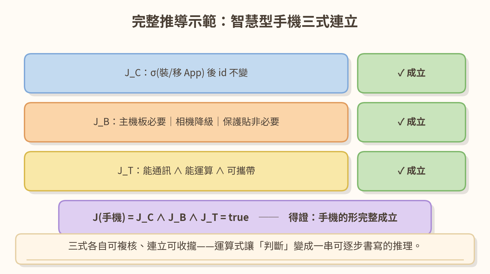

**圖 10-2　智慧型手機三式連立**

> **【推導】推導示範：J(智慧型手機)**
>
> ① 認明對象：M = 智慧型手機；寫形集合：M = { 主機板, 電池, 螢幕, 相機模組, 喇叭, ..., (App), [智慧型手機] }。
>
> ② J_C：σ_{裝/移 App}(M) 後 id 不變——J_C = true。
>
> ③ J_B：主機板 remove ≢ M（必要）；相機模組 ≡ M′ ⊂ M（降級）；保護貼 ≡ M（非必要）——三級全數歸位，J_B = true。
>
> ④ J_T：F = { 能通訊, 能運算, 可攜帶 }，逐項通過，∩(T)(M) = true。
>
> ⑤ 連立：J = true ∧ true ∧ true = true——智慧型手機的形完整成立。（得證）

> **【例】對照：單層判斷的盲點**
>
> 只看 J_C：平板也裝 App，也會被誤判為手機；只看 J_B：計算器也有部件結構；只看 J_T：對講機也能通訊。
>
> 三式連立後盲點互補——任何單層放行的物件，都被另外兩式擋下。

## 10.3　判斷式的推導價值

把判斷寫成式子有三個直接好處。可複核：審閱者逐式打勾即可重現結論。可組合：複雜判斷可以先分式推導、再連立收攏。可定位錯誤：哪一式為假，盲點就在哪一層——比「判斷錯了」精確得多。

> **【練習】練習**
>
> P17（三式連立）：為「電動車」寫出完整的 J_C、J_B、J_T 三式與連立式，並在 J_B 中至少標出一個必要件。
>
> P18（盲點定位）：用三式連立判斷「智慧手錶」，指出它在第幾式被擋下、該式判 false 的原因。

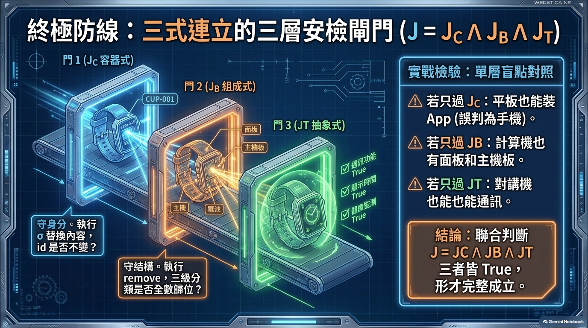

**圖 B-10　藍圖卡：終極防線——三式連立的三層安檢閘門**

# 第十一章　形進形出：運算式與時間本形接上軌

五大運算推導完畢之後，回頭看第二章立下的總形式：op: Type → Type。這條形式不只是本冊的語法——它正是時間本形的定義。

## 11.1　一切運算都是形進形出

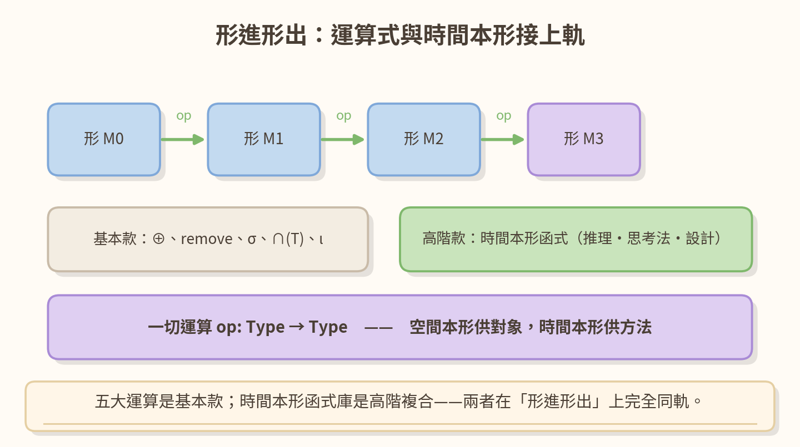

**圖 11-1　形進形出與時間本形**

空間本形（名詞）提供運算的對象：形集合是「什麼」；時間本形（動詞）提供運算的動作：函式是「怎麼做」。⊕、remove、σ、∩(T)、ι 五式是形進形出的「基本款」——一進一出、語法單純、運算律可查。

## 11.2　高階複合：時間本形函式庫

> **【定義】基本款與高階款**
>
> 基本款：五大運算——作用在形集合的部件、內容、類別上，一步一形。
>
> 高階款：時間本形函式庫——推理（因果／果因／模擬／統計／逆向）、思考法（正向／逆向／水準／垂直／第一性原理）、設計、分析、解題——都是基本款的複合鏈，輸入一個形，產出一個形。

> **【例】例 11-1：推理鏈作為運算複合**
>
> 情境：「杯蓋不見了，杯子去哪了？」——果因推理。
>
> ① 觀察形：remove(杯蓋, M) ≡ M′ ⊂ M（降級）——杯蓋是功能降級件；
>
> ② 回溯鏈：σ_{杯蓋→∅} 後的 M′ 曾出現在哪些容器？——ι 鏈反查：杯子 ι 辦公桌 ι 辦公室；
>
> ③ 比較：對每個候選位置的形做 ≡ 比對，鎖定 id 一致者。
>
> 一條推理鏈＝remove ＋ σ ＋ ι 反查 ＋ ≡ 比較的複合——時間本形的每一步，都踩在空間本形的形上。

## 11.3　兩庫對照

| 角度 | 本冊五大運算 | 時間本形函式庫 |
| --- | --- | --- |
| 定位 | 形進形出的基本款 | 形進形出的高階複合 |
| 粒度 | 一步一形 | 一串式子、多形往返 |
| 推導 | 運算律逐式可查 | 以基本款運算律為地基 |
| 使用 | 寫式子 | 選函式、組推導鏈 |

**表 11-1　五大運算與時間本形函式庫的對照**

這個對照解釋了一件事：為什麼時間本形依附空間本形——函式吃進、吐出的都是形；沒有形，函式無物可動。本冊推導的五式，就是整座函式庫共同的底層運算。

> **【練習】練習**
>
> P19（複合拆解）：把「找出桌上咖啡杯的杯蓋去哪了」拆成至少三個基本運算，寫出複合式。
>
> P20（定位判斷）：「設計搜尋」是基本款還是高階款？為什麼？寫出它可能包含的基本運算。

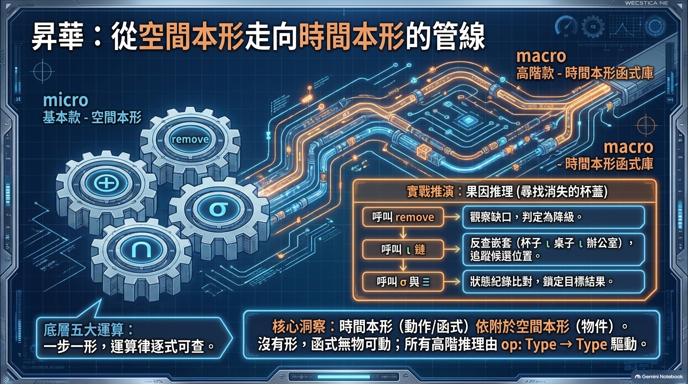

**圖 B-11　藍圖卡：昇華——從空間本形走向時間本形的管線**

# 第十二章　準確使用方法：運算式推導版

推導的工具都齊了。最後一章把它們收攏成方法：面對一個實際問題，怎麼一步步寫出正確的運算式，並在交出去之前自己驗收。準確，是可複核的準。

## 12.1　推導六步驟

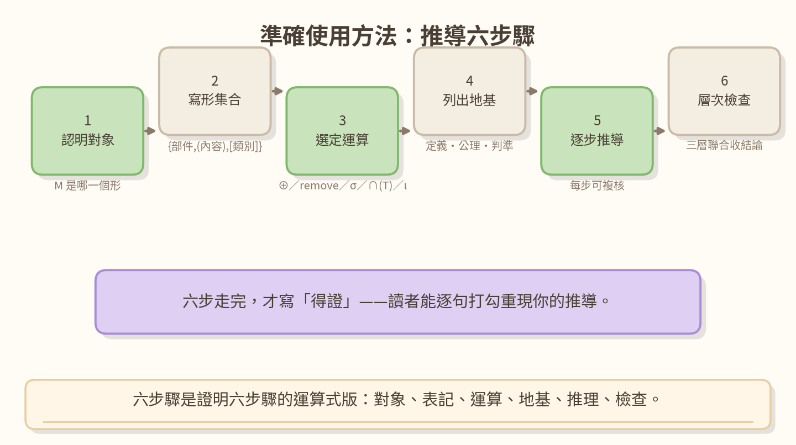

**圖 12-1　推導六步驟**

| 步驟 | 操作 | 產出 | 常用工具 |
| --- | --- | --- | --- |
| 1 認明對象 | 指認推導的判斷對象 | 一句話：M 是哪一個形 | —— |
| 2 寫形集合 | 完整表記 | { 部件, ( 內容 ), [ 類別 ] } | 三括號 |
| 3 選定運算 | 依問題選式 | ⊕／remove／σ／∩(T)／ι／≡ | 運算對象表 |
| 4 列出地基 | 寫出定義、公理、判準 | T、C、不變性公理、remove | 第一章地基 |
| 5 逐步推導 | 一步一層，逐步推演 | 推導正文 | 運算律總表 |
| 6 層次檢查 | 三層聯合檢查 | 結論（得證） | 三式連立 |

**表 12-1　推導六步驟操作表**

六步驟是證明六步驟的運算式版：第三步「選定命題」改為「選定運算」，第五步「判準推理」擴為「逐步推導」——其餘精神完全一致：先認對象、再寫表記、後走推理、末做檢查。

## 12.2　八問檢查清單

| # | 檢查問題 | 通過標準 |
| --- | --- | --- |
| 1 | 對象認明了嗎？ | 「我推導的是哪個形」一句話說得出來 |
| 2 | 形集合寫全了嗎？ | { 部件, ( 內容 ), [ 類別 ] } 三段齊備 |
| 3 | 對象與運算配對了嗎？ | 部件用 ⊕/remove、內容用 σ/ι、類別用 ∩(T)/α |
| 4 | 括號範圍標清了嗎？ | 每條式子的作用範圍無歧義 |
| 5 | 引用的運算律成立嗎？ | 對照總表：成立才引，不成立附條件 |
| 6 | 反例找過了嗎？ | 至少一個邊界案例被正確判決 |
| 7 | 每一步可複核嗎？ | 讀者能逐句打勾重現推導 |
| 8 | 三層檢查做了嗎？ | J_C ∧ J_B ∧ J_T 全過，才寫得證 |

**表 12-2　交出推導前的八問**

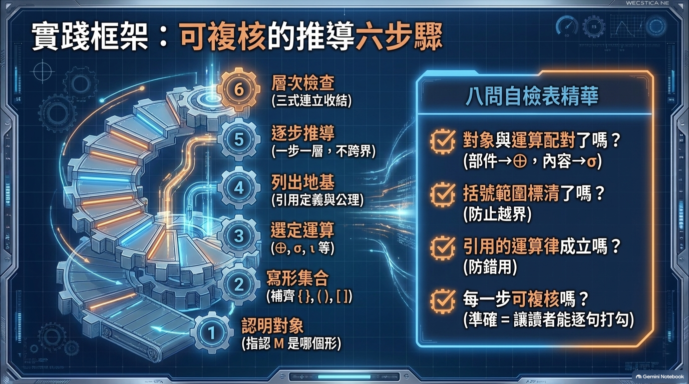

**圖 B-12　藍圖卡：實踐框架——可複核的推導六步驟與八問自檢**

## 12.3　誤用對照五種

**圖 12-2　誤用對照五種**

| # | 誤用 | 問題所在 | 正確寫法 |
| --- | --- | --- | --- |
| 1 | 層次壓平 | {杯子,水} 當容器寫，σ 失去空間 | 容器用 ( )，標 id(C) |
| 2 | 對象錯認 | 把內容形拿去 ⊕ | 先辨部件／內容／類別再選式 |
| 3 | 運算錯配 | σ 用在部件、remove 用在內容 | 括號決定運算，範圍不得跨越 |
| 4 | 越界推導 | 引用不成立的交換律 | 對照總表：成立才引，不成立附條件 |
| 5 | 單層下結 | 只做一層判斷就寫得證 | 三式連立後才收結論 |

**表 12-3　五種誤用與正確寫法**

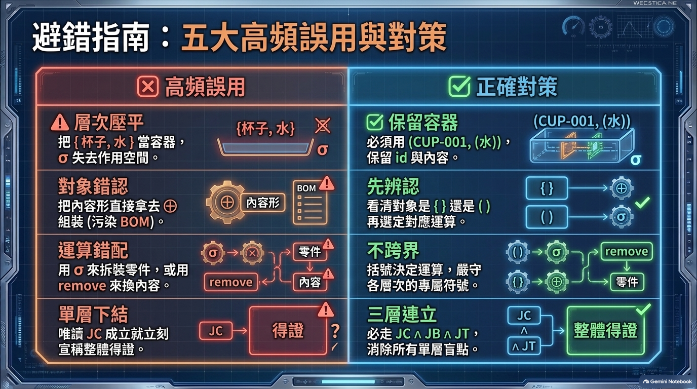

**圖 B-13　藍圖卡：避錯指南——高頻誤用與對策**

## 12.4　完整案例：一組式從定義推到得證

> **【推導】完整推導示範：咖啡杯的三個問題一次推完**
>
> 情境：M = 咖啡杯 = { 杯把, 杯底, 杯蓋, 杯身, (咖啡), [白色] }。三問：① 換茶後是同一杯嗎？② 拿掉杯蓋呢？③ 保溫杯算不算杯子？
>
> 【步驟 1–2】認明對象、寫形集合——M 如上，id(M) = CUP-001。
>
> 【步驟 3–4】選運算：① σ；② remove；③ ∩(T)。地基：不變性公理、remove 判準、F(杯子) = { 能裝液體, 能被手持喝 }。
>
> 【步驟 5】① σ_{咖啡→茶}(M)：只動 S(C) → 由定理 5-1，id 不變 → ≡ 同一杯。② remove(杯蓋, M)：杯蓋可拆可識 → ≡ M′ ⊂ M，功能降級、身份存續。③ ∩(杯子)(保溫杯) = 能裝液體 ∧ 能被手持喝 = true → ∈ [杯子]。
>
> 【步驟 6】三層檢查：容器層 ✓（σ 保身份）；組成層 ✓（remove 三級歸位）；抽象層 ✓（∩(T) 全過）——三式連立為真，全部得證。

> **【練習】練習**
>
> S01（六步驟全程）：自選一個工作中的對象（文件、產品、組織皆可），走完推導六步驟，寫出至少兩條運算式。
>
> S02（誤用自檢）：用表 12-3 檢查你過去寫過的三個判斷，標出曾犯的誤用並改寫。

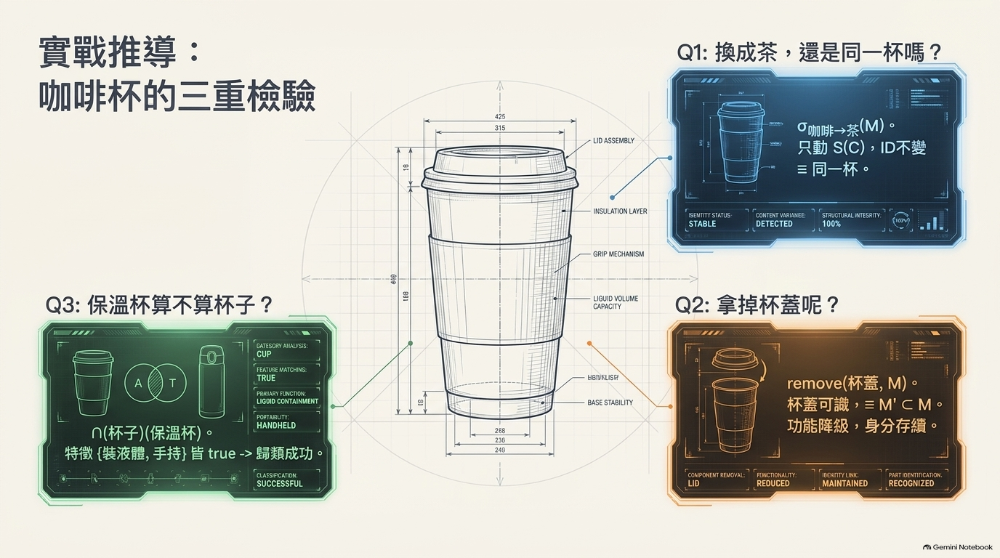

**圖 B-14　藍圖卡：實戰推導——咖啡杯的三重檢驗**

# 第十三章　內容完整方案：學・練・用・教・建

最後給出這套推導體系的完整落地方案：怎麼學、怎麼練、怎麼用、怎麼教、怎麼建——五段路線接成一條成長線。

## 13.1　學練用教建五段路線

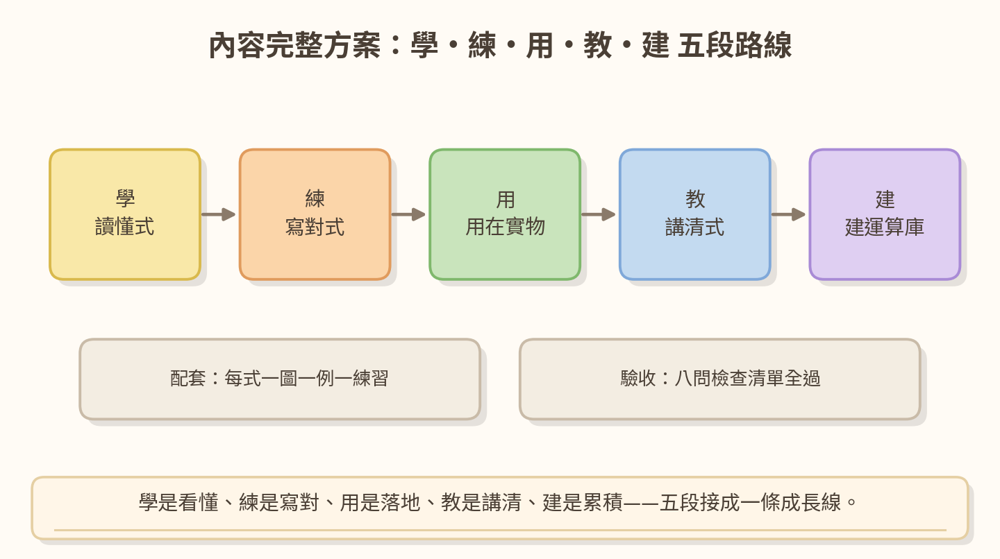

**圖 13-1　學練用教建五段路線**

| 段 | 目標 | 做法 | 驗收 |
| --- | --- | --- | --- |
| 學 | 讀懂每一式 | 一式一圖一例，先看定義框與重點框 | 能複述五式的對象與範圍 |
| 練 | 寫對每一式 | 每章練習 P01–P20 逐題手寫推導 | 練習全數寫完並對答案 |
| 用 | 用在實物 | 每週自選 2 個實物走六步驟 | 推導卡 8 張以上 |
| 教 | 講清每一式 | 把一式講給不懂的人聽 | 對方能正確解一題 |
| 建 | 建運算卡庫 | 把常用複合式沉澱成卡片 | 個人運算卡庫 20 張以上 |

**表 13-1　學練用教建五段操作表**

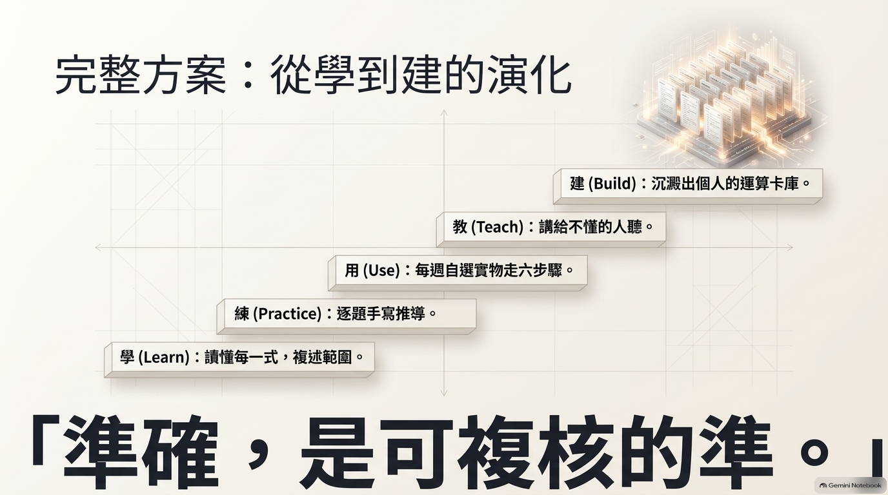

**圖 B-15　藍圖卡：完整方案——從學到建的演化**

## 13.2　八週學習路線

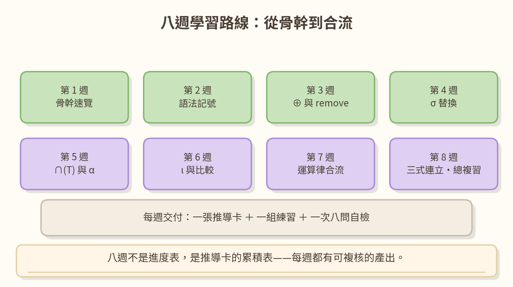

**圖 13-2　八週學習路線**

八週不是進度表，是推導卡的累積表：每週交付一張推導卡、一組練習、一次八問自檢。前六週每週攻一到兩個運算，第七週專攻運算律總表與反例，第八週三式連立與總複習——每週都有可複核的產出。

## 13.3　情境選路：何時用哪個運算

| 你遇到的問題 | 首選運算 | 輔助工具 |
| --- | --- | --- |
| 把幾個部分組成一個整體 | ⊕ 合形 | 結合律；依存結構檢查 |
| 拆一個部分，還是不是同一個 | remove 拆形 | 三級判準式 |
| 換掉裡面的東西，身份在不在 | σ 替換 | 保身份定理、不變性公理 |
| 一個新東西算不算這一類 | ∩(T) 歸類 | F(T) 邊界案例 |
| 一群樣本怎麼變成一條規則 | α 抽象生成 | 屬性浮現規則 |
| 把東西放進去、層次怎麼排 | ι 嵌套 | 層次定理、不可壓平 |
| 兩個東西是不是同一個 | ≡／≢／⊂ | 先選比較層次 |

**表 13-2　情境選路決策表**

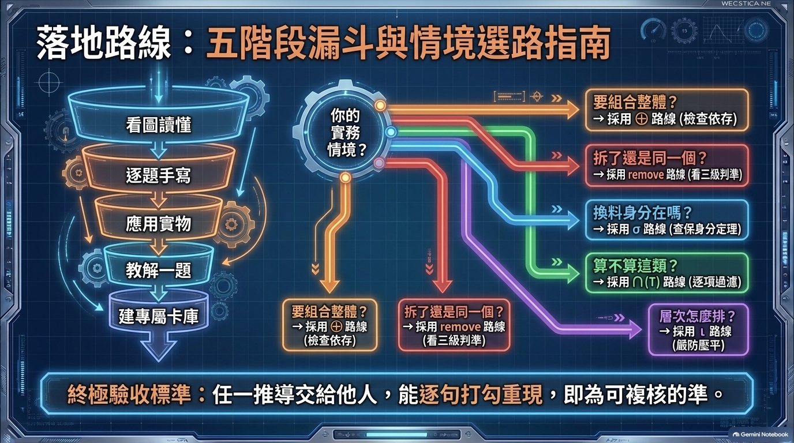

**圖 B-16　藍圖卡：落地路線——五階段漏斗與情境選路指南**

## 13.4　驗收標準

> **【重點】整體驗收**
>
> ◆　個人層：五式能默寫、運算律總表能默背、六步驟能在 30 分鐘內走完一個實物。
>
> ◆　產出層：推導卡 8 張、個人運算卡庫 20 張、練習 P01–P20 全數對過答案。
>
> ◆　複核層：任一條推導式交給他人，能逐句打勾重現——準確＝可複核的準。

# 回顧　要點總整理與自我檢查

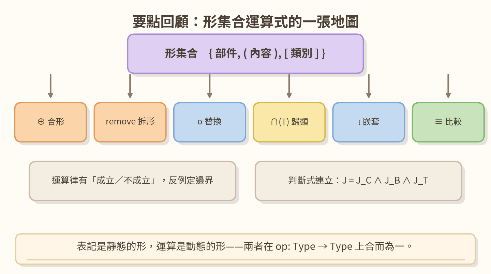

**圖 R-1　要點回顧：形集合運算式的一張地圖**

## R-1　五式三律一判斷

五大運算各管一層：⊕ 合形與 remove 拆形管部件 { }，σ 替換與 ι 嵌套管內容 ( )，∩(T) 歸類與 α 抽象管類別 [ ]；比較運算 ≡／≢／⊂ 收攏兩形之辨。運算律有成立、有不成立——不成立的反例共同指向兩條約束：層次與身份。判斷收攏為三式連立 J = J_C ∧ J_B ∧ J_T。

## R-2　表記與運算是一體兩面

表記是靜態的形：{ 部件, ( 內容 ), [ 類別 ] }；運算是動態的形：op: Type → Type。兩者在「形進形出」上合而為一——五大運算是基本款，時間本形函式庫是高階複合。

## R-3　準確是可複核的準

推導不靠直覺靠流程：六步驟逐步走、八問逐項查、反例定邊界、三式連立才得證。讀者能逐句打勾重現你的推導——這就是「準確」兩個字的意思。

| 自我檢查問題 | 你應該能回答的內容 |
| --- | --- |
| 運算的一般形式？ | op: Type → Type——形進形出 |
| 五大運算各作用在哪一層？ | ⊕/remove 管部件、σ/ι 管內容、∩(T)/α 管類別 |
| 哪些運算律成立？ | 結合、冪等、交換（σ 同容器）、保身份、單調反變 |
| 不成立的共同根源？ | 層次與身份——反例畫出邊界 |
| 判斷怎麼寫成式子？ | J = J_C ∧ J_B ∧ J_T，三式連立 |
| 推導從哪開始？ | 認明對象 → 寫形集合 → 選定運算 → 列地基 → 推導 → 檢查 |

**表 R-1　自我檢查清單**

> **【重點】一句話**
>
> 表記是靜態的形，運算是動態的形——把形看清楚，把式推準確。

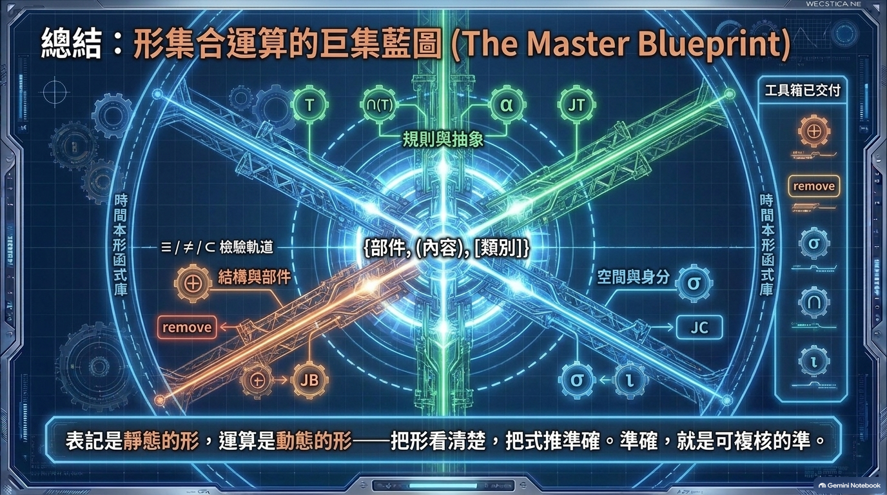

**圖 B-17　藍圖卡總結：形集合運算的巨集藍圖（The Master Blueprint）**

# 練習篇　參考答案

以下為 P01–P20 與 S01–S02 的示範答案。答案不是唯一寫法——只要六步驟走得對、層次寫得清、每步可複核，就是好答案。

### P01　對象辨認

> **【推導】示範答案**
>
> ① 書包裡的課本換成筆記本——課本與筆記本是內容形 ( e )，書包是容器 → σ_{課本→筆記本}(書包)，id(書包) 不變。
>
> ② 相機模組拆下來——部件形 { p } → remove(相機模組, 手機)，結果 ≡ M′ ⊂ M（功能降級件）。
>
> ③ 吸管杯是不是杯子——類別形 [ T ] → ∩(杯子)(吸管杯)，F = { 能裝液體, 能被手持喝 } 逐項檢驗。

### P02　語法判斷

> **【推導】示範答案**
>
> 因為括號決定層次，而誤用的根源就是層次錯位：⊕ 用在內容上會把「裝了什麼」誤合成部件，BOM 被污染；σ 用在部件上會把「拆裝」誤當「換裝」，id 判斷失據；∩(T) 用在部件上會把「結構差異」誤判為「類別差異」。
>
> 範圍規則把每一式鎖在自己的層次裡——式子一越界就寫不下去，誤用在落筆時就被擋下。

### P03　合形推導

> **【推導】示範答案**
>
> M = 主機板 ⊕ 電池 ⊕ 螢幕 ⊕ 相機模組（依結合律可任意加括號）。
>
> BOM(M) = { 主機板, 電池, 螢幕, 相機模組 }；依存：螢幕依存主機板（無主機板則無顯示輸出）——層次保留，合形成立。

### P04　反例尋找

> **【推導】示範答案**
>
> 例：文章的「前言 ⊕ 本文」與「本文 ⊕ 前言」——閱讀順序與邏輯依存不同，是兩個不同的形。
>
> 差別在依存層次：前言引導本文（依存方向 A → B），換序後依存反向——位置與次序是形的一部分。

### P05　三級分類

> **【推導】示範答案**
>
> M = 筆記型電腦。必要件：主機板、電池——remove(p, M) ≢ M（無法開機，解形）；
>
> 功能降級件：觸控板、內建喇叭——remove ≡ M′ ⊂ M（可用外接，功能降級）；
>
> 非必要件：貼紙、腳墊——remove ≡ M（完全不影響）。

### P06　分支分配

> **【推導】示範答案**
>
> ( 書架 ⊕ 書 ) remove 雜誌 ≡ 書架 ⊕ ( 書 remove 雜誌 )——雜誌只在「書」分支，由定理 4-2 分支分配成立。
>
> remove(雜誌, 書) ≡ 書（書的整體不受一本雜誌影響）→ 雜誌是非必要件。

### P07　保身份推導

> **【推導】示範答案**
>
> ① C = ( WALLET-001, (鈔票A) )，寫出 id(C)；② 變動：σ_{鈔票A→鈔票B}(C)，只動 S(C)；
>
> ③ 引用不變性公理（∀ e1, e2 ∈ S(C)，替換不改 id(C)）；④ 故 id(C) 恆定，錢包是同一個錢包。（得證）

### P08　σ 邊界

> **【推導】示範答案**
>
> 不是 σ。「把杯子換成碗」動的是容器本身——id(CUP-001) 換成 id(BOWL-001)，身份改變；
>
> σ 的前提是 id 不動、只換 S(C) 內的元素。動容器是拆裝（ι 的逆向）＋新容器，應記作 ≢ 並另立新的形。

### P09　歸類推導

> **【推導】示範答案**
>
> F = { 能在道路行駛, 能載運人貨, 有動力系統, 可被駕駛操控 }。
>
> f1(Tesla) = true（道路行駛）；f2 = true（載 5 人）；f3 = true（電池＋電動馬達＝動力系統）；f4 = true（方向盤操控）。
>
> ∩(電動車)(Tesla) = true ∧ true ∧ true ∧ true = true → Tesla ∈ [電動車]。（得證）

### P10　單調反變

> **【推導】示範答案**
>
> F(T′) = F(T) ∪ { 容量 500ml 以下 } ⊋ F(T) → 由定理 6-2，[T′] ⊆ [T]，類別收緊。
>
> 例：750ml 的運動水壺原本 ∈ [杯子]，加特徵後 ∉ [T′]——特徵加入、類別收緊，方向相反。

### P11　嵌套推導

> **【推導】示範答案**
>
> ι( ι( ι( 手機, 保護套 ), 快遞箱 ), 貨車 )。
>
> 由定理 7-1：換貨車只動最外層的 S(物流系統)——各層 id 各自恆定，手機的 id(SM-001) 在全鏈任何一層都未改變。（得證）

### P12　壓平辨析

> **【推導】示範答案**
>
> 名單是 { 學生1, 學生2, ... } 的組成/集合表記——只有並列，沒有「誰裝誰」的容器層。
>
> 缺少 ( )：沒有 id(C)、沒有 S(C)，σ 找不到可替換的範圍、ι 找不到可入位的身位——要套 σ/ι，必須先立容器（如「三年甲班」這個班級容器）。

### P13　層次選擇

> **【推導】示範答案**
>
> 員工是容器（職責、工號是其形）、座位是內容之一 → 換座位是 σ_{座位A→座位B}，員工 id 不變——id 同一（容器層）。
>
> 注意：若「員工」被視為組織容器的內容，則員工調動是組織的 σ——比較層次取決於你認明的整體。

### P14　降級式

> **【推導】示範答案**
>
> remove(空調, 汽車) ≡ M′ ⊂ M：汽車仍被認出是汽車（id 與主要 BOM 仍在），但少了空調的功能。
>
> 記 ⊂ 不記 ≢：同一性存續，只是功能子集化——≢ 留給解形，⊂ 留給降級。

### P15　運算律判定

> **【推導】示範答案**
>
> ① 成立：⊕交換律，(M1⊕M2)⊕M3 ≡ M1⊕(M3⊕M2)（M2、M3 換序同形）。
>
> ② 成立：σ 複合——同容器兩次替換可合併、可交換。
>
> ③ 不成立：拆合不對稱，remove(p,M) ⊕ p 重建的是「新合形」，依存斷口與原 M 不同。

### P16　反例自造

> **【推導】示範答案**
>
> 樣本：{ 帶杯蓋的杯子, 無杯蓋的碗 }。先 remove(杯蓋) 再 α → 特徵不含「有杯蓋」；先 α 再 remove → 類別已含「有杯蓋」特徵，remove 後樣本與規則對不上。
>
> 順序不同、萃取的 F(T) 不同 → 先拆後抽 ≢ 先抽後拆——α 與 remove 不可交換。

### P17　三式連立

> **【推導】示範答案**
>
> J_C：乘客上下車是 σ，車輛 id 不變 → true。
>
> J_B：電池組、電動馬達 = 必要件（remove ≢ M）；中控螢幕 = 降級件；車標 = 非必要件 → 三級歸位，true。
>
> J_T：F(汽車) = { 能在道路行駛, 能載運人貨, 有動力系統, 可被駕駛操控 } 全過 → true。
>
> J = true ∧ true ∧ true = true。（得證）

### P18　盲點定位

> **【推導】示範答案**
>
> 智慧手錶：J_C = true（可裝 App）；J_B = true（有部件結構）；J_T = false——F(智慧型手機) 的「可攜帶」雖過，但若 F 含「獨立通話／大螢幕操作」即失敗（依你立的 F(T) 而定）。
>
> 本題設計答案：以 F = { 能通訊, 能運算, 可攜帶 } 判，手錶三項全過會入類——故盲點在 F(T) 精確度不足，需加特徵（如「可獨立安裝應用程式」）收緊類別。結論：被第幾式擋下取決於 F(T) 的立場——這正是特徵清單即立場的例證。

### P19　複合拆解

> **【推導】示範答案**
>
> ① remove(杯蓋, M) 觀察 → M′ ≡ M′ ⊂ M（杯蓋缺失）；② ι 反查：M ι 辦公桌 ι 辦公室，列出候選容器鏈；
>
> ③ 對每層 σ 狀態比對：σ_{杯蓋→∅} 的紀錄 + ≡ 比較 → 鎖定 id 一致的容器。
>
> 複合式：compare( ι反查( remove(杯蓋, M) ), σ紀錄 )——果因推理＝基本運算的複合鏈。

### P20　定位判斷

> **【推導】示範答案**
>
> 高階款：設計搜尋要「從需求形找到設計形」，多形往返、含比對與萃取。
>
> 可能包含的基本運算：∩(T)（判候選是否合需求類別）、≡（比對已知設計）、⊕（組合候選方案）、remove（排除不適用部件）——高階函式＝基本款複合。

### S01・S02　綜合題

> **【推導】示範答案（要領）**
>
> S01：自選對象後，務必先寫形集合再選式；兩條運算式應分屬不同層次（如一條 σ、一條 remove），以展示層次獨立性。
>
> S02：誤用自檢的重點不是「找錯」，而是標出「層次錯在哪」——五種誤用的共同根源都是層次沒寫清。

# 附錄 A　運算符號總表

| 符號 | 名稱 | 定義式 | 作用層 |
| --- | --- | --- | --- |
| ⊕ | 合形運算 | BOM(M1⊕M2) = BOM(M1) ∪ BOM(M2) | { } 部件 |
| remove(p, M) | 拆形運算 | 三級：≢M／≡M′⊂M／≡M | { } 部件 |
| σ_{e1→e2}(C) | 替換運算 | S(C) 中 e1 換為 e2 | ( ) 內容 |
| ∩(T)(x) | 歸類運算 | f1(x) ∧ f2(x) ∧ ... ∧ fn(x) | [ ] 類別 |
| α(x1...xk) | 抽象生成 | 萃取特徵 → T = (F(T), ∩(T)) | [ ] 類別 |
| ι(M, C) | 嵌套運算 | M ∈ S(C)，確立身位 | ( ) 內容 |
| ≡／≢ | 比較運算 | 三種同一：id／形／類 | 三層皆可 |
| ⊂ | 降級記號 | M′ ⊂ M（功能降級） | { } 部件 |
| op: Type → Type | 一般形式 | 形進形出 | 全部 |

**表 A-1　運算符號總表**

# 附錄 B　術語記號速查

| 術語 | 英文／記號 | 一句話定義 |
| --- | --- | --- |
| 形 | Type | 一個被完整描述的對象 |
| 單位形 | Unit Type | 三種集合的合體：{ 部件, ( 內容 ), [ 類別 ] } |
| 形集合 | Type Set | 單位形的完整表記 |
| 抽象類別 | T = (F(T), ∩(T)) | 由特徵與判準決定的開放類別 |
| 交集判準 | ∩(T) | 特徵全數通過才算屬於 |
| 容器 | C = (id(C), S(C)) | 集合＋不變的身份 |
| 不變性公理 | ∀ e1, e2 ∈ S(C) | 替換內容不改變 id(C) |
| remove 判準 | remove(p, M) | 移除部件，看同一性是否存續 |
| 三層判斷 | J_C ∧ J_B ∧ J_T | 容器／組成／抽象三式連立 |
| 形進形出 | op: Type → Type | 輸入一個形，產出一個形 |
| 時間本形 | Function／Method | 形進形出的高階複合 |
| 準確 | 可複核的準 | 讀者能逐句打勾重現推導 |

**表 B-1　術語速查**

| 記號 | 讀法 | 用法 |
| --- | --- | --- |
| { } | 大括號 | 組成集合（部件） |
| ( ) | 小括號 | 容器集合（內容物） |
| [ ] | 中括號 | 抽象集合（類別） |
| ∈／∉ | 屬於／不屬於 | 歸屬陳述 |
| ≡／≢／⊂ | 同一／不同一／降級 | 比較運算 |
| ∀／∧ | 對所有／且 | 全稱量詞／條件連結 |
| ⇔ | 若且唯若 | 定義等價 |

**表 B-2　記號速查**

# 附錄 C　推導模板速查

> **【定義】模板一：單式推導卡**
>
> 【對象】M = { 部件, ( 內容 ), [ 類別 ] }，id = ...
>
> 【問題】一句話。
>
> 【運算】⊕／remove／σ／∩(T)／ι／≡（選一）。
>
> 【地基】引用的定義／公理／判準。
>
> 【推導】① ② ③...一步一層，逐步推演。
>
> 【結論】得證／判決＋層次標注。

> **【定義】模板二：運算律判定卡**
>
> 【式子】寫出待判定的律。
>
> 【成立？】對照第九章總表。
>
> 【推導或反例】成立給推導，不成立給反例。
>
> 【條件】若需另立條件，寫明前提。

> **【定義】模板三：三式連立卡**
>
> 【對象】M = ...
>
> 【J_C】σ 後 id 不變？→ true/false＋理由。
>
> 【J_B】remove 三級全數歸位？→ true/false＋理由。
>
> 【J_T】∩(T)(x) = ? → true/false＋逐項表。
>
> 【連立】J = J_C ∧ J_B ∧ J_T → 得證與否。

三張模板就是六步驟的濃縮：模板一走單式、模板二判運算律、模板三收結論。印出來放在桌上，推導時逐格填寫——填得下去，就是推得出來。
