

  💻橫式
  <a href="https://youtu.be/ek580IvQRQA">簡介</a> ｜ 
  <a href="https://youtu.be/hG9KdjQCLGQ">公理化・定理・證明</a> 
  ｜ 
 📱直式 
  <a href="https://v.douyin.com/fTPhFyduJY8">簡介</a> ｜ 
 <a href="https://v.douyin.com/MDeWvl0yM">公理化・定理・證明</a> 
 

 

本形學　Ontypology

空間本形　Space

**形集合與形邏輯**

**正文全篇 ＋ 公理化・定理・證明**

*Form Sets and Form Logic: Text, Axioms, Theorems, and Proofs*

  **文件性質**   合訂典藏版：正文全篇與數學證明篇合為一冊
  -------------- ------------------------------------------------
  **理論基座**   形集合 F = ⟨S, I, R, Φ⟩・四條公理・十二個定理
  **章節對應**   第一部（原第五章）之形式化重構與擴充，見第二部

# 合訂說明

本合訂典藏版收錄《本形學・空間本形》第五章的兩部文本：其一為正文全篇《形集合與形邏輯》，以日常語言與判斷範例建立容器、SOM、抽象三種「加值」；其二為《數學證明篇》，將同一理論改寫為公理系統，給出四條公理與十二個定理的完整證明。第一部提供直覺與用法，第二部提供嚴格性與保證——先讀正文可得判斷力，再讀證明篇可知其所以然。

**本形階層：從本形學到形邏輯——每一層疊加一個獨立的資訊維度**

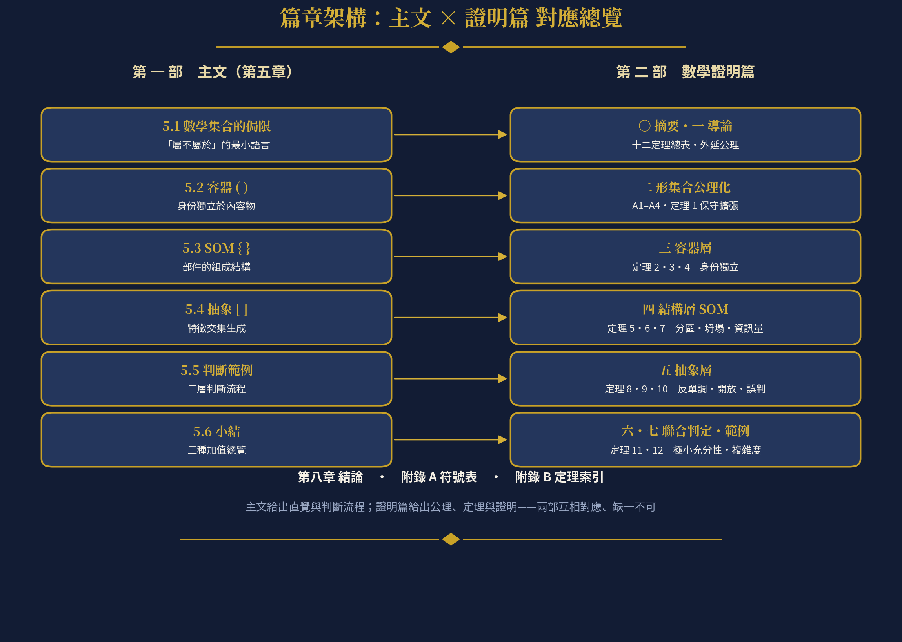

**篇章架構：主文 × 證明篇 對應總覽**

# 目　錄

**第一部　形集合與形邏輯（主文・第五章）**

> · 5.1　數學集合的侷限
>
> · 5.2　容器：補上「隱含的元素，看不見的子集」
>
> · 5.3　SOM：補上「元素之間的組成結構」
>
> · 5.4　抽象：補上「特徵交集生成」
>
> · 5.5　邏輯應用判斷範例
>
> · 5.6　小結

**第二部　數學證明篇（公理化・定理・證明）**

> · 第〇章　摘要與閱讀指南
>
> · 第一章　導論：集合語言的表達侷限
>
> · 第二章　形集合的公理化
>
> · 第三章　容器層：身份的獨立性
>
> · 第四章　結構層（SOM）：組成關係
>
> · 第五章　抽象層：生成判準
>
> · 第六章　三層聯合判定
>
> · 第七章　判斷範例的形式化解答
>
> · 第八章　結論
>
> · 附錄 A　符號表
>
> · 附錄 B　定理索引

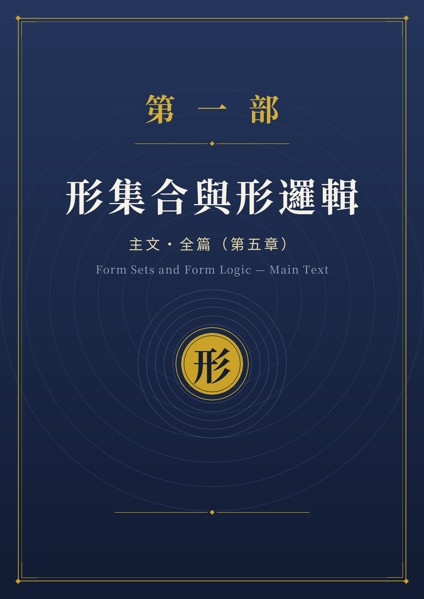

# 第五章　形集合與形邏輯　　主文・全篇

## 5.1 數學集合的侷限

數學集合本來就只回答一個問題：「屬不屬於」。

這套語言極度精簡——它假設得最少，因此也描述得最少。當我們說「水屬於杯子裡裝的東西」，集合論能精確地用「水 ∈ S」來表達這個關係；但它同時也把另外三層在日常語言中自然攜帶的資訊全部省略掉了：

> 1\. 身份的獨立性：杯子不會因為裝了水或咖啡就變成別的東西。
>
> 2\. 元素之間的結構：杯把、杯底、杯蓋不是隨便擺放的，它們彼此依存、各有位置。
>
> 3\. 生成規則：「杯子」這個類別不是一份寫死的清單，而是一條可以判斷新成員的規則。

形邏輯要做的，就是把這三層被省略掉的資訊逐一補回來。為此，我們引入三種不同的括號系統，分別對應三種不同的「加值」：

  **集合別**   **括號別**     **範例**                           **來源**      **補上的性質**
  ------------ -------------- ---------------------------------- ------------- ------------------
  組成集合     大括號 { }     { 杯把, 杯底, 杯蓋, 容器, 杯身 }   SOM（Y軸）    元素間的組成結構
  抽象集合     中括號 \[ \]   \[ 馬克杯, 玻璃杯, 紙杯 \]         抽象（X軸）   特徵交集生成規則
  容器集合     小括號 ( )     ( 水, 咖啡 )                       容器          身份獨立性

**圖5-1 三種日常語句，三種加值**

**咖啡杯:** { 杯把, 杯底, 杯蓋, 杯身,咖啡 }

**咖啡杯:** { 杯把, 杯底, 杯蓋, 杯身, 容器(咖啡)}

> 上圖將三種集合觀點並列比較：左側「組成集合」展示整體如何被分解為結構性部件（SOM/Y軸）；中間「抽象集合」展示多個具體實例如何向上收斂為一個共同概念（抽象/X軸）；右側「容器集合」展示同一容器如何容納可替換的內容物。

上面這張表列出的，其實是三種不同層次的「加值」。日常語言裡的每一句話，都同時壓縮了這三層資訊：「杯子裡有水」除了表達「水屬於杯子裡裝的東西」，還預設了杯子本身有一個不隨內容物改變的身份；「杯子由杯把、杯底、杯蓋組成」除了表達「這些部件都屬於杯子」，還預設了部件之間有固定的接合關係；「保溫杯也是杯子」除了表達「保溫杯屬於杯子這個集合」，還預設了一條可以不斷生出新成員的判斷規則。

數學集合只保留了最前面那一句「屬不屬於」，其餘三層都被省略掉了。換句話說，集合是一套「最小」的語言：它假設得最少，因此也描述得最少。形邏輯要做的，就是把這三層被省略掉的資訊逐一補回來。

## 5.2 容器：補上「隱含的元素，看不見的子集」

**◆ 核心問題**

「杯子裡裝著水」這句話講的其實還是一個子集合關係：水屬於杯子裡裝的東西；今天倒掉水，換成裝咖啡，咖啡也屬於杯子裡裝的東西。但容器多做一件數學集合不做的事：它讓這個集合擁有一個獨立於元素之外的「自己」。

把水倒掉，杯子還是那個杯子；換成裝咖啡，也還是同一個杯子，容器的身份不會因為裝的內容物改變而改變。而數學集合完全相反：{水} 拿掉水、換成 {咖啡}，已經是「另一個集合」，沒有一個「杯子」可以撐住這個身份，讓它在內容物變動之後還被認出是同一個東西。

**容器 = 集合 + 一個不隨元素變動而改變的身份**

這裡的「杯子」和「水／咖啡」是兩個層次：杯子是那個保持不變的身份，水跟咖啡只是暫時被裝進去、隨時可以替換的元素。

**◆ 圖解對比**

**圖5-2 容器：身份不隨內容物改變**

> 左邊是數學集合的處境：{水} 與 {咖啡} 是兩個互不相干的集合。右邊是容器的處境：杯子有一個獨立於內容物之外的識別。底部公式總結：容器 = 集合 + 不變的身份。

**◆ 為什麼「層次」很重要**

這裡的關鍵在於「層次」。杯子與水其實是兩個不同層次的東西：杯子是那個保持不變的身份，水是可以被替換的內容物。如果只用集合的語言寫，這兩層會被壓平成同一層——{杯子, 水} 裡的兩個元素地位完全相等，看不出誰是身份、誰是內容物。日常語言卻從不含糊：我們說「杯子裡有水」時，從不會把杯子和水當成同一種東西。

這個區別在工程與資料建模中尤其關鍵。在關聯式資料庫裡，「杯子表」和「內容物表」是兩張不同的表，內容物表透過外鍵參考杯子表的主鍵，這種主從關係本身就體現了「層次」的概念。

**◆ 容器的形式化定義**

> • 容器 C = ( 身份識別 id(C), 內部空間 S(C) )
>
> • 身份識別 id(C)：一個不隨 S(C) 中元素變動而改變的標記
>
> • 內部空間 S(C)：一個可以容納元素的集合，其內容可替換、可清空
>
> • 不變性公理：∀ e₁, e₂ ∈ S(C)，替換 e₁ 為 e₂ 不改變 id(C)

## 5.3 SOM：補上「元素之間的組成結構」

**◆ 核心定義**

**SOM = BOM + 容器**

「杯子由杯把、杯底、杯蓋、容器組成」這句話同樣可以看成集合關係：{杯把，杯底，杯蓋，容器} 都屬於杯子。但 SOM 補上的，是數學集合完全忽略的東西：元素之間彼此依賴、彼此定位的組成結構關係。

**◆ 集合 vs. SOM 的根本差異**

{杯蓋，杯把，杯底，容器} 與 {杯把，杯底，杯蓋，容器} 在集合論中完全是同一個集合，順序、關係都不重要；但實際的杯子裡，杯把接在杯身側邊、杯底支撐著整個結構、杯蓋蓋在杯口，拿掉杯底，杯子甚至可能就垮了。

**SOM = 子集合 + 元素之間的組成關係**

某些元素的存在或位置會影響整體的同一性。這也是為什麼「拿掉一個元素之後，這還是不是原來那個東西」這個問題，在數學集合裡是無意義的，但在 BOM 裡卻是一個關鍵問題。

**圖5-3 SOM：從「並列的元素」到「有結構的部件」**

> 左邊是集合眼中的杯子：四個元素地位平等、順序無關。右邊是 SOM 眼中的杯子：每個部件都有明確的位置與依賴對象。拿掉杯底 → 結構塌陷。

**◆ 工程意義**

  **部件**   **必要性**   **拿掉後的影響**
  ---------- ------------ ------------------------------
  杯底       必要件       結構塌陷，杯子不成杯子
  杯身       必要件       結構塌陷，杯子不成杯子
  杯把       選配件       杯子仍能裝水，但失去手持功能
  杯蓋       選配件       杯子仍能裝水，但失去密封功能
  容器       核心件       整體不存在

**◆ SOM 的形式化定義**

> • SOM(M) = ( 部件集合 P(M), 組成關係 R(M), 空間配置 G(M) )
>
> • 組成關係 R(M) ⊆ P(M) × P(M)：部件之間的依存、連接、支撐關係
>
> • 同一性條件：移除 pᵢ 後 M 是否仍為同一個整體，取決於 pᵢ 在 R(M) 中的角色

## 5.4 抽象：補上「特徵交集生成」

**◆ 核心問題**

馬克杯、玻璃杯、紙杯、保溫杯⋯⋯這些都是具體、各自不同的實際物件。把它們的共同特徵抽出來——「一個容器，加上一個能讓人手持或就口的開口結構」——就得到一個新的東西：「杯子」這個類別本身。

抽象補上的，是數學集合裡最欠缺的東西：一條能夠不斷生出新成員的規則，而不是一份寫死的清單。

**◆ 封閉清單 vs. 開放規則**

  **面向**   **封閉集合 { }**         **開放類別 \[ \]**
  ---------- ------------------------ --------------------------------------
  成員來源   手動列舉                 規則自動判斷
  新成員     不在清單上就不屬於       符合規則即自動屬於
  時間性     靜態、固定               動態、可擴展
  例子       {馬克杯, 玻璃杯, 紙杯}   \[x \| x 能裝液體 ∧ x 能被拿起來喝\]

**抽象 = 集合 + 交集（一條判斷準則）**

讓集合從「封閉的清單」變成「開放、能自動判斷新成員的規則」。

**圖5-4 抽象：從「封閉的清單」到「開放的規則」**

> 左邊是封閉集合，沒被列進去的東西永遠不屬於它。右邊是開放類別，只要符合規則，即使是全新的設計也自動屬於它。

**◆ 抽象的形式化定義**

> • 抽象類別 T = ( 特徵集合 F(T), 交集判準 ∩(T) )
>
> • 交集判準 ∩(T)：物件 x 屬於 T ⟺ ∀ fᵢ ∈ F(T), fᵢ(x) = true
>
> • 開放性：T 的成員不由列舉決定，而由 ∩(T) 動態生成

## 5.5 邏輯應用判斷範例

前面四節分別建立了容器、SOM、抽象三種加值的理論定義。本節將這套理論轉化為可操作的判斷流程，讓讀者在面對一個具體物件時，能逐步回答三個核心問題：它是容器嗎？它的部件之間有結構依存嗎？它屬於哪個開放類別？最後以「智慧型手機」為例，展示三層判斷如何聯合運作。

### 5.5.1 容器判斷：身份是否獨立於內容物？

當我們面對一個「裝了東西的整體」時，第一個要判斷的問題是：這個整體有沒有一個不隨內容物改變的身份？

**圖5-6 容器判斷流程**

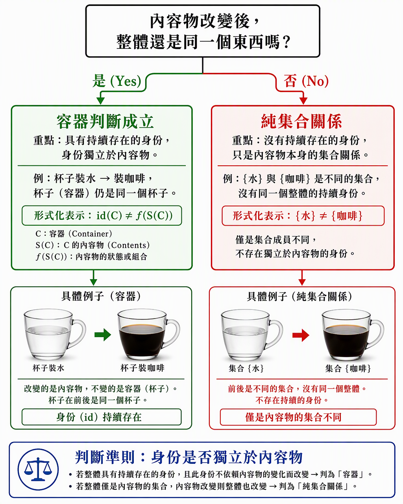

> 從頂部問題出發：「內容物改變後，整體還是同一個東西嗎？」左側綠色路徑（是）導向容器判斷成立；右側紅色路徑（否）導向純集合關係。

  **步驟**   **操作**                     **判斷標準**
  ---------- ---------------------------- -------------------------------
  1          確認整體包含可替換的內容物   內容物能被取出、更換、清空
  2          替換內容物                   將 e₁ 換為 e₂
  3          檢查身份                     id(整體) 在替換前後是否相同？
  4a         相同 → 容器判斷成立          適用容器邏輯 ( )
  4b         不同 → 純集合關係            僅適用數學集合 ∈

**◆ 實作範例：**

> • 書包：放入課本或換成筆袋，書包仍是同一個書包 → 容器 ✓
>
> • 電腦資料夾：裡面的檔案可以增刪改，資料夾本身不變 → 容器 ✓
>
> • {蘋果, 香蕉}：拿掉蘋果換成橘子，變成另一個集合 → 純集合 ✗

### 5.5.2 SOM 結構依存判斷：拿掉部件後，整體還是同一個東西嗎？

確認了一個整體具有結構性部件之後，下一步要判斷的是：每個部件對整體的同一性有多大的影響？

**圖5-7 SOM 結構依存判斷樹**

> 從根問題分出三條路徑：紅色（否→必要件）、橙色（部分→功能降級件）、綠色（是→非必要件）。底部公式：pᵢ ∈ Necessary(M) ⟺ remove(pᵢ, M) ≢ M。

  **等級**     **判斷結果**         **定義**                 **杯子範例**   **手機範例**
  ------------ -------------------- ------------------------ -------------- ----------------
  必要件       移除後同一性喪失     remove(pᵢ,M) ≢ M         杯底、杯身     主機板、電池
  功能降級件   功能缺失但身份存續   remove(pᵢ,M) ≡ M\' ⊂ M   杯把、杯蓋     相機模組、喇叭
  非必要件     移除後完全不影響     remove(pᵢ,M) ≡ M         貼紙、裝飾     保護貼、掛飾

這個三級分類在工程上有直接的對應：必要件對應「安全關鍵件」，功能降級件對應「可選功能件」，非必要件對應「裝飾件／消耗件」。

### 5.5.3 抽象規則判斷：新物件是否符合類別規則？

當我們需要判斷一個新出現的物件是否屬於某個類別時，不是去查清單，而是用交集判準當場驗證。

**圖5-8 抽象規則的判斷流程**

> 三個待判斷對象通過「交集判準 ∩(T)」漏斗：馬克杯通過、碗被排除、未來新型杯也自動通過。底部對比封閉集合與開放類別。

  **步驟**   **操作**                         **說明**
  ---------- -------------------------------- ---------------------------------------
  1          確定類別 T 的必要特徵集合 F(T)   例如 F(杯子) = {能裝液體, 能被手持喝}
  2          逐一檢驗新物件 o 的每個特徵      fᵢ(o) = true / false
  3          取交集                           ∩(T)(o) = ∀ fᵢ ∈ F(T), fᵢ(o) = true?
  4a         全部通過 → o ∈ \[T\]             自動歸類，不需手動加入
  4b         任一失敗 → o ∉ \[T\]             不屬於此類別

**◆ 邊界案例討論：**

> • 碗：能裝液體 ✓，但不能被手持喝 ✗ → 不屬於 \[杯子\]
>
> • 吸管杯：能裝液體 ✓，透過吸管喝 ✓ → 屬於 \[杯子\]
>
> • 注射器：能裝液體 ✓，能被手持 ✓，但用途不是「喝」→ 取決於 F(T) 是否包含「用於飲用」

這個邊界案例說明了：規則的精確度取決於特徵集合 F(T) 的完備度。

### 5.5.4 三層聯合判斷範例：智慧型手機

現在把三層判斷合在一起，用「智慧型手機」作為測試對象，展示形邏輯如何在實際物件上完整運作。

**圖5-9 三層形邏輯聯合判斷範例：智慧型手機**

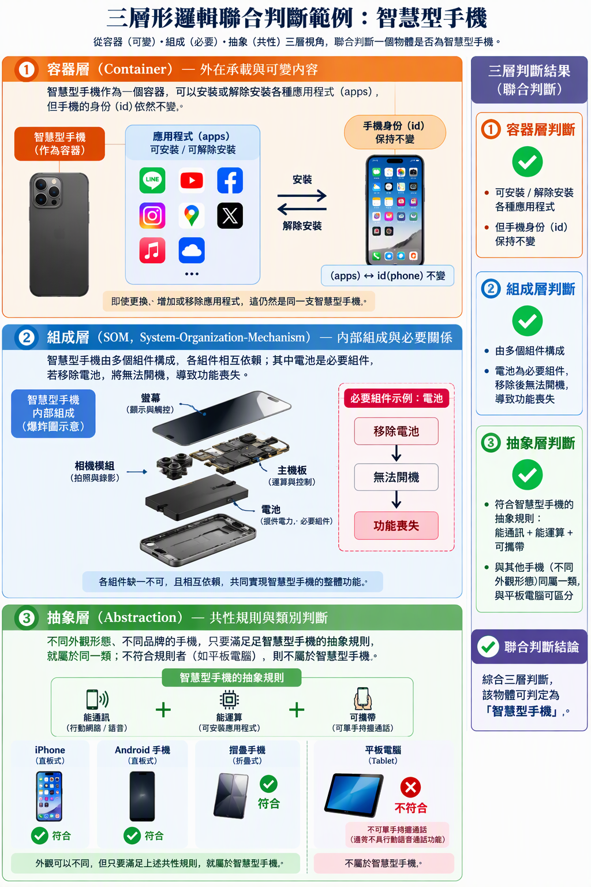

> 以智慧型手機為對象，三層判斷同時展開：容器層——App 可替換但手機身份不變；組成層——電池/主機板為必要件；抽象層——iPhone、Android、折疊機均通過規則，平板被排除。

**◆ 第一層：容器判斷**

  **檢驗項目**                 **結果**
  ---------------------------- ------------------------------------------
  手機是否有可替換的內容物？   ✓ App 可安裝/移除
  替換內容物後身份是否不變？   ✓ 裝 LINE 或卸載 YouTube，手機仍是同一支
  容器判斷                     成立 — 手機 = 容器(App)

**◆ 第二層：SOM 結構依存判斷**

  **部件**   **移除後結果**            **分類**
  ---------- ------------------------- ------------
  主機板     無法開機，功能完全喪失    必要件
  電池       無法供電，功能喪失        必要件
  螢幕       無法顯示/觸控             必要件
  相機模組   無法拍照，通話/上網正常   功能降級件
  喇叭       無法外放，耳機可用        功能降級件
  保護貼     完全不影響功能            非必要件

**◆ 第三層：抽象規則判斷**

F(智慧型手機) = { 能通訊, 能運算, 可攜帶 }

  **測試物件**   **能通訊**   **能運算**   **可攜帶**   **結果**
  -------------- ------------ ------------ ------------ ------------------
  iPhone         ✓            ✓            ✓            ∈ \[智慧型手機\]
  Android 手機   ✓            ✓            ✓            ∈ \[智慧型手機\]
  折疊手機       ✓            ✓            ✓            ∈ \[智慧型手機\]
  平板電腦       ✗            ✓            ✓            ∉ \[智慧型手機\]
  智慧手錶       ✓            ✓            ✗            ∉ \[智慧型手機\]

**◆ 聯合判斷結論：**

智慧型手機同時滿足三層形邏輯的判斷：1. 容器層 ✓ — App 的容器，身份獨立；2. 組成層 ✓ — 明確的部件結構與依存關係；3. 抽象層 ✓ — 符合「能通訊 ∧ 能運算 ∧ 可攜帶」規則。

這三層判斷缺一不可：只看容器層，平板也是手機；只看組成層，計算器也是手機；只看抽象層，對講機也是手機。只有三層同時通過，才能精確界定「智慧型手機」。

### 5.5.5 判斷範例的理論意義

**◆ 從描述到判斷的跨越。**

前幾節建立的定義解決「怎麼描述一個形」的問題；本節的判斷流程解決「怎麼在實際情境中運用這些描述去做決策」的問題。前者是靜態的知識結構，後者是動態的認知操作。

**◆ 三層判斷的互補性。**

每一層單獨使用時都有盲點：容器判斷無法區分結構差異，SOM 判斷無法處理內容替換，抽象判斷無法捕捉身份持續性。三層聯合使用時，盲點互相補足，形成完整的認知濾網。

**◆ 與 AI 分類系統的對應。**

現代 AI 的分類系統本質上是在做抽象層的判斷。但它通常缺乏容器層（身份持續性追蹤）和組成層（結構依存分析）的能力。形邏輯的三層框架，恰好指出了當前 AI 分類能力的缺口，以及未來世界模型需要補上的維度。

### 5.5.6 問題與解答範例

以下六組判斷練習題，涵蓋容器、SOM、抽象三層以及聯合判斷。每題先給出問題情境，再逐步展開解答過程。

**圖5-10 形邏輯判斷練習：問題與解答**

> 四張練習卡片分別對應容器判斷（冰箱）、SOM分級（汽車方向盤）、抽象規則（水壺vs杯子）、三層聯合判斷（電動車vs汽車）。

**◆ 問題一：冰箱是容器嗎？（容器層判斷）**

問題：冰箱可以放入各種食物，也可以把食物全部取出。當內容物改變時，冰箱還是同一個冰箱嗎？

解答：步驟1→確認可替換內容物 ✓ 食物可放入/取出/更換。步驟2→執行替換（牛奶換蔬菜）。步驟3→檢查身份：冰箱前後仍是「同一台冰箱」id不變。步驟4→容器判斷成立 ✓

延伸思考：如果把壓縮機拆掉，它還是不是「冰箱」？這不再是容器層問題，而是SOM層——壓縮機是必要件，移除後同一性喪失。容器層只關心「內容物替換」，不關心「結構部件移除」。

**◆ 問題二：汽車的方向盤是哪一級部件？（SOM層判斷）**

問題：汽車有引擎、車輪、方向盤、空調、音響等部件。方向盤屬於哪一級？

解答：mentally remove 方向盤→仍能辨識為汽車（外觀/車身/引擎都在），但無法轉向駕駛→功能降級件。

  **部件**   **移除後**                     **分類**
  ---------- ------------------------------ ------------
  引擎       無法啟動，不再是可行駛的汽車   必要件
  方向盤     仍可辨識為汽車，但無法駕駛     功能降級件
  空調       仍能正常行駛，只是不舒適       功能降級件
  音響       完全不影響行駛與安全           非必要件
  車標       完全不影響任何功能             非必要件

**◆ 問題三：水壺屬於 \[杯子\] 嗎？（抽象層判斷）**

問題：F(杯子) = { 能裝液體, 能被手持喝 }。運動水壺（750ml、有吸管口）是否 ∈ \[杯子\]？

解答：能裝液體 ✓ + 能被手持喝（透過吸管口）✓ → ∩(T) ✓ → ∈ \[杯子\]。

對比：保溫壺（2L、需倒出才能喝）：能裝液體 ✓ + 不能被手持喝 ✗ → ∉ \[杯子\]，但 ∈ \[容器\]。

關鍵洞察：不同 F(T) 定義不同類別，同一物件可能屬於上層類別但不屬於下層子類別。

**◆ 問題四：電動車是 \[汽車\] 嗎？（三層聯合判斷）**

問題：Tesla Model 3 沒有內燃機，改用電池與電動馬達。它還算「汽車」嗎？

第一層（容器）：乘客/貨物可上下車 ✓，載不同的人仍是同一台車 ✓ → 容器成立 ✓

第二層（SOM）：電池組=必要件（取代引擎角色）、電動馬達=必要件、中控螢幕=功能降級件、自動駕駛感測器=功能降級件。SOM關心結構角色而非實現方式。

第三層（抽象）：F(汽車)={能在道路行駛,能載運人貨,有動力系統,可被駕駛操控}。Tesla全部通過→ ∈ \[汽車\] ✓

聯合結論：三層全通過→是汽車。規則寫「有動力系統」而非「有內燃機」，所以電力驅動不影響判斷。開放類別捕捉功能本質而非實現細節。

**◆ 問題五：書架上的書是容器關係還是集合關係？（易混淆辨析）**

問題：「書架上擺著十本書」——書架是容器嗎？還是僅僅是一個集合？

  **判斷對象**                 **身份是否持續**           **判斷結果**
  ---------------------------- -------------------------- -----------------------------
  書架（物理結構）             ✓ 不管放什麼書，書架不變   容器 ( )
  「書架上的書」（書的組合）   ✗ 換書就換了組合           純集合 { }
  書架+書（展示單元）          視語境而定                 固定展示→SOM；臨時擺放→容器

重要原則：同一個物理場景，取決於你關注的「整體」是什麼，可能同時涉及不同的判斷類型。

**◆ 問題六：AI 聊天機器人是 \[對話系統\] 嗎？（跨域抽象判斷）**

問題：F(對話系統) = { 能接收自然語言輸入, 能產生自然語言回應, 能維持對話上下文 }。FAQ機器人 vs ChatGPT？

  **特徵**             **FAQ機器人**        **ChatGPT**
  -------------------- -------------------- --------------------
  能接收自然語言輸入   ✓                    ✓
  能產生自然語言回應   △ 只能輸出預設回覆   ✓ 自由生成
  能維持對話上下文     ✗ 每次獨立處理       ✓ 多輪對話有上下文
  ∩(T)                 ✗                    ✓
  結果                 ∉ \[對話系統\]       ∈ \[對話系統\]

FAQ機器人不屬於\[對話系統\]，但屬於更寬泛的\[資訊檢索工具\]。調整F(T)的寬嚴度會改變判斷結果。

與AI發展的關聯：形邏輯提供清晰思路——不要問「它是不是真的對話系統」這種本質主義問題，而是明確列出F(T)逐項檢驗。特徵清單的選擇本身就是對概念的理解與立場表達。

### 5.5.7 判斷練習的設計原則

  **題號**          **覆蓋面向**     **教學目的**
  ----------------- ---------------- --------------------------------
  Q1 冰箱           容器層基本判斷   建立「身份vs內容物」直覺
  Q2 汽車方向盤     SOM三級分類      區分必要件/功能降級件/非必要件
  Q3 水壺vs杯子     抽象規則邊界     體驗F(T)完備度如何影響結果
  Q4 電動車         三層聯合判斷     展示三層互補、缺一不可
  Q5 書架上的書     易混淆辨析       區分同一場景中不同判斷對象
  Q6 AI聊天機器人   跨域應用         將形邏輯應用到非物理對象

這些練習的共同特點：答案不是靠直覺猜的，而是靠走完判斷流程得出的。即使直覺對了，走完流程能讓你理解「為什麼對」；即使直覺錯了，走完流程能讓你發現「錯在哪一層」。這就是形邏輯作為認知工具的價值——它給你一套可重複、可檢驗、可辯論的判斷方法。

## 5.6 小結

**◆ 三種加值的總覽**

  **加值類型**   **補上的性質**   **核心貢獻**                                             **對應括號**
  -------------- ---------------- -------------------------------------------------------- --------------
  容器           身份的獨立性     讓集合裡多了一個不隨元素變動的「自己」                   ( )
  SOM            元素間的結構     讓集合裡的元素不再只是並列，而是有了依存關係             { }
  抽象           生成規則         讓集合從一份寫死的清單變成一條可以自動判斷新成員的準則   \[ \]

這三種加值彼此獨立，可以單獨存在，也可以疊加在一起。一個「杯子」同時擁有容器的身份獨立性、BOM 的部件結構、以及抽象的類別規則，這三者共同構成了我們對「杯子」這個概念的完整理解。

**圖5-5 同一句話，三層意義**

> 日常語言「杯子裡有水」同時承載三層意義：① 集合關係 ② 容器的身份獨立性 ③ 可替換性。數學集合僅捕捉第①層，而日常認知三層同時運作。

當我們說「杯子裡有水」，我們同時在說三件事：1. 集合關係；2. 容器的加值；3. 容器的可替換性。數學集合只捕捉了第一層，但日常認知其實同時運作著全部三層。

數學集合之所以好用，正是因為它把「一群東西構成整體」這件事濃縮到只剩下「屬不屬於」。本文所建立的理論框架，正是在數學集合這個最小核心之上，系統性地疊加三種加值，讓「形」的概念從一個抽象的數學工具，變成一個能夠完整描述現實世界的認知框架。

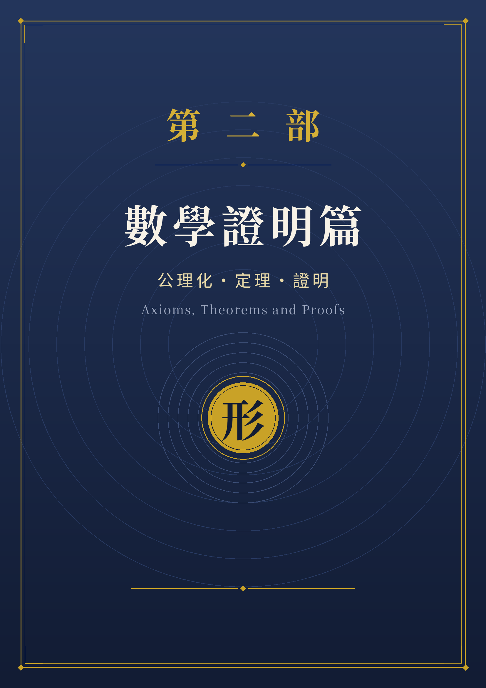

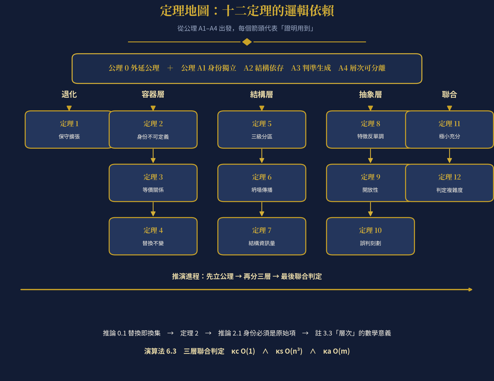

**閱讀地圖：十二定理的邏輯依賴——可先讀此圖，再逐章展開**

# 第 〇 章　摘要與閱讀指南

第五章《形集合與形邏輯》以自然語言指出：數學集合只回答「屬不屬於」，並省略了三層資訊——**身份的獨立性**、**元素之間的結構**、**生成規則**。本篇將這三層資訊正式化：我們給出形集合的公理化定義，提出四條公理，並在其上證明十二個定理。全部證明只使用初等集合論與基礎邏輯，不依賴任何未經聲明的直覺。

本篇的核心結果可以用一句話概括：**容器、結構、抽象三種加值，不是對集合論的修辭性補充，而是三個不可互相化約的獨立資訊維度**——定理 2 證明身份不可能由元素決定；定理 7 量化了結構所攜帶的位元數；定理 8 與定理 11 證明生成判準與三層聯合判定各自不可省略。

  **編號**      **定理名稱**     **一句話內容**
  ------------- ---------------- --------------------------------------------------
  **定理 1**    保守擴張         退化後的形集合就是普通集合，故不與集合論衝突
  **定理 2**    身份不可定義性   「由元素決定的身份」必為常數，故身份必須獨立引入
  **定理 3**    等價關係         身份等價 $\sim_{\text{id}}$ 是真正的等價關係
  **定理 4**    替換不變性       替換內容物不改變容器身份，而集合論中必改變
  **定理 5**    三級分區         必要件／降級件／非必要件完備且互斥
  **定理 6**    坍塌傳播         移除必要件，整個依賴錐一併失效
  **定理 7**    結構資訊量       組成關係攜帶 $\log_{2}P(n)$ 位元，集合層為 0
  **定理 8**    特徵反單調       特徵集越大，類別越小
  **定理 9**    開放性           開放類別不可由有限列舉決定
  **定理 10**   誤判刻劃         偽陽性集合可被精確寫出，並隨特徵完備度單調縮小
  **定理 11**   極小充分性       三層判定任一真子集皆不充分
  **定理 12**   判定複雜度       容器 $O(1)$・結構 ${O(n}^{3})$・抽象 $O(m)$

**閱讀約定**：定義與公理是約定（不可證，只能被檢驗其後果）；定理是從定義與公理出發的必然結論（必須證明）；例與註說明定理如何落地。所有數學式皆可在 Word 中直接檢視。

# 第 一 章　導論：集合語言的表達侷限

## 1.1　三層被省略的資訊

數學集合本來就只回答一個問題：**屬不屬於**。「杯子裡有水」在集合論中寫成 $水 \in S$，精確，但同時丟掉了三層日常語言自然攜帶的資訊：

1.　**身份的獨立性**——杯子不因為裝了水或咖啡就變成別的東西；

2.　**元素之間的結構**——杯把、杯底、杯蓋彼此依存、各有位置；

3.　**生成規則**——「杯子」不是寫死的清單，而是能判斷新成員的規則。

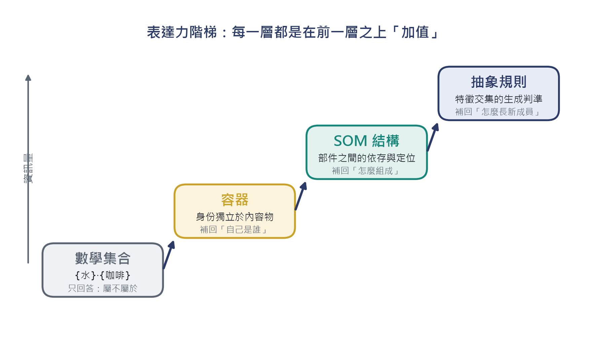

**▍圖 1-1　表達力階梯：每一層都是在上一層之上疊加一個獨立的資訊維度。本篇將證明：這三個維度彼此不可化約。**

## 1.2　外延公理與它的代價

+----------------------------------------------------------------------------------------------------------+
| **▍公理 0（外延公理）　Extensionality**                                                                  |
|                                                                                                          |
| $$\forall A\,\forall B\,\lbrack(\forall x\,(x \in A \Leftrightarrow x \in B)) \Rightarrow A = B\rbrack$$ |
|                                                                                                          |
| 一個集合被它的元素**完全決定**。這是集合論的基石，也是它表達力的上限來源。                               |
+----------------------------------------------------------------------------------------------------------+

+-----------------------------------------------------------------------------------------------------------------------------------+
| **▍推論 0.1　替換即換集**                                                                                                         |
|                                                                                                                                   |
| 設 $e_{1} \neq e_{2}$，$e_{1} \in A$，$e_{2} \notin A$，且 $A' = (A \smallsetminus \{ e_{1}\}) \cup \{ e_{2}\}$。則 $A' \neq A$。 |
|                                                                                                                                   |
| $$e_{2} \in A^{'}\  \land \ e_{2} \notin A\  \Rightarrow \ A^{'} \neq A$$                                                         |
|                                                                                                                                   |
| **證明**：$e_{2} \in A'$ 而 $e_{2} \notin A$，由邏輯的同一律，$A' \neq A$。∎                                                      |
+-----------------------------------------------------------------------------------------------------------------------------------+

推論 0.1 正是第五章指出的現象的嚴格形式：「把水倒掉、換成咖啡」在集合論中**必然**產生另一個集合。那麼，「杯子」這個在內容物變動後仍被認出是同一個東西的指稱對象，在集合論內部根本無處安放。這不是集合論的缺陷，而是它的設計取捨——第一章的其餘部分將把這個取捨量化，第二章起把它補回。

## 1.3　本篇的方法論

我們採用標準的數學結構化流程：**定義 → 公理 → 定理 → 證明 → 判定流程**。公理是約定，其好壞由兩個標準檢驗：(i) **一致性**——不導出矛盾；(ii) **充分性**——足以導出與日常與工程直覺相符的定理。本篇的每一條公理都會在後續章節中被使用至少一次，沒有多餘假設。

# 第 二 章　形集合的公理化

## 2.1　論域與基本符號

固定一個論域 $U$（所有可能出現的個體：水、咖啡、杯把、App……）。以 $\mathcal{P}(U)$ 記 $U$ 的冪集合，$\varnothing$ 為空集合，$|X|$ 為集合的基數。$\mathbb{N}$ 表自然數。

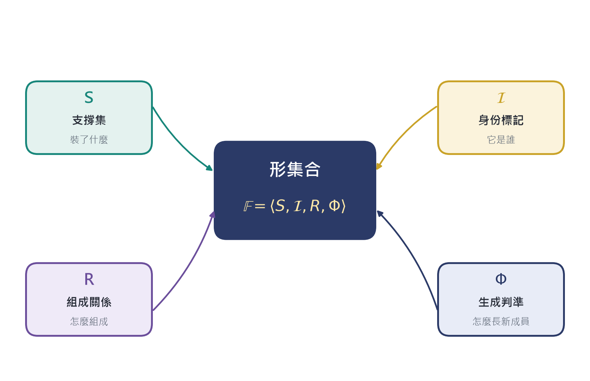

**▍圖 2-1　形集合的四元結構：四個成分各自承擔一層被集合論省略的資訊。**

## 2.2　形集合的定義

+--------------------------------------------------------------------------------------------------------------------------------------------------------------+
| **▍定義 2.1　形集合（Form Set）**                                                                                                                            |
|                                                                                                                                                              |
| **形集合**為有序四元組                                                                                                                                       |
|                                                                                                                                                              |
| $$\mathbb{F} = \langle S,\mathcal{\text{\ I}},\ R,\ \Phi\rangle$$                                                                                            |
|                                                                                                                                                              |
| 其中：                                                                                                                                                       |
|                                                                                                                                                              |
| 1.　$S \subseteq U$，$|S| < \infty$，稱為**支撐集**（carrier）——它裝了什麼；                                                                             |
|                                                                                                                                                              |
| 2.　$\mathcal{I} \in I$ 為**身份標記**（identity token），$I$ 是一個與 $\mathcal{P}(U)$ 無關的標記集——它是誰；                                           |
|                                                                                                                                                              |
| 3.　$R \subseteq S \times S$ 為**組成關係**（composition relation），是 $S$ 上的嚴格偏序（反自反、傳遞）；$q\, R\, p$ 讀作「$q$ 依賴 $p$」——它怎麼組成； |
|                                                                                                                                                              |
| 4.　$\Phi:U \rightarrow \{ 0,1\}$ 為**生成判準**（generative criterion），滿足 $S \subseteq \Phi^{- 1}(1)$——它怎麼長新成員。                             |
|                                                                                                                                                              |
| 四個投影函數記為 $\pi_{S},\pi_{\mathcal{I}},\pi_{R},\pi_{\Phi}$。                                                                                            |
+--------------------------------------------------------------------------------------------------------------------------------------------------------------+

+-----------------------------------------------------------------------------------------------------------------------------------------------------------------------------------------------------------------+
| **▍註 2.2　為什麼是四元組，而不是加在集合上的三個性質**                                                                                                                                                         |
|                                                                                                                                                                                                                 |
| 若身份 $\mathcal{I}$ 被定義為 $S$ 的函數，定理 2 將證明它必然退化為常數。因此身份必須與 $S$ 並列作為**獨立的原始項**，而不是導出量。這正是定義 2.1 的關鍵設計，也是第五章「容器 = 集合 + 不變的身份」的嚴格化。 |
+-----------------------------------------------------------------------------------------------------------------------------------------------------------------------------------------------------------------+

## 2.3　四條公理

+-----------------------------------------------------------------------------------------------------------------------------------------------------------------------------------------------------+
| **▍公理 A1　身份獨立性（Identity Independence）**                                                                                                                                                   |
|                                                                                                                                                                                                     |
| 定義**填充**與**清空**算子：對 $e \in U \smallsetminus S$ 與 $e \in S$，                                                                                                                            |
|                                                                                                                                                                                                     |
| $$\mathbb{F} \oplus e: = \langle S \cup \{ e\},\mathcal{I},R,\Phi\rangle,\quad\quad\mathbb{F} \ominus e: = \langle S \smallsetminus \{ e\},\mathcal{I}{,R|}_{S \smallsetminus \{ e\}},\Phi\rangle$$ |
|                                                                                                                                                                                                     |
| 則要求：                                                                                                                                                                                            |
|                                                                                                                                                                                                     |
| $$\pi_{\mathcal{I}}(\mathbb{F} \oplus e) = \pi_{\mathcal{I}}(\mathbb{F} \ominus e) = \pi_{\mathcal{I}}(\mathbb{F})$$                                                                                |
|                                                                                                                                                                                                     |
| 即：填充與清空都不動身份。**這一條公理就是「容器」的全部內容。**                                                                                                                                    |
+-----------------------------------------------------------------------------------------------------------------------------------------------------------------------------------------------------+

+-----------------------------------------------------------------------------------------------------------------------------------------------------------+
| **▍公理 A2　結構依存性（Structural Dependence）**                                                                                                         |
|                                                                                                                                                           |
| 存在**存活判準** $\sigma:\mathcal{P}(S) \rightarrow \{ 0,1\}$ 與**能力函數** $\kappa:\mathcal{P}(S) \rightarrow \mathcal{P}(C)$（$C$ 為能力論域），滿足： |
|                                                                                                                                                           |
| （A2a）　$\sigma$ 單調：$X \subseteq Y$ 且 $\sigma(X) = 1 \Rightarrow \sigma(Y) = 1$；                                                                    |
|                                                                                                                                                           |
| （A2b）　$\kappa$ 單調：$X \subseteq Y \Rightarrow \kappa(X) \subseteq \kappa(Y)$；                                                                       |
|                                                                                                                                                           |
| （A2c）　完整性：$\sigma(S) = 1$。                                                                                                                        |
+-----------------------------------------------------------------------------------------------------------------------------------------------------------+

+----------------------------------------------------------------------------------------------------+
| **▍公理 A3　判準生成性（Generativity）**                                                           |
|                                                                                                    |
| 類別成員由判準決定，而非由列舉決定：                                                               |
|                                                                                                    |
| $$x \in \lbrack T\rbrack\  \Leftrightarrow \ \bigcap(T)(x) = \bigwedge_{f \in F(T)}^{}\ f(x) = 1$$ |
|                                                                                                    |
| 其中 $F(T)$ 為類別 $T$ 的特徵集合（見第五章）。                                                    |
+----------------------------------------------------------------------------------------------------+

+--------------------------------------------------------------------------------------------------------------------------------------------------------------------------------------------------+
| **▍公理 A4　層次可分離性（Separability）**                                                                                                                                                       |
|                                                                                                                                                                                                  |
| $\pi_{\mathcal{I}}$、$\sigma$、$\kappa$、$\Phi$ 相互獨立：任一成分可在不改變其他成分的前提下變動。此公理保證三種加值可以**單獨存在、也可以疊加**——這是原章 5.6「三種加值彼此獨立」的形式化。 |
+--------------------------------------------------------------------------------------------------------------------------------------------------------------------------------------------------+

## 2.4　退化與保守擴張

+-------------------------------------------------------------------------------------------------------------------------------------------+
| **▍定義 2.3　退化映射（Degeneration）**                                                                                                   |
|                                                                                                                                           |
| $$\delta(S): = \langle S,\ \lceil S\rceil,\ \varnothing,\ \mathbb{1}\rangle$$                                                             |
|                                                                                                                                           |
| 其中 $\lceil S\rceil$ 是由 $S$ 決定的標記（例如 $S$ 本身），$\mathbb{1}(x) \equiv 1$ 為恒真判準，$R = \varnothing$ 表示沒有任何結構資訊。 |
+-------------------------------------------------------------------------------------------------------------------------------------------+

+-----------------------------------------------------------------------------------------------------------------------------------------------------+
| **▍定理 1　保守擴張定理（Conservative Extension）**                                                                                                 |
|                                                                                                                                                     |
| （i）$\rho(\delta(S)) = S$，其中 $\rho: = \pi_{S}$ 為遺忘函式；                                                                                     |
|                                                                                                                                                     |
| （ii）凡僅依賴「哪些元素在裡面」的性質 $P$，皆有 $P(\delta(S)) \Leftrightarrow P(S)$。                                                              |
|                                                                                                                                                     |
| **證明**：（i）$\pi_{S}(\delta(S)) = S$ 直接由定義 2.3 得到，故 $\rho \circ \delta = \text{id}_{\mathcal{P}(U)}$，$\delta$ 為單射且 $\rho$ 為滿射。 |
|                                                                                                                                                     |
| （ii）設 $P$ 只依賴 $S$。因 $\rho(\delta(S)) = S$ 且 $P$ 是 $S$ 的函數，故 $P(\delta(S)) = P(S)$。∎                                                 |
+-----------------------------------------------------------------------------------------------------------------------------------------------------+

+--------------------------------------------------------------------------------------------------------------------------------------------------------------------------------------------------------------------------+
| **▍推論 1.1　與集合論的相容性**                                                                                                                                                                                          |
|                                                                                                                                                                                                                          |
| 形集合論是樸素集合論的**保守擴張**：把 $R$ 清空、$\Phi$ 設為恒真、$\mathcal{I}$ 綁定到 $S$，形集合就退化回普通集合。因此本篇不與任何既有集合論結果衝突；它只在集合論「假設得最少」的地方，系統性地加回三層被省略的資訊。 |
+--------------------------------------------------------------------------------------------------------------------------------------------------------------------------------------------------------------------------+

# 第 三 章　容器層：身份的獨立性

## 3.1　核心直覺

**▍圖 3-1　左：集合論中替換內容物必然得到另一個集合（推論 0.1）。右：容器允許內容物在 Sigma(𝔽) 中任意變動，而身份 ℐ 不變。**

## 3.2　替換算子與身份等價

+-----------------------------------------------------------------------------------------------+
| **▍定義 3.1　替換算子**                                                                       |
|                                                                                               |
| $$\mathbb{F}{\lbrack e}_{1} \mapsto e_{2}\rbrack: = (\mathbb{F} \ominus e_{1}) \oplus e_{2}$$ |
|                                                                                               |
| 其中 $e_{1} \in S$，$e_{2} \in U \smallsetminus (S \smallsetminus \{ e_{1}\})$。              |
+-----------------------------------------------------------------------------------------------+

+-----------------------------------------------------------------------------------------------------------------------------+
| **▍定義 3.2　身份等價關係**                                                                                                 |
|                                                                                                                             |
| $$\mathbb{F} \sim_{\text{id}}\mathbb{G}\  \Leftrightarrow \ \pi_{\mathcal{I}}(\mathbb{F}) = \pi_{\mathcal{I}}(\mathbb{G})$$ |
+-----------------------------------------------------------------------------------------------------------------------------+

+-----------------------------------------------------------------------------------------------------------------------------------------------------------------+
| **▍定理 2　身份的不可定義性（The Non-definability of Identity）**                                                                                               |
|                                                                                                                                                                 |
| 設 $|U| \geq 2$。若函數 $\text{id}:\mathcal{P}(U) \rightarrow I$ 同時滿足                                                                                       |
|                                                                                                                                                                 |
| $$\text{id}(A \cup \{ e\}) = \text{id}(A)\text{\ \ }(e \notin A),\quad\quad\text{id}(A \smallsetminus \{ e\}) = \text{id}(A)\text{\ \ }(e \in A)$$              |
|                                                                                                                                                                 |
| （即：填充與清空都不改變身份），則 $\text{id}$ 為**常數函數**。                                                                                                 |
|                                                                                                                                                                 |
| **證明**：任取 $A,B \subseteq U$。構造中間集合 $M: = A \cap B$，並考慮序列                                                                                      |
|                                                                                                                                                                 |
| $$A\  \longrightarrow \ M = A \smallsetminus (A \smallsetminus B)\  \longrightarrow \ M \cup (B \smallsetminus A) = B$$                                         |
|                                                                                                                                                                 |
| 第一段只做**清空**（逐個移除 $A \smallsetminus B$ 中的元素），第二段只做**填充**（逐個加入 $B \smallsetminus A$ 中的元素）。由假設，每一步 $\text{id}$ 不變，故 |
|                                                                                                                                                                 |
| $$\text{id}(A) = \text{id}(M) = \text{id}(B)$$                                                                                                                  |
|                                                                                                                                                                 |
| 由 $A,B$ 的任意性，$\text{id}$ 為常數。∎                                                                                                                        |
+-----------------------------------------------------------------------------------------------------------------------------------------------------------------+

+--------------------------------------------------------------------------------------------------------------------------------------------------------------------------------+
| **▍推論 2.1　身份必須是原始項**                                                                                                                                                |
|                                                                                                                                                                                |
| 任何企圖把容器身份定義成「其內容物集合的函數」的做法都會失敗：它要嘛違反填充／清空不變性（於是杯子不再是同一個杯子），要嘛是常數（於是所有容器共用同一個身份，容器概念瓦解）。 |
|                                                                                                                                                                                |
| 因此定義 2.1 中 $\mathcal{I}$ 與 $S$ 並列出現，不是風格選擇，而是**邏輯必然**。                                                                                                |
+--------------------------------------------------------------------------------------------------------------------------------------------------------------------------------+

+--------------------------------------------------------------------------------------------------------------------------------------------------------------------------------------------------+
| **▍定理 3　身份等價是等價關係**                                                                                                                                                                  |
|                                                                                                                                                                                                  |
| $\sim_{\text{id}}$ 自反、對稱、傳遞。                                                                                                                                                            |
|                                                                                                                                                                                                  |
| **證明**：$\mathbb{F} \sim_{\text{id}}\mathbb{F}$ 由 $\pi_{\mathcal{I}}(\mathbb{F}) = \pi_{\mathcal{I}}(\mathbb{F})$ 直接得到；對稱性與傳遞性分別由「$=$ 的對稱性」與「$=$ 的傳遞性」直接得到。∎ |
+--------------------------------------------------------------------------------------------------------------------------------------------------------------------------------------------------+

+------------------------------------------------------------------------------------------------------------------------------------------------------------------------------------------------------------------------------------------------------------------------------------------------------------------------------------------------------------+
| **▍定理 4　替換不變性（Substitution Invariance）**                                                                                                                                                                                                                                                                                                         |
|                                                                                                                                                                                                                                                                                                                                                            |
| 在公理 A1 之下，對任意 $e_{1} \in S$、$e_{2} \in U \smallsetminus S$：                                                                                                                                                                                                                                                                                     |
|                                                                                                                                                                                                                                                                                                                                                            |
| $$\boxed{\ \mathbb{F}{\lbrack e}_{1} \mapsto e_{2}\rbrack\  \sim_{\text{id}}\ \mathbb{F}\ }$$                                                                                                                                                                                                                                                              |
|                                                                                                                                                                                                                                                                                                                                                            |
| **證明**：$\mathbb{F}{\lbrack e}_{1} \mapsto e_{2}\rbrack = (\mathbb{F} \ominus e_{1}) \oplus e_{2}$。由 A1 的清空不變性，$\pi_{\mathcal{I}}(\mathbb{F} \ominus e_{1}) = \pi_{\mathcal{I}}(\mathbb{F})$；再由 A1 的填充不變性，$\pi_{\mathcal{I}}((\mathbb{F} \ominus e_{1}) \oplus e_{2}) = \pi_{\mathcal{I}}(\mathbb{F} \ominus e_{1})$。兩式串接即得。∎ |
+------------------------------------------------------------------------------------------------------------------------------------------------------------------------------------------------------------------------------------------------------------------------------------------------------------------------------------------------------------+

+-----------------------------------------------------------------------------------------------------------------------------------------------------------------------------------------------------------------------------------------------------------------------------------------------------------------------------------------------------------------+
| **▍註 3.3　與推論 0.1 的對照**                                                                                                                                                                                                                                                                                                                                  |
|                                                                                                                                                                                                                                                                                                                                                                 |
| 集合論：${A\lbrack e}_{1} \mapsto e_{2}\rbrack \neq A$（必然）。形集合論：$\mathbb{F}{\lbrack e}_{1} \mapsto e_{2}\rbrack \sim_{\text{id}}\mathbb{F}$（公理保證）。兩者不矛盾——後者談的是 $\mathcal{I}$，前者談的是 $S$。**這正是「層次」的數學意義**：第五章說「杯子與水是兩個層次的東西」，在這裡即是 $\pi_{\mathcal{I}}$ 與 $\pi_{S}$ 是兩個不同的投影。 |
+-----------------------------------------------------------------------------------------------------------------------------------------------------------------------------------------------------------------------------------------------------------------------------------------------------------------------------------------------------------------+

## 3.3　內容物空間

+-----------------------------------------------------------------------------------------------------------------------------+
| **▍定義 3.4　內容物空間**                                                                                                   |
|                                                                                                                             |
| $$\Sigma(\mathbb{F}): = \{ S^{'} \subseteq \Phi^{- 1}(1):\ \mathbb{F} \ominus S \oplus S^{'} \sim_{\text{id}}\mathbb{F}\}$$ |
|                                                                                                                             |
| 即：所有「裝進去之後仍然是同一個容器」的內容物配置。由 A1 與 A4，$\Sigma(\mathbb{F})$ 恰為可容許內容物的冪集。              |
+-----------------------------------------------------------------------------------------------------------------------------+

+-----------------------------------------------------------------------------------------------------------------------+
| **▍命題 3.5　內容物空間的大小**                                                                                       |
|                                                                                                                       |
| 若 $|\Phi^{- 1}(1)| = m$，則 $|\Sigma(\mathbb{F})| = 2^{m}$。                                                         |
|                                                                                                                       |
| **證明**：$\Sigma(\mathbb{F}) = \mathcal{P}(\Phi^{- 1}(1))$（A1 保證每個子集都可用），而有限集冪集的基數為 $2^{m}$。∎ |
+-----------------------------------------------------------------------------------------------------------------------+

**▍圖 3-2　一杯可裝三種液體的杯子，其內容物空間是 8 個狀態的布林格；沿格上任意路徑填充或清空，身份 ℐ 全程不變（定理 2）。**

## 3.4　工程對應

  **形邏輯概念**                                       **關聯式資料庫對應**    **物件導向對應**
  ---------------------------------------------------- ----------------------- ------------------------
  **身份** $\mathcal{I}$                               主鍵（Primary Key）     物件參考 / OID
  **支撐集** $S$                                       內容物表的外鍵集合      成員集合
  $$\Sigma(\mathbb{F})$$                               外鍵可指向的所有列      可替換的成員狀態
  $$\mathbb{F}{\lbrack e}_{1} \mapsto e_{2}\rbrack$$   UPDATE 外鍵，主鍵不變   替換成員物件，容器不變

資料庫設計中「主鍵不因外鍵內容改變」是一條工程紀律；定理 2 說明它為什麼**必須**是紀律——因為若身份可由內容導出，則任何一次內容更新都會製造一個「新的」容器，所有參照同時失效。

# 第 四 章　結構層（SOM）：組成關係

## 4.1　從並列元素到有結構的部件

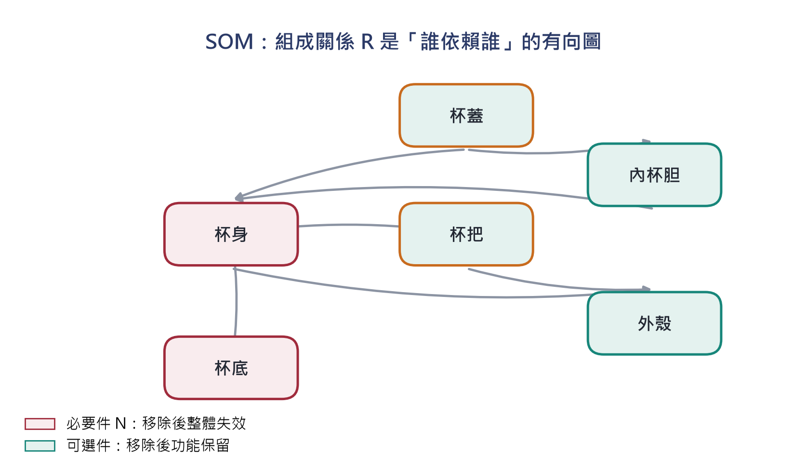

**▍圖 4-1　SOM：組成關係 R 是「誰依賴誰」的有向圖。集合論中 {杯蓋, 杯把, 杯底, 杯身} 與順序無關；SOM 中拿掉杯底，結構塌陷。**

## 4.2　形式工具

+----------------------------------------------------------------------------------------------------------------------------------------+
| **▍定義 4.1　移除算子與傳遞閉包**                                                                                                      |
|                                                                                                                                        |
| 對 $p \in S$，**移除算子**定義為                                                                                                       |
|                                                                                                                                        |
| $$\mathbb{F} \smallsetminus p: = \langle S \smallsetminus \{ p\},\mathcal{\text{\ I}},\ {R|}_{S \smallsetminus \{ p\}},\ \Phi\rangle$$ |
|                                                                                                                                        |
| $R^{+}$ 表 $R$ 的傳遞閉包。**依賴錐**定義為                                                                                            |
|                                                                                                                                        |
| $$\uparrow p: = \{ q \in S:\ p\, R^{+}\, q\}$$                                                                                         |
|                                                                                                                                        |
| 即所有（直接或間接）依賴 $p$ 的部件。                                                                                                  |
+----------------------------------------------------------------------------------------------------------------------------------------+

+----------------------------------------------------------------------------------------------------------------------------------------------------------------------+
| **▍定義 4.2　三級部件分類**                                                                                                                                          |
|                                                                                                                                                                      |
| 在公理 A2 的 $\sigma$ 與 $\kappa$ 之下，對 $p \in S$：                                                                                                               |
|                                                                                                                                                                      |
| $$N(\mathbb{F}) = \{ p \in S:\ \sigma(S \smallsetminus \{ p\}) = 0\}\text{\quad\quad}（必要件）$$                                                                    |
|                                                                                                                                                                      |
| $$D(\mathbb{F}) = \{ p \in S:\ \sigma(S \smallsetminus \{ p\}) = 1\  \land \ \kappa(S \smallsetminus \{ p\}) \subsetneq \kappa(S)\}\text{\quad\quad}（功能降級件）$$ |
|                                                                                                                                                                      |
| $$T(\mathbb{F}) = \{ p \in S:\ \sigma(S \smallsetminus \{ p\}) = 1\  \land \ \kappa(S \smallsetminus \{ p\}) = \kappa(S)\}\text{\quad\quad}（非必要件）$$            |
+----------------------------------------------------------------------------------------------------------------------------------------------------------------------+

+--------------------------------------------------------------------------------------+
| **▍引理 A　存活判準的單調性**                                                        |
|                                                                                      |
| $X \subseteq Y \subseteq S$ 且 $\sigma(X) = 1 \Rightarrow \sigma(Y) = 1$。（即 A2a） |
+--------------------------------------------------------------------------------------+

+-----------------------------------------------------------------------+
| **▍引理 B　能力函數的單調性**                                         |
|                                                                       |
| $X \subseteq Y \Rightarrow \kappa(X) \subseteq \kappa(Y)$。（即 A2b） |
+-----------------------------------------------------------------------+

## 4.3　三級分區定理

+----------------------------------------------------------------------------------------------------------------------------------------------------------------------------------------------------------------------------------------------------------------------------------------------------------------------------------------------------------------------------+
| **▍定理 5　三級分區（Three-way Partition）**                                                                                                                                                                                                                                                                                                                               |
|                                                                                                                                                                                                                                                                                                                                                                            |
| $\{ N(\mathbb{F}),D(\mathbb{F}),T(\mathbb{F})\}$ 構成 $S$ 的一個分區：                                                                                                                                                                                                                                                                                                     |
|                                                                                                                                                                                                                                                                                                                                                                            |
| （i）**完備性**　$N \cup D \cup T = S$；                                                                                                                                                                                                                                                                                                                                   |
|                                                                                                                                                                                                                                                                                                                                                                            |
| （ii）**互斥性**　三者兩兩不相交。                                                                                                                                                                                                                                                                                                                                         |
|                                                                                                                                                                                                                                                                                                                                                                            |
| **證明**：                                                                                                                                                                                                                                                                                                                                                                 |
|                                                                                                                                                                                                                                                                                                                                                                            |
| （i）任取 $p \in S$。由 $\sigma$ 的值域為 $\{ 0,1\}$，分兩種情形。若 $\sigma(S \smallsetminus \{ p\}) = 0$，則 $p \in N$。若 $\sigma(S \smallsetminus \{ p\}) = 1$，由引理 B（取 $X = S \smallsetminus \{ p\}$、$Y = S$）得 $\kappa(S \smallsetminus \{ p\}) \subseteq \kappa(S)$。此包含關係只有兩種可能：真包含（$p \in D$）或相等（$p \in T$）。故 $p$ 必屬於三者之一。 |
|                                                                                                                                                                                                                                                                                                                                                                            |
| （ii）設 $p \in N \cap D$。則 $\sigma(S \smallsetminus \{ p\}) = 0$ 且 $= 1$，違反 $\sigma$ 為良定義函數，矛盾。$N \cap T$ 與 $D \cap T$ 的互斥性分別由 $\sigma$ 值不相容與 $\kappa$ 關係不相容同理得到。∎                                                                                                                                                                 |
+----------------------------------------------------------------------------------------------------------------------------------------------------------------------------------------------------------------------------------------------------------------------------------------------------------------------------------------------------------------------------+

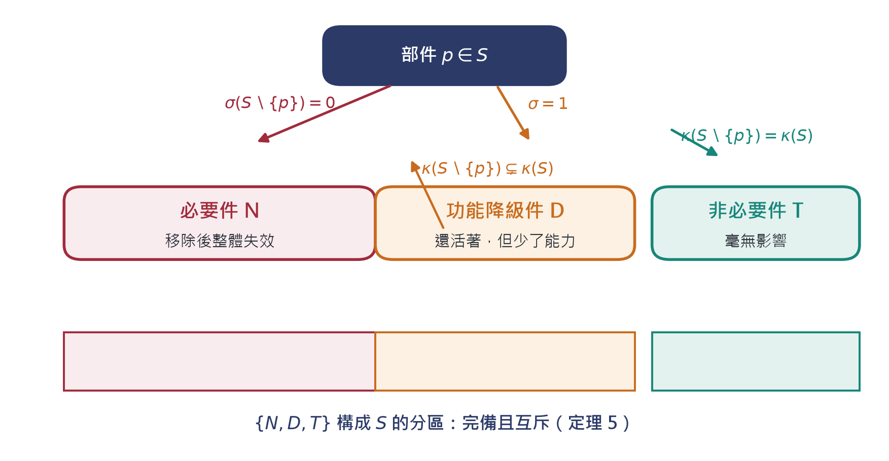

**▍圖 4-2　三級分類的判定樹與分區結構（定理 5）：每個部件恰落入一級，沒有中間地帶。**

## 4.4　坍塌傳播

+-------------------------------------------------------------------------------------------------------------------------------------------------------------------------------------------------------------------------------------------------------------------------------------------------------------------------------------------------------+
| **▍定理 6　坍塌傳播（Collapse Propagation）**                                                                                                                                                                                                                                                                                                         |
|                                                                                                                                                                                                                                                                                                                                                       |
| 若 $p \in N(\mathbb{F})$，則對任意 $A$ 滿足 $\{ p\} \subseteq A \subseteq S$，有                                                                                                                                                                                                                                                                      |
|                                                                                                                                                                                                                                                                                                                                                       |
| $$\sigma(S \smallsetminus A) = 0$$                                                                                                                                                                                                                                                                                                                    |
|                                                                                                                                                                                                                                                                                                                                                       |
| **證明**：反證法。設 $\sigma(S \smallsetminus A) = 1$。由 $\{ p\} \subseteq A$ 得 $S \smallsetminus A \subseteq S \smallsetminus \{ p\}$。由引理 A（單調性），$\sigma(S \smallsetminus A) = 1 \Rightarrow \sigma(S \smallsetminus \{ p\}) = 1$。但 $p \in N$ 表示 $\sigma(S \smallsetminus \{ p\}) = 0$，矛盾。故 $\sigma(S \smallsetminus A) = 0$。∎ |
+-------------------------------------------------------------------------------------------------------------------------------------------------------------------------------------------------------------------------------------------------------------------------------------------------------------------------------------------------------+

+---------------------------------------------------------------------------------------------------------------------------------------------------------------------------------------------------------------+
| **▍推論 6.1　依賴錐的連鎖失效**                                                                                                                                                                               |
|                                                                                                                                                                                                               |
| 若 $q \in \uparrow p$（$q$ 依賴 $p$）且 $p \in N$，則在配置 $S \smallsetminus \{ p\}$ 下 $q$ 不再可用。這正是原章的觀察「拿掉杯底，杯子就垮了」的嚴格形式：**失效不是局部的，它沿依賴錐單調傳播**（圖 4-3）。 |
+---------------------------------------------------------------------------------------------------------------------------------------------------------------------------------------------------------------+

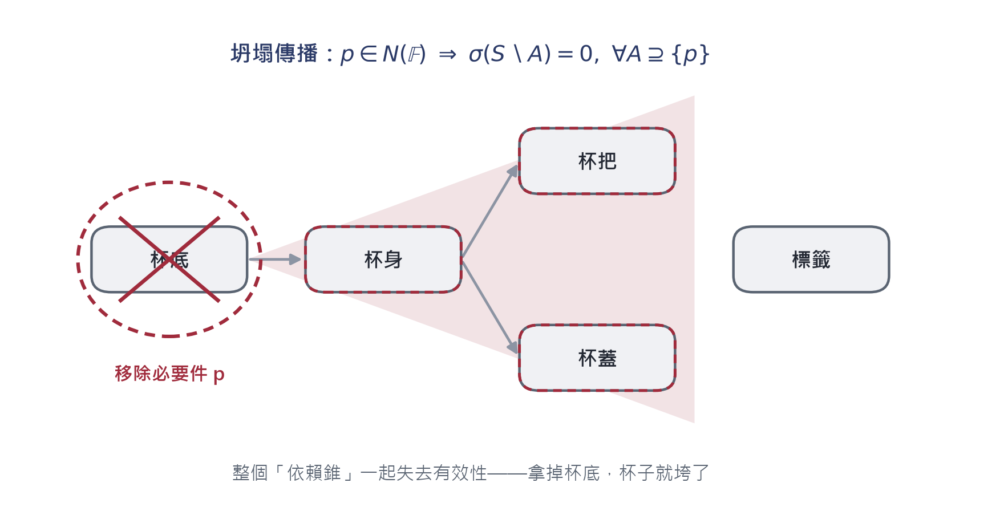

**▍圖 4-3　坍塌傳播（定理 6）：移除一個必要件 p，整個依賴錐 ↑p 一併失效。**

## 4.5　結構攜帶多少資訊？

+--------------------------------------------------------------------------------------+
| **▍定理 7　結構資訊量（Structural Information Content）**                            |
|                                                                                      |
| 設 $|S| = n$。令 $P(n)$ 為 $n$ 元素集合上嚴格偏序的個數（即 $R$ 的可能取值數）。則： |
|                                                                                      |
| （i）集合層的結構資訊量為 $0$ 位元（外延公理保證表示唯一）；                         |
|                                                                                      |
| （ii）結構層的結構資訊量為 $\log_{2}P(n)$ 位元。                                     |
|                                                                                      |
| **證明**：（i）由公理 0，$S$ 被其元素完全決定，表示唯一，故熵為 0。                  |
|                                                                                      |
| （ii）$R$ 有 $P(n)$ 種等可能的取值，故其資訊量為 $\log_{2}P(n)$ 位元。∎              |
+--------------------------------------------------------------------------------------+

  $$n$$   $P(n)$**（已知枚舉）**   $$\log_{2}P(n)$$
  ------- ------------------------ ------------------
  1       1                        0.00 bits
  2       3                        1.58 bits
  3       19                       4.25 bits
  4       219                      7.77 bits
  5       4,231                    12.05 bits

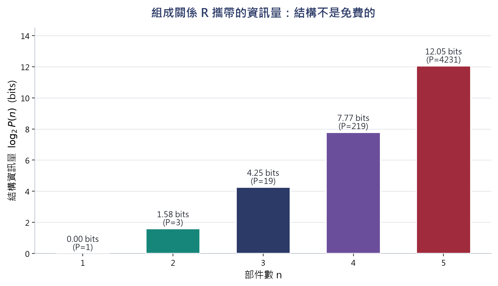

**▍圖 4-4　結構資訊量隨部件數超指數成長：四個部件的杯子已攜帶近 8 位元的結構資訊。這解釋了為什麼人工列舉結構不可行，必須以關係形式表達。**

## 4.6　工程意義

  **分級**           **判定條件**                              **工程對應**     **杯子中的例子**
  ------------------ ----------------------------------------- ---------------- ------------------
  **必要件** $N$     $$\sigma(S \smallsetminus \{ p\}) = 0$$   安全關鍵件       杯底
  **降級件** $D$     $\sigma = 1$ 且 $\kappa$ 縮小             可選功能件       杯把
  **非必要件** $T$   $\sigma = 1$ 且 $\kappa$ 不變             裝飾件／消耗件   杯身刻花

# 第 五 章　抽象層：生成判準

## 5.1　從封閉清單到開放規則

**▍圖 5-1　封閉清單靠列舉，開放類別靠規則：成員資格由交集判準 ⋂(T) 當場決定，與歷史列舉無關（定理 9）。**

## 5.2　形式定義

+-----------------------------------------------------------------------------------------------------------+
| **▍定義 5.1　特徵集合、判準與類別擴展**                                                                   |
|                                                                                                           |
| 類別 $T$ 的**特徵集合**為有限集 $F(T) = \{ f_{1},\ldots{,f}_{n}\}$，每個 $f_{i}:U \rightarrow \{ 0,1\}$。 |
|                                                                                                           |
| **交集判準**：                                                                                            |
|                                                                                                           |
| $$\bigcap(T)(x): = \bigwedge_{i = 1}^{n}\ f_{i}(x)$$                                                      |
|                                                                                                           |
| **類別擴展**（extension）：                                                                               |
|                                                                                                           |
| $${\lbrack T\rbrack}_{F}: = \{ x \in U:\ \bigcap(T)(x) = 1\}$$                                            |
+-----------------------------------------------------------------------------------------------------------+

## 5.3　單調性：條件越多，類別越小

+---------------------------------------------------------------------------------------------------------------------------------------------------------------------------------------------+
| **▍定理 8　特徵反單調性（Feature Antitonicity）**                                                                                                                                           |
|                                                                                                                                                                                             |
| 若 $F_{1} \subseteq F_{2}$，則 ${\lbrack T\rbrack}_{F_{2}} \subseteq {\lbrack T\rbrack}_{F_{1}}$。                                                                                          |
|                                                                                                                                                                                             |
| **證明**：設 $x \in {\lbrack T\rbrack}_{F_{2}}$，則 $\forall f \in F_{2}:f(x) = 1$。因 $F_{1} \subseteq F_{2}$，故 $\forall f \in F_{1}:f(x) = 1$，即 $x \in {\lbrack T\rbrack}_{F_{1}}$。∎ |
+---------------------------------------------------------------------------------------------------------------------------------------------------------------------------------------------+

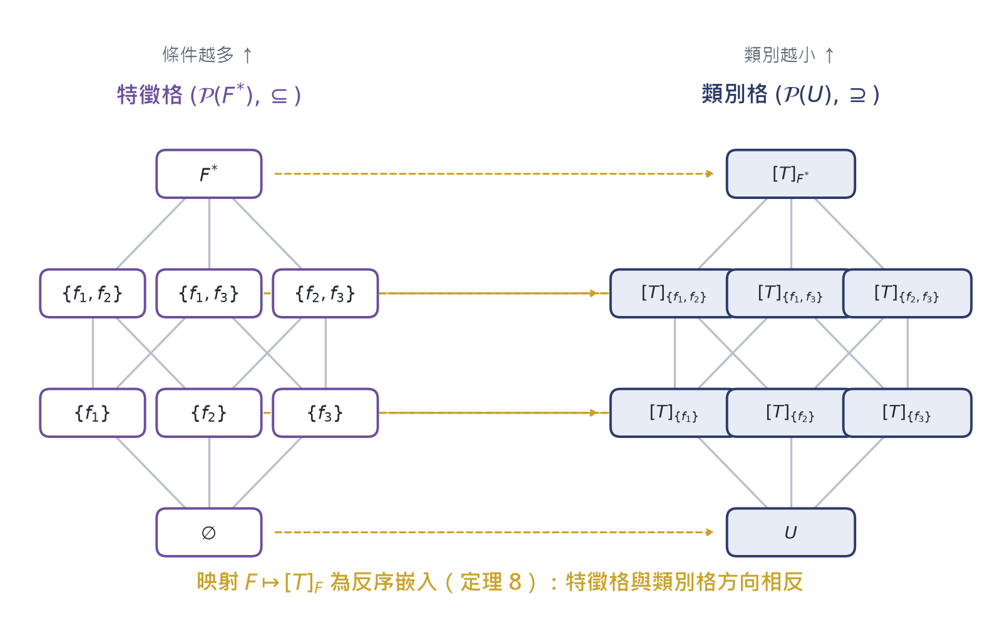

**▍圖 5-2　特徵格與類別格的方向相反（定理 8）：左邊往上加特徵，右邊往下縮類別。映射 F ↦ \[T\]\_F 是兩個格之間的反序對應。**

## 5.4　開放性

+--------------------------------------------------------------------------------------------------------------------------------------------------------+
| **▍定理 9　開放性（Openness）**                                                                                                                        |
|                                                                                                                                                        |
| 設 $U$ 無限，且存在特徵 $f$ 使 $f^{- 1}(1)$ 無限。則對任意有限列舉 $L \subseteq f^{- 1}(1)$：                                                          |
|                                                                                                                                                        |
| $$L \subsetneq {\lbrack T\rbrack}_{\{ f\}}$$                                                                                                           |
|                                                                                                                                                        |
| 即：**任何有限清單都不是這個類別**。                                                                                                                   |
|                                                                                                                                                        |
| **證明**：${\lbrack T\rbrack}_{\{ f\}} = f^{- 1}(1)$ 為無限集，$L$ 為其有限子集，故 $f^{- 1}(1) \smallsetminus L \neq \varnothing$，即 $L$ 為真子集。∎ |
+--------------------------------------------------------------------------------------------------------------------------------------------------------+

+-----------------------------------------------------------------------------------------------------------------------------------------------------------------------------------------------------------+
| **▍推論 9.1　新成員的自動判定**                                                                                                                                                                           |
|                                                                                                                                                                                                           |
| 對任何 $x \in U$（無論是否在訓練資料、設計文件或歷史清單中出現過），成員資格由 $\bigcap(T)(x)$ 在 $O(n)$ 時間內決定（$n = |F(T)|$）。這就是原章「只要符合規則，即使是全新的設計也自動屬於它」的形式內容。 |
+-----------------------------------------------------------------------------------------------------------------------------------------------------------------------------------------------------------+

## 5.5　誤判的精確刻劃

+---------------------------------------------------------------------------------------------------+
| **▍定義 5.2　完備特徵集**                                                                         |
|                                                                                                   |
| 設存在目標類別 $T^{*}$，其真實特徵集為 $F^{*}$。使用者提出的 $F \subseteq F^{*}$ 稱為**不完備**。 |
+---------------------------------------------------------------------------------------------------+

+----------------------------------------------------------------------------------------------------------------------------------------------------------------------------------------------------------------------------------------------------------------------------------+
| **▍定理 10　誤判刻劃（Misclassification Characterization）**                                                                                                                                                                                                                     |
|                                                                                                                                                                                                                                                                                  |
| 設 $F \subseteq F^{*}$。則：                                                                                                                                                                                                                                                     |
|                                                                                                                                                                                                                                                                                  |
| （a）${\lbrack T\rbrack}_{F^{*}} \subseteq {\lbrack T\rbrack}_{F}$（由定理 8）；                                                                                                                                                                                                 |
|                                                                                                                                                                                                                                                                                  |
| （b）**偽陽性集合**可精確寫為                                                                                                                                                                                                                                                    |
|                                                                                                                                                                                                                                                                                  |
| $${\text{FP}(F): = \lbrack T\rbrack}_{F} \smallsetminus {\lbrack T\rbrack}_{F^{*}}{= \lbrack T\rbrack}_{F} \cap (U \smallsetminus {\lbrack T\rbrack}_{F^{*}})$$                                                                                                                  |
|                                                                                                                                                                                                                                                                                  |
| （c）$\text{FP}(F) = \varnothing \Leftrightarrow {\lbrack T\rbrack}_{F}{= \lbrack T\rbrack}_{F^{*}}$；                                                                                                                                                                           |
|                                                                                                                                                                                                                                                                                  |
| （d）若 $F_{1} \subseteq F_{2} \subseteq F^{*}$，則 ${\text{FP}(F}_{2}) \subseteq {\text{FP}(F}_{1})$——特徵越完備，誤判越少。                                                                                                                                                |
|                                                                                                                                                                                                                                                                                  |
| **證明**：（a）定理 8。（b）差集的定義。（c）由（a），${\lbrack T\rbrack}_{F^{*}} \subseteq {\lbrack T\rbrack}_{F}$；差集為空當且僅當兩集合相等。（d）由定理 8，${\lbrack T\rbrack}_{F_{2}} \subseteq {\lbrack T\rbrack}_{F_{1}}$；對同一集合取差集，較小的集合給出較小的差集。∎ |
+----------------------------------------------------------------------------------------------------------------------------------------------------------------------------------------------------------------------------------------------------------------------------------+

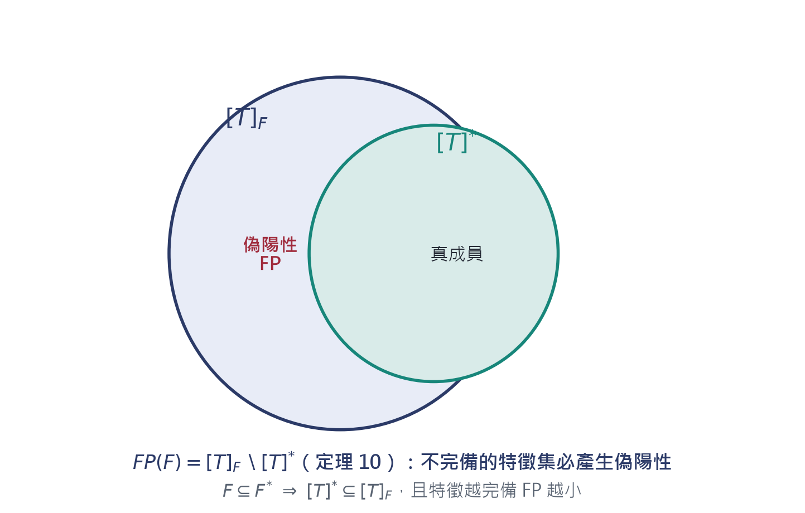

**▍圖 5-3　偽陽性集合的幾何（定理 10）：不完備的特徵集必然把一些非成員圈進來；補特徵的過程就是收縮 \[T\]\_F 的過程。**

+------------------------------------------------------------------------------------------------------------------------------------------------------------------------------------------+
| **▍推論 10.1　邊界案例的可判定性**                                                                                                                                                       |
|                                                                                                                                                                                          |
| 「碗是不是杯子」「吸管杯是不是杯子」這類爭議，由定理 10 完全歸約為**特徵集的爭議**：若 $F$ 不含「用於飲用」，碗 $\in {\lbrack T\rbrack}_{F}$；若含，碗 $\notin {\lbrack T\rbrack}_{F}$。 |
|                                                                                                                                                                                          |
| 判斷程序沒有歧義；歧義全部來自 $F(T)$ 的選取。這把一個本體論爭論轉換成一個可明確討論的工程決策。                                                                                         |
+------------------------------------------------------------------------------------------------------------------------------------------------------------------------------------------+

  **候選物件**   $f_{1}$ **能裝液體**   $f_{2}$ **能被手持喝**   $f_{3}$ **用於飲用**   **結論**
  -------------- ---------------------- ------------------------ ---------------------- --------------------------------
  **馬克杯**     1                      1                        1                      $$\in {\lbrack T\rbrack}_{F}$$
  **碗**         1                      0                        0                      $\notin$（$f_{2}$ 不通過）
  **吸管杯**     1                      1                        1                      $$\in {\lbrack T\rbrack}_{F}$$
  **注射器**     1                      1                        0                      取決於 $f_{3}$ 是否 $\in F$

## 5.6　格結構

+--------------------------------------------------------------------------------------------------------------------------------------+
| **▍命題 5.3　反序嵌入**                                                                                                              |
|                                                                                                                                      |
| 映射 $F \mapsto {\lbrack T\rbrack}_{F}$ 是布林格 $(\mathcal{P}{(F}^{*}), \subseteq )$ 到 $(\mathcal{P}(U), \supseteq )$ 的反序嵌入。 |
|                                                                                                                                      |
| **證明**：反序性即定理 8。嵌入性由 ${\lbrack T\rbrack}_{F}$ 作為 $F$ 的函數唯一確定。∎                                               |
+--------------------------------------------------------------------------------------------------------------------------------------+

# 第 六 章　三層聯合判定

## 6.1　判定算子

+-----------------------------------------------------------------------------------------------------------------------------------------------------------------------------+
| **▍定義 6.1　三層判定算子**                                                                                                                                                 |
|                                                                                                                                                                             |
| $$\kappa_{c}(\mathbb{F}) = 1\  \Leftrightarrow \ \exists e_{1} \in S,\ \exists e_{2} \notin S:\ \mathbb{F}{\lbrack e}_{1} \mapsto e_{2}\rbrack \sim_{\text{id}}\mathbb{F}$$ |
|                                                                                                                                                                             |
| $$\kappa_{s}(\mathbb{F}) = 1\  \Leftrightarrow \ \sigma(S) = 1\  \land \ N(\mathbb{F}) \neq \varnothing$$                                                                   |
|                                                                                                                                                                             |
| $$\kappa_{a}(x) = 1\  \Leftrightarrow \ \bigcap(T)(x) = 1$$                                                                                                                 |
|                                                                                                                                                                             |
| $$J(\mathbb{F}): = \kappa_{c}(\mathbb{F}) \land \kappa_{s}(\mathbb{F}) \land \kappa_{a}(\mathbb{F})$$                                                                       |
+-----------------------------------------------------------------------------------------------------------------------------------------------------------------------------+

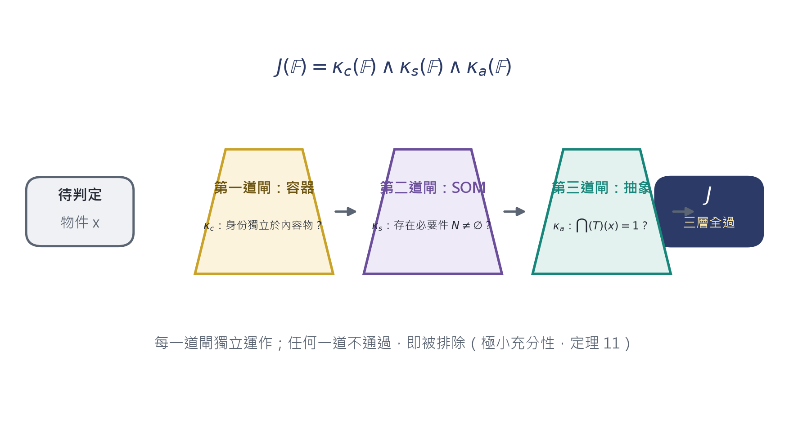

**▍圖 6-1　三道閘門：每一道獨立運作，任何一道不通過即被排除。**

## 6.2　極小充分性

+--------------------------------------------------------------------------------------------------------------------------------------------------------------------------------------------------------------------+
| **▍定理 11　極小充分性（Minimal Sufficiency）**                                                                                                                                                                    |
|                                                                                                                                                                                                                    |
| 設目標類別 $M^{*}$ =［智慧型手機］，完備特徵集                                                                                                                                                                     |
|                                                                                                                                                                                                                    |
| $$F^{*}{(M}^{*}) = \{ 具備蜂巢式行動通訊,\ 通用可程式運算平台,\ 可單手隨身持用\}$$                                                                                                                                 |
|                                                                                                                                                                                                                    |
| 論域 $\Omega = \{ s^{*},t_{1},t_{2},c,w,u\}$（智慧型手機、Wi-Fi 平板、LTE 平板、計算機、對講機、車載主機）。                                                                                                       |
|                                                                                                                                                                                                                    |
| 則對 $\{\kappa_{c},\kappa_{s},\kappa_{a}\}$ 的任一真子集 $J'$，存在 $x \in \Omega \smallsetminus M^{*}$ 使 $x$ 通過 $J'$ 的全部測試。                                                                              |
|                                                                                                                                                                                                                    |
| **證明**：逐一構造見證（witness），見下表與圖 6-2。                                                                                                                                                                |
|                                                                                                                                                                                                                    |
| （1）$J' = \varnothing$：任取 $x \in \Omega \smallsetminus M^{*}$，平凡通過。                                                                                                                                      |
|                                                                                                                                                                                                                    |
| （2）$J' = \{\kappa_{c}\}$：取 $x = t_{1}$（Wi-Fi 平板）。App 可增刪而平板身份不變（A1），故 $\kappa_{c}{(t}_{1}) = 1$；但 $t_{1}$ 無蜂巢通訊，$t_{1} \notin M^{*}$。                                              |
|                                                                                                                                                                                                                    |
| （3）$J' = \{\kappa_{s}\}$：取 $x = c$（計算機）。電池、主機板為必要件，$N(c) \neq \varnothing$；但 $c$ 無蜂巢通訊且非通用平台，$c \notin M^{*}$。                                                                 |
|                                                                                                                                                                                                                    |
| （4）$J' = \{\kappa_{a}\}$（取不完備特徵 $F = \{ 能通訊,能運算\}$）：$t_{1}$ 兩項皆通過，$t_{1} \notin M^{*}$。                                                                                                    |
|                                                                                                                                                                                                                    |
| （5）$J' = \{\kappa_{c},\kappa_{s}\}$：$t_{1}$ 皆通過（見 2、3 的理由），$t_{1} \notin M^{*}$。                                                                                                                    |
|                                                                                                                                                                                                                    |
| （6）$J' = \{\kappa_{c},\kappa_{a}\}$：$t_{1}$ 皆通過，$t_{1} \notin M^{*}$。                                                                                                                                      |
|                                                                                                                                                                                                                    |
| （7）$J' = \{\kappa_{s},\kappa_{a}\}$：取 $x = u$（車載主機）。$\kappa_{s}(u) = 1$（有電源模組等必要件）；$u$ 具通訊與運算能力，$\kappa_{a}(u) = 1$（$F$ 不含「可攜帶」）；但 $u$ 不可隨身攜帶，$u \notin M^{*}$。 |
|                                                                                                                                                                                                                    |
| 七個真子集全部不充分。而 $J$ 本身：以 $F^{*}$ 逐項檢驗，$t_{1}$ 不通過（無蜂巢）、$t_{2}$ 不通過（不可單手持用）、$c$、$w$、$u$ 皆不通過，唯 $s^{*}$ 三項全過。故 $J$ 在 $\Omega$ 上精確刻劃 $M^{*}$。∎            |
+--------------------------------------------------------------------------------------------------------------------------------------------------------------------------------------------------------------------+

**▍圖 6-2　極小性見證矩陣（定理 11）：每一列（一個判定子集）都至少有一個「漏網之魚」。**

+--------------------------------------------------------------------------------------------------------------------------------------------------------------------------------------------------------------------------------------------------------------------------------------+
| **▍註 6.2　這個定理在說什麼**                                                                                                                                                                                                                                                        |
|                                                                                                                                                                                                                                                                                      |
| 原章說「三層判斷缺一不可：只看容器層，平板也是手機；只看組成層，計算器也是手機」——定理 11 把這句話變成可檢驗的數學命題：**充分性屬於整個三元組，不屬於任何真子集**。注意其中第（4）條的關鍵：抽象層若使用不完備的特徵集，同樣會漏。這把「特徵工程的責任」也納入框架（定理 10）。 |
+--------------------------------------------------------------------------------------------------------------------------------------------------------------------------------------------------------------------------------------------------------------------------------------+

## 6.3　完整案例：智慧型手機

**▍圖 6-3　智慧型手機的三層聯合判定：三道閘門全過，且每個近似對象都恰好卡在某一閘。**

  **層**   **算子**         **物件** $s^{*}$ **的取值**                                             **判定**
  -------- ---------------- ----------------------------------------------------------------------- ----------
  容器層   $$\kappa_{c}$$   App 可替換、資料可清空，身份不變                                        1
  組成層   $$\kappa_{s}$$   $N = \{$電池, 主機板$\} \neq \varnothing$；$D = \{$保護殼, 螢幕貼$\}$   1
  抽象層   $$\kappa_{a}$$   蜂巢通訊 1・通用運算 1・單手持用 1                                      1
  聯合     $$J$$            $$1 \land 1 \land 1$$                                                   **1**

## 6.4　判定複雜度

+-----------------------------------------------------------------------------------------------------------------------------------------------------------------------------------------------------------------------------------------------------------------------------------------+
| **▍定理 12　判定複雜度**                                                                                                                                                                                                                                                                |
|                                                                                                                                                                                                                                                                                         |
| 設 $|S| = n$、$|F| = m$。則 $\kappa_{c}$、$\kappa_{s}$、$\kappa_{a}$ 的判定時間分別為                                                                                                                                                                                                   |
|                                                                                                                                                                                                                                                                                         |
| $$O(1),\quad\quad{O(n}^{3}),\quad\quad O(m)$$                                                                                                                                                                                                                                           |
|                                                                                                                                                                                                                                                                                         |
| **證明（要點）**：$\kappa_{c}$ 只需一次替換測試（A1 為公理，不需搜尋）。$\kappa_{s}$ 需先求 $R$ 的傳遞閉包（Warshall，${O(n}^{3})$），再對每個 $p \in S$ 計算 $\sigma(S \smallsetminus \{ p\})$（每次 ${O(n}^{2})$，共 $n$ 次），合計 ${O(n}^{3})$。$\kappa_{a}$ 逐項求值 $m$ 個特徵。∎ |
+-----------------------------------------------------------------------------------------------------------------------------------------------------------------------------------------------------------------------------------------------------------------------------------------+

**▍圖 6-4　三層判定的計算成本：結構層 O(n\^3) 是主要瓶頸，這也解釋了為什麼工程上常用人工維護的 BOM/SOM 取代自動推導。**

+------------------------------------------------------------+
| **▍演算法 6.3　三層聯合判定（pseudo-code）**               |
|                                                            |
| INPUT : form set F = \<S, I, R, Phi\>; feature set F\_T    |
|                                                            |
| BEGIN                                                      |
|                                                            |
| \# 第一道閘：容器（O(1)）                                  |
|                                                            |
| k\_c := ( substitute one element of S; check I unchanged ) |
|                                                            |
| \# 第二道閘：SOM（O(n\^3)）                                |
|                                                            |
| R+ := transitive\_closure(R) \# O(n\^3)                    |
|                                                            |
| for each p in S: \# n times                                |
|                                                            |
| sigma\[p\] := survival(S {p}) \# O(n\^2)                   |
|                                                            |
| k\_s := sigma\[S\] AND (exists p: sigma\[p\] = 0)          |
|                                                            |
| \# 第三道閘：抽象（O(m)）                                  |
|                                                            |
| k\_a := AND over f in F\_T of f(x)                         |
|                                                            |
| RETURN k\_c AND k\_s AND k\_a                              |
|                                                            |
| END                                                        |
+------------------------------------------------------------+

# 第 七 章　判斷範例的形式化解答

本章將原章 5.5.6 的六題判斷練習，改寫為依定理與公理逐步執行的推演。每題的解答都可由演算法 6.3 機械化重做——這正是形邏輯作為認知工具的價值：**答案不是靠直覺猜的，而是走完流程得出的**。

## 7.1　問題一：冰箱是容器嗎？

+----------------------------------------------------------------+
| **▍問題**                                                      |
|                                                                |
| 冰箱可放入食物、可全部取出。內容物改變時，它還是同一台冰箱嗎？ |
+----------------------------------------------------------------+

+------------------------------------------------------------------------------------------------------------------------------------------------------------------+
| **▍解答　（容器層）**                                                                                                                                            |
|                                                                                                                                                                  |
| **步驟 1**　確認可替換內容物：$\Phi^{- 1}(1)$ 包含牛奶、蔬菜、保鮮盒……，$|\Phi^{- 1}(1)| = m$。                                                              |
|                                                                                                                                                                  |
| **步驟 2**　執行替換：$\mathbb{F}\lbrack 牛奶 \mapsto 蔬菜\rbrack$（定義 3.1）。                                                                                 |
|                                                                                                                                                                  |
| **步驟 3**　檢查身份：由定理 4，$\mathbb{F}\lbrack\cdots\rbrack \sim_{\text{id}}\mathbb{F}$。                                                                    |
|                                                                                                                                                                  |
| **步驟 4**　結論：$\kappa_{c} = 1$，冰箱是容器。且內容物空間大小 $|\Sigma| = 2^{m}$（命題 3.5）。                                                                |
|                                                                                                                                                                  |
| **延伸**：若拆掉壓縮機，這不是容器層問題——壓縮機 $\in N(\mathbb{F})$（SOM 層），由定理 5 它屬於必要件，移除後 $\sigma = 0$。**兩個問題分屬兩層，不可混用**。 |
+------------------------------------------------------------------------------------------------------------------------------------------------------------------+

## 7.2　問題二：汽車的方向盤是哪一級部件？

+-------------------------------------------------------------------------+
| **▍問題**                                                               |
|                                                                         |
| 汽車有引擎、車輪、方向盤、空調、音響。方向盤屬於 $N$、$D$、$T$ 哪一級？ |
+-------------------------------------------------------------------------+

+-----------------------------------------------------------------------------------------------------------------------------------------------------------------------------------------------------------------------------------------+
| **▍解答　（SOM 層）**                                                                                                                                                                                                                   |
|                                                                                                                                                                                                                                         |
| **步驟 1**　構造 $S \smallsetminus \{ 方向盤\}$（定義 4.1）。                                                                                                                                                                           |
|                                                                                                                                                                                                                                         |
| **步驟 2**　求 $\sigma$：車體、引擎、車輪仍在，整體存續，$\sigma = 1$。故方向盤 $\notin N$。                                                                                                                                            |
|                                                                                                                                                                                                                                         |
| **步驟 3**　求 $\kappa$：能力集 $C$ 含「轉向控制」；$\kappa(S)$ 有 $c_{轉向}$，$\kappa(S \smallsetminus \{ 方向盤\})$ 沒有（引理 B 的單調性保證只減不增）。故 $\kappa$ 真包含，$\kappa(S \smallsetminus \{ p\}) \subsetneq \kappa(S)$。 |
|                                                                                                                                                                                                                                         |
| **步驟 4**　由定義 4.2：方向盤 $\in D(\mathbb{F})$（功能降級件）。                                                                                                                                                                      |
|                                                                                                                                                                                                                                         |
| **對照**：引擎 $\in N$（移除後 $\sigma = 0$）；腳踏墊 $\in T$（$\kappa$ 不變）。三級分區由定理 5 保證恰有一解。                                                                                                                         |
+-----------------------------------------------------------------------------------------------------------------------------------------------------------------------------------------------------------------------------------------+

## 7.3　問題三：水壺屬於［杯子］嗎？

+--------------------------------------------------------------------------------------------------------------+
| **▍問題**                                                                                                    |
|                                                                                                              |
| $F(杯子) = \{ f_{1}能裝液體,f_{2}能被手持喝\}$。運動水壺（750 ml、有吸管口）是否 $\in \lbrack 杯子\rbrack$？ |
+--------------------------------------------------------------------------------------------------------------+

+-------------------------------------------------------------------------------------------------------------------------------------------------------------------------------------------------------------------------------------------------+
| **▍解答　（抽象層）**                                                                                                                                                                                                                           |
|                                                                                                                                                                                                                                                 |
| **步驟 1**　運動水壺：$f_{1} = 1$，$f_{2} = 1$（透過吸管口手持飲用）。由定義 5.1，$\bigcap(T)(x) = 1 \land 1 = 1$，故 $\in \lbrack 杯子\rbrack$。                                                                                               |
|                                                                                                                                                                                                                                                 |
| **步驟 2**　保溫壺（2 L、需倒出）：$f_{1} = 1$，$f_{2} = 0$，故 $\notin \lbrack 杯子\rbrack$。                                                                                                                                                  |
|                                                                                                                                                                                                                                                 |
| **步驟 3**　但保溫壺 $\in \lbrack 容器\rbrack$（容器層 $\kappa_{c} = 1$）。                                                                                                                                                                     |
|                                                                                                                                                                                                                                                 |
| **理論根據**：$\{ f_{1}\} \subseteq F(杯子)$，由定理 8，$\lbrack 杯子\rbrack \subseteq {\lbrack T\rbrack}_{\{ f_{1}\}}$——子類別比父類別小，方向由單調性鎖死。同一物件可以屬於上層類別而不屬於下層子類別，這不是矛盾，是格結構（命題 5.3）。 |
+-------------------------------------------------------------------------------------------------------------------------------------------------------------------------------------------------------------------------------------------------+

## 7.4　問題四：電動車是［汽車］嗎？

+--------------------------------------------------------------+
| **▍問題**                                                    |
|                                                              |
| Tesla Model 3 沒有內燃機，改用電池與馬達。它還是「汽車」嗎？ |
+--------------------------------------------------------------+

+-----------------------------------------------------------------------------------------------------------------------------------------------------------------------------------------------+
| **▍解答　（三層聯合）**                                                                                                                                                                       |
|                                                                                                                                                                                               |
| **第一層（容器）**：乘客與貨物可上下車，載不同的人仍是同一台車。$\kappa_{c} = 1$。                                                                                                            |
|                                                                                                                                                                                               |
| **第二層（SOM）**：$N = \{$電池組, 馬達, 車架$\}$；$D = \{$中控螢幕, 音響$\}$；$T = \{$裝飾條$\}$。注意：SOM 關心**結構角色**而非實現方式——電池組佔據了引擎的功能位置。$\kappa_{s} = 1$。 |
|                                                                                                                                                                                               |
| **第三層（抽象）**：$F(汽車) = \{ 能在道路行駛,能載運人貨,有動力系統,可被駕駛操控\}$。Tesla 四項全過。$\kappa_{a} = 1$。                                                                      |
|                                                                                                                                                                                               |
| **結論**：$J = 1$，電動車是汽車。                                                                                                                                                             |
|                                                                                                                                                                                               |
| **關鍵**：規則寫「有動力系統」而非「有內燃機」。若誤寫後者，由定理 10，「電動車」會成為偽陽性集合的成員被錯誤排除——**這是特徵工程的錯，不是判斷程序的錯**。                               |
+-----------------------------------------------------------------------------------------------------------------------------------------------------------------------------------------------+

## 7.5　問題五：書架上的書是容器關係還是集合關係？

+------------------------------------------------------------+
| **▍問題**                                                  |
|                                                            |
| 「書架上擺著十本書」——書架是容器嗎？還是只是一個集合？ |
+------------------------------------------------------------+

+------------------------------------------------------------------------------------------------------------------------------------------------------------------------------------------------------------------------------------------------------------+
| **▍解答　（判準相依性）**                                                                                                                                                                                                                                  |
|                                                                                                                                                                                                                                                            |
| **情形 A**　取「整體」= 書架（含層板結構）：書可放取替換，書架身份不變，$\kappa_{c} = 1$，是容器。                                                                                                                                                         |
|                                                                                                                                                                                                                                                            |
| **情形 B**　取「整體」= 書的聚集：取走一本換一本，聚集的元素集改變，由推論 0.1 它已是另一個集合，$\kappa_{c} = 0$，是純集合。                                                                                                                              |
|                                                                                                                                                                                                                                                            |
| **理論根據**：判定類型由**整體的選取**決定，不由物理場景決定。形式上，兩種情形對應兩個不同的 $\mathbb{F}$（不同的 $S$ 與 $\mathcal{I}$），故結論不同不構成矛盾。**同一個場景可以同時涉及多種判定類型**——這是原章「取決於你關注的整體是什麼」的嚴格化。 |
+------------------------------------------------------------------------------------------------------------------------------------------------------------------------------------------------------------------------------------------------------------+

## 7.6　問題六：AI 聊天機器人是［對話系統］嗎？

+-------------------------------------------------------------------------------------------------------------------------+
| **▍問題**                                                                                                               |
|                                                                                                                         |
| $F(對話系統) = \{ f_{1}接收自然語言輸入,f_{2}產生自然語言回應,f_{3}維持對話上下文\}$。FAQ 機器人與 ChatGPT 各屬於什麼？ |
+-------------------------------------------------------------------------------------------------------------------------+

+--------------------------------------------------------------------------------------------------------------------------------------------------------------------------------------------------------------+
| **▍解答　（跨域抽象判斷）**                                                                                                                                                                                  |
|                                                                                                                                                                                                              |
| **步驟 1**　ChatGPT：$f_{1} = f_{2} = f_{3} = 1$，故 $\in \lbrack 對話系統\rbrack$。                                                                                                                         |
|                                                                                                                                                                                                              |
| **步驟 2**　FAQ 機器人：$f_{1} = 1$、$f_{2} = 1$、$f_{3} = 0$（每次獨立檢索，無上下文），故 $\notin \lbrack 對話系統\rbrack$。                                                                               |
|                                                                                                                                                                                                              |
| **步驟 3**　但取更寬的 $F' = \{ f_{1},f_{2}\}$：由定理 8（$F' \subseteq F$），${\lbrack T\rbrack}_{F} \subseteq {\lbrack T\rbrack}_{F'}$，FAQ 機器人 $\in {\lbrack T\rbrack}_{F'}$ = ［問答工具］。          |
|                                                                                                                                                                                                              |
| **理論意義**：不要問「它是不是真的對話系統」這種本質主義問題，而是明確列出 $F(T)$ 逐項檢驗。**特徵清單的選擇本身就是對概念的理解與立場表達**——定理 10 保證這個立場的後果（偽陽性集合的大小）是可計算的。 |
+--------------------------------------------------------------------------------------------------------------------------------------------------------------------------------------------------------------+

# 第 八 章　結論

## 8.1　三種加值的總覽

  **層次**          **補回的資訊**         **形式載體**                                           **關鍵定理**    **判定成本**
  ----------------- ---------------------- ------------------------------------------------------ --------------- ----------------
  **容器**          身份獨立於內容物       $\mathcal{I}$ 與 $\sim_{\text{id}}$                    定理 2、3、4    $$O(1)$$
  **結構（SOM）**   元素之間的依存與定位   $R$、$\sigma$、$\kappa$                                定理 5、6、7    $${O(n}^{3})$$
  **抽象**          可生成新成員的規則     $F(T)$ 與 $\bigcap(T)$                                 定理 8、9、10   $$O(m)$$
  **聯合**          三層的互補過濾         $$J = \kappa_{c} \land \kappa_{s} \land \kappa_{a}$$   定理 11、12     取最大

## 8.2　理論意義

**從描述到判斷。**定義與公理解決「怎麼描述一個形」；定理 11 與演算法 6.3 解決「怎麼在實際情境中運用這些描述去做決策」。前者是靜態知識結構，後者是動態認知操作，兩者由同一套符號串接。

**與 AI 分類系統的對應。**現代 AI 的分類本質上在做抽象層的判定（$\kappa_{a}$），而且用的是不完備的特徵集。定理 10 精確指出這個結構性弱點（偽陽性不可避免），而定理 11 指出被忽略的兩層：身份持續性追蹤（$\kappa_{c}$）與結構依存分析（$\kappa_{s}$）。形邏輯的三層框架，恰好給出了世界模型需要補上的維度清單。

## 8.3　限制與誠實聲明

1.　$\sigma$、$\kappa$ 是外生參數**。本框架給出它們必須滿足的單調性結構（A2a、A2b），但不給出數值。判定「移除杯底後整體是否存續」仍是建模判斷，框架保證的是：一旦給定，三級分區、坍塌傳播等結論**必然成立。

2.　**特徵集的選取含立場**。定理 10 只保證「給定 $F$」之後的行為；它不保證 $F$ 選得對。邊界案例（碗、注射器）的爭議被歸約為特徵爭議，而非自動消解。

3.　$R$ 的取得是建模決策。本框架檢驗依賴結構的後果（定理 6），不自動發現「誰依賴誰」。在工程實務中，$R$ 通常來自 BOM/SOM 文件或領域專家。

4.　$\sigma$ 與 $\kappa$ 的單調性可能被違反。若某系統存在「移除部件反而恢復完整」的病態情形（例如抑制性調節迴路），A2a 不成立，定理 5、6 需要放寬。這是框架的適用邊界，不是它的缺陷——但使用時必須檢查。

# 附錄 A　符號表

  **符號**                                                 **意義**                       **定義處**
  -------------------------------------------------------- ------------------------------ ------------
  $$U$$                                                    論域（所有個體）               2.1
  $$\mathbb{F} = \langle S,\mathcal{I},R,\Phi\rangle$$     形集合                         定義 2.1
  $$S$$                                                    支撐集                         定義 2.1
  $$\mathcal{I}$$                                          身份標記                       定義 2.1
  $$R$$                                                    組成關係（嚴格偏序）           定義 2.1
  $$\Phi$$                                                 生成判準                       定義 2.1
  $$\oplus / \ominus$$                                     填充 / 清空算子                公理 A1
  $$\mathbb{F}{\lbrack e}_{1} \mapsto e_{2}\rbrack$$       替換算子                       定義 3.1
  $$\sim_{\text{id}}$$                                     身份等價關係                   定義 3.2
  $$\Sigma(\mathbb{F})$$                                   內容物空間                     定義 3.4
  $$\sigma$$                                               存活判準                       公理 A2
  $$\kappa$$                                               能力函數                       公理 A2
  $$N/D/T$$                                                必要件 / 降級件 / 非必要件     定義 4.2
  $$\uparrow p$$                                           依賴錐                         定義 4.1
  $F(T)$**、**$\bigcap(T)$**、**${\lbrack T\rbrack}_{F}$   特徵集合、交集判準、類別擴展   定義 5.1
  $$\text{FP}(F)$$                                         偽陽性集合                     定理 10
  $$J$$                                                    三層聯合判定算子               定義 6.1

# 附錄 B　定理索引

  **編號**      **名稱**             **章節**   **依賴**
  ------------- -------------------- ---------- ----------------------------
  **定理 1**    保守擴張             2.4        定義 2.3
  **定理 2**    身份不可定義性       3.2        填充／清空不變性假設
  **定理 3**    身份等價是等價關係   3.2        定義 3.2
  **定理 4**    替換不變性           3.2        公理 A1
  **定理 5**    三級分區             4.3        公理 A2、引理 A、引理 B
  **定理 6**    坍塌傳播             4.4        定理 5、引理 A
  **定理 7**    結構資訊量           4.5        公理 0、枚舉 $P(n)$
  **定理 8**    特徵反單調性         5.3        定義 5.1
  **定理 9**    開放性               5.4        定義 5.1
  **定理 10**   誤判刻劃             5.5        定理 8、定義 5.2
  **定理 11**   極小充分性           6.2        公理 A1、定理 10、構造見證
  **定理 12**   判定複雜度           6.4        定義 4.1、定義 6.1

[www.longreat.net](www.longreat.net)

张长丰<gamma@livemail.tw>

张楟颍<mindaiworks@gmail.com>
