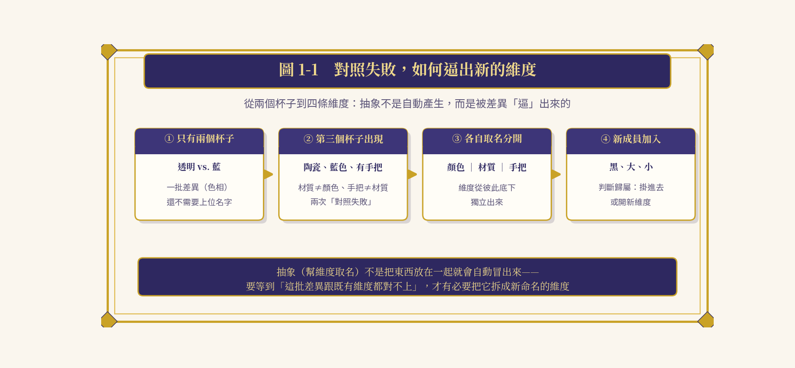
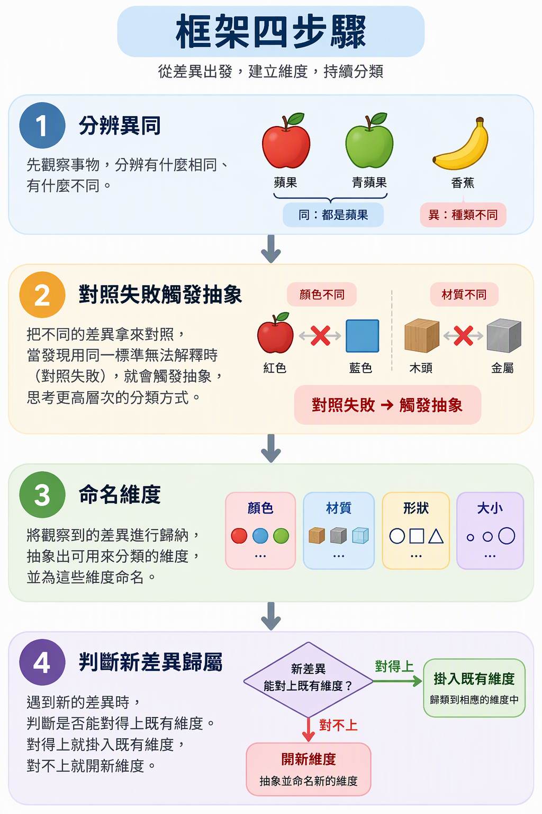
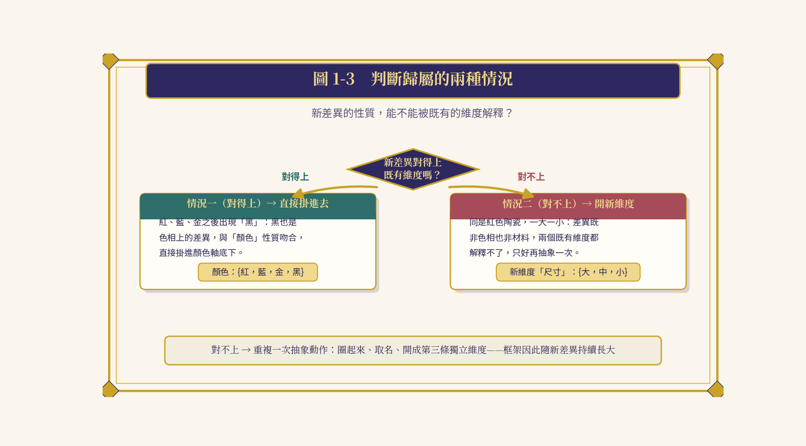
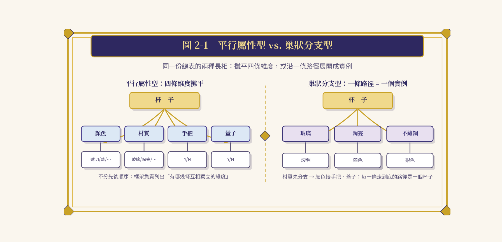
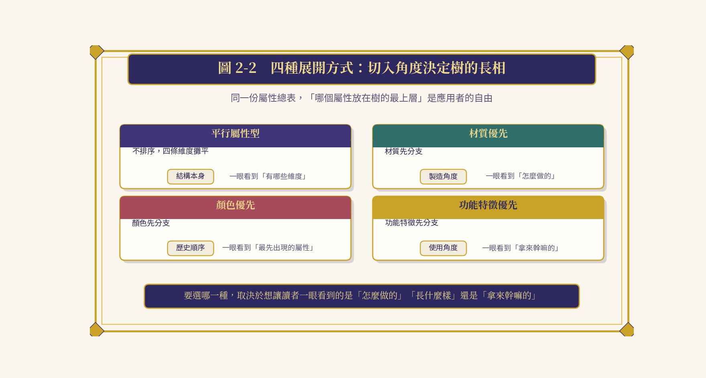
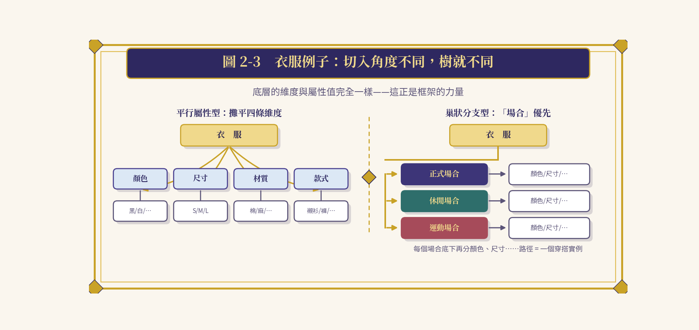
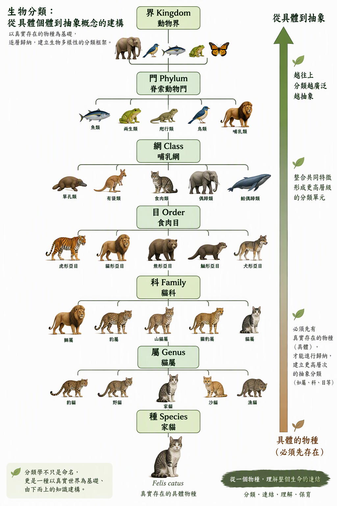
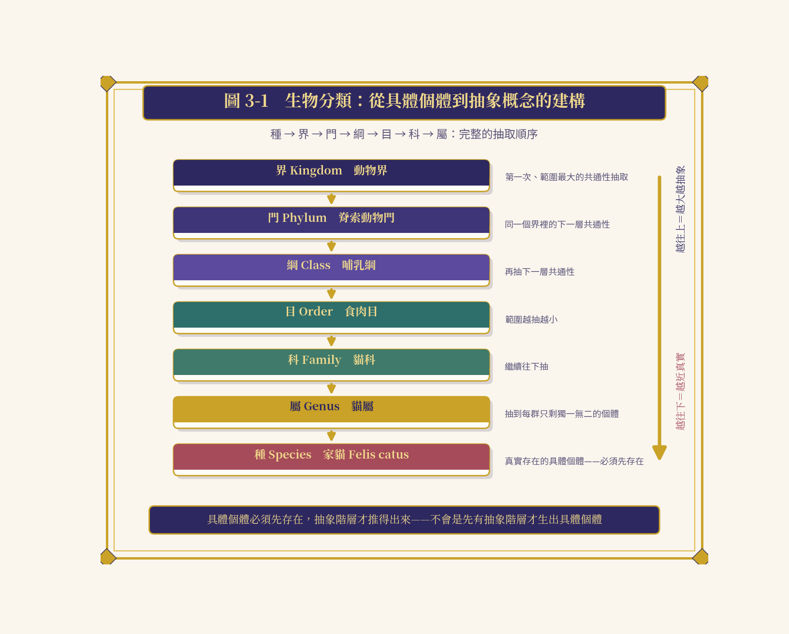
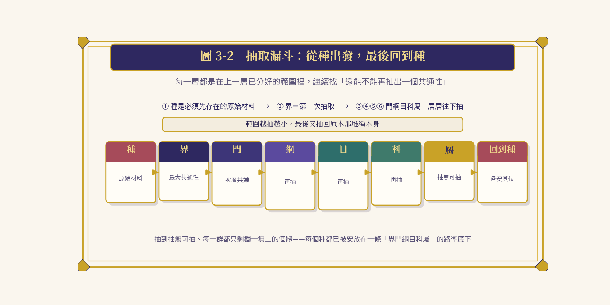
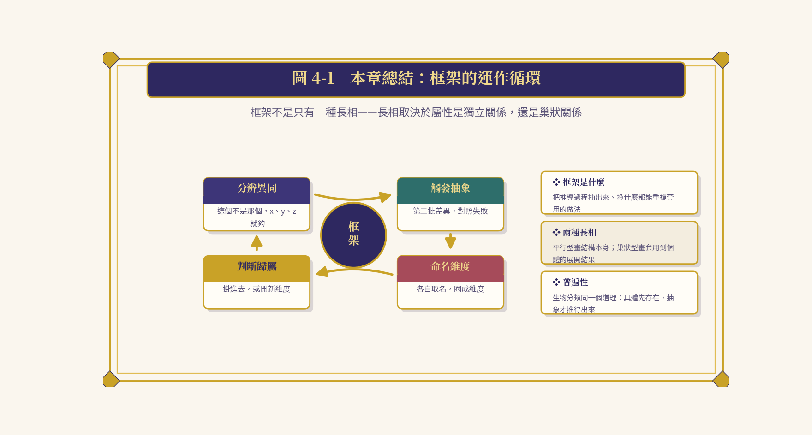

  <a href="https://youtu.be/ek3m6X2idWk">🎞️youtube</a> ｜ 
 <a href="https://v.douyin.com/ETtNqubX3mw">📽️抖音</a> 
 

# 本形學   Ontypology

# 空間本形 Space

❖ ❖ ❖

**S P A C E　F R A M E W O R K**

**空 間 框 架**

*Framework——把推導過程變成可重複套用的做法*

## 目　錄

**❖　導讀——把推導過程變成可重複套用的做法**

**◆　第一章　框架四步驟**

1-1　從「對照失敗」說起

1-2　框架四個步驟

1-3　判斷歸屬的兩種情況

**◆　第二章　框架的多種展開方式**

2-1　平行屬性型與巢狀分支型

2-2　四種展開方式的切入角度

2-3　衣服的例子：同一份總表、不同的樹

**◆　第三章　框架的普遍性：以生物分類為例**

3-1　種是原始材料，具體先於抽象

3-2　抽取漏斗：從種出發，回到種

**❖　本章要點回顧**

## 導讀——把推導過程變成可重複套用的做法

> *章節意象・框架之舵——把推導變成可重複的航線*

框架（Framework）是指事物或系統的基本結構、格式與規範。在不同領域中，它代表提供基礎骨架與標準化流程的工具或概念，能協助人們快速搭建系統、組織資訊或分析問題。

在〈屬性與屬性值〉一章裡，我們用杯子當例子，從「這個不是那個」的最初分辨開始，一路推導出顏色、材質、手把、蓋子四個屬性，最後收斂成一張完整的屬性——屬性值總表。那一次推導回答的是「杯子有哪些屬性」；但推導過程中真正珍貴的產出，其實不是那張總表本身，而是「如何從一堆差異長出維度」的整個過程。

框架要做的事情，正是把這整個推導過程抽出來，變成一套不管換成什麼東西——杯子、衣服、生物，乃至任何一批可分辨的東西——都能重複套用的做法。**框架是框架運作完之後留下的成果**：當四個步驟跑完、維度一條條立起來，留在那裡的那副骨架，就是框架。

換句話說，〈屬性與屬性值〉展示的是一次成功的推導；框架展示的是讓這類推導可以一再重演的方法。前者給你一條魚，後者給你釣魚的航線——這也是「可重複套用」四個字的份量所在。

> **❖　本章地圖**
>
> **◆** 「屬性與屬性值」用杯子推導出顏色、材質、手把、蓋子四個屬性——本章把「這整個推導過程」抽出來，變成任何東西都能套用的做法。
>
> **◆** 差異對不上既有維度時怎麼辦？——「框架四步驟」（第一章）。
>
> **◆** 維度排出來之後，可以怎麼排列？——「多種展開方式」（第二章）。
>
> **◆** 框架只有杯子適用嗎？——「以生物分類為例」（第三章）。

> **框架提供「有哪些維度」的事實本身；怎麼排列這些維度，是應用者的自由**

## 第一章　框架四步驟

> *章節意象・四步之階——從分辨異同到判斷歸屬*

### 1-1　從「對照失敗」說起

回到最初只有透明、藍色兩個杯子的時候，確實能分辨「這個不是那個」，但這只是最原始的「異」，完全不需要幫這批差異取一個上位的名字，因為根本沒有第二種性質的差異可以拿來對照。

當第三個杯子（陶瓷、藍色、有手把）出現，情況改變了：材質從「玻璃」變成「陶瓷」，這批差異跟顏色這個維度性質完全不一樣——顏色是「看起來的色相」，材質是「摸起來／做成的材料」；同一個杯子還多了「手把」，這批差異連材質都解釋不了。這時候才第一次感覺到「這些差異沒辦法用同一套標準去理解」。

正是這種「這批差異跟既有維度都對不上」的**對照失敗**，才把它們各自取名分開放：材質從顏色底下獨立出來，手把又從材質底下獨立出來。抽象（幫維度取名）這個動作，不是把東西放在一起就會自動冒出來，而是要等到出現一批性質不同的差異、對照失敗之後，才有必要、也才有辦法把它拆成一個新命名的維度。

> **圖1-1** 對照失敗，如何逼出新的維度

**對照失敗 → 抽象取名 → 維度獨立 → 判斷歸屬**

### 1-2　框架四個步驟

由此可以歸納出框架運作的四個步驟：

> **壹　第一步・分辨異同**
>
> 拿到一群東西，先能分辨「這個不是那個」就夠了。這時候還不需要抽象，叫 x、y、z 都可以，就像最原始的「有／無」。

> **貳　第二步・觸發抽象**
>
> 出現第二批性質不同的差異時，才觸發抽象的需要。當發現新的差異（如材質）跟舊的差異（如顏色）對不上、無法用同一套標準解釋，才會意識到「這其實是兩種不同的東西在變」。

> **參　第三步・命名維度**
>
> 把兩批差異各自取名，分成不同的維度。這一步就是抽象的動作本身——「顏色」、「材質」這兩個名字，就是把各自一批性質相同的差異圈起來、貼上標籤的結果。

> **肆　第四步・判斷歸屬**
>
> 新東西加入時，要先判斷它跟哪個維度對得上。判斷方式是：這批新差異的性質，能不能被既有的維度解釋？

**表1-1　框架四步驟一覽**

| **步驟** | **觸發時機** | **動作** |
| --- | --- | --- |
| **壹・分辨異同** | 拿到一群東西，能分辨「這個不是那個」 | 先不抽象，叫 x、y、z 都可以（最原始的「有／無」） |
| **貳・觸發抽象** | 出現第二批性質不同的差異 | 發現新差異與舊差異對不上、無法用同一套標準解釋 |
| **參・命名維度** | 兩批差異必須分開理解 | 各自取名、貼上標籤，圈成不同維度 |
| **肆・判斷歸屬** | 新東西加入 | 判斷新差異的性質能否被既有維度解釋 |

> **圖1-2** 框架運作的四個步驟

### 1-3　判斷歸屬的兩種情況

第四步「判斷歸屬」包含兩種情況：

> **情況一（對得上既有維度）→ 直接掛進去**
>
> 例如紅、藍、金之後出現「黑」，黑也是一種色相上的差異，跟「顏色」這個維度性質吻合，所以直接掛進顏色軸底下，變成 {紅，藍，金，黑}，不需要重新抽象。

> **情況二（跟所有既有維度都對不上）→ 開新維度**
>
> 又出現一批新東西，彼此之間確實有差異，但這批差異既不是色相在變，也不是材料在變——例如同樣是紅色的陶瓷，一個大、一個小，顏色跟材質完全一樣，差異卻依然明顯。這批差異拿去對照顏色軸、材質軸都對不上，兩個既有維度都解釋不了，於是又重複一次抽象的動作：把這批性質相同的差異圈起來，取名叫「尺寸」，變成第三條獨立的維度，底下有 {大，中，小} 這些選項。

> **圖1-3** 判斷歸屬的兩種情況

值得留意的是，判斷歸屬並不是框架的收尾，而是框架繼續長大的入口。每當「對不上」發生一次，抽象就再跑一次，維度就再多一條；每當「對得上」發生一次，既有維度就多收一個屬性值。前者擴充框架的骨架，後者擴充骨架上的血肉——框架因此不是寫死的清單，而是一部隨新差異持續生長的機器。

也可以把四個步驟倒過頭來看：第四步的「判斷」之所以可能，是因為前三步已經把維度立好、名字取好；而前三步之所以有必要，是因為第四步遲早會遇到「對不上」的新差異。四個步驟互為因果，構成一個可以反覆運轉的循環——這正是「可重複套用」在機制層面的意義。

> **❖　本章小結**
>
> 抽象不是凝視萬物就自動浮現的天賦，而是被「對照失敗」逼出來的應對。四個步驟——分辨異同、觸發抽象、命名維度、判斷歸屬——就是把這次「被逼出來的過程」固化成可重複運轉的機制。

## 第二章　框架的多種展開方式

> *章節意象・並行與分枝——同一份總表的不同長相*

### 2-1　平行屬性型與巢狀分支型

四個屬性平起平坐掛在杯子底下，不分先後順序，強調的是「框架負責列出有哪幾條互相獨立的維度」。這是框架四步驟跑完之後最直接的產出畫法——平行屬性型。

除此之外，也可以先依材質分支，材質底下再依顏色分支，顏色底下再接手把、蓋子，每一條走到底的路徑就代表一個具體的杯子實例——巢狀分支型；也可以換成顏色先分支，呼應顏色本來就是最先出現的屬性，這種排序反映的是屬性被逼出來的歷史順序。

> **圖2-1** 平行屬性型 vs. 巢狀分支型——兩種屬性結構比較

### 2-2　四種展開方式的切入角度

不同的展開方式畫的其實是同一份總表，差別只在於「哪個屬性放在樹的最上層」：材質優先看的是製造角度，顏色優先呼應屬性被逼出來的歷史順序，功能特徵優先看的是使用角度，平行屬性型則乾脆不排順序、直接把四條維度攤平。

要選哪一種，取決於想讓讀者一眼看到的是「怎麼做的」「長什麼樣」還是「拿來幹嘛的」。

**表2-1　四種展開方式的切入角度**

| **展開方式** | **最上層** | **切入角度** | **一眼看到** |
| --- | --- | --- | --- |
| **平行屬性型** | 不排序，四條維度攤平 | 不排順序，直接並列 | 「有哪些維度」——結構本身 |
| **巢狀型・材質優先** | 材質先分支 | 製造角度 | 「怎麼做的」 |
| **巢狀型・顏色優先** | 顏色先分支 | 屬性被逼出來的歷史順序 | 「最先出現的屬性」 |
| **巢狀型・功能特徵優先** | 功能特徵先分支 | 使用角度 | 「拿來幹嘛的」 |

> **圖2-2** 四種展開方式：切入角度決定樹的長相

### 2-3　衣服的例子：同一份總表、不同的樹

「杯子（框架）」這個抽象容器底下，掛著顏色、材質、手把、蓋子四條屬性維度，每條維度底下再掛著曾經出現過的所有屬性值。框架負責回答「有哪幾條維度」，屬性與屬性值負責回答「每條維度底下實際長什麼樣子」；平行屬性型畫的是這個結構本身，巢狀分支型畫的則是這個結構套用到一個個具體個體上的展開結果。

以衣服為例，平行屬性型會列出「顏色、尺寸、材質、款式」四條維度，不分先後；巢狀分支型若以「場合」優先，則會先分成「正式場合 → 休閒場合 → 運動場合」，每個場合底下再分顏色、尺寸等。同一份屬性總表，切入角度不同，呈現出來的樹狀結構就不同，但底層的維度與屬性值完全一樣。

> **圖2-3** 衣服例子：切入角度不同，樹就不同

把幾種角度並排來看就會發現：維度清單從頭到尾沒有變過，變的只是「誰站在樹的最上層」。這件事透露了框架的一個關鍵特質——框架與排列是兩件事。框架回答的是「有哪幾條維度、它們各自是什麼」；排列回答的是「我想讓讀者先看到什麼」。把兩者混為一談，就會誤以為換一種畫法就換了一個框架，其實換的只是切入角度。

這也解釋了為什麼同一個杯子框架，在工廠的 SOP、賣場的型錄、設計教科書裡會長成三棵完全不同的樹：它們抽取的維度事實相同，只是各自把最在意的那條維度舉到了最上層。

> **❖　本章小結**
>
> 框架提供的是「有哪些維度」這件事實本身，至於怎麼排列這些維度，是應用者可以自由選擇的。平行屬性型畫結構本身，巢狀分支型畫套用到具體個體的展開結果——同一份總表，切入角度不同，樹就不同。

## 第三章　框架的普遍性：以生物分類為例

> *章節意象・生命之階——從具體物種到抽象階層*

### 3-1　種是原始材料，具體先於抽象

框架這件事，不是只有杯子這個例子適用。拿生物分類的界、門、綱、目、科、屬、種來看，一樣的道理：不管哪一套分類系統，都要先有具體的種存在——老虎、獅子、家貓、狼、鮭魚⋯⋯全部都是先被觀察到的具體個體。

**種是最原始的材料**，沒有種，後面什麼都抽不出來。有了種之後，才開始把它們的共通處一層一層往上抽：先抽的是範圍最大的那個共通性，抽出來就是界；界分好之後，在同一個界裡面再找下一層共通性抽出門；門裡面再抽綱；綱裡面再抽目；目裡面再抽科；科裡面再抽屬。

每一層都是在上一層已經分好的範圍裡，繼續找「這個範圍還能不能再抽出一個共通性」，一路抽到抽無可抽、每一群都只剩獨一無二的個體，那就回到最原始的種——只是這時候每個種都已經被安放在一條界門綱目科屬的路徑底下了。

> **圖3-1** 生物分類：從具體個體到抽象概念的建構

**表3-1　界門綱目科屬種——從具體到抽象**

| **階層** | **定位** |
| --- | --- |
| **種** | 最原始的材料，必須先存在的具體個體（老虎、獅子、家貓、狼、鮭魚⋯⋯）；沒有種，後面什麼都抽不出來 |
| **界** | 從種堆裡第一次、也是範圍最大的一次共通性抽取 |
| **門** | 在同一個界裡找到的下一層共通性 |
| **綱・目・科・屬** | 在上一層已分好的範圍裡，一層一層繼續往下抽，範圍越抽越小 |
| **回到種** | 抽到每一群只剩獨一無二的個體，便回到最原始的種——每個種都已安放在一條界門綱目科屬的路徑底下 |

### 3-2　抽取漏斗：從種出發，回到種

所以完整的順序是：種 → 界 → 門 → 綱 → 目 → 科 → 屬。種是必須先存在的原始材料；界是從種堆裡第一次、也是範圍最大的一次共通性抽取；門、綱、目、科、屬則是在界分好的範圍裡，一層一層繼續往下抽，範圍越抽越小，最後又抽回原本那堆種本身。

**具體個體必須先存在，抽象階層才推得出來**，不會是先有抽象階層才生出具體個體。框架不是只有一種長相，長相取決於屬性彼此之間是獨立關係，還是巢狀關係。

> **圖3-2** 抽取漏斗：從種出發，最後回到種

把杯子與生物分類並排對照，可以看得更清楚：杯子的例子規模小、步驟快，四個維度在幾次對照失敗裡就立了起來；生物分類規模龐大，卻跑的是同一部機器——差異對不上就往上抽一層名字，一路抽到屬、抽回種。規模不同，機器相同，這正是框架普遍性的意思：框架不是為杯子量身打造的技巧，而是任何「從差異到維度」的推導都必須經過的同一條路。

更重要的是順序不能倒。先有具體個體，才抽得出抽象階層——這個先後關係在杯子與生物分類上完全一致，也將在後續各篇的應用裡一再出現，值得在此先牢牢記住。

> **❖　本章小結**
>
> 界門綱目科屬種與杯子四屬性是同一個道理：具體個體必須先存在，抽象階層才推得出來。框架的普遍性不在於它只能長一種長相，而在於「從差異到維度」的推導路徑，到處都是同一條。

## 本章要點回顧

> **圖4-1** 本章總結：框架的運作循環

**表4-1　本章要點回顧**

| **要點** | **一句話總結** |
| --- | --- |
| **❖ 框架是什麼** | 把一整個推導過程抽出來，變成不管換成什麼東西都能重複套用的做法；是框架運作完之後留下的成果。 |
| **❖ 四步驟（第一章）** | 分辨異同 → 對照失敗觸發抽象 → 各自取名成維度 → 新差異判斷歸屬；對得上就掛進去，對不上就開新維度。 |
| **❖ 多種展開（第二章）** | 平行屬性型畫結構本身，巢狀分支型畫套用到具體個體的展開結果；同一份總表，切入角度自由選擇。 |
| **❖ 普遍性（第三章）** | 生物分類的界門綱目科屬種同一個道理：具體個體必須先存在，抽象階層才推得出來。 |

---

> **推導一次，是收穫；把推導變成框架，是讓收穫可以重複發生。**
>
> *──《空間本形論》系列・空間框架──*

[www.longreat.net](https://www.longreat.net)

张长丰 [gamma@livemail.tw](mailto:gamma@livemail.tw)

张楟颍 [mindaiworks@gmail.com](mailto:mindaiworks@gmail.com)
