**◆ 　 本形學（Ontypology） ◆**

# 醫 藥 研 發 大 腦

**PharmaMind 與藥物探索的準確方法**

*PharmaMind: An Accurate Method of Ontypology for Pharmaceutical R&D*

—— ◆ —— ◆ —— ◆ ——

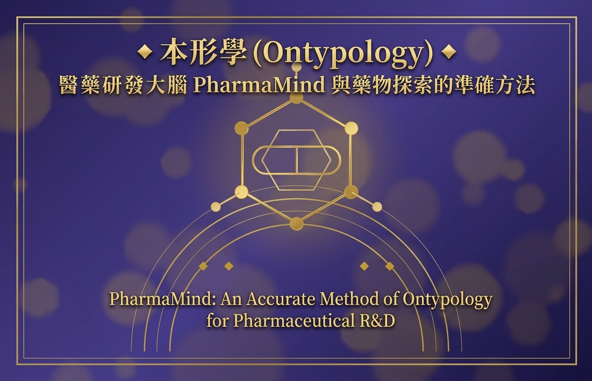

## 摘要

藥物研發長年受困於「雙十定律」：一枚新藥平均耗時逾十年、耗資逾十億美元，而臨床成功率仍不足一成。其深層原因並非實驗技術不足，而是研發全程的判斷缺乏一套語義完整、假設可見、步驟可檢的準確方法——靶點定義模糊、構效關係斷裂、優化決策經驗化，使大量資源消耗在「形」的不確定之上。本文將本形學（Ontypology）應用於藥物探索與發現，提出醫藥研發大腦 PharmaMind 的準確方法。首先，以「異同→分合→形」的認知鏈，將靶點、化合物、活性數據重建為形、容器、屬性與框架的精確對應；其次，給出藥物形與化合物容器的形式化定義，以及容器身份不變、SOM 結構分級、三層判斷充要、形替換不變性四條公理化基礎；再次，提出 LLM 與 Mind Model 雙引擎五層架構與「預測—驗證—修正」閉環迴圈，使每一輪先導優化成為可檢、可修、可累積的形判斷；最後，以先導化合物優化與藥物重定位兩個案例，展示三層形判斷在活性懸崖辨識與重定位檢索中的運用，並以五維準確性評估（語義完整、假設可見、步驟可檢、層次一致、邊界明確）對照純 LLM 與傳統 RDB＋規則方法。結果顯示，形化重建使研發假設顯式化、判斷步驟可回溯，為藥物探索提供一條兼具理論嚴謹與工程可落地的準確路徑。

**關鍵詞：**本形學、Ontypology、藥物探索、PharmaMind、Mind Model、構效關係、形邏輯、準確方法

> **本篇主張**
> 藥物研發失敗的本質，是「形」的定義、結構或判斷不準確。以本形學重建藥物探索的概念體系，可使假設可見、步驟可檢、替換不變——這是 PharmaMind 準確方法的核心。

## 目錄

- 摘　要
- 第一章　緒論：藥物研發的困境與本形學切入
  - 1.1　藥物研發的困境：雙十定律與判斷失準
  - 1.2　本形學與準確方法
  - 1.3　研究問題與貢獻
- 第二章　本形學與 Mind Model 要義
  - 2.1　形的起源：異同、分合與形
  - 2.2　三大加值：容器、SOM 與抽象
  - 2.3　框架四步驟與 RDB 對應
  - 2.4　時間本形與十八主題
- 第三章　藥物探索的本形學建模
  - 3.1　形偵測與形定義
  - 3.2　三方精確對照
  - 3.3　構效關係的屬性矩陣
  - 3.4　先導優化即框架演化
- 第四章　PharmaMind 雙引擎五層架構
  - 4.1　雙引擎分工
  - 4.2　五層架構
  - 4.3　預測—驗證—修正迴圈
- 第五章　形式化與準確性評估
  - 5.1　公理與定理
  - 5.2　五維準確性評估
- 第六章　案例研究
  - 6.1　案例一：先導化合物優化
  - 6.2　案例二：藥物重定位的形檢索
- 第七章　結論與展望
  - 7.1　成果回顧
  - 7.2　局限與展望
- 參考文獻
## 第一章　緒論：藥物研發的困境與本形學切入

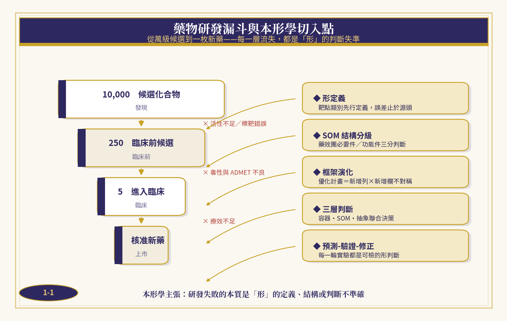

*圖1-1　藥物研發漏斗與本形學切入點*

### 1.1　藥物研發的困境：雙十定律與判斷失準

藥物研發是當代最昂貴、最漫長、失敗率最高的系統工程之一。業界常以「雙十定律」概括其面貌：平均十年以上研發週期、十億美元以上投入，而最終能走完發現、臨床前、臨床三期並獲准上市的候選藥物，往往萬中取一。圖1-1描繪了這條漏斗：上萬個候選化合物經活性篩選只剩數百，進入臨床前評估再折損九成，臨床階段又因療效不足、毒性與藥代動力學問題大量終止，最後僅一枚新藥過關。

值得追問的是：流失究竟發生在哪裡？綜觀各階段的失敗原因——標靶選擇錯誤、活性不足、毒性與 ADMET（吸收、分佈、代謝、排泄、毒性）不良、臨床療效不佳——幾乎都可歸結為同一類問題：研發全程的「判斷」不夠準確。標靶的定義邊界模糊，使先導化合物從一開始就瞄準了錯誤的形；構效關係（SAR）的記錄零散，使優化經驗無法沉澱為可重複的知識；決策依據散落於文獻、實驗記錄與專家直覺之中，假設隱含、步驟難檢。當判斷的語義不完整、邊界不明確，再精密的實驗平台也只是在放大錯誤。

近年大型語言模型（LLM）的進展為研發注入了文獻挖掘與假設生成的新能力，但 LLM 的語言流暢不等於判斷準確：它擅長召回與生成，卻難以保證語義完整、假設可見與步驟可檢，幻覺與不可回溯性使它無法獨自承擔研發決策。這正是本形學（Ontypology）切入的位置。

### 1.2　本形學與準確方法

本形學主張：人類智慧由「形」與「數」共同構成——數學描述數量、關係與規律，形學描述結構、組成、關聯、演化與本質。世界萬物皆可由形來表達與理解：大腦先偵測「異同」，再以「分」與「合」畫出邊界，「形」（Type）才在邊界之上產生。由此出發，本形學建立了一套從認知起點逐層建構的理論：屬性與屬性值描述形的維度，空間容器保證身份的獨立，SOM（空間清單）補上元素間的組成結構，抽象以交集判準開放生成新成員，框架則把整套推導抽象成可重複套用的方法。

本篇所稱「準確方法」，指五個可操作的維度：語義完整（判斷對象的形定義完備）、假設可見（每一步的前提顯式列出）、步驟可檢（判斷過程可回溯驗證）、層次一致（容器、結構、抽象三層不互相矛盾）、邊界明確（類別的成立與排除條件清楚）。這五維既是方法的設計準則，也是第五章的評估量尺。

### 1.3　研究問題與貢獻

本研究圍繞三個問題展開：藥物探索的概念如何精確映射到本形學的形、容器、結構與框架？以形判斷為核心的準確方法如何提升研發決策的可檢性？LLM 與 Mind Model 的雙引擎架構如何在藥物探索場景落地？表1-1彙整研究問題與本文貢獻的對應。

**表1-1　研究問題與貢獻對照**

| **研究問題** | **內容** | **對應章節** | **本文貢獻** |
| --- | --- | --- | --- |
| RQ1 | 藥物探索概念的形化映射 | 第三章 | 藥物探索↔本形學↔資料庫三方精確對照表 |
| RQ2 | 形判斷提升決策準確性 | 第五章 | 四條公理化基礎＋五維準確性評估量尺 |
| RQ3 | 雙引擎架構落地藥物探索 | 第四、六章 | PharmaMind 五層架構＋兩個示範案例 |

全文結構如下：第二章回顧本形學與 Mind Model 的核心理論；第三章完成藥物探索的形化建模；第四章提出 PharmaMind 雙引擎五層架構與預測—驗證—修正迴圈；第五章給出公理與定理的形式化基礎，並以五維量尺評估準確性；第六章以兩個案例展示方法的運用；第七章總結並展望後續方向。

## 第二章　本形學與 Mind Model 要義

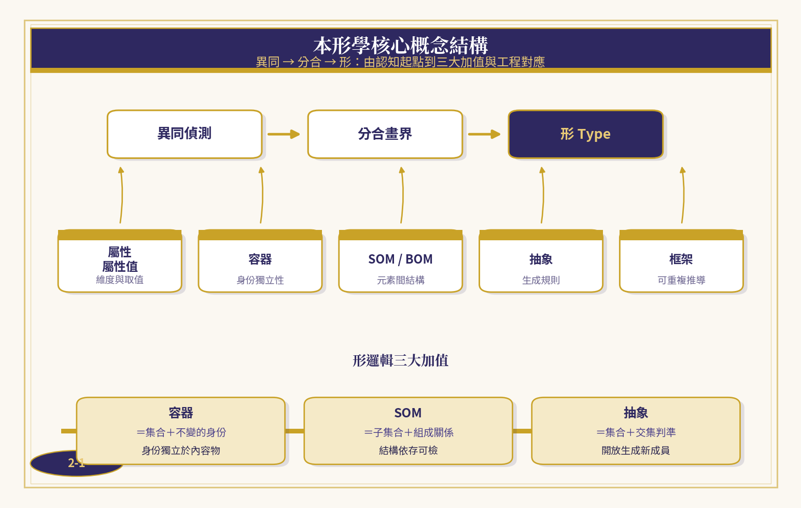

*圖2-1　本形學核心概念結構*

### 2.1　形的起源：異同、分合與形

形並非天生存在。認知的第一步是偵測「異同」：大腦注意到「這個不是那個」；繼而以「分」與「合」的動作畫出邊界——把相同者合攏、相異者分開；邊界成立的那一刻，「形」才產生。名詞是後來才被貼上的標籤，先有邊界、後有名字。這條認知鏈決定了本形學的整體走向：任何領域的知識重建，都必須回到異同的分辨與分合的畫界，而不從既有的名詞表出發。

> **定義 2-1（形 Type）**
> 形是大腦對一群物件偵測異同、經分合畫界後產生的類別，由一組屬性維度與其值域完整描述；物件 x 屬於形 T，記作 x ∈ T，其判準由 T 的交集判準給出。

### 2.2　三大加值：容器、SOM 與抽象

數學集合強大而精簡，卻缺少三樣東西：身份、結構與生成規則。本形學以三大加值補足之。其一是空間容器——一個有邊界、有內部空間、身份獨立於內容物的整體；杯子換裝咖啡仍是同一個杯子，這種「身份不隨內容物改變」的性質，是資料世界主鍵與實體同一性的認知根源。其二是 SOM——在物料清單 BOM 之上補上元素之間的組成結構；拿掉杯底杯子不成杯子，拿掉貼紙卻無傷大雅，部件對整體同一性的貢獻可以精確分級。其三是抽象——以特徵交集判準把封閉清單變成開放規則，使新成員的歸屬由判準動態生成，而非手動列舉。

> **定義 2-2（容器）、2-3（SOM）、2-4（抽象）**
> 容器　C =（id(C), S(C)）：id(C) 為不隨內部空間 S(C) 元素變動而改變的身份識別；S(C) 內容可替換、可清空。
> SOM　M =（P(M), R(M), G(M))：部件集合 P(M)、組成關係 R(M) ⊆ P(M) × P(M)、配置 G(M)；同一性取決於部件在 R(M) 中的角色。
> 抽象　T =（F(T), ∩(T)）：特徵集合 F(T) 與交集判準 ∩(T)；x ∈ T 若且唯若對一切 f ∈ F(T) 皆有 f(x) 成立，成員由判準開放生成。

**表2-1　本形學核心術語與藥物探索對應**

| **術語** | **定義要旨** | **藥物探索對應** |
| --- | --- | --- |
| 形 Type | 異同→分合→畫界所得的類別 | 靶點類別、藥物系列 |
| 屬性・屬性值 | 形的維度與取值 | 分子描述符、活性值 |
| 容器 Container | 身份獨立於內容物 | API、鹽型、晶型、製劑 |
| BOM / SOM | 組成清單／元素間結構 | 官能基清單／藥效團結構 |
| 抽象 Abstraction | 交集判準開放生成 | 類藥性規則、篩選判準 |
| 框架 Framework | 可重複套用的推導方法 | SAR 框架、優化計畫 |

### 2.3　框架四步驟與 RDB 對應

框架（Framework）把「描述一個物件」這件事本身抽象化，其運作有四個步驟：先分辨「這個不是那個」；當出現性質不同的第二批差異、對照失敗時，觸發抽象的需要；把各批差異分維度命名；新物件加入時先判斷它跟哪個維度對得上。框架的力量在於「列出有哪幾條互相獨立的維度」，至於維度如何排列，是應用者可自由選擇的切入角度——平行屬性型、巢狀分支型皆可，底層的維度與值域完全相同。

這套術語與關聯式資料庫（RDB）幾乎可以逐條翻譯：表頭是形，資料列是實體，主鍵是每一列被獨立指認的身份，外鍵參考是形與形之間的主從連接；「新增列」擴充同形的實體清單，「新增欄」則是框架本身的演化——引入一條新的判斷維度。這種不對稱性在藥物優化中對應著兩種本質不同的操作：合成更多類似物（新增列），與引入新的評估維度如選擇性、hERG 毒性（新增欄）。

### 2.4　時間本形與十八主題

空間本形回答「是什麼樣子、在哪裡、由什麼組成」，時間本形則回答「如何生成、如何演化」。時間形以 (I, E, κ) 三元描述——區間（Interval）、事件（Event）與因果連結（κ）——並把方法論的十八個主題聚成四個模組。藥物研發恰是時間性的工程：試驗有時序、優化有回合、因果與果因推理交織於機理與逆向解釋之間。表2-2列出十八主題的四模組結構及其藥物探索意義。

**表2-2　時間本形十八主題聚四模組**

| **模組** | **十八主題** | **藥物探索意義** |
| --- | --- | --- |
| 結構模組 | 分合、抽象、框架、重構 | 形定義、SAR 重構與系列設計 |
| 生成模組 | 設計模式、邏輯生成、標記、思考、思考法 | 分子設計模式與合成路徑規劃 |
| 應用模組 | 邏輯應用、解題、分析、設計、推理、因果推理、果因推理 | 機理闡釋、資料判讀與逆向解釋 |
| 演化模組 | 記憶管理、持續學習 | 形庫累積與閉環自我修正 |

## 第三章　藥物探索的本形學建模

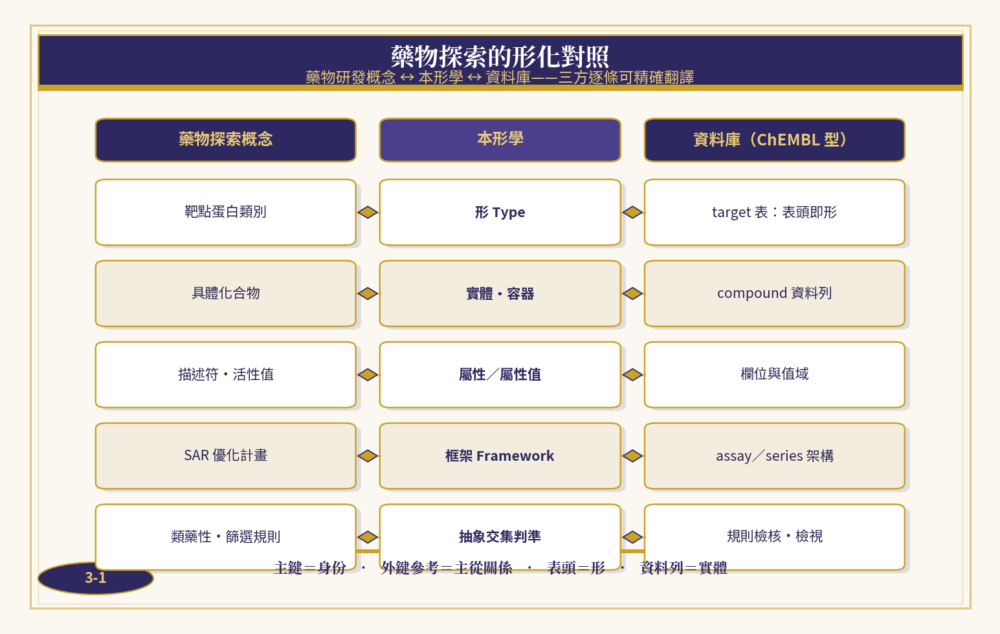

*圖3-1　藥物探索的形化對照*

### 3.1　形偵測與形定義

藥物探索的第一個動作是形偵測：從一批化合物與靶點資料中分辨「這個不是那個」——哪些分子屬於同一活性系列，哪些靶點屬於同一蛋白家族。形偵測不依賴預先的命名，而是回到異同的分辨：先有活性譜的差異感受，再有系列的分合畫界，最後才把這個系列命名為某類藥物形。

在形偵測的基礎上，形定義把類別的邊界寫成顯式的判準。本文以藥物形與化合物容器兩個形式定義承載這一重建：

> **定義 3-1（藥物形 Drug Type）**
> 藥物形 DT =（τ, F, ∩(DT)）：τ 為靶點類別（形的上位歸屬），F 為描述符與活性屬性的維度集合，∩(DT) 為入選交集判準（如 IC50 閾值、選擇性門檻、類藥性規則）。化合物 x 屬於 DT，若且唯若 x 通過 ∩(DT) 的全部特徵檢驗。

> **定義 3-2（化合物容器 Compound Container）**
> 化合物容器 CC =（id(CC), S(CC)）：id(CC) 為由母核骨架決定的身份識別（登錄號、結構標準化識別）；S(CC) 為可替換內容物集合——鹽型、晶型、溶劑化物、處方組成。內容物替換不改變 id(CC)。

這兩個定義把藥物探索的日常語句翻譯成形的語言：「同一個藥換了鹽型」＝內容物替換而容器身份不變；「這個化合物不屬於本系列」＝未通過交集判準；「活性懸崖」＝SOM 結構的微小變異引發判斷跳變。語句一旦形化，就從經驗描述變成可檢驗的判斷。

### 3.2　三方精確對照

本形學的價值在於跨域翻譯的精確性。表3-1把藥物探索概念、本形學術語與資料庫結構三方逐條對照：靶點蛋白類別是形，對應 target 表的表頭；具體化合物是實體，對應 compound 表的資料列；描述符與活性是屬性與屬性值，對應欄位與值域；SAR 優化計畫是框架，對應 assay 與 series 的架構；類藥性與篩選規則是抽象的交集判準，對應規則檢核與檢視。主鍵即身份、外鍵參考即主從關係——資料工程與認知理論在此合流。

**表3-1　藥物探索↔本形學↔資料庫三方精確對照**

| **藥物探索概念** | **本形學** | **資料庫（ChEMBL 型）** |
| --- | --- | --- |
| 靶點蛋白類別 | 形 Type | target 表：表頭即形 |
| 具體化合物 | 實體・容器 | compound 資料列 |
| 描述符・活性值 | 屬性／屬性值 | 欄位與值域 |
| SAR 優化計畫 | 框架 Framework | assay／series 架構 |
| 類藥性・篩選規則 | 抽象交集判準 | 規則檢核・檢視 |

### 3.3　構效關係的屬性矩陣

構效關係（SAR）記錄的是「結構的每一條維度如何影響活性」，其本形學形式就是屬性值矩陣：列是化合物實體，欄是結構維度與測量屬性，格中填入屬性值。表3-2給出一個示意系列；圖3-2把矩陣與活性走勢並置，凸顯本方法最關心的現象——活性懸崖。

**表3-2　SAR 屬性值矩陣（含活性懸崖對）**

| **化合物** | **R¹** | **R²** | **logP** | **IC50 (nM)** |
| --- | --- | --- | --- | --- |
| A-01 | H | Me | 2.1 | 480 |
| A-02 | F | Me | 2.3 | 120 |
| A-03 | F | Et | 2.8 | 38 |
| A-04 | F | n-Pr | 3.4 | 1,210 |
| A-05 | Cl | Et | 3.1 | 52 |

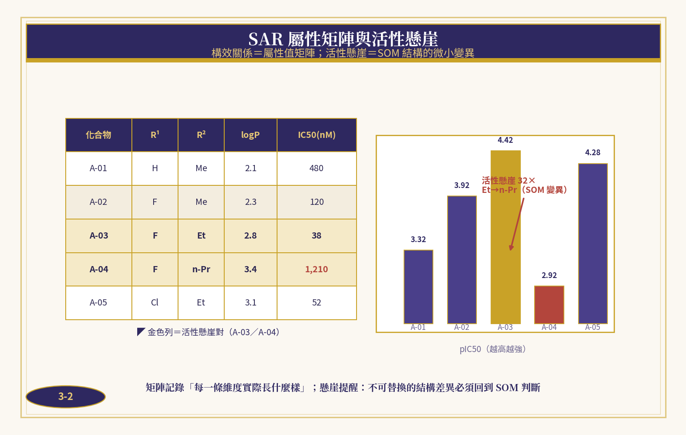

*圖3-2　SAR 屬性矩陣與活性懸崖*

A-03 與 A-04 僅在 R² 側鏈相差一個碳（Et→n-Pr），活性卻跳變 32 倍——這不是測量噪音，而是 SOM 結構層的信號：側鏈長度越過了結合口袋的邊界，藥效團的組成關係被破壞。數值方法只看到 38 與 1,210 兩個數字的差距，形判斷則能指出「哪一條結構維度的變異觸發了跳變」，並把這個判斷沉澱為框架的新維度。

### 3.4　先導優化即框架演化

先導優化的每一輪，都是框架的一次演化。合成新的類似物是「新增列」——同形實體清單的擴充，可逆且平緩；引入新的評估維度（選擇性、hERG、代謝穩定性）則是「新增欄」——框架本身的變動，會改變判斷的全貌。成熟的方法必須把兩者分開管理：新增列決定「我們看得多廣」，新增欄決定「我們看得多深」。

多框架展開則對應研發的多視角需求：同一份屬性總表，以療效優先的切入角度展開，得到適應症導向的優化樹；以成藥性優先展開，得到 ADMET 導向的優化樹；以合成可及性展開，得到路徑導向的優化樹。底層的維度與值域完全相同，展開方式不同——這正是框架「維度事實與排列自由分離」性質的直接運用。時間本形在此引入試驗時序與回合結構（I, E, κ），使「第幾輪做了什麼、為何做」成為可回溯的時間形記錄。

## 第四章　PharmaMind 雙引擎五層架構

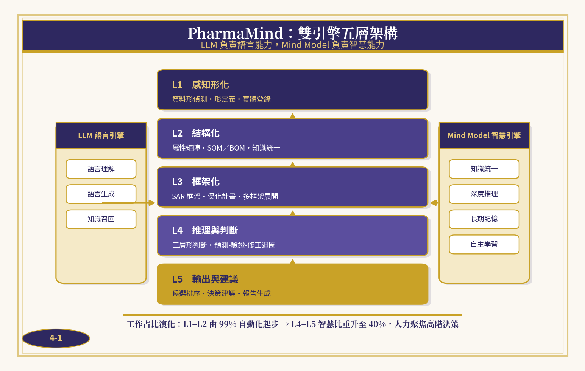

*圖4-1　PharmaMind：雙引擎五層架構*

### 4.1　雙引擎分工

PharmaMind 是本形學在醫藥研發的實踐架構，採 LLM 與 Mind Model 雙引擎設計。LLM 語言引擎負責語言能力：文獻理解、報告生成、知識召回；Mind Model 智慧引擎負責智慧能力：知識統一、深度推理、長期記憶、自主學習。兩者分工的準繩是本形學的判斷觀：語言可以模糊，判斷必須精確——凡涉及形定義、結構歸屬與三層判斷的工作，一律由 Mind Model 承擔並留下可檢的判斷軌跡，LLM 僅在語言層提供潤飾與召回支援。

### 4.2　五層架構

架構自底向上分五層。L1 感知形化層執行形偵測與形定義，把文獻、資料庫與實驗記錄中的原始資料登錄為形與實體；L2 結構化層建立屬性矩陣、BOM／SOM 並完成知識統一；L3 框架化層產出 SAR 框架、優化計畫與多框架展開；L4 推理與判斷層執行三層形判斷與預測—驗證—修正迴圈；L5 輸出與建議層生成候選排序、決策建議與報告。圖4-1示其全貌。

**表4-1　五層架構職掌與工作占比演化**

| **層** | **職掌** | **輸入** | **輸出** | **初期占比** | **成熟占比** |
| --- | --- | --- | --- | --- | --- |
| L1 感知形化 | 形偵測、形定義、實體登錄 | 文獻・資料庫・實驗記錄 | 形定義檔 | 45% | 10% |
| L2 結構化 | 屬性矩陣、SOM／BOM、知識統一 | 形定義檔 | 結構化知識 | 30% | 15% |
| L3 框架化 | SAR 框架、優化計畫、多框架展開 | 結構化知識 | 框架與計畫 | 15% | 15% |
| L4 推理與判斷 | 三層形判斷、預測-驗證-修正 | 框架與計畫 | 判斷與建議 | 8% | 35% |
| L5 輸出與建議 | 候選排序、決策建議、報告生成 | 判斷與建議 | 決策報告 | 2% | 25% |

工作占比的演化是架構的動態特徵：專案初期，九成以上的工作落在 L1–L2 的感知與結構化勞務；隨著形庫與框架成熟，L4–L5 的智慧判斷比重升至四成以上，人力得以聚焦高階決策。換言之，自動化不是取代科學家，而是把科學家從形的整理工作中解放出來，回到形的創造與判斷。

### 4.3　預測—驗證—修正迴圈

PharmaMind 的運作核心是「預測—驗證—修正」閉環迴圈（圖4-2）：設計階段由 Mind Model 依框架給出可檢的預測，合成與測試階段取得實驗證據，驗證比對預測與證據的落差，修正階段把落差回寫為形定義與框架的更新。對應的六步驟方法是——形偵測、形定義、結構化、框架化、形式化、驗證修正——每一步的產出都是下一步的輸入，且全程留有判斷軌跡。

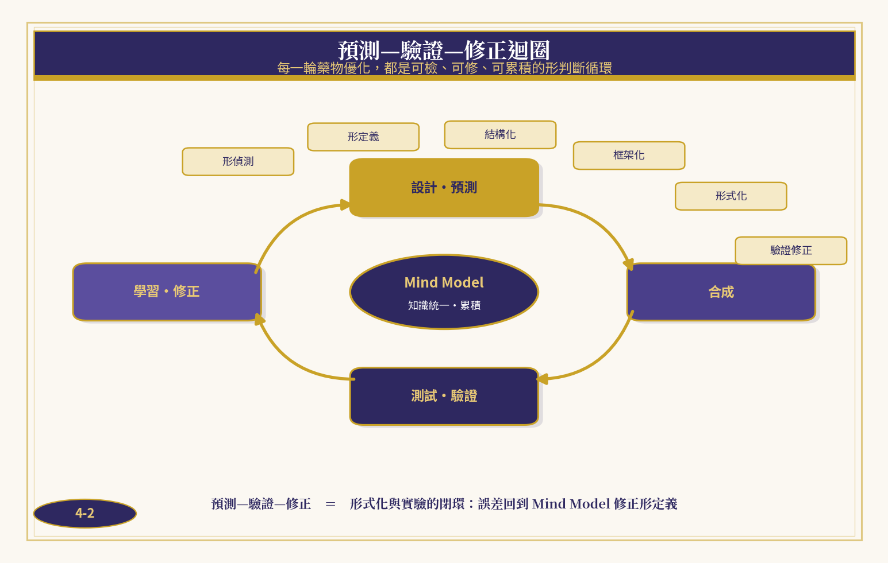

*圖4-2　預測—驗證—修正迴圈*

> **六步驟準確方法**
> 形偵測（分辨異同）→ 形定義（顯式判準）→ 結構化（屬性矩陣與 SOM）→ 框架化（維度與計畫）→ 形式化（公理與定理承載）→ 驗證修正（證據回寫）。每一輪迴圈都使形庫更完整、判斷更準確。

## 第五章　形式化與準確性評估

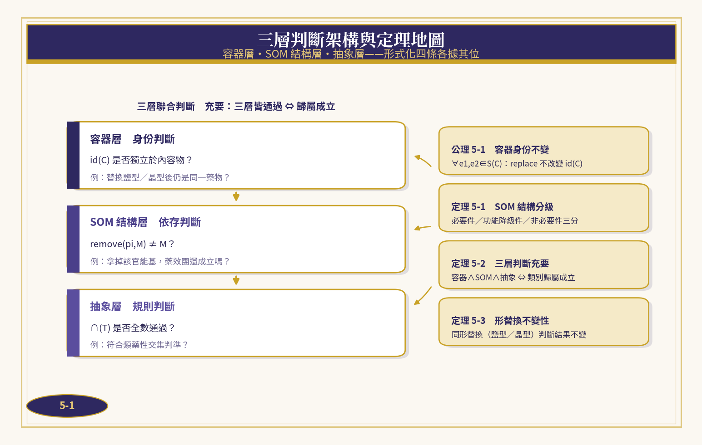

*圖5-1　三層判斷架構與定理地圖*

### 5.1　公理與定理

準確方法必須能被形式地陳述與檢驗。本節給出四條公理化基礎，它們分別服務於三層判斷的不同層級（圖5-1、表5-1）。

> **公理 5-1（容器身份不變）**
> 對任意化合物容器 C 與其內容物 e1、e2 ∈ S(C)：replace(C, e1, e2) 不改變 id(C)。鹽型、晶型、處方的替換不動搖藥物身份。

> **定理 5-1（SOM 結構分級）**
> 對藥效團 M 的任一部件 p：p 為必要件，若且唯若 remove(p, M) ≢ M。依移除後的同一性損失，部件精確分為必要件（安全關鍵）、功能降級件（可選功能）與非必要件（修飾消耗）三級。

> **證明（構造性）**
> 由定義 2-3，同一性取決於部件在組成關係 R(M) 中的角色。對每個 p ∈ P(M) 執行移除檢查：若 remove(p, M) ≢ M，則 p 支撐 R(M) 的關鍵連接，判為必要件；若移除後整體存續而功能受損，p 為功能降級件；若移除後一切判斷不變，p 為非必要件。三分互斥且窮盡，判斷終止於有限步。證畢。

> **定理 5-2（三層判斷充要）**
> 物件 x 屬於藥物形 DT，若且唯若三層判斷同時成立：容器層——x 的身份獨立且登錄一致；SOM 結構層——x 的藥效團必要件齊備；抽象層——x 通過 ∩(DT) 全部特徵檢驗。

> **證明（充分必要）**
> 必要性：若 x ∈ DT，由定義 3-1 它通過 ∩(DT)；由公理 5-1 其身份判斷一致；由定理 5-1 其必要件齊備，否則移除必要件將使 x 失去形的同一而與 x ∈ DT 矛盾。充分性：三層皆成立時，身份保證判斷對象正確，必要件保證結構完整，交集判準保證歸屬成立，故 x ∈ DT。三層缺一，判斷即不完整。證畢。

> **定理 5-3（形替換不變性）**
> 設 x 與 x′ 同形（x′ 為 x 的鹽型／晶型替換且 x′ 通過 ∩(DT)），則對任一三層判斷 J：J(x) = J(x′)。同形替換不改變判斷結果。

> **證明**
> 由公理 5-1，replace 不改變 id，容器層判斷相同；替換發生於內容物 S(CC)，不觸及藥效團 P(M) 與關係 R(M)，SOM 層判斷相同；x′ 通過 ∩(DT)，抽象層判斷相同。三層皆同，故 J(x) = J(x′)。證畢。

**表5-1　公理與定理一覽**

| **編號** | **名稱** | **陳述要旨** | **服務層** |
| --- | --- | --- | --- |
| 公理 5-1 | 容器身份不變 | 內容物替換不改變 id(C) | 容器層 |
| 定理 5-1 | SOM 結構分級 | 必要件/功能件/非必要件三分 | SOM 層 |
| 定理 5-2 | 三層判斷充要 | 三層皆成立 ⇔ 歸屬成立 | 聯合判斷 |
| 定理 5-3 | 形替換不變性 | 同形替換判斷結果不變 | 容器層→全域 |

### 5.2　五維準確性評估

為量化「準確」，本文沿用五維量尺：語義完整、假設可見、步驟可檢、層次一致、邊界明確，每維 1–5 分。表5-2與圖5-2對照三種方法：純 LLM 生成、傳統 RDB＋規則、PharmaMind 形判斷。

**表5-2　五維準確性評分對照**

| **維度** | **定義** | **純 LLM** | **RDB＋規則** | **PharmaMind** |
| --- | --- | --- | --- | --- |
| 語義完整 | 判斷對象的形定義完備 | 2.5 | 3.5 | 4.5 |
| 假設可見 | 前提與假設顯式列出 | 1.5 | 3.5 | 4.5 |
| 步驟可檢 | 判斷過程可回溯驗證 | 1.5 | 4.0 | 4.5 |
| 層次一致 | 容器・SOM・抽象三層不矛盾 | 2.0 | 3.0 | 4.5 |
| 邊界明確 | 成立與排除條件清楚 | 1.5 | 3.0 | 4.0 |
| 總分 | 滿分 25 | 9.0 | 17.0 | 22.0 |

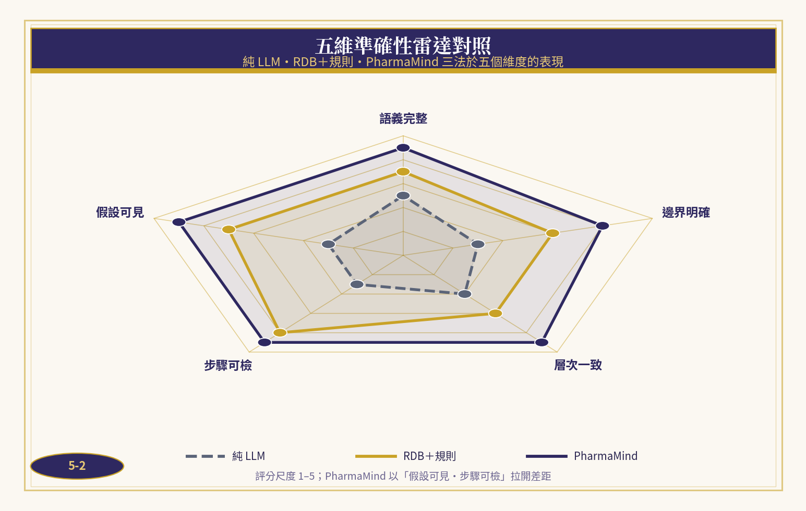

*圖5-2　五維準確性雷達對照*

純 LLM 在語義流暢上表現良好，但假設隱含、步驟不可回溯，總分最低；RDB＋規則在步驟可檢上可靠，卻缺乏層次一致的聯合判斷能力；PharmaMind 以形式化公理承載判斷，在五個維度上全面領先，其弱項「邊界明確」（4.0）則源自交集判準的特徵完備度仍依賴領域專家的迭代——這是方法誠實的自我揭示，也是下一步的方向。

## 第六章　案例研究

本章以兩個示範案例演示準確方法的運用。案例資料為展示方法而構造（synthetic），重點在判斷過程的可檢性而非具體數值；真實專案中，同樣的判斷鏈可直接套用於實驗資料。

### 6.1　案例一：先導化合物優化

任務：針對某激酶靶點，把先導化合物 A-01 的活性從 480 nM 優化至 50 nM 以內，同時控制 hERG 毒性風險。表6-1記錄四輪優化，圖6-1示框架演化路徑。

**表6-1　案例一優化回合紀錄**

| **回合** | **操作** | **框架意義** | **IC50 (nM)** | **hERG 抑制** |
| --- | --- | --- | --- | --- |
| R1 | 起點 A-01，確認母核 | 形定義・登錄容器 | 480 | — |
| R2 | F 取代類似物掃描 | 新增列：同形擴充 | 120 | — |
| R3 | 引入 hERG 維度 | 新增欄：框架演化 | 38 | 62% |
| R4 | 側鏈微調收斂 A-07 | 交集判準全過 | 22 | 18% |

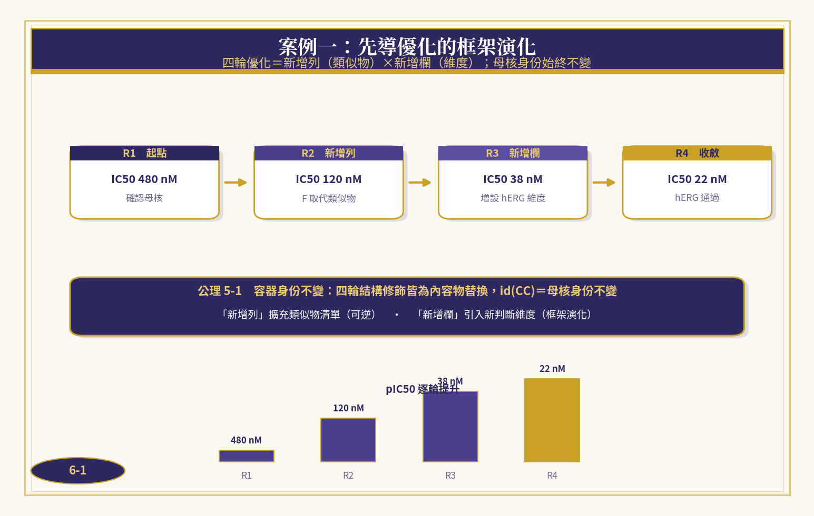

*圖6-1　案例一：先導優化的框架演化*

判斷鏈的運作如下。容器層：R1–R4 的全部化合物登錄於同一母核身份 id(CC) 下，依公理 5-1，側鏈修飾皆為內容物替換，四輪判斷對象始終是「同一個」系列。SOM 層：對 R3 前的命中物執行定理 5-1 分級，確認藥效團氫鍵供體為必要件、疏水口袋佔據基團為功能降級件——hERG 風險正來自功能降級件的過度延伸，故 R4 以縮短側鏈回收選擇性。抽象層：R4 產物通過 IC50、選擇性、hERG、類藥性四重交集判準，歸屬成立。全程假設顯式（每輪列出修改的維度）、步驟可檢（每輪留下矩陣行）、替換不變（鹽型篩選依定理 5-3 無需重判）。

### 6.2　案例二：藥物重定位的形檢索

任務：為同一激酶靶點在既有藥物庫中尋找可重定位的候選。傳統做法以結構相似度檢索，容易落入「相似而不相同」的活性懸崖；PharmaMind 改以「形」檢索——以屬性簽名（靶點類別、活性、選擇性、類藥性）建構交集判準，對藥物庫的形索引做歸屬判斷（圖6-2）。

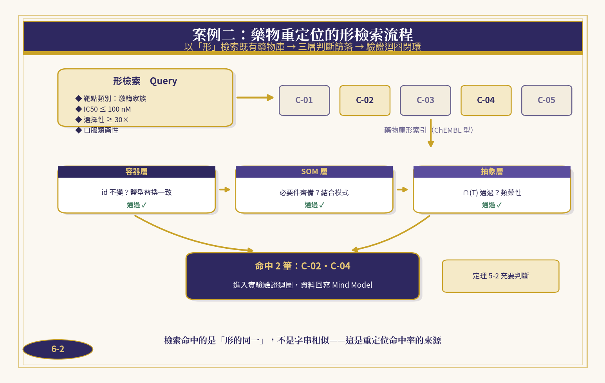

*圖6-2　案例二：藥物重定位的形檢索流程*

**表6-2　案例二候選評分與三層判斷**

| **候選** | **IC50 (nM)** | **選擇性** | **類藥性** | **三層判斷落點** | **結論** |
| --- | --- | --- | --- | --- | --- |
| C-01 | 8 | 12× | 通過 | SOM 層未過：必要件缺 | 淘汰 |
| C-02 | 22 | 45× | 通過 | 三層全過 | 命中 |
| C-03 | 65 | 8× | 未通過 | 抽象層未過 | 淘汰 |
| C-04 | 34 | 60× | 通過 | 三層全過 | 命中 |
| C-05 | 15 | 25× | 通過 | 容器層未過：鹽型不穩 | 淘汰 |

五個候選中，C-01 活性最強卻在 SOM 層落馬——其結構缺少必要件，活性屬「相似而不相同」的假命中；C-03 在抽象層被類藥性判準排除；C-05 則因鹽型不穩定、容器身份不連續而未過容器層。最終命中 C-02、C-04 兩筆，皆進入實驗驗證迴圈。值得注意的是判斷的「落點可說」：每個淘汰都精確指向三層中的某一步，而非一個籠統的分數——這正是定理 5-2 充要性的工程價值。

## 第七章　結論與展望

### 7.1　成果回顧

本文完成了一件基礎工作：把藥物探索與發現的判斷，從經驗語句重建為可檢的形判斷。具體成果有四：其一，完成藥物探索↔本形學↔資料庫的三方精確對照，使跨域翻譯逐條可驗；其二，給出藥物形與化合物容器的形式定義，以及容器身份不變、SOM 結構分級、三層判斷充要、形替換不變性四條公理化基礎；其三，提出 PharmaMind 雙引擎五層架構與預測—驗證—修正閉環，使六步驟方法成為可落地的工程流程；其四，以兩個案例演示三層形判斷的運用，並以五維量尺顯示形化方法在準確性上的全面優勢。

### 7.2　局限與展望

本研究的局限同樣清楚：案例為展示方法而構造，尚待真實研發資料的前瞻性驗證；交集判準的特徵完備度依賴領域專家的迭代，「邊界明確」維度仍有提升空間；方法目前聚焦藥物探索與發現，臨床前、臨床與法規階段的形化尚未展開。

展望有三。其一，把時間本形引入試驗設計與臨床時序，以 (I, E, κ) 記錄因果與果因推理，使「第幾輪為何失敗」同樣可檢；其二，沿著 AGI 永恆之道的三階段——知識統一、思維統一、智慧統一——把 PharmaMind 的形庫演化為跨機構共享的醫藥知識統一模型；其三，把準確方法推向製劑、臨床與真實世界證據，讓「形的判斷」貫穿新藥的一生。當判斷足夠準確，漏斗的每一層流失才真正成為可學習的信號，而非不可知的代價。

> **結語**
> 數學描述數量與規律，形學描述結構與本質。藥物研發的下一個突破，不只在更強的篩選平台，更在更準的判斷方法——這是 PharmaMind 的信念，也是本形學交給醫藥研發的答案。

## 參考文獻

[1]　Paul SM, Mytelka DS, Dunwiddie CT, et al. How to improve R&D productivity: the pharmaceutical industry's grand challenge. Nat Rev Drug Discov. 2010;9(3):203–214.

[2]　Scannell JW, Blanckley A, Boldon H, Warrington B. Diagnosing the decline in pharmaceutical R&D efficiency. Nat Rev Drug Discov. 2012;11(3):191–200.

[3]　Wong CH, Siah KW, Lo AW. Estimation of clinical trial success rates and related parameters. Biostatistics. 2019;20(2):273–286.

[4]　Gaulton A, Hersey A, Nowotka M, et al. The ChEMBL database in 2017. Nucleic Acids Res. 2017;45(D1):D945–D954.

[5]　Kim S, Chen J, Cheng T, et al. PubChem 2019 update: improved access to chemical data. Nucleic Acids Res. 2019;47(D1):D1102–D1109.

[6]　Lipinski CA, Lombardo F, Dominy BW, Feeney PJ. Experimental and computational approaches to estimate solubility and permeability in drug discovery. Adv Drug Deliv Rev. 1997;23(1–3):3–25.

[7]　Schneider G. Automating drug discovery. Nat Rev Drug Discov. 2018;17(2):97–113.

[8]　Vamathevan J, Clark D, Czodrowski P, et al. Applications of machine learning in drug discovery and development. Nat Rev Drug Discov. 2019;18(6):463–477.

[9]　Stokes JM, Yang K, Swanson K, et al. A deep learning approach to antibiotic discovery. Cell. 2020;180(4):688–702.

[10]　Jumper J, Evans R, Pritzel A, et al. Highly accurate protein structure prediction with AlphaFold. Nature. 2021;596(7873):583–589.

[11]　Allen JF. Maintaining knowledge about temporal intervals. Commun ACM. 1983;26(11):832–843.

[12]　Maggiora GM. On outliers and activity cliffs—why QSAR often disappoints. J Chem Inf Model. 2006;46(4):1549.

[13]　Reker D, Schneider G. Active-learning strategies in computer-assisted drug discovery. Drug Discov Today. 2015;20(4):458–465.

[www.longreat.net](www.longreat.net)

张长丰[gamma@livemail.tw](mailto:gamma@livemail.tw)

张楟颍[mindaiworks@gmail.com](mailto:mindaiworks@gmail.com)

