# 依值型別論Dependent type與形式化驗證 Lean

**本形學 Ontypology**

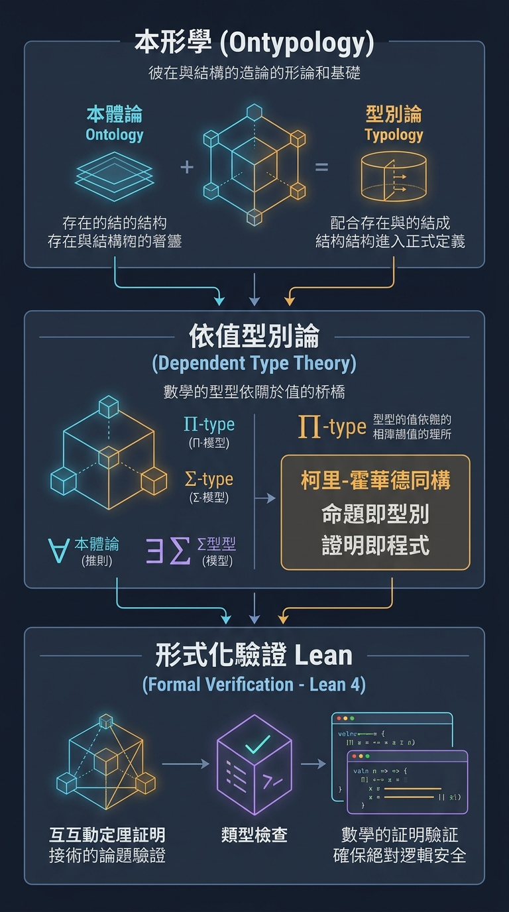

# 目　錄

- 寫在前面
- 導讀
  - 導-1　兩種語言，疊加在一起讀
  - 導-2　讀法建議
  - 導-3　工具箱清單
- 第一篇　定位：為什麼要讓本形學與 Lean 同桌
  - 1-1　五個痛點：形沒立好長什麼樣子
  - 1-2　根幹果：三層定位
  - 1-3　一句話主線：形＝Type
  - 1-4　本冊四柱：關係・方法・架構・方案
- 第二篇　骨幹速覽：三套語言一張桌
  - 2-1　本形學工具箱：一張圖立骨幹
  - 2-2　依值型別論工具箱：型別依賴值
  - 2-3　Lean 是什麼：簡史與現況
  - 2-4　十大對讀命題總表
- 第三篇　空間本形 × 依值型別論：靜態對讀
  - 3-1　三軸對三大構造
  - 3-2　[ ] 屬性 ↔ Π 型與索引：刻度寫進型別
  - 3-3　{ } BOM ↔ Σ 型與欄位：拆件判準進型別
  - 3-4　( ) 容器 ↔ context 與宇宙：身位寫進環境
  - 3-5　單位形 ↔ 歸納型別：咖啡杯寫成 structure
  - 3-6　三層判斷 ↔ kernel 收件漏斗
  - 3-7　三種同一 ↔ defeq・Eq・iso：由嚴到寬
  - 3-8　五大運算 × 型別構造：一次只動一層
  - 3-9　本篇練習
- 第四篇　時間本形 × Lean：動態對讀
  - 4-1　時間本形＝函式 ↔ def・theorem
  - 4-2　op：形→形 ↔ 型別構造子
  - 4-3　函式四問卡 ↔ 簽名＋契約
  - 4-4　六大函式群 ↔ Mathlib 與 tactic 生態
  - 4-5　tactic 招式盤與選路
  - 4-6　形與函式互相長大：Mathlib 迴路
  - 4-7　本篇練習
- 第五篇　準確使用方法：可複核的準
  - 5-1　體—用—準 × Lean
  - 5-2　三種補足：寫不清就補到位
  - 5-3　證明六步驟 × Lean 工作流
  - 5-4　全程示範：合形的數
  - 5-5　八問檢查 × 收件清單
  - 5-6　誤用大對照與選路決策樹
  - 5-7　本篇練習
- 第六篇　總架構：兩庫一中樞一迴路 × Lean 生態
  - 6-1　架構總圖
  - 6-2　形庫 ↔ Mathlib：建庫四階段
  - 6-3　AI × Lean：AI 出招，kernel 驗收
  - 6-4　里程碑長廊與業界落地
  - 6-5　本篇練習
- 第七篇　內容完整方案：學練用教建
  - 7-1　五部曲：學・練・用・教・建
  - 7-2　八週路線
  - 7-3　四種讀者，情境選路
  - 7-4　驗收卡關表與 FAQ
  - 7-5　教學推廣與 Mind AI 願景
  - 7-6　本篇練習
- 第八篇　總結：五領域並列與三個連續目標
  - 8-1　五領域並列：形的問題不換
  - 8-2　三個連續目標
- 附錄 A　術語對照表
- 附錄 B　速查卡
  - B-1　函式四問卡（Lean 版）
  - B-2　八問收件清單
  - B-3　可複印空白模板
- 附錄 C　練習參考答案
- 附錄 D　圖表索引
- 附錄 E　出處與延伸閱讀

# 寫在前面

這本冊子只做一件事：把本形學與 Lean 形式化驗證、依值型別論放在同一張桌上，說清楚三件事——它們的關係是什麼、準確使用方法怎麼用、架構怎麼搭，最後給出一份內容完整方案。

本形學把「形」立成認知的最小單位：空間本形回答「形是什麼」，時間本形回答「形怎麼運作」。依值型別論（Dependent Type Theory）把「形」立成數學與計算的最小單位：型別（type）依賴值、證明即程式。Lean 把這套理論做成一台機器：每個證明都要過 kernel 的逐項檢查。三者相遇的地點只有一個——可複核的準。

> **三約定**
>
> 約定一：形的英文用 Type；文件中直接使用，不另作標註。
>
> 約定二：本冊以本形學為理論基礎，但不重抄原有理論內容——用架構圖與圖文摘要立骨幹，篇幅讓給 Lean 與依值型別論。
>
> 約定三：本冊無系統實作；書中 Lean 程式碼僅作入門示範與對讀用途，不是可執行專案。

表 0-1 用一張表交代本冊的四根柱子。每個人都能沿著這四根柱子找到自己的入口。

| 柱子 | 回答的問題 | 落在哪幾篇 |
| --- | --- | --- |
| 關係 | 本形學與依值型別論、Lean 是什麼關係 | 第一篇至第四篇 |
| 方法 | 準確使用方法如何落到 Lean 的工作流 | 第五篇 |
| 架構 | 兩庫一中樞一迴路如何接上 Lean 生態 | 第六篇 |
| 方案 | 怎麼學、怎麼練、怎麼建庫、怎麼驗收 | 第七篇、第八篇 |

# 導讀

## 導-1 兩種語言，疊加在一起讀

本形學與依值型別論是兩種語言，描述的是同一條認知路。人腦走這條路時叫「認知鏈」：先感到異同，再做分合，畫出形，最後給名。機器走這條路時叫「驗證鏈」：先寫陳述，再做構造，交給 kernel 檢查，最後得證。

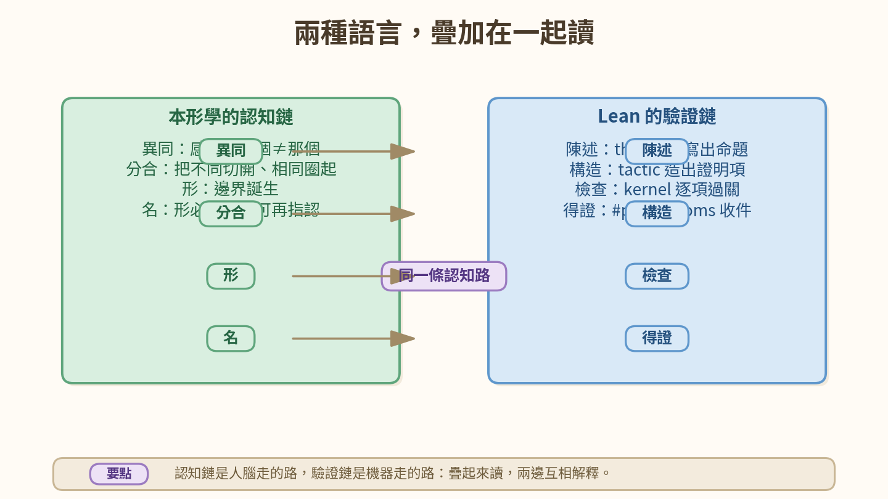

**圖 導-1　認知鏈與驗證鏈：同一條路的兩種走法**

疊加閱讀的意思是：每碰到一個 Lean 的概念，先問它在認知鏈的哪一環；每碰到一個本形學的觀念，再問它在 Lean 裡由哪個機制驗收。兩邊互相解釋，理解就不再靠比喻。

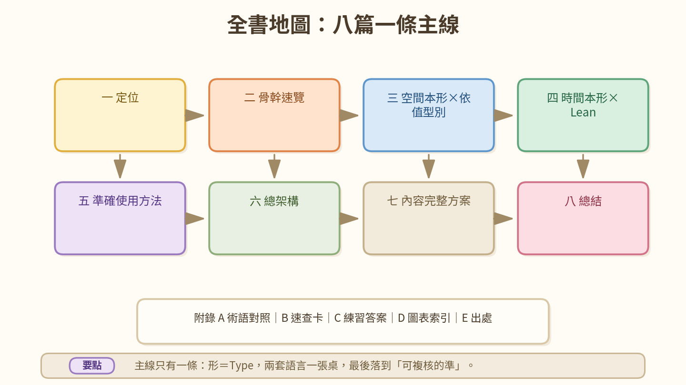

**圖 導-2　全書地圖：八篇一條主線**

## 導-2 讀法建議

- 想先弄懂關係的人：讀第一篇、第二篇、第三篇，直接看十大對讀命題。
- 想馬上會用的人：讀第五篇的六步驟與八問，邊讀邊開 Lean 實作小定理。
- 想規劃學習或教學的人：讀第七篇的八週路線與情境選路，直接排課。

## 導-3 工具箱清單

全書反覆使用的工具共六件：三軸三括號、三層判斷、五大運算、函式四問卡、三種補足、八問檢查。它們在第二篇速覽一次，之後每篇都出現。

| 工具 | 一句話 | 出場篇 |
| --- | --- | --- |
| 三軸三括號 | 形的結構：[ ] 屬性・{ } 組成・( ) 容器 | 第三篇 |
| 三層判斷 | 形的驗收：J＝J_C∧J_B∧J_T | 第三篇 |
| 五大運算 | 形的動態：op：形→形 | 第三篇 |
| 函式四問卡 | 函式的規格：名稱・輸入形・輸出形・判準 | 第四篇 |
| 三種補足 | 寫不清就補：[ ] 規則・( ) 身份・{ } 結構 | 第五篇 |
| 八問檢查 | 收件清單：上崗前四問＋上崗後四問 | 第五篇 |

# 第一篇 定位：為什麼要讓本形學與 Lean 同桌

## 1-1 五個痛點：形沒立好長什麼樣子

形式化驗證不是新話題，但過去二十年它始終停在小圈子裡。原因不在機器不夠強，而在「形」沒有立好：證明寫在散文裡、規格與程式對不上、測試過了邊界照樣出事、AI 生成的推理不敢收、知識散落各處長不出可重用的形。

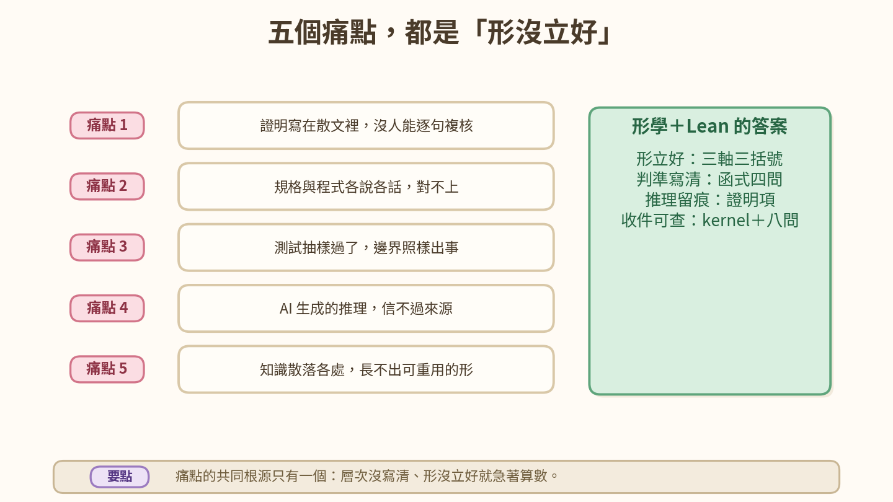

**圖 1-1　五個痛點，共同根源是形沒立好**

本形學對痛點的回答是先把形立好：三軸三括號把「是什麼」寫清楚，函式四問把「怎麼做」寫清楚，三層判斷把「算不算數」寫清楚。Lean 對痛點的回答是把驗收機械化：kernel 對每個證明項逐項檢查，過就是過，不過就是不過。兩邊合起來，才補上「可複核」這最後一塊。

| 痛點 | 形學的補法 | Lean 的補法 |
| --- | --- | --- |
| 證明寫在散文裡 | 證明六步驟：每步寫成形 | theorem＋tactic：每步可機檢 |
| 規格與程式對不上 | 函式四問：輸入形輸出形 | 簽名即規格：型別檢查 |
| 測試抽樣出事 | 三層判斷全稱式 | kernel 全稱覆蓋 |
| AI 推理信不過 | 判準＋複核留痕 | kernel 驗收，假證明退件 |
| 知識長不出形 | 形庫＋建庫四階段 | Mathlib 共享函式庫 |

## 1-2 根幹果：三層定位

本體論問「有什麼」，是根；本形學問「形是什麼、怎麼判斷、怎麼運作」，是幹；Lean 形式化驗證把「可複核的準」交給 kernel 執行，是果。三層各守其位：根負責存在的清單，幹負責形的運作，果負責驗收的落地。

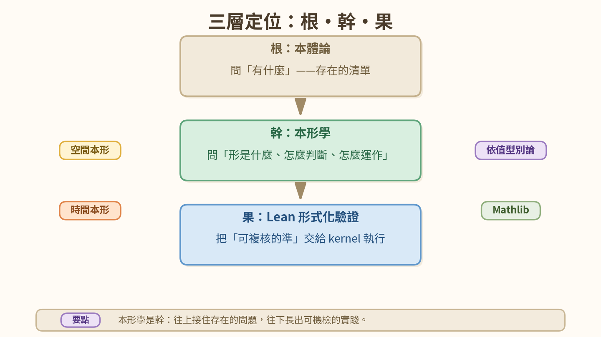

**圖 1-2　根・幹・果：三層定位**

## 1-3 一句話主線：形＝Type

全書主線只有一句話：形＝Type。本形學說「單位形＝形集合＝{部件,(內容),[類別]}」，依值型別論說「型別由構造子、欄位、索引組成」——兩句話指的是同一個認知動作：把可辨識的邊界寫下來。Lean 進場之後，這條主線從「寫下來」升級成「驗得過」。

## 1-4 本冊四柱：關係・方法・架構・方案

關係篇回答「對讀起來像什麼」，方法篇回答「怎麼用才準確」，架構篇回答「整套系統怎麼搭」，方案篇回答「人怎麼學會、組織怎麼落地」。四根柱子順序不變：先看懂，再用準，後搭穩，最後推廣。

> **【專業專欄 C1】Lean 簡史與版系譜**
>
> 2013 年 7 月，Leonardo de Moura 提交 Lean 的首次 commit；2014 年 6 月官方釋出 Lean 0.1。2017 年 1 月 Lean 3.0 釋出，是第一個中度穩定的版本。2018 年 4 月 Lean 4 開發啟動；2021 年 de Moura 與 Ullrich 在 CADE-28 發表 Lean 4 論文（doi:10.1007/978-3-030-79876-5_37），完全重寫，可編譯產生 C 程式碼、導入衛生巨集；2023 年 9 月 Lean 4.0 正式釋出。
>
> 2023 年 7 月，Lean FRO（Focused Research Organization）在非營利組織 Convergent Research 之下成立，使命是提升可擴充性、可用性、文件與證明自動化；共同創辦人為 de Moura 與 Sebastian Ullrich。2025 年 7 月，Alex Gerko 捐贈 1,000 萬美元（500 萬給新成立的 Mathlib Initiative、500 萬給 FRO）；2026 年 7 月 Amazon 宣布 FRO 史上最大單筆捐款。2025 年 Lean 獲 Skolem Award 與 ACM SIGPLAN Programming Languages Software Award；2026 年 Mathlib 獲 Demailly 開放科學獎。最新穩定版為 4.35.0（2026-10-12 釋出）。
>
> （考據來源：lean-fro.org/about、英文維基百科 Lean 條目，查證日 2026-11-08；完整出處見附錄 E。）

# 第二篇 骨幹速覽：三套語言一張桌

這一頁是給急性子的全景：左邊是本形學的工具箱，中間是依值型別論的工具箱，右邊是 Lean 的現況。不逐章重講理論——只立骨幹。

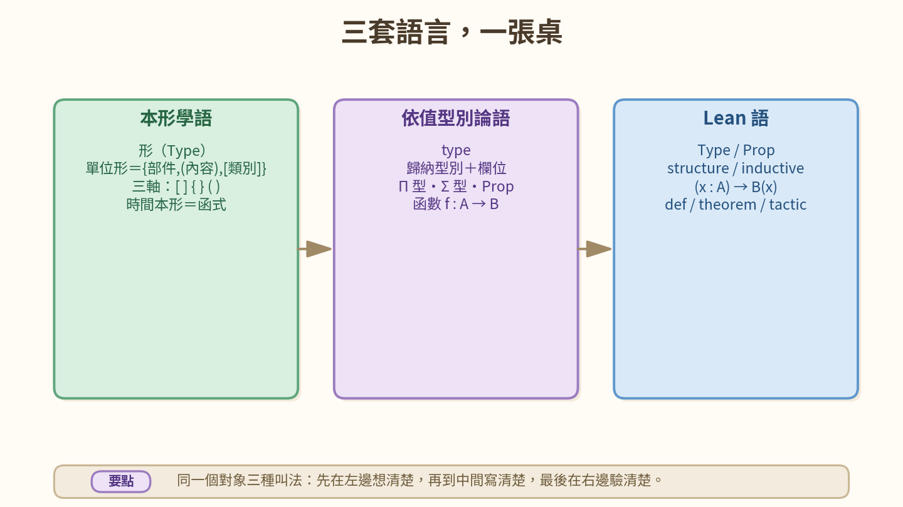

**圖 2-1　三套語言一張桌**

## 2-1 本形學工具箱：一張圖立骨幹

本形學的骨幹六件套：認知鏈立下「先有形，才有數」；三軸三括號立下形的結構（[ ] 屬性、{ } 組成、( ) 容器）；三層判斷立下驗收（J＝J_C∧J_B∧J_T）；五大運算立下形的動態（⊕、remove、σ、∩(T)/α、ι）；時間本形函式庫立下形的運作（六大函式群＋函式四問卡）；準確使用方法立下使用的規矩（三種補足、證明六步驟、八問）。

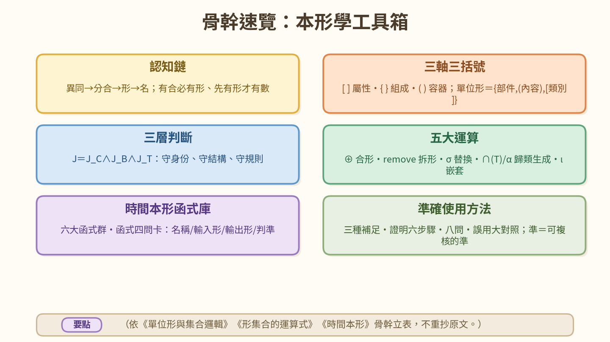

**圖 2-2　本形學工具箱速覽（骨幹，不重抄）**

| 工具 | 一句話 | 記號 |
| --- | --- | --- |
| 認知鏈 | 異同→分合→形→名；有合必有形、先有形才有數 | 數＝形裡面的小形・次比較 |
| 三軸三括號 | 屬性、組成、容器三種加值 | {部件,(內容),[類別]} |
| 三層判斷 | 守身份、守結構、守規則 | J＝J_C ∧ J_B ∧ J_T |
| 五大運算 | 吃進一個形，吐出一個形 | op：形→形 |
| 函式四問卡 | 名稱、輸入形、輸出形、判準 | 判準是心臟 |
| 準確使用方法 | 可複核的準 | 三種補足＋六步驟＋八問 |

## 2-2 依值型別論工具箱：型別依賴值

依值型別論的核心只有一句話：型別可以依賴值。普通函數型 A → B 的回傳型別固定；依值函數型 Π(x:A) B(x) 的回傳型別跟著參數的值走——長度為 n 的向量型別 Vec(A, n) 是最經典的例子：n 不是型別，是值，卻決定了型別。

與 Π 型成對的是 Σ 型：Σ(x:A) B(x) 把「一個 A 值」與「一個依賴它的 B 值」綁成對，對應邏輯的存在量化 ∃。歸納型別（inductive type）給出形的生長規則：每個構造子是一種部件組合，每個型別自動配一把遞迴子（recursor）。這三樣——Π、Σ、歸納型別——就是形的三大構造。

| 邏輯端 | 型別端 | 本形學讀法 |
| --- | --- | --- |
| 命題 | 型別 | 形 |
| 證明 | 項（term） | 判準的證據 |
| 蘊涵 → | 函數型 A → B | 時間本形：輸入形產出形 |
| 合取 ∧ | 積型 A × B | ⊕ 合形 |
| 析取 ∨ | 和型 A + B | 分支構造 |
| 全稱 ∀ | Π 型 | [ ] 屬性對所有刻度 |
| 存在 ∃ | Σ 型 | { } 部件與內容的對 |

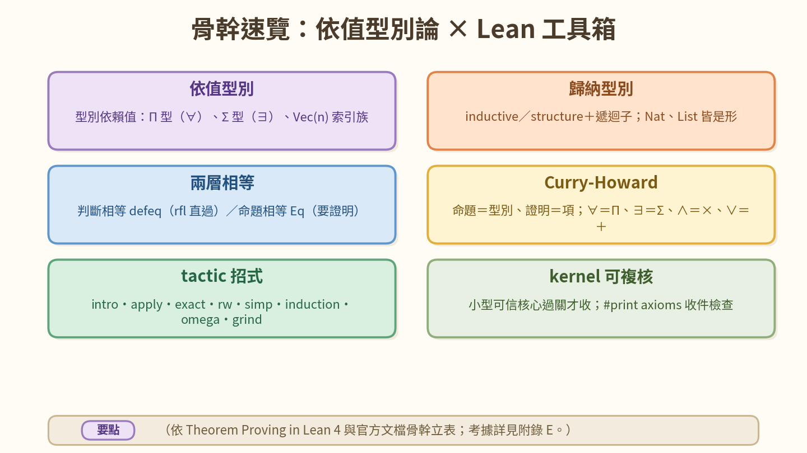

**圖 2-3　依值型別論 × Lean 工具箱速覽**

## 2-3 Lean 是什麼：簡史與現況

Lean 是證明助理，也是函數式程式語言，由 Leonardo de Moura 設計，理論基礎是「建構演算＋歸納型別」。它的十年簡史畫在下圖：2013 年問世、2017 年 Lean 3.0、2021 年 Lean 4 論文、2023 年 4.0 與 FRO、2024 至 2025 年 AI 與大型形式化專案爆發、2026 年走向業界驗證。

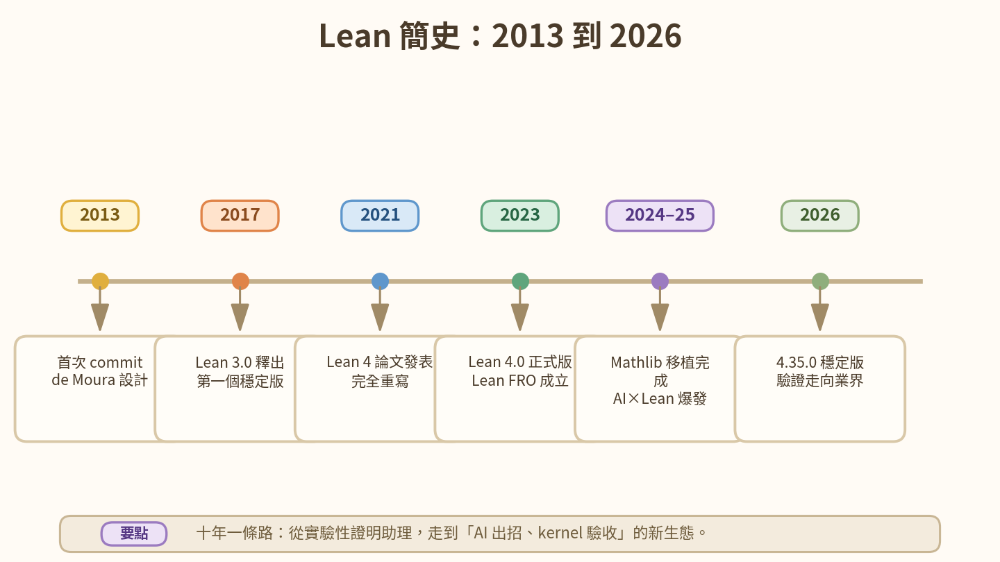

**圖 2-4　Lean 簡史：2013 到 2026**

現況的幾個硬數字（2026-11-08 查證）：Mathlib 數學函式庫已有定義 139,864 條、定理 293,257 條、貢獻者 772 人；2025 年 9 月 Mathlib Initiative 正式成立；2025 年 5 月統計已有逾 50 門大學課程以 Lean 教學。這些數字背後的意義只有一個：可複核的形，正在以「庫」的規模累積。

## 2-4 十大對讀命題總表

把關係壓縮成十條命題，就是本冊的地基。後面兩篇會逐條拆開，這裡先給全景。

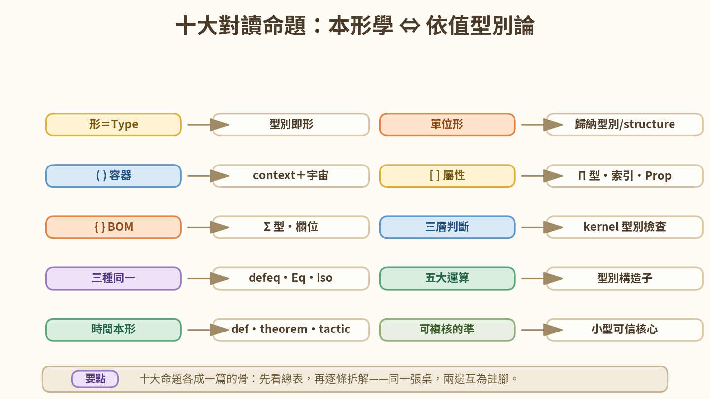

**圖 2-5　十大對讀命題：本形學 ⇔ 依值型別論**

| 命題 | 本形學側 | 依值型別論／Lean 側 |
| --- | --- | --- |
| 一 | 形＝Type | 型別即形，寫下來就可驗 |
| 二 | 單位形＝{部件,(內容),[類別]} | structure／inductive：欄位三角色 |
| 三 | ( ) 容器 C=(id(C),S(C)) | context Γ＋宇宙 Type u |
| 四 | [ ] 屬性：維度×刻度 | Π 型與索引：刻度寫進型別 |
| 五 | { } BOM＋remove 三級 | Σ 型與欄位分級 |
| 六 | 三層判斷 J＝J_C∧J_B∧J_T | kernel 型別檢查 |
| 七 | 三種同一 ≡ / ⊂ | defeq・Eq・iso 三層相等 |
| 八 | 五大運算 op：形→形 | 型別構造子與 substitution |
| 九 | 時間本形＝函式 | def・theorem・tactic |
| 十 | 準確＝可複核的準 | kernel 小型可信核心 |

# 第三篇 空間本形 × 依值型別論：靜態對讀

空間本形是形的「體」：三條軸、三種括號、三層判斷。依值型別論是形的「語法」：三大構造、兩層相等、一個 kernel。這一章把兩邊逐件對上——先看總圖，再看細部。

## 3-1 三軸對三大構造

X 軸的 [ ] 屬性問「這個形長什麼樣子」，對上 Π 型與索引：維度是索引參數，刻度是索引值。Y 軸的 { } 組成問「這個形由什麼組成」，對上 Σ 型與欄位：部件是欄位，remove 三級是欄位的分級。Z 軸的 ( ) 容器問「這個形在哪裡」，對上 context 與宇宙：id(C) 是型別名，S(C) 是內容。

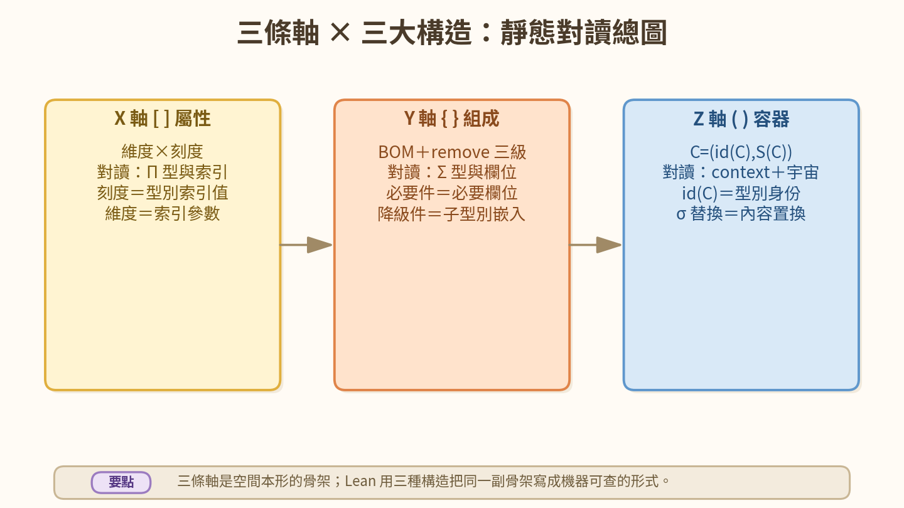

**圖 3-1　三條軸 × 三大構造：靜態對讀總圖**

| 軸 | 括號 | 本形學問句 | 依值型別論對應 |
| --- | --- | --- | --- |
| X 屬性軸 | [ ] | 樣子：維度×刻度 | Π 型、索引族、Prop |
| Y 組成軸 | { } | 部件：BOM＋remove | Σ 型、structure 欄位 |
| Z 容器軸 | ( ) | 身位：id(C) 不變 | context、宇宙、module |

## 3-2 [ ] 屬性 ↔ Π 型與索引：刻度寫進型別

本形學說：屬性是一個「可以被拿來問的問題」，屬性值是這個問題在某個情境下的實際答案——維度是屬性，刻度是屬性值。依值型別論把這對關係寫成索引族：型別 B 依賴索引 a，記 B(a)；Vec(A, n) 讀作「長度刻度為 n 的 A 向量形」。

關鍵的升級在於：刻度失誤會在寫的當下攔下來。給一個 Vec(A, 2) 餵一個 Vec(A, 3) 的值，型別檢查直接不過——不再是「填表填錯、執行才炸」，而是「形對不上，根本寫不出來」。Π(n:Nat) Vec(A, n) 則把「對所有刻度」寫成一個形，這正是 [ ] 屬性的全稱讀法。

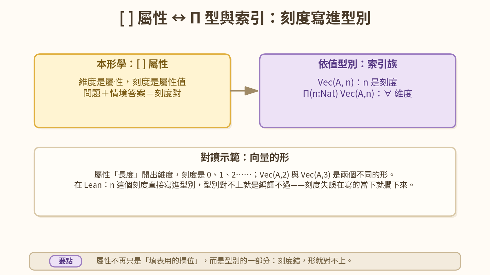

**圖 3-2　[ ] 屬性 ↔ Π 型與索引**

```lean
def firstTwo (v : Vec Nat 2) : Nat := v[0] + v[1]
-- the length scale is part of the type: Vec Nat 2 <> Vec Nat 3
-- a wrong scale cannot even be written down
```

空間框架四步驟——分辨異同、觸發抽象、命名維度、判斷歸屬——在這裡有了機械版：對照失敗（型別不匹配）逼出抽象（開索引參數）、命名維度（寫下索引名）、判斷歸屬（讓值掛進對應刻度的形）。

## 3-3 { } BOM ↔ Σ 型與欄位：拆件判準進型別

本形學的 BOM 判準是一句問話：「拆下來之後，它還認得自己嗎？」認得就進 BOM，不認得就進屬性。remove 三級把答案分成三支：必要件（remove 後同一性喪失，記 remove(p,M) ≢ M）、功能降級件（功能缺、身份在，記 ≡ M′ ⊂ M）、非必要件（拿掉沒感覺，記 ≡ M）。

依值型別論的對應非常直接。structure 的必要欄位拿掉就建構不出值——這正是「必要件」的機械版：型別的建構子就是身份本身。降級件對應子型別（subtype）或 Option 欄位：值還在、形降一級。Σ(x:A) B(x) 把「部件」與「依賴部件的內容」綁成對，正是 {部件,(內容)} 的型別寫法。

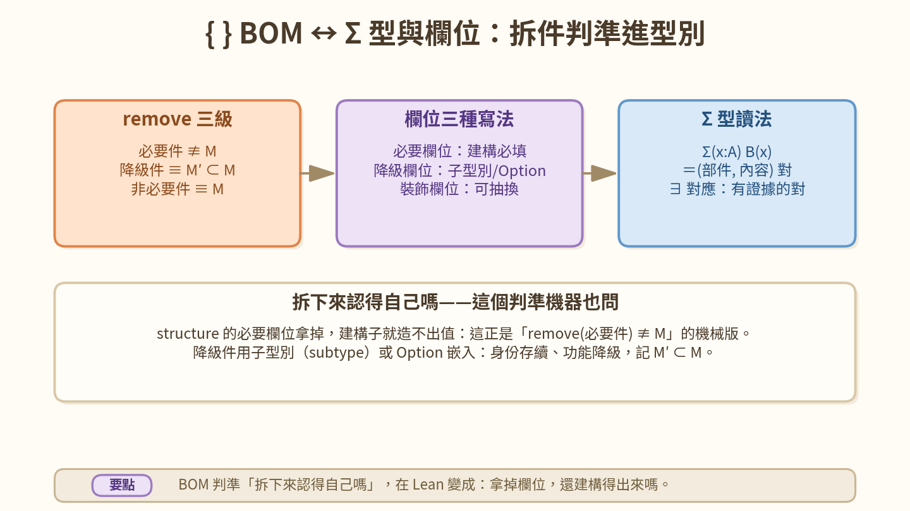

**圖 3-3　{ } BOM ↔ Σ 型與欄位**

| remove 三級 | 形學記號 | Lean 對應 | 判準讀法 |
| --- | --- | --- | --- |
| 必要件 | remove(p,M) ≢ M | 建構子必要欄位 | 拿掉就造不出值 |
| 功能降級件 | ≡ M′ ⊂ M | 子型別／Option | 身份存續，功能降級 |
| 非必要件 | ≡ M | 可抽換欄位 | 拿掉無感 |

## 3-4 ( ) 容器 ↔ context 與宇宙：身位寫進環境

容器的定義是「集合＋一個不隨元素變動而改變的身份」：C = (id(C), S(C))。不變性公理說：∀e1, e2 ∈ S(C)，把 e1 換成 e2，id(C) 不變——杯子裝水或裝咖啡，杯子還是杯子。

Lean 的 context Γ 就是容器的活教材。(x : A) (h : P x) 是容器的入場規則：帶對型別的值與對命題的證明，才進得了這個 context。宇宙 Type u 是容器的層級：小形住在 Type 裡，形的形住在 Type 1 裡，杯入袋、袋入箱的嵌套在宇宙階層裡有位置。module 與 namespace 則是命名容器：名字不隨內容變動——id(C) 的日常樣子。

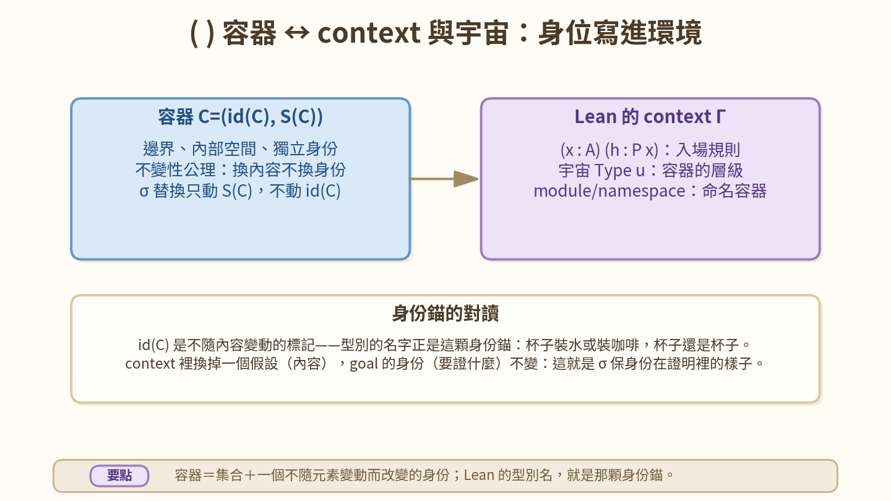

**圖 3-4　( ) 容器 ↔ context 與宇宙**

σ 替換的規矩在這裡第一次露面：σ 只動 S(C) 的內容，不動 id(C)。context 裡把假設 h1 換成 h2，要證的目標不變——這是「換內容不換身份」在證明中的樣子。下一章會看到它與 substitution 定理的完整對讀。

## 3-5 單位形 ↔ 歸納型別：咖啡杯寫成 structure

單位形＝形集合＝{部件,(內容),[類別]}。把咖啡杯寫成 Lean 的 structure，三種括號各歸各位：杯把、杯底、杯蓋、杯身是部件欄位，咖啡是內容欄位，顏色是類別欄位。三種括號，三種加值——括號的差異正是層次的差異。

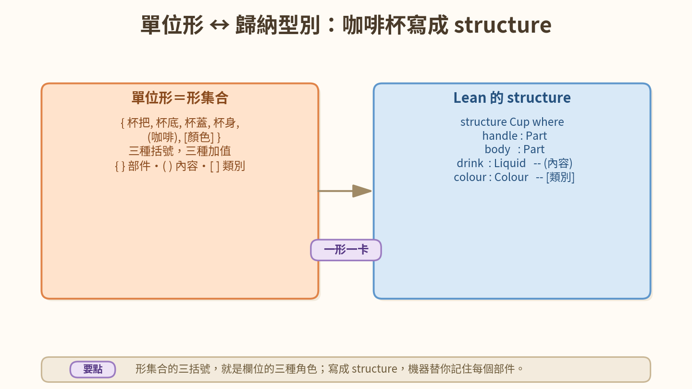

**圖 3-5　單位形 ↔ 歸納型別**

```lean
structure Cup where
  handle : Part        -- { } component
  body   : Part        -- { } component
  drink  : Liquid      -- ( ) content, replaceable
  colour : Colour      -- [ ] category

inductive Liquid where
  | water | coffee     -- two scales of the content dimension
```

歸納型別的構造子（constructor）對應「形的生長規則」：每個構造子給出一種部件組合方式；遞迴子對應「形的運算規則」：想從形裡算出東西，就沿著遞迴子走。這正是「數依附在形之上」的型別版——先有 List 這個形，才有 length 這個數。

## 3-6 三層判斷 ↔ kernel 收件漏斗

形邏輯的三層判斷問三件事：容器判斷問「身份獨立於內容嗎」，BOM 判斷問「拆件後還是同一個嗎」，抽象判斷問「過 ∩(T) 規則嗎」。三式連立 J(M) = J_C(M) ∧ J_B(M) ∧ J_T(M)，三式全真才寫「得證」——只看容器層，平板也是手機；只看組成層，計算器也是手機；只看抽象層，對講機也是手機。

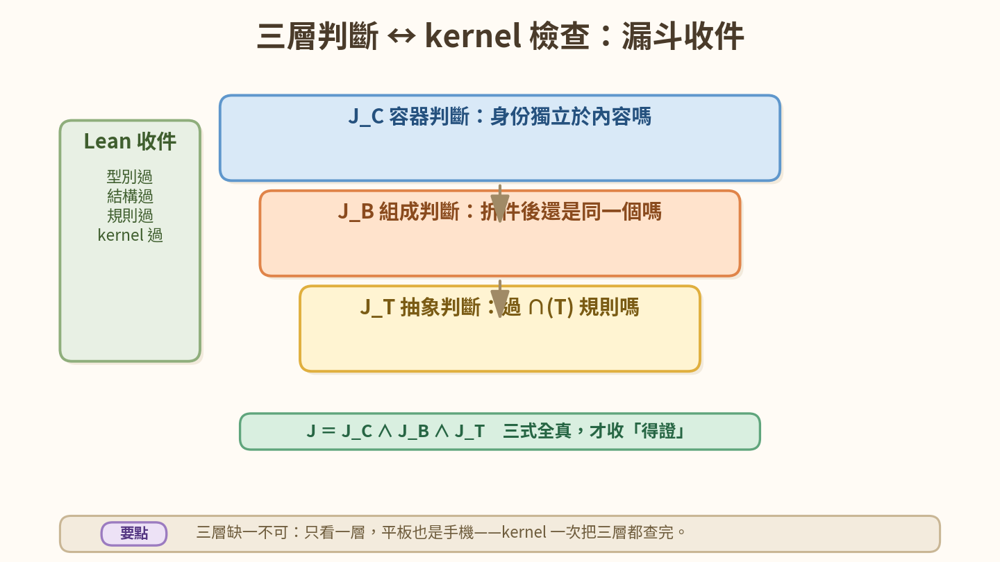

**圖 3-6　三層判斷 ↔ kernel 收件漏斗**

Lean 的 kernel 是這個漏斗的機械化身：型別對不對（J_T 的規則檢查）、結構完不完整（J_B 的欄位檢查）、身份對不對（J_C 的型別身份檢查），一次查完。tactic 可以花俏、AI 可以狂猜，但 kernel 不放水——這就是「三層缺一不可」的機器版。

> **要點：J＝J_C∧J_B∧J_T 的 Lean 版**
>
> J_C 守身份：型別名字（id(C)）不變——α 等價、宇宙層級對得上。
>
> J_B 守結構：構造子欄位齊全——每個欄位都得給出對型別的值。
>
> J_T 守規則：∩(T) 全過——type class 解析、Decidable 判定、契約證明。
>
> 三式全真，kernel 才輸出「得證」；缺一式，退件。

## 3-7 三種同一 ↔ defeq・Eq・iso：由嚴到寬

形的比較有三種同一，由嚴到寬：id 同一（容器層，σ 前後 id(C) 相同）、形同一（組成層，BOM 與依存結構相同）、類同一（抽象層，∩(T) 判準全數通過）。記號 ≡、≢、⊂ 各歸其位，不混用。

依值型別論恰好也有三層相等。判斷相等（judgmental equality，defeq）是最嚴的一層：型別檢查器約化後直接視為同一，(fun x => f x) a 與 f a 同一、2+3 與 5 同一，rfl 直接過。命題相等（propositional equality，Eq）寬一層：(a+b)+c 與 a+(b+c) 判斷上不同一，要交出證明才同一。同構（iso）最寬：兩個形的結構對得上、可以互搬，類同一是也。

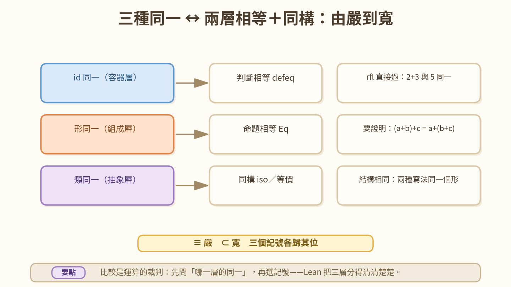

**圖 3-7　三種同一 ↔ 兩層相等＋同構**

| 本形學 | 記號 | Lean 對應 | 怎麼驗 |
| --- | --- | --- | --- |
| id 同一（容器層） | ≡（嚴） | 判斷相等 defeq | rfl 直接過 |
| 形同一（組成層） | ≡（組成） | 命題相等 Eq | 給證明：induction／calc |
| 類同一（抽象層） | ⊂（寬） | 同構 iso／等價 | 給雙向映射 |

「比較是運算的裁判」在這裡長出新用法：每次想寫「相等」之前，先問自己這是哪一層的同一——層次問對了，記號就不會混用，Lean 的錯誤訊息也會突然變得可讀。

## 3-8 五大運算 × 型別構造：一次只動一層

五大運算的語法規則是：⊕ 與 remove 只動 { } 的部件，σ 只動 ( ) 的內容，∩(T) 只問 [ ] 的類別——「一次只動一層」是複合式推導的唯一要領。型別構造子遵守同一條紀律：積型動結構、substitution 動內容、type class 動類別。

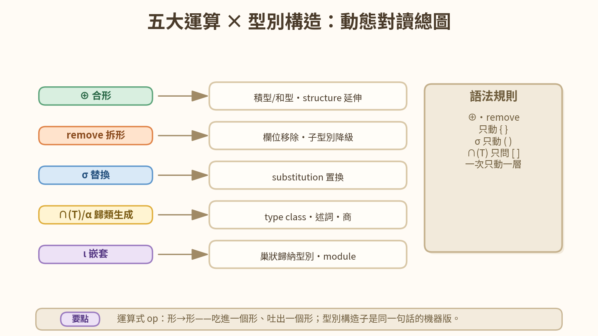

**圖 3-8　五大運算 × 型別構造總圖**

### σ 替換 ↔ substitution：保身份定理

σ 的保身份定理寫 id(σ(C)) = id(C)：換內容不換身份。依值型別論的替換定理（substitution lemma）是同一條定理的型別版：把項代入項，型別跟著走、結構不變形；capture-avoiding 的規矩保證「不誤抓變數」——這正是「σ 跨層交換不成立」的另一面：換容器的名，不等於換容器的內容。

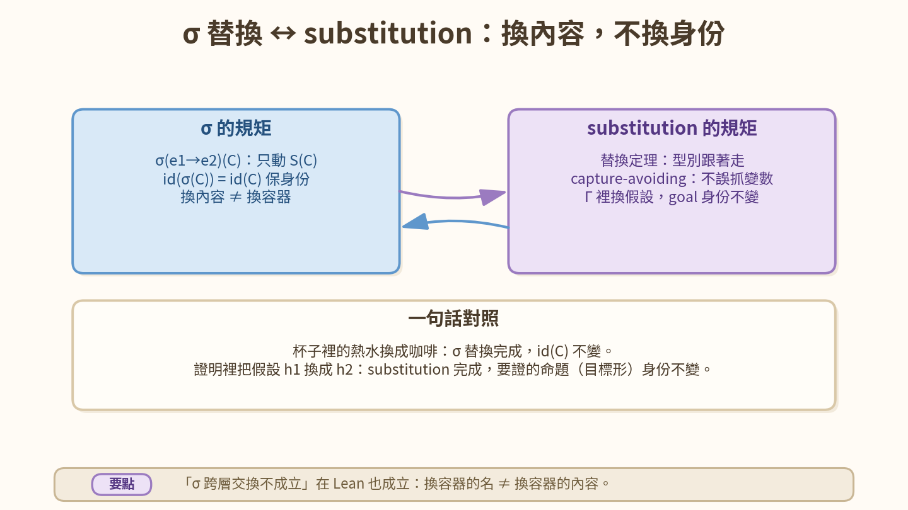

**圖 3-9　σ 替換 ↔ substitution**

### ⊕ 合形 ↔ 結構延伸：結合律兩邊同證

⊕ 的結合律 (A⊕B)⊕C ≡ A⊕(B⊕C)（依存結構相同時成立）在 Lean 裡有個熟面孔：add_assoc。Nat 的加法結合律不是公理，是定理——從歸納型別與遞迴子一步步證出來。「有合必有形」也有對應：a ++ b 造出新的 List 形，而「數＝形裡面的小形・次比較」在 length_append 這個定理裡現形：合形的數，是兩側小形計數之和。

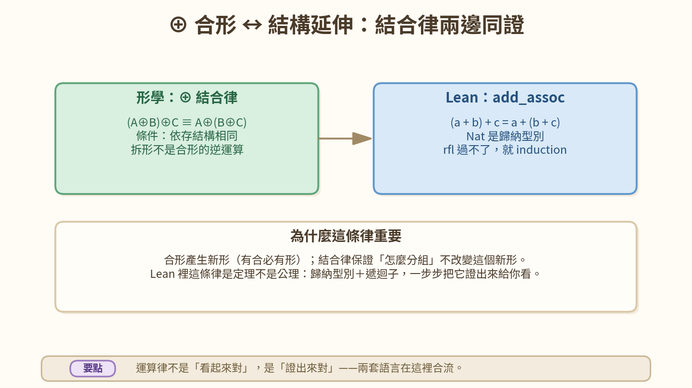

**圖 3-10　⊕ 合形 ↔ 結構延伸**

### ∩(T) 與 α ↔ type class：篩網長出類別

抽象類別 T = (F(T), ∩(T)) 是「特徵集合＋交集判準」；α 抽象生成從一群具體形萃取共同特徵。Lean 的 type class 是同一個動作：class DecidableEq(A) 是一張類別卡，instance 是一份「判準可執行」的證據；instance 解析就是把物件送過 ∩(T) 的篩網——f1、f2、fn 全過，才收進 [T]。

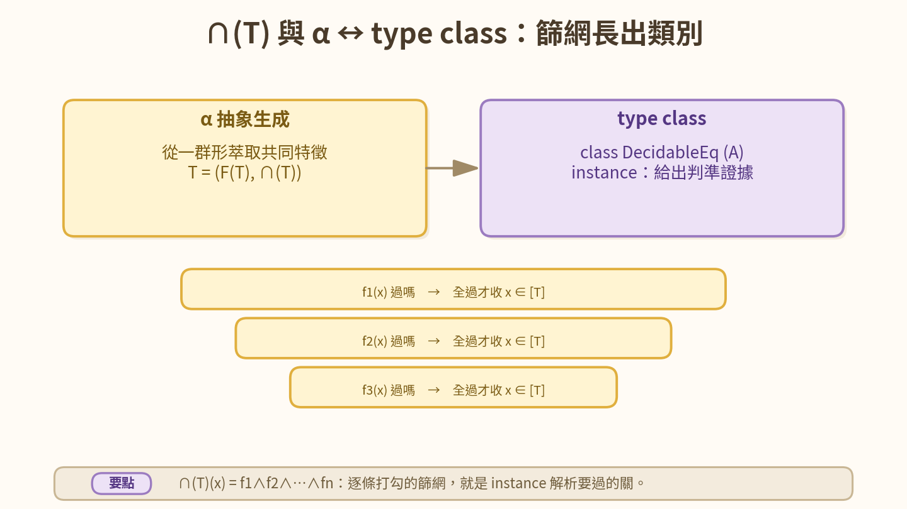

**圖 3-11　∩(T) 與 α ↔ type class**

> **【專業專欄 C3】判斷相等與命題相等的深水區**
>
> 判斷相等由型別檢查器透過約化（β、δ、ι）決定：beta 約化、定義展開、遞迴子計算，兩項化到不能再化還一樣，就判斷相等。所以 2 + 3 = 5 用 rfl 就過——兩邊都約化到 5。def 在 Lean 裡是 semireducible：預設不展開，必要時才展開，避免動不動把證明炸開。
>
> 命題相等是 Prop 裡的歸納族 Eq：rfl 是構造子 Eq.refl，代換靠 Eq.subst 與 ▸，鏈式推算靠 calc。兩層相等的分工是：判斷相等管「機器怎麼認」，命題相等管「人怎麼證」。conv 模式（轉換策略）則讓你在等式兩側的子項之間走來走去，一步一改寫。
>
> 外延性三公理讓兩層相等互相靠近：命題外延性 propext（(a ↔ b) → a = b）、函數外延性（由商構造導出）、選擇原則 Classical.choice。用它們證出的定理，#print axioms 會誠實列出——收件時看得見。

> **【專業專欄 C4】三大公理與「誠實」的收件**
>
> Lean 標準庫帶著三條公理：propext（命題外延性）、Quot.sound（商型別的合理性）、Classical.choice（選擇原則）。三者合起來可導出排中律——這是古典數學的入場券，也是誠實的代價：用了就列出。
>
> 社群的收件清單把關四件事：程式碼在格式正確的儲存庫、lake build 全過、主定理確實被編譯、#print axioms 只見三大公理或其子集。見到 sorryAx（未完成證明）或自訂 axiom 即退件。2026 年的兩個事件補上最後一課：AI 專門找 Lean 漏洞並修復數處；一則宣稱推翻 Collatz 猜想的證明，後來被證實依賴 Lean 的漏洞，修復後證明無效——kernel 是最後防線，防線本身也要維護。2026 年 9 月 Lean FRO 釋出 con-leche：一個以 Lean 證明自身一致性的外部檢查器。
>
> （考據來源：Theorem Proving in Lean 4 第 12 章、leanprover-community.github.io/did_you_prove_it.html、英文維基百科，查證日 2026-11-08。）

## 3-9 本篇練習

> **練習 E01–E05（答案見附錄 C）**
>
> E01　用「刻度寫進型別」的思路，說明為什麼「給 Vec Nat 2 餵 Vec Nat 3 的值」在 Lean 裡根本寫不出來。這對應 [ ] 屬性的哪一條規矩？
>
> E02　把「杯子的杯蓋是功能降級件」寫成 Lean 的欄位選擇：該用必要欄位、Option 還是子型別？說明你的 remove 判準。
>
> E03　判斷下列各組是哪一層的同一（id 同一／形同一／類同一）：(a) 2+3 與 5；(b) (a+b)+c 與 a+(b+c)；(c) 咖啡杯換杯蓋顏色前後。
>
> E04　為什麼說 add_assoc 是「⊕ 結合律」的 Lean 版？兩邊的「依存結構相同」條件分別是什麼？
>
> E05　#print axioms 看到 sorryAx 代表什麼？依收件清單，這樣的證明可以入庫嗎？

# 第四篇 時間本形 × Lean：動態對讀

空間本形是體，時間本形是用。時間本形＝動詞＝函式＝方法＝招式＝服務＝法門——八個名字，同一件事：吃進一個形，吐出一個形。Lean 的世界裡，這句話的化身就是 def、theorem 與 tactic。

## 4-1 時間本形＝函式 ↔ def・theorem

時間本形依附空間本形：函式不憑空運作，輸入一個形，產出一個形。售票的形學寫法是「輸入需求的形 → 輸出門票的形」；Lean 的寫法是 def sell (r : Request) : Ticket。兩個世界共用同一條語法直覺：先有形（參數型別與回傳型別），才談得上動。

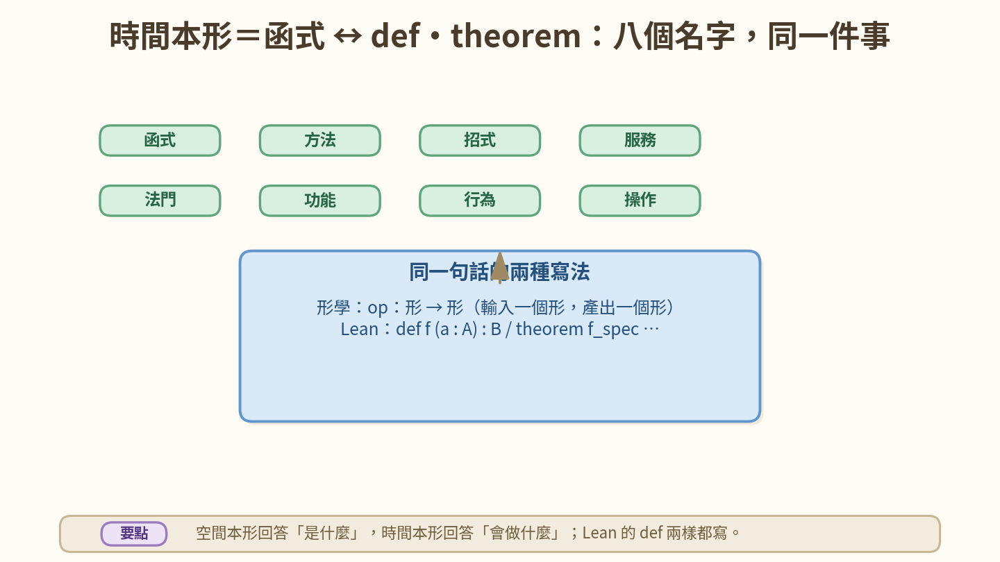

**圖 4-1　時間本形＝函式 ↔ def・theorem**

theorem 是函式的特殊種：輸出形是一份「判準的證據」。說得精準些，theorem 的型別是命題，項是證明——Curry-Howard 把「會做什麼」與「算不算對」寫進同一套語法。這就是為什麼本形學堅持「判準是四問的心臟」：沒有判準的函式只是描述，有判準的函式才可驗收。

## 4-2 op：形→形 ↔ 型別構造子

任何運算式都是一個從形到形的映射：op：形→形。這句話有兩層讀法。第一層是值的函式：f : A → B。第二層是形的函式：List、Option、Vec 這些型別構造子吃進一個形、吐出一個新的形——Type → Type 的日常樣子。

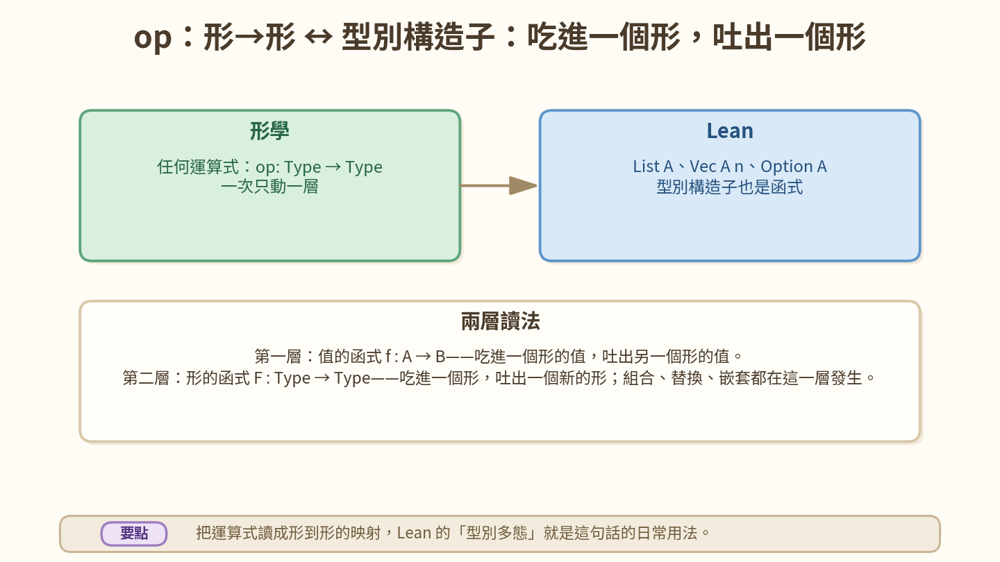

**圖 4-2　op：形→形 ↔ 型別構造子**

兩層讀法的分工，正是「一次只動一層」的另一種說法：值的函式在內容層動手（σ 級），形的函式在結構層動手（⊕、ι 級）。層次壓平，op 就失去意義——這句原著警告在 Lean 的型別錯誤訊息裡天天現形。

## 4-3 函式四問卡 ↔ 簽名＋契約

函式四問卡問四件事：名稱（這個函式叫什麼）、輸入形（作用在哪個形上）、輸出形（產出什麼形）、判準（怎麼算成功）。Lean 的一個完整函式恰好是同一張卡的兩種寫法：名稱是 def 的名字，輸入形是參數型別，輸出形是回傳型別，判準是掛在函式旁邊的 theorem——契約（spec）。

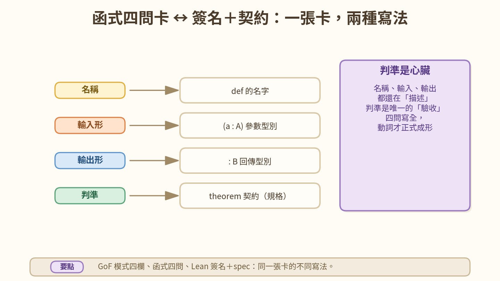

**圖 4-3　函式四問卡 ↔ 簽名＋契約**

| 四問 | 卡片寫法 | Lean 寫法 | 檢查點 |
| --- | --- | --- | --- |
| 名稱 | 這個函式叫什麼 | def 的名字 | 名字人人認得 |
| 輸入形 | 作用在哪個形上 | (a : A) | 認得出、交得出 |
| 輸出形 | 產出什麼形 | : B | 可辨識、可驗收 |
| 判準 | 怎麼算成功 | theorem 契約 | 可逐句打勾 |

「四問寫全，一個動詞才正式成形」——在 Lean 裡這句話是字面意思：四問沒寫全，函式還能編譯（判準缺席時），但它只是描述，不是可驗收的形。

## 4-4 六大函式群 ↔ Mathlib 與 tactic 生態

時間本形函式庫把十四個函式收攏成六大群：認知與萃取、生成與應用、解題與創造、推理與思考、成長與維護、探索。把這六群對到 Lean 生態，會發現 Mathlib 幾乎是照著同一張地圖長出來的。

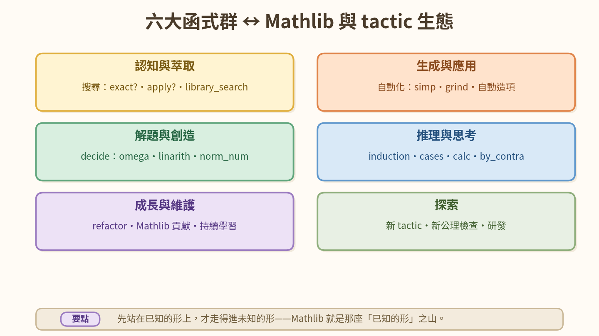

**圖 4-4　六大函式群 ↔ Mathlib 與 tactic 生態**

| 函式群 | 形學讀法 | Lean 生態對應 |
| --- | --- | --- |
| 認知與萃取 | 函式搜尋、設計搜尋與萃取、設計模式 | exact?／apply?／library_search 搜尋定理 |
| 生成與應用 | 邏輯生成、函式生成與應用 | simp 規則集、grind 自動推理、巨集生成 |
| 解題與創造 | 解題、分析、設計 | omega／linarith／norm_num 決策程序 |
| 推理與思考 | 推理五族、思考法 | induction／cases／calc／by_contra |
| 成長與維護 | 持續學習、重構重組、自我演化 | refactor、Mathlib 貢獻、版系遷移 |
| 探索 | 研發與探索 | 新 tactic 研發、新公理檢查 |

「先站在已知的形上，才走得進未知的形」——這句函式庫的排列理由，正是 Mathlib 的存在理由：29 萬條定理就是 29 萬個「已知的形」，搜尋、對準、apply，然後把新證明再入庫。

## 4-5 tactic 招式盤與選路

tactic 是時間本形的「招式」：每一招都有輸入形（當前目標）、輸出形（化簡後的目標或得證）與判準（kernel 過不過）。八大基本招覆蓋入門九成場景：intro 把前提迎進來，exact 與 apply 直接給證或對準定理，rw 按等式改寫，simp 化簡收斂，induction 與 cases 做歸納與分支，omega、linarith、norm_num 交給算術決策程序，grind 是新一代的 SMT 式自動推理。

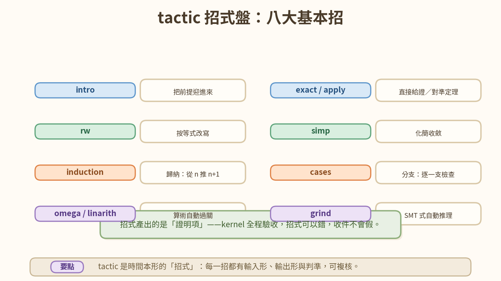

**圖 4-5　tactic 招式盤：八大基本招**

招式盤的使用紀律是「選路先問層次再問招」：先問要證的是哪一層的同一，再挑招。判斷相等就過的，rfl 收工；有結構可拆的，induction 或 cases；剩下交給自動化。順序反了，tactic 再熟也是繞遠路。完整的選路決策樹放在第五篇。

## 4-6 形與函式互相長大：Mathlib 迴路

時間本形的深層命題是「形與函式互相長大」：新形長出新函式，新函式產出新形。Mathlib 是這個循環的最大實景——搜尋形與定理、對準輸入形、apply 對接、產出形再入庫，四步一循環。

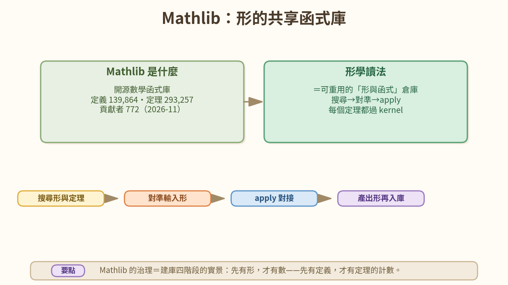

**圖 4-6　Mathlib：形的共享函式庫**

> **【專業專欄 C5】Mathlib 生態與治理**
>
> Mathlib 起於 2017 年 7 月的 mathlib3；2021 年 5 月建立 mathlib4 儲存庫，2023 年 7 月完成 Lean 3 到 4 的移植。2026 年 11 月 8 日的官方統計頁數字：定義 139,864、定理 293,257、貢獻者 772。2025 年 9 月 Mathlib Initiative 成立，把函式庫的永續經營當成獨立事業來推。
>
> 治理的重點不在「收得多」而在「收得準」：著名定理的陳述（含費馬大定理、黎曼假說的版本）都要經維護者審核為正確翻譯——防的是「陳述≠證明」的漏洞：把 TheRiemannHypothesis 命名成另一個命題並不難，機器不負責語意，人負責。這正是本形學「名」的一環：形必有名，名要副實。
>
> （考據來源：mathlib.org/mathlib_stats.html、leanprover-community.github.io，查證日 2026-11-08。）

## 4-7 本篇練習

> **練習 E06–E08（答案見附錄 C）**
>
> E06　把「計程車載客：輸入乘客的形，輸出收據的形」寫成函式四問卡，並寫出它的 Lean 簽名與契約（判準）各一行。
>
> E07　為什麼說 List、Option、Vec 是「時間本形」的形的版本？它們與 f : A → B 的層次差在哪裡？
>
> E08　給定目標 (a + b) + c = a + (b + c)，用「選路先問層次」的紀律，排出你的招式順序並說明理由。

# 第五篇 準確使用方法：可複核的準

準確的定義只有一個：可複核的準——讀者能逐句打勾，重現你的推理。Lean 把這個定義從美德升級成機制：kernel 就是那支自動打勾的筆。這一章把本形學的準確使用方法完整落到 Lean 工作流。

## 5-1 體—用—準 × Lean

體—用—準三層是準確使用方法的總架構：體是形（structure／inductive 立起來），用是函式（def／tactic 寫下來），準是判準（theorem＋kernel 驗到底）。三層各有各的失敗方式：體沒立好，用就歪；用沒寫清，準就落空；準沒執行，前面全部白做。

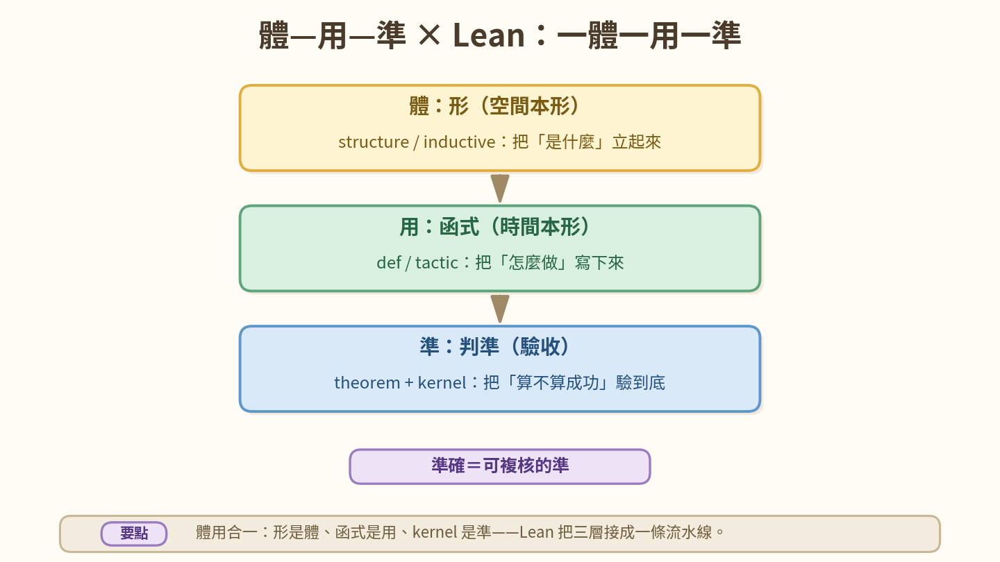

**圖 5-1　體—用—準 × Lean**

## 5-2 三種補足：寫不清就補到位

判準寫不清，用 [ ] 補；輸入形指認不出，用 ( ) 補；輸出形部件不明，用 { } 補。Lean 的補法非常具體：[ ] 補規則，用 type class 與 Decidable 把判準寫成可執行的東西；( ) 補身份，用命名型別與 context 綁定把「這是什麼」釘死；{ } 補結構，用 structure 與欄位清單把部件列全。

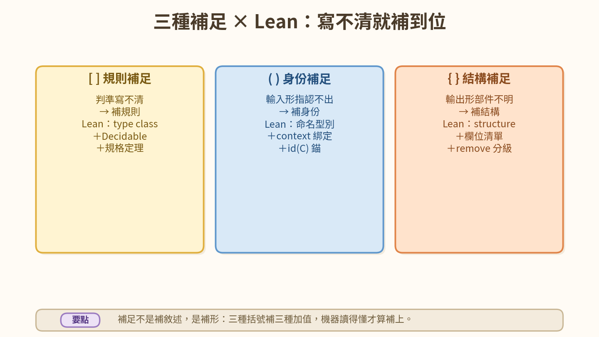

**圖 5-2　三種補足 × Lean**

| 補足 | 什麼時候補 | Lean 的補法 | 補完的檢查 |
| --- | --- | --- | --- |
| [ ] 規則 | 判準寫不清 | type class＋Decidable＋契約定理 | 判準可執行、可打勾 |
| ( ) 身份 | 輸入形指認不出 | 命名型別＋context 綁定 | id(C) 錨定，名字副實 |
| { } 結構 | 輸出形部件不明 | structure＋欄位清單 | BOM 全列、remove 分級 |

## 5-3 證明六步驟 × Lean 工作流

證明六步驟——認明整體、分軸描述、寫形集合、選定命題、判準推理、三層檢查——與 Lean 的工作流一一對應。第⑤步可以錯一百次，第⑥步不放水：kernel 是最後防線，也是唯一的裁判。

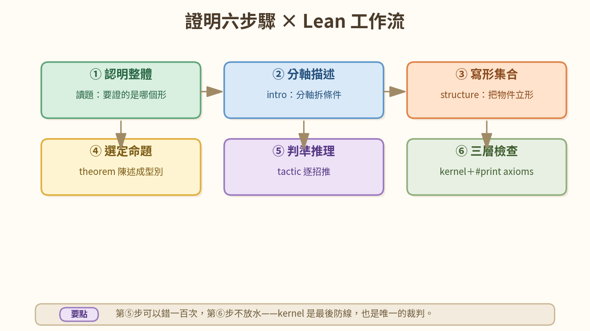

**圖 5-3　證明六步驟 × Lean 工作流**

| 步驟 | 形學動作 | Lean 動作 | 產出物 |
| --- | --- | --- | --- |
| ① 認明整體 | 認明要證的形 | 讀 goal：這在證哪個形的哪一層 | 目標形 |
| ② 分軸描述 | 分軸拆條件 | intro：迎假設入 context | 條件清單 |
| ③ 寫形集合 | 把物件立形 | structure／inductive 定義 | 形卡 |
| ④ 選定命題 | 寫下命題 | theorem 陳述成型別 | 待證形 |
| ⑤ 判準推理 | 逐條判準推 | tactic 逐招推（可 sorry 佔位） | 證明項 |
| ⑥ 三層檢查 | J_C∧J_B∧J_T | kernel＋#print axioms | 得證 |

## 5-4 全程示範：合形的數

示範命題挑最能代表本形學的一條：length (a ++ b) = length a + length b。「有合必有形」——a++b 造出新形；「數＝形裡面的小形・次比較」——length 就是小形的計數；合形的數等於兩側計數之和，就是「次比較」的可複核版。

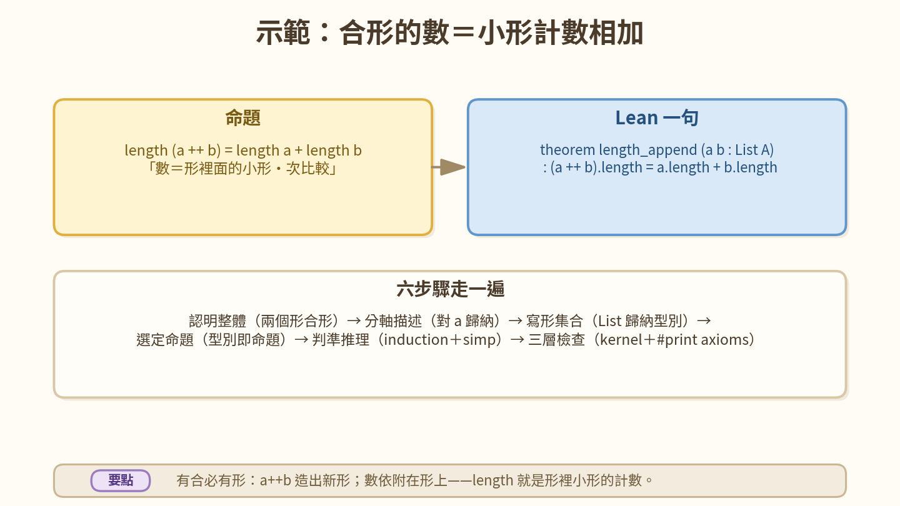

**圖 5-4　示範：合形的數＝小形計數相加**

六步驟走一遍。① 認明整體：要證的是兩個形合形之後的計數規則——組成層的命題。② 分軸描述：對 a 歸納，b 是固定的參數。③ 寫形集合：List 是歸納型別，有 nil 與 cons 兩個構造子——形先立好。④ 選定命題：theorem 的陳述本身就是型別。⑤ 判準推理：nil 情形 rfl 直過；cons 情形 induction 一步，simp 收尾。⑥ 三層檢查：kernel 過關，#print axioms 乾淨。

```lean
theorem length_append (a b : List A) :
    (a ++ b).length = a.length + b.length := by
  induction a with
  | nil => rfl              -- judgmental equality closes it
  | cons hd tl ih =>
    simp [List.length, ih]  -- rewrite with the induction hypothesis
-- #print axioms length_append  ==>  [propext, Quot.sound, ...]
```

收件的機制值得單獨一圖：你寫的 theorem 與 tactic 可以很長很花，tactic 的產物是證明項——完整推理帳本；kernel 對證明項逐項檢查，收件三查全過才得證。

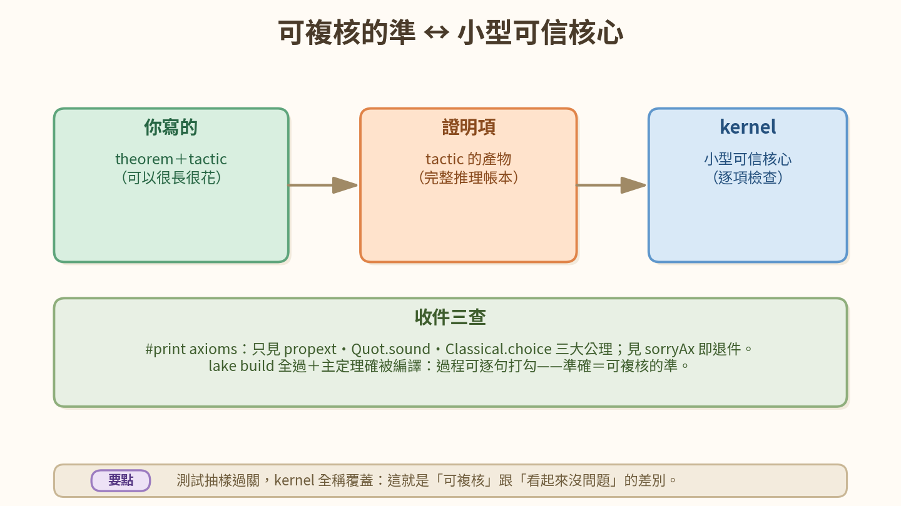

**圖 5-5　可複核的準 ↔ 小型可信核心**

> **示範的三個回饋點**
>
> 一、induction 就是「大形看不清就拆小形，小形與大形同構」——分形模式的機械版。
>
> 二、rfl 在 nil 情形直接過：兩側都是 0——判斷相等的甜頭。
>
> 三、#print axioms 是收件檢查：過程可逐句打勾，讀者複核不用信你，只要跑一遍。

## 5-5 八問檢查 × 收件清單

八問檢查把使用紀律壓成八個問題：上崗前四問管描述——名稱對嗎、輸入形認得出嗎、輸出形交得出嗎、判準可打勾嗎；上崗後四問管驗收——選的招對嗎、過三層檢查了嗎、過程可複核嗎、產出又成新形了嗎。

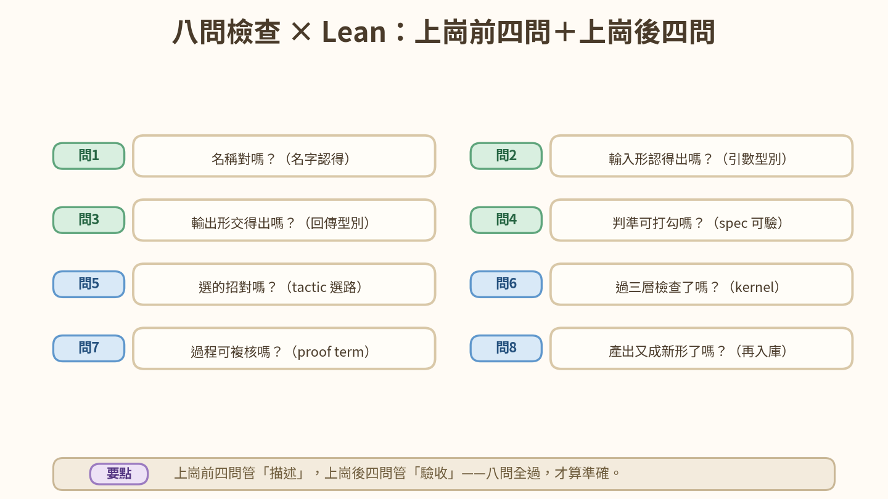

**圖 5-6　八問檢查 × Lean**

| 八問 | Lean 對應動作 | 不過的時候怎麼辦 |
| --- | --- | --- |
| 名稱對嗎 | 名字與語境一致 | 回三種補足：( ) 補身份 |
| 輸入形認得出嗎 | 參數型別明確 | ( ) 補：命名型別綁定 |
| 輸出形交得出嗎 | 回傳型別可驗收 | { } 補：欄位清單 |
| 判準可打勾嗎 | 契約定理可證 | [ ] 補：判準寫成規則 |
| 選的招對嗎 | 選路決策樹走一遍 | 換招：先問層次 |
| 過三層檢查了嗎 | kernel 全過 | 退件重推 |
| 過程可複核嗎 | proof term 完整 | 補 sorry 空缺 |
| 產出又成新形了嗎 | 新定理入庫 | 寫形卡，再入庫 |

## 5-6 誤用大對照與選路決策樹

誤用大對照十六種，共同的根源只有一個：層次沒寫清。Lean 的世界裡最常見的六種誤用畫在下圖：屬性與類別混寫（刻度當規則）、內容當容器（σ 誤成 ι）、判準不可驗證（只有描述沒有契約）、三層只做一層（單層下結論）、把招式當死清單（背 tactic 不問輸入形）、產出不經三層檢查（編譯過就當證完）。

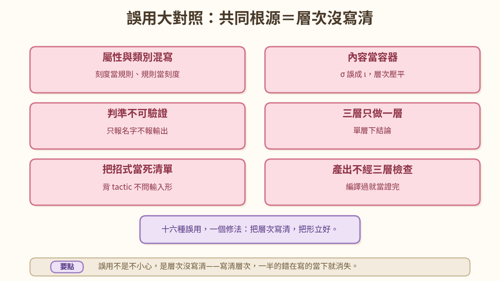

**圖 5-7　誤用大對照**

選路決策樹是把「選路先問層次再問招」畫成一張圖：拿到命題先問層次，再問判斷相等能不能收工，再問結構能不能拆，最後才交給自動化——條條路通 kernel。

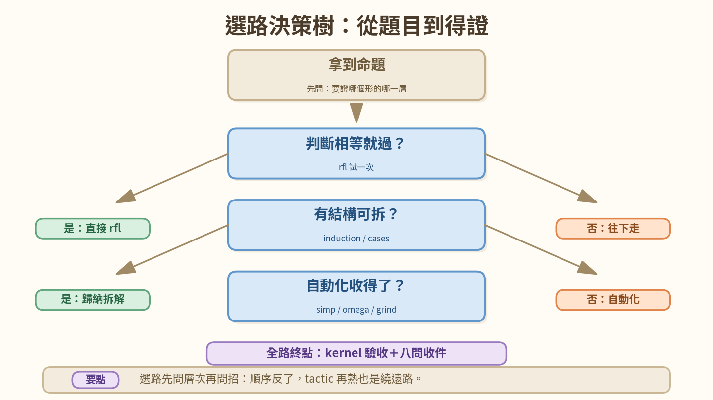

**圖 5-8　選路決策樹：從題目到得證**

> **【專業專欄 C6】AI × Lean 的里程碑考據**
>
> 2024 年 7 月，Google DeepMind 的 AlphaProof 以 Lean＋Mathlib 達 IMO 銀牌級解題。2025 年 7 月，Harmonic 的 Aristotle 以 Lean 獲 IMO 金牌，ByteDance Seed Prover 獲銀牌。2025 年 12 月完成的 Equational Theories 專案（Terence Tao 發起，2024 年 9 月立項）判定 4,694 條 magma 等式律之間的全部 22,028,942 條蘊含關係，人工與自動證明結合、全部經 Lean 驗證（arXiv:2512.07087）。
>
> 費馬大定理兩線並行：Imperial 專案 2023 年 12 月立項，Kevin Buzzard 主持，截至 2026 年 11 月仍持續進行；2026 年 9 月，Anthropic 宣布其模型代理群在 11 天內完成 Lean 4 全機檢形式化——約 1,300 萬行 Lean 程式碼、約 3 萬條中間定理，依 Darmon–Diamond–Taylor 1995 年對 Wiles 證明的表述完成，僅使用三大標準公理。Buzzard 編譯複核確認其有效性，同時評其數學上「adds nothing」、程式碼無法併入 Mathlib——這正是本形學的判準觀：機檢得證與數學價值是兩條獨立的驗收線。
>
> （考據來源：teorth.github.io/equational_theories、arXiv:2512.07087、imperialcollegelondon.github.io/FLT、Anthropic 研究公告與 Nature 報導、英文維基百科，查證日 2026-11-08。）

## 5-7 本篇練習

> **練習 E09–E12（答案見附錄 C）**
>
> E09　某定理的證明用 sorry 佔位後編譯通過。請依「收件三查」說明：這樣的證明能不能入庫？卡關的是哪一問？
>
> E10　用三種補足各舉一例：判準寫不清、輸入形指認不出、輸出形部件不明，分別該補什麼？Lean 的補法各是什麼？
>
> E11　把「先有形，才有數」用 length_append 的六步驟說明：哪一步立形、哪一步出數？
>
> E12　「編譯過就當證完」為什麼是誤用？它違反八問中的哪幾問？

# 第六篇 總架構：兩庫一中樞一迴路 × Lean 生態

把前面的對讀收攏成一座架構：兩庫（形庫、函式庫）一中樞（三層判斷）一迴路（產出形回庫）。這座架構與 Lean 生態幾乎是鏡像：structure 清單對上形庫、Mathlib 與 tactic 對上函式庫、kernel 對上中樞、貢獻迴圈對上迴路。

## 6-1 架構總圖

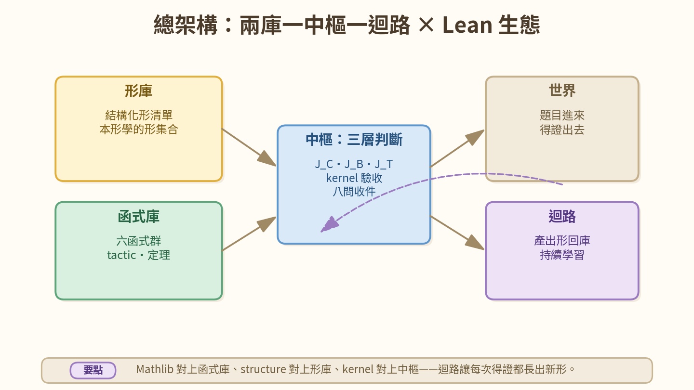

**圖 6-1　兩庫一中樞一迴路 × Lean 生態**

| 組件 | 本形學側 | Lean 側 | 守的判準 |
| --- | --- | --- | --- |
| 形庫 | 形集合、形卡、單位形清單 | structure／inductive 定義檔 | J_C＋J_B：身份與結構 |
| 函式庫 | 六大函式群、四問卡 | def／theorem／tactic／Mathlib | J_T：契約可證 |
| 中樞 | 三層判斷 J＝J_C∧J_B∧J_T | kernel＋#print axioms | 全過才收件 |
| 迴路 | 產出形回庫、持續學習 | 貢獻、refactor、再入庫 | 產出又成新形 |

## 6-2 形庫 ↔ Mathlib：建庫四階段

建庫四階段——收標本、立形、萃函式、共享——就是 Mathlib 從零到 29 萬定理的成長路徑，也是任何團隊自建形庫的路徑。收標本是蒐集具體形；立形是寫 structure 與歸納型別；萃函式是把做法封裝成四問卡與 tactic；共享是寫文件、過驗收、貢獻入庫。

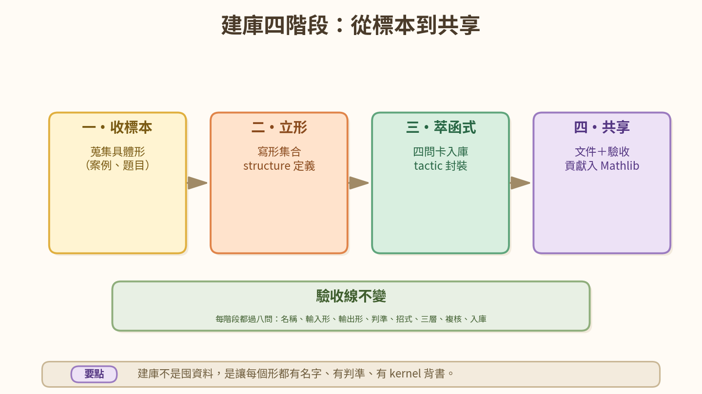

**圖 6-2　建庫四階段：從標本到共享**

每階段的驗收線不變：八問全過才算完成。「先有形，才有數」在建庫裡的版本是：先有定義的形，才有定理的計數——Mathlib 的統計頁永遠是定義與定理並列，就是這個道理。

## 6-3 AI × Lean：AI 出招，kernel 驗收

AI 是時間本形的新生代：它生成 tactic 與證明項、搜尋、猜測、試錯。但它的產出永遠只是「證明項候選」——過不過 kernel 說了算。假證明退件、真證明入庫，這條迴路讓「準」的定義權留在判準與 kernel 手上，而不是留在生成機率上。

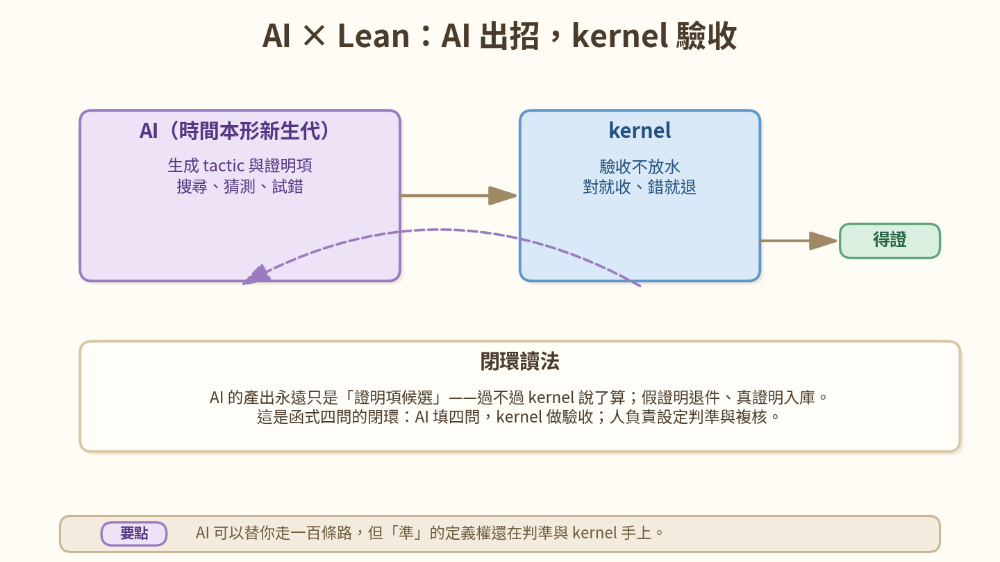

**圖 6-3　AI × Lean：AI 出招，kernel 驗收**

這正是 Mind AI 願景的驗收觀：AI 出思考的招式，形與函式記錄思考的軌跡，三層判斷負責收件。人不交出判準的定義權，只把「逐句打勾」的勞務交給機器——準確從此不是美德，是流程。

## 6-4 里程碑長廊與業界落地

2021 年的 Liquid Tensor 實驗驗證了 Scholze 凝縮數學的主要定理；2023 年 PFR 猜想的證明在三週內以大型協作完成形式化；2024 到 2025 年 AI×Lean 爆發；2025 年 Equational Theories 專案收攏 2,203 萬條蘊含；2026 年費馬大定理的機檢形式化與業界驗證落地。里程碑的共通點只有一個：每個證明都過 kernel 收件。

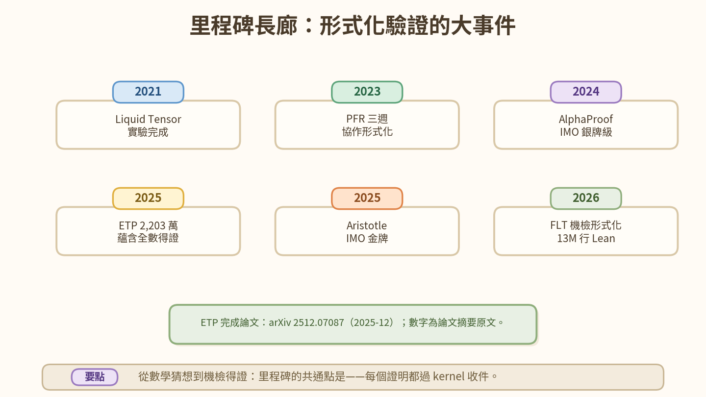

**圖 6-4　里程碑長廊**

| 案例 | 年份 | 驗的是什麼 | 用什麼驗 |
| --- | --- | --- | --- |
| Liquid Tensor 實驗 | 2020–21 | Scholze 凝縮數學主要定理 | Lean＋Mathlib |
| PFR 形式化 | 2023 | 多項式 Freiman–Ruzsa 猜想 | Lean 三週協作 |
| Equational Theories | 2024–25 | 22,028,942 條蘊含全數 | Lean＋自動化 |
| AWS Cedar | 2024 | 權限政策語言規格與實作 | Lean 驗證 |
| SampCert | 2025 | 差分隱私原語庫 | Lean（PLDI 2025） |
| Microsoft SymCrypt | 2026 | 生產級加密演算法 | Aeneas＋Lean |

> **【專業專欄 C7】形式驗證的業界座標**
>
> Lean 不是唯一的證明助理，但它是「可複核」走向業界的最快一支。座標系上有四個參照點：seL4——以 Isabelle/HOL 完成端對端驗證的 L4 微核心，微核心驗證的開山案例；CompCert——以 Coq（2024 年改名 Rocq）驗證的 C 語言優化編譯器，編譯器驗證的標竿；AWS Cedar——權限政策語言的規格與實作驗證（2024 年 4 月），把驗證帶進雲端治理；Microsoft SymCrypt——生產級加密演算法經 Aeneas 工具鏈以 Lean 驗證（2026 年 7 月），把驗證帶進密碼學基礎設施。
>
> 新創與研究端同樣熱鬧：位元向量決策 bv_decide 把 Lean 推向晶片與硬體驗證（ACM 獎詞明列 hardware verification）；NASA 形式方法研討會 2026 年以 Lean 為主題；驗證新創 &Truth（7,000 萬美元種子輪）與 Pramaana Labs（2,700 萬美元）相繼成立。一句話總結座標：驗證的成本正在下降，「可複核」正在變成預設要求。
>
> （考據來源：sel4.systems、compcert.org、AWS Open Source 部落格、lean-fro.org/about，查證日 2026-11-08。）

## 6-5 本篇練習

> **練習 E13（答案見附錄 C）**
>
> E13　把「兩庫一中樞一迴路」四個組件，各用一句話對到 Lean 生態的具體機制，並說明為什麼 kernel 只能當中樞、不能當函式庫。

# 第七篇 內容完整方案：學練用教建

方案篇回答最後一組問題：人怎麼學會、怎麼練熟、怎麼用準、怎麼教人、怎麼建庫。五部曲是循環不是階梯——每一次「建」，都讓下一次「學」站在更高的形上。

## 7-1 五部曲：學・練・用・教・建

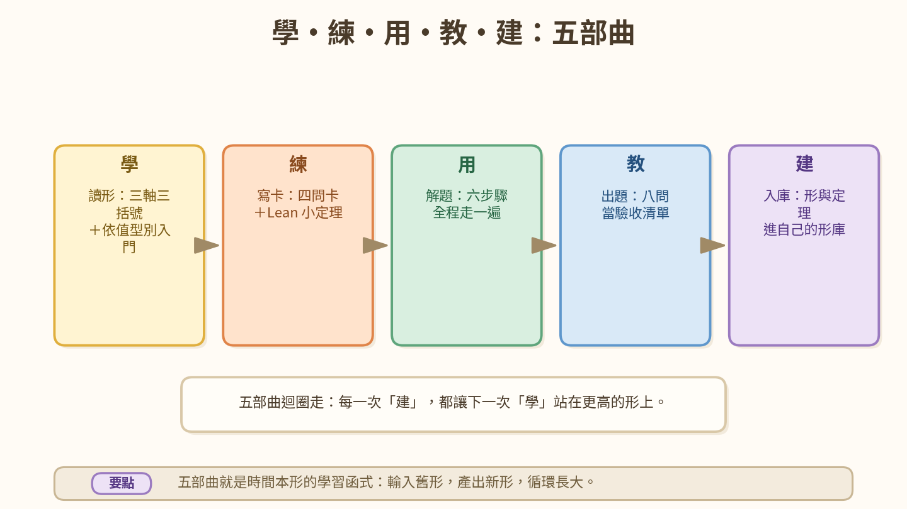

**圖 7-1　學練用教建：五部曲**

| 步 | 做什麼 | 產出物 | 驗收 |
| --- | --- | --- | --- |
| 學 | 讀形：三軸三括號＋依值型別入門 | 筆記形卡 | 八問前四問 |
| 練 | 寫卡：四問卡＋Lean 小定理 | 定理檔 | kernel 過 |
| 用 | 解題：六步驟全程走一遍 | 解題紀錄 | 八問全過 |
| 教 | 出題：八問當驗收清單 | 題目與解答 | 可逐句打勾 |
| 建 | 入庫：形與定理進形庫 | 形庫條目 | 產出又成新形 |

## 7-2 八週路線

八週路線把五部曲排成課表：前兩週立形，三四週補理論，五週練招，六週走全流程，七週收件，八週交小專案。每週交件物都是一張「可複核」的產出——四問卡、定理檔、或一頁六步驟紀錄。

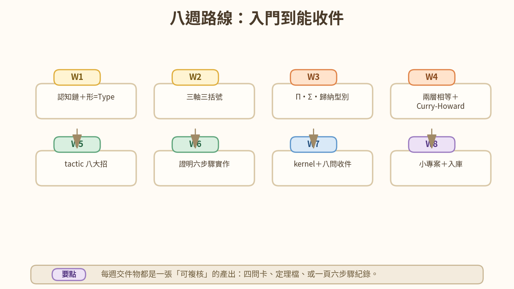

**圖 7-2　八週路線：入門到能收件**

| 週 | 主題 | 交件物 | 對應篇 |
| --- | --- | --- | --- |
| W1 | 認知鏈與形＝Type | 認知鏈筆記 | 第一篇 |
| W2 | 三軸三括號 | 形卡三張 | 第三篇 |
| W3 | Π・Σ・歸納型別 | Lean 小定理三則 | 第三篇 |
| W4 | 兩層相等＋Curry-Howard | 相等三層對照表 | 第三篇 |
| W5 | tactic 八大招 | 招式盤練習檔 | 第四篇 |
| W6 | 證明六步驟實作 | 六步驟全程紀錄 | 第五篇 |
| W7 | kernel＋八問收件 | 收件報告 | 第五篇 |
| W8 | 小專案＋入庫 | 形庫條目五則 | 第六篇 |

## 7-3 四種讀者，情境選路

| 讀者 | 入口 | 主線 | 八週的重心 |
| --- | --- | --- | --- |
| 初學者 | 導讀＋第一篇 | 關係優先 | W1–W4 慢走 |
| 數學背景者 | 第二篇＋第三篇 | 理論優先 | W3–W4 加深、W8 做數學專案 |
| 工程背景者 | 第四篇＋第五篇 | 方法優先 | W5–W7 加重、W8 做規格驗證 |
| 教學者 | 第七篇＋附錄 B | 方案優先 | 全程並行設計題目 |

## 7-4 驗收卡關表與 FAQ

| 卡關 | 症狀 | 八問定位 | 解法 |
| --- | --- | --- | --- |
| 卡一 | 看不懂 goal | 問2 輸入形 | 回 3-2：刻度寫進型別 |
| 卡二 | tactic 亂試 | 問5 選的招 | 回 4-5：先問層次再問招 |
| 卡三 | 證完不知道對不對 | 問6 三層檢查 | #print axioms 收件 |
| 卡四 | 證明長到不可讀 | 問7 可複核 | 拆小形：分形模式 |
| 卡五 | 想用 AI 又不敢信 | 問8 產出入庫 | kernel 驗收＋複核留痕 |

- FAQ 一：需要會寫程式嗎？——不需要先會；六步驟的前四步是形的功夫，第五步才碰招式。
- FAQ 二：Mathlib 太大，從哪裡下手？——從 exact? 與 apply? 搜尋下手：把 Mathlib 當函式庫查，不當書讀。
- FAQ 三：AI 生成的證明敢用嗎？——敢用，但要過收件三查：kernel 過、axioms 乾淨、陳述經人複核。

## 7-5 教學推廣與 Mind AI 願景

教學推廣的順序是「先形後動」：先用認知鏈讓學員體會「形」是什麼，再上依值型別的語法，最後才開 Lean。八問不只當收件清單，也當出題模板——每一題都要能被八問檢視，題目本身就是形卡。

長線上，這一切指向 Mind AI 的願景：讓機器在形庫之上長出會驗收的思考。Lean 實踐了其中最硬的一段——可複核的準；本形學提供最寬的一段——形的認知框架；兩者接起來，就是「知識→思維→智慧」三統一的第一步。

> **【專業專欄 C8】型別論的外圍：HoTT 與 ZFC**
>
> 依值型別論不是唯一的數學基礎。同倫型論（HoTT）以單值公理為核心，把型別讀成空間、證明讀成路徑，2013 年的 HoTT Book 開啟替代基礎的研究綱領；Lean 早期版本曾支援 HoTT 基礎，後移除，專注於實用的建構演算路線。
>
> 與 ZFC 集合論的對比值得一句話：ZFC 是古典一階集合論，外延相等原生、無內建計算內容；依值型別論的相等有判斷與命題雙層、核心帶正規化計算意義。具體的對照例是「集合」：Lean 標準庫把集合定義為述詞 Set A := A → Prop，外延性由函數外延性與命題外延性導出——集合在型別論中是內嵌構造，不是原生基礎。本形學的讀法是：ZFC 問「有什麼」（根），型別論問「形是怎麼構造與驗證的」（幹）——與本體論和本形學的分工同構。
>
> 程式設計側的旁支是 Idris 與 Type-Driven Development（Edwin Brady，2017）：把依值型別用在「寫對程式」而非「證明定理」，與 Lean 的證明助理路線互為參照。
>
> （考據來源：homotopytypetheory.org、Theorem Proving in Lean 4 第 12 章、idris-lang.org，查證日 2026-11-08。）

## 7-6 本篇練習

> **練習 E14、S01–S03（答案見附錄 C）**
>
> E14　某學員第六週卡在「證明長到不可讀」。用卡關表定位：卡在八問的哪一問？該用哪個招式原則處理？
>
> S01　為「數學背景的讀者」改編八週路線：列出你要調整的三週與理由。
>
> S02　設計一堂 90 分鐘的入門課：主題是「形＝Type」，列出三個教學段落與各段的產出物。
>
> S03　規劃一個小專案題目：讓學員用六步驟完成一個 Lean 小定理，寫出命題、預期卡關與收件標準。

# 第八篇 總結：五領域並列與三個連續目標

## 8-1 五領域並列：形的問題不換

哲學問「同一是什麼」，生物問「物種怎麼分」，語言問「指稱怎麼換」，程式問「規格怎麼驗」，組織問「職責怎麼定」。五個領域問的是同一組形的問題：是什麼、由什麼組成、在哪裡、怎麼判斷、怎麼運作。

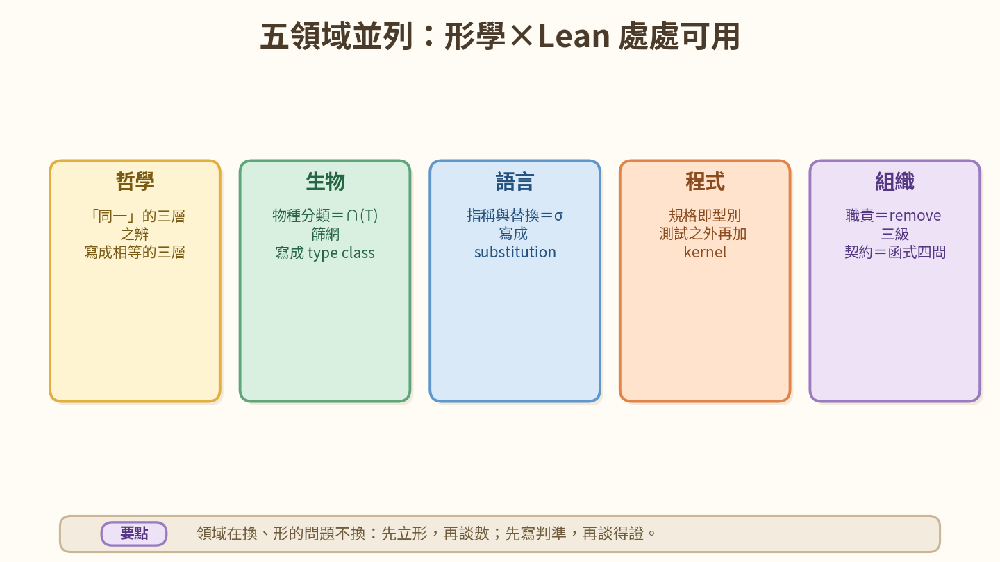

**圖 8-1　五領域並列**

| 領域 | 形的問題 | 本形學的形 | Lean 的形 |
| --- | --- | --- | --- |
| 哲學 | 同一是什麼 | 三種同一 ≡/⊂ | defeq／Eq／iso |
| 生物 | 物種怎麼分 | ∩(T) 篩網＋α 抽象 | type class＋述詞 |
| 語言 | 指稱怎麼換 | σ 替換保身份 | substitution |
| 程式 | 規格怎麼驗 | 函式四問＋三層判斷 | 契約定理＋kernel |
| 組織 | 職責怎麼定 | remove 三級＋( ) 身份 | 欄位分級＋契約 |

## 8-2 三個連續目標

第一個目標是個人的：把「準」從美德變成流程——八問收件，kernel 背書。第二個目標是組織的：把形庫建起來——收標本、立形、萃函式、共享，讓知識長出可重用的形。第三個目標是長線的：讓 Mind AI 在形庫之上長出會驗收的思考——AI 出招、kernel 驗收、人守判準。


**圖 8-2　把「準」交給機器，把「形」留給自己**

回到主線那句話：形＝Type。本形學立形，依值型別論寫形，Lean 驗形。有合必有形，先有形，才有數——現在，這句話有了機械化的版本：先有 type，才有 proof；先有 proof 過 kernel，才算數。

# 附錄 A 術語對照表

三欄對照：左欄本形學，中欄依值型別論，右欄 Lean 的具體機制。查表原則——左欄定義概念，中欄給語法位置，右欄給可驗收的落點。

| 本形學 | 依值型別論 | Lean 機制 |
| --- | --- | --- |
| 形（Type） | 型別 type | Type／Prop |
| 單位形、形集合 | 歸納型別、結構型 | inductive／structure |
| 部件 | 欄位、構造子參數 | structure field |
| 內容 | 值、項 | term |
| 類別 | 述詞、類別 | Prop／type class |
| [ ] 屬性（維度×刻度） | 索引族、Π 型 | Vec A n、(x : A) → B x |
| { } 物料清單 BOM | Σ 型、欄位清單 | Σ(x : A) × B x |
| ( ) 容器 C=(id(C),S(C)) | context、宇宙 | Γ、Type u、module |
| 不變性公理 | 替換不變身分 | id(C) 不變、record 身分 |
| 三層判斷 J＝J_C∧J_B∧J_T | 型別檢查 | kernel |
| ⊕ 合形 | 積型／和型／結構延伸 | A × B、A + B、extend |
| remove 拆形（三級） | 欄位分級、子型別 | Option、subtype |
| σ 替換 | substitution | 代換定理、rw |
| ∩(T) 歸類 | 述詞、類別判定 | Decidable、type class |
| α 抽象生成 | 抽象、商 | class、Quotient |
| ι 嵌套 | 巢狀歸納型別 | nested inductive |
| op：形→形 | 型別構造子 | List、Option、Vec |
| 時間本形（函式） | 函數、證明 | def、theorem |
| 函式四問卡 | 簽名＋契約 | signature＋spec |
| 三種同一 | defeq／Eq／iso | rfl、Eq、Equiv |
| 判準 | 命題、規格 | Prop、契約定理 |
| 證明六步驟 | 證明構造 | intro→induction→kernel |
| 可複核的準 | kernel 檢查 | #print axioms、lake build |
| 形庫 | 型別庫 | Mathlib、專案檔 |
| 函式庫（六群） | 定理與策略庫 | tactic、Mathlib |
| 產出形回庫 | 證明入庫 | merge、再利用 |

# 附錄 B 速查卡

## B-1 函式四問卡（Lean 版）

| 四問 | 寫什麼 | Lean 一行 | 打勾 |
| --- | --- | --- | --- |
| 名稱 | 這個函式叫什麼 | def myFunc … | 名字認得、語境不混 |
| 輸入形 | 作用在哪個形上 | (a : A) | 認得出、交得出 |
| 輸出形 | 產出什麼形 | : B | 可辨識、可驗收 |
| 判準 | 怎麼算成功 | theorem myFunc_spec … | 可逐句打勾 |

## B-2 八問收件清單

| # | 問題 | 不過時補什麼 |
| --- | --- | --- |
| 1 | 名稱對嗎 | ( ) 身份 |
| 2 | 輸入形認得出嗎 | ( ) 身份 |
| 3 | 輸出形交得出嗎 | { } 結構 |
| 4 | 判準可打勾嗎 | [ ] 規則 |
| 5 | 選的招對嗎 | 回選路決策樹 |
| 6 | 過三層檢查了嗎 | kernel 重跑 |
| 7 | 過程可複核嗎 | proof term 補齊 |
| 8 | 產出又成新形了嗎 | 形卡入庫 |

## B-3 可複印空白模板

（本頁可整頁複印：一張空白四問卡＋形卡＋八問勾選，供課堂與工作坊使用。）

| **函式四問卡（空白）** |  |
| --- | --- |
| 名稱 |  |
| 輸入形 |  |
| 輸出形 |  |
| 判準 |  |
| 形卡：{部件,(內容),[類別]} |  |
| 八問勾選 | 問1 　問2 　問3 　問4 　問5 　問6 　問7 　問8 |

# 附錄 C 練習參考答案

答案為示範性質：給出判準與推理要點，重在「可逐句打勾」，不求唯一寫法。

| 題 | 示範答案 |
| --- | --- |
| E01 | Vec Nat 2 與 Vec Nat 3 是兩個不同的形：刻度 n 寫在型別裡，型別不匹配時項根本構造不出來。對應 [ ] 的規矩「屬性值是維度上的刻度」——刻度錯＝形錯，入場即攔。 |
| E02 | 杯蓋是功能降級件（remove 後 ≡ M′ ⊂ M）：用 Option 欄位或子型別。杯身是必要欄位（拿掉 ≢ M）：建構子必填。判準是「拆下來認得自己嗎」。 |
| E03 | (a) id 同一／判斷相等：2+3 約化即 5。(b) 形同一／命題相等：需 induction 證明。(c) id 同一：內容與裝飾換、id(C) 不變（顏色屬性若非必要件）。 |
| E04 | add_assoc 說 (a+b)+c = a+(b+c)：⊕ 結合律的組成層版本。兩邊條件都是「依存結構相同」——Nat 的加法是同一個運算的兩種分組；若接合位置或依存不同（杯把⊕杯身 vs 杯身⊕杯把），則不成立。 |
| E05 | sorryAx 代表有未完成證明佔位。依收件清單：見 sorryAx 即退件——過程不可複核，八問第 7 問不過。 |
| E06 | 四問卡：名稱 sell／輸入形 Request／輸出形 Ticket／判準「有票且金額正確」。簽名 def sell (r : Request) : Ticket；契約 theorem sell_spec (r : Request) : Valid (sell r)。 |
| E07 | List、Option、Vec 是形的函式（Type → Type）：吃進一個形、吐出一個新的形，屬 op 的第二層讀法；f : A → B 是值的函式，動在內容層。層次差在「動的是形還是形的值」。 |
| E08 | 先問層次：這是組成層的命題相等（不是 defeq），rfl 不收。有結構可拆：對 a 做 induction；nil 情形 rfl，cons 情形 simp [ih]。自動化收尾後 kernel 驗收。 |
| E09 | 不能入庫。收件三查第二查「#print axioms 乾淨」不過：sorryAx 會被列出。卡在八問第 7 問（過程可複核嗎）。 |
| E10 | 判準寫不清→[ ] 補：type class＋契約定理；輸入形指認不出→( ) 補：命名型別＋context 綁定；輸出形部件不明→{ } 補：structure＋欄位清單。 |
| E11 | 第③步「寫形集合」立形：List 歸納型別先立好；第⑤步出數：length 是形裡小形的計數，length_append 定理把「數」與「合形」掛上——先有形，才有數。 |
| E12 | 編譯通過只證了型別檢查通過的部分，不等於契約已證。違反第 6 問（三層檢查）與第 7 問（過程可複核）——J_T 的規則層與收件都沒走完。 |
| E13 | 形庫＝structure／inductive 定義檔（守 J_C＋J_B）；函式庫＝def／theorem／tactic／Mathlib（守 J_T）；中樞＝kernel＋#print axioms（全過才收件）；迴路＝貢獻與再入庫。kernel 只判定「過不過」，不產出內容——它是裁判不是球員，故不能當函式庫。 |
| E14 | 卡在第 7 問（過程可複核）。用分形模式處理：大形看不清就拆小形——把長證明拆成 lemma 鏈，每個 lemma 一張形卡，小形與大形同構。 |
| S01 | 示範調整：W3 加深 Π/Σ 的數學讀法（索引集合族）；W4 換成同構與範疇論視角；W8 專案改「數學定理形式化」（如無限集的對角線論證）。理由：數學者長於推理、短於工程語法。 |
| S02 | 示範三段：(1) 認知鏈暖身——從異同到命名（產出：一張形卡）；(2) 形＝Type 對讀——Vec 的刻度（產出：一句 Lean 程式）；(3) 小定理觀摩——length_append 六步（產出：一頁六步驟筆記）。 |
| S03 | 示範題：證 reverse (reverse l) = l（列表反轉兩次回原形）。預期卡關：induction 後要 lemma（append 的行為）——正好演練「拆小形」。收件標準：kernel 過＋#print axioms 乾淨＋八問全過。 |

# 附錄 D 圖表索引

| 圖 | 所在篇 | 題目 |
| --- | --- | --- |
| 圖 01 | 封面 | Lean 形式化驗證與依值型別論×本形學 |
| 圖 02 | 導讀 | 認知鏈與驗證鏈 |
| 圖 03 | 導讀 | 全書地圖 |
| 圖 04 | 1-1 | 五個痛點 |
| 圖 05 | 1-2 | 根幹果三層定位 |
| 圖 06 | 2-3 | Lean 簡史時間軸 |
| 圖 07 | 第二篇 | 三套語言一張桌 |
| 圖 08 | 2-1 | 本形學工具箱 |
| 圖 09 | 2-2 | 依值型別論×Lean 工具箱 |
| 圖 10 | 2-4 | 十大對讀命題 |
| 圖 11 | 3-1 | 三軸×三大構造 |
| 圖 12 | 3-2 | [ ] 屬性↔Π 型 |
| 圖 13 | 3-3 | { } BOM↔Σ 型 |
| 圖 14 | 3-4 | ( ) 容器↔context |
| 圖 15 | 3-5 | 單位形↔歸納型別 |
| 圖 16 | 3-6 | 三層判斷↔kernel |
| 圖 17 | 3-7 | 三種同一↔兩層相等 |
| 圖 18 | 3-8 | 五大運算×型別構造 |
| 圖 19 | 3-8 | σ 替換↔substitution |
| 圖 20 | 3-8 | ⊕ 合形↔add_assoc |
| 圖 21 | 3-8 | ∩(T)↔type class |
| 圖 22 | 4-1 | 時間本形↔def・theorem |
| 圖 23 | 4-2 | op↔型別構造子 |
| 圖 24 | 4-3 | 四問卡↔簽名契約 |
| 圖 25 | 4-4 | 六函式群↔Mathlib |
| 圖 26 | 4-5 | tactic 招式盤 |
| 圖 27 | 4-6 | Mathlib 形的共享函式庫 |
| 圖 28 | 5-1 | 體—用—準×Lean |
| 圖 29 | 5-2 | 三種補足×Lean |
| 圖 30 | 5-3 | 證明六步驟×工作流 |
| 圖 31 | 5-4 | 示範：合形的數 |
| 圖 32 | 5-5 | 八問檢查×Lean |
| 圖 33 | 5-6 | 誤用大對照 |
| 圖 34 | 5-6 | 選路決策樹 |
| 圖 35 | 5-4 | 可複核的準↔小型可信核心 |
| 圖 36 | 6-1 | 兩庫一中樞一迴路 |
| 圖 37 | 6-3 | AI×Lean 閉環 |
| 圖 38 | 6-4 | 里程碑長廊 |
| 圖 39 | 7-1 | 學練用教建五部曲 |
| 圖 40 | 7-2 | 八週路線 |
| 圖 41 | 6-2 | 建庫四階段 |
| 圖 42 | 8-1 | 五領域並列 |
| 圖 43 | 8-2 | 收束卡 |

表目錄：表 0-1 四柱地圖、表 1-1 痛點對照、表 2-1 本形學工具箱、表 2-2 邏輯—型別對照、表 2-3 十大命題、表 3-1 三軸對讀、表 3-2 remove 三級、表 3-3 三種同一、表 4-1 四問卡對照、表 4-2 六函式群、表 5-1 六步驟、表 5-2 三種補足、表 5-3 八問、表 6-1 架構組件、表 6-2 業界案例、表 7-1 五部曲、表 7-2 八週課表、表 7-3 選路、表 7-4 卡關表、表 8-1 五領域、表 A-1 術語對照、表 B-1 四問卡、表 B-2 八問、表 B-3 空白模板、表 C-1 答案。

# 附錄 E 出處與延伸閱讀

考據查證日統一為 2026-11-08。官方頁面與論文為第一手出處；維基百科條目僅作交叉核對。

| # | 出處 | 內容 |
| --- | --- | --- |
| 1 | lean-lang.org/theorem_proving_in_lean4/ | Theorem Proving in Lean 4（Avigad、de Moura、Kong、Ullrich）：依值型別論、tactic、公理與計算 |
| 2 | lean-fro.org/about/ | Lean FRO 官方大事記：版本、資助、獎項、里程碑 |
| 3 | mathlib.org/mathlib_stats.html | Mathlib 即時統計：定義、定理、貢獻者 |
| 4 | leanprover-community.github.io/did_you_prove_it.html | 社群收件清單：lake build、#print axioms |
| 5 | arxiv.org/abs/2512.07087 | Equational Theories 專案完成論文：22,028,942 條蘊含 |
| 6 | teorth.github.io/equational_theories/ | ETP 專案首頁（Terence Tao） |
| 7 | teorth.github.io/pfr/ | PFR 形式化專案 |
| 8 | imperialcollegelondon.github.io/FLT/ | 費馬大定理形式化（Imperial，Kevin Buzzard） |
| 9 | Anthropic 研究公告＋Nature 報導 | 2026-09 費馬大定理機檢形式化 |
| 10 | en.wikipedia.org/wiki/Lean_(proof_assistant) | Lean 條目：簡史、架構、事件交叉核對 |
| 11 | en.wikipedia.org/wiki/Dependent_type | 依值型別條目：Π/Σ、索引族 |
| 12 | en.wikipedia.org/wiki/Curry–Howard_correspondence | Curry–Howard 對應條目：對應表與史源 |
| 13 | sel4.systems／compcert.org／AWS 部落格 | 業界形式驗證案例：seL4、CompCert、Cedar |
| 14 | homotopytypetheory.org/book/ | HoTT Book（2013）：同倫型論研究綱領 |
| 15 | 本形資料夾：單位形與集合邏輯・形集合的運算式・本形學_時間本形・空間框架・形與數・緒論・本體論與本形學 | 本形學術語與記號的原始依據（立骨幹不複製） |

> **全書終**
>
> 形＝Type：本形學立形，依值型別論寫形，Lean 驗形。
>
> 準確＝可複核的準——kernel 說了算。
>
> 有合必有形；先有形，才有數。
