# Mind RAG 準確使用方法與架構 內容完整方案

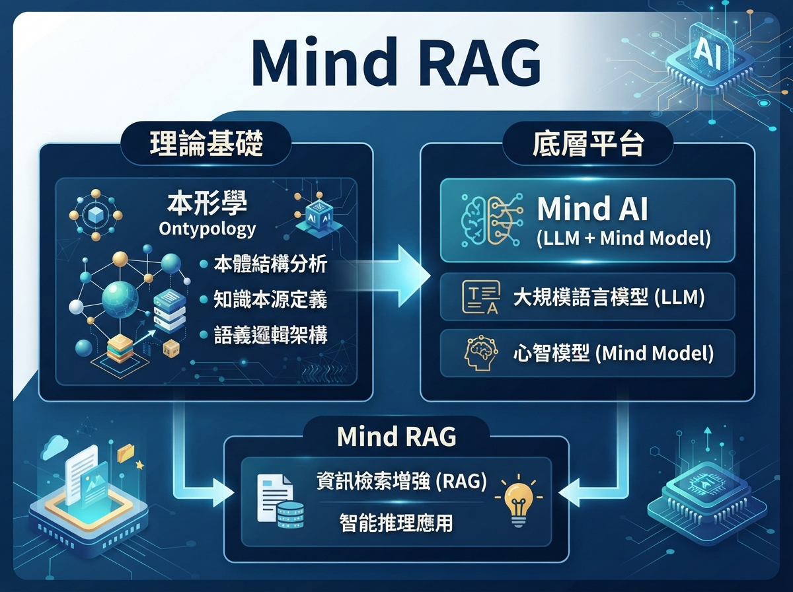

# 目　錄

- 前言
  - 任務地圖：七個不足，七個補足
- 導讀　兩條路的交會
  - 兩條路，各有長短
  - 本冊新增的三個名字
  - 本冊的走法
- 第一篇　定位：Mind RAG 為什麼出生
  - 1-1　RAG 一句話：帶著資料去回答
  - 1-2　五個痛點，都是形沒立好
  - 1-3　三層定位：根、幹、果
  - 1-4　主軸宣言：七不足 → 七補足
- 第二篇　骨幹速覽：只用不教的六件工具
  - 2-1　認知鏈 × 檢索鏈
  - 2-2　三軸三括號：三種關係，三種判準
  - 2-3　三層判斷：漏斗，不是查表
  - 2-4　時間本形：函式四問
  - 2-5　五大運算：op：Type → Type
  - 2-6　Mind AI 平台：兩庫一中樞一迴路
  - 2-7　映射總表：RAG × 本形學
- 第三篇　空間本形：檢索世界的形
  - 3-1　五種檢索形
  - 3-2　三軸對讀：向量、圖、庫
  - 3-3　remove 三級：檢索的取捨地圖
  - 3-4　三層判斷＝收件防線
  - 3-5　空間四不足，在檢索現場
- 第四篇　時間本形：檢索與生成的函式
  - 4-1　檢索鏈六站：形進形出
  - 4-2　六張函式四問卡
  - 4-3　推理五族：問答要開新路
  - 4-4　思考法選路：怎麼想，決定怎麼檢
  - 4-5　時間三不足，在生成現場
  - 4-6　LLM 與 Mind Model：各守其位
- 第五篇　七不足 → 七補足：核心主軸
  - 5-1　補足總覽
  - 5-2　七張補足卡
  - 5-3　七補足 × 檢索六家族
  - 5-4　補足卡的組合技
- 第六篇　準確使用方法：體—用—準
  - 6-1　體—用—準
  - 6-2　三種補足：規則、身份、結構
  - 6-3　證明六步驟：一則問答的全程
  - 6-4　四層準確性與日誌六欄位
  - 6-5　八問：出發前先問一遍
  - 6-6　誤用 16 種：四組預防針
  - 6-7　選路決策樹
  - 6-8　完整示範紀錄：日誌長什麼樣
- 第七篇　總架構：長在平台上的問答
  - 7-1　兩庫一中樞一迴路 × Mind RAG
  - 7-2　GraphRAG → Mind RAG：三同五異
  - 7-3　兩公式：各守其位的另一面
  - 7-4　七補足全景
  - 7-5　四條驗收線與 AGI 三階段
  - 7-6　四種常見做法對讀
- 第八篇　內容完整方案：學練用教建
  - 8-1　學練用教建
  - 8-2　八週路線
  - 8-3　建庫四階段
  - 8-4　情境選路：四種讀者
  - 8-5　PoC 三情境驗收
  - 8-6　五領域並列：形不換，庫換
  - 8-7　成熟度：L1 → L4
  - 8-8　常見問題 FAQ
  - 8-9　驗收清單與常見卡關
- 結語　七個補足，一條路
- 附錄 A　術語與記號
- 附錄 B　速查卡
  - B-1　七補足卡速查
  - B-2　八問勾選
  - B-3　可複印空白模板（整頁）
  - B-4　可複印・推理與日誌模板（整頁）
- 附錄 C　練習參考答案
- 附錄 D　圖表索引
- 附錄 E　出處與延伸閱讀
- 附錄 F　五領域示範問答

# 前言

這本冊子只做一件事：把「形學式檢索增強生成」——Mind RAG——的準確使用方法與架構，一處一處講清楚、一張一張畫出來。它不重抄本形學（空間本形與時間本形）的理論原典，也不重抄 Mind AI 的平台簡介；它站在兩者的肩膀上，回答一個新問題：檢索增強生成（RAG），怎麼把形立起來，答得準、可複核、長得大。

> **約定一・形 = Type**
>
> 「形」的英文一律用 Type，不用別的字。空間本形 = Space Type、時間本形 = Time Type、單位形 = Unit Type。
>
> 本冊出現「形」字處，皆依此約定。

> **約定二・理論與平台，只用不教**
>
> 本冊假定你已讀過本形學的空間本形與時間本形，也知道 Mind AI 是什麼。
>
> 括號、判準、公理、函式四問、兩庫一中樞一迴路——全部「點名式」引用，不重新教學；
>
> 它們在本冊的角色是地基：地基在腳下，不在講台上。
> 
> 自動匯入Mind RAG Database
> 見-基於物料清單的知識圖譜建構與多來源資料整合方法 
> Knowledge Graph Construction Based on Bill of Materials and Multi-Source Data Integration Method
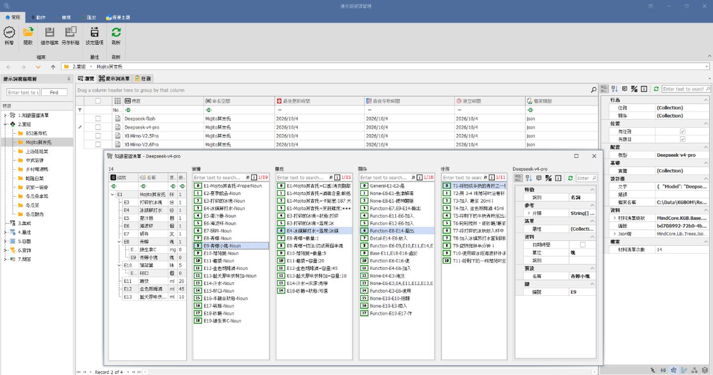

## 任務地圖：七個不足，七個補足

本冊的主軸，來自一本姊妹作的結論。《知識圖譜用於本形學不足處分析》把知識圖譜（KG）用在本形學上說不清、存不下、判不動、跟不上的地方，拆成了七個不足：括號壓平、身份漂移、圖不會判、生成失憶、動詞消失、推理缺席、演化缺席。那本書只分析不足、不提補強——這本冊子，就是它的下半場：七個不足，逐一補回來。

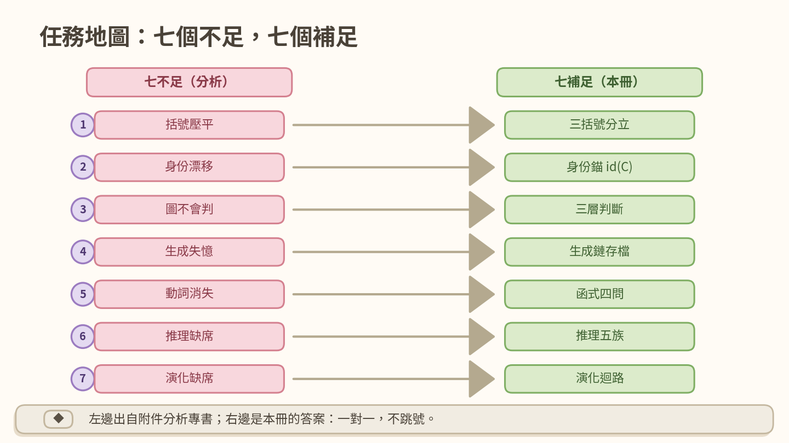

**圖 0-1　任務地圖：左邊七個不足（分析），右邊七個補足（本冊）**

| 篇 | 不足（姊妹作） | 補足（本冊） | 落在哪一篇 |
| --- | --- | --- | --- |
| 空間 | 括號壓平・三種關係一種邊 | 三括號分立 | 第五篇・補足卡① |
| 空間 | 身份漂移・圖無身份錨 | 身份錨 id(C) | 第五篇・補足卡② |
| 空間 | 圖不會判・查表非判斷 | 三層判斷 | 第五篇・補足卡③ |
| 空間 | 生成失憶・只存結果 | 生成鏈存檔 | 第五篇・補足卡④ |
| 時間 | 動詞消失・招式成標籤 | 函式四問 | 第五篇・補足卡⑤ |
| 時間 | 推理缺席・圖走舊路 | 推理五族 | 第五篇・補足卡⑥ |
| 時間 | 演化缺席・圖不長大 | 演化迴路 | 第五篇・補足卡⑦ |

**表 0-1　任務地圖：七個不足與七個補足的篇章對照**

> **一句話說完這本冊子**
>
> 形立起來，檢索才準；準可複核，知識才長大。

# 導讀　兩條路的交會

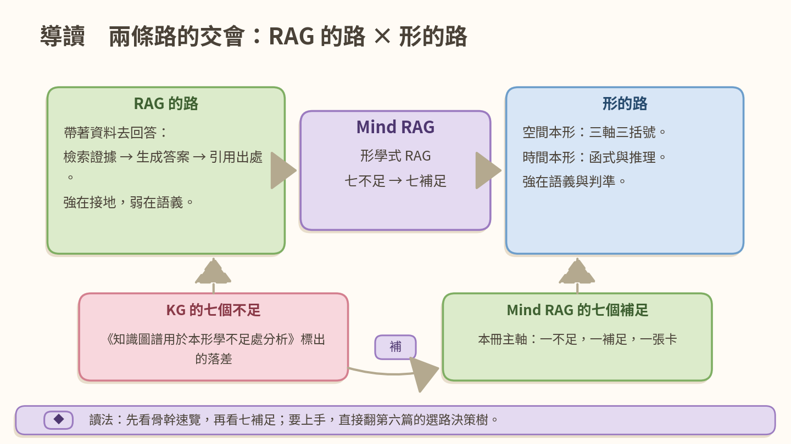

**圖 D-1　RAG 的路與形的路，在 Mind RAG 交會**

## 兩條路，各有長短

RAG 的路，是「帶著資料去回答」。使用者提問，系統檢索證據，模型生成答案，答案帶著引用出處。這條路的長處是接地：答案不靠模型憑空記憶，而是站在真實文件上。短處在語義：檢回來的片段像什麼、算什麼、由什麼組成、裝在誰裡面——它說不清。

形的路，是本形學走出來的路。空間本形用三種括號說三種關係——[ ] 說「是類別」、{ } 說「是部件」、( ) 說「裝在裡面」，各掛各的判準；時間本形用函式說「怎麼做」——輸入一個形，產出一個形。這條路的長處正是語義與判準，短處是它需要一套落地的方法，才能餵進真實的問答系統。

Mind RAG 站在兩條路的交會點上：把形的語義與判準，補進 RAG 的每一個環節。

## 本冊新增的三個名字

本冊不另造體系，只在既有骨幹上新增三個名字，後面各篇反覆使用。第一個是「五種檢索形」——文件形、知識形、查詢形、證據形、答案形，進出檢索鏈的五張臉；第二個是「七補足」——三括號分立、身份錨、三層判斷、生成鏈存檔、函式四問、推理五族、演化迴路，對治七個不足的七張卡；第三個是「日誌六欄位」——查詢形、檢索式、證據形集、判準記錄、推理鏈、答案形，可複核的準的載體。記住這三個名字，全書的地圖就在手上。

## 本冊的走法

第一篇先立定位：為什麼需要 Mind RAG。第二篇把要用的骨幹一次點名——只用不教。第三篇走空間：檢索世界的形。第四篇走時間：檢索與生成的函式。第五篇是核心主軸：七不足 → 七補足，一張卡對一個落差。第六篇給準確使用方法：體—用—準、證明六步驟、八問、誤用對照、選路決策樹。第七篇收總架構，第八篇給內容完整方案——學練用教建、八週路線、建庫四階段，一路到驗收。

> **讀法建議**
>
> 求快：導讀 → 七張補足卡 → 選路決策樹，三小時上手。
>
> 求穩：照篇章順序走、做練習；求用：直接翻第八篇開工，前面當手冊隨查。

# 第一篇　定位：Mind RAG 為什麼出生

## 1-1　RAG 一句話：帶著資料去回答

檢索增強生成（Retrieval-Augmented Generation，RAG）的定義可以壓成一句話：先檢索，後生成，答案帶著出處。比起裸問一個大語言模型，它多了兩件事：答案有證據撐腰，證據可以追查更新。醫療、法務、企業知識問答之所以擁抱 RAG，看上的就是這兩件事。

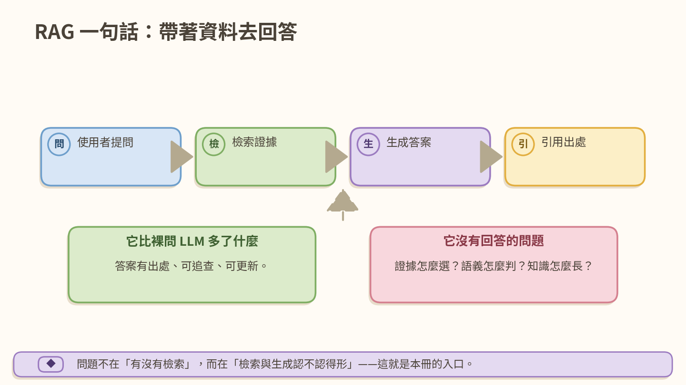

**圖 1-1　RAG 一句話：問 → 檢索 → 生成 → 引用**

但 RAG 沒有回答的問題，一樣是兩件事：證據怎麼選、語義怎麼判。檢索回來的片段，哪些算數、哪些不算？同一段文字裡的三種關係——是類別、是部件、還是裝在裡面——壓成一鍋後怎麼分辨？答案生成之後，憑什麼說它「準」？這些問題，正是形的本行。

## 1-2　五個痛點，都是形沒立好

把實務上 RAG 最常見的五個痛點排開來看，會發現它們共享同一個根源：形沒立好。

| 痛點 | 現場樣子 | 形的診斷 |
| --- | --- | --- |
| 幻覺 | 答案裡冒出證據沒有的內容 | 證據形沒立：無形可守，生成就飄 |
| 引用不明 | 答案與出處對不上、引了等於沒引 | 身份錨沒立：引文錨不住身 |
| 檢索碎片 | 檢回來東一塊西一塊，拼不成形 | 形集合沒立：無⊕合形的依據 |
| 不可複核 | 對錯說不清，只能憑感覺 | 判準沒立：無尺可量 |
| 知識不長大 | 用完就丟，系統永遠在原地 | 演化迴路沒立：無帳可查 |

**表 1-1　五個痛點 × 形的缺位**

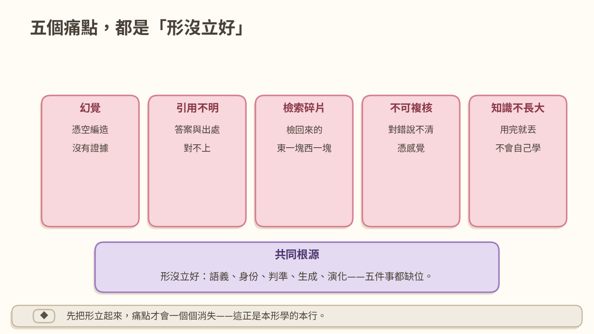

**圖 1-2　五個痛點：拆開是五件事，合起來是同一件事**

五個痛點不是五個獨立的 bug。把底片翻過來看：幻覺是語義缺位，引用不明是身份缺位，檢索碎片是結構缺位，不可複核是判準缺位，知識不長大是演化缺位。要補，就得整套補——這就是為什麼本冊的方案是「七補足」，不是七個小技巧。

## 1-3　三層定位：根、幹、果

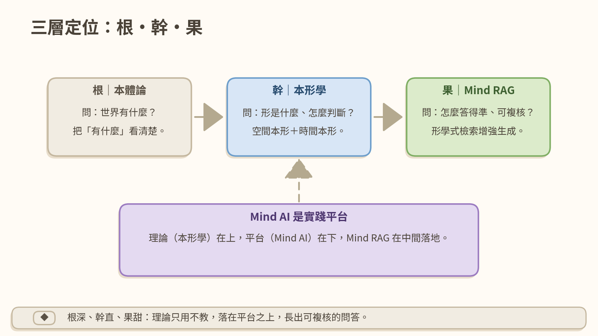

**圖 1-3　根幹果：本體論是根，本形學是幹，Mind RAG 是果**

把 Mind RAG 放回大圖裡，它是「果」的那一層。本體論問「世界有什麼」，是根；本形學問「形是什麼、怎麼判斷、怎麼運作」，是幹；Mind RAG 問「怎麼答得準、可複核」，結在枝頭。底下的土壤是 Mind AI——兩庫一中樞一迴路的實踐平台。理論只用不教，平台只引不述，果子才結得實。

## 1-4　主軸宣言：七不足 → 七補足

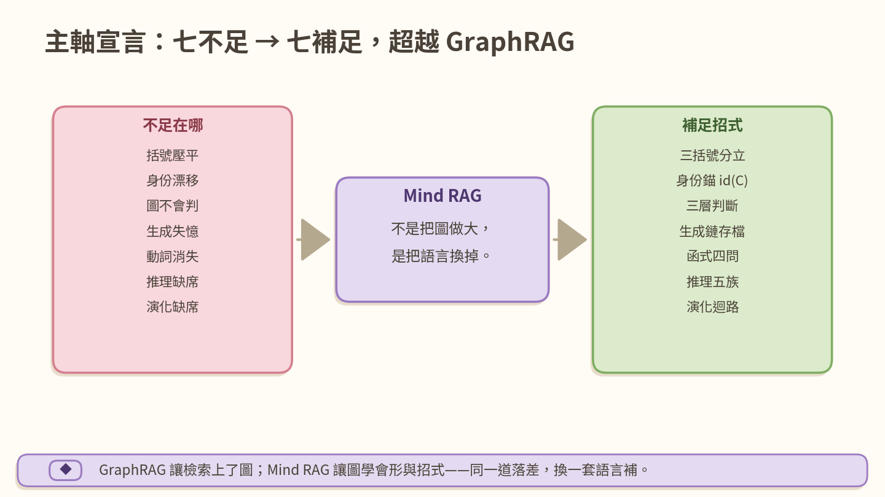

**圖 1-4　主軸宣言：不是把圖做大，是把語言換掉**

姊妹作的結論可以壓成一句話：知識圖譜的語言是「陳述」，本形學的語言是「形與招式」；陳述是說出來的結果，形要的是畫出來的過程，招式要的是跑起來的方法。GraphRAG 把檢索搬上圖譜，走的仍是陳述的語言——七個不足原封不動。Mind RAG 的主張是：不把圖做大，把語言換掉。七個不足，一對一補回；補足的招式，後面第五篇一張卡一張卡開。

> **【專業專欄 C1】RAG 簡史：從一篇論文到一條產業線**
>
> RAG 的名字來自 Lewis 等人 2020 年的論文（Retrieval-Augmented Generation for Knowledge-Intensive NLP Tasks）：把參數化的生成模型與非參數化的檢索索引接在一起，讓生成站在文件上。在此之前，問答系譜走過抽取式 QA（讀一段挑一句）與知識庫 QA（查三元組回答）兩支；RAG 把「檢索一段文字」與「生成一段話」焊成一條管線。
>
> 2023 年後這條線快速分岔：RA-DIT 把檢索器與生成器一起微調；Self-RAG 讓模型學會「什麼時候該查、查回來的算不算數」；GraphRAG（微軟，2024）把檢索單位從片段升級到「社群摘要＋子圖」，回答跨文件的全局問題。再往後，KG-Search 一系把實體與關係檢索做到極致，與 GraphRAG 逐漸合流。
>
> 看這段簡史要抓的重點只有一個：RAG 的演化史，就是一部「檢索語義不夠用」的補課史——片段語義不夠，就上圖；圖的語義還是不夠，就輪到形。本冊站在這條補課線的下一站。
>
> 還有一條暗線值得記：這條產業線上的每個里程碑，都把「檢索」的定義擴大了一圈——從找片段，到找結構，到找摘要，再到找「能回答問題的形」。Mind RAG 的定義屬於最後一種：檢索的終點不是文件，是帶著判準的形。

> **練習 E01　定位**
>
> - E01-1　用一句話向同事解釋「RAG 比裸問 LLM 多了什麼」，再用一句話說明它還缺什麼。
> - E01-2　從表 1-1 挑一個你遇過的痛點，對照「形的診斷」欄，說明它為什麼不是單點問題。

# 第二篇　骨幹速覽：只用不教的六件工具

進正文之前，先把要用的骨幹一次點名。以下六件工具全部來自本形學與 Mind AI 的既有成果——依約定二，只點名、不教學；它們是本冊的地基，讀過原典的溫故知新，沒讀過的把這一篇當速覽圖。

## 2-1　認知鏈 × 檢索鏈

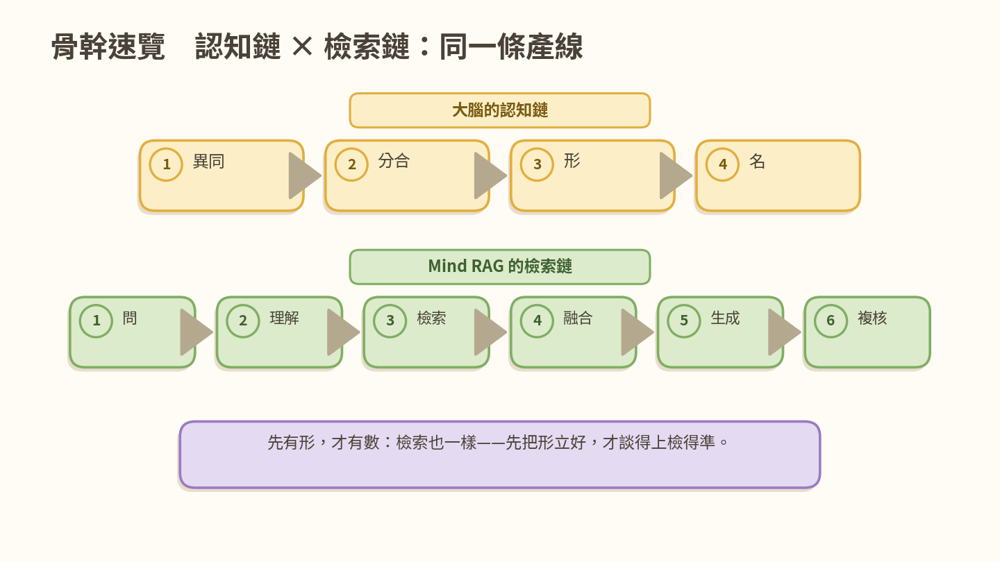

**圖 2-1　同一條產線：大腦的認知鏈與 Mind RAG 的檢索鏈**

本形學的認知鏈是「異同 → 分合 → 形 → 名」：先看出不一樣，才圈得出邊界；邊界定形，形才有名。Mind RAG 的檢索鏈「問 → 理解 → 檢索 → 融合 → 生成 → 複核」是它的工程投影：先懂問題的異同，才分得出要找什麼；檢回來的東西分合融合，生成答案，最後複核命名。兩條鏈對得越齊，檢索越準。

## 2-2　三軸三括號：三種關係，三種判準

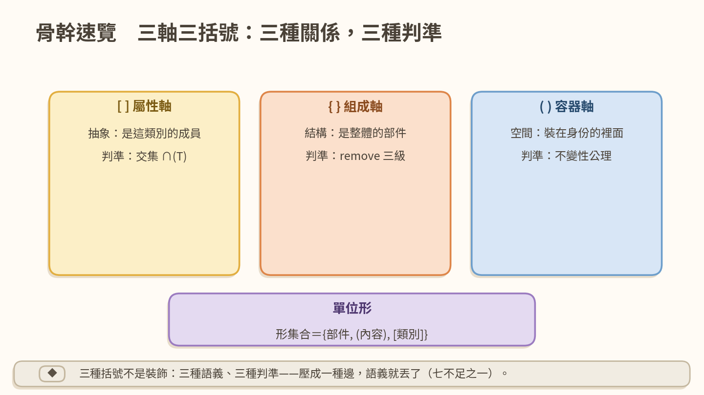

**圖 2-2　三軸三括號：語義與判準各歸其位**

空間本形的三條軸：屬性 [ ]（維度×刻度）、物料清單 { }（部件與 remove 三級）、容器 ( )（id(C) 與不變性公理）。單位形＝形集合＝{部件, (內容), [類別]}。這三種括號是三種完全不同的關係——檢索時若壓成一種，語義就丟了。

## 2-3　三層判斷：漏斗，不是查表

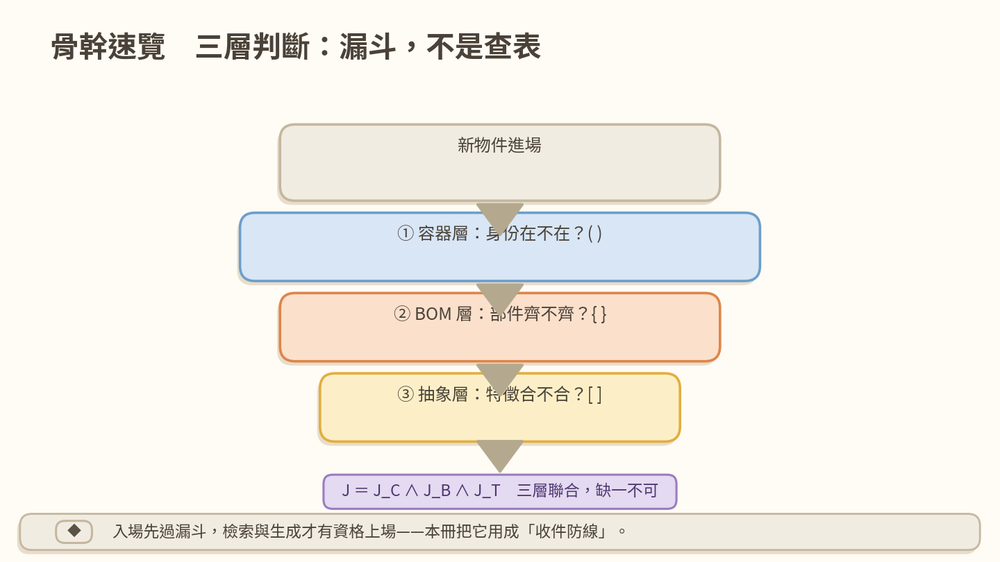

**圖 2-3　三層判斷漏斗：J ＝ J_C ∧ J_B ∧ J_T**

形邏輯的判斷是漏斗：容器層問「身份在不在」，BOM 層問「部件齊不齊」，抽象層問「特徵合不合」——三層聯合，缺一不可。它與查表的根本分別在開放性：名單查得到的，名單有用；名單查不到的（沒見過的新東西），規則開口。

## 2-4　時間本形：函式四問

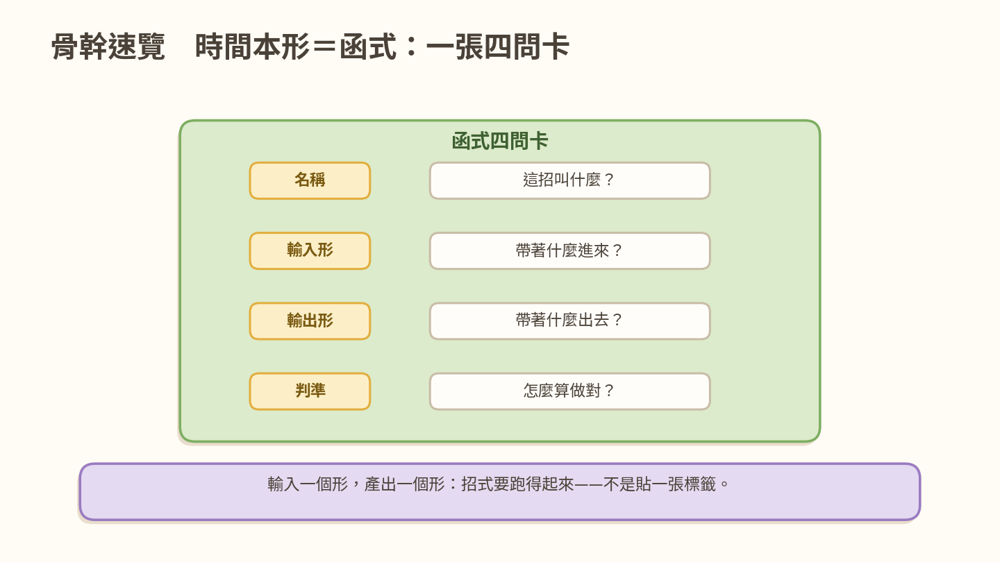

**圖 2-4　函式四問卡：名稱、輸入形、輸出形、判準**

時間本形＝動詞＝函式＝招式。一張四問卡說盡一個招式：名稱、輸入形、輸出形、判準。時間本形依附空間本形：輸入一個形，產出一個形。檢索鏈上的每一站，都是一張四問卡——第四篇會逐一開卡。

## 2-5　五大運算：op：Type → Type

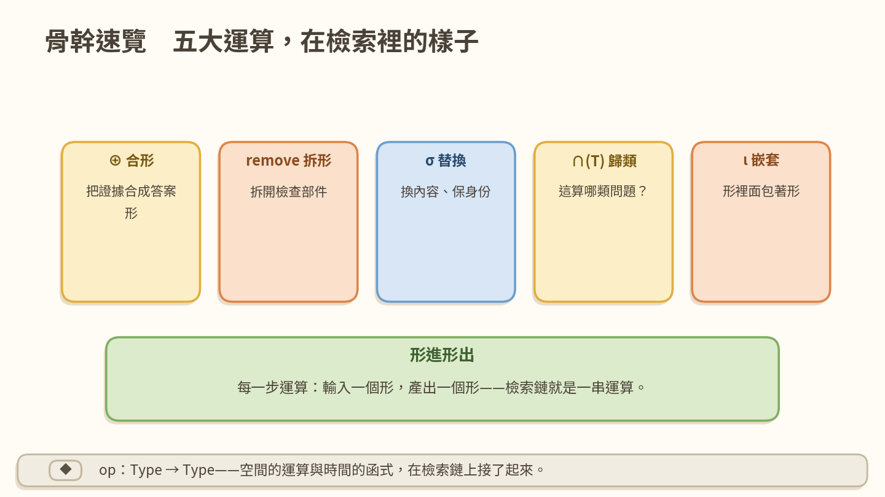

**圖 2-5　五大運算在檢索裡的樣子**

形集合的五大運算——⊕ 合形、remove 拆形、σ 替換、∩(T) 歸類、ι 嵌套——是形的算術。檢索的每一步都在跑這些運算：把證據合成答案是合形，把證據拆開檢查是拆形，換掉內容守住身份是替換，判斷問題類別是歸類，形裡包著形是嵌套。空間的運算與時間的函式，在檢索鏈上接了起來。

## 2-6　Mind AI 平台：兩庫一中樞一迴路

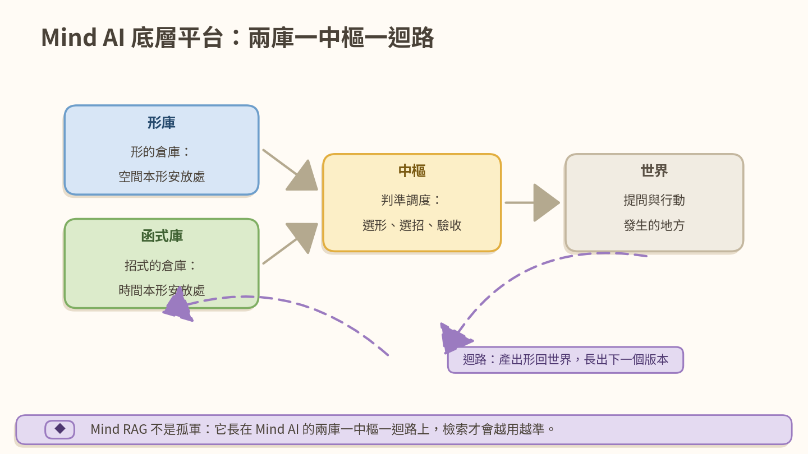

**圖 2-6　Mind AI：兩庫一中樞一迴路**

Mind AI 是本形學與 Mind Model 的實踐平台：形庫安放空間本形，函式庫安放時間本形，中樞做選形、選招、驗收的判準調度，迴路把產出的形送回世界、長出下一個版本。Mind RAG 不是孤軍——它長在這四件套上，檢索才會越用越準。

## 2-7　映射總表：RAG × 本形學

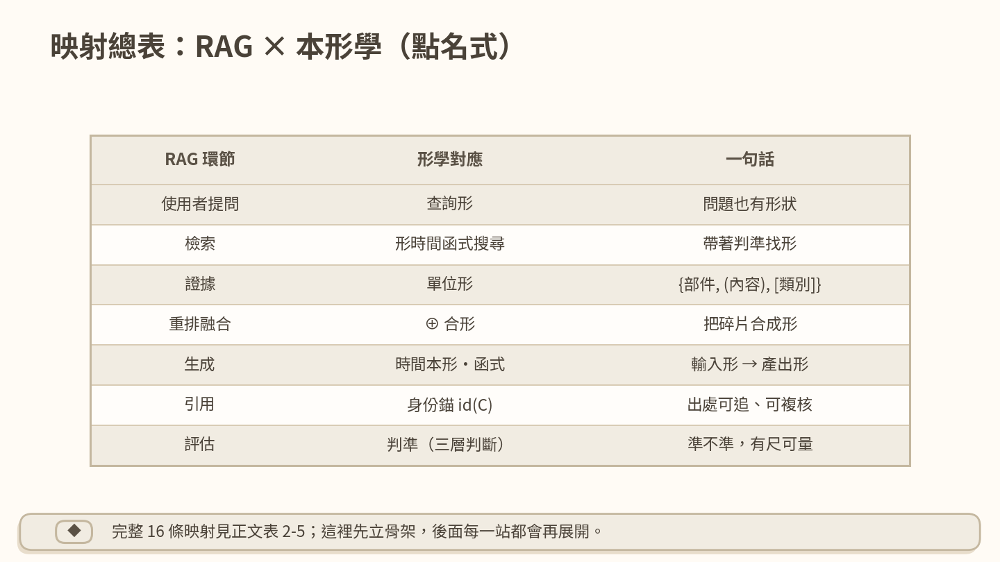

**圖 2-7　映射總表：RAG 環節與形學語義的對照骨架**

| RAG 環節 | 形學對應 | 一句話 | 展開處 |
| --- | --- | --- | --- |
| 使用者提問 | 查詢形 | 問題也有形狀 | 3-1 |
| 查詢改寫 | σ 替換 | 換說法，不換意圖 | 4-2 |
| 檢索 | 形時間函式搜尋 | 帶著判準找形 | 4-2 |
| 證據 | 單位形 | {部件, (內容), [類別]} | 3-1 |
| 重排 | ∩(T) 歸類 | 算不算數，當場驗 | 3-4 |
| 融合 | ⊕ 合形 | 把碎片合成形 | 4-1 |
| 生成 | 時間本形・函式 | 輸入形 → 產出形 | 4-2 |
| 引用 | 身份錨 id(C) | 出處可追、可複核 | 5-2② |
| 評估 | 判準・三層判斷 | 準不準，有尺可量 | 6-4 |
| 記憶 | 形庫・演化迴路 | 用完回寫，越用越準 | 5-2⑦ |

**表 2-1　RAG × 本形學映射總表（完整版，各欄展開處見右欄）**

> **【專業專欄 C6】知識圖譜的七限制，與 Mind Model 的回答**
>
> 《Mind AI 簡介》在推出 Mind Model 時，列過傳統知識圖譜的七條限制：本形學表達能力有限、關係表達能力有限、缺乏深層推理、難以表示抽象概念、缺乏思維結構、難以統一跨領域知識、難以支持持續演化學習。這七條與姊妹作的七不足隔空呼應——前者是平台視角的能力清單，後者是理論視角的語義拆解，指向同一道落差。
>
> Mind Model 的回答是換語言：不建傳統知識圖譜，而建「模擬人類認知方式的統一知識模型」——本形學資料庫容納語言、數學、物理、化學、生物、程式、哲學、商業、工程、社會、經驗、隱性知識，以及未來任何新領域；統一思維能力則把邏輯、歸納、演繹、類比、因果推理與規劃決策收進同一架構。
>
> 把這段背景記在心裡，第三、四篇的「空間四不足×檢索現場」「時間三不足×生成現場」讀起來會更有共鳴：那些翻車案例，就是七限制在問答現場的現形。
>
> 反過來說，七限制也是驗收的尺：每當系統出現「說不清、存不下、判不動、跟不上的狀況」，先別急著修功能——回來對照七限制，多半會發現是語言層的缺口，該上補足卡。

> **練習 E02　骨幹**
>
> - E02-1　不看書，畫出三軸三括號草圖，標出三種判準各自的名稱。
> - E02-2　用「檢索鏈六站」重述你最近一次找資料的過程：每一站你其實做了什麼？

# 第三篇　空間本形：檢索世界的形

空間本形回答「是什麼・有什麼・在哪裡」。檢索世界裡游著五種形——文件形、知識形、查詢形、證據形、答案形；它們各就各位，檢索才有準頭。這一篇先把五種形立起來，再看三軸怎麼對上檢索的三大流派，最後用 remove 三級與三層判斷，把「取捨」與「收件」兩道關卡立成規矩。

## 3-1　五種檢索形

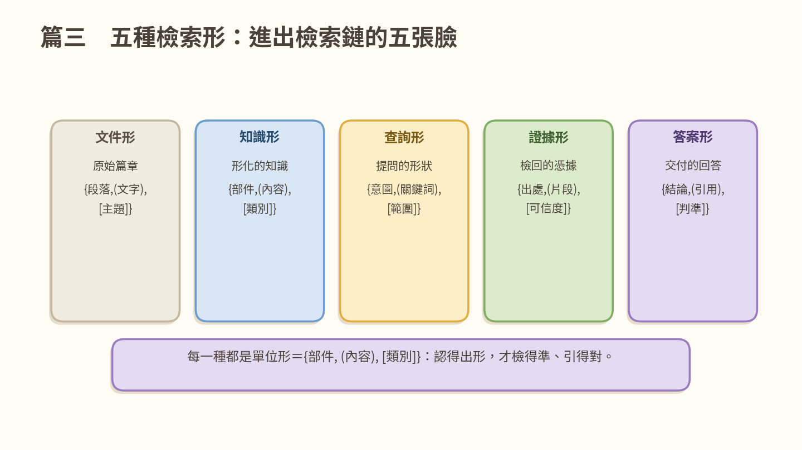

**圖 3-1　五種檢索形：進出檢索鏈的五張臉**

每一種檢索形都是單位形＝{部件, (內容), [類別]}。文件形是原始篇章，部件是段落，內容是文字，類別是主題；知識形是形化後的知識，帶著判準與生成鏈；查詢形是提問的形狀——意圖、關鍵詞、範圍三件套；證據形是檢回來的憑據，帶著出處與可信度；答案形是最終交付，帶著結論、引用與判準記錄。

| 檢索形 | {部件} | (內容) | [類別] | 立形的要點 |
| --- | --- | --- | --- | --- |
| 文件形 | 段落・節 | 原文文字 | 主題域 | 切分粒度＝部件邊界 |
| 知識形 | 概念・命題 | 形化敘述 | 形的類別 | 帶判準與生成鏈 |
| 查詢形 | 意圖・關鍵詞 | 提問原文 | 問題類型 | 先立形，再檢索 |
| 證據形 | 片段・資料點 | 引用原文 | 可信度刻度 | 出處身份必填 |
| 答案形 | 結論・引用 | 生成文本 | 答案類型 | 句句可回指證據 |

**表 3-1　五種檢索形的形集合構造**

五種形的轉換，就是檢索鏈的內容：查詢形進去，證據形出來；證據形⊕合成答案形，答案形再帶著引用回指證據形。認得出每一張臉，才不會把「檢索回來的片段」直接當「答案」用。

## 3-2　三軸對讀：向量、圖、庫

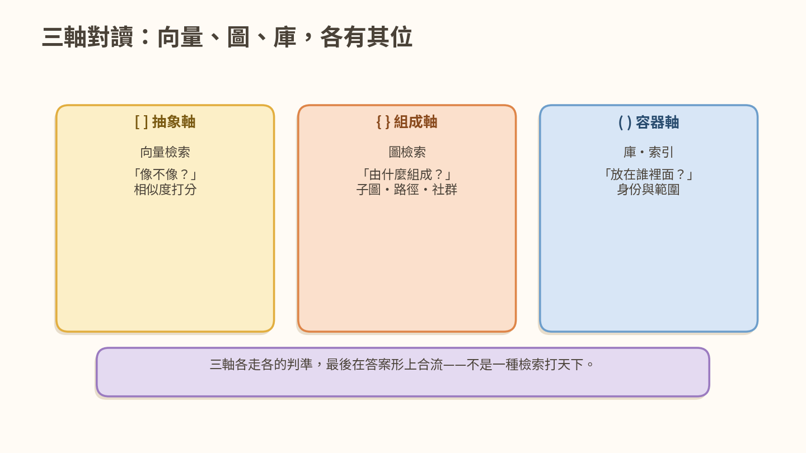

**圖 3-2　三軸對讀：向量走抽象、圖走組成、庫守容器**

檢索的三大流派，剛好對上空間本形的三條軸。向量檢索走抽象軸 [ ]：把文字壓成座標，問「像不像」——它天生是相似度語言，適合「找同類」。圖檢索走組成軸 { }：子圖、路徑、社群，問「由什麼組成、經由什麼相連」——它天生是結構語言，適合「找關係」。庫與索引守容器軸 ( )：範圍、身份、歸屬，問「放在誰裡面」——它天生是身份語言，適合「找出處」。

三軸各走各的判準，最後要在答案形上合流。誤區是拿一種檢索打天下：只用向量，問「A 由什麼組成」就露餡；只用圖，問「有沒有類似的說法」就卡住；只用庫，答案永遠是一張出處清單，不是回答。

## 3-3　remove 三級：檢索的取捨地圖

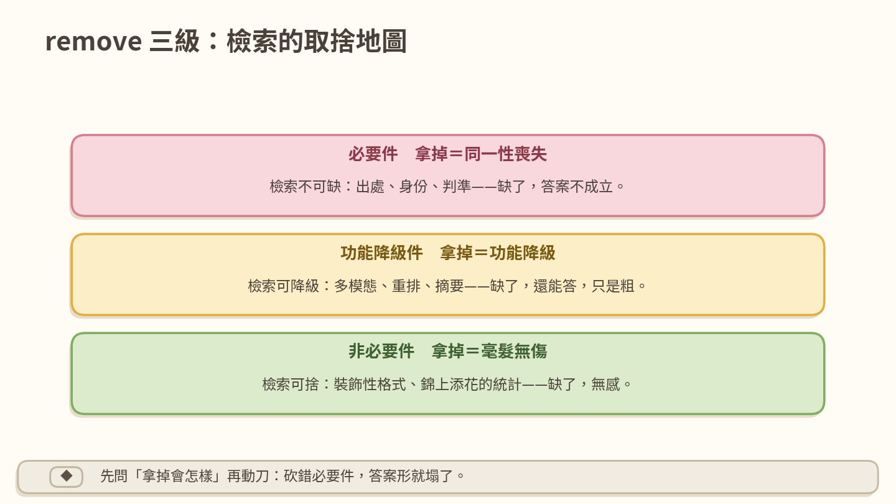

**圖 3-3　remove 三級：先問「拿掉會怎樣」，再動刀**

組成軸的 remove 判準問的是反事實：「把部件拿掉，會怎樣？」必要件：拿掉後同一性喪失；功能降級件：拿掉後功能缺但身份存續；非必要件：拿掉後毫髮無傷。把這把刀用在檢索系統上，就是一張取捨地圖：出處、身份、判準是必要件——砍了答案不成立；重排、摘要、多模態是功能降級件——砍了還能答，只是粗；裝飾性格式、錦上添花的統計是非必要件——砍了無感。

這張地圖的用法很實在：資源不夠時，照三級排隊砍——先捨非必要件，再降功能降級件，必要件一根都不能動。

## 3-4　三層判斷＝收件防線

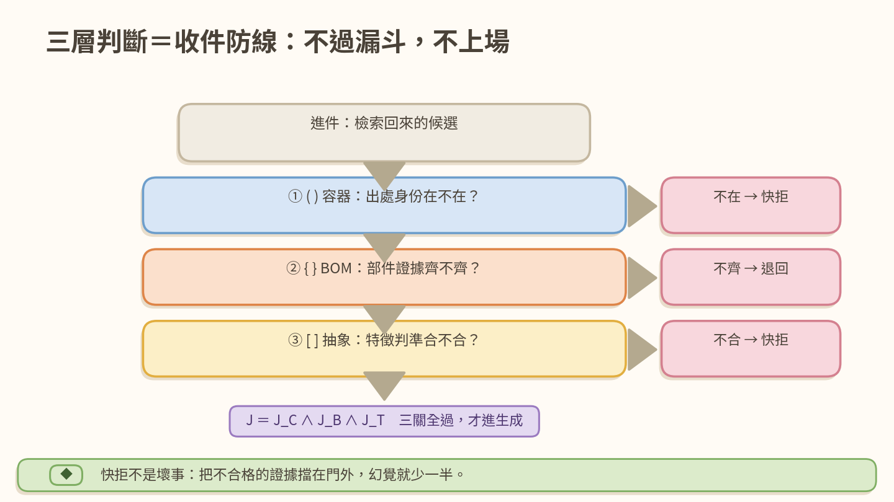

**圖 3-4　收件防線：三關全過，才進生成**

檢索回來的候選，在進生成之前要過三層判斷的收件防線：容器層驗出處身份在不在（不在，快拒）；BOM 層驗部件證據齊不齊（不齊，退回）；抽象層驗特徵判準合不合（不合，快拒）。快拒不是失敗——把不合格的證據擋在門外，幻覺就少一半。

這裡正是「查表 vs 判斷」的分水嶺。查表回答「有沒有登錄過」，判斷回答「算不算這類」。收件防線要的是後者：名單上沒有的新樣式，規則一視同仁當場驗。

## 3-5　空間四不足，在檢索現場

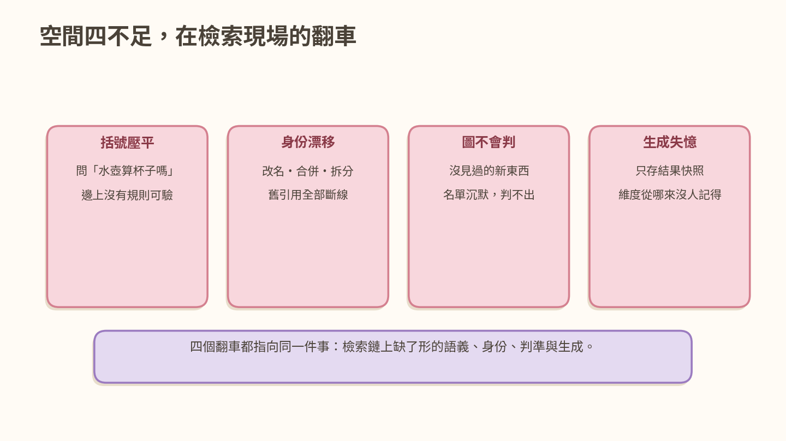

**圖 3-5　空間四不足的檢索現場翻車**

姊妹作標出的空間篇四不足——括號壓平、身份漂移、圖不會判、生成失憶——在檢索現場各有翻車樣態。問「水壺算不算杯子」，壓平的邊上沒有規則可驗；文件改名合併，舊引用全部斷線；吸管杯沒登錄過，名單沉默；「蓋子」這維度從哪來，圖裡沒有出生證明。四場翻車，四個補足的入口——第五篇的補足卡①到④，就是為這四個現場準備的。

> **這一篇的一句話**
>
> 檢索世界的形立起來了：五種形、三條軸、一把刀、一道防線。
>
> 下一篇換時間——形怎麼跑、怎麼推理、怎麼長大。

> **【專業專欄 C3】檢索六家族：一座座不同的橋**
>
> 把主流檢索方式攤開來看，大致可分六大家族：向量（相似度近鄰）、結構化（欄位與查詢語言）、子圖（鄰域擴張與社群）、路徑（多跳行走）、社群（分群與彙總）、迭代（多輪精煉）。它們不是對手，是六座不同的橋——問題的形狀決定走哪座。
>
> 對照本篇的三軸：向量家族守抽象軸，子圖與路徑家族走組成軸，結構化與社群家族靠容器軸撐腰，迭代家族則是時間本形的客人——它把檢索做成多輪迴圈，越走越準。混合檢索（多家族融合）之所以有效，正是因為三軸本來就該各走各的判準。
>
> 選型心法一頁說完：先問問題的形狀——找同類走向量、找關係走子圖與路徑、找範圍走結構化、找全局圖景走社群、問題複雜就上迭代。第六篇的選路決策樹會把這段話展開成可操作的流程。
>
> 值得補一筆的是「迭代家族」的特殊地位：它把檢索做成多輪迴圈——查了再改寫、改寫再查——這正是時間本形「形進形出」的節奏。六家族裡，迭代家族是唯一天生帶時間性的；用好它，等於把時間本形裝進了檢索。

> **練習 E03　空間**
>
> - E03-1　把「證據形」寫成形集合：{部件, (內容), [類別]} 各填什麼？為什麼出處必須放進內容位？
> - E03-2　用 remove 三級評估你所在團隊的一個檢索系統：哪些元件是必要件、降級件、非必要件？
> - E03-3　舉一個「查表查不到、判斷判得出」的例子（不限電腦，日常生活也算）。

# 第四篇　時間本形：檢索與生成的函式

空間本形回答「是什麼」，時間本形回答「怎麼做」。檢索鏈六站，站站是函式；六張四問卡，把每一站寫成可執行的招式。推理五族負責開新路，思考法負責選方向；LLM 與 Mind Model 各守其位。這一篇把「跑起來」的全部裝備配齊。

## 4-1　檢索鏈六站：形進形出

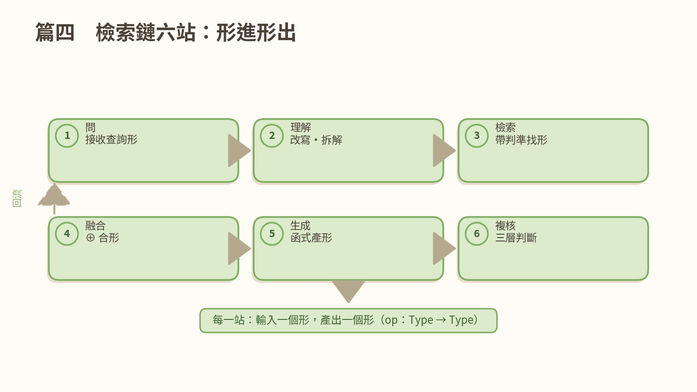

**圖 4-1　檢索鏈六站：每一站都是 op：Type → Type**

問 → 理解 → 檢索 → 融合 → 生成 → 複核——六站走完，一個查詢形長成一個答案形。六站的共同契約只有一條：形進形出。每一站輸入一個形、產出一個形，產出物不合格就退回上一站，不硬著頭往下走。

值得停一秒的是「理解」站。問題不是拿到就檢：先立查詢形——意圖、關鍵詞、範圍；說法太糊就做 σ 替換（換說法不換意圖），問題太大就做拆解（大形拆小形），拆完再檢。理解站的產出是精準的查詢形，後面四站才有靶可打。

## 4-2　六張函式四問卡

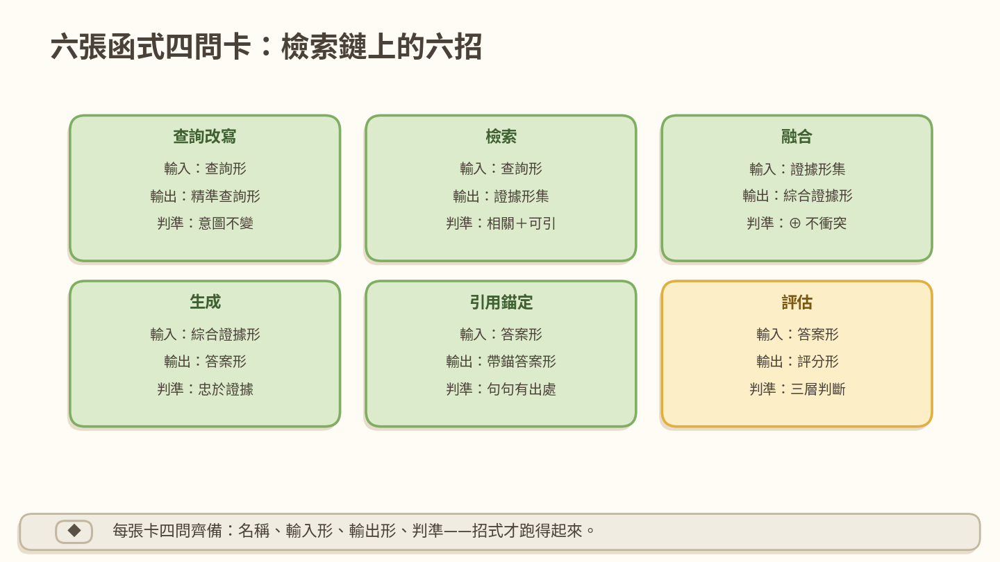

**圖 4-2　六張四問卡：檢索鏈上的六招**

| 招式 | 輸入形 | 輸出形 | 判準 |
| --- | --- | --- | --- |
| 查詢改寫 | 查詢形 | 精準查詢形 | 意圖不變（σ 保身份） |
| 檢索 | 精準查詢形 | 證據形集 | 相關且可引 |
| 融合 | 證據形集 | 綜合證據形 | ⊕ 合形不衝突 |
| 生成 | 綜合證據形 | 答案形 | 忠於證據、不越權 |
| 引用錨定 | 答案形 | 帶錨答案形 | 句句有出處可回指 |
| 評估 | 帶錨答案形 | 評分形 | 三層判斷＋四層準確性 |

**表 4-1　六站六卡：名稱、輸入形、輸出形、判準**

六張卡的價值在可執行：寫清楚輸入輸出與判準，任何團隊成員拿卡就能跑，跑完能驗——這就是「招式」與「標籤」的分別。

## 4-3　推理五族：問答要開新路

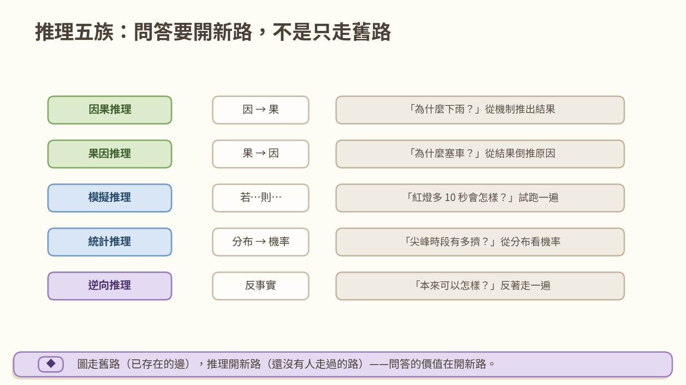

**圖 4-3　推理五族：帶著方向與機制開新路**

推理是時間本形的心臟。因果推理從因推到果，果因推理從果倒推因，模擬推理在腦中試跑一遍，統計推理從分布看機率，逆向推理反事實走一遍——五族接力，人類「想事情」的招式就齊了。它們與圖查詢的分別在一句話裡：圖走舊路（沿已存在的邊），推理開新路（走還沒有人走過的路）。

檢索現場最經典的翻車，是把「有關」當「所以」：圖上「公雞叫」和「天亮」連在一起——這是相關；因果要問誰使誰發生——地球自轉使天亮，公雞叫只是同時發生。答案形要寫「所以」，就得讓推理五族上場，不能讓一條無方向的邊背書。

## 4-4　思考法選路：怎麼想，決定怎麼檢

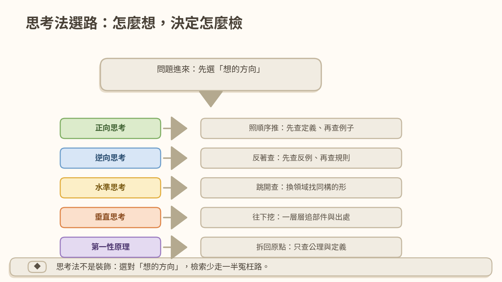

**圖 4-4　思考法選路：正向、逆向、水準、垂直、第一性原理**

思考法一族管的是「想的方向」：正向照順序推，逆向反著查，水準跳開換領域找同構的形，垂直一層層追部件與出處，第一性原理拆回公理與定義。方向選對，檢索少走一半冤枉路；方向選錯，檢得再多也是繞圈。

## 4-5　時間三不足，在生成現場

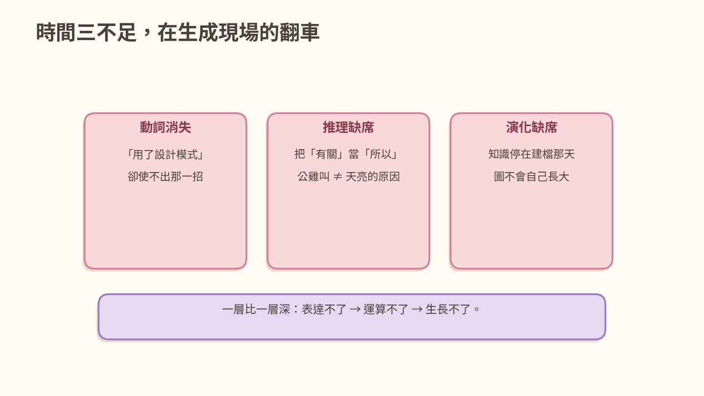

**圖 4-5　時間三不足的生成現場翻車**

動詞消失、推理缺席、演化缺席——姊妹作的時間篇三不足，在生成現場排成一列：知道「用了設計模式」卻使不出那一招，是動詞消失；把「有關」當「所以」，是推理缺席；知識停在建檔那天、圖不會自己長大，是演化缺席。一層比一層深：表達不了、運算不了、生長不了。

## 4-6　LLM 與 Mind Model：各守其位

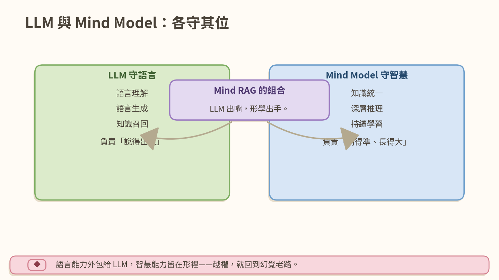

**圖 4-6　各守其位：LLM 出嘴，形學出手**

Mind AI 的分工宣示很乾脆：LLM 負責語言能力——語言理解、語言生成、知識召回；Mind Model 負責智慧能力——知識統一、深層推理、長期記憶、自主學習、思維管理。放在 Mind RAG 裡：生成的措辭交給 LLM，證據的取捨、判準的執行、推理的走向、知識的回寫，留在形與判準裡。越權，就回到幻覺老路。

> **【專業專欄 C2】GraphRAG 考據：社群、子圖與全局問題**
>
> GraphRAG（微軟研究院，2024）針對向量 RAG 的盲區——跨文件的全局性問題（「這批文件的主題共識是什麼？」）——提出兩種檢索模式：Global Search 用「社群摘要」層級做地圖式回答，Local Search 從實體鄰域出發做細節式回答。建庫時它先把文件抽取成實體與關係圖，再做社群偵測與層級摘要。
>
> 它的貢獻是把檢索單位從「文字片段」升級到「結構＋摘要」，讓全局問題第一次有解；它的邊界也在同一處：抽取出來的仍是陳述式的節點與邊——三種括號壓成一種關係、身份靠名稱錨定、判斷靠檢索規則、推理靠圖上行走。七不足在社群摘要裡依然成立，只是藏得更深。
>
> 所以本冊對 GraphRAG 的態度是繼承與超越並存：三同（起點、方法、產出）照單全收，五異（壓縮內容、關係型態、推理方式、學習更新、可複核性）逐一補形。第七篇會把三同五異攤開成表。

> **練習 E04　時間**
>
> - E04-1　挑檢索鏈的任意一站，寫出它的四問卡（名稱、輸入形、輸出形、判準），判準欄至少一條可驗證的條件。
> - E04-2　用推理五族各造一個問答例子：同一個主題，五族各開一條不同的路。
> - E04-3　「公雞叫所以天亮」是翻車現場。請用因果與相關的分別，改寫成一句不翻車的回答。

# 第五篇　七不足 → 七補足：核心主軸

這一篇是全書的心臟。姊妹作標出七個不足，本冊逐一開方：一不足、一補足、一張卡。每張卡照固定格式排——不足回顧、補足招式、現場示範——看的是同一道落差的兩面：左邊是「圖說不清的地方」，右邊是「形接得住的地方」。

## 5-1　補足總覽

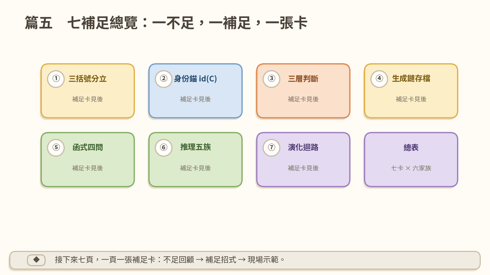

**圖 5-1　七補足總覽：一不足，一補足，一張卡**

七個補足不是七個新發明——它們全部是本形學既有語義的「上崗」：三括號本來就分立，身份錨本來就在公理裡，三層判斷本來就是漏斗，生成鏈本來就有四步，函式本來就要四問，推理本來就有五族，演化本來就該成迴路。不足之處，正是它們缺席的地方；補足，就是把它們請回來，各守其位。

## 5-2　七張補足卡

### 補足卡①　括號壓平 → 三括號分立

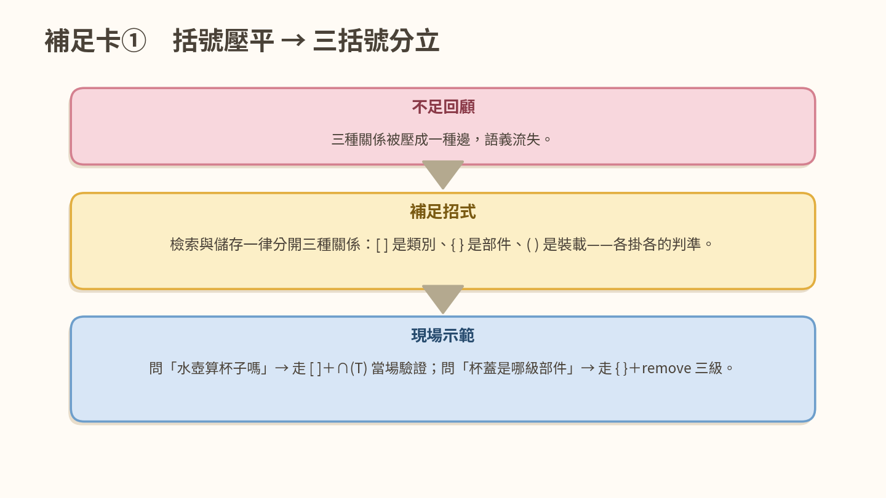

**圖 5-2　補足卡①：三種關係，分開住**

不足回顧：三種關係被壓成一種邊之後，查詢分不出是哪一種問法，判斷不知道該用哪條規則——語義不是被簡化，是被丟掉。

補足招式：檢索、建模與儲存一律分開三種關係：[ ] 是類別（交集判準 ∩(T) 當場驗）、{ } 是部件（remove 三級分層）、( ) 是裝載（不變性公理守身份）。邊不再是一種，而是三種；每種關係進自己的欄位、掛自己的判準。

現場示範：問「水壺算不算杯子」，走 [ ]＋∩(T)：能裝液體嗎？能被手持喝嗎？全過才歸類。問「杯蓋是哪一級部件」，走 { }＋remove 三級：拿掉杯蓋，杯子還是杯子，只是功能降級——它是功能降級件。兩種問法，兩條路，不再擠同一條邊。

### 補足卡②　身份漂移 → 身份錨 id(C)

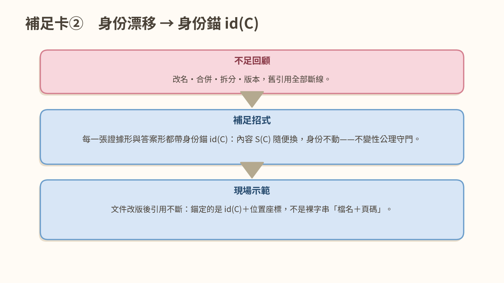

**圖 5-3　補足卡②：內容可換，身份不換**

不足回顧：沒有身份錨，改名、合併、拆分、版本更新都是災難：標籤一換，舊名字下的關係斷成孤島；URI 相等只是「指標沒改」，不是「身份沒改」。

補足招式：每一張證據形與答案形都帶身份錨 id(C)：容器 C ＝ ( id(C), S(C) )，內容 S(C) 隨便換，身份 id(C) 一動不動——不變性公理寫進資料契約。引用錨定的是 id(C)＋位置座標，不是裸字串「檔名＋頁碼」。

現場示範：文件改版了怎麼辦？內容替換（σ 替換）保身份：舊引用跟著 id(C) 走到新版，出處鏈不斷。這就是「指標牌可以重掛，身份錨不會漂」在工程上的全部意義。

### 補足卡③　圖不會判 → 三層判斷

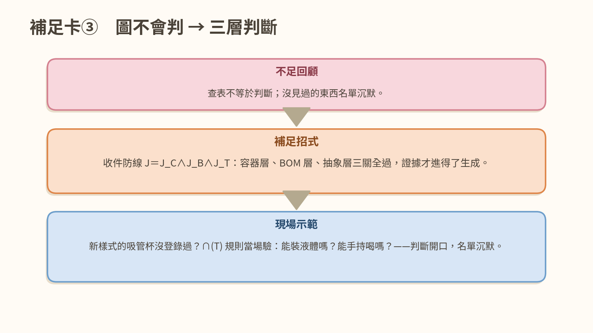

**圖 5-4　補足卡③：判斷是漏斗，不是查表**

不足回顧：查表回答「有沒有登錄過」，判斷回答「算不算這類」。名單查不到的新東西，名單沉默——而檢索現場每天都在進新東西。

補足招式：收件防線內建三層判斷 J ＝ J_C ∧ J_B ∧ J_T：容器層驗身份、BOM 層驗部件、抽象層驗特徵，三關全過才放行。開放規則取代封閉名單：名單上沒有的新成員，規則一視同仁當場驗。

現場示範：一隻沒見過的吸管杯進來：名單沉默，∩(T) 開口——能裝液體嗎？能手持喝嗎？驗完歸類，寫下判準記錄。這一步的產出不只是「放行」，還有「為什麼放行」——可複核的準從這裡開始。

### 補足卡④　生成失憶 → 生成鏈存檔

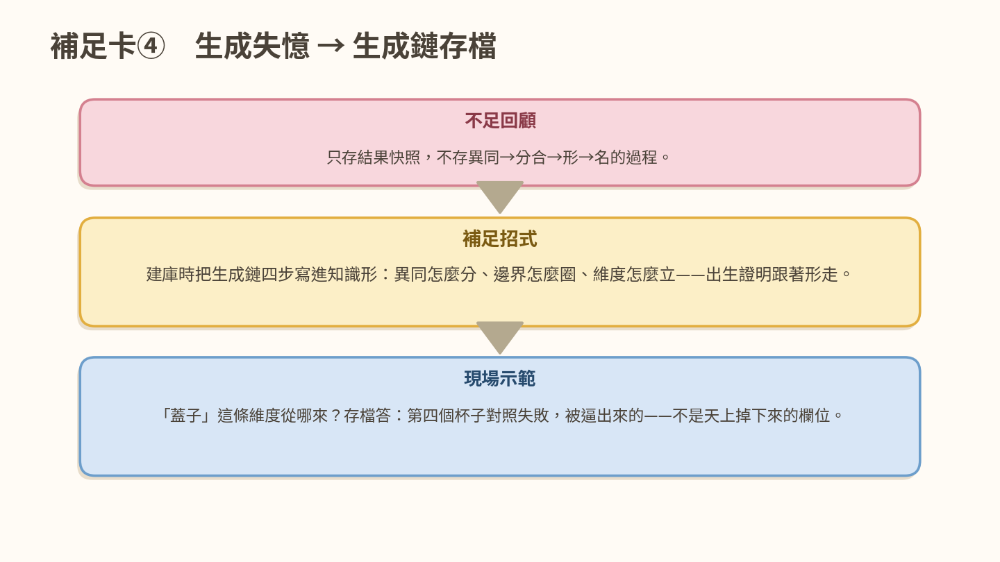

**圖 5-5　補足卡④：出生證明跟著形走**

不足回顧：圖是生成的結果快照：異同、分合、對照失敗的過程全部遺失——維度是繼承來的，不是解釋出來的；形畫錯了也無從回溯。

補足招式：建庫時把生成鏈四步寫進知識形的存檔欄位：異同怎麼分、邊界怎麼圈、形怎麼定、名怎麼取；維度的出生證明（對照失敗的現場）一起存。形不再是孤伶伶的結果，而是帶著出生證明的產物。

現場示範：有人問「『蓋子』這條維度從哪來」，存檔直接回答：第四個杯子帶來了前三個杯子對不上軸的差異，對照失敗，逼著認知另立一條新軸——維度是被逼出來的，不是天上掉下來的欄位。

### 補足卡⑤　動詞消失 → 函式四問

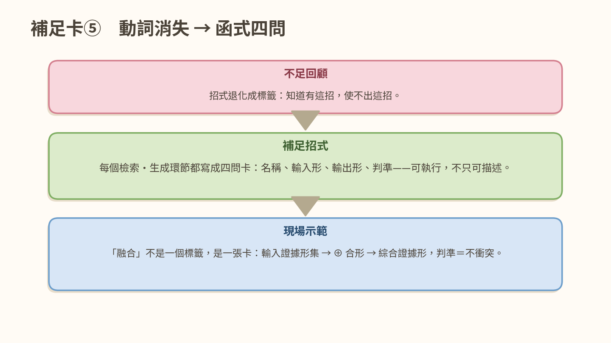

**圖 5-6　補足卡⑤：招式要跑得起來**

不足回顧：招式被存成「某某—是—設計模式」一條邊，輸入輸出對不齊、步驟沒人記得、可執行性歸零——動詞進了名詞的圖書館，被要求只做一張書卡。

補足招式：檢索與生成的每個環節都寫成函式四問卡：名稱、輸入形、輸出形、判準——可執行、可驗收，不只可描述。招式庫（函式庫）收卡不收標籤：一張卡就是一個跑得起來的動作。

現場示範：「融合」不是一個標籤，是一張卡：輸入證據形集 → ⊕ 合形 → 綜合證據形，判準＝不衝突、不重複、可回指。新人拿卡就能跑，跑完拿判準就能驗——這就是招式與標籤的全部分別。

### 補足卡⑥　推理缺席 → 推理五族

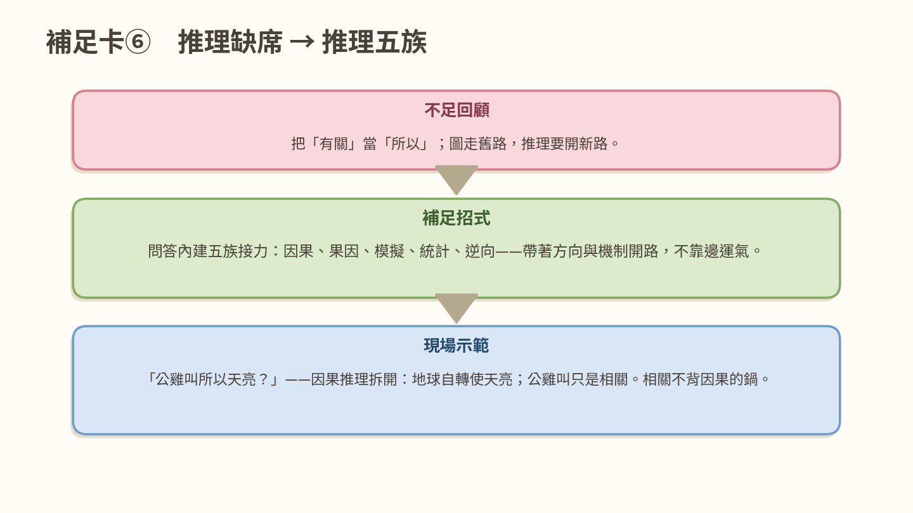

**圖 5-7　補足卡⑥：開新路，不走舊路**

不足回顧：查詢走的是已存在的邊，推理走的是還沒有人走過的路。把查詢當推理，就把「有關」當「所以」——圖本身沒有欄位提醒你這條邊沒有因果方向。

補足招式：問答內建推理五族接力：因果（因→果）、果因（果→因）、模擬（若…則…）、統計（分布→機率）、逆向（反事實）。答案形的推理欄位必須標明用的是哪一族、方向與機制是什麼——推理不再是黑箱。

現場示範：「公雞叫所以天亮？」因果族拆開：地球自轉使天亮，公雞叫只是相關。答案寫成「公雞叫與天亮相關，但因果是地球自轉」——相關不背因果的鍋，這一行字就是推理五族上崗的證明。

### 補足卡⑦　演化缺席 → 演化迴路

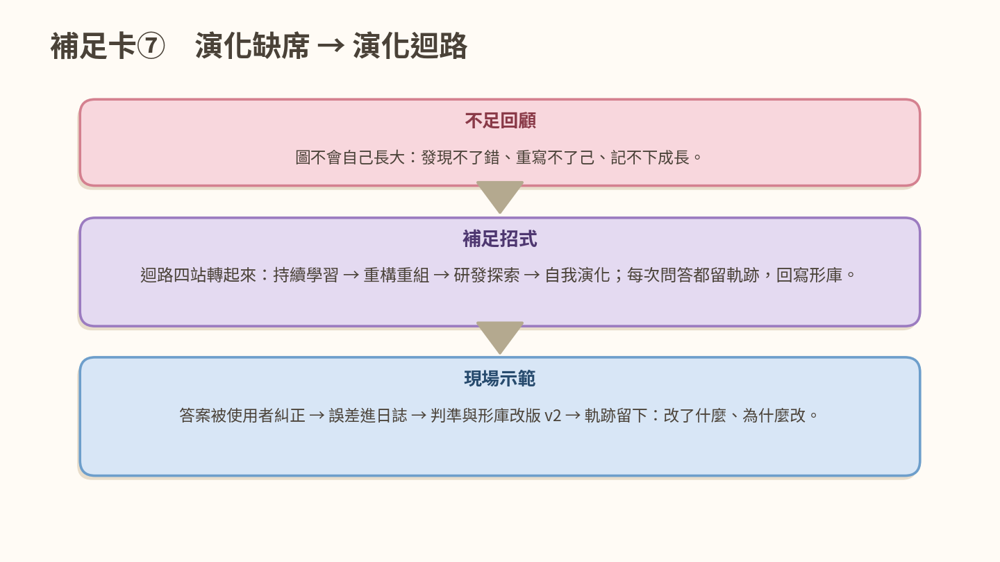

**圖 5-8　補足卡⑦：知識是一條流動的河**

不足回顧：動詞消失是表達不了，推理缺席是運算不了，演化缺席是生長不了：發現不了自己錯了、重寫不了自己、記不下成長——一本不會自己改自己的書，裝不下一條會流動的河。

補足招式：迴路四站轉起來：持續學習（新經驗進來）→ 重構重組（舊知識重新安放）→ 研發與探索（往未知推進）→ 自我演化（下一個版本的自己）。每次問答都留軌跡，回寫形庫；每次修正都留帳：改了什麼、為什麼改。

現場示範：使用者糾正了一個答案：誤差進日誌 → 判準與形庫改版 v2 → 軌跡留下。下次同類問題，系統站上 v2 的肩膀——這不是「人工改資料」，是知識帶著時間流動。

## 5-3　七補足 × 檢索六家族

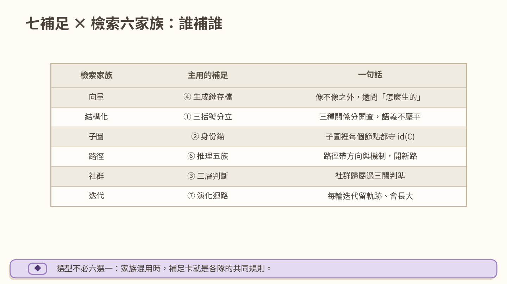

**圖 5-9　七補足 × 六家族：誰補誰**

| 檢索家族 | 主用的補足 | 輔用的補足 | 一句話 |
| --- | --- | --- | --- |
| 向量 | ④ 生成鏈存檔 | ③ 三層判斷 | 像不像之外，還問「怎麼生的」 |
| 結構化 | ① 三括號分立 | ② 身份錨 | 三種關係分開查，語義不壓平 |
| 子圖 | ② 身份錨 | ① 三括號分立 | 子圖裡每個節點都守 id(C) |
| 路徑 | ⑥ 推理五族 | ⑤ 函式四問 | 路徑帶方向與機制，開新路 |
| 社群 | ③ 三層判斷 | ④ 生成鏈存檔 | 社群歸屬過三關判準 |
| 迭代 | ⑦ 演化迴路 | ⑥ 推理五族 | 每輪迭代留軌跡、會長大 |

**表 5-1　七補足 × 六家族對照表**

選型不必六選一。家族混用時，補足卡就是各隊的共同規則：不管你從哪座橋過來，三括號要分立、身份要錨定、判斷要過三關、過程要存檔、招式要四問、推理要記族、軌跡要留下——七條規則，全場適用。

## 5-4　補足卡的組合技

七張卡不是只能單打。實務上最有力的是組合技：兩三張卡疊起來，對付一類具體的場景。以下六組是驗過好用的起手式。

| 組合 | 場景 | 疊法 |
| --- | --- | --- |
| ①＋③ | 問答收件 | 三括號分立進件，三層判斷把關——語義與判斷兩道閘一起開 |
| ②＋④ | 版本治理 | 身份錨守續接，生成鏈存檔守回溯——改版不斷線、不抹帳 |
| ⑤＋⑥ | 推理問答 | 四問卡寫招式，推理五族開路——「怎麼做」與「怎麼想」齊備 |
| ⑥＋⑦ | 研究探索 | 推理開新路，演化留軌跡——走過的路都變成下一版的地基 |
| ①＋② | 多源融合 | 語義分立防壓平，身份錨防漂移——來源再多，形不亂 |
| ③＋⑦ | 自我修正 | 判斷察覺誤差，迴路回寫改版——系統自己發現、自己長大 |

**表 5-2　補足卡組合技**

組合技的挑法很簡單：先問這場景最怕什麼——怕壓平上①、怕漂移上②、怕誤判上③、怕失憶上④、怕空談上⑤、怕亂推上⑥、怕停滯上⑦。怕兩樣，就疊兩張。

> **【專業專欄 C7】兩條公式：萃取與壓縮的兩條路**
>
> LLM 的路：語言結構 → Transformer（萃取與壓縮）→ Token 與其他 Token 間的關係（權重）。Mind Model 的路：語言結構 → 本形學（萃取與壓縮）→ Token 與其他 Token「時空結構」間的關係（權重）。兩條公式長得很像，差別就在中間那一段：壓成權重，還是立成形。
>
> 壓成權重，知識融進參數——說得出，但指不出；立成形，知識立在結構上——說得出，也指得出。RAG 的「引用出處」追求的就是「指得出」，但它只做到片段層的指；形學要做到語義層的指：指到括號、指到判準、指到生成鏈。
>
> 這組對照也是 Mind RAG 的設計總綱：凡是要「指得出」的部分——證據、判準、推理、軌跡——立成形；凡是「說得出」的部分——措辭、流暢、語氣——交給 LLM。兩條路各補各的短，合成完整的問答。
>
> 再往深看一步：壓縮與萃取本身不是問題，問題是「壓掉了什麼」。Transformer 壓掉了指涉與過程，形學則把指涉壓成身份錨、把過程壓成生成鏈——壓得可逆、壓得可查。兩種壓縮的差別，就是「權重裡找不回」與「結構裡查得到」的差別。

> **練習 E05　七補足（上）**
>
> - E05-1　用自己的話講述補足卡①與②，並各舉一個「沒有補足就翻車」的真實案例。
> - E05-2　為什麼「生成鏈存檔」能治「知識不長大」？請從出生證明與回溯兩面各說一句。

> **練習 E06　七補足（下）**
>
> - E06-1　把「融合」寫成四問卡，判準欄寫至少兩條可驗證的條件。
> - E06-2　演化迴路四站中，哪一站最常被誤解成「人工改資料」？說明兩者的分界。

# 第六篇　準確使用方法：體—用—準

形立起來了，補足配齊了，這一篇交方法。體—用—準是總綱：體是形與函式，用是檢索鏈六站，準是可複核的準。往下拆成三種補足、證明六步驟、四層準確性、八問、誤用對照與選路決策樹——六件套走完，任何一則問答都能回答「憑什麼說它準」。

## 6-1　體—用—準

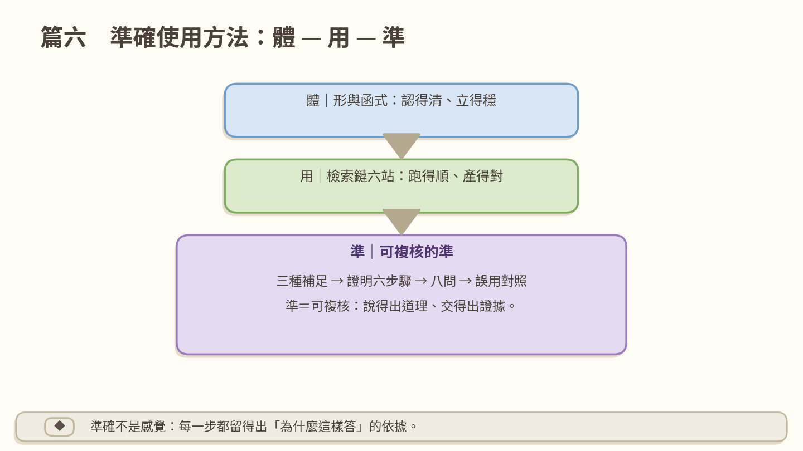

**圖 6-1　體—用—準：認得清、跑得順、說得準**

體不立，用必歪；用不全，準必虛。三層是疊加的：先認得出形與函式（體），再讓六站跑得順（用），最後每一則答案都交得出依據（準）。這不是三個階段，是三個同時打開的視角——每一則問答，都要同時過三關。

## 6-2　三種補足：規則、身份、結構

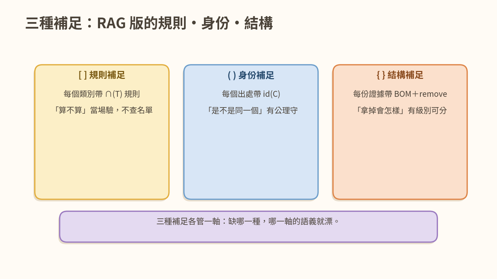

**圖 6-2　三種補足：[ ] 規則、( ) 身份、{ } 結構**

三種補足是把補足卡壓成三句口訣：[ ] 規則補足——每個類別帶 ∩(T) 規則，「算不算」當場驗；( ) 身份補足——每個出處帶 id(C)，「是不是同一個」有公理守；{ } 結構補足——每份證據帶 BOM 與 remove 三級，「拿掉會怎樣」有級別可分。三句口訣，七張卡裡的①②③全部覆蓋。

## 6-3　證明六步驟：一則問答的全程

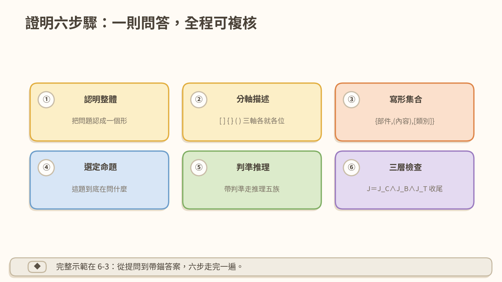

**圖 6-3　證明六步驟：認明整體 → 三層檢查**

準確使用方法的核心流程是證明六步驟。下面用一則貫穿示範走全程——問題：「我們該不該把杯蓋列進新品的標準配備？」（供應鏈視角的杯子，貫穿案例回歸）。

> **證明六步驟全程示範**
>
> ① 認明整體：這題問的是「杯蓋」在「杯子」這個整體中的部件定位與決策——認成一個形的問題，不是一句話的問題。
>
> ② 分軸描述：[ ] 杯蓋類（特徵：可開合、密封、配合杯口）；{ } 杯子的部件清單（杯身、杯底、杯蓋、杯把…）；( ) 杯子容器內（id(C)＝這款杯子的型號身份）。
>
> ③ 寫形集合：杯蓋＝{邊緣,(密封圈),[杯蓋類]}；杯子＝{杯身,杯底,(內容),[杯具]}。
>
> ④ 選定命題：命題＝「杯蓋對本款杯子是功能降級件」——要驗的是 remove 等級與市場判準。
>
> ⑤ 判準推理：remove(杯蓋, M)＝M′⊂M（功能降級：不密封但仍能盛裝）→ 推理五族上場：因果（密封需求的成因）、模擬（拿掉杯蓋的使用情境試跑）、統計（客訴分布裡「漏液」占比）。
>
> ⑥ 三層檢查：容器層——杯子身份不因杯蓋去留而變（過）；BOM 層——部件清單與 remove 級別一致（過）；抽象層——杯蓋符合 [杯蓋類] 判準（過）。結論：功能降級件，可列為選配而非必要件——每一步留記錄，可複核。

全程走一遍就會發現：六步驟不是儀式，是把「憑什麼」攤在陽光下。每一步都有產出、每個產出都能回指——這就是「可複核的準」的樣子。

### 再一個速寫：城市紅綠燈

問題：「這條路口的紅綠燈該不該重新配時？」六步速寫——① 認明整體：路口號誌系統的配時決策；② 分軸：[ ] 車流時段類（尖峰／離峰）、{ } 號誌部件（週期、相位、時差）、( ) 路口容器（這條路口的身份）；③ 形集合：配時方案＝{相位,(週期秒數),[時段類]}；④ 命題：「現行配時在尖峰時段不敷使用」；⑤ 判準推理：統計族看車流分布、模擬族試跑新配時、因果族查瓶頸成因；⑥ 三層檢查：路口身份不變、部件齊全、時段分類合判準——結論與建議全程留記錄。領域換了，六步不換。

## 6-4　四層準確性與日誌六欄位

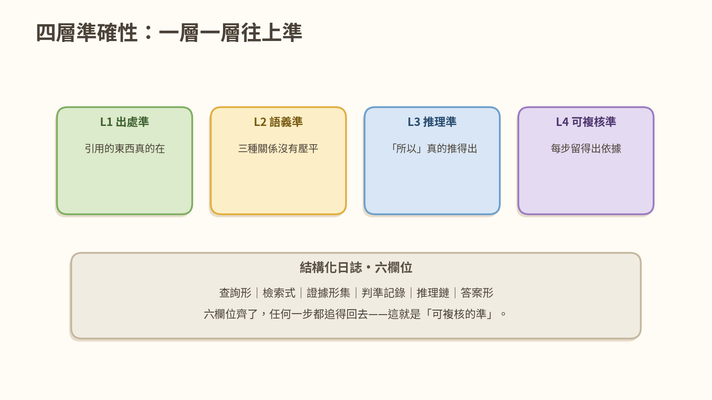

**圖 6-4　四層準確性：一層一層往上準**

準確性分四層：L1 出處準（引用的東西真的在）、L2 語義準（三種關係沒有壓平）、L3 推理準（「所以」真的推得出）、L4 可複核準（每步留得出依據）。四層是疊加上去的——L4 的天花板，是 L1 到 L3 的地板。

| 日誌欄位 | 記什麼 | 守哪一層 |
| --- | --- | --- |
| 查詢形 | 提問的意圖・關鍵詞・範圍 | L2 語義準 |
| 檢索式 | 實際下的檢索指令與參數 | L1 出處準 |
| 證據形集 | 檢回證據的 id(C) 與片段 | L1 出處準 |
| 判準記錄 | 三層判斷各關的過與不過 | L2 語義準 |
| 推理鏈 | 用了哪一族、方向與機制 | L3 推理準 |
| 答案形 | 最終答案與引用錨 | L4 可複核準 |

**表 6-1　結構化日誌・六欄位：可複核的準的載體**

## 6-5　八問：出發前先問一遍

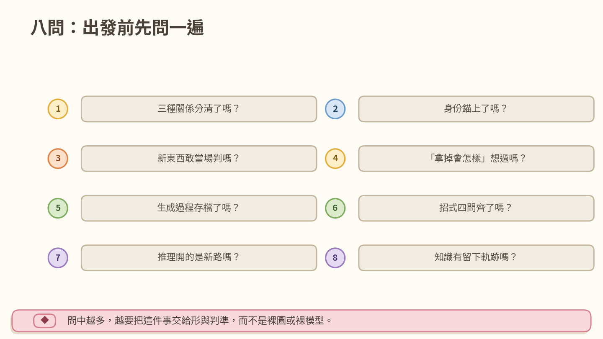

**圖 6-5　八問：問中越多，越要交給形與判準**

| # | 問句 | 背後的補足 |
| --- | --- | --- |
| 1 | 三種關係分清了嗎？ | ① 三括號分立 |
| 2 | 身份錨上了嗎？ | ② 身份錨 id(C) |
| 3 | 新東西敢當場判嗎？ | ③ 三層判斷 |
| 4 | 「拿掉會怎樣」想過嗎？ | ③ remove 三級 |
| 5 | 生成過程存檔了嗎？ | ④ 生成鏈存檔 |
| 6 | 招式四問齊了嗎？ | ⑤ 函式四問 |
| 7 | 推理開的是新路嗎？ | ⑥ 推理五族 |
| 8 | 知識有留下軌跡嗎？ | ⑦ 演化迴路 |

**表 6-2　八問 × 補足對照**

八問是七張補足卡的便攜版。任何新任務開工前過一遍——問中越多，越要把這件事交給形與判準，而不是裸圖或裸模型。

## 6-6　誤用 16 種：四組預防針

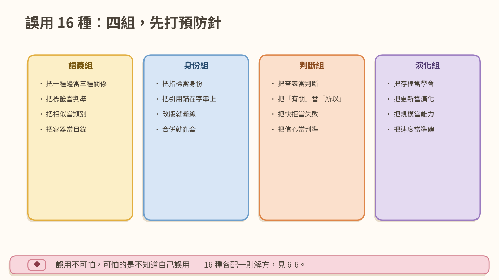

**圖 6-6　誤用 16 種：四組，先打預防針**

| 組 | # | 誤用 | 解方 |
| --- | --- | --- | --- |
| 語義組 | M1 | 把一種邊當三種關係 | 三括號分立，各掛判準 |
|  | M2 | 把標籤當判準 | 判準要可驗證，標籤只指名 |
|  | M3 | 把相似當類別 | 相似走向量，類別走 ∩(T) |
|  | M4 | 把容器當目錄 | 容器守 id(C)，目錄只列名 |
| 身份組 | M5 | 把指標當身份 | id(C) 進資料契約 |
|  | M6 | 把引用錨在字串上 | 錨定 id(C)＋位置座標 |
|  | M7 | 改版就斷線 | σ 替換保身份，引用跟著走 |
|  | M8 | 合併就亂套 | 合併走形的運算，不刪舊帳 |
| 判斷組 | M9 | 把查表當判斷 | 開放規則當場驗 |
|  | M10 | 把「有關」當「所以」 | 推理五族標明方向機制 |
|  | M11 | 把快拒當失敗 | 快拒是防線，記入日誌 |
|  | M12 | 把信心當判準 | 信心是分數，判準是規則 |
| 演化組 | M13 | 把存檔當學會 | 存檔要回寫、要複核 |
|  | M14 | 把更新當演化 | 演化要留軌跡與理由 |
|  | M15 | 把規模當能力 | 能力看四層準確性 |
|  | M16 | 把速度當準確 | 準確看可複核，不看手快 |

**表 6-3　誤用 16 種 × 解方**

16 種誤用分四組：語義組、身份組、判斷組、演化組——剛好沿著空間四補與時間三補的地形排。誤用不可怕，可怕的是不知道自己誤用；這張表的用法是回診：系統出了怪事，先來表裡對號。

## 6-7　選路決策樹

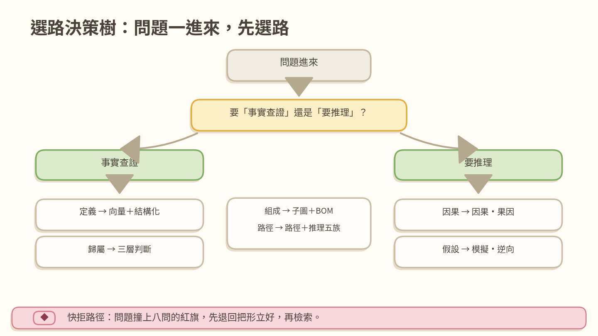

**圖 6-7　選路決策樹：問題一進來，先選路**

最後把所有方法收成一條決策樹。問題進來，先問「事實查證還是要推理」：查證類再分定義、歸屬、組成三路，推理類再分路徑、因果、假設三路——每條路標明主用的檢索家族與補足。撞上八問紅旗的問題走快拒路徑：先退回把形立好，再檢索。

## 6-8　完整示範紀錄：日誌長什麼樣

可複核不是一句口號，是一張填得滿的表。下面把杯蓋示範（6-3）的六欄位日誌實寫一遍——任何團隊照這張表留紀錄，第三方就重跑得出。

| 欄位 | 紀錄內容（杯蓋示範） |
| --- | --- |
| 查詢形 | 意圖＝部件決策；關鍵詞＝杯蓋／標準配備；範圍＝本款杯子（id(C)＝CUP-A2） |
| 檢索式 | BOM 檢索（CUP-A2 部件清單）＋結構化查詢（remove 級別欄位）＋向量（類似款配備慣例） |
| 證據形集 | E1 部件表#12（id(C)＝DOC-BOM-01）、E2 客訴統計 Q3（DOC-CS-07）、E3 競品配備表（DOC-MKT-15） |
| 判準記錄 | 容器層過（CUP-A2 身份確認）；BOM 層過（杯蓋列於部件表）；抽象層過（杯蓋合 [杯蓋類] 判準） |
| 推理鏈 | remove 三級（M′⊂M，功能降級）＋因果（密封需求成因）＋模擬（無蓋情境試跑）＋統計（漏液客訴占比 23%） |
| 答案形 | 「杯蓋為功能降級件，建議列選配」；引用錨＝E1/E2/E3 各句回指；判準版本＝v2（2026-11） |

**表 6-4　六欄位日誌實寫示範**

看這張表要注意一件事：六欄位互相咬合——查詢形決定檢索式，檢索式牽出證據形集，判準記錄管住推理鏈，推理鏈撐起答案形，答案形的引用錨又回指證據形集。少任何一欄，重跑就斷在那一環。

> **選路心法三句話**
>
> 找同類走向量，找關係走子圖與路徑，找範圍走結構化。
>
> 要「所以」上推理五族，不要讓一條邊背書。
>
> 問題形狀看不清時，先花三分鐘立查詢形——靶立好了，再開槍。

> **【專業專欄 C4】融合與重排的工程：RRF、HyDE 與查詢拆解**
>
> 檢索鏈的「理解」與「融合」兩站，工程界積累了一組好用的招。查詢改寫側：HyDE 先讓模型寫一篇「假答案」，再拿假答案去檢索——用生成引導檢索，效果常優於直接拿問題檢索；查詢拆解把大問題切成小問題，各檢各的再合併——對應形學的「大形拆小形」。
>
> 融合側：RRF（倒數排名融合）用「排名的倒數和」給證據排序，簡單到不需要訓練，卻是混合檢索最穩的基線；cross-encoder 重排則把「問題＋證據」成對打分，精度高但成本高——實務上兩段式：RRF 粗排、cross-encoder 精排。
>
> 對照形學：這些招式全都可以寫成四問卡——輸入形、輸出形、判準各就各位。工程招式與形學卡片是同一張卡的兩種寫法；把招式收進函式庫，檢索鏈就從「一串管線」升級為「一疊可重用的招」。
>
> 一個常見的坑要提醒：查詢拆解拆過頭會丟意圖——大形拆小形，拆完要記得合回去（⊕ 合形）。判準很簡單：拆出的子問題全部回答後，原問題的答案能不能自然長出來？長不出來，就是拆壞了。

> **【專業專欄 C5】RAG 評估：量什麼、怎麼量**
>
> RAG 的評估逐漸收斂到三個面向：檢索端量「查得準不準」（recall@k、命中率），生成端量「答得信不信」（faithfulness：答案是否忠於證據），引用端量「引得對不對」（citation precision：引用是否真的支持那句話）。RAGAS 一類框架把三者做成可自動化的流水線。
>
> 對照本篇的四層準確性：L1 出處準對應 citation 系指標，L2 語義準與 L3 推理準是 RAGAS 覆蓋較薄的部分——它們需要形的語義與推理鏈記錄才量得到；L4 可複核準則是更高一檔的要求：不但要量得出，還要讓第三方重跑得出。
>
> 實務建議：評估資料集就從誤用 16 種反著造——每一種誤用造兩三個陷阱案例，系統在陷阱上的表現，比平均分數更能說明「準不準」。
>
> 還有一條評估哲學值得寫進團隊牆上：評估不是期末考，是體檢。每次評完都要回到補足卡——分數低在哪一層（L1 到 L4），就補哪一張卡；只調參數不補形，下個月還是那個分數。

> **練習 E07　準確使用方法（上）**
>
> - E07-1　用證明六步驟分析一個你工作中的真實問題（任何領域），每步寫一行產出。
> - E07-2　三種補足（規則、身份、結構）與補足卡①②③的對應是什麼？說明為什麼少了任何一種，對應的軸就漂。

> **練習 E08　準確使用方法（下）**
>
> - E08-1　從誤用 16 種挑三種你見過的（不限電腦系統），各寫一則 50 字的解方說明。
> - E08-2　用選路決策樹為三類問題選路：「這份合約怎麼說」「A 方案和 B 方案差在哪」「若延後一個月會怎樣」。

# 第七篇　總架構：長在平台上的問答

方法收好，這一篇拉遠看架構。Mind RAG 長在 Mind AI 的兩庫一中樞一迴路上；它對 GraphRAG 是三同五異；它對 LLM 與 Mind Model 的分工有明確的守位；它的七補足在空間與時間的座標系上有清楚的站位；它的驗收有四條線，遠景接 AGI 三階段。

## 7-1　兩庫一中樞一迴路 × Mind RAG

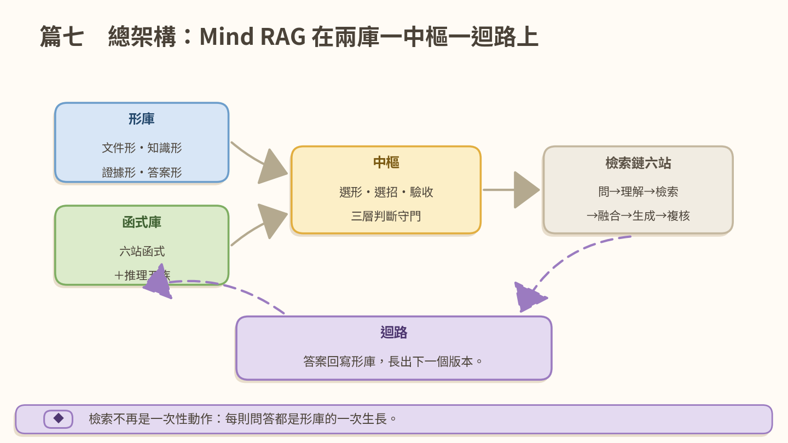

**圖 7-1　Mind RAG 在兩庫一中樞一迴路上的運作**

形庫收五種檢索形與它們的生成鏈；函式庫收六站招式、推理五族與思考法；中樞做選形、選招、驗收的判準調度——收件防線就站在中樞門口；迴路把答案形與修正回寫形庫，長出下一個版本。檢索鏈六站在這個骨架上運轉：它不是一次性管線，而是一則問答一次生長。

## 7-2　GraphRAG → Mind RAG：三同五異

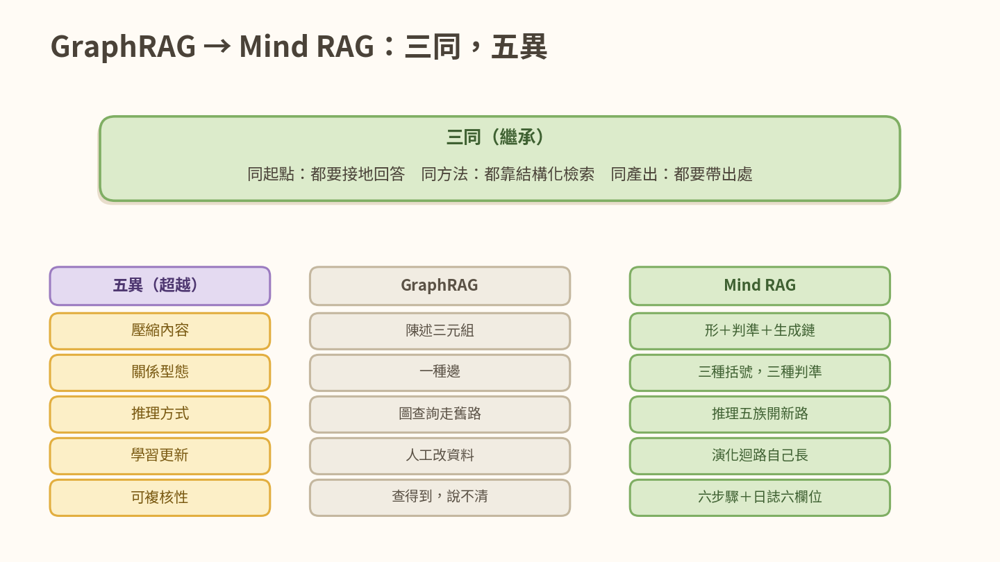

**圖 7-2　三同五異：繼承與超越**

| 面向 | GraphRAG | Mind RAG | 差在哪 |
| --- | --- | --- | --- |
| 起點 | 都要接地回答 | 同 | 三同之一 |
| 方法 | 都靠結構化檢索 | 同 | 三同之二 |
| 產出 | 都要帶出處 | 同 | 三同之三 |
| 壓縮內容 | 陳述三元組 | 形＋判準＋生成鏈 | 過程入庫 |
| 關係型態 | 一種邊 | 三種括號，三種判準 | 語義分立 |
| 推理方式 | 圖查詢走舊路 | 推理五族開新路 | 方向與機制 |
| 學習更新 | 人工改資料 | 演化迴路自己長 | 軌跡入帳 |
| 可複核性 | 查得到，說不清 | 六步驟＋日誌六欄位 | 可複核的準 |

**表 7-1　三同五異對照**

三同是繼承：GraphRAG 把檢索從片段升級到結構，這條路走對了。五異是超越：把「陳述的語言」換成「形與招式的語言」，七個不足才有得補。

## 7-3　兩公式：各守其位的另一面

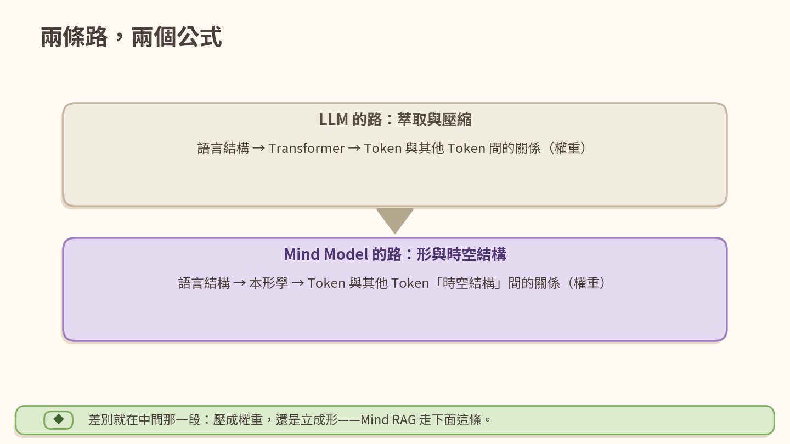

**圖 7-3　兩條路，兩個公式**

把 LLM 與 Mind Model 的分工寫成公式，「守位」的意思就一目了然：凡是要「指得出」的部分立成形——證據、判準、推理、軌跡；凡是「說得出」的部分交給 LLM——措辭、流暢、語氣。生成站看似 LLM 在主講，其實每一句話都被形押著走。

## 7-4　七補足全景

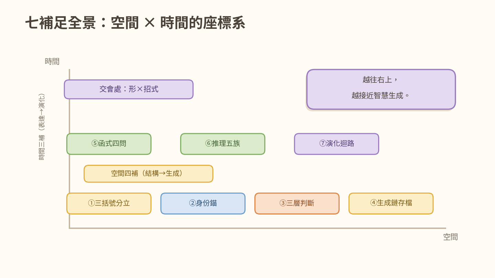

**圖 7-4　七補足全景：空間 × 時間的座標系**

把七補足放回空間與時間的座標系：橫軸是空間四補，沿「結構 → 身份 → 判斷 → 生成」往深處走；縱軸是時間三補，沿「表達 → 推理 → 演化」往高處走。兩軸交會處——形與招式交織的地方——正是姊妹作指出最深的缺口，如今也是 Mind RAG 收穫最豐的所在。

## 7-5　四條驗收線與 AGI 三階段

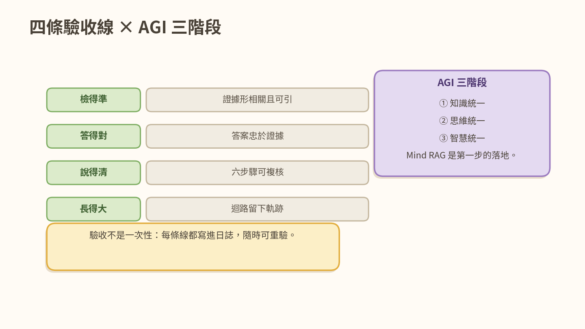

**圖 7-5　四條驗收線 × AGI 三階段**

| 驗收線 | 驗什麼 | 怎麼驗 |
| --- | --- | --- |
| 檢得準 | 證據形相關且可引 | recall@k ＋ 出處抽查 |
| 答得對 | 答案忠於證據 | faithfulness 對照證據形集 |
| 說得清 | 六步驟可複核 | 日誌六欄位完整性檢查 |
| 長得大 | 迴路留下軌跡 | 版本帳：改了什麼、為什麼改 |

**表 7-2　四條驗收線**

四條線不是一次性考試：每條線都寫進日誌，隨時可重驗。往遠看，Mind RAG 對齊的是 AGI 三階段——知識統一（形庫把知識立成形）、思維統一（函式庫與推理五族把思維立成招）、智慧統一（迴路讓系統自己長）——它是第一步的落地，也是後兩步的地基。

## 7-6　四種常見做法對讀

把 Mind RAG 放回市場上，最常被問的是「它和我現在用的做法差在哪」。四種常見做法，一表對讀。

| 做法 | 強項 | 弱項 | Mind RAG 的位置 |
| --- | --- | --- | --- |
| 裸 LLM | 快、什麼都能聊 | 幻覺、無出處、不更新 | 語言照用，智慧換形 |
| 向量 RAG | 接地、有引用 | 語義壓平、碎片化 | 守住它，補①③④ |
| GraphRAG | 結構、全局問題 | 七不足藏在圖裡 | 三同繼承，五異補形 |
| 知識庫問答 | 可控、可審 | 查表不判斷、不演化 | 開放規則＋迴路上崗 |

**表 7-3　四種常見做法對讀**

結論不是「全部打掉重練」，而是「各守其位再補形」：裸 LLM 的語言能力、向量 RAG 的接地、GraphRAG 的結構、知識庫的可控，全部保留——缺的七塊，用補足卡一塊一塊補上。

> **【專業專欄 C8】合流與超越：從 KG-Search 到 Mind RAG**
>
> 檢索技術這幾年有一條容易被忽略的暗線：GraphRAG 陣營（社群摘要、全局問題）與 KG-Search 陣營（實體連結、子圖檢索、多跳問答）從對立走向合流。合流的契機很務實——全局問題要摘要、細節問題要子圖，一家做不全；混合檢索與統一的證據模型讓兩家的輸出可以融合。
>
> 本冊的立場更進一步：合流解決的是「檢索方式」的拼裝問題，而七不足是「知識語言」的表達問題。拼裝得再漂亮，語言還是陳述——括號照樣壓平、身份照樣漂移。Mind RAG 的超越點在語言層：把形與招式立為第一公民，檢索方式的合流變成自然而然——因為形的三軸，本來就對應著不同的檢索家族。
>
> 換句話說：GraphRAG 與 KG-Search 的合流是「術」的合流，Mind RAG 追求的是「道」的合流——術在選路決策樹裡排隊，道在七補足卡裡立規矩。術道並進，問答才立得起來。
>
> 對導入者最實際的建議是：把合流當成過渡形態——現有的混合檢索照跑，同時開始形化高價值知識。等七補足上齊，你會發現「選哪座橋」變成了次要問題，因為每座橋上跑的都是同一套形。

> **練習 E09　總架構**
>
> - E09-1　向一位沒讀過本系列的同事解釋「三同五異」，三分鐘版本。
> - E09-2　四條驗收線中，哪一條最常被略過？為什麼它偏偏是「長得大」的關鍵？

> **練習 E10　架構補充**
>
> - E10-1　用表 7-3 對讀你現行的做法：它落在哪一格？最該先補哪一張卡？
> - E10-2　「把 LLM 出嘴、形學出手」翻成你團隊的分工語言：哪些工作交給模型？哪些必須留給形與判準？

# 第八篇　內容完整方案：學練用教建

最後一篇交方案。內容完整方案回答三個問題：人怎麼學（學練用教建＋八週）、庫怎麼建（建庫四階段）、事怎麼驗（PoC 三情境＋成熟度）。讀者四種，路有四條；領域五個，形不換——換的只是形庫裡的內容。

## 8-1　學練用教建

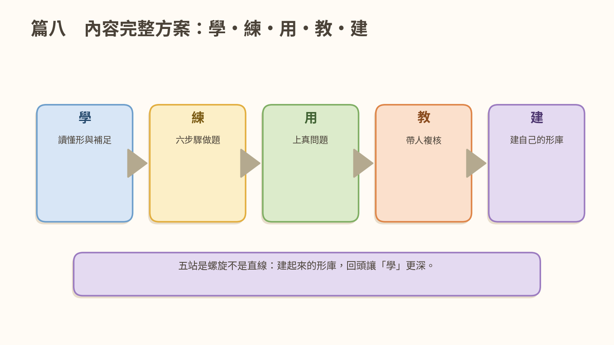

**圖 8-1　學練用教建：五站是螺旋，不是直線**

學——讀懂形與七補足；練——六步驟做題；用——上真問題；教——帶人複核；建——建自己的形庫。五站是螺旋不是直線：建起來的形庫回頭讓「學」更深，教出去的複核回頭讓「用」更穩。

## 8-2　八週路線

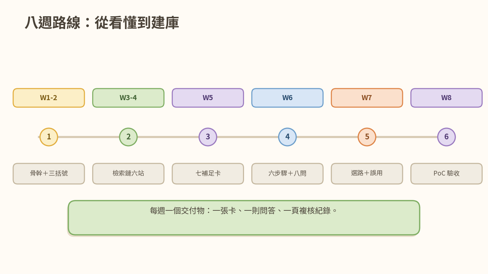

**圖 8-2　八週路線：每週一個交付物**

| 週 | 主題 | 交付物 |
| --- | --- | --- |
| W1-2 | 骨幹＋三括號 | 三括號分立的筆記＋一張補足卡①實例 |
| W3-4 | 檢索鏈六站 | 六張四問卡（自己領域的版本） |
| W5 | 七補足卡 | 七張卡的個人案例庫 |
| W6 | 六步驟＋八問 | 一則全程可複核的示範問答 |
| W7 | 選路＋誤用 | 選路決策樹實戰紀錄＋誤用回診表 |
| W8 | PoC 驗收 | 三情境 PoC 報告（含四條驗收線結果） |

**表 8-1　八週路線**

## 8-3　建庫四階段

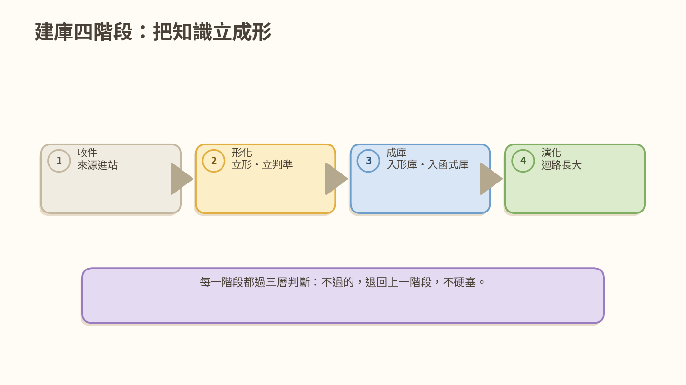

**圖 8-3　建庫四階段：收件 → 形化 → 成庫 → 演化**

收件——來源進站，先過三層判斷的收件防線；形化——立形、立判準、寫生成鏈存檔；成庫——入形庫與函式庫，檢索索引同步建立；演化——迴路轉起來，每次問答留軌跡、回寫改版。每一階段都有出口條件，不過的退回上一階段，不硬塞。

## 8-4　情境選路：四種讀者

**圖 8-4　四種讀者，四條路**

學生與初學者走 W1-4 起步：先懂形，再懂檢索；工程師直接上六站與四問卡，實戰優先；研究與分析人員重六步驟與推理五族，可複核是生命線；決策與管理者看八問與驗收線——看結論，也看依據。四條路通向同一個終點：可複核的準。

## 8-5　PoC 三情境驗收

**圖 8-5　PoC 三情境：先小勝，再擴點**

| 情境 | 示範問題 | 主驗的準 | 通過門檻 |
| --- | --- | --- | --- |
| 一・事實查證 | 「這份文件怎麼說？」 | 出處準＋語義準 | 引用 100% 可回指 |
| 二・比較判斷 | 「甲和乙差在哪？」 | 三括號分立＋三層判斷 | 比較逐軸對齊 |
| 三・推理建議 | 「若…會怎樣？」 | 推理準＋可複核準 | 推理鏈可重跑 |

**表 8-2　PoC 三情境**

三情境全過，才談擴點與量產；一情境不過，就退回修形庫——PoC 的意義不是展示，是立信。

## 8-6　五領域並列：形不換，庫換

**圖 8-6　五領域並列：哲學、生物、語言、程式、組織**

形學式問答的好處是跨領域：哲學問「正義是什麼」走 [ ]＋∩(T) 立判準；生物問「這算不算器官」走 { }＋remove 分級；語言問「同義還是同指」走 ( )＋id(C) 守身份；程式問「這個型別是誰」走三層判斷＋四問卡；組織問「誰負責什麼」走 { }＋BOM＋推理五族。領域換了，形與補足不換——換的只是形庫裡的內容。

## 8-7　成熟度：L1 → L4

**圖 8-7　成熟度四級：看得見 → 判得準 → 答得清 → 長得大**

| 級 | 名字 | 樣子 | 對應的驗收線 |
| --- | --- | --- | --- |
| L1 | 看得見 | 資料進得來，出處找得到 | 檢得準（部分） |
| L2 | 判得準 | 三層判斷守門，快拒生效 | 檢得準＋答得對 |
| L3 | 答得清 | 六步驟可複核，句句有錨 | 說得清 |
| L4 | 長得大 | 迴路轉起來，形庫自己長 | 長得大 |

**表 8-3　成熟度四級**

成熟度不是貼標籤：每升一級，都要交得出下一條驗收線的證據。L1 到 L4 的距離，就是「檢索系統」長成「智慧問答」的距離。

## 8-8　常見問題 FAQ

| 問 | 答 |
| --- | --- |
| Mind RAG 要不要放棄向量檢索？ | 不要。向量守抽象軸，是六家族之一；七補足是讓它多問「怎麼生的」，不是拆掉它。 |
| 七補足要一次全部上嗎？ | 不必。先上①②③（語義、身份、判斷）立地基，再上④⑤⑥⑦。八問可以當上線清單。 |
| 沒有 LLM 可以用 Mind RAG 嗎？ | 可以但吃力。LLM 守語言、形學守智慧——沒有 LLM，生成站換成模板，其餘六站照跑。 |
| 建庫四階段，最難的是哪一段？ | 形化。把陳述翻成形與判準是手藝活；建議從高價值、高複核需求的知識先形化。 |
| 快拒會不會拒掉太多？ | 快拒要記日誌、要回診。拒錯的案例正是判準改版的燃料——這正是演化迴路的用處。 |
| 和 GraphRAG 的既有投資衝突嗎？ | 不衝突。三同是繼承：已建的社群摘要與子圖檢索照用，五異的部分一卡一卡補。 |
| 「準」由誰說了算？ | 由可複核說了算：第三方拿日誌六欄位重跑六步驟，結論一致即準——不靠權威，靠證據。 |
| 多久可以看到 PoC 成果？ | 照八週路線，第八週交三情境報告。若建庫從零開始，建議先小庫試點，再擴全域。 |

**表 8-4　常見問題 FAQ**

## 8-9　驗收清單與常見卡關

方案落地前，最後交一張驗收清單與一份卡關對照——清單照勾，卡關照修。

| 驗收項 | 勾選標準 | 常見卡關 | 修法 |
| --- | --- | --- | --- |
| 三括號零壓平 | 抽查 20 條關係，三種語義分欄 | 建模嫌煩，先壓再說 | 先形化高價值知識，其後補 |
| 身份錨覆蓋 | 證據形 100% 帶 id(C) | 舊系統只有檔名 | 過渡期雙錨並存，逐步替換 |
| 收件防線運作 | 快拒日誌可查、可回診 | 快拒被當失敗不敢開 | 把快拒率列為健康指標 |
| 生成鏈存檔 | 抽查維度，答得出出生證明 | 老知識沒過程 | 老知識標「待補檔」，新知識必填 |
| 四問卡齊備 | 六站各一張卡，判準可驗 | 判準寫成形容詞 | 判準必須是可驗證的條件句 |
| 推理標族 | 答案推理欄標明族別與方向 | 習慣讓模型自由發揮 | 生成模板強制填推理欄 |
| 軌跡入帳 | 版本帳可查「改了什麼」 | 只存最新版 | 改版必寫理由，舊版不刪 |

**表 8-5　驗收清單與常見卡關對照**

卡關不可怕——每一種卡關都對應一張補足卡：卡關是訊號，補足卡是回應。

> **練習 E11　方案（上）**
>
> - E11-1　為你的團隊排出八週路線的個人版：每週主題與交付物各寫一行。
> - E11-2　建庫四階段的出口條件，你會為「形化」站立哪三條？

> **練習 S01–S03　方案（下）**
>
> - S01　選一個真實領域，寫出 PoC 三情境的示範問題與通過門檻（照表 8-2 的格式）。
> - S02　用成熟度四級自評你現有的知識系統：它在哪一級？升下一級缺什麼？
> - S03　綜合題：把全書壓成一頁「給長官的簡報稿」——七補足、六步驟、四條驗收線各一句話。

> **練習 E12　方案（補充）**
>
> - E12-1　照表 8-5 的驗收清單，為你的系統逐項打勾：三項不過的，各對應哪一張補足卡？
> - E12-2　寫一份 300 字的「卡關回診紀錄」：卡關現象 → 對照誤用 16 種 → 補足方案。

# 結語　七個補足，一條路

回頭看這本冊子走過的路：先立定位——五個痛點都是形沒立好；再點骨幹——三軸三括號、三層判斷、函式四問、兩庫一中樞一迴路；然後空間、時間兩篇把檢索世界的形與招式立起來；第五篇開出七張補足卡，把姊妹作的七個不足一處一處補回；第六篇給方法——體—用—準、六步驟、八問、誤用對照、選路決策樹；第七篇收架構，第八篇給方案。

七個補足其實只有一條路：把形立起來。語義分立、身份錨定、判斷開口、過程存檔、招式可跑、推理開新路、知識會長大——每一件都是本形學早已寫下的語義，只不過在檢索的世界裡，它們曾經集體缺席。Mind RAG 做的事很樸素：把它們請回來，各守其位。

**圖 8-8　全書收束：形立起來，檢索才準；準可複核，知識才長大**

這條路的盡頭不是一個系統，而是一種態度：對「準」的態度——說得出道理、交得出證據、留得住軌跡。帶著這份態度上路，檢索會長成問答，問答會長成知識，知識會長成智慧。七個補足，一條路——路已經在腳下。

**圖 9-1　全書一頁總圖**

> **全書終**
>
> 形立起來，檢索才準；準可複核，知識才長大。

# 附錄 A　術語與記號

| 術語 | 英文 | 一句話 |
| --- | --- | --- |
| 形 | Type | 分合畫出的邊界，認得出、叫得出的東西 |
| 空間本形 | Space Type | 形的靜面：三軸三括號 |
| 時間本形 | Time Type | 形的動面：函式與招式 |
| 單位形 | Unit Type | 形集合＝{部件, (內容), [類別]} |
| 屬性形 | AttributeType [ ] | 抽象：特徵交集的類別 |
| 物料清單形 | BOMType { } | 組成：部件與 remove 三級 |
| 空間容器形 | ContainerType ( ) | 容器：id(C) 與不變性公理 |
| 交集判準 | ∩(T) | 「算不算這類」的當場驗證規則 |
| remove 判準 | remove(p, M) | 「拿掉會怎樣」的反事實三級 |
| 身份錨 | id(C) | 內容可換、身份不換的錨 |
| 不變性公理 | Invariance | 替換內容不改身份 |
| 生成鏈 | Generation Chain | 異同 → 分合 → 形 → 名 |
| 函式四問 | Function Card | 名稱、輸入形、輸出形、判準 |
| 形進形出 | op：Type → Type | 每步運算：輸入一個形，產出一個形 |
| 查詢形 | Query Type | 提問的形狀：意圖・關鍵詞・範圍 |
| 證據形 | Evidence Type | 檢回的憑據：{出處, (片段), [可信度]} |
| 答案形 | Answer Type | 交付的回答：{結論, (引用), [判準]} |
| 七不足 | Seven Gaps | 括號壓平・身份漂移・圖不會判・生成失憶・動詞消失・推理缺席・演化缺席 |
| 七補足 | Seven Fixes | 三括號分立・身份錨・三層判斷・生成鏈存檔・函式四問・推理五族・演化迴路 |
| 可複核的準 | Auditable Accuracy | 說得出道理、交得出證據、留得住軌跡 |

**表 A-1　術語表（形的英文是 Type）**

| 記號 | 讀作 | 用在哪 |
| --- | --- | --- |
| [ ] | 屬性括號 | 抽象・類別・交集判準 |
| { } | 組成括號 | 部件・BOM・remove 三級 |
| ( ) | 容器括號 | 裝載・身份・不變性公理 |
| ≡　≢　⊂ | 形的比較 | 形同一・不同一・降級 |
| ⊕ | 合形 | 融合站的運算 |
| σ | 替換 | 查詢改寫・內容更新（保身份） |
| ∩(T) | 交集判準 | 抽象層的判斷 |
| J_C ∧ J_B ∧ J_T | 三層聯合 | 收件防線的總判準 |
| id(C) | 身份錨 | 引用錨定・版本續接 |

**表 A-2　記號總表**

# 附錄 B　速查卡

## B-1　七補足卡速查

| # | 不足 | 補足 | 一句口訣 |
| --- | --- | --- | --- |
| ① | 括號壓平 | 三括號分立 | 三種關係，三種判準，分開住 |
| ② | 身份漂移 | 身份錨 id(C) | 內容可換，身份不換 |
| ③ | 圖不會判 | 三層判斷 | 判斷是漏斗，不是查表 |
| ④ | 生成失憶 | 生成鏈存檔 | 出生證明跟著形走 |
| ⑤ | 動詞消失 | 函式四問 | 招式要跑得起來 |
| ⑥ | 推理缺席 | 推理五族 | 開新路，不走舊路 |
| ⑦ | 演化缺席 | 演化迴路 | 知識是一條流動的河 |

## B-2　八問勾選

> **開工前勾一遍**
>
> □ 1 三種關係分清了嗎？　　□ 2 身份錨上了嗎？
>
> □ 3 新東西敢當場判嗎？　　□ 4「拿掉會怎樣」想過嗎？
>
> □ 5 生成過程存檔了嗎？　　□ 6 招式四問齊了嗎？
>
> □ 7 推理開的是新路嗎？　　□ 8 知識有留下軌跡嗎？
>
> 勾中越多，越要把這件事交給形與判準。

## B-3　可複印空白模板（整頁）

以下模板可整頁複印使用：一張函式四問卡、一張形集合卡、一張八問勾選單。

| 函式四問卡（空白） |  |
| --- | --- |
| 名稱 | ________________________________ |
| 輸入形 | ________________________________ |
| 輸出形 | ________________________________ |
| 判準 | ________________________________ |
| 備註 | ________________________________ |

| 形集合卡（空白） |  |
| --- | --- |
| 形的名稱 | ________________________________ |
| {部件} | ________________________________ |
| (內容) | ________________________________ |
| [類別] | ________________________________ |
| remove 級別 | □ 必要件　□ 功能降級件　□ 非必要件 |

| 八問勾選單（空白） |  |
| --- | --- |
| 任務名稱 | ________________________________ |
| 勾選 | □1 三括號　□2 身份錨　□3 當場判　□4 remove |
|  | □5 生成鏈　□6 四問　□7 推理　□8 軌跡 |
| 複核人／日期 | ________________________________ |

## B-4　可複印・推理與日誌模板（整頁）

| 推理五族勾選卡（空白） |  |
| --- | --- |
| 問題 | ________________________________ |
| □ 因果（因→果） | 機制說明：________________________ |
| □ 果因（果→因） | 溯因說明：________________________ |
| □ 模擬（若…則…） | 假設與試跑：______________________ |
| □ 統計（分布→機率） | 數據來源：________________________ |
| □ 逆向（反事實） | 另一個世界：______________________ |

| 日誌六欄位（空白） |  |
| --- | --- |
| 查詢形 | ________________________________ |
| 檢索式 | ________________________________ |
| 證據形集 | ________________________________ |
| 判準記錄 | ________________________________ |
| 推理鏈 | ________________________________ |
| 答案形（含引用錨） | ________________________________ |

# 附錄 C　練習參考答案

以下為示範答案，不是標準答案——言之成理、可複核，即為好答案。

| 題號 | 示範答案 |
| --- | --- |
| E01-1 | 多兩件事：答案有證據撐腰、證據可追查更新；缺的是證據怎麼選、語義怎麼判——也就是形沒立好。 |
| E01-2 | 例：引用不明。單看是「引用功能沒做好」，對照形的診斷是身份錨沒立——引文錨不住身，自然對不上出處；治標修引用，治本立 id(C)。 |
| E02-1 | 三軸：[ ] 屬性（∩(T) 交集判準）、{ } 組成（remove 三級判準）、( ) 容器（不變性公理）。三者各有判準，缺一即壓平。 |
| E02-2 | 例：找旅遊攻略——問（想去哪）、理解（拆成機票＋住宿＋景點）、檢索（各查各的）、融合（合成行程）、生成（寫成計畫）、複核（比對預算與時間）。六站是本能，只是以前沒名字。 |
| E03-1 | 證據形＝{出處, (片段), [可信度]}：出處放內容位，因為它是身份錨的所在——換了片段（內容），出處身份不變，引用才不會斷。 |
| E03-2 | 例：必要件＝原始文件庫與索引；功能降級件＝自動摘要、重排模型；非必要件＝儀表板裝飾圖。先捨裝飾，再降摘要，索引一根不動。 |
| E03-3 | 例：面試判斷「這個人算不算會團隊合作」——名單查不到（沒合作過的人），但規則可驗：有無共同交付、衝突如何處理。查表沉默，判斷開口。 |
| E04-1 | 例「檢索」卡：輸入＝精準查詢形；輸出＝證據形集；判準＝相關且可引、每則證據帶 id(C)、可信度達門檻。 |
| E04-2 | 例主題「尖峰時段塞車」：因果（號誌設計導致瓶頸）、果因（從塞車回推事故或施工）、模擬（紅燈多 10 秒試跑）、統計（尖峰分布）、逆向（若錯峰上班會怎樣）。 |
| E04-3 | 「公雞叫與天亮高度相關，但因果是地球自轉使天亮；公雞叫只是同時發生。」——標明相關與因果的分別，不翻車。 |
| E05-1 | 略（依卡①②格式，各舉一例即可）。要點：案例須含「壓平／漂移的現場」與「補足後的走法」兩面。 |
| E05-2 | 出生證明讓維度可解釋（說得出道理）；回溯讓形可修正（回得了頭）——兩者合起來，知識才有「長大」的機制。 |
| E06-1 | 例「融合」卡判準：證據間不衝突（衝突須標注）、不重複（去重）、合成後每句可回指至少一則證據。 |
| E06-2 | 「重構重組」最常被誤解。分界：人工改資料只改現狀；重構要有帳——改了什麼、為什麼改、舊結構去哪了，三問缺一即非演化。 |
| E07-1 | 略（六步驟各一行：整體、三軸、形集合、命題、判準推理、三層檢查）。示範見 6-3 杯蓋案例。 |
| E07-2 | 規則↔①、身份↔②、結構↔③。少規則則類別漂、少身份則引用斷、少結構則取捨無據——一軸缺一補，一軸就漂。 |
| E08-1 | 略（誤用＋解方各一則，解方須指回七補足之一）。 |
| E08-2 | 合約→結構化＋三層判斷（歸屬路）；A/B 差異→子圖＋三括號（組成路）；延後→模擬・逆向（假設路）。 |
| E09-1 | 略（三同：起點方法產出；五異：壓縮內容、關係型態、推理方式、學習更新、可複核性——前半句說同，後半句說異）。 |
| E09-2 | 「長得大」最常被略過——驗收被當一次性考試。它是關鍵因為演化迴路轉不轉、軌跡留不留，決定系統是資產還是消耗品。 |
| E10-1 | 略（對照表 7-3 找出所在格，補卡建議須指到七補足之一，例如向量 RAG 先補①③④）。 |
| E10-2 | 示範：措辭、摘要、語氣交給 LLM；證據取捨、判準執行、推理走向、版本回寫必須留給形與判準——前者可妥協，後者不可越權。 |
| E11-1 | 略（八週個人版，每週主題＋交付物各一行）。 |
| E11-2 | 示範三條：每形帶判準（可驗證）、每形帶生成鏈存檔、三括號零壓平（抽查通過）。 |
| S01 | 略（照表 8-2 格式：情境、示範問題、主驗的準、通過門檻）。 |
| S02 | 略（自評＋差距清單；差距須指到 L1–L4 的具體樣子）。 |
| S03 | 示範三句：七補足＝把七個語義缺口逐一補回；六步驟＝每則問答攤開「憑什麼」；四條驗收線＝檢得準、答得對、說得清、長得大。 |
| E12-1 | 略（逐項勾選＋補卡對應，例如「身份錨覆蓋」不過→補②、「推理標族」不過→補⑥）。 |
| E12-2 | 示範骨架：現象（引用常斷線）→ 對照（M6 把引用錨在字串上）→ 補足（id(C)＋位置座標雙錨，舊引用逐步回填）。 |

# 附錄 D　圖表索引

| 編號 | 圖名 | 所在篇 |
| --- | --- | --- |
| 圖 D-1 | 兩條路的交會 | 導讀 |
| 圖 0-1 | 任務地圖：七不足→七補足 | 寫在前面 |
| 圖 1-1 | RAG 一句話 | 一篇 |
| 圖 1-2 | 五個痛點 | 一篇 |
| 圖 1-3 | 根幹果三層定位 | 一篇 |
| 圖 1-4 | 主軸宣言 | 一篇 |
| 圖 2-1 | 認知鏈×檢索鏈 | 二篇 |
| 圖 2-2 | 三軸三括號 | 二篇 |
| 圖 2-3 | 三層判斷漏斗 | 二篇 |
| 圖 2-4 | 函式四問卡 | 二篇 |
| 圖 2-5 | 五大運算×檢索 | 二篇 |
| 圖 2-6 | 兩庫一中樞一迴路 | 二篇 |
| 圖 2-7 | 映射總表圖 | 二篇 |
| 圖 3-1 | 五種檢索形 | 三篇 |
| 圖 3-2 | 三軸對讀 | 三篇 |
| 圖 3-3 | remove 三級取捨地圖 | 三篇 |
| 圖 3-4 | 三層判斷收件防線 | 三篇 |
| 圖 3-5 | 空間四不足翻車現場 | 三篇 |
| 圖 4-1 | 檢索鏈六站 | 四篇 |
| 圖 4-2 | 六張函式四問卡 | 四篇 |
| 圖 4-3 | 推理五族 | 四篇 |
| 圖 4-4 | 思考法選路 | 四篇 |
| 圖 4-5 | 時間三不足翻車現場 | 四篇 |
| 圖 4-6 | LLM×Mind Model 各守其位 | 四篇 |
| 圖 5-1 | 七補足總覽 | 五篇 |
| 圖 5-2 | 補足卡①三括號分立 | 五篇 |
| 圖 5-3 | 補足卡②身份錨 | 五篇 |
| 圖 5-4 | 補足卡③三層判斷 | 五篇 |
| 圖 5-5 | 補足卡④生成鏈存檔 | 五篇 |
| 圖 5-6 | 補足卡⑤函式四問 | 五篇 |
| 圖 5-7 | 補足卡⑥推理五族 | 五篇 |
| 圖 5-8 | 補足卡⑦演化迴路 | 五篇 |
| 圖 5-9 | 七補足×六家族 | 五篇 |
| 圖 6-1 | 體—用—準 | 六篇 |
| 圖 6-2 | 三種補足 RAG 版 | 六篇 |
| 圖 6-3 | 證明六步驟 | 六篇 |
| 圖 6-4 | 四層準確性＋日誌 | 六篇 |
| 圖 6-5 | 八問 | 六篇 |
| 圖 6-6 | 誤用 16 種四組 | 六篇 |
| 圖 6-7 | 選路決策樹 | 六篇 |
| 圖 7-1 | 兩庫一中樞一迴路運作 | 七篇 |
| 圖 7-2 | 三同五異 | 七篇 |
| 圖 7-3 | 兩公式 | 七篇 |
| 圖 7-4 | 七補足全景 | 七篇 |
| 圖 7-5 | 四條驗收線×AGI 三階段 | 七篇 |
| 圖 8-1 | 學練用教建 | 八篇 |
| 圖 8-2 | 八週路線 | 八篇 |
| 圖 8-3 | 建庫四階段 | 八篇 |
| 圖 8-4 | 情境選路 | 八篇 |
| 圖 8-5 | PoC 三情境 | 八篇 |
| 圖 8-6 | 五領域並列 | 八篇 |
| 圖 8-7 | 成熟度 L1–L4 | 八篇 |
| 圖 8-8 | 全書收束卡 | 結語 |
| 圖 9-1 | 全書一頁總圖 | 結語 |

**表 D-1　圖索引（共 54 圖，另含封面；編號對應內文圖說）**

| 編號 | 表名 | 所在篇 |
| --- | --- | --- |
| 表 0-1 | 任務地圖 | 寫在前面 |
| 表 1-1 | 五痛點×形的缺位 | 一篇 |
| 表 2-1 | RAG×本形學映射總表 | 二篇 |
| 表 3-1 | 五種檢索形構造 | 三篇 |
| 表 4-1 | 六站六卡 | 四篇 |
| 表 5-1 | 七補足×六家族 | 五篇 |
| 表 5-2 | 補足卡組合技 | 五篇 |
| 表 6-1 | 日誌六欄位 | 六篇 |
| 表 6-2 | 八問×補足 | 六篇 |
| 表 6-3 | 誤用 16 種 | 六篇 |
| 表 6-4 | 日誌實寫示範 | 六篇 |
| 表 7-1 | 三同五異 | 七篇 |
| 表 7-2 | 四條驗收線 | 七篇 |
| 表 7-3 | 四種常見做法對讀 | 七篇 |
| 表 8-1 | 八週路線 | 八篇 |
| 表 8-2 | PoC 三情境 | 八篇 |
| 表 8-3 | 成熟度四級 | 八篇 |
| 表 8-4 | 常見問題 FAQ | 八篇 |
| 表 8-5 | 驗收清單與卡關 | 八篇 |
| 表 A-1 | 術語表 | 附錄 A |
| 表 A-2 | 記號總表 | 附錄 A |
| 表 F-1 | 五領域示範問答 | 附錄 F |

**表 D-2　表索引（共 22 表）**

# 附錄 E　出處與延伸閱讀

| # | 出處 | 用途 |
| --- | --- | --- |
| 1 | 《知識圖譜用於本形學不足處分析》（本系列附件） | 七不足的分析主骨幹——本冊的「不足」全部出自此書 |
| 2 | 《Mind AI 簡介》（本系列附件） | Mind AI／Mind Model 定位與七限制（C6） |
| 3 | Lewis et al., Retrieval-Augmented Generation for Knowledge-Intensive NLP Tasks, NeurIPS 2020 (arXiv:2005.11401) | RAG 原始論文（C1） |
| 4 | Edge et al., From Local to Global: A Graph RAG Approach to Query-Focused Summarization, 2024 (arXiv:2404.16130) | GraphRAG 考據（C2） |
| 5 | Asai et al., Self-RAG, 2023 (arXiv:2310.11511) | 自適應檢索（C1） |
| 6 | Lin et al., RA-DIT, 2023 (arXiv:2310.01558) | 檢索器與生成器聯調（C1） |
| 7 | Gao et al., Precise Zero-Shot Dense Retrieval without Relevance Labels (HyDE), 2022 (arXiv:2212.10496) | 查詢改寫（C4） |
| 8 | Cormack et al., Reciprocal Rank Fusion Outperforms Condorcet, SIGIR 2009 | RRF 融合（C4） |
| 9 | Es et al., RAGAS, 2023 (arXiv:2309.15217) | RAG 評估（C5） |
| 10 | Graph Retrieval-Augmented Generation: A Survey, 2024 (arXiv:2408.08921) | GraphRAG 分類座標（C3、C8） |
| 11 | KG-Search／GraphRAG 合流綜述, 2025 (arXiv:2501.00309) | 合流論（C8） |
| 12 | 本形學系列：《本體論與本形學》《空間框架》《單位形與集合邏輯》《本形學_時間本形》 | 理論原典——依約定二不重抄，只點名 |

# 附錄 F　五領域示範問答

最後附一組示範問答：五個領域，同一套走法——立形、走六站、過八問、留記錄。每一則照「問 / 形 / 答 / 複核」四行排，供實戰時對照模仿。

| 領域・問 | 形 / 答 / 複核 |
| --- | --- |
| 哲學：「正義算不算一種美德？」 | 形：正義＝{分配規則,(判準),[美德類]}；走 [ ]＋∩(T)。｜答：依所立判準——若「美德」的判準是「使持有者成為更好的人」，則正義合判準，算；但需標明判準版本。｜複核：判準記錄＋∩(T) 逐條過。 |
| 生物：「線粒體算不算器官？」 | 形：線粒體＝{內膜,(DNA),[細胞器類]}；走 { }＋remove 三級。｜答：在真核細胞內屬必要件（remove 後細胞能量崩解）——是功能完整的細胞器，歸 [細胞器類]，通稱「半自主性器官」。｜複核：remove 分級＋類別判準各一欄。 |
| 語言：「『腳踏車』和『自行車』是同一個嗎？」 | 形：指稱對象 C ＝ ( id(C), 詞形 )；走 ( )＋id(C)。｜答：詞形不同、身份錨相同——同指（同一個形的兩個名）。｜複核：id(C) 對照＋不變性公理（換詞形不換指稱）。 |
| 程式：「這個例外型別該歸哪一族？」 | 形：例外＝{堆疊追蹤,(訊息),[例外類]}；走三層判斷＋四問卡。｜答：容器層驗模組歸屬、BOM 層驗必要欄位、抽象層驗特徵交集——歸入對應例外族，並寫入型別庫。｜複核：J＝J_C∧J_B∧J_T 三關記錄。 |
| 組織：「客服中心該不該擴編？」 | 形：客服中心＝{班表,(話務量),[服務單元]}；走 { }＋BOM＋推理五族。｜答：統計族看話務分布、模擬族試跑擴編排班、因果族查瓶頸成因——建議與前提一併寫明。｜複核：推理鏈標明族別與方向，數據可回溯。 |

**表 F-1　五領域示範問答**

> **示範的用法**
>
> 不要背答案——背走法：立形、六站、八問、留記錄。
>
> 領域換了，形與補足不換；換的只是形庫裡的內容。

> **編後記**
>
> 本冊是《知識圖譜用於本形學不足處分析》的下半場：那本書問「圖少了什麼」，這本書答「形怎麼補」。
>
> 一問一答之間，檢索長成了問答，問答長成了可複核的準——路還長，形先行。
