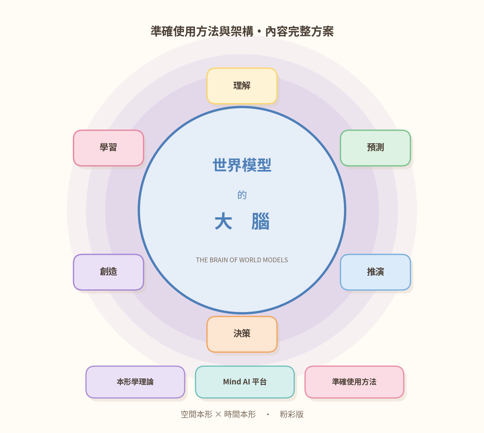

# 世界模型的大腦

> **以本形學（空間本形・時間本形）為理論基礎　·　以 Mind AI 為底層平台**

# 前言・這本書是什麼

「世界模型」是當代人工智慧最熱門的詞之一——讓機器擁有一個內部的世界，在心裡推演還沒發生的事。可是，今天的世界模型大多長得像一份精密的地圖：它能描述世界，卻常常不會思考。地圖不會預測下一刻、不會問「如果⋯會怎樣」、更不會為決策負責。缺的那一塊，叫大腦。

本書要做的，就是把「世界模型的大腦」立起來。以本形學為理論基礎：空間本形教我們把世界看清楚——萬物皆可寫成形；時間本形教我們把世界的運作寫下來——一切運作皆是函式；準確使用方法回答最後一問——怎麼樣才算數？以 Mind AI 為底層平台：語言能力交給 LLM，智慧能力由 Mind Model 承擔，大腦站在平台上長出來。

全書交出兩件主產物：其一是「準確使用方法」——三種補足、證明六步驟、八問檢查、誤用大對照，讓你使用世界模型的每一步都可打勾、可複核；其二是「內容與框架完整方案」——世界知識全面形化的藍圖、建庫四階段、情境選路與八週路線，讓大腦一類一類長出來、越用越準。

本書的邊界先說清楚：理論原典與 Mind AI 的原有內容不再重抄，理論骨幹以架構圖與圖文摘要呈現；書中談到的一切都是方法與方案，不涉及系統實作。讀者只要帶著一顆「想把世界看清楚」的心，就能一路讀下去。

# 本書怎麼讀（雙軌讀者・顏色分工）

全書採雙軌設計：主文是一般讀者都能讀的教學路線——一概念、一圖、一例、一練習；【專業專欄】是給 AI・工程讀者的深一層對照——共八則，編號 C1–C8，可跳讀、可略過，不影響主線。

> **閱讀元件一覽**
>
> - 導讀框：每篇開頭的「這一篇在說什麼」，先看它再讀本文。
> - 圖解：全書四十張粉彩圖，圖與文互相補足——圖看骨架，文看血肉。
> - 【例】框：把概念落到一個具體對象上，看完例再做練習。
> - 【練習】框：動手寫形、寫卡；寫完對照「寫完檢查」一行。
> - 要點框：每篇結尾的五句話複習，可當成口袋卡。
> - 【專業專欄】框：C1–C8，AI・工程視角的延伸對照。

全書圖解採統一的顏色分工，看顏色就知道在說三條軸的哪一條：

| 顏色 | 代表 | 記號 | 一句話 |
| --- | --- | --- | --- |
| 黃 | 屬性（X 軸） | [ ] | 它什麼樣子——維度 × 刻度 |
| 橘 | 組成（Y 軸） | { } | 它由什麼組成——物料清單 |
| 藍 | 容器（Z 軸） | ( ) | 它放在哪裡——身份與邊界 |
| 綠 | 時間 | 函式 | 它怎麼運作——形進形出 |
| 紫 | 總結 | — | 要點與收束 |
| 粉 | 誤用 | — | 避坑與退回 |

*練習共二十二題，編號三種：W＝篇末練習（W01–W13）、A＝準確使用方法篇（A01–A04）、S＝方案篇（S01–S05）；全部參考答案收在附錄三。*

# 篇章導覽表

| 篇 | 回答的問題 | 主要內容與產出 |
| --- | --- | --- |
| 第一篇 | 世界模型是什麼？大腦要做什麼？ | 三層定位・大腦五件事・世界四問 |
| 第二篇 | 大腦長什麼樣？ | 兩庫一中樞一迴路・平台對接 |
| 第三篇 | 世界的「形」怎麼寫？ | 形集合・三軸・世界四形・五域形化 |
| 第四篇 | 世界的「時間」怎麼寫？ | 形進形出・函式庫六群・因果與模擬 |
| 第五篇 | 大腦怎麼判斷？ | 三層判斷・推理五族・思考法選路・全程推演 |
| 第六篇 | 怎麼用才算準？ | 三種補足・證明六步驟・八問・誤用大對照 |
| 第七篇 | 內容怎麼建？ | 形化藍圖・建庫四階段・情境選路・驗收 |
| 第八篇 | 框架怎麼長大？ | 學練用教建・八週路線・三階段成長・願景 |

# 目錄

- 前言・這本書是什麼
- 本書怎麼讀（雙軌讀者・顏色分工）
- 篇章導覽表
- 第一篇　世界模型是什麼？大腦要做什麼？
  - 1.1　世界模型：不只是地圖
  - 1.2　大腦的五件事
  - 1.3　三層定位：理論・平台・應用
  - 1.4　世界四問
- 第二篇　整體架構：大腦解剖圖
  - 2.1　兩庫・一中樞・一迴路
  - 2.2　世界形庫：世界的樣子收在這裡
  - 2.3　世界函式庫：世界的運作收在這裡
  - 2.4　三層判斷中樞：怎麼算數
  - 2.5　認知鏈與學習迴路
  - 2.6　與 Mind AI 平台對接
- 第三篇　世界的形：空間本形面向
  - 3.1　把世界寫成形
  - 3.2　三軸形化：X 屬性・Y 組成・Z 容器
  - 3.3　世界四形：實體・關係・場域・狀態
  - 3.4　五域形化並列
  - 3.5　拆件試驗與不變性
- 第四篇　世界的時間：時間本形面向
  - 4.1　形進形出：世界的運作即函式
  - 4.2　世界函式庫六群
  - 4.3　狀態轉移與因果鏈
  - 4.4　五域動態並列
  - 4.5　模擬與反事實
- 第五篇　大腦怎麼判斷：推理與思維
  - 5.1　三層判斷的運作
  - 5.2　推理五族
  - 5.3　思考法選路
  - 5.4　全程推演：城市紅綠燈怎麼調
- 第六篇　準確使用方法：怎麼用才算準
  - 6.1　準確的定義：可複核的準
  - 6.2　三種補足
  - 6.3　證明六步驟
  - 6.4　八問檢查清單
  - 6.5　誤用大對照
  - 6.6　完整示範：寫到可複核
- 第七篇　內容完整方案：把世界裝進大腦
  - 7.1　世界知識全面形化藍圖
  - 7.2　建庫四階段
  - 7.3　情境選路對照
  - 7.4　驗收標準
- 第八篇　框架完整方案：發展路線與願景
  - 8.1　學練用教建五段
  - 8.2　八週學習路線
  - 8.3　三階段成長
  - 8.4　願景
- 附錄一　術語與記號速查
- 附錄二　準確使用方法速查卡
- 附錄三　練習參考答案

# 第一篇　世界模型是什麼？大腦要做什麼？

> **導讀・這一篇在說什麼**
>
> 世界模型是對世界的內部表示——但只有描述，不叫大腦。這一篇先把「世界模型的大腦」定位清楚：它要做哪五件事、站在哪三層之上、開口問哪四個問題。
>
> 讀法：1.1 看清地圖與大腦之別 → 1.2 看五職 → 1.3 看三層定位 → 1.4 學會世界四問；練習 W01–W02。

## 1.1　世界模型：不只是地圖

一個「世界模型」，是系統心裡的那個世界：它把外在世界的樣子記下來，把世界的運作記下來，好讓系統在行動之前，先在心裡把世界演一遍。做得好的世界模型有三件事——記下世界的樣子、記下世界的運作、推演還沒發生的事。

問題在於，今天多數世界模型只做到前半。它們像一張精密的地圖：標得出路口、量得出距離、連得出關係——但地圖不會告訴你下一刻會怎樣，不會問「如果改紅綠燈會怎樣」，更不會替你選一條路。描述世界，和思考世界，是兩件事。

本形學的回答很清楚：世界模型＝世界的形＋世界的時間＋判斷與推理。空間本形立起「世界的形」——世界萬物皆可寫成形；時間本形立起「世界的時間」——世界的一切運作皆是函式；而把形與函式用起來、判斷怎麼算數的那個中樞，就是本書說的大腦。

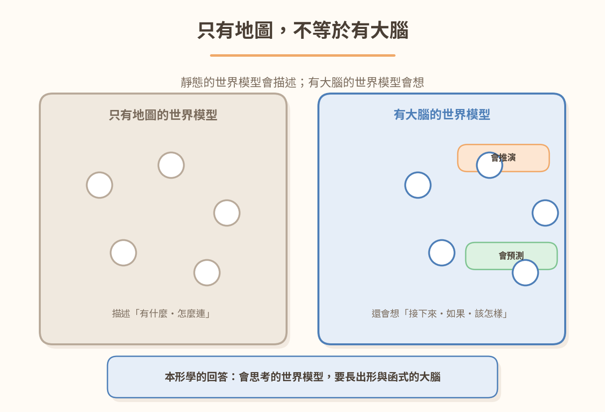

**圖 01　只有地圖，不等於有大腦**

> **【專業專欄】C1　世界模型在 AI 研究中的位置**
>
> 在機器學習社群，world models 指的是從資料學出「可推演的內部表示」——無論是隱狀態、模擬器，還是世界表徵，目標都是讓模型在心裡 rollout：推幾步、看結果、再行動。
>
> 形學補上的是「可複核的描述」：內部表示要有名字（形集合）、要過判斷（三層判斷）、要能交接（函式四問）。黑箱表徵擅長推演，形的描述擅長審查——兩者合用，世界模型才既會想、又說得清。

## 1.2　大腦的五件事

世界模型有了大腦，才會思考。大腦的工作可以收成五件：理解世界——認出眼前是什麼、由什麼組成；預測未來——推知下一刻世界長什麼樣；推演情境——回答「如果這樣，會怎樣」；決策行動——在多條路裡選一條，並寫得出選它的理由；創造新知——造出世界原本沒有的形，收進世界形庫。

五件事的次序不能亂：先理解、後預測；先推演、後決策；決策沉澱多了，才有創造的底子。跳過理解直接決策，是世界模型最常見的病——本書第五、六篇會給出完整的診法與治法。

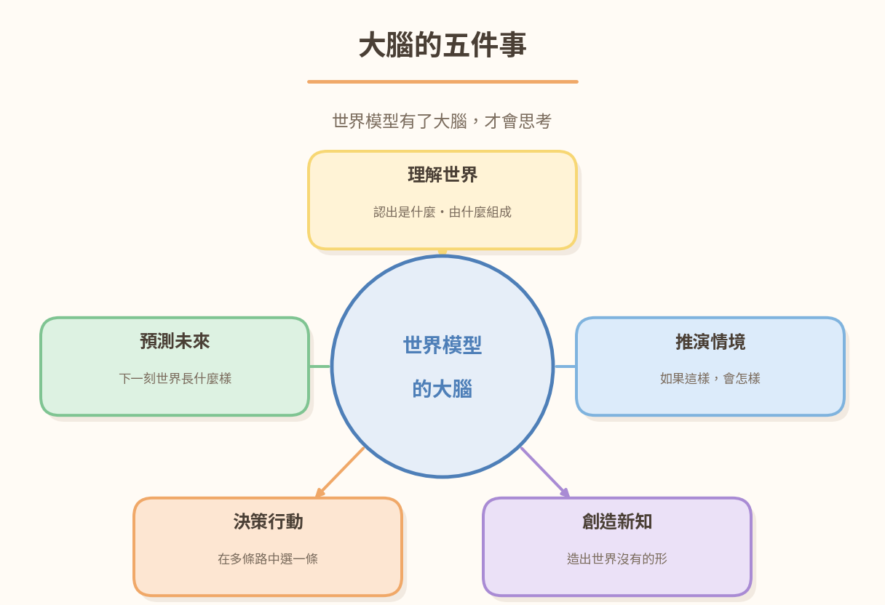

**圖 02　大腦的五件事**

## 1.3　三層定位：理論・平台・應用

「世界模型的大腦」不是從天上掉下來的，它站在三層之上：理論為根——本形學的空間本形、時間本形與準確使用方法，是大腦看世界、寫世界、判世界的整套語言；平台為底——Mind AI 匯合 LLM 的語言能力與 Mind Model 的智慧能力，是大腦生長的土壤；應用為果——本大腦把理論與平台收成一套可用的世界模型方法。

三層各司其職：理論回答「用什麼語言想」，平台回答「站在什麼上面跑」，應用回答「拿來做什麼」。本書談的是第三層的方法與方案，理論與平台只以架構圖引用，不重抄原典。

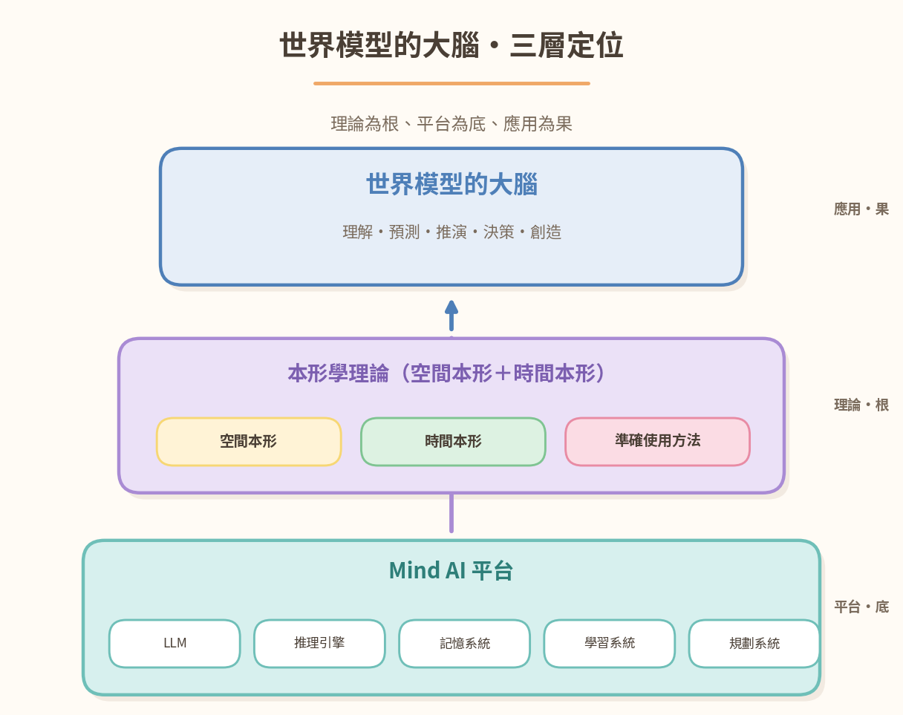

**圖 03　世界模型的大腦・三層定位**

## 1.4　世界四問

把世界看清楚，先問對問題。本形學的「四個學習之問」落到世界模型上，就成了世界四問：世界是什麼樣子？——這是 X 屬性 [ ]，維度與刻度；世界由什麼組成？——這是 Y 組成 { }，物料清單；東西放在哪裡？——這是 Z 容器 ( )，身份與邊界；世界怎麼運作？——這是時間本形，函式與招式。

前三問是空間本形，第四問是時間本形。四問都答得出來，世界才真正「成形」。認知的次序也藏在四問裡：先看得出異同、再拆得開合得攏、才立得起形、取得出名——有合必有形。

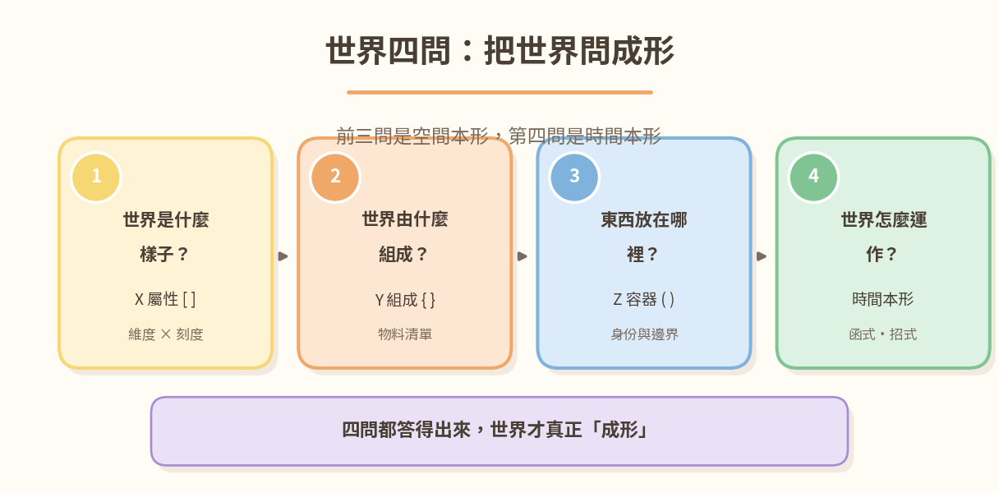

**圖 04　世界四問：把世界問成形**

> **【例】一輛車的世界四問**
>
> 世界是什麼樣子？——白色、三廂、電動、乘五人（屬性：顏色・車型・動力・座位，各有刻度）。
>
> 世界由什麼組成？——引擎或馬達、輪胎、車殼、電池（物料清單，拆開逐件認）。
>
> 東西放在哪裡？——這輛車是「這一輛」：車牌與 id 不變，今天在停車場、明天在高速公路上，車還是那輛車。
>
> 世界怎麼運作？——充電、行駛、保養、維修：每個動作都是一個函式，輸入一個形、產出一個形。

> **【練習】W01　為你的工作對象問世界四問**
>
> 挑一個你工作上最熟的對象（一個客戶、一台設備、一份報表），把世界四問逐題寫出來——每問至少一行，屬性要寫到刻度。
>
> 寫完檢查：四問的答案交給同事，他能不問你第三句話就認得這個對象嗎？

> **【練習】W02　把五件事排進你的工作**
>
> 回想上週做過的一件任務：它用到大腦五件事裡的哪幾件？哪一件被跳過了？把跳過的補上，寫出補做的一步。
>
> 寫完檢查：五件事的次序是「理解→預測→推演→決策→創造」——你的任務有沒有跳序？

> **第一篇要點**
>
> - 世界模型＝世界的形＋世界的時間＋大腦——只會描述的是地圖，會思考的才叫大腦。
> - 大腦五件事：理解・預測・推演・決策・創造——先理解後決策，次序不能亂。
> - 三層定位：本形學為根、Mind AI 為底、世界模型的大腦為果。
> - 世界四問：什麼樣子 [ ]、由什麼組成 { }、放在哪裡 ( )、怎麼運作（時間本形）。
> - 認知鏈：異同→分合→形→名；有合必有形，先有形、才有數。

# 第二篇　整體架構：大腦解剖圖

> **導讀・這一篇在說什麼**
>
> 這一篇把大腦解剖開：兩庫、一中樞、一迴路。世界形庫收世界的樣子，世界函式庫收世界的運作，三層判斷中樞管怎麼算數，認知鏈與學習迴路讓大腦越用越準。最後看它怎麼站在 Mind AI 平台上。
>
> 讀法：2.1 看總圖 → 2.2–2.3 認兩庫 → 2.4 認中樞 → 2.5 看迴路 → 2.6 看對接；練習 W03–W04。

## 2.1　兩庫・一中樞・一迴路

打開大腦，看見四個部件。世界形庫：一座收納「世界的樣子」的倉庫，任何對象寫成一行形集合就進得來；世界函式庫：一座收納「世界的運作」的兵器譜，任何動作寫成一張函式四問卡就掛得上牆；三層判斷中樞：管「怎麼算數」的關卡，任何結論要過容器關、BOM 關、抽象關；認知鏈與學習迴路：管「越用越準」的循環，每次認知沉澱成記憶，每次記憶升級形庫。

四個部件缺一不可：缺形庫，無物可思；缺函式庫，無事能做；缺中樞，無準可依；缺迴路，大腦不再長大。世界從左邊進來——感知輸入；成果從右邊出去——預測、決策與新形。

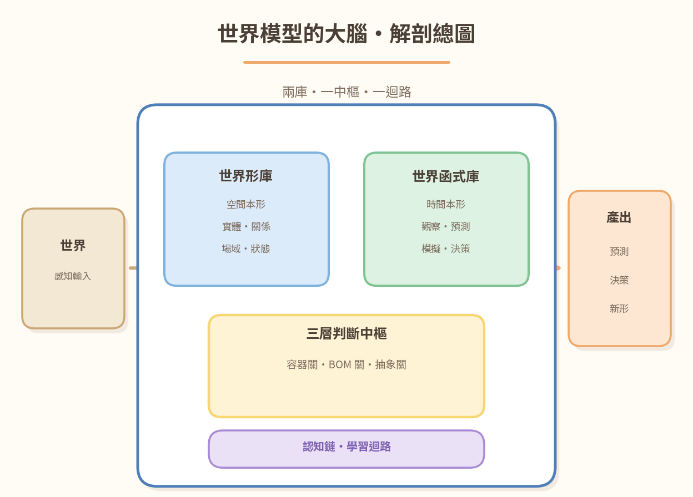

**圖 05　世界模型的大腦・解剖總圖**

## 2.2　世界形庫：世界的樣子收在這裡

世界形庫收的是「形」。任何世界對象，寫成形集合 {部件, (內容), [類別]} 一行，就入庫。庫裡的形分四種基本款：實體形（看得見的東西）、關係形（東西之間的連線）、場域形（東西待的地方）、狀態形（此刻的樣子）——第三篇會逐一打開。

查庫的口訣是「先對照、後開新」：新對象來了，先拿它的形去庫裡對照；對得上就掛進既有類別，對不上才開新維度、立新形。這樣庫越用越大，卻不會亂——因為每一條都有名字、有判準。

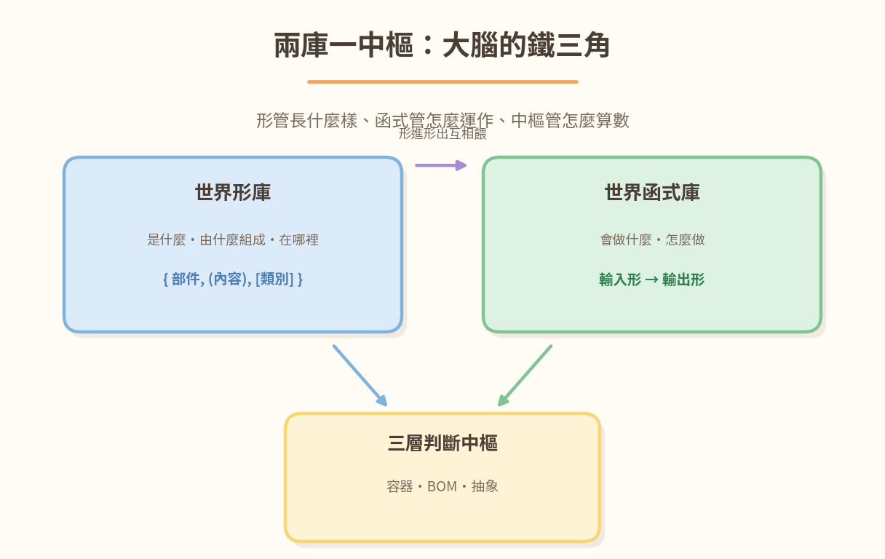

**圖 06　兩庫一中樞：大腦的鐵三角**

## 2.3　世界函式庫：世界的運作收在這裡

世界函式庫收的是「函式」——世界的每一個動作：觀察、預測、模擬、設計、學習、決策，收成六群招式。每一個函式上崗前都要寫全四問：名稱、輸入形、輸出形、判準——四問寫全，動詞才成形。

面對任務，第一個動作不是發明，而是搜尋：把任務寫成形，拿去函式庫對照；對得上，現成招式直接上崗；對不上，才走進萃取、生成與設計。任務來了先搜尋、後發明——這是大腦省力又不重複犯錯的底層紀律。

## 2.4　三層判斷中樞：怎麼算數

判斷中樞是大腦的法院。任何一個形、任何一個結論，都要過三關：容器關問「身份是誰」——id 是什麼、不變性守住沒有；BOM 關問「部件齊嗎」——拆得開、認得回，必要件一個不能少；抽象關問「歸哪一類」——拿判準 T=(F(T), ∩(T)) 逐條比對：功能對上、交集對上，才判進這一類。

三層聯合判斷，缺一不可：只做抽象關，會把同名不同實的東西混在一起；只做容器關，會認得身份卻不懂類別；只做 BOM 關，拆得開卻合不回。三關都過，這個判斷才算數。

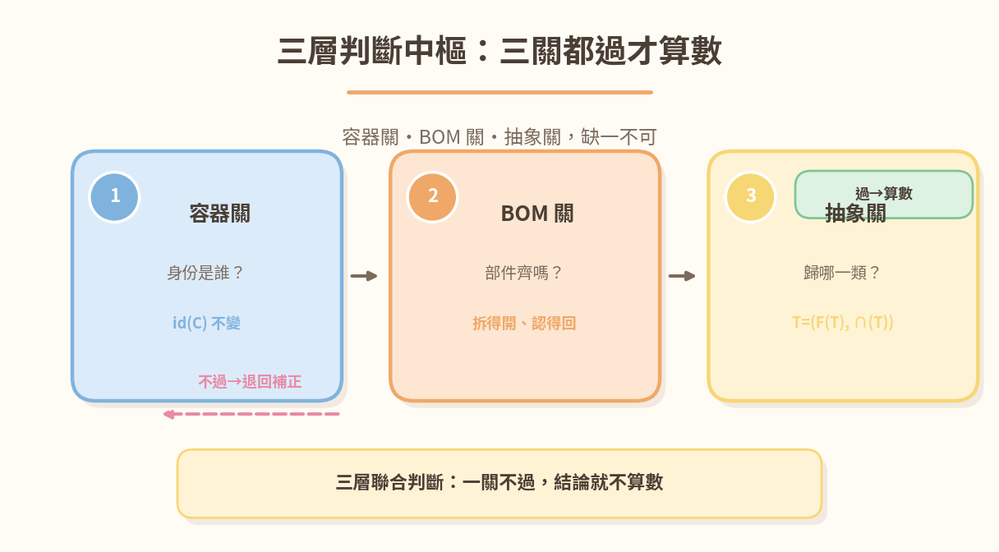

**圖 07　三層判斷中樞：三關都過才算數**

## 2.5　認知鏈與學習迴路

大腦怎麼長出新形？走認知鏈：先看「異同」——看得出差異，是認知的起點；再走「分合」——拆得開、合得攏，才摸到結構；立起「形」——把結構寫成形集合；取下「名」——人人可查、可交接。四步一輪迴，世界的樣子就一格一格進了形庫。

認知鏈的核心命題是「有合必有形」：只要多個小形合成一個整體，這個整體就必然有自己的形——不要漏看。「數」則是形裡面的小形、次一級的比較：先有形、才有數。記憶沉澱在迴路裡：每完成一輪認知，形庫就厚一分，判斷就準一分——這就是持續學習。

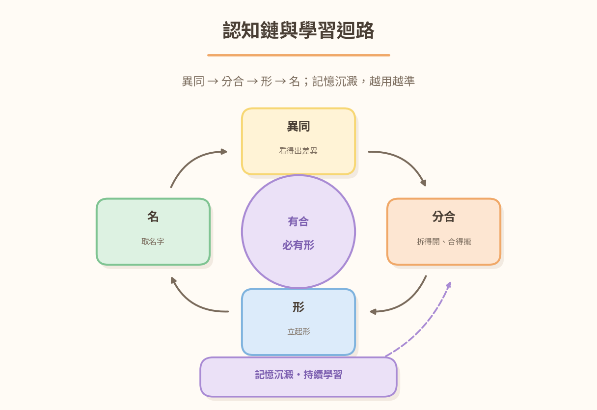

**圖 08　認知鏈與學習迴路**

## 2.6　與 Mind AI 平台對接

大腦不是孤島，它站在 Mind AI 平台上。平台給它兩樣東西：LLM 的語言能力——聽得懂世界、說得出結果；Mind Model 的智慧能力——知識統一、深層推理、長期記憶、思維管理。分工很清楚：LLM 管語言，Mind Model 管智慧，形的語言則由本形學提供。

對接的方式是「形上形下」：大腦把形與函式交給平台存、交給平台運算；平台把推理與記憶的成果交回大腦判斷。理論在最底層支撐——空間本形立形、時間本形立函式、準確使用方法立複核。三層疊起來，就是完整的應用。

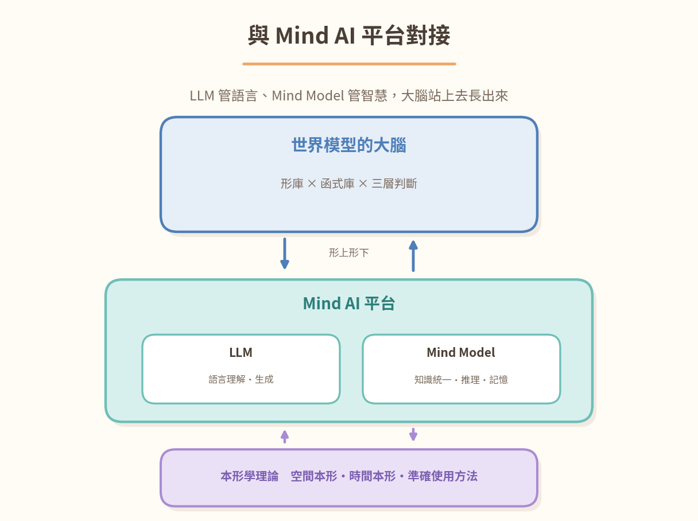

**圖 09　與 Mind AI 平台對接**

> **【專業專欄】C3　LLM 時代，世界模型補什麼**
>
> LLM 把「說世界」做到極致：理解語言、生成語言、召回知識，樣樣驚人。但會說不等於會演——把世界的運作在心裡推一遍、為推演的後果負責，是世界模型的職責。語言模型回答「像什麼」，世界模型回答「會怎樣」。
>
> 分工一句話：LLM 負責把話說清楚，世界模型負責把世界想清楚，大腦把兩者黏在一起——形的語言讓 LLM 的輸出可被審查，讓世界的推演可被言說。實務做法：LLM 的產出一律「成形入庫」——先寫成形集合與函式四問、過三層檢查，再收進世界形庫；語言能力就此沉澱為可複核的資產，而不是一次性的對話。

> **【專業專欄】C2　為何知識圖譜不夠**
>
> 傳統知識圖譜描述實體與關係已經很好，但對世界模型來說仍有缺口：表達能力有限——寫得出「相連」，寫不出「由什麼組成、拆了會怎樣」；難以表示抽象概念——類別的邊界只能約定，不能判斷；缺乏思維結構——圖會回答「是什麼」，不會回答「怎麼想」；難以持續演化——新知識進來，schema 先要改半天。
>
> 形學的解法是把「形」做成一等公民：形集合自帶組成與類別，三層判斷自帶歸屬推理，函式庫自帶思維結構，開放位自帶演化空間。世界圖譜描述世界，世界形庫思考世界。

> **【練習】W03　為你的領域寫出兩庫清單**
>
> 你的工作領域裡，「形庫」會收哪三種東西？「函式庫」會收哪三種動作？各寫三行——動作要寫到「輸入什麼形、產出什麼形」。
>
> 寫完檢查：六行裡每一行，都能在腦中指認出具體例子嗎？

> **【練習】W04　跑一次三層判斷**
>
> 拿 W01 寫過的對象，逐關回答：容器關——它的 id 是什麼？BOM 關——拆掉哪一件它就不再是他？抽象關——它屬於哪一類，判準是什麼？
>
> 寫完檢查：三關的答案有沒有互相矛盾？（例如：類別說它是車，必要件卻少了輪胎。）

> **第二篇要點**
>
> - 兩庫一中樞一迴路：形庫收樣子、函式庫收運作、中樞管算數、迴路管長大。
> - 查庫口訣：先對照、後開新；任務口訣：先搜尋、後發明。
> - 三層判斷：容器關（身份）・BOM 關（部件）・抽象關（判準 T=(F(T),∩(T))），缺一不可。
> - 認知鏈：異同→分合→形→名；有合必有形，先有形、才有數。
> - 平台對接：LLM 管語言、Mind Model 管智慧；形上形下，理論在底層支撐。

# 第三篇　世界的形：空間本形面向

> **導讀・這一篇在說什麼**
>
> 這一篇把「世界的形」寫出來：一行形集合、三條軸、四種基本形、五個領域的並列案例，最後用拆件試驗守住不變性。學完這一篇，世界上任何對象你都寫得下。
>
> 讀法：3.1 學一行寫法 → 3.2 學三軸 → 3.3 認四形 → 3.4 看五域 → 3.5 做拆件試驗；練習 W05–W07。

## 3.1　把世界寫成形

把世界看清楚的第一步，是把世界寫下來。本形學的寫法是「形集合」——一行寫下一個形：{部件, (內容), [類別]}。花括號寫部件：這個東西拆開來有什麼；圓括號寫內容：它的容器裡裝著什麼；方括號寫類別：它屬於哪一類。一行寫完，人人可查、可驗收。

為什麼要寫成一行？因為世界模型要交接。形只存在腦子裡，是一團感覺；寫成形集合，就成了可教、可練、可複核的資料。還有一條鐵律要記住：先有形、才有數——還沒立形就數數量，數會失去意義；形立穩了，數才有地方掛。

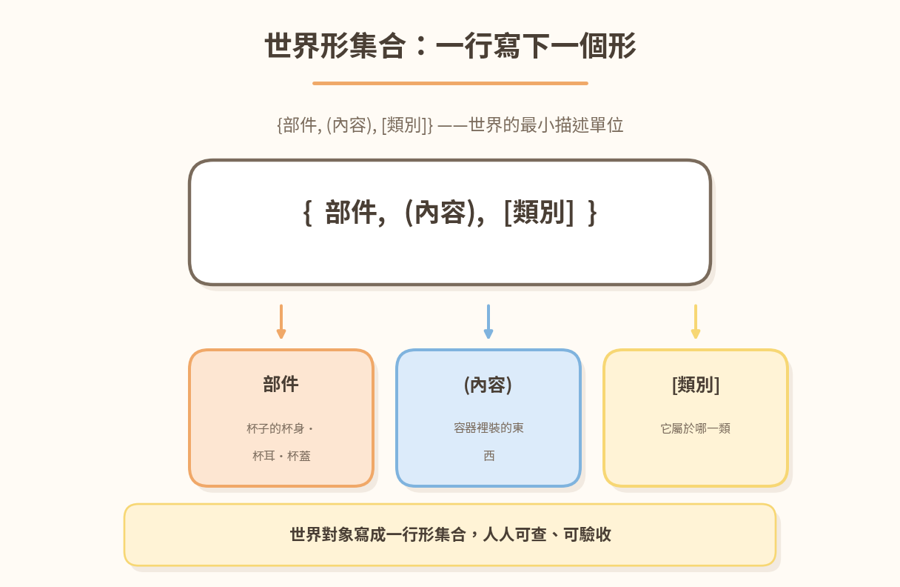

**圖 10　世界形集合：一行寫下一個形**

## 3.2　三軸形化：X 屬性・Y 組成・Z 容器

每個形都能沿三條軸拆開來看。X 屬性 [ ]：它什麼樣子——每一條屬性是一條維度，每個維度配上刻度（顏色有刻度、時速有刻度、年齡有刻度）；Y 組成 { }：它由什麼組成——物料清單，逐件拆開來看；Z 容器 ( )：它放在哪裡——身份與邊界，容器有不變的身份 id(C) 與變動的內容 S(C)，id 不變，容器才是同一個。

三條軸互相獨立、缺一不可：只有屬性，寫不出結構；只有組成，認不出類別；只有容器，說不清裡面裝什麼。三軸拆完，一個世界對象就寫成人人可查的形集合。

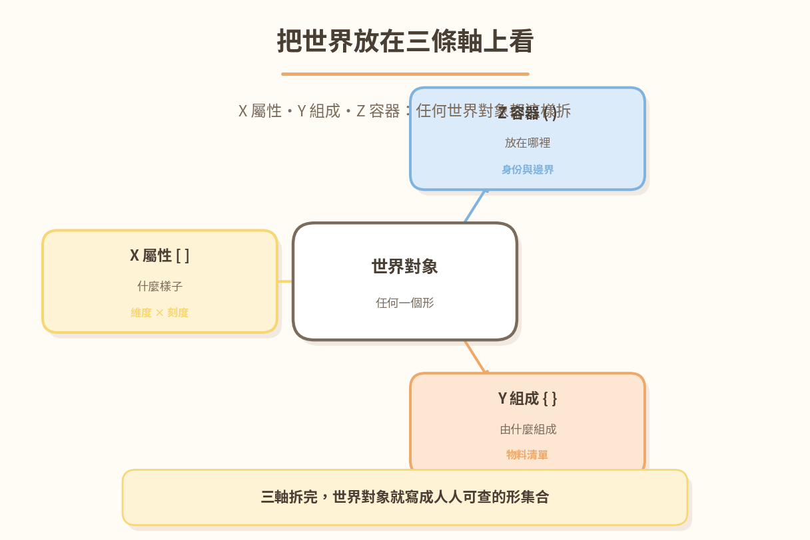

**圖 11　把世界放在三條軸上看**

> **【例】一隻貓的三軸**
>
> X 屬性：毛色（橘白）、年齡（三歲）、體重（四・二公斤）——每條維度都有刻度。
>
> Y 組成：{骨骼, 器官, 毛皮, (食物), [哺乳類]}——拆開逐件認，少了心臟就不再是活的貓。
>
> Z 容器：這隻貓叫「阿橘」，id 不變——今天在客廳、明天在院子，阿橘還是阿橘；客廳只是它此刻的容器。

## 3.3　世界四形：實體・關係・場域・狀態

世界對象千千萬萬，基本形只有四種。實體形：看得見摸得著的東西——一座橋、一隻貓；關係形：東西之間的連線——橋連兩岸、母子相依；場域形：東西待的地方——一座城市、一個生態系；狀態形：此刻的樣子——堵車中、發芽期。四形分清，世界的每一樣東西都有位子。

四形的寫法完全相同，都是形集合一行；差別在部件的性質——實體的部件是零件，關係的部件是兩端與連線，場域的部件是區域與規則，狀態的部件是此刻各屬性的取值。世界模型的大腦認形時，先認四形，再認細節——這就是抽象關的入口。

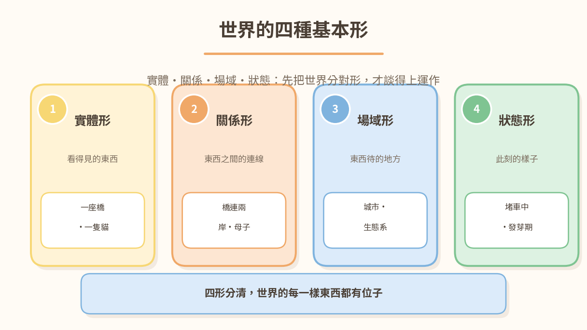

**圖 12　世界的四種基本形**

## 3.4　五域形化並列

這套寫法是不是只適用於工程？看五個領域同時寫一遍：物理——一座橋寫成{橋墩・橋面・纜索, (車流), [交通設施]}；生物——一隻貓寫成{骨骼・器官・毛皮, (食物), [哺乳類]}；語言——一句話寫成{主詞・動詞・受詞, (語境), [句子]}；程式——一個模組寫成{函式・變數・介面, (資料), [元件]}；組織——一家公司寫成{部門・職位・流程, (客戶), [企業]}。

五個領域、五套常識、一行寫法。換個領域，只是換部件的名字；形集合的結構、三軸的拆法、判準的寫法，一行不變。這就是本形學說的「統一認知」——跨領域知識先在「形」的層次統一，思維才有統一的可能。

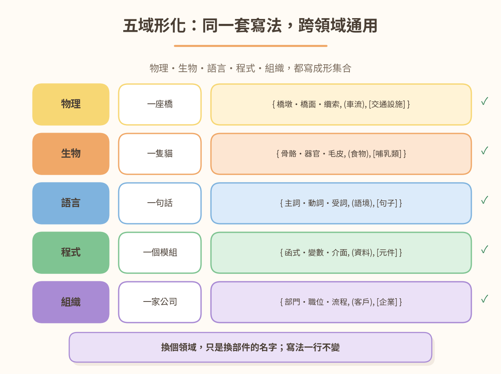

**圖 13　五域形化：同一套寫法，跨領域通用**

## 3.5　拆件試驗與不變性

形立起來之後，怎麼守住它？靠拆件試驗——remove 試驗：把部件一件件拆下來，問「拆下來，還認得自己嗎？」答案分三級：必要件——拆了，形就散了（≢ M）：車拆掉引擎與輪胎，車就不再是車；功能降級件——拆了，功能降級（≡ M′ ⊂ M）：車拆掉空調與音響，還是車，但舒適度降級；非必要件——拆了，形不變（≡ M）：車拿掉吊飾與貼紙，車還是車。

這就是容器的不變性公理：id(C) 不變，容器才是同一個；必要件守住形，內容 S(C) 可以變動。世界模型的大腦靠這條公理追蹤世界——十年後的 A3 橋換過纜索，橋還是那座橋；拆了橋墩，橋就不是橋了。

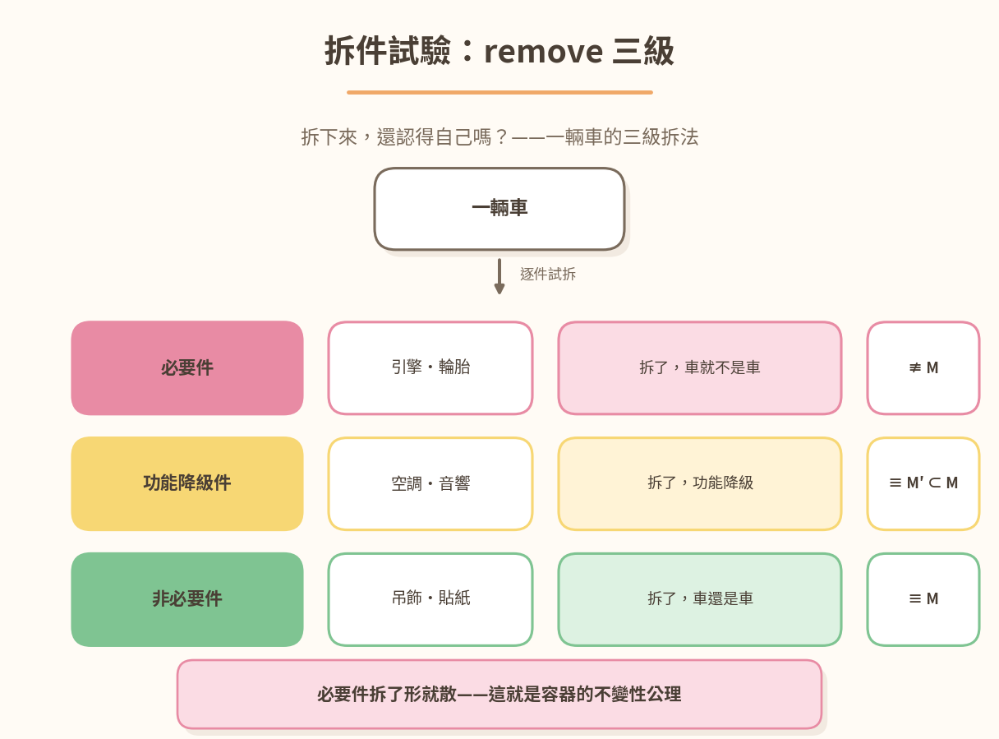

**圖 14　拆件試驗：remove 三級**

> **【專業專欄】C4　狀態表示與形集合**
>
> 工程上表示「世界此刻的樣子」，常用狀態向量：一串數字，餵給模型推演。向量的好處是運算快，壞處是不可讀、不可交接——同一串數字，兩位工程師可能讀出兩個世界。
>
> 形集合是狀態的「可讀寫法」：屬性帶刻度、組成帶部件、容器帶身份。實務上兩層並用——運算層用向量，交接與審查層用形；形集合負責讓狀態「說得清」，向量負責讓狀態「算得快」。

> **【練習】W05　為一個對象寫形集合**
>
> 挑一個你常處理的對象，寫成形集合一行：部件列三件以上、內容寫清、類別寫明；再沿三軸各補一行描述。
>
> 寫完檢查：把這一行交給同事，他能照著認出同一類對象嗎？

> **【練習】W06　五域各寫一行**
>
> 仿 3.4 的表，為你熟悉的五個東西各寫一行形集合——盡量來自五個不同領域。
>
> 寫完檢查：五行的寫法結構是否一致？（部件、內容、類別都在同一個位子上。）

> **【練習】W07　做一次 remove 三級**
>
> 拿 W05 的對象做拆件試驗：列出必要件、功能降級件、非必要件各至少一件，標上 ≢ M、≡ M′ ⊂ M、≡ M。
>
> 寫完檢查：必要件全部拆掉後，這個對象還認得自己嗎？——認不得，就代表你找到真正的必要件了。

> **第三篇要點**
>
> - 形集合一行寫下一個形：{部件, (內容), [類別]}——可查、可驗收、可交接。
> - 三軸：X 屬性 [ ]（維度×刻度）・Y 組成 { }（物料清單）・Z 容器 ( )（id(C) 與 S(C)）。
> - 世界四形：實體・關係・場域・狀態——先認四形，再認細節。
> - 五域一行寫法：換領域只是換部件名字，結構一行不變。
> - remove 三級守不變性：必要件 ≢ M、功能降級件 ≡ M′ ⊂ M、非必要件 ≡ M；先有形、才有數。

# 第四篇　世界的時間：時間本形面向

> **導讀・這一篇在說什麼**
>
> 世界的形是靜的，世界的時間是動的。這一篇把世界的運作寫成函式：形進形出、六群招式、狀態轉移、因果與果因、五域動態，最後打開「模擬與反事實」——大腦最像大腦的時刻。
>
> 讀法：4.1 學形進形出 → 4.2 看六群 → 4.3 走時間流 → 4.4 看五域 → 4.5 學推演；練習 W08–W10。

## 4.1　形進形出：世界的運作即函式

世界不是靜物畫，世界一直在運作。本形學把一切運作寫成時間本形：函式＝方法＝招式＝服務。每一個函式的寫法只有一句話——輸入一個形，產出一個形。觀察是函式：輸入「現場的形」，產出「記錄的形」；預測是函式：輸入「此刻的形」，產出「下一刻的形」；決策也是函式：輸入「情境的形」，產出「行動的形」。

動詞也要成形。一個動詞只報名字，每個人都在做不同的事；為它寫出「函式四問卡」——名稱、輸入形、輸出形、判準——它就成了可教、可練、可複核的招式。判準尤其要緊：寫到能逐句打勾，才叫寫全。

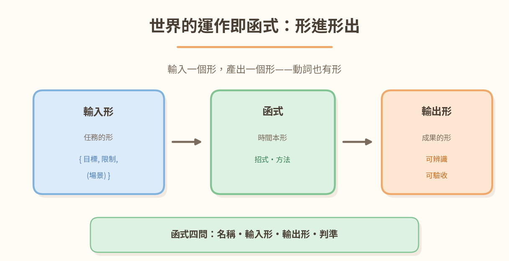

**圖 15　世界的運作即函式：形進形出**

## 4.2　世界函式庫六群

世界的招式千千萬萬，收成六群。觀察群：把世界看清楚——搜尋、萃取、對照；預測群：推知下一刻——因果、果因、統計；模擬群：在心裡演一遍——模擬、逆向、推演；設計群：造出新方案——設計、生成、組合；學習群：越用越準——持續學習、重構；決策群：選一條路走——解題、規劃、決策。

六群的用法有次序：先觀察、後預測；先模擬、後決策；學習群貫穿全程——每次收工，把用過的招沉澱回函式庫。第六篇的「選對招嗎」一問，問的就是你從這六群裡挑的招，與處境配不配。

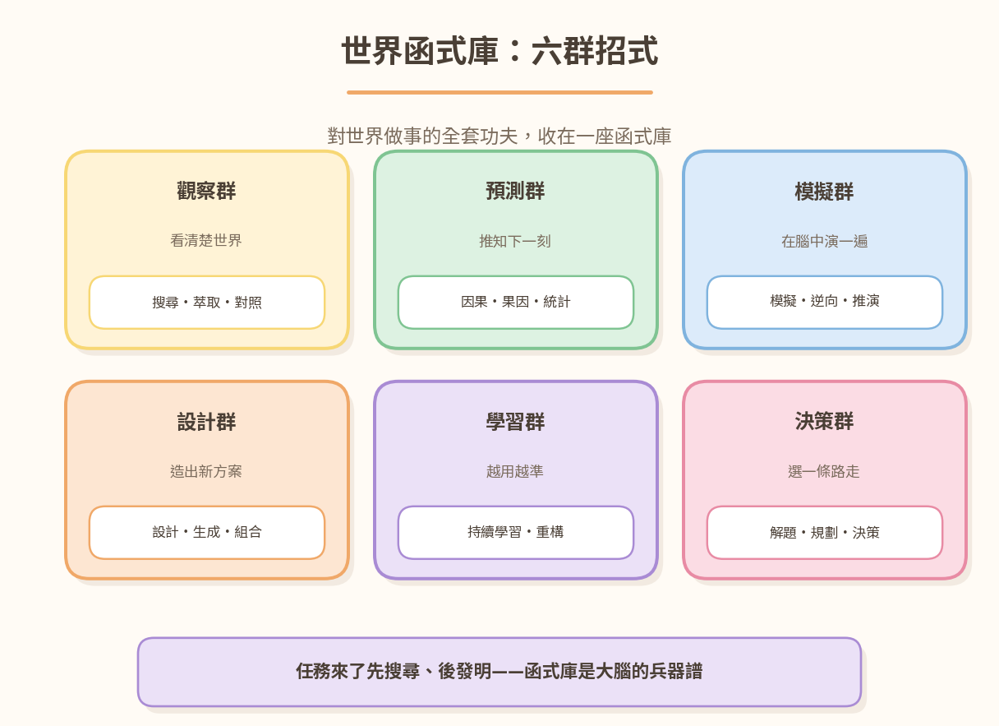

**圖 16　世界函式庫：六群招式**

## 4.3　狀態轉移與因果鏈

世界的時間怎麼寫下來？用狀態轉移：世界每一刻都是一個狀態形，時間是形的接力——S0 交棒給 S1、S1 交棒給 S2，交棒的那隻手就是函式 f。清晨的乾路面（S0）經過「天氣函式」交棒給午後的烏雲（S1），再交棒給傍晚的暴雨（S2）——每一棒都是「輸入一個形，產出一個形」。

因果是這條鏈的方向感。因果順推：由因推果——烏雲密布，推將有暴雨，用於預測與推演；果因逆推：由果推因——路面積水，推排水堵塞，用於診斷與找根因。一順一逆，兩把鑰匙開世界的兩扇門。世界模型的大腦遇到問題，先問方向：要的是「接下來會怎樣」，還是「為什麼變成這樣」？

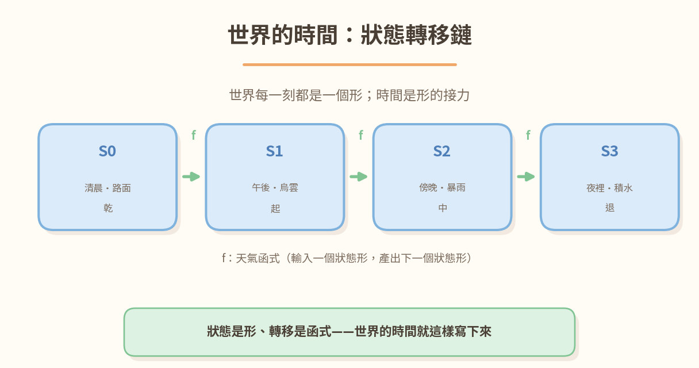

**圖 17　世界的時間：狀態轉移鏈**

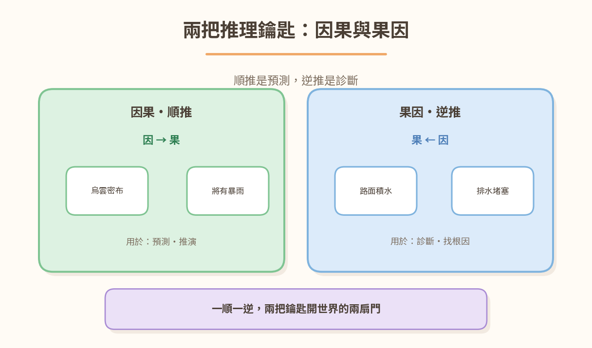

**圖 18　兩把推理鑰匙：因果與果因**

## 4.4　五域動態並列

函式的寫法同樣跨領域通用。物理的拋物線：初速與角度的形進、落點的形出；生物的光合作用：光・水・二氧化碳的形進、養分的形出；語言的句法生成：意思的形進、句子的形出；程式的函式執行：輸入的形進、輸出的形出；組織的請假流程：申請的形進、核准的形出。

五個領域、五套機制、一句寫法——輸入一個形、產出一個形。這就是時間本形的統一力：跨領域的「做法」在形的層次先統一，推理才能跨域借用——第四篇的形、第五篇的推理，都會再用到這一點。

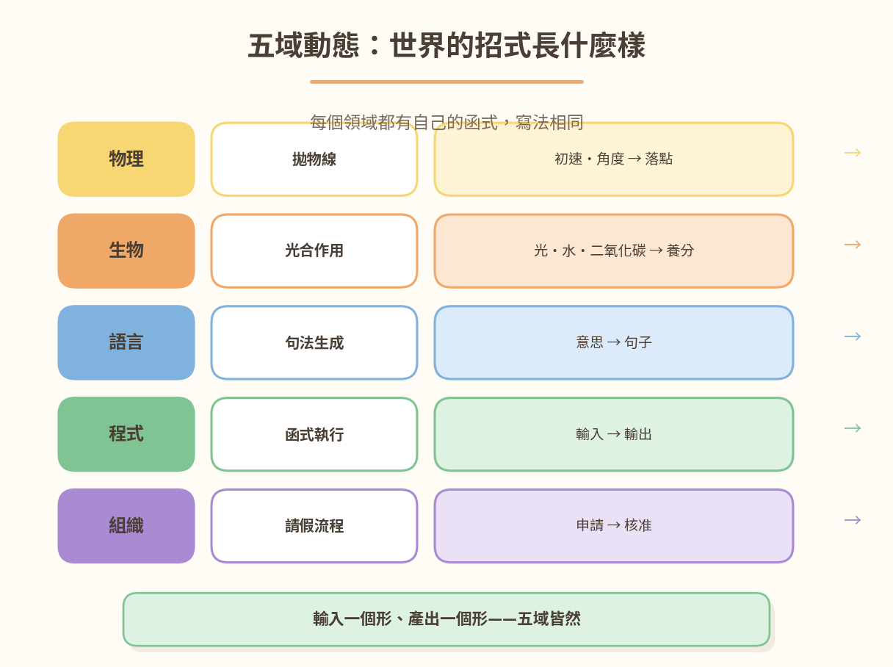

**圖 19　五域動態：世界的招式長什麼樣**

## 4.5　模擬與反事實

大腦最像大腦的時刻，是「什麼都還沒發生，卻已經在心裡走了一遍」。模擬推理就是這件事：從此刻的狀態形出發，把多條路徑各自推幾步——如果改綠燈制，會怎樣；如果維持現制，會怎樣；如果只調路線，會怎樣。推完再比較，選一條走。

反事實的關鍵在「不落地」：推演的每一條路都是暫存的形，直到判準打勾、決策敲定，才有一條路成為現實。這裡要用到判準 T=(F(T), ∩(T)) 的開放位精神：推演的形要留開放位給新證據——路況一變，推演就要重跑。推演不是猜：每條路都寫成形、配上判準再選。

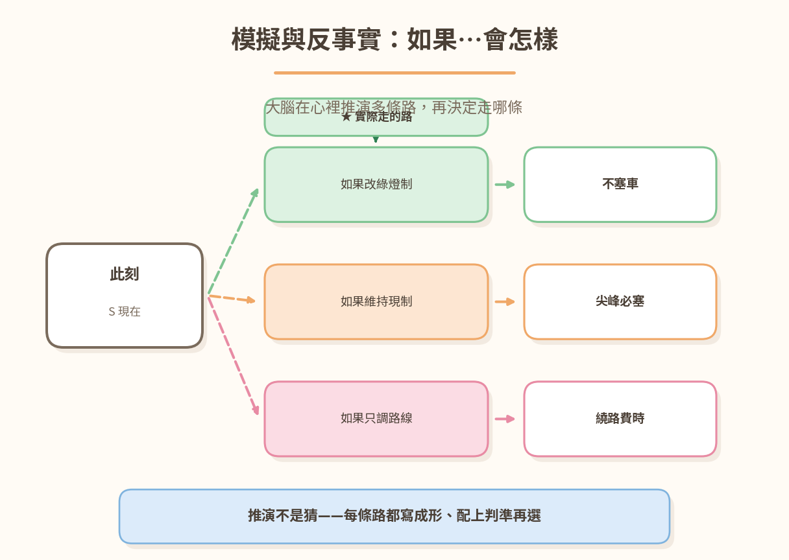

**圖 20　模擬與反事實：如果⋯會怎樣**

> **【專業專欄】C5　形進形出與狀態空間**
>
> 把世界寫成狀態、把運作寫成轉移函式，正是控制論與強化學習的共同骨架：transition function 吃進當前狀態、吐出下一狀態，rollout 就是一串轉移的接力。形學的增量是給每個狀態與轉移「上戶口」——輸入形與輸出形寫清楚，rollout 的每一站都可驗收，而不只是一串隱向量。
>
> 實務好處有二：其一，交接——工程師與領域專家用同一套形對話；其二，審查——推演路徑的每一步都能打勾，決策來歷清楚，反事實也才真的可反駁。

> **【例】「城市紅綠燈」的函式四問卡**
>
> 名稱：號誌調校（設計函式）；輸入形：{路口, 車流, (號誌制), [市區]}；輸出形：{新號誌案, 預估車流速, [方案]}；判準：預估車流速提升可量化、三個時段各模擬一遍、缺任一時段不收。

> **【練習】W08　為一個動作寫函式四問卡**
>
> 挑一個你工作上天天做、卻說不清的動作（例：開會、巡檢、回客訴），寫全函式四問——判準要寫到能逐句打勾。
>
> 寫完檢查：只看卡、不問你，同事能做出一模一樣的動作嗎？

> **【練習】W09　畫一條狀態轉移鏈**
>
> 回想一件正在進行的事（報表流程、專案、生產線），畫出三個以上的狀態形，標出每一棒的轉移函式與方向。
>
> 寫完檢查：每一棒是不是真的「輸入一個形、產出一個形」？有沒有哪一棒其實說不清輸入？

> **【練習】W10　做一次反事實推演**
>
> 拿 W09 的鏈，挑一個節點做三條「如果⋯」分支：各推兩步、各寫一行預估結果、配一條判準，最後選一條並寫出理由。
>
> 寫完檢查：你選的那條路，判準是可打勾的嗎？——不是的話，重寫判準再選一次。

> **第四篇要點**
>
> - 世界的運作即函式：輸入一個形、產出一個形——動詞寫全四問才成形。
> - 世界函式庫六群：觀察・預測・模擬・設計・學習・決策——先觀察後決策，先搜尋後發明。
> - 狀態轉移：世界每一刻都是形，時間是形的接力；因果順推是預測，果因逆推是診斷。
> - 五域一式：物理・生物・語言・程式・組織，函式寫法一行不變。
> - 模擬與反事實：多路各推幾步、留開放位給新證據、判準打勾才落地。

# 第五篇　大腦怎麼判斷：推理與思維

> **導讀・這一篇在說什麼**
>
> 形立好了、函式掛好了，大腦開始運轉：三層判斷管對錯，推理五族管出招，思考法管選路。最後用「城市紅綠燈」把全流程推一遍——從「感覺塞」走到「可複核的準」。
>
> 讀法：5.1 看判斷 → 5.2 認推理 → 5.3 學選路 → 5.4 看全程；練習 W11–W13。

## 5.1　三層判斷的運作

判斷不是感覺，是三關接力。拿「一座橋」過堂：容器關先問——這座橋是哪一座？答：id 不變，A3 橋十年後還是它，身份寫得出才算認得；BOM 關再問——部件齊不齊？答：橋墩・橋面・纜索都在，缺纜索不叫吊橋，拆件試驗過了才算齊；抽象關後問——屬於哪一類？答：功能是承載通行、判準交集對上「交通設施」，才判進這一類。

三關在世界模型裡各有用途：容器關負責「追蹤同一個東西」——世界在變，身份不變；BOM 關負責「結構完整性」——缺件的推演一律退回；抽象關負責「歸類與預測」——同類同判準，預測才有依據。三關都過，這座橋的判斷才算數。

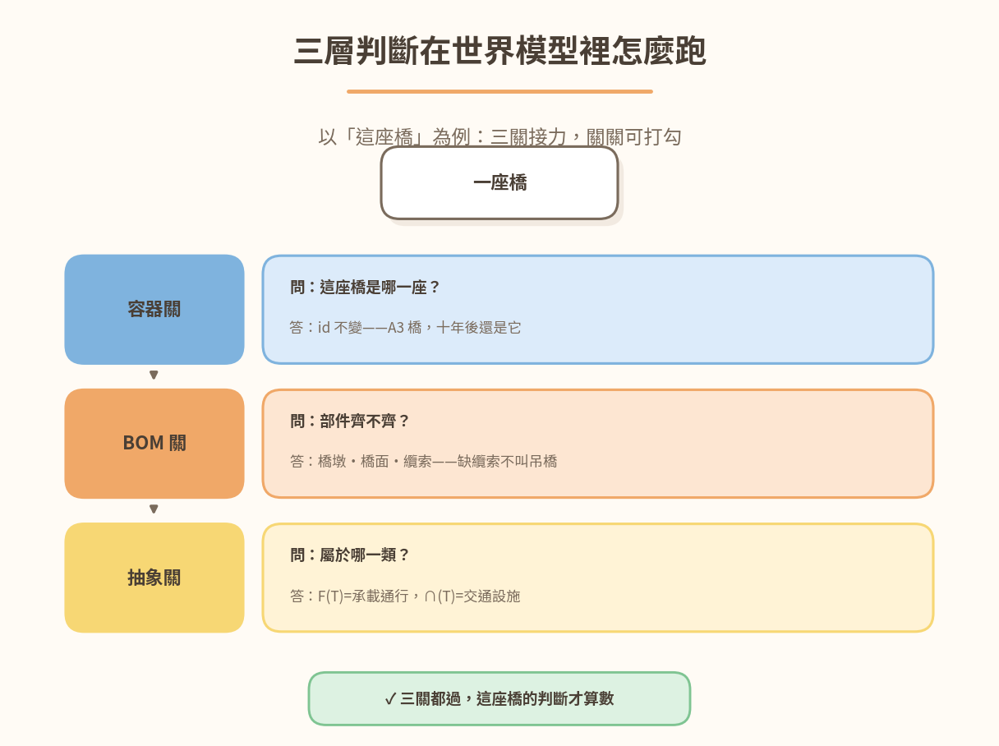

**圖 21　三層判斷在世界模型裡怎麼跑**

## 5.2　推理五族

大腦出招，靠五族推理。因果推理——由因推果，預測下一刻；果因推理——由果推因，診斷找根因；模擬推理——在心裡演一遍，推演情境；統計推理——由數看勢，看分布與趨勢；逆向推理——從目標倒推，規劃路徑。

五族不是互斥的選項，是接力的隊友。診斷一個問題：先果因找根因、再因果驗證修好之後會怎樣、必要時統計看是不是通例；規劃一條路：先逆向從目標倒推里程碑、再模擬試走兩遍。挑推理族之前，先問自己要的方向：往未來，還是往過去？

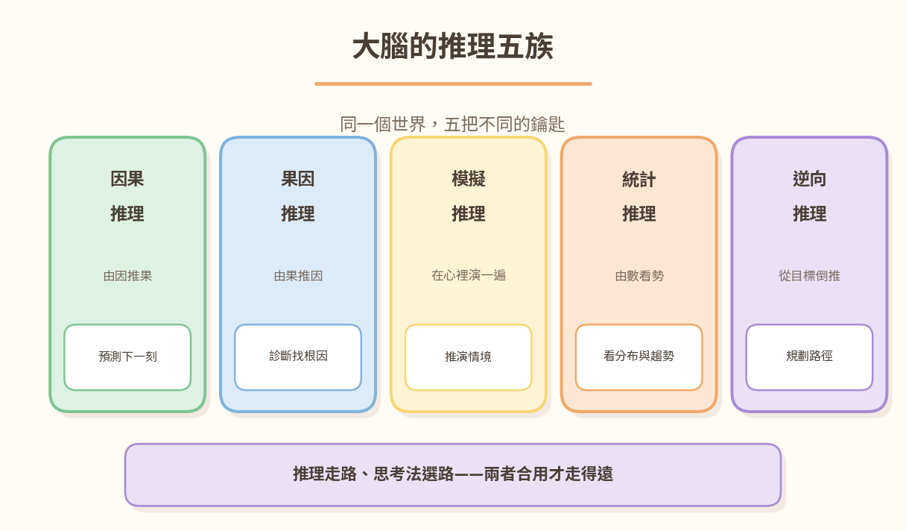

**圖 22　大腦的推理五族**

| 推理族 | 方向 | 典型問句 | 世界模型用法 |
| --- | --- | --- | --- |
| 因果推理 | 因 → 果 | 接下來會怎樣？ | 預測・推演 |
| 果因推理 | 果 ← 因 | 為什麼變成這樣？ | 診斷・根因 |
| 模擬推理 | 情境 → 展開 | 如果這樣呢？ | what-if 推演 |
| 統計推理 | 數 → 勢 | 多數情況如何？ | 分布・趨勢 |
| 逆向推理 | 目標 → 倒推 | 要達成先做什麼？ | 規劃・解題 |

## 5.3　思考法選路

推理是走路，思考法是選路。資訊完整，走正向思考——按部就班推出答案；鑽進死胡同，換逆向思考——從結論倒著走；同質化撞牆，用水準思考——跳到別處借形；表象底下有根，用垂直思考——一層層往下挖；從零開始沒有現成，上第一性原理——回到最基本的形重搭。

選路有兩條紀律。其一，選路要說明——「我就想這樣想」不算數，寫出入口的形：任務的形長什麼樣，才配走這條路；其二，選路不等於走路——思考法只負責選方向，真正的推進仍靠推理一步一步走。第五篇的選路樹與第六篇的「選對招嗎」一問，就是這兩條紀律的操作版。

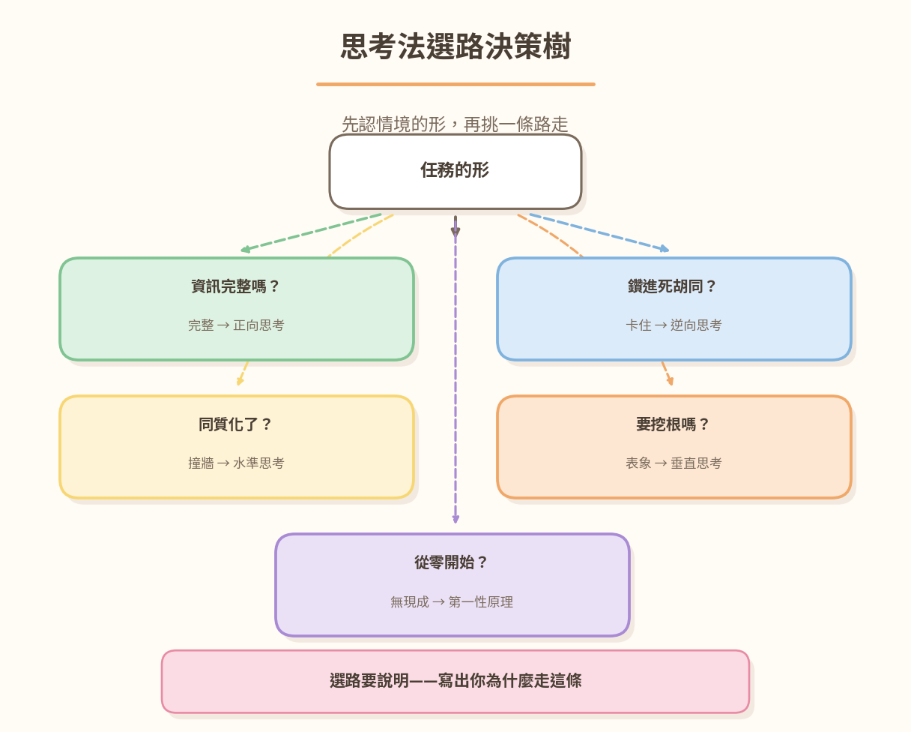

**圖 23　思考法選路決策樹**

## 5.4　全程推演：城市紅綠燈怎麼調

把前五篇串成一次完整運作。情境：尖峰路口必塞，市民怨聲載道。理解——大腦先認出「這是排隊與瓶頸問題」；形化——路口寫成{車道, 車流, (號誌制), [路口]}，每個維度配刻度（車流＝輛／十五分鐘）；函式——立起預測函式「號誌制的形進、車流速的形出」；推演——三條路各推幾步：A 改綠燈制、B 維持現制、C 只調路線。

判斷——每條路的產出形過三層檢查，判準打勾：車流速提升多少、三個時段各模擬一遍；決策——A 過判準、B 與 C 不過，採 A，並把這次推演的形收進形庫——下回同類路口先搜尋、後發明。六步走完，世界模型從「感覺塞」變成「可複核的準」。

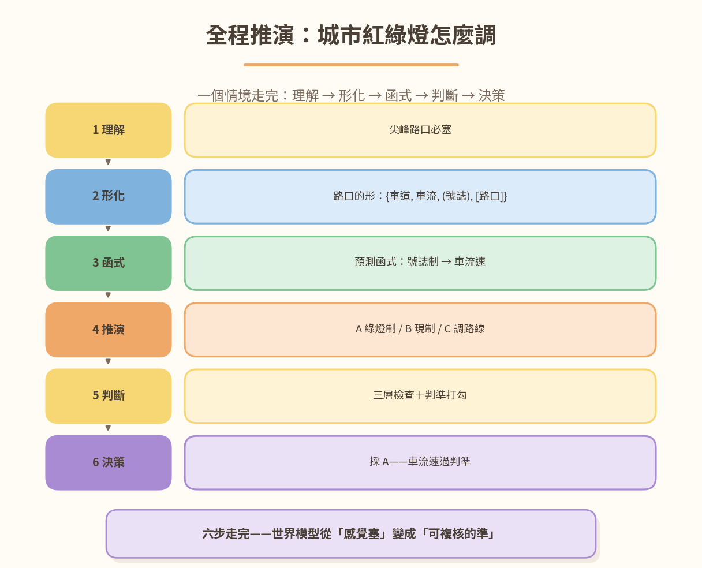

**圖 24　全程推演：城市紅綠燈怎麼調**

> **【專業專欄】C6　記憶與持續學習**
>
> 大腦與搜尋引擎的差別，在記憶怎麼用。搜尋引擎每次從零開始；大腦把每次認知沉澱成形——形庫就是記憶的本體，函式庫就是經驗的本體。世界模型的持續學習因此有具體的落點：不是「參數又更新了」，而是「形庫又厚了、判準又準了」。
>
> 運作上有三個抓手：收工例行——每次任務把用過的招記成卡；同類對照——定期把像的卡放一起，萃取共通形；版本升級——形與函式都有 v1、v2，越用越準，而且每一版都可回溯。

> **【練習】W11　三層判斷一輪堂**
>
> 挑一個你工作上必須「認得同一個東西」的場景（同一台設備、同一位客戶、同一份合約），把三關逐關寫出問句與答句。
>
> 寫完檢查：三個月後再看你的三關記錄，還能認得出同一個東西嗎？

> **【練習】W12　選推理族**
>
> 拿一個真實問題（最好是你現在卡住的），判斷它需要哪一族推理：往未來還是往過去？要試走還是要倒推？寫下你的選擇與一句理由。
>
> 寫完檢查：換另一族推理試推三行——結論若不同，哪一族的假設更穩？

> **【練習】W13　選思考法並走三步**
>
> 仿 5.3 的決策樹，為 W12 的問題選一條思考法路——寫出入口的形（任務的形長什麼樣），再實際走出三步推理。
>
> 寫完檢查：你有沒有「只選路不走路」？三步推理寫出來了嗎？

> **第五篇要點**
>
> - 三層判斷：容器關追蹤身份、BOM 關守結構、抽象關管歸類——三關接力，關關可打勾。
> - 推理五族：因果・果因・模擬・統計・逆向——先問方向（往未來還是往過去），再挑族。
> - 思考法選路五式：正向・逆向・水準・垂直・第一性原理——選路要說明，走路靠推理。
> - 全程推演六步：理解→形化→函式→推演→判斷→決策——每步有產出可查。
> - 記憶即形庫：收工記卡、同類對照、版本升級——越用越準，且可回溯。

# 第六篇　準確使用方法：怎麼用才算準

> **導讀・這一篇在說什麼**
>
> 這一篇是全書的心臟：準確使用方法。工具四件——三種補足（寫全四問）、證明六步驟（複核運作）、八問檢查（上崗驗收）、誤用大對照（避坑）。最後把整套工具串成一次完整示範。
>
> 讀法：6.1 立定義 → 6.2–6.4 學工具 → 6.5 避誤用 → 6.6 看示範；練習 A01–A04。

## 6.1　準確的定義：可複核的準

準確是什麼？定義只有一個：可複核的準——讀者能逐句打勾，重現你的推理。不是「我覺得對」，不是「模型說對」，而是「把記錄攤開，任何人照著走一遍，會走到同一個結論」。世界模型的每一個判斷、每一次推演、每一份產出，都要以這個標準收工。

準確使用方法立在三層架構上：體——空間本形立起形，回答「是什麼」；用——時間本形立起函式，回答「會做什麼」；準——準確使用方法立起複核，回答「怎麼算數」。缺體，方法無所依附；缺用，形立著不動；缺準，一切不可複核。

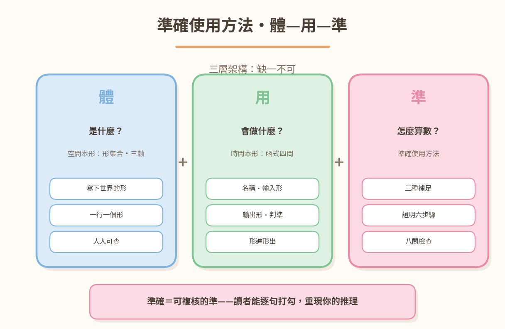

**圖 25　準確使用方法・體—用—準**

## 6.2　三種補足

函式四問卡寫不全時，不要硬寫——沿三軸補齊。判準寫不清？用 [ ] 規則補足：把判準寫到維度與刻度——「效果要好」不算數，「三項指標各達幾分」才算數；輸入形指認不出？用 ( ) 身份補足：寫清容器身份——作用對象是誰、id 是什麼；輸出形部件不明？用 { } 結構補足：列清部件——產出由哪些件組成、缺件行不行。

三種補足對應三條軸，一對一不亂：規則補足補屬性、身份補足補容器、結構補足補組成。補完的檢查點也各有一問：判準能逐句打勾嗎？輸入形指認得出、交得出來嗎？輸出形可辨識、可驗收嗎？三問都點頭，卡就完整了。

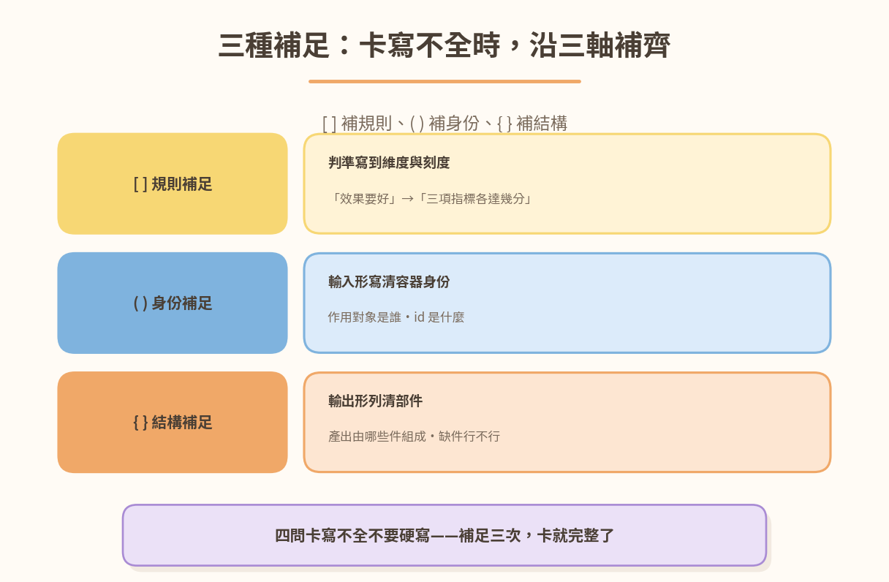

**圖 26　三種補足：卡寫不全時，沿三軸補齊**

## 6.3　證明六步驟

卡寫好了，運作做完了，怎麼複核？走證明六步驟。認明整體——寫出任務的形：目標、限制、場景一樣樣寫出；分軸描述——沿三軸拆任務：[ ] 要什麼屬性、{ } 要哪些件、( ) 在哪個容器裡；寫形集合——輸入形與輸出形各寫一行；選定命題——挑函式、挑模式、挑思考法；判準推理——執行並逐步打勾，推理步驟可重現；三層檢查——產出形過容器、BOM、抽象三關。

六步的每一步都有產出：任務的形、三軸描述表、形進形出兩行、選定的招式、判準檢查表、可複核的成果——六樣產出攤開，讀者就能逐句打勾重現你的運作。這六步在空間側立形、在時間側立函式、在世界模型側立推演，寫法通用。

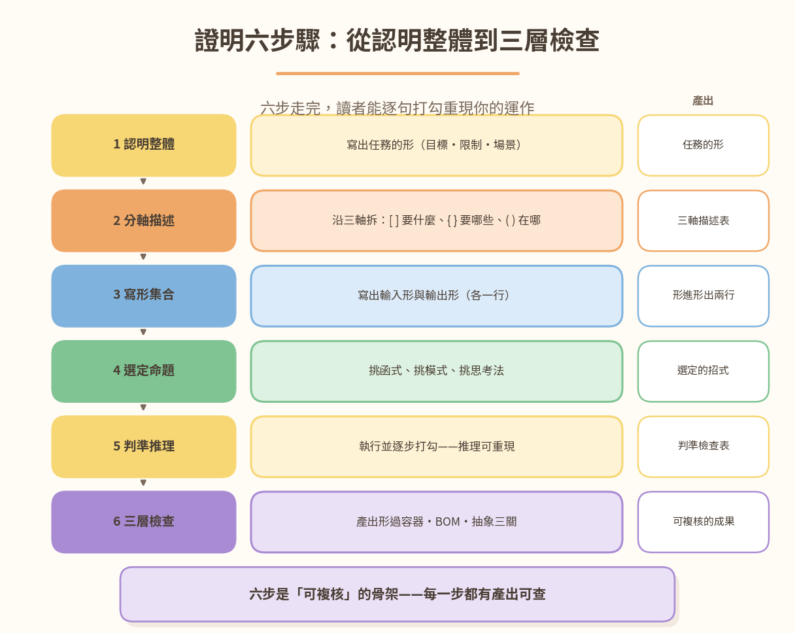

**圖 27　證明六步驟：從認明整體到三層檢查**

## 6.4　八問檢查清單

六步走完，最後驗收——八問檢查。上崗前四問：名稱對嗎？輸入形認得出嗎？輸出形交得出嗎？判準可打勾嗎？上崗後四問：選的招對嗎？過三層檢查了嗎？過程可複核嗎？產出又成新形了嗎？

八問的價值在「不過怎麼辦」——每一問都配了退路：判準打不了勾，就用 [ ] 規則補足補；產出來路不明，就退回三層檢查補正，並說明卡在哪一層。八問全過，這個動詞才算「準確」地完成一次任務。八問可以印出來貼在工作區：每完成一個重要動作，八個勾打完再收工。

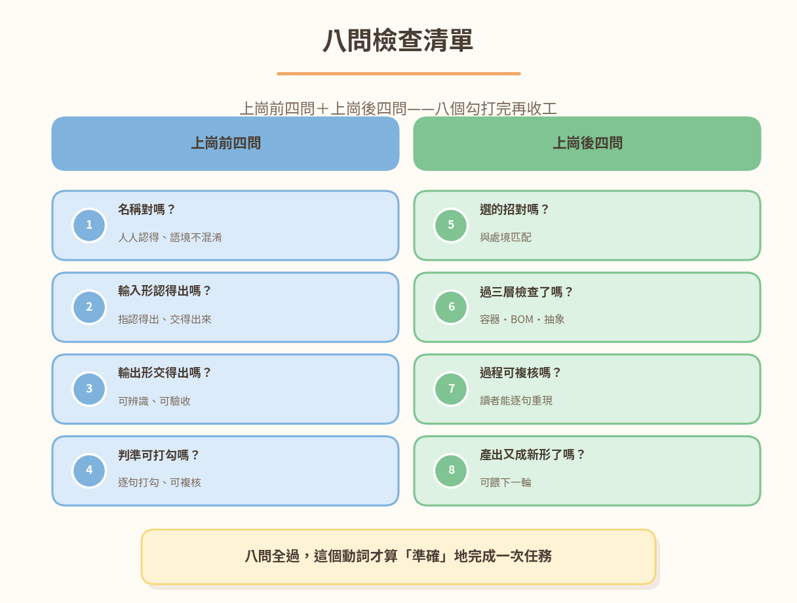

**圖 28　八問檢查清單**

| # | 問題 | 檢查什麼 | 不過怎麼辦 |
| --- | --- | --- | --- |
| 1 | 名稱對嗎？ | 人人認得、語境不混淆 | 換個更準的名字 |
| 2 | 輸入形認得出嗎？ | 指認得出來、交得出來 | 用 ( ) 身份補足 |
| 3 | 輸出形交得出嗎？ | 可辨識、可驗收 | 用 { } 結構補足 |
| 4 | 判準可打勾嗎？ | 逐句打勾、可複核 | 用 [ ] 規則補足 |
| 5 | 選的招對嗎？ | 與處境的形匹配 | 回函式庫重選 |
| 6 | 過三層檢查了嗎？ | 容器・BOM・抽象三關 | 退回補正，說明哪一層 |
| 7 | 過程可複核嗎？ | 讀者能逐句重現 | 補記判準推理 |
| 8 | 產出又成新形了嗎？ | 可餵下一輪 | 收進形庫與函式庫 |

## 6.5　誤用大對照

誤用是方法的影子——有方法就有影子，把影子攤開來看，就不會踩進去。四側十六種誤用收成一張大表：空間側五種、動詞側五種、模式側三種、思考法側三種。共同的根源只有一個：層次沒寫清。

表的讀法：先看「側別」定位自己可能踩的坑，再看「正確寫法」直接抄走。世界模型的實務裡，最常踩的是動詞側五種——「只報名字不報四問」「判準不可驗證」「產出不經三層檢查」這三種，幾乎是一切推演翻車的源頭。

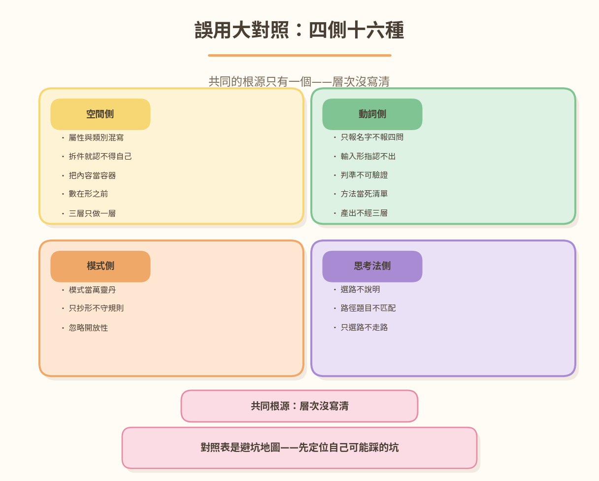

**圖 29　誤用大對照：四側十六種**

| 側別 | 常見誤用 | 問題所在 | 正確寫法 |
| --- | --- | --- | --- |
| 空間側 | 屬性與類別混寫 | [ ] 維度刻度 ≠ [類別] | 維度歸屬性、類別歸形集合 |
| 空間側 | 拆件就認不得自己 | 必要件拆了，形就散 | remove 三級逐件試拆 |
| 空間側 | 把內容當容器 | id(C) 與 S(C) 不分 | 身份與內容分離 |
| 空間側 | 數在形之前 | 還沒立形就數數量 | 先有形，才有數 |
| 空間側 | 三層判斷只做一層 | 缺一不可 | 容器・BOM・抽象聯合檢查 |
| 動詞側 | 只報名字不報四問 | 人人做不同的事 | 寫全函式四問 |
| 動詞側 | 輸入形指認不出來 | 作用對象含糊 | 輸入形要辨識、可交付 |
| 動詞側 | 判準不可驗證 | 「效果要好」打不了勾 | [ ] 規則補足寫到可打勾 |
| 動詞側 | 把方法當死清單 | 新情境套不上 | 方法是開放規則，留開放位 |
| 動詞側 | 產出不經三層檢查 | 成果來路不明 | 三層都過才算數 |
| 模式側 | 把模式當萬靈丹 | 什麼處境都套同一式 | 先認處境的形，再挑招 |
| 模式側 | 只抄形不守規則 | 抄外殼沒守解法形 | 解法形每條規則都要守 |
| 模式側 | 忽略開放性 | 當成死清單 | 留開放位給新成員 |
| 思考法側 | 選路不說明 | 「我就想這樣想」 | 寫出入口的形 |
| 思考法側 | 路徑與題目不匹配 | 用正向解死胡同 | 對決策樹重選 |
| 思考法側 | 只選路不走路 | 想得很美沒有推理 | 思考法選路，推理走路 |

## 6.6　完整示範：寫到可複核

最後把整套工具串一次。任務：城市交通預測——市民問「明天尖峰會不會塞」，答不出來就失去信任。先用函式四問立形：名稱＝城市交通預測（預測函式）；輸入形＝{路口, 車流, (號誌制), [市區]}；輸出形＝{熱點圖, 建議, [報告]}；判準＝每十五分鐘更新、誤差小於一成可打勾。

再用三種補足補角：[ ] 誤差刻度寫到一成；( ) 不同號誌制的路口分開 id，不混樣本；{ } 熱點圖缺任一行政區塊不收。接著用證明六步驟複核整場：認明整體（任務的形——目標・限制・場景）、分軸描述（三軸）、寫形集合（路口與車流進、熱點圖與建議出）、選定命題（預測函式＋因果推理＋統計推理）、判準推理（逐時段打勾）、三層檢查（熱點圖過容器・BOM・抽象三關）。

最後八問檢查全過——一份交通預測，從「憑感覺說會塞」變成「可複核的準」。這就是準確使用方法的完整流程：四問→補足→六步→三層→八問——每一步都可打勾。

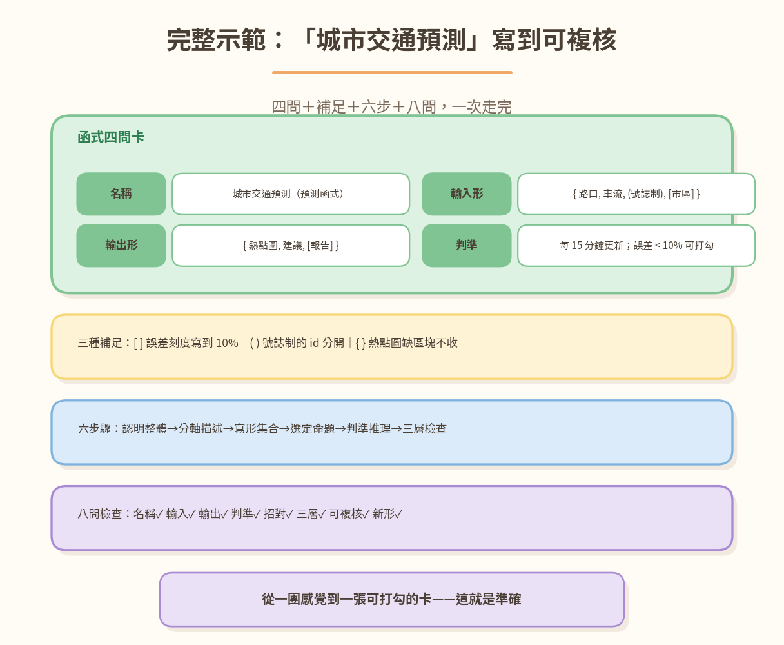

**圖 30　完整示範：「城市交通預測」寫到可複核**

> **【專業專欄】C7　可複核性與評估**
>
> AI 系統的評估常停在指標層：準確率、誤差、通過率。指標告訴你「多常對」，可複核性告訴你「為什麼對」。世界模型要上崗，兩者都要——指標是體檢報告，可複核是病歷本。
>
> 形學把可複核做成可操作的規格：每張四問卡、每次六步驟、每個八問勾，都是評估的落點。實務上可以做「複核抽測」——定期抽一份產出，讓第二個人照記錄重走一遍；走不通的那一步，就是要補判準的地方。

> **【練習】A01　把一個動作寫到可複核**
>
> 挑你工作上一個「做得很順但說不清」的動詞，全程走一次：函式四問＋三種補足＋證明六步驟＋八問檢查。
>
> 寫完檢查：把卡交給同事，他能不問你第三句話就上崗嗎？

> **【練習】A02　誤用診斷**
>
> 回顧你最近一次「方法用得不順」的經驗，從大對照表裡定位誤用（至少兩條），各寫出改正的一行。
>
> 寫完檢查：十六種誤用裡，你的「常用坑」是哪三種？把它們寫成你的私人警語。

> **【練習】A03　八問驗收一場會**
>
> 拿最近開過的一場會議當對象，逐問打勾：名稱、輸入形、輸出形、判準、招、三層、可複核、新形——不過的問寫出退路。
>
> 寫完檢查：八個勾裡若有三個以上打不下去，這場會的「形」還沒立起來——先回 6.2 三種補足。

> **【練習】A04　設計你的上崗清單**
>
> 把八問改成你職務專屬的上崗清單：每問替換成你的用語，並各配一條「不過怎麼辦」；列印或存成範本。
>
> 寫完檢查：連續三個任務用這張清單——第三個任務是不是明顯快了、穩了？

> **第六篇要點**
>
> - 準確＝可複核的準——讀者能逐句打勾，重現你的推理。
> - 三種補足：[ ] 補判準、( ) 補輸入身份、{ } 補輸出結構——卡寫不全不要硬寫。
> - 證明六步驟：認明整體→分軸描述→寫形集合→選定命題→判準推理→三層檢查。
> - 八問檢查：上崗前四問＋上崗後四問；每一問都配了退路。
> - 誤用十六種，根源是「層次沒寫清」；完整流程：四問→補足→六步→三層→八問。

# 第七篇　內容完整方案：把世界裝進大腦

> **導讀・這一篇在說什麼**
>
> 方法學完了，這一篇把它排成一條能走的路——內容完整方案：世界知識全面形化的藍圖、建庫四階段、情境選路對照、驗收標準。世界的知識一類一類進庫，大腦一格一格長大。
>
> 讀法：7.1 看藍圖 → 7.2 排建庫 → 7.3 對照實戰 → 7.4 定驗收；練習 S01–S03。

## 7.1　世界知識全面形化藍圖

把世界裝進大腦，第一步是把世界分好類。藍圖收十二類知識：物理、化學、生物、語言、數學、程式、社會、經濟、工程、哲學、經驗、隱性——前十一類是顯學，第十二類「隱性」最見功夫：師傅的手感、團隊的默契、客戶的直覺，這些說不清卻真實存在的知識，也要一格一格形化進庫。

每類知識進庫，都走同一條流水線：分形——把這類的對象寫成形集合；立式——把這類的運作寫成函式四問；設準——把這類的判準寫到可打勾；入庫——過三層檢查後收進世界形庫。十二條流水線並行，共用同一套寫法——這就是「知識統一」在世界模型裡的具體長相。

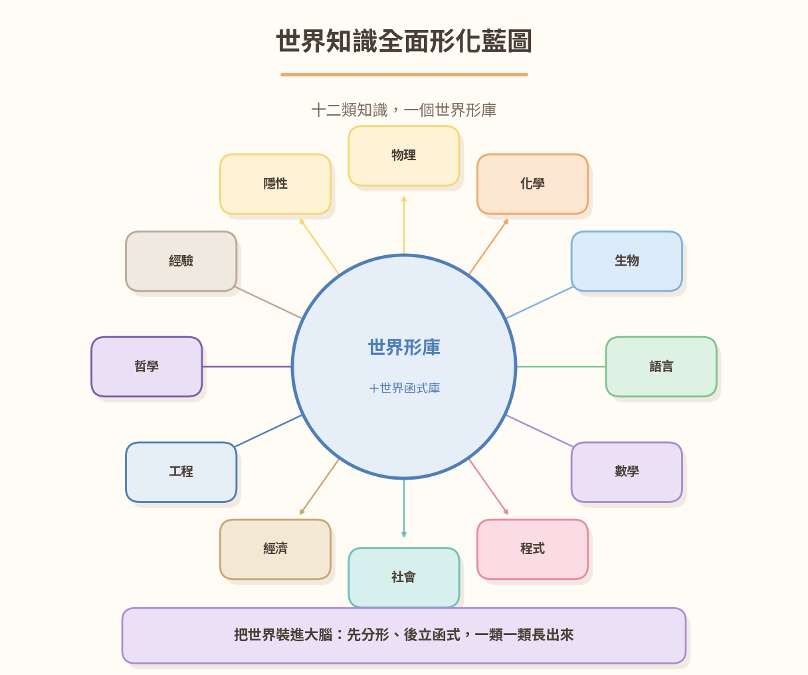

**圖 31　世界知識全面形化藍圖**

| 類 | 形化對象舉例 | 先立的形 | 先立的函式 |
| --- | --- | --- | --- |
| 物理・化學 | 橋・材料・反應 | 實體形・狀態形 | 力學與反應函式 |
| 生物 | 貓・生態系 | 實體形・場域形 | 代謝與演化函式 |
| 語言・數學 | 句子・證明 | 關係形・狀態形 | 生成與推導函式 |
| 程式・工程 | 模組・系統 | 實體形・關係形 | 執行與設計函式 |
| 社會・經濟 | 組織・市場 | 場域形・關係形 | 營運與決策函式 |
| 哲學・經驗・隱性 | 價值・手感・默契 | 關係形・狀態形 | 判準與萃取函式 |

## 7.2　建庫四階段

世界形庫不是讀出來的，是養出來的——四階段：借、抽、立、化。借——先把用過的招記成卡：每完成一個任務，函式四問卡一張起跳，遇到新任務先搜尋庫裡的現成招；抽——同類卡對照異同，萃取共通形：三張以上相似的卡，放一起問「同在哪、異在哪」，套回每張都對上才算抽成。

立——驗證多次後收成模式卡：共通形被反覆驗證，就升級成可掛上牆的招式，寫明處境的形、解法的形與判準；化——每次反思升級版本：v1、v2、v3 一路長上去，舊版本不刪——回溯是大腦的誠實。四階段循環，庫越養越大——這就是你和團隊的方法資產。

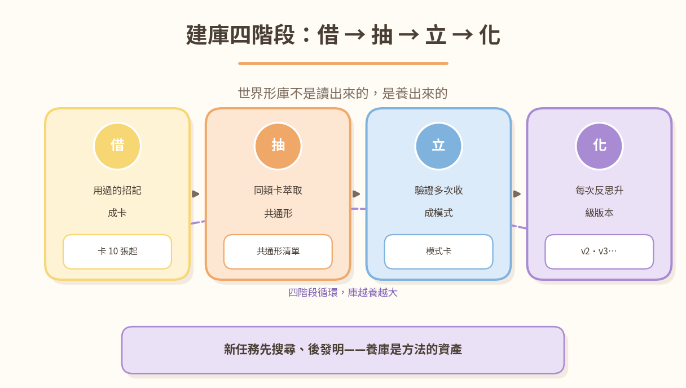

**圖 32　建庫四階段：借 → 抽 → 立 → 化**

## 7.3　情境選路對照

實戰的口訣是「先認情境的形，三層各就各位」——同一個情境，先挑函式（用哪一招）、再選模式（套哪張卡）、後選思考法（走哪條路）。下表示範三個常見情境的完整選路；自己的情境仿表填寫，就是你的實戰手冊。

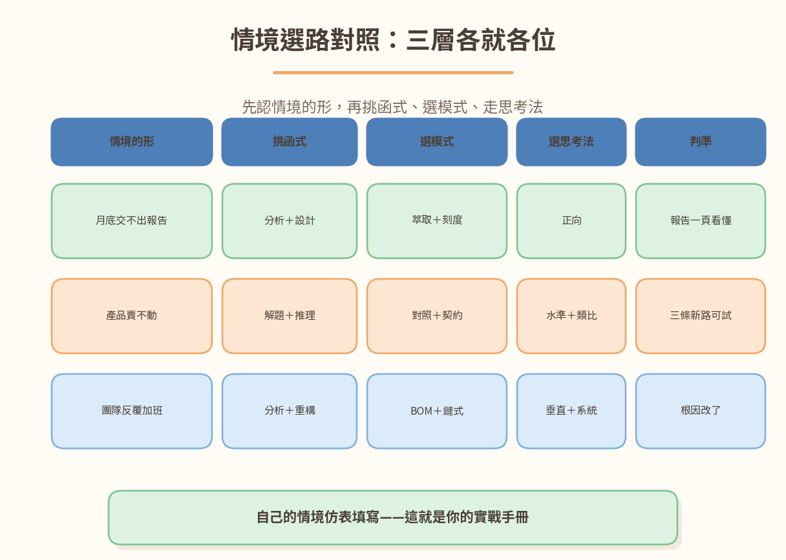

**圖 33　情境選路對照：三層各就各位**

| 情境（任務的形） | 挑函式 | 選招式 | 選思考法 | 判準 |
| --- | --- | --- | --- | --- |
| 月底交不出報告（散資料） | 分析＋設計 | 萃取＋刻度 | 正向（資訊完整） | 報告一頁看懂、數字有來源 |
| 產品賣不動（同質競爭） | 解題＋推理 | 對照＋契約 | 水準＋類比（換域借形） | 三條新路徑可試、各有小實驗 |
| 團隊反覆加班（越救越糟） | 分析＋重構 | BOM＋鏈式 | 垂直＋系統（挖根看局） | 根因改了、加班迴圈變輕 |
| 新業務沒有流程（從無到有） | 生成＋設計 | 開放模板＋契約 | 設計（造方案） | 流程可重複、判準可驗證 |
| 學新技能學了就忘 | 持續學習 | 迴圈＋分形 | 正向＋假說（立形驗形） | 每圈產出可查、形更準 |

## 7.4　驗收標準

內容建得怎麼樣，不能憑感覺——立驗收。兩道關卡：八問全過＋三層檢查。八問管「這次任務做得準不準」——每次上崗逐問打勾；三層檢查管「這次產出收不收得下」——容器、BOM、抽象三關都過，成果才收進世界形庫，又成新形，餵給下一輪。

驗收之外再加一條「資產清點」：每隔一段時間，數一數庫裡的形卡與函式卡、翻一翻版本升級的紀錄、抽一張卡做複核抽測。庫在長大、準在提高、錯誤在變少——三件事都看得見，這套內容方案才算真的在跑。

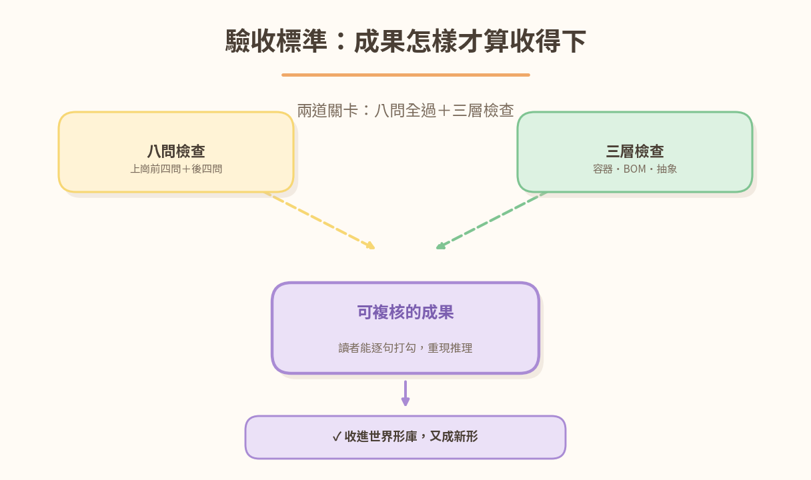

**圖 34　驗收標準：成果怎樣才算收得下**

> **【練習】S01　為三個情境選路**
>
> 從你的工作、學習、生活各挑一個真實情境，仿 7.3 的表各填一行（挑函式、選招式、選思考法、判準）。
>
> 寫完檢查：三層的選擇彼此一致嗎？判準是可打勾的嗎？

> **【練習】S02　排你的建庫四階段**
>
> 照 7.2 的四階段，為你的個人形庫排出第一個月計畫：借哪十張卡、抽哪一類共通形、立哪一張模式卡、化哪一個舊經驗。
>
> 寫完檢查：四階段各有具體產物嗎？（卡幾張、清單幾條、模式卡幾張、版本升到幾。）

> **【練習】S03　做一次驗收清點**
>
> 把 W01–W13 與 A01–A04 做過的卡全部攤開，走一次八問抽測＋三層檢查：抽三張卡複核，記錄哪一問最常不過。
>
> 寫完檢查：最常不過的那一問，就是你下階段要補的功夫——寫成一行改進計畫。

> **第七篇要點**
>
> - 藍圖十二類知識一條流水線：分形→立式→設準→入庫——知識統一的具體長相。
> - 建庫四階段：借（記卡）→抽（共通形）→立（模式卡）→化（版本升級）——庫是養出來的。
> - 情境選路：先認情境的形，三層各就各位——挑函式、選招式、選思考法。
> - 驗收兩關＋資產清點：八問全過、三層都過，成果才入庫；庫在長大要看得見。
> - 產出又成新形——入庫的成果，是下一輪任務先搜尋的現成招。

# 第八篇　框架完整方案：發展路線與願景

> **導讀・這一篇在說什麼**
>
> 內容有了、方法有了，最後一篇把「框架」排成發展路線：學練用教建五段閉環、八週學習路線、三階段成長，以及這顆大腦要去的地方。
>
> 讀法：8.1 走五段 → 8.2 排課表 → 8.3 看成長 → 8.4 看願景；練習 S04–S05。

## 8.1　學練用教建五段

框架要長大，靠的是一條閉環的路：學——看懂形與函式，讀本書、看圖解，產出每篇要點筆記；練——把概念寫成卡，一概念一練習，產出四問卡與招式卡；用——上崗解真問題，走情境選路，產出三個真實案例；教——帶別人寫卡，一概念一圖一例一練習，產出一份小講義（教是最好的學）；建——養個人形庫，走建庫四階段，產出你的形庫 v1。

五段的驗收都可打勾：學能口述六群招式、練每張判準可打勾、用八問全過、教學員寫得出卡、建新任務先搜尋後發明。五段走完，方法就真正屬於你——而且會繼續長大。

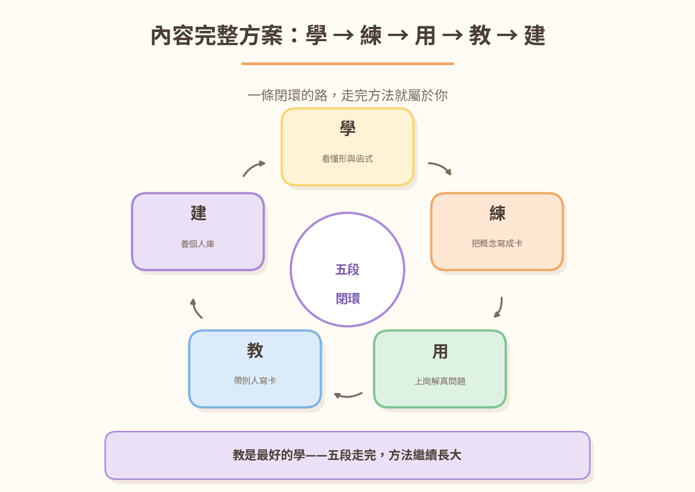

**圖 35　內容完整方案：學 → 練 → 用 → 教 → 建**

## 8.2　八週學習路線

把全書排成八週路線——每週讀一篇、做一組練習、產一張卡。節奏的設計原則是「小步快走」：寧可每週一小步走完，不要第一週讀完全部、第三週全部忘光。有基礎的讀者可縮成四周（每週兩段）；要帶班的老師可擴成十二週（每週加一次實作課）。

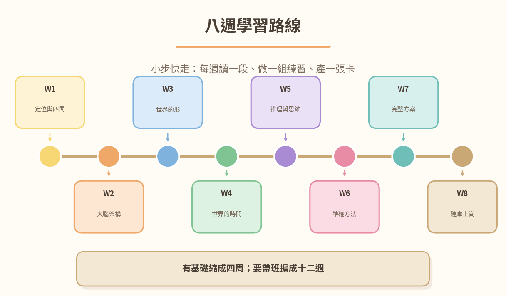

**圖 36　八週學習路線**

| 週 | 主題 | 讀法 | 練習 | 產出 |
| --- | --- | --- | --- | --- |
| W1 | 定位與世界四問 | 第一篇 | W01–W02 | 你的第一張四問卡 |
| W2 | 大腦架構 | 第二篇 | W03–W04 | 兩庫清單＋一次三層判斷 |
| W3 | 世界的形 | 第三篇 | W05–W07 | 形集合與 remove 試驗紀錄 |
| W4 | 世界的時間 | 第四篇 | W08–W10 | 函式四問卡＋推演分支 |
| W5 | 推理與思維 | 第五篇 | W11–W13 | 選路卡＋全程推演紀錄 |
| W6 | 準確方法 | 第六篇 | A01–A02 | 可複核的完整卡 |
| W7 | 內容方案 | 第七篇 | A03–A04、S01–S02 | 上崗清單＋建庫計畫 |
| W8 | 框架方案與願景 | 第八篇 | S03–S05 | 個人形庫 v1 規劃書 |

## 8.3　三階段成長

世界模型的大腦不是一天長成的——它的成長，對應著人工智慧的三個大階段。第一階段·知識統一：世界形庫成形——跨領域的知識用同一個寫法進庫，語言、數學、物理、工程第一次說同一種話；第二階段·思維統一：推理與思考同庫運作——五族推理、思考法選路、三層判斷在同一顆大腦裡接力，系統開始「真的會想」；第三階段·智慧統一：知識、思維、記憶、學習與創造一體——大腦不只解決眼前的問題，還能長出世界沒有的形。

三階段的驗收語言一以貫之：可複核。知識統一驗收「查得到」，思維統一驗收「重現得了」，智慧統一驗收「又成新形」。這條成長路，正是通往 AGI 的路——本書把方法交到你手上，路要一步一步走。

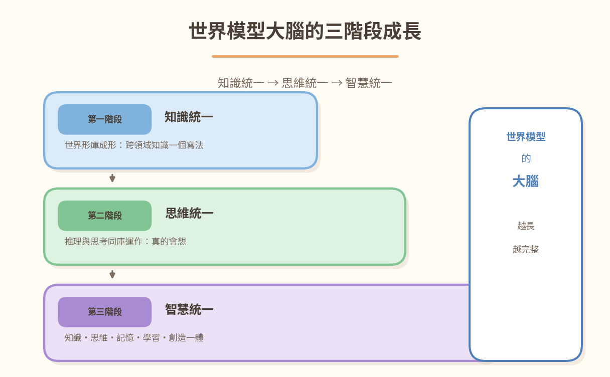

**圖 37　世界模型大腦的三階段成長**

## 8.4　願景

最後回到開頭那個問題：世界模型為什麼需要大腦？因為世界不只需要被描述，還需要被理解、被預測、被推演、被負責地改變。讓世界模型長出真正的大腦——看得清形、想得透理、用得準法；從資訊處理，走向智慧生成。

這就是本書的願景，也是理論與平台共同的方向：把形看清楚，轉成顯學，實踐化為世界模型的大腦。讓人工智慧不只是工具——而是會理解、推理、學習與創造的大腦。世界四問，問到哪裡，形就立到哪裡；形立到哪裡，世界就看清楚到哪裡。

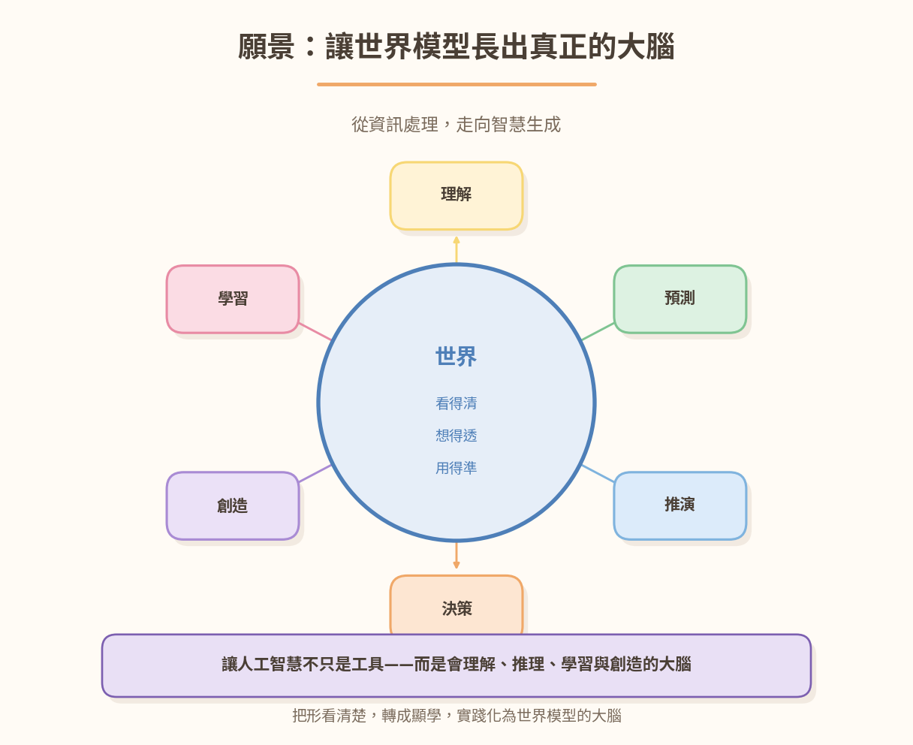

**圖 38　願景：讓世界模型長出真正的大腦**

> **【專業專欄】C8　從世界模型到 AGI**
>
> 業界談 AGI，多從能力清單出發：會推理嗎、會規劃嗎、會學習嗎。形學的路線是從「表示」出發：先讓知識有一個統一的形（知識統一），思維才有統一的載體（思維統一），能力才有整合的底座（智慧統一）。三階段不是產品路線圖，而是驗收次序——上一階段不可複核，下一階段就不開工。
>
> 對實務者的含意很直接：不必等「完整的 AGI」才開始受益。今天就讓你的世界模型寫形、立式、設準、入庫——每一個可複核的形，都是這條長路上的一塊磚。

> **【練習】S04　排你的八週路線**
>
> 照 8.2 的表，排出你自己的八週路線：每週讀哪一篇、做哪幾題、產哪一張卡——工作忙的週，把產出縮到一張卡就好。
>
> 寫完檢查：八週結束時，你手上會有幾張卡？少於八張，就把路線調小步一點。

> **【練習】S05　寫給三年後的形庫**
>
> 想像三年後你的個人形庫 v10：裡面收了哪些形、掛了哪些招、判準進化到什麼程度？寫成半頁的「形庫願景書」。
>
> 寫完檢查：願景書裡的每一格，今天就能開始長嗎？——挑出第一格，寫下這一週就動手的一步。

> **第八篇要點**
>
> - 學練用教建五段閉環：學看懂、練寫卡、用上崗、教帶人、建養庫——教是最好的學。
> - 八週路線小步快走：每週一篇、一組練習、一張卡；可縮四周、可擴十二週。
> - 三階段成長：知識統一→思維統一→智慧統一——驗收語言一以貫之：可複核。
> - 願景：看得清、想得透、用得準——從資訊處理，走向智慧生成。
> - 世界四問問到哪裡，形就立到哪裡——形立到哪裡，世界就看清楚到哪裡。

# 附錄一　術語與記號速查

本附錄收全書用到的術語與記號，供速查；形的英文為 Type，一詞一義，全書統一。

| 術語／記號 | 讀法 | 一句話定義 |
| --- | --- | --- |
| 形（Type） | xíng | 認知與描述的基本單位；有結構、可判斷、可命名 |
| 形集合 | {部件, (內容), [類別]} | 一行寫下一個形的標準寫法 |
| [ ] 屬性 | 方括號 | X 軸：它什麼樣子——維度 × 刻度 |
| { } 組成 | 花括號 | Y 軸：它由什麼組成——物料清單 |
| ( ) 容器 | 圓括號 | Z 軸：它放在哪裡——身份與邊界 |
| C=(id(C), S(C)) | 容器二元式 | id(C) 是不變身份、S(C) 是可變內容 |
| T=(F(T), ∩(T)) | 抽象判準 | F(T) 功能對上、∩(T) 交集對上，才歸入此類 |
| remove 三級 | 拆件試驗 | 必要件 ≢ M・功能降級件 ≡ M′ ⊂ M・非必要件 ≡ M |
| 認知鏈 | 異同→分合→形→名 | 一輪認知的四步；有合必有形，先有形、才有數 |
| 函式四問 | 名稱・輸入形・輸出形・判準 | 動詞成形的標準卡；判準要可打勾 |
| 三層判斷 | 容器・BOM・抽象 | 三關聯合判斷，缺一不可 |
| 三種補足 | [ ] 規則・( ) 身份・{ } 結構 | 四問卡寫不全時，沿三軸補齊 |
| 證明六步驟 | 認明→分軸→形集合→命題→推理→三層 | 複核一次運作的標準流程 |
| 八問檢查 | 前四問＋後四問 | 上崗驗收清單；八個勾打完再收工 |
| 可複核的準 | 準確的定義 | 讀者能逐句打勾，重現你的推理 |
| 形進形出 | 輸入一個形，產出一個形 | 一切運作的標準寫法 |

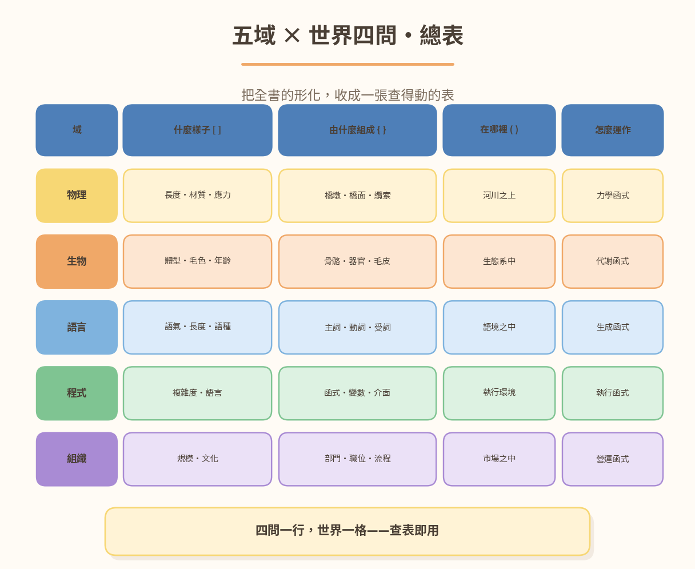

**圖 39　五域 × 世界四問・總表**

# 附錄二　準確使用方法速查卡

這張卡是全書的口袋版：四問立卡、三補足補角、六步驟複核、八問驗收。建議列印貼在工作區，或存成每次上崗前打開的範本。

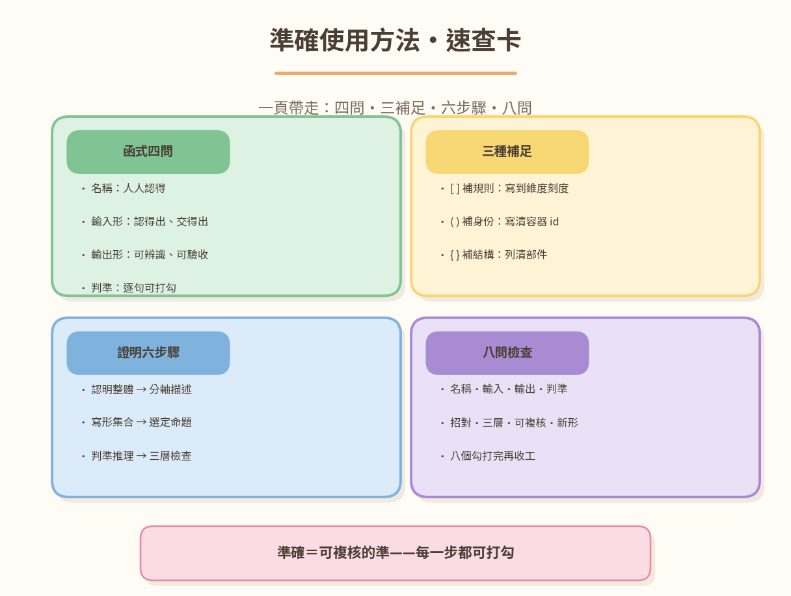

**圖 40　準確使用方法・速查卡**

> **使用順序（一條線走完）**
>
> - 立卡：函式四問——名稱、輸入形、輸出形、判準。
> - 補角：三種補足——[ ] 補規則、( ) 補身份、{ } 補結構。
> - 複核：證明六步驟——認明整體→分軸描述→寫形集合→選定命題→判準推理→三層檢查。
> - 驗收：八問檢查——名稱・輸入・輸出・判準・招對・三層・可複核・新形。
> - 收工：產出又成新形——收進形庫與函式庫，下一輪先搜尋、後發明。

# 附錄三　練習參考答案

以下為二十二題練習的參考答案——答案不是唯一解，重點在「可複核」：你的答案若也能逐句打勾，就是對的答案。

> **【W01】參考答案**
>
> 世界四問示範（以「一台咖啡機」為例）：什麼樣子——黑色、全自動、日出三十杯（維度：顏色・型式・產能，各有刻度）；由什麼組成——{磨豆器, 鍋爐, 沖泡頭, (咖啡豆), [家電]}；放在哪裡——茶水間那一台，id 不變；怎麼運作——開機・沖泡・清洗・除垢，各是一個函式。檢查點：屬性有刻度、組成可拆認、id 說得清。

> **【W02】參考答案**
>
> 示範：一場客戶簡報任務用了「理解（認客戶需求）→預測（猜客戶追問）→決策（定簡報結構）」，跳過了「推演（先試講一遍）」。補做一步：上台前對同事試講，把追問的形預演兩輪。檢查點：五件事次序不跳。

> **【W03】參考答案**
>
> 示範（軟體維運領域）：形庫收「服務的形、事故的形、變更的形」；函式庫收「巡檢（系統的形進、檢查表的形出）、救火（事故的形進、復原的形出）、複盤（事故的形進、改善案的形出）」。檢查點：六行都有可指認的例子。

> **【W04】參考答案**
>
> 示範（以 W01 咖啡機過三關）：容器關——財產編號 CF-07，三年後還是它；BOM 關——拆掉鍋爐就不是可用的咖啡機（必要件）；抽象關——功能是沖煮飲品、判準交集對上「家電・廚房」。檢查點：三關不矛盾——類別說家電，必要件就不能少鍋爐。

> **【W05】參考答案**
>
> 示範（「一份月報」）：{數據, 敘述, (時限), [報告]}；X 屬性——頁數（十頁內）、語氣（客觀）、時效（次月三日前）；Y 組成——數據表・摘要・建議；Z 容器——2026 年 10 月月報，id 不因改版而變。檢查點：同事能照一行認出同類對象。

> **【W06】參考答案**
>
> 示範五行：杯子{杯身, 杯耳, 杯蓋, (茶), [器皿]}；句子{主詞, 動詞, 受詞, (語境), [句子]}；專案{任務, 資源, 里程碑, (客戶), [專案]}；生態系{生產者, 消費者, 分解者, (能量流), [生態系]}；交易{買方, 賣方, 標的, (合約), [交易]}。檢查點：五行的「部件・內容・類別」都在同一位子。

> **【W07】參考答案**
>
> 示範（月報）：必要件——數據（≢ M，沒有數據不叫月報）；功能降級件——精美圖表（≡ M′ ⊂ M，去掉仍成立、可讀性降級）；非必要件——封面裝飾（≡ M）。檢查點：必要件全拆後「月報」之形已散——代表找對了必要件。

> **【W08】參考答案**
>
> 示範（「回客訴」）：名稱＝客訴處理（服務函式）；輸入形＝{客訴內容, 證據, (客戶), [客訴]}；輸出形＝{回覆, 補償案, [結案]}；判準＝四十八小時內回覆、補償案有條款依據、客戶確認收到。檢查點：同事照卡能做出同一動作。

> **【W09】參考答案**
>
> 示範（採購流程）：S0 需求提出→S1 核准→S2 下單→S3 交貨；轉移函式：申請審核、下單、驗收；每一棒輸入與產出都是形——核准單的形進、採購單的形出。檢查點：沒有哪一棒的輸入說不清。

> **【W10】參考答案**
>
> 示範（在 S2 下單分支）：A 提前下單——交貨早、庫存壓力大；B 拆單下單——彈性高、單價升；C 維持現單——照舊、風險在交期。判準：交期誤差小於三天、單價增幅小於一成；選 B，理由寫明「交期彈性優先」。檢查點：判準可打勾才選。

> **【W11】參考答案**
>
> 示範（追蹤同一台生產設備）：容器關——機號 M-12、三年大修後仍是 M-12；BOM 關——主軸・馬達・控制器為必要件；抽象關——功能是切削加工、歸「CNC 車床」類。檢查點：三個月後憑記錄仍認得 M-12。

> **【W12】參考答案**
>
> 示範（客訴反覆發生）：往過去找根因——選果因推理；理由：先要回答「為什麼變成這樣」，才輪到預測。換因果推理試三行會得到「將再發生」的預測，但假設（根因未除）更不穩——故果因優先。檢查點：寫出方向與理由。

> **【W13】參考答案**
>
> 示範（接 W12）：入口的形＝「重複發生的缺陷，資料完整」→ 選垂直思考；三步：一、往下挖到「回覆模板未更新」；二、再挖到「新產品線沿用舊模板」；三、定位到「模板版控缺失」。檢查點：三步推理寫出來了，不是只選路。

> **【A01】參考答案**
>
> 示範（「備課」）：四問——名稱＝備課（設計函式）；輸入形＝{教材, 學員程度, (時數), [課程]}；輸出形＝{教案, 練習, [課綱]}；判準＝每四十分鐘一個段落、每段一圖一例一練習。補足——[ ] 判準寫到分鐘與題數；( ) 班級 id 分開；{ } 教案缺練習不收。六步驟與八問走完後交同事試上。檢查點：同事不問第三句話就上崗。

> **【A02】參考答案**
>
> 示範：常見兩條誤用——「判準不可驗證」（把「做好一點」寫成判準）與「產出不經三層檢查」（交出去就算完）。改正各一行：判準改寫成可打勾的刻度；交出前跑三層檢查。私人警語示範：「先寫形，再動手；先打勾，再收工。」

> **【A03】參考答案**
>
> 示範（一場週會）：名稱✓（週例會）、輸入形✓（各組進度的形）、輸出形✗（決議缺負責人）、判準✓（每議題有結論）、招✓、三層✗（決議未過 BOM 關）、可複核✓、新形✗（紀錄未入庫）。退路：{ } 結構補足——決議缺負責人不收。檢查點：三個以上不過＝形未立，先補足。

> **【A04】參考答案**
>
> 示範（專案經理版八問）：需求對嗎／範圍認得出嗎／交付交得出嗎／驗收可打勾嗎／路線對嗎／風險過三關嗎／來歷可回溯嗎／經驗入庫了嗎；退路各配一行。檢查點：第三個任務明顯更快——清單生效。

> **【S01】參考答案**
>
> 示範一行（「跨部門協作出包」）：挑函式＝分析＋設計；選招式＝鏈式＋契約；選思考法＝垂直（挖根）；判準＝交接點各有負責人、出包率下降可量化。檢查點：三層選擇一致、判準可打勾。

> **【S02】參考答案**
>
> 示範一個月計畫：借——十張函式四問卡（本週起每週兩到三張）；抽——「溝通類」共通形（月底萃取）；立——「開會決議」模式卡（驗證三次後掛牆）；化——把去年「專案失控」經驗升級 v2。檢查點：四階段各有產物與數字。

> **【S03】參考答案**
>
> 示範抽測：抽 W05、W08、A01 三張卡走八問——最常不過的是「輸出形交得出嗎」。改進計畫一行：每寫輸出形，就同時寫「驗收人是誰、怎麼驗」。檢查點：最常不過的問找出來了。

> **【S04】參考答案**
>
> 示範：工作忙版——每週只讀一篇、只產一張卡；八週後手上八張卡，剛好一本小形庫。檢查點：八張以上，路線可行；少於八張，縮小步幅。

> **【S05】參考答案**
>
> 示範願景書半頁：v10 的形庫收三千個形、三百張招式卡、判準平均升級三次；第一格是「每天記一張卡」——這一週就動手。檢查點：第一格具體到本週可做。

> **結語・把書闔上之後**
>
> 世界四問，問到哪裡，形就立到哪裡；形立到哪裡，世界就看清楚到哪裡。把形看清楚，轉成顯學，實踐化為世界模型的大腦——這條路，從你寫下第一張四問卡開始。
