# 化學證明 Chemical proof

**本形學 Ontypology**

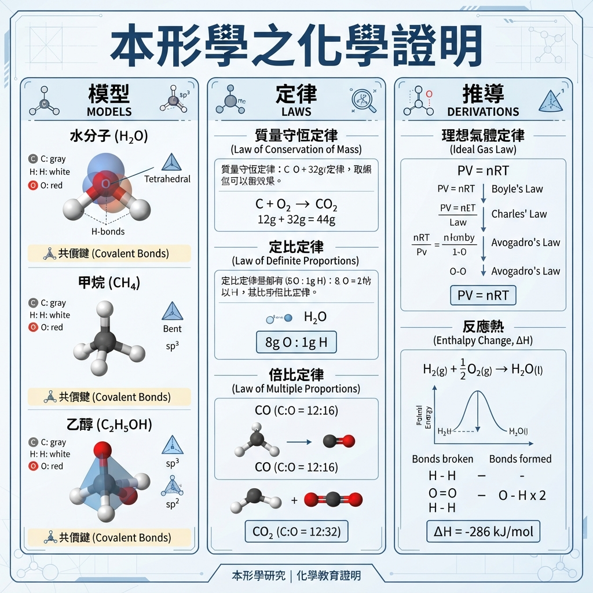

# 目　錄

- 寫在前面——化學證明篇的任務
- 導讀——工具箱：兩種語言與四件工具
- 第一章　化學證明在方程式裡做什麼
  - 1.1　化學證明的三件套：模型、定律、推導
  - 1.2　方程式語言做得到什麼
  - 1.3　四處缺口：規則、身份、結構、過程
- 第二章　立形上場：化學系統與化學反應
  - 2.1　[ ] 屬性：化學量＝維度 × 刻度
  - 2.2　( ) 容器：化學體系的邊界＝身份
  - 2.3　{ } 組成：BOM 判準與 remove 三級
  - 2.4　時間本形上場：反應＝op：形 → 形
- 第三章　普化五域證明示範
  - 3.1　物質結構與鍵結：離子鍵的歸類判準
  - 3.2　化學反應與計量：質量守恆的記帳
  - 3.3　熱化學：赫斯定律的不變量
  - 3.4　平衡與動力學：K 不變與阿瑞尼斯卡
  - 3.5　電化學：能斯特方程的推導
- 第四章　準確使用方法完整架構
  - 4.1　化學證明六步驟
  - 4.2　完整範例：鐵釘生鏽
  - 4.3　誤用對照：五種常見錯誤
  - 4.4　交出證明前的檢查清單
- 回顧——要點總整理與自我檢查
- 附錄　術語與記號速查

# 寫在前面——化學證明篇的任務

這本小書是《單位形與集合邏輯》的化學補足篇，與《數學證明》《物理證明》是姊妹篇。《數學證明》回答：用集合論寫數學證明時，工具怎麼用才準；《物理證明》把同一套方法推上物理現場。本書回答第三個問題：當對象換成化學──鍵結的歸類、反應的記帳、熱化學的路徑、平衡的移動、電池的電位──證明該怎麼立形、怎麼推導、怎麼驗收？

具體地說，本書做三件事。第一，把化學證明的現場看清楚：一個化學推導靠什麼站穩？方程式的語言在哪裡不夠用？第二，把本形學的兩大支柱直接推上化學現場：空間本形替化學系統立形（莫耳、濃度、體系邊界、分子組成），時間本形把化學反應寫成函式（形進形出、守恆、函式四問卡）。第三，收攏成完整的「準確使用方法」架構：三種補足、證明六步驟、三層檢查、誤用對照與八問清單──而且普化五域各配一則可以照抄格式的證明示範。

> **閱讀本書的三個約定**
>
> ◆　約定一：三種括號各有專屬職務。大括號 { } 是組成集合（物料清單）、中括號 [ ] 是抽象集合（屬性）、小括號 ( ) 是容器集合（空間容器）。
>
> ◆　約定二：形的英文是 Type──一個被完整描述的對象。全書直接用「形」，不另標註。
>
> ◆　約定三：本書不重講本形學理論──導讀給出工具箱速覽後，直接把工具推上化學現場，篇幅留給化學。

| 證明中的缺口 | 補足工具 | 用到的判準 | 章節 |
| --- | --- | --- | --- |
| 規則被省略──類別寫成死清單 | [ ] 抽象集合 | T = (F(T), ∩(T)) | 第二章 |
| 身份被省略──過程一走就散 | ( ) 容器集合 | C = (id(C), S(C))、不變性公理 | 第二章 |
| 結構被省略──部件只是並列 | { } 組成集合 | BOM 判準、remove 三級 | 第二章 |
| 過程被省略──反應跳步直達 | 時間本形 | op：形 → 形、函式四問 | 第二章 |
| 四者合流──裝回同一個證明 | 六步驟＋三層檢查 | ∩(T)・id(C)・remove 聯合 | 第四章 |

**表 0-1　補足地圖：化學證明的四處缺口與四件工具**

**證明寫得準，是因為每一層資訊都寫在它該在的位置上。**

# 導讀——工具箱：兩種語言與四件工具

化學證明幾乎都用方程式的語言寫成：化學式、配平式、平衡常數、電極電位。這門語言極精確，也省略得最多──體系的邊界、物種的身份、裝置的依存、反應的輸入與輸出，在一行行漂亮的式子裡全部被壓平。形的語言補的正是這四層：空間本形替系統立形，時間本形替反應立形。兩種語言不是互相取代，而是疊加。

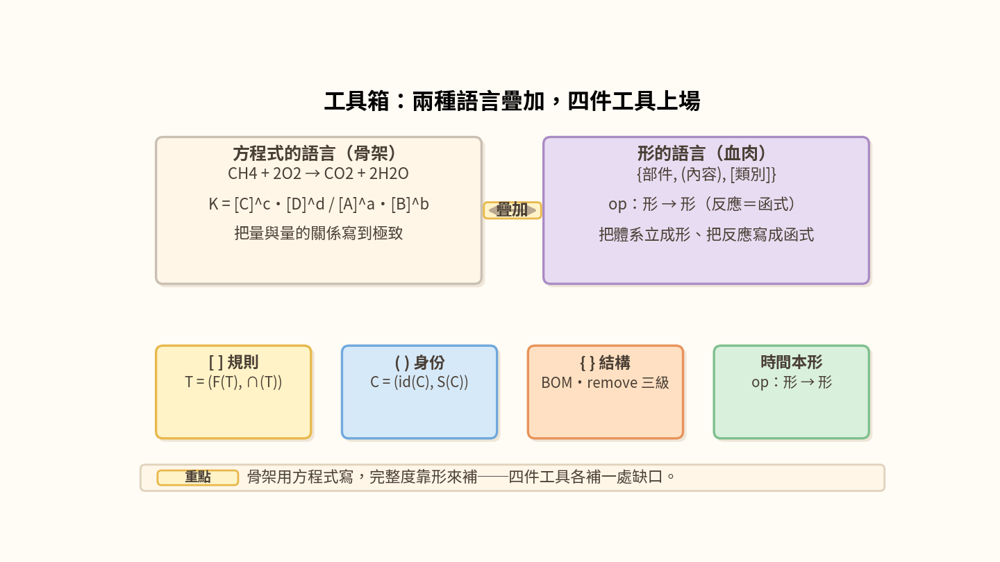

**圖 D-1　工具箱：兩種語言疊加，四件工具上場**

工具的詳細理論不在此重講，只把骨幹看一眼：空間本形用三條軸描述「是什麼」──X 屬性 [ ] 維度×刻度、Y 組成 { } BOM 與 remove 三級、Z 容器 ( ) id(C) 與不變性公理，合體為單位形 {部件, (內容), [類別]}。時間本形描述「怎麼運作」──反應是函式 op：形 → 形，每條定律可以寫成函式四問卡（名稱、輸入形、輸出形、判準），守恆律是時間軸上的不變性公理。

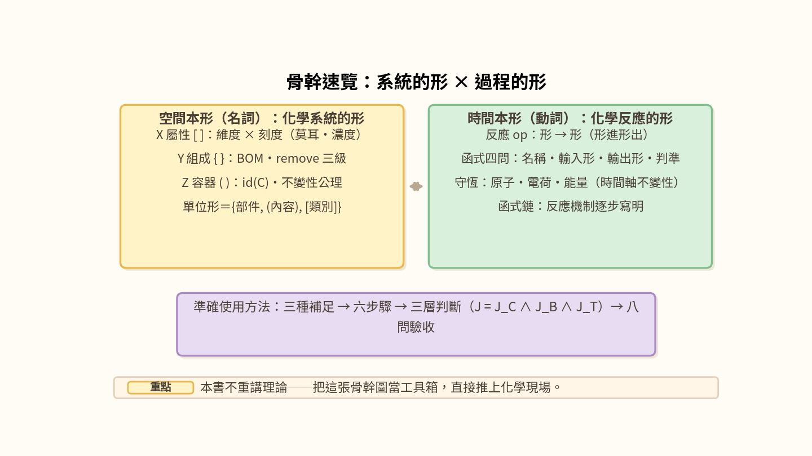

**圖 D-2　骨幹速覽：系統的形 × 過程的形**

| 工具 | 括號／記號 | 職務 | 化學中的化身 |
| --- | --- | --- | --- |
| 空間本形（名詞） | [ ] 屬性 | 維度 × 刻度 | 化學量：莫耳、濃度、電負度 |
| 空間本形（名詞） | { } 組成 | BOM、remove 三級 | 分子組成、蒸餾裝置部件 |
| 空間本形（名詞） | ( ) 容器 | id(C)、不變性公理 | 化學體系、原子（質子數＝id） |
| 時間本形（動詞） | op：形 → 形 | 函式四問、形進形出 | 化學反應：合成、燃燒、電解 |

**表 D-1　四件工具速覽**

> **一句話，拆四層**
>
> ◆　「鹽酸滴進碳酸鈣冒泡」應拆成四層：規則（[酸] 由 ∩(T) 判定）、身份（CaCO3 的 Ca 是質子數 20 的鈣）、結構（{碳酸根, 鈣} 的依存）、反應（op：把反應物形轉成 CaCl2、H2O、CO2）。
>
> ◆　方程式只寫下第三層的一角；四層都補上，化學證明才算完整。

# 第一章　化學證明在方程式裡做什麼

寫一個化學證明之前，先弄清楚它靠什麼站穩。這一章拆解化學證明的三件套，看看方程式語言做得到什麼、又在哪四處留下缺口──缺口在哪，補足就往哪去。

## 1.1　化學證明的三件套：模型、定律、推導

任何一個化學證明，翻開來都是三樣東西的組合。模型：先立形，說清楚體系是誰、邊界在哪、做了哪些理想化──「稀溶液」「密閉容器」「標準狀態」都是形的入場規則。定律：給出可以逐項驗證的判準──質量守恆、勒沙特列、能斯特，每條都是一把尺。推導：從模型與定律出發一步步走向結論，配平、記帳、代入，每一步都能被檢驗。

三件套缺一不可。沒有模型，證明沒有對象；沒有定律，證明只能靠感覺；沒有推導，只有結論沒有過程。化學與數學還有一點不同：推導得證之後，還有實驗這一關──天平、電位計、量熱計要點頭，結論才算數。這正是「可複核的準」在化學裡的完整含義。

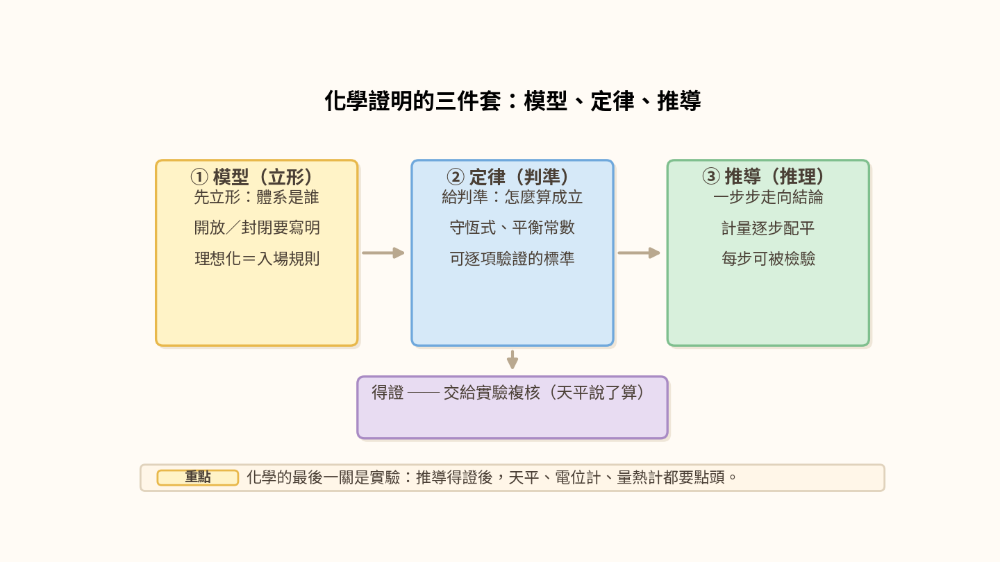

**圖 1-1　化學證明的三件套：模型、定律、推導**

## 1.2　方程式語言做得到什麼

方程式語言的核心是等號兩邊的量與關係。「CH4 + 2O2 → CO2 + 2H2O」把物種與係數鎖進一行；「K = [NH3]²/([N2][H2]³)」把濃度鎖進一個比值。它可以精確地陳述配平、平衡、轉移──大部分化學推導的骨架，都用這幾個式子搭起來。

| 式子 | 讀法 | 在證明中的用途 |
| --- | --- | --- |
| CH4 + 2O2 → CO2 + 2H2O | 物種與係數的等式 | 記帳（原子守恆的骨架） |
| K = [C]^c·[D]^d / [A]^a·[B]^b | 平衡時濃度的約束 | 判斷平衡位置（規則的骨架） |
| k = A·e^(-Ea/RT) | 速率常數與溫度 | 推導動力學（過程的骨架） |
| E = E° - (RT/nF)·lnQ | 電位與濃度 | 推導電化學（判準的骨架） |

**表 1-1　常見化學式子與它在證明中的能力**

對化學推導來說，這已經夠用──前提是，你只需要回答「量等不等」。一旦證明裡需要追問「這體系由什麼組成」「換了內容還是同一個嗎」「新物種算不算這一類」「反應吃什麼吐什麼」，方程式就開始省略。

## 1.3　四處缺口：規則、身份、結構、過程

缺口一，規則。{ 鹽酸, 硫酸, 硝酸 } 是一份寫死的清單──新出現的氫氟酸算不算「酸」？「什麼算酸」「什麼算氧化劑」都需要一條開放的生成規則，而不是幾個背熟的例子。

缺口二，身份。氯化鈉溶進水，固體不見了，可是 Na 仍是質子數 11 的鈉、Cl 仍是質子數 17 的氯。方程式寫下濃度的變化，卻不回答「沿途是不是同一個物種」──凡是需要「在變動中保持同一」的地方，都需要不隨內容改變的身份。

缺口三，結構。{ 蒸餾瓶, 冷凝管, 溫度計, 標籤 } 四個部件並列，看不出誰依存於誰──拆掉冷凝管和拆掉標籤，後果完全不同。凡是需要「分清主次」的地方，都需要部件的依存結構。

缺口四，過程。方程式寫下反應物與產物，但「這個反應吃進什麼形、吐出什麼形」被壓平了──推導跳步，往往就是輸入形與輸出形沒有寫明。凡是需要「反應可複核」的地方，都需要時間本形。

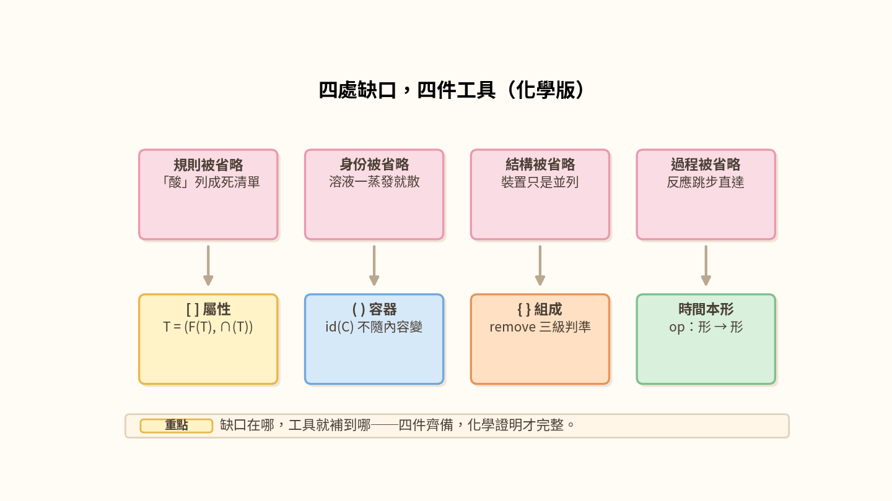

**圖 1-2　四處缺口，四件工具（化學版）**

| 缺口 | 方程式式的寫法 | 補足後的寫法 | 工具 |
| --- | --- | --- | --- |
| 規則 | 酸的例子清單（封閉） | [ x｜x 通過 ∩(T) ]（開放規則） | [ ] |
| 身份 | 濃度曲線（過程散了） | (Na) → (Na+)，質子數不變 | ( ) |
| 結構 | 部件並列（不分主次） | remove(p, M) 三級分類 | { } |
| 過程 | 直接跳到產物 | op：輸入形 → 輸出形，逐步寫明 | 時間本形 |

**表 1-2　四處缺口與四件工具**

> **本章重點**
>
> ◆　三件套：模型（立形）、定律（判準）、推導（推理）──得證之後還有實驗複核。
>
> ◆　方程式語言精確回答「量等不等」，其餘四層全部省略。
>
> ◆　四處缺口──規則、身份、結構、過程──各由 [ ]、( )、{ }、時間本形補足。

> **練習（P1）**
>
> P1-1　把「鹽酸滴進碳酸鈣冒泡」寫成一句話，指出這句話裡被省略的四層資訊各是什麼。
>
> P1-2　「酸」為什麼是一條規則而不是一份清單？試舉一個邊界案例（提示：醋酸、路易士酸）。
>
> P1-3　在 K = [NH3]²/([N2][H2]³) 這個式子裡，哪一部分回答了「身份」？哪一部分沒有？
>
> 提示：先問自己──這句話談的是哪一個體系？

# 第二章　立形上場：化學系統與化學反應

工具箱看完了，直接上場。這一章用化學的實物把四件工具逐一用活：用 [ ] 讀化學量、用 ( ) 定體系身份、用 { } 分裝置主次、用時間本形寫反應──每一件都配化學實例，不重講理論。

## 2.1　[ ] 屬性：化學量＝維度 × 刻度

每個化學量都可以拆成兩半：維度問「量的是什麼」──物質的量、濃度、電負度；刻度問「讀到哪一格」──莫耳（6.02×10^23 個）、mol/L、鮑林刻度。這裡接上核心命題：數，是形裡面的小形、次比較。1 mol 不是孤零零的數字，而是「物質的量」這個形上、莫耳刻度的一次讀數──而且莫耳後面永遠跟著物質，脫離物質的 mol 沒有意義。

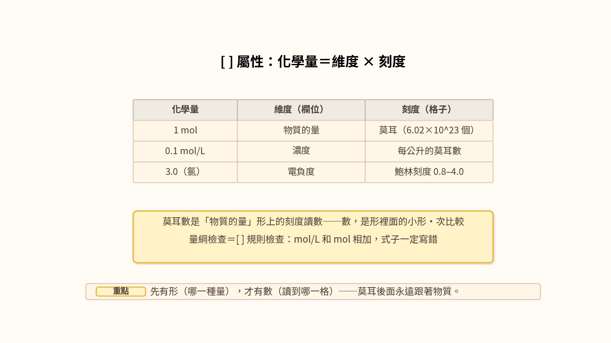

**圖 2-1　[ ] 屬性：化學量＝維度 × 刻度**

| 化學量 | 維度（欄位） | 刻度（格子） | 形學讀法 |
| --- | --- | --- | --- |
| 1 mol NaCl | 物質的量 | 莫耳 | 物質的量形上的刻度讀數 |
| 0.1 mol/L | 濃度 | 每公升莫耳數 | 濃度形上的刻度讀數 |
| 電負度 3.0 | 電負度 | 鮑林刻度 | 電負度形上的刻度讀數 |

**表 2-1　化學量的維度與刻度**

實用上，[ ] 規則送你一件免費的體檢工具：量綱檢查。mol/L 跟 mol 相加、方程式兩邊原子數不平，式子一定寫錯──這是最便宜、也最難騙過的證明檢查。

## 2.2　( ) 容器：化學體系的邊界＝身份

把容器寫成二元組：C = ( 身份識別 id(C), 內部空間 S(C) )。化學體系首先是個邊界問題：什麼可以進出、什麼必須隔絕。開放體系在入場規則裡寫明交換項（鐵釘在空氣中，氧氣與水進得來）；封閉體系隔絕物質（密閉反應瓶）；孤立體系連能量都隔絕。寫法都是同一種：先寫 id(C)，再寫 S(C) 能收什麼。

原子是練習容器最好的標本：原子的 id 就是質子數──電子得失是內容替換，Na 失一個電子變成 Na+，仍是鈉；Cl 得一個電子變成 Cl-，仍是氯。離子化是 S(C) 的內容變動，元素身份不變──不變性公理在原子尺度上的化身。

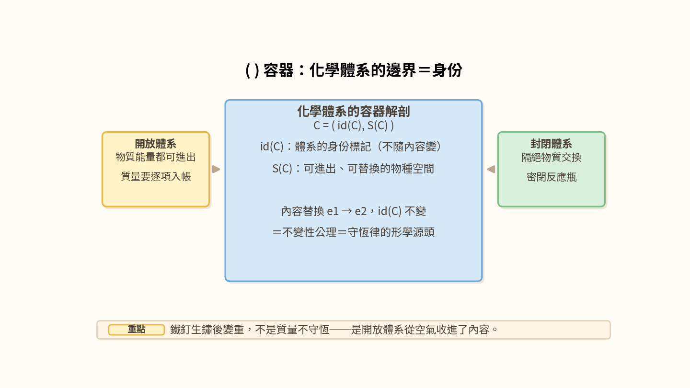

**圖 2-2　( ) 容器：化學體系的邊界＝身份**

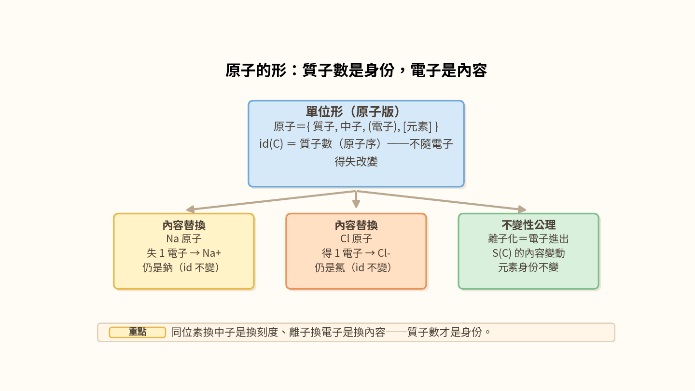

**圖 2-3　原子的形：質子數是身份，電子是內容**

> **定義（容器・化學版）**
>
> ◆　容器 C = ( id(C), S(C) )；原子的 id(C) ＝ 質子數，體系的 id(C) 自訂（如 FLASK-001）。
>
> ◆　不變性公理：替換 S(C) 內容不改變 id(C)──離子化、溶解、稀釋都不換身份。
>
> ◆　入場規則：開放／封閉／孤立，差別只在 ( ) 允許進出的項目清單──鐵釘變重，是開放體系入了帳。

## 2.3　{ } 組成：BOM 判準與 remove 三級

部件清單人人會列，證明要的是依存。先過 BOM 判準：拆下來認得自己嗎？冷凝管拆下來仍是一支冷凝管，進 BOM；「冷卻功能」拆下來什麼都不是，進屬性。再用 remove 判準分級：把部件 p 從整體 M 移除，看結果落在哪一級。

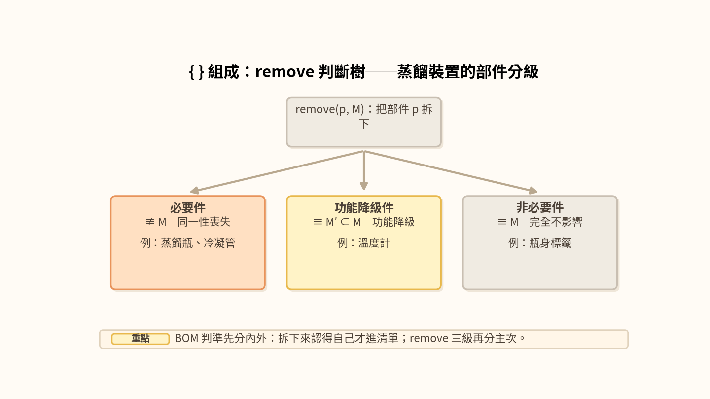

**圖 2-4　{ } 組成：remove 判斷樹──蒸餾裝置的部件分級**

| 等級 | 判斷結果 | 蒸餾裝置範例 | 證明中的用法 |
| --- | --- | --- | --- |
| 必要件 | remove(p,M) ≢ M | 蒸餾瓶、冷凝管 | 證「少了它就不成整體」 |
| 功能降級件 | remove(p,M) ≡ M′ ⊂ M | 溫度計 | 證「功能缺、身份存」 |
| 非必要件 | remove(p,M) ≡ M | 瓶身標籤 | 證「移除後完全不影響」 |

**表 2-2　remove 三級判準（化學系統版）**

## 2.4　時間本形上場：反應＝op：形 → 形

化學反應是標準的時間本形：輸入一個形（反應物體系），產出一個形（產物體系）。用之前先寫函式四問卡：名稱是哪條反應、輸入形是什麼、輸出形是什麼、判準是什麼──判準欄寫明成立條件與守恆帳。

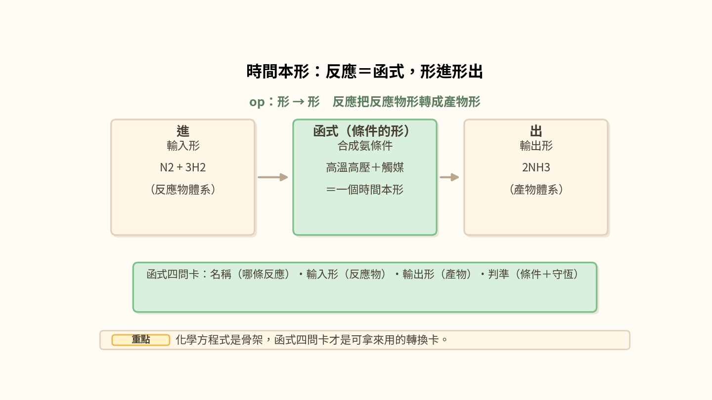

**圖 2-5　時間本形：反應＝函式，形進形出**

| 反應（名稱） | 輸入形 | 輸出形 | 判準 |
| --- | --- | --- | --- |
| 質量作用定律 | 各物種濃度的體系 | 平衡位置的體系 | Q 與 K 比大小 |
| 阿瑞尼斯方程 | 溫度 T 的反應 | 速率常數 k 的反應 | k = A·e^(-Ea/RT) |
| 法拉第電解 | 通過電量的電解池 | 析出產物的電解池 | m = (Q·M)/(n·F) |

**表 2-3　三張函式四問卡**

用卡有一個要領：參數變了是換卡，不是卡錯。觸媒換了、Ea 變了，就換一張卡──而不是硬套原來那張卡再怪世界不聽話。

> **本章重點**
>
> ◆　[ ] 化學量＝維度 × 刻度──莫耳後面永遠跟著物質，量綱檢查是免費的體檢。
>
> ◆　( ) 容器──質子數是原子的身份，離子化是內容替換；體系開放與否決定帳怎麼記。
>
> ◆　{ } 組成──BOM 判準分內外、remove 三級分主次；反應 op：形 → 形，四問齊才可複核。

> **練習（P2）**
>
> P2-1　把「一瓶稀鹽酸」寫成單位形 {部件, (內容), [類別]}，並標出 id(C) 與體系開放與否。
>
> P2-2　對蒸餾裝置追問：remove(冷凝管) 與 remove(溫度計) 各落在哪一級？說出判斷理由。
>
> P2-3　替「電解水」填一張函式四問卡：名稱、輸入形、輸出形、判準。
>
> 提示：先立形（體系是誰），再問每件工具落在哪一層。

# 第三章　普化五域證明示範

工具都已就位。這一章把同一套方法推上普化五域的現場──物質結構與鍵結、化學反應與計量、熱化學、化學平衡與動力學、電化學各一則。每則都按同一格式：寫定理、立形、選判準、推導、三層收束。先看路線圖：

| 領域 | 命題 | 主要判準 | 形學落點 |
| --- | --- | --- | --- |
| 物質結構 | 鍵結歸類 | 電負度差・電子轉移・晶格 | ∩(T) 归類漏斗 |
| 反應與計量 | 質量守恆 | 兩端同數同種原子 | 不變性公理＋莫耳記帳 |
| 熱化學 | 赫斯定律 | ΔH 與路徑無關 | 狀態函數＝不變量 |
| 平衡與動力學 | 平衡移動 | Q 與 K 比大小 | K 不變＝身份不變 |
| 電化學 | 能斯特方程 | E = E°-(RT/nF)·lnQ | ( ) 電池＋函式卡 |

**表 3-1　普化五域示範總表**

## 3.1　物質結構與鍵結：離子鍵的歸類判準

> **證明示範・物質結構**
>
> 【定理】氯化鈉（NaCl）的鍵結判給 [離子鍵]。
>
> 【證明】(1) 立形：待判對象＝NaCl；(2) 寫出 F(離子鍵)＝{電負度差 ≥ 1.7, 電子轉移, 形成晶格}；(3) 逐項檢驗：電負度 Na 0.9、Cl 3.0，Δ＝2.1 ≥ 1.7，✓；電子由 Na 移向 Cl，✓；常溫下形成離子晶格，✓；(4) 由 ∩(T) 全數通過，NaCl ∈ [離子鍵]；(5) 對照與邊界：HCl Δ＝0.9 第一道不過，判給 [共價鍵]；HF Δ＝1.9 過第一道卻不形成晶格（第三道不過）──邊界案例把 F(T) 磨利，特徵清單要寫全。（得證）

氯化鈣是離子鍵還是共價鍵？這是一道標準的歸類題──把 ∩(T) 漏斗放到化合物身上。先把 F(離子鍵) 寫明：{ 電負度差 ≥ 1.7, 電子由金屬移向非金屬, 常溫下形成離子晶格 }。

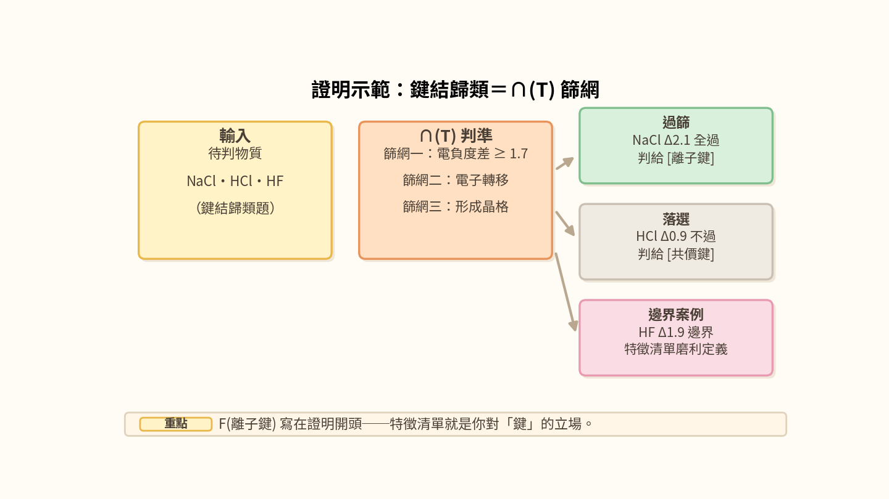

**圖 3-1　證明示範：鍵結歸類＝∩(T) 篩網**

## 3.2　化學反應與計量：質量守恆的記帳

甲烷在密閉容器中燃燒，前後總質量不變。守恆的立足點是 ( ) 的入場規則：密閉──沒有物種進出帳本。記帳用莫耳：計量係數就是 BOM 重排的帳目。

> **證明示範・反應與計量**
>
> 【定理】密閉容器中 CH4 + 2O2 → CO2 + 2H2O，反應前後總質量守恆。
>
> 【證明】(1) 立形：M ＝密閉容器（id(FLASK-001)），S(M) 只收反應物與產物；(2) 不變式候選：原子總數；(3) 逐項記帳：C 前 1 後 1、H 前 4 後 4、O 前 4 後 4──兩端同數同種；(4) 各原子摩爾質量不變，總質量 m ＝ Σ(摩爾數×摩爾質量) 前後相等；(5) 三層檢查：容器──密閉入場規則成立；BOM──四物種皆入帳；抽象──通過 [燃燒反應] 的 ∩(T)。（得證）
>
> 【對照】鐵釘生鏽後變重不違反守恆──那是開放體系，帳要加記空氣入的氧與水（見 4.2）。

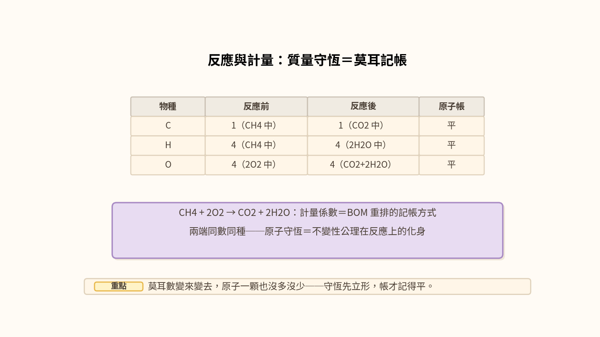

**圖 3-2　反應與計量：質量守恆＝莫耳記帳**

## 3.3　熱化學：赫斯定律的不變量

反應熱可以分步加總──因為焓 H 是狀態函數：它只認起點與終點，不認路徑。這正是不變性公理在熱化學的化身：過程怎麼走，ΔH 不變。

> **證明示範・熱化學**
>
> 【定理】赫斯定律：反應熱與路徑無關，ΔH(A) = ΔH(B) + ΔH(C)。
>
> 【證明】(1) 立形：起點（反應物）與終點（產物）各是一個狀態形；(2) 不變式候選：焓 H；(3) 由 H 是狀態函數（不變量），任何路徑的 ΔH 只由兩端決定；(4) 故分步路徑 B＋C 的加總等於一步路徑 A：ΔH(A) = ΔH(B) + ΔH(C)；(5) 三層檢查：容器──量熱計恆壓；BOM──狀態物種全入帳；抽象──通過 [熱化學] 的 ∩(T)。（得證）
>
> 【對照】登山不論走哪條路，山頂與山腳的落差固定──落差是狀態，路徑是過程，層次分明。

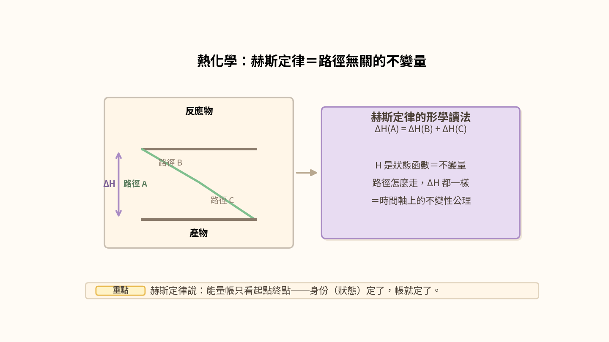

**圖 3-3　熱化學：赫斯定律＝路徑無關的不變量**

## 3.4　平衡與動力學：K 不變與阿瑞尼斯卡

平衡常數 K 是平衡體系的身份標記：濃度怎麼變、壓力怎麼改，只要溫度不變，K 不變。勒沙特列原理說系統會「追回」被擾動的 K──這是系統在守護自己的不變量。

> **證明示範・平衡與動力學**
>
> 【定理】合成氨 N2 + 3H2 ⇌ 2NH3 增壓時，平衡向右移動。
>
> 【證明】(1) 立形：平衡體系 M，id(M) 由溫度與 K 定義；(2) 判準：K ＝ [NH3]²/([N2][H2]³)；(3) 增壓瞬間各濃度同比增大，分子增平方、分母增四次方，Q ＝ K／(增幅) < K；(4) 由質量作用定律，Q < K 時反應向右進行，直到 Q ＝ K 回復──K 不變，身份不變；(5) 三層檢查：容器──恆溫密閉；BOM──三物種入帳；抽象──通過 [化學平衡] 的 ∩(T)。（得證）
>
> 【對照】只有改變溫度才改變 K──那不是同一個體系被擾動，是換了一個體系（換卡，不是卡錯）。

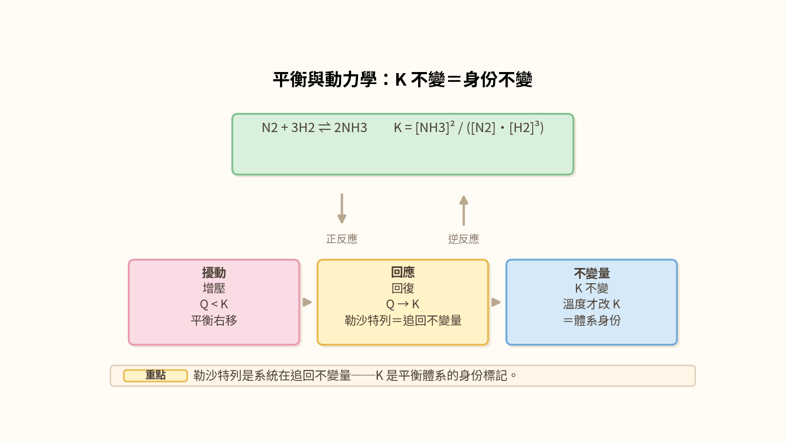

**圖 3-4　平衡與動力學：K 不變＝身份不變**

動力學側的代表卡是阿瑞尼斯方程：k ＝ A·e^(-Ea/RT)。輸入形是「溫度 T 的反應」，輸出形是「速率常數 k 的反應」，判準欄帶著活化能 Ea 這個門檻。ln k 對 1/T 是一條直線，斜率裡藏著 Ea──實驗測兩個溫度，就能把卡上的參數算出來。

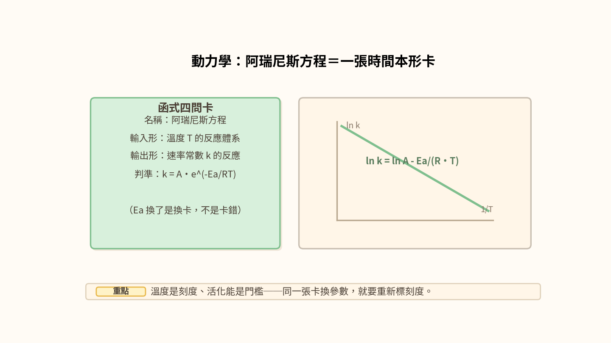

**圖 3-5　動力學：阿瑞尼斯方程＝一張時間本形卡**

## 3.5　電化學：能斯特方程的推導

電池是個標準的容器：兩極材料是身份，電子是內容，可以流動、可以替換，id(電池) 不變。濃度改變，電位就跟著變──能斯特方程把這層關係寫成判準。

> **證明示範・電化學**
>
> 【定理】鋅電極浸於 [Zn²⁺] ＝ 0.1 M 溶液，其電位較 1 M 時下降約 30 mV（25°C）。
>
> 【證明】(1) 立形：M ＝鋅電極體系（Zn²⁺ + 2e⁻ ⇌ Zn），( ) 內 S(M)＝(Zn²⁺ 離子)；(2) 判準：能斯特方程 E ＝ E° - (RT/nF)·ln(1/[Zn²⁺])；(3) 代入 n＝2、T＝298 K、[Zn²⁺] 由 1 → 0.1 M：ΔE ＝ (0.0592/2)·log(0.1) ＝ -0.0296 V ≈ -30 mV；(4) 函式四問：名稱＝能斯特、輸入形＝濃度 0.1 M 的電極、輸出形＝電位下降的電極、判準＝上式；(5) 三層檢查：容器──離子進出 id 不變；BOM──電極為必要件；抽象──通過 [電化學] 的 ∩(T)。（得證）

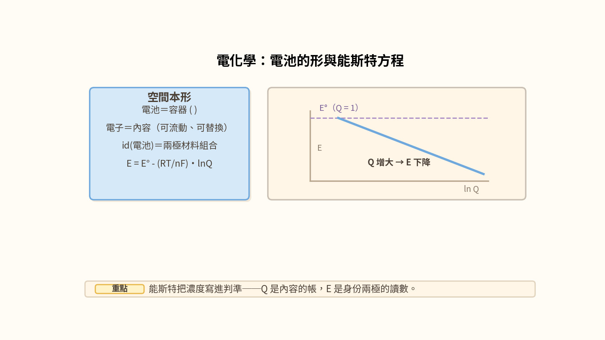

**圖 3-6　電化學：電池的形與能斯特方程**

> **本章重點**
>
> ◆　歸類題用 ∩(T) 漏斗──F(T) 寫全，邊界案例磨利定義。
>
> ◆　守恆題用不變性公理──密閉入場規則＋莫耳記帳，帳才平。
>
> ◆　平衡題認 K 為身份、動力學題用函式卡──擾動是內容、K 是身份。

> **練習（P3）**
>
> P3-1　用 ∩(T) 判斷氧化鎂（MgO）的鍵結歸屬（電負度 Mg 1.2、O 3.5），並指出它過了哪幾道篩網。
>
> P3-2　用赫斯定律推導：C → CO 的燃燒熱，可由 C → CO2 與 CO → CO2 兩步加減得到（寫出路徑式即可）。
>
> P3-3　合成氨是放熱反應：升溫時平衡如何移動？用「K 是身份」的語言解釋（先立形、再選判準）。

# 第四章　準確使用方法完整架構

四件工具、五域示範都已就位。最後一章把它們裝回同一個流程：化學證明六步驟、一個走完全程的範例、五種誤用對照，以及交出證明前的八問清單──這就是本書標題所說的「準確使用方法完整架構」。

## 4.1　化學證明六步驟

面對一個要寫成證明的化學命題，固定走六步。第一步認明整體──先問「我證明的體系是哪一個」。第二步分軸描述──X 屬性、Y 組成、Z 容器各寫一次。第三步寫形集合──用 {部件, (內容), [類別]} 表記。第四步選定命題──歸屬、守恆、分級，還是反應？第五步判準推理──對應的判準一步步走。第六步三層檢查──容器、組成、抽象三層聯合驗證後，收攏結論。

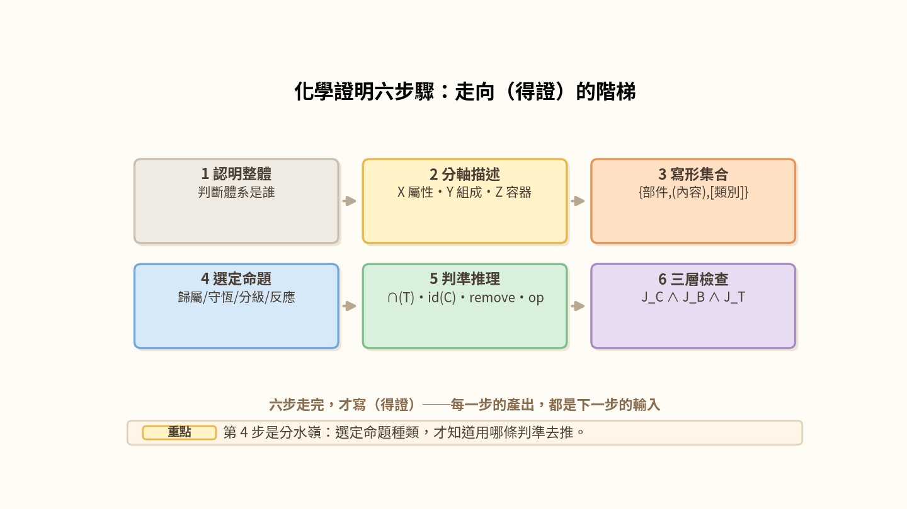

**圖 4-1　化學證明六步驟：走向（得證）的階梯**

| 步驟 | 操作 | 產出 | 常用工具 |
| --- | --- | --- | --- |
| 1 認明整體 | 指認判斷體系 | 一句話：M 是什麼 | ── |
| 2 分軸描述 | 三條軸各描述一次 | 屬性表、BOM、容器 | 三括號 |
| 3 寫形集合 | 完整表記 | {部件, (內容), [類別]} | 形集合 |
| 4 選定命題 | 歸屬／守恆／分級／反應 | 定理一句 | ── |
| 5 判準推理 | 用對判準逐步推理 | 推導正文 | ∩(T)・id(C)・remove・op |
| 6 三層檢查 | 三層聯合檢查 | 結論（得證） | 三層判斷 |

**表 4-1　證明六步驟操作表**

## 4.2　完整範例：鐵釘生鏽

用一個把「變重」講清楚的經典實驗，把六步驟走完整。

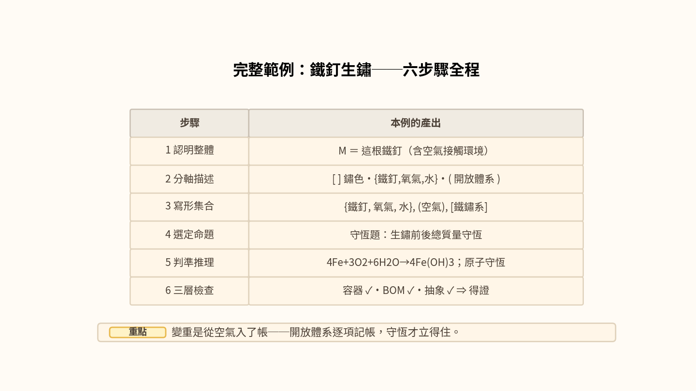

> **證明示範・全程**
>
> 【定理】鐵釘生鏽後變重，但含空氣入帳後總質量守恆。
>
> 【證明】
>
> (1) 認明整體：M ＝ 這根鐵釘（FE-001）＋接觸到的空氣與水──先聲明是開放體系。
>
> (2) 分軸描述：[ ] 鏽＝含水氧化鐵（維度＝組成、刻度＝氧化程度）；{ } BOM ＝ {鐵釘, 氧氣, 水}；( ) 開放體系，入場規則＝氧氣與水可進出。
>
> (3) 寫形集合：M ＝ { {鐵釘, 氧氣, 水}, (空氣), [鐵鏽系] }。
>
> (4) 選定命題：守恆題──生鏽前後「全體帳本」總質量守恆。
>
> (5) 判準推理：4Fe + 3O2 + 6H2O → 4Fe(OH)3；逐項記帳兩端同數同種原子；鐵釘增加的質量＝入帳的氧與水的質量；( ) 內容替換，id(FE-001) 的鐵原子數不變（質子數 26 一路不變）。
>
> (6) 三層檢查：容器──開放體系逐項入帳後守恆成立，✓；BOM──remove(氧氣) 不鏽（必要件）、remove(水) 不鏽（必要件），✓；抽象──通過 [氧化反應] 的 ∩(T)，✓。三層全過。（得證）
>
> 【教訓】只稱鐵釘就說「變重＝不守恆」，是把開放體系當封閉體系記帳──誤用不在數據，在層次。

**圖 4-2　完整範例：鐵釘生鏽──六步驟全程**

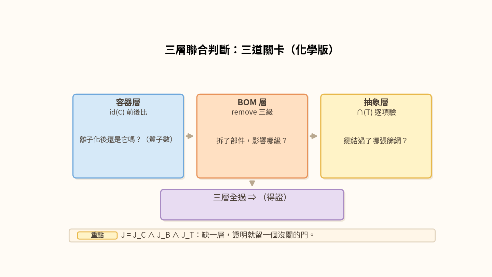

**圖 4-3　三層聯合判斷：三道關卡（化學版）**

## 4.3　誤用對照：五種常見錯誤

| # | 誤用 | 問題所在 | 正確寫法 |
| --- | --- | --- | --- |
| 1 | 把 ( ) 當一般集合用 | (Na+) 被寫成 {Na+}，身份消失 | 離子用 ( )，標上質子數 |
| 2 | 把 [ ] 寫成封閉清單 | 新物種無法歸類 | 用 T = (F(T), ∩(T)) 開放規則 |
| 3 | 數值不帶維度 | mol 不帶物質，帳就記錯 | 先寫維度（哪一種量），再寫刻度 |
| 4 | 反應跳步 | 輸入形與輸出形沒寫明 | 用函式鏈逐步寫 op：形 → 形 |
| 5 | 只做一層判斷就下結論 | 三層各有盲點 | 三層聯合 J = J_C ∧ J_B ∧ J_T |

**表 4-2　五種常見誤用與正確寫法**

五種誤用的共同根源，都是「層次」沒寫清楚：括號的層次、體系與內容的層次、數與形的層次、反應的層次。寫證明時時刻刻問自己──這一筆資訊，該在哪一層？

## 4.4　交出證明前的檢查清單

| # | 檢查問題 | 通過標準 |
| --- | --- | --- |
| 1 | 體系認明了嗎？ | 「我證的是哪個體系」一句話說得出來 |
| 2 | 入場規則寫明了嗎？ | 開放／封閉／孤立與交換項列清楚 |
| 3 | 括號用對了嗎？ | { } 部件、( ) 內容、[ ] 類別，各安其位 |
| 4 | 身份標出來了嗎？ | 質子數或 id(C) 明確，沿途不散 |
| 5 | remove 分級做了嗎？ | 談部件影響時，三級各有歸屬 |
| 6 | 函式四問齊了嗎？ | 每條反應有名稱、輸入形、輸出形、判準 |
| 7 | 每一步可檢驗嗎？ | 讀者能逐句打勾重現推理 |
| 8 | 三層聯合檢查了嗎？ | 容器・組成・抽象三層都過，才寫（得證） |

**表 4-3　檢查清單：交出證明前的八個問題**

**八個問題全過，證明才算「寫準」──它就是四件工具的驗收標準。**

> **本章重點**
>
> ◆　六步驟：認明整體 → 分軸描述 → 寫形集合 → 選定命題 → 判準推理 → 三層檢查。
>
> ◆　鐵鏽教訓：開放體系逐項入帳，守恆才立得住──誤用不在數據，在層次。
>
> ◆　八問檢查清單，就是準確使用方法的驗收標準。

> **練習（P4）**
>
> P4-1　用六步驟證明：「銅在潮濕空氣中生成銅綠，前後全體帳本總質量守恆」。
>
> P4-2　對照表 4-2，檢查你 P4-1 的證明有沒有犯任何一種誤用，逐條回答。
>
> P4-3　把表 4-3 的八問套用在你化學課本上的任一條例題，指出它缺了哪幾層。
>
> 提示：第 4 步先選定命題種類，再選判準──順序反了就會跳步。

# 回顧——要點總整理與自我檢查

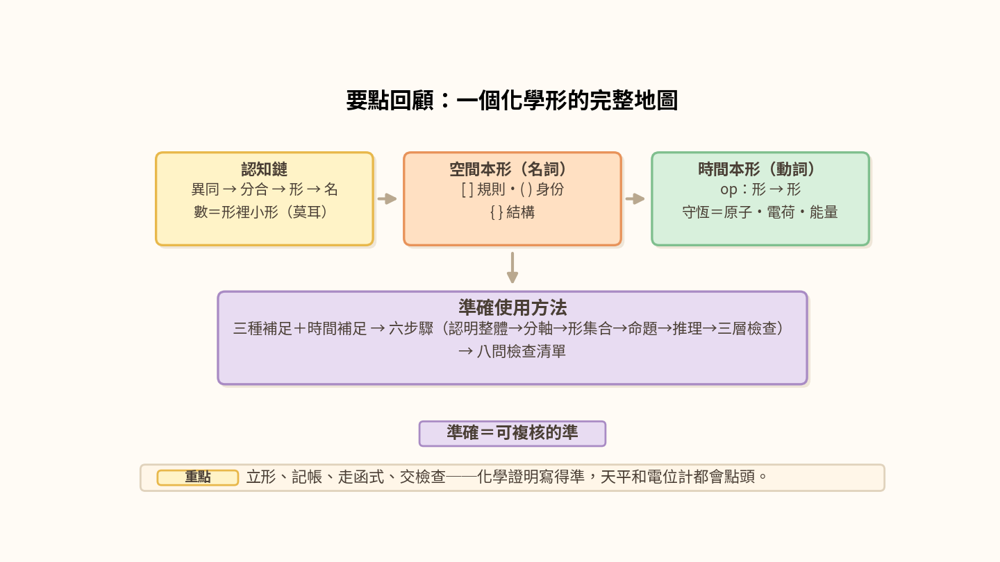

**圖 R-1　要點回顧：一個化學形的完整地圖**

### R-1　四種補足，四處缺口

[ ] 把寫死的清單換成開放規則──T = (F(T), ∩(T))；( ) 把散掉的內容收在不變身份之下──質子數、id(C) 與不變性公理；{ } 把並列的部件排成依存結構──remove 三級；時間本形把壓平的反應展開成函式鏈──op：形 → 形。缺口在哪，工具就補到哪。

### R-2　三件套，兩種語言，一條主軸

模型在前、定律居中、推導在後；方程式是骨架，形的補足是血肉。空間本形立住體系，時間本形走完反應──兩種語言疊加，化學證明才完整。

### R-3　準確，是可複核的準

判斷不靠直覺靠流程：∩(T) 逐項驗、質子數前後比、remove 三級分、函式鏈逐步走；三層聯合檢查後才下結論。讀者能逐句打勾重現你的推導，天平與電位計能照著你的結論複測──這才是「準確」兩個字在化學裡的意思。

| 自我檢查問題 | 你應該能回答的內容 |
| --- | --- |
| 體系怎麼立形？ | 寫出 {部件, (內容), [類別]}，開放封閉先聲明 |
| 化學量怎麼讀？ | 維度 × 刻度──莫耳後面永遠跟著物質 |
| 反應怎麼寫？ | 函式四問卡：名稱、輸入形、輸出形、判準 |
| 守恆怎麼用？ | 原子・電荷・能量三本帳，不變量五步驟 |
| 證明怎麼起步？ | 六步驟走一遍：從認明整體到（得證） |
| 誤用怎麼避開？ | 對照五種誤用逐一自查，層次寫清 |

**表 R-1　自我檢查清單**

**證明寫得準，是因為每一層資訊都寫在它該在的位置上。**

# 附錄　術語與記號速查

| 術語 | 英文／記號 | 一句話定義 |
| --- | --- | --- |
| 形 | Type | 一個被完整描述的對象 |
| 單位形 | Unit Type | 三種集合的合體：{ 部件, (內容), [類別] } |
| 形集合 | Type Set | 單位形的完整表記 |
| 屬性・維度・刻度 | [ ] | 化學量＝維度（欄位）× 刻度（格子） |
| 抽象類別 | T = (F(T), ∩(T)) | 由特徵與判準決定的開放類別 |
| 交集判準 | ∩(T) | 特徵全數通過才算屬於 |
| 容器 | C = (id(C), S(C)) | 化學體系邊界＋不變的身份 |
| 身份識別 | id(C) | 原子＝質子數；體系＝自訂標記 |
| 不變性公理 | ∀ e1, e2 ∈ S(C) | 替換內容不改變 id(C) |
| BOM・remove 判準 | remove(p,M) | 三級：必要件 ≢M／降級件 ≡M′⊂M／非必要件 ≡M |
| 時間本形 | Time Type | 動詞的形＝函式：op：形 → 形 |
| 函式四問卡 | 名稱/輸入形/輸出形/判準 | 把一條反應寫成一張可用的卡 |
| 守恆 | conservation | 原子・電荷・能量三本帳＝時間軸不變量 |
| 三層判斷 | J = J_C ∧ J_B ∧ J_T | 容器層・BOM 層・抽象層聯合檢查 |
| 證明六步驟 | 六步 | 認明整體→分軸→形集合→命題→推理→三層檢查 |

**表 A-1　術語與記號速查**

### 練習參考答案

| 題號 | 答案要點 |
| --- | --- |
| P1-1 | 規則（什麼算「鹽酸」「碳酸鈣」）；身份（Ca 的質子數 20 全程不變）；結構（{碳酸根, 鈣} 的依存）；反應（op：反應物形 → CaCl2+H2O+CO2 形）。四層在句中都被省略。 |
| P1-2 | 因為「酸」由 F(T)＝{能提供 H+, 能與鹼中和…} 與 ∩(T) 決定；醋酸是弱酸仍在類中、路易士酸不含 H+ 卻收電子對──定義一改邊界就移動，清單答不了這種情況。 |
| P1-3 | 式子回答了平衡時各濃度的關係，沒有回答「這是哪一個體系、哪一組物種」──身份要靠質子數與 id(C) 補。 |
| P2-1 | M ＝ { {水, 氯化氫}, (稀鹽酸), [酸溶液] }，id(C) 自訂如 SOL-003；開放體系（揮發的 HCl 可逸出）──入帳要記。 |
| P2-2 | 冷凝管──remove ≢ M（蒸餾不成，必要件）；溫度計──≡ M′ ⊂ M（仍可蒸餾但失去測溫，功能降級件）。 |
| P2-3 | 名稱＝電解水；輸入形＝通電中的水（2H2O）；輸出形＝氫氧混合（2H2 + O2）；判準＝2H2O → 2H2↑ + O2↑（電量依 m = QM/nF 記帳）。 |
| P3-1 | Mg 1.2、O 3.5，Δ＝2.3 ≥ 1.7 ✓；電子由 Mg 移向 O ✓；常溫形成離子晶格 ✓──三道全過，MgO ∈ [離子鍵]。 |
| P3-2 | 路徑式：C → CO 的 ΔH ＝（C → CO2 的 ΔH）−（CO → CO2 的 ΔH）；狀態函數只認兩端，故可加減。 |
| P3-3 | 升溫＝換了一個體系（K 改變＝換卡）；對放熱反應，新 K 變小、Q > K，平衡左移──系統追回的是「新體系的 K」，不是舊 K。 |
| P4-1 | 照 4.2 格式：(1) 開放體系聲明；(2) [ ] 銅綠組成、{Cu, O2, H2O, CO2}、(空氣)；(3) 形集合；(4) 守恆題；(5) 2Cu+O2+H2O+CO2→Cu2(OH)2CO3 記帳；(6) 三層全過──增重＝入帳的氧、水、二氧化碳。 |
| P4-2 | 逐條對照五種誤用：離子有沒有寫成 { }？類別有沒有寫死？mol 有沒有帶物質？推導有沒有跳步？有沒有只查一層？ |
| P4-3 | 課本例題通常只給第 5 步的推導──缺第 1–3 步的立形與第 6 步的三層檢查；八問逐條打勾即知。 |

**表 A-2　練習參考答案**

> **全書終**
>
> ◆　空間本形把化學體系立成形，時間本形把反應寫成函式，準確使用方法把證明交給檢查。
>
> ◆　把形看清楚，把每一層資訊放在它該在的位置上──化學證明，就寫準了。
