**本形學 Ontypology**

# 數學建模

*Mathematical modeling*

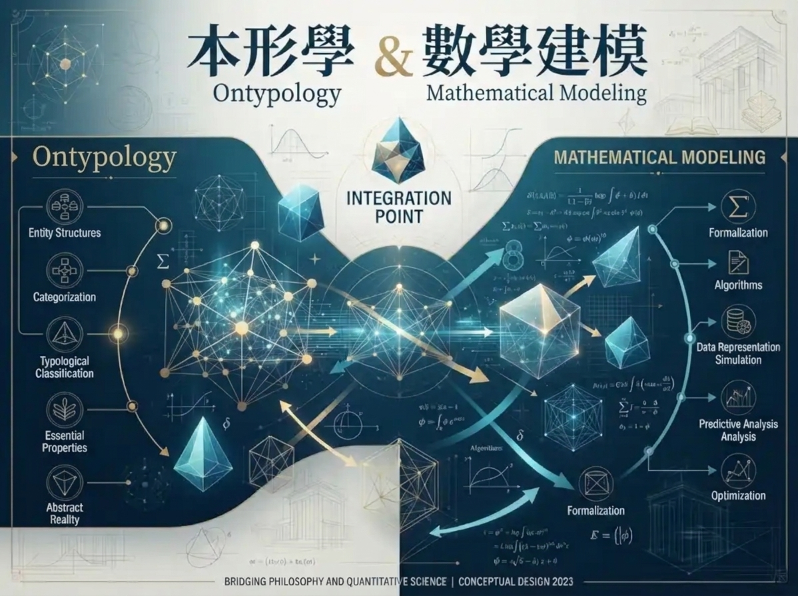

# 目　錄

- 前言
- 導讀　工具箱與讀法
  - 一、這本書只做一件事
  - 二、認知鏈與建模鏈
  - 三、本書的工具箱清單
- 第一篇　定位——數學建模為什麼需要本形學
  - 1-1　五個痛點，一個根源
  - 1-2　三層定位：根・幹・果
  - 1-3　本篇小結
- 第二篇　骨幹速覽——本形學工具箱
  - 2-1　三軸三括號：單位形的完整表記
  - 2-2　三層判斷：容器・組成・抽象
  - 2-3　空間框架四步驟：維度是被逼出來的
  - 2-4　五大運算與比較
  - 2-5　時間本形函式庫
  - 2-6　建模 ↔ 形學映射總表
  - 2-7　準確使用方法總覽
  - 2-8　本篇小結
- 第三篇　空間本形——把建模對象立成形
  - 3-1　認明整體：模型的 M 是誰
  - 3-2　變數與刻度：數依附在形上
  - 3-3　假設：容器的入場規則
  - 3-4　模型結構：BOM 與 remove 三級
  - 3-5　三層判斷 × 模型分類
  - 3-6　本篇小結
- 第四篇　時間本形——建模流程即函式鏈
  - 4-1　全流程六站：問題→假設→建構→求解→驗證→回饋
  - 4-2　六張函式四問卡
  - 4-3　方程式＝形的轉移規則：op: Type → Type
  - 4-4　推理五族：式子從哪裡長出來
  - 4-5　思考法選路：卡住的時候走哪條
  - 4-6　形進形出：建模迴圈
  - 4-7　本篇小結
- 第五篇　模型家族形化——六族對讀
  - 5-1　六族總覽
  - 5-2　優化模型：目標是判準，約束是入場規則
  - 5-3　微分方程模型：狀態是內容，守恆是身份
  - 5-4　統計機率模型：資料是形裡小形，檢定是三層判斷
  - 5-5　圖與網路模型：節點立形，邊掛關係
  - 5-6　排隊系統模型：容器、服務、降級
  - 5-7　模擬模型：規則、隨機、重複
  - 5-8　選族決策樹與六族對讀總表
  - 5-9　本篇小結
- 第六篇　準確使用方法完整架構
  - 6-1　體—用—準
  - 6-2　三種補足・建模版
  - 6-3　建模六步驟
  - 6-4　全程示範：SIR 疫情模型走六步
  - 6-5　八問・建模版
  - 6-6　誤用 16 種・四組對照
  - 6-7　可複核的準
  - 6-8　本篇小結
- 第七篇　總架構——兩庫一中樞一迴路
  - 7-1　建模的兩庫一中樞一迴路
  - 7-2　四條驗收線
  - 7-3　建模工具 ↔ 形學對讀
  - 7-4　通往 Mind AI：知識統一 → 思維統一 → 智慧統一
  - 7-5　本篇小結
- 第八篇　內容完整方案——學練用教建
  - 8-1　學練用教建＋八週路線
  - 8-2　四讀者選路＋建庫四階段
  - 8-3　五領域並列總結
  - 8-4　總結：把形立好，把式立準，把驗做實
- 附錄 A　術語與記號速查
- 附錄 B　速查卡
- 附錄 C　練習參考答案
- 附錄 D　圖表索引

# 前言

本形學為理論基礎，把數學建模的每一個動作——立變數、寫假設、列方程、做驗證——都變成寫得出來、驗得回去的形操作。

| 篇目 | 回答的問題 | 主要產出 |
| --- | --- | --- |
| 導讀 | 這本書怎麼讀？ | 兩種語言、認知鏈、工具箱清單 |
| 第一篇　定位 | 數學建模為什麼需要本形學？ | 五痛點、三層定位 |
| 第二篇　骨幹速覽 | 本形學工具箱裡有什麼？ | 三軸・三層判斷・運算・函式庫・映射總表 |
| 第三篇　空間本形 | 建模對象怎麼立成形？ | 立形三件：變數・假設・結構 |
| 第四篇　時間本形 | 建模流程怎麼跑得穩？ | 六站函式鏈・推理五族・思考法選路 |
| 第五篇　模型家族 | 式子從哪個家族長出來？ | 六族對讀・選族決策樹 |
| 第六篇　準確使用方法 | 怎麼把模型寫準、驗準？ | 三種補足・六步驟・八問・誤用16種 |
| 第七篇　總架構 | 建模能力怎麼長久長大？ | 兩庫一中樞一迴路・四條驗收線 |
| 第八篇　內容完整方案 | 怎麼學、怎麼教、怎麼建庫？ | 學練用教建・八週路線・建庫四階段 |
| 附錄 A–D | 查什麼、複印什麼、對什麼答案？ | 術語表・速查卡・練習答案・圖表索引 |

> **本篇金句**
>
> 準確，是可複核的準。模型的每一步都寫得出來、驗得回去，才輪到談『算得準不準』。

# 導讀　工具箱與讀法

## 一、這本書只做一件事

數學建模的教科書很多：教微分方程、教優化、教統計、教模擬——教的都是「式子怎麼解」。但實務上模型出事，十之八九不是解錯，而是立錯：假設寫不清、變數意義漂移、模型與現實對不上。本書只做一件事：把「立」和「驗」補上，用本形學的形語言，把建模對象、流程與判準全部寫成可複核的形式。式子怎麼解，交給既有教科書；形怎麼立、準怎麼驗，是本書的主場。

> **讀法建議**
>
> 第一遍：順著導讀與八篇走，抓「立形 → 立式 → 立準」主線。
>
> 第二遍：跳讀第二篇工具箱與第六篇方法，手邊放一個真實建模問題對照。
>
> 第三遍：做各篇練習（E01–E14、S01–S03），到附錄 C 對示範答案。

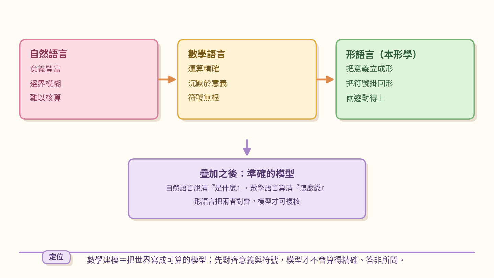

**圖 0-1　兩種語言疊加：自然語言說清「是什麼」，數學語言算清「怎麼變」**

**例　一句假設的兩種寫法**

> **例・假設**
>
> 自然語言：「空氣阻力很小，可以忽略。」——『很小』多小？誰判定？
>
> 形語言：「假設 H3：將空氣阻力自 BOM 移除，記 remove 三級之必要件檢驗——移除後模型仍為 [自由落體]，判準 ∩(T) 全過。」——可指認、可放寬、可回收驗證。

## 二、認知鏈與建模鏈

本形學的認知鏈是：異同 → 分合 → 形 → 名——先有「這個不是那個」的感受，才生出分與合的動作，最後立出形，而形必有名。數學建模走的是同一部機器：先分辨現象中的異同，把對象從背景裡分出來（立形），再給每條維度命名（變數）。這就是「先有形，才有數」在建模現場的意思：變數永遠依附在已被辨識出來的形之上。

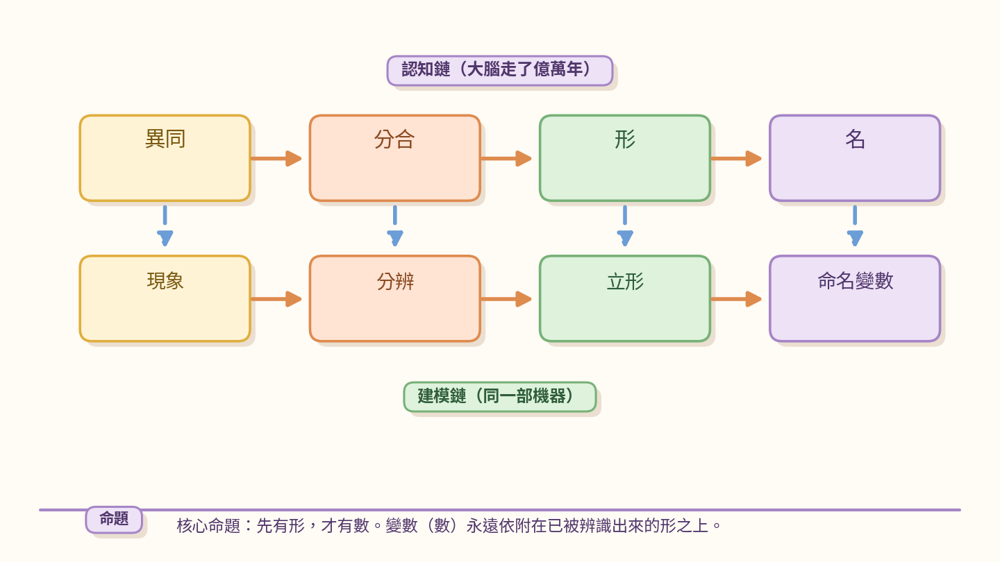

**圖 0-2　認知鏈 × 建模鏈：同一部機器的兩個現場**

**例　先有形，才有數**

> **例・觀測值**
>
> 「37.2」是一個數；它必須說得出：哪個形（病患的體溫）、哪個維度（攝氏溫度）、什麼刻度（°C）。
>
> 形沒有立好就急著建模，37.2 會在資料表裡漂移——今天當體溫、明天當氣溫，模型算得再快也是白算。

## 三、本書的工具箱清單

本書用到的本形學工具，全數在第二篇「骨幹速覽」一次立好；之後每一篇只負責「用」。先給一張清單，讀者可按圖索驥：

| 工具 | 一句話 | 用在哪一篇 |
| --- | --- | --- |
| 三軸三括號 | X 屬性 [ ]、Y 物料清單 { }、Z 容器 ( ) | 第三篇 |
| 三層判斷 | 容器・組成・抽象，三層聯合缺一不可 | 第三・六篇 |
| 空間框架四步驟 | 分辨異同→觸發抽象→命名維度→判斷歸屬 | 第三篇 |
| 五大運算 | ⊕・remove・σ・∩(T)/α・ι，op: Type → Type | 第四・五篇 |
| 時間本形函式庫 | 函式＝方法＝招式；輸入一個形，產出一個形 | 第四篇 |
| 準確使用方法 | 三種補足＋六步驟＋八問 | 第六篇 |
| 兩庫一中樞一迴路 | 形庫・函式庫・判準中樞・建模迴圈 | 第七篇 |

# 第一篇　定位——數學建模為什麼需要本形學

數學建模是把世界寫成可算的模型的學問。它不缺式子，缺的是「意義的帳」：模型的對象是誰、變數是什麼、假設把什麼擋在門外、驗證到底驗了什麼。本篇先看五個常見痛點，再給出本形學在建模現場的三層定位。

## 1-1　五個痛點，一個根源

任何做過建模的人都遇過這五件事：假設寫不清——事後沒人說得出模型當初忽略了什麼；變數意義漂移——同一個符號在不同章節指不同的量；模型對不上現實——擬合很漂亮，一換場景就崩；參數說不出意義——最佳化跑出一個數，沒人知道它對應現實裡的什麼；驗證流於表面——拿同一份資料驗同一份資料。

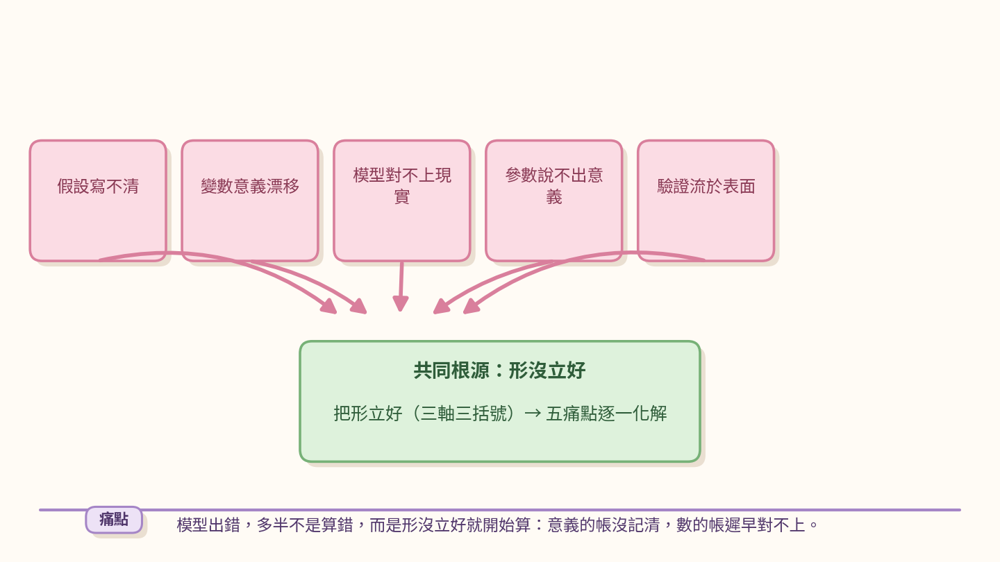

**圖 1-1　五個痛點的共同根源：形沒立好**

**例　變數漂移的代價**

> **例・品質**
>
> 某產線模型以「良率」為目標函式，上線後發現報表的「良率」是抽檢良率、模型裡的卻是批次良率——兩個「良率」是兩條不同的維度。
>
> 形學立帳：良率 ∈ [品質指標]，先寫明維度（抽檢／批次）、刻度（百分比）、容器（哪條產線），漂移無所遁形。

## 1-2　三層定位：根・幹・果

本體論問「世界有什麼」，是根；本形學問「形是什麼、怎麼判斷、怎麼運作」，是幹；數學建模用形與函式把世界寫成可算的模型，是果。三層各司其職：本體論保證「有什麼」不漏，本形學保證「是什麼」不亂，數學建模保證「怎麼算」不錯。

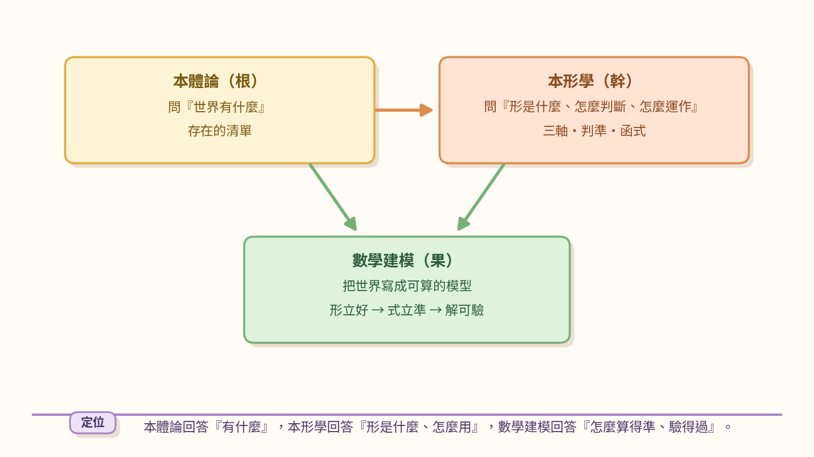

**圖 1-2　三層定位：根（本體論）→ 幹（本形學）→ 果（數學建模）**

**例　三層各答一問**

> **例・城市供水**
>
> 本體論問：城市裡有什麼？——水源、管網、用戶、水錶。
>
> 本形學問：供水系統這個形長什麼樣？——{ 水源, 泵站, 管段, (水壓數據), [供水範圍] }。
>
> 數學建模問：水壓怎麼算、管徑怎麼選？——網路流方程＋優化，解形可交付。

## 1-3　本篇小結

> **第一篇要點**
>
> - 五痛點的共同根源是形沒立好：意義的帳沒記清，數的帳遲早對不上。
> - 三層定位：本體論是根、本形學是幹、數學建模是果。
> - 建模第一問不是「怎麼列式」，是「我建模的對象是哪一個整體」。

> **E01　練習（第一篇・痛點辨識）**
>
> （一）回想一個你做過（或讀過）的模型：五個痛點中了幾個？各用一句話寫出病徵。
>
> （二）把其中一個痛點改寫成「形沒立好」的說法：缺的是哪個括號的帳？
>
> *提示：五痛點分別對應 [ ] 的規則、( ) 的身份、{ } 的結構沒立全。答案見附錄 C。*

> **E02　練習（第一篇・三層定位）**
>
> （一）以「校園電動機車充電排隊」為題，各寫一句本體論問題、本形學問題、數學建模問題。
>
> （二）三句話裡，哪一句必須先回答？為什麼？（用「先有形，才有數」作答）
>
> *提示：本形學的問題要問到「形長什麼樣」才算到位。答案見附錄 C。*

> **【專業專欄 C1】數學建模簡史與競賽**
>
> 數學建模作為可教可賽的學問，成型於二十世紀後半。1985 年美國 COMAP 首辦數學建模競賽（MCM），其後增設跨學科的 ICM，如今全球數千隊同場，賽題從流行病到城市設計都有——賽制的核心評分正是「假設合理性、模型構建、驗證與靈敏度」，與本書的三種補足、八問幾乎逐項對得上。
>
> 更早的源頭是經典的建模三巨頭：牛頓把行星運動寫成微分方程（機理建模）、高斯在 1801 年以最小二乘追回穀神星（參數估計）、馬可夫在 1906 年立出鏈（隨機建模）。三者分別長出今天的微分方程、統計、隨機過程三大家族——第五篇會逐一形化。
>
> 對讀：競賽評審表其實就是一張八問——假設清不清楚（( ) 身份書）、模型合不合理（{ } 結構書）、驗證做沒做實（三層判斷）。用形學的話說，評審在找的，是可複核的準。

# 第二篇　骨幹速覽——本形學工具箱

本篇不重抄理論原文，只做一件事：把本書要用的本形學工具，以架構圖與圖文摘要立好骨幹。每一件工具後面都會在建模現場再出場；這裡先認得名字、看懂長相。

## 2-1　三軸三括號：單位形的完整表記

單位形＝形集合＝{ 部件, (內容), [類別] }。三種括號對應三條軸：X 屬性 [ ]（維度 × 刻度，它是什麼樣子）、Y 物料清單 { }（它由什麼組成，拆下來認得自己嗎）、Z 容器 ( )（東西放在哪裡，id(C) 與不變性公理）。數學集合只答「屬不屬於」；形集合在純集合之上疊加三種加值：{ } 補結構、[ ] 補規則、( ) 補身份。

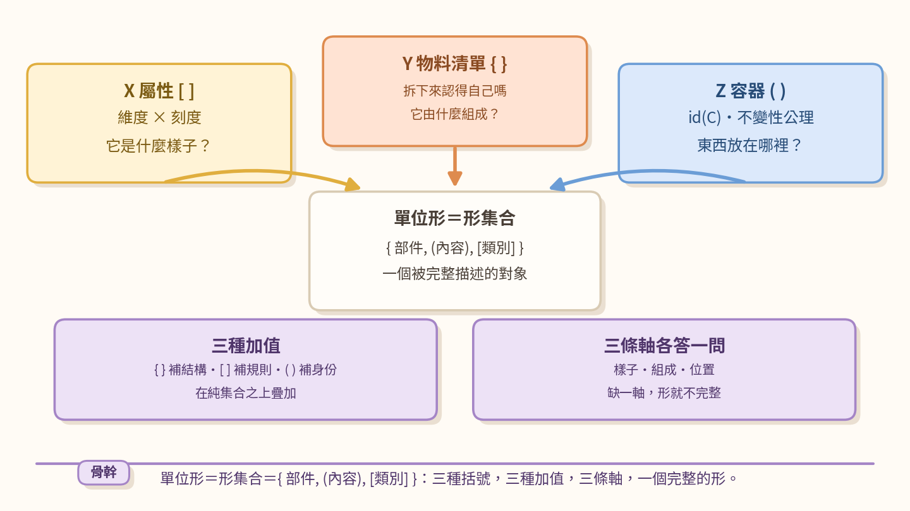

**圖 2-1　三軸三括號：單位形＝形集合**

**例　一隻咖啡杯的完整表記**

> **例・杯子**
>
> M = { 杯把, 杯底, 杯蓋, 杯身, (咖啡), [白色] }。
>
> 把 (咖啡) 換成 (茶)：內容換了，杯子還是同一隻杯子——id(C) 不變，這就是不變性公理。

## 2-2　三層判斷：容器・組成・抽象

形邏輯的判斷分三層：容器層比 id(C) 前後是否一致；組成層以 BOM 拆解並給 remove 三級——必要件（移除則同一性喪失，≢M）、功能降級件（形在功能缺，≡M′⊂M）、非必要件（移除形不動，≡M）；抽象層用 T = (F(T), ∩(T)) 逐項驗特徵交集。三層各有盲點，聯合判斷缺一不可。

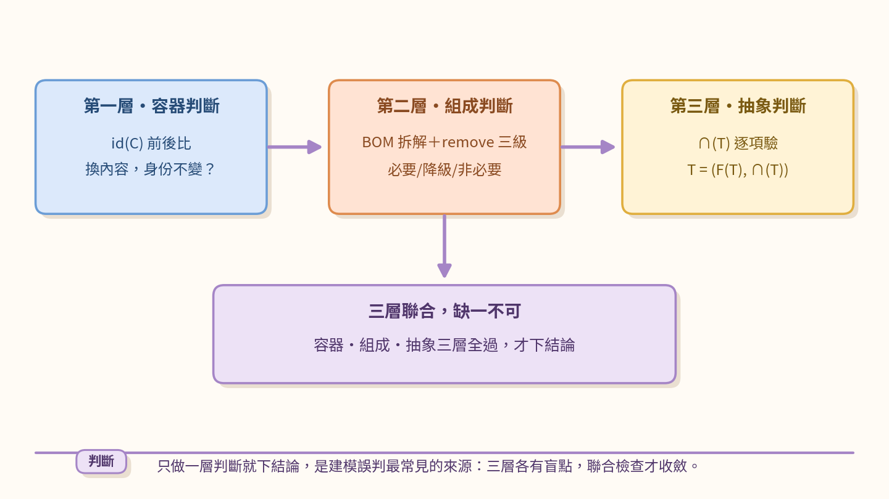

**圖 2-2　三層判斷：三道關卡串成一列**

**例　電動車是不是汽車**

> **例・分類**
>
> 容器層 ✓：換電池不換車，id 不變；組成層 ✓：電機為必要件、油箱移除記降級式（≡M′⊂M）；抽象層 ✓：F(汽車)＝{ 能載人, 能在道路上自主行駛 } 逐項通過。
>
> 三層全過——電動車 ∈ [汽車]。（得證）

## 2-3　空間框架四步驟：維度是被逼出來的

空間框架回答「有哪幾條維度」。四步驟：分辨異同 → 觸發抽象（一批差異跟既有維度對不上——對照失敗）→ 命名維度（各自取名、貼標籤）→ 判斷歸屬（對得上就掛進去，對不上就開新維度）。抽象不是凝視萬物的天賦，是被「對照失敗」逼出來的應對——這正是建模時「開新變數」該走的流程。

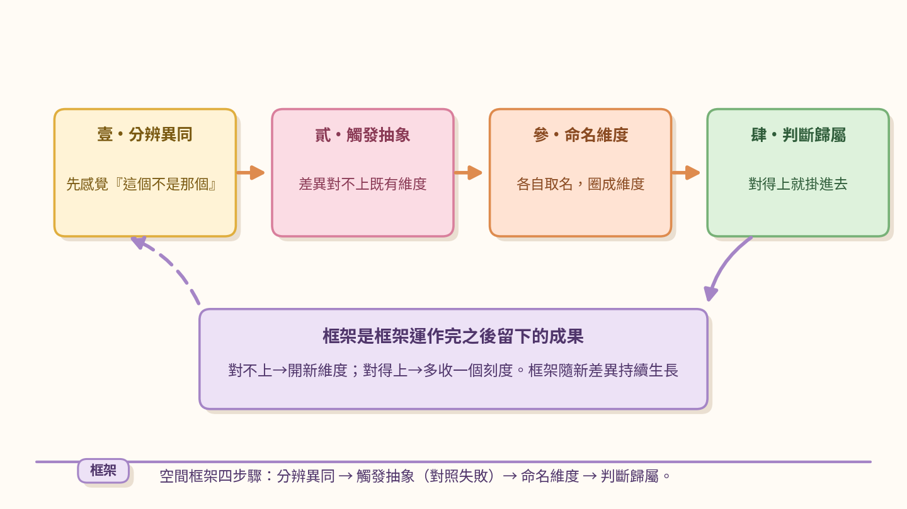

**圖 2-3　空間框架四步驟：框架隨新差異持續生長**

**例　模型長出一條新維度**

> **例・尺寸**
>
> 兩個預測誤差一樣的模型，一個快、一個慢——「速度」這批差異跟「準確度」維度對不上（對照失敗），於是開新維度「計算成本」。
>
> 模型評估的框架從一條軸長成兩條軸：準確度 × 計算成本——框架是框架運作完之後留下的成果。

## 2-4　五大運算與比較

形集合的五大運算各守一個括號：⊕ 合形與 remove 拆形只動 { } 的部件；σ 替換只動 ( ) 的內容（保身份）；∩(T) 歸類與 α 抽象生成只問 [ ] 的類別；ι 嵌套把形放進容器，層層各持身份。比較運算 ≡／≢／⊂ 問的是「哪一層的同一」。所有運算共用一條總律：op: Type → Type——吃進一個形，吐出一個形。

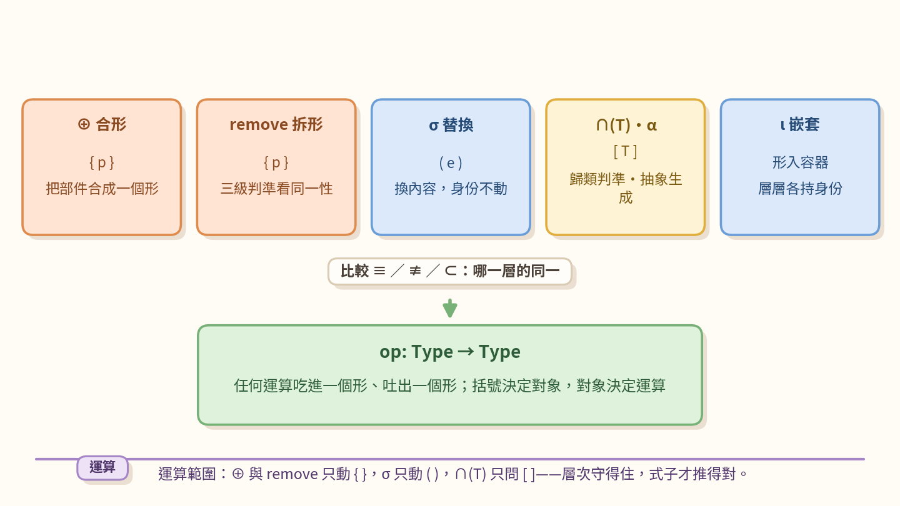

**圖 2-4　五大運算：括號決定對象，對象決定運算**

**例　σ 在建模裡的名字**

> **例・理想化**
>
> 「把不規則的飛彈換成質點」＝σ 替換：換掉內容（形狀），保住身份（同一個飛彈、同一條彈道問題）。
>
> 「把模型的摩擦係數從 0.3 改成 0.25」也是 σ：內容換、模型身份不換——若身份必須換，那不是 σ，是立了新形。

## 2-5　時間本形函式庫

時間本形是動詞的一面：函式＝方法＝招式＝服務＝法門，依附在空間本形之上——輸入一個形，產出一個形。原著函式庫涵蓋：函式搜尋、設計搜尋與萃取、設計模式、邏輯生成與應用、持續學習、重構與重組、解題、分析、設計、推理（因果・果因・模擬・統計・逆向）、思考法（正向・逆向・水準・垂直・第一性原理）、研發與探索、自我演化。建模流程的每一站，都是這座函式庫裡的一個函式。

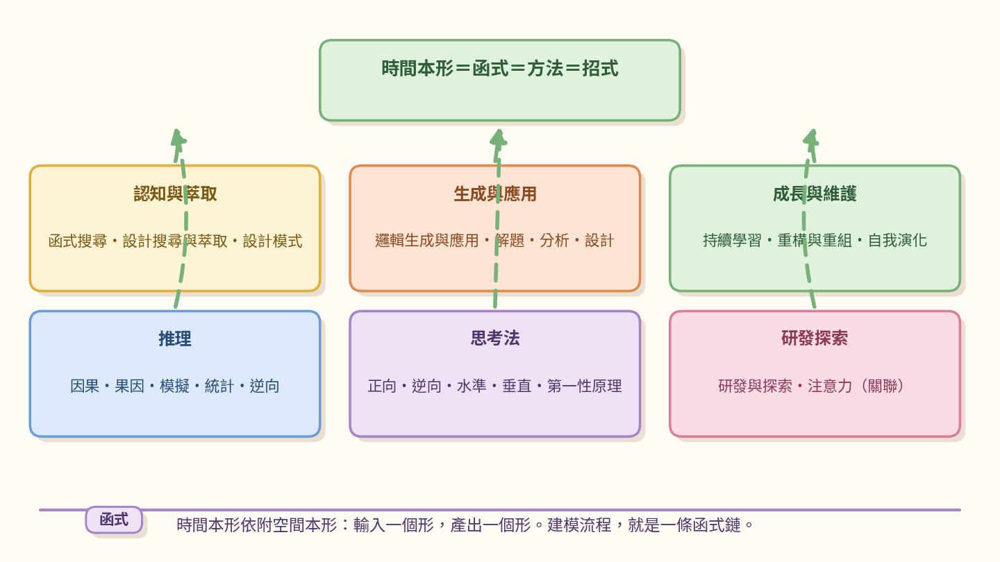

**圖 2-5　時間本形函式庫：建模用得到的六群**

**例　一個函式四問卡**

> **例・最小二乘擬合**
>
> 名稱：最小二乘擬合；輸入形：一批觀測點 {(x, y)}；輸出形：一條擬合曲線（含參數形）；判準：殘差平方和最小。
>
> 四欄寫滿，這個函式就能被接手、被替換、被複核——這就是函式四問的用途。

## 2-6　建模 ↔ 形學映射總表

把建模的每一個動作對到形學的形操作，是本書的主軸。映射不是修辭，是操作手冊：每個建模動作都有它的括號、它的運算、它的判準。

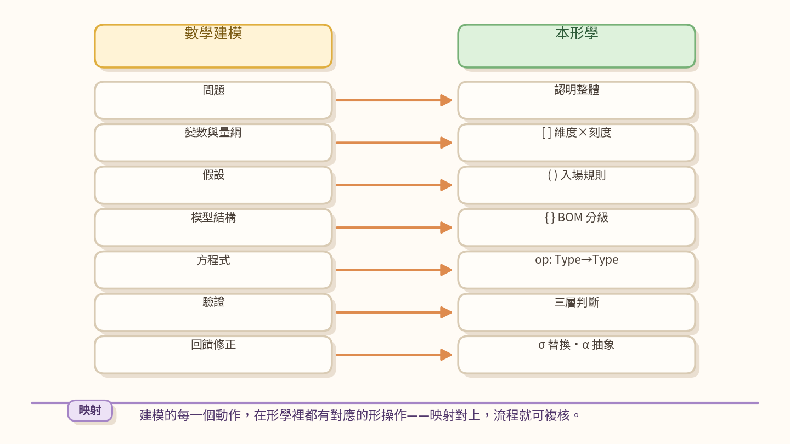

**圖 2-6　建模 ↔ 形學映射總表**

| 建模動作 | 形學對應 | 落到紙上的產出 |
| --- | --- | --- |
| 界定問題 | 認明整體 | 一句話：M 是什麼 |
| 定義變數 | [ ] 維度 × 刻度 | 變數定義表（規則書） |
| 寫假設 | ( ) 入場規則・σ 理想化 | 假設清單（身份書） |
| 取捨簡化 | { } BOM・remove 三級 | 結構分級表（結構書） |
| 列方程 | op: Type → Type | 方程組＋量綱檢查 |
| 求解 | 運算鏈（⊕σ∩(T)ι） | 解形＋求解記錄 |
| 驗證 | 三層判斷 | 驗證報告（過／不過） |
| 回饋修正 | σ 保身份・α 新抽象 | 改版記錄（模型形 v2） |

## 2-7　準確使用方法總覽

準確使用方法是本書的收束器：三種補足立帳（[ ] 補規則、( ) 補身份、{ } 補結構）、六步驟走流程（認明整體 → 分軸描述 → 寫形集合 → 選定命題 → 判準推理 → 三層檢查）、八問驗收。第六篇會把它全部裝進建模現場；這裡先看全景。

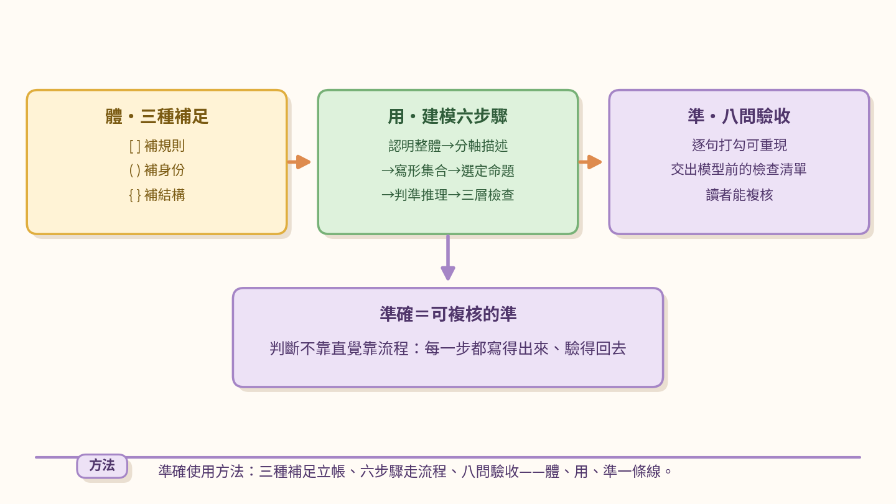

**圖 2-7　準確使用方法：體・用・準**

**例　準確的樣子**

> **例・可複核**
>
> 「這個參數取 0.14 效果最好」——不可複核：好是多好？跟誰比？0.14 怎麼來？
>
> 「參數 θ 的刻度在 [0.1, 0.2] 網格上以三層判斷驗收：殘差過、穩健性過、邊界案例過，故取 θ = 0.14」——每一步寫得出來、驗得回去。

## 2-8　本篇小結

> **第二篇要點**
>
> - 三軸三括號立形、三層判斷立準、四步驟立維度、五大運算立式、函式庫立流程。
> - 映射總表是操作手冊：每個建模動作都有括號、運算與判準。
> - 準確使用方法＝三種補足＋六步驟＋八問——本書的收束器。

> **E03　練習（第二篇・括號歸位）**
>
> （一）把下列建模元素各配一個括號：初值、目標函式、決策變數、觀測誤差、可行域、模型版本號。
>
> （二）用 { 部件, (內容), [類別] } 表記「一個投資組合」，並指認它的 id(C)。
>
> *提示：先問「它是部件、內容，還是類別規則」。答案見附錄 C。*

> **E04　練習（第二篇・運算辨識）**
>
> （一）指出下列動作各是哪個運算：把「摩擦」從模型中拿掉；把人口數從 800 萬改為 820 萬；判定新樣本屬於 [常態分佈]；把排隊模型嵌進城市系統模型。
>
> （二）「把摩擦拿掉」的動作，會用 remove 三級的哪一級記法？分情況作答。
>
> *提示：⊕ 合形、remove 拆形、σ 替換、∩(T) 歸類、ι 嵌套——各守一個括號。答案見附錄 C。*

> **【專業專欄 C2】量綱分析與 Buckingham π**
>
> 量綱分析是建模最早的「刻度檢查」：1914 年 Buckingham 立下 π 定理——若物理關係涉及 n 個量、k 個基本量綱，則可化為 n−k 個無量綱群的關係。這與 [ ] 的「維度 × 刻度」完全同構：維度就是量綱的形學名，刻度就是帶單位的屬性值。
>
> 實務價值：量綱一致性是方程組的第一道驗收（對應八問之「括號用對了嗎」）。傅汝德數、雷諾數這些無量綱群，其實是「把多條維度壓成一條新維度」的 α 抽象——對照失敗（流況無法只用速度解釋）逼出的新維度。
>
> 建模啟示：量綱檢查永遠排在求解之前——刻度不一致的方程，解得再漂亮也是錯的。這是「先立形，再談數」最廉價也最有效的一次應用。

# 第三篇　空間本形——把建模對象立成形

空間本形是名詞的功夫：把對象立成一個完整、可指認、可判斷的形。對應到建模，就是三件立形工作——認明整體（3-1）、立變數（3-2）、立假設（3-3）、立結構（3-4），最後用三層判斷驗收模型的歸類（3-5）。

## 3-1　認明整體：模型的 M 是誰

六步驟的第一步是認明整體：先問「我建模的對象是哪一個整體」。同一個場景可以立出很多個形——一座城市可以立出供水管網、交通網路、疫情動態，每個形的邊界、變數、判準都不一樣。選錯整體，後面五步全部白做。

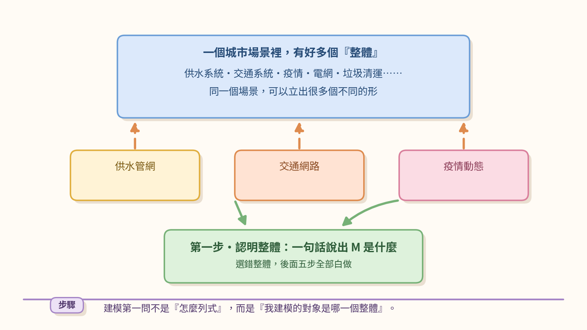

**圖 3-1　認明整體：一個場景，多個候選的形**

**例　同一個路口，兩個整體**

> **例・路口**
>
> 要「降低平均等待時間」，M＝一個路口的車流（{ 車道, 號誌, (車流), [時段] }）；
>
> 要「降低事故率」，M＝一個路口的安全系統（{ 車道, 標線, 視距, (事故紀錄), [路況] }）——問題換了，整體就換了。

## 3-2　變數與刻度：數依附在形上

X 軸 [ ] 由維度與刻度組成：維度是屬性（溫度），刻度是屬性值（20°C）。建模的每個變數，都是某個形、某條維度上的一個刻度——這就是「數＝形裡面的小形・次比較」的建模讀法：觀測值是在數「某個形的子形出現了幾次、量到哪裡」。變數定義表因此是建模的第一份帳：每個變數三欄——屬於哪個形、哪條維度、刻度與單位。

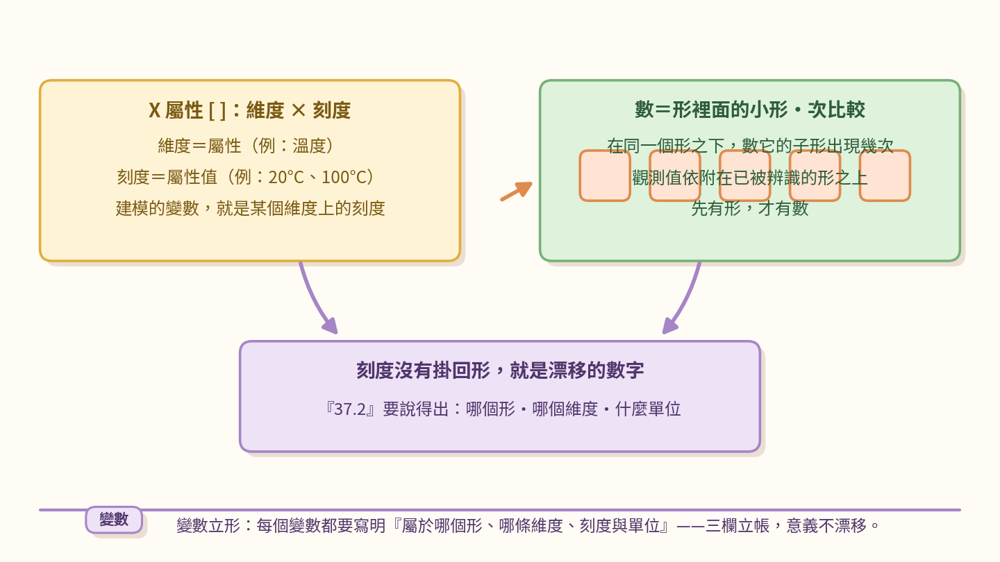

**圖 3-2　變數＝維度 × 刻度；數依附在形之上**

**例　變數定義表三欄**

| 變數 | 所屬形與維度 | 刻度與單位 |
| --- | --- | --- |
| P | 人口系統・人口數 | 萬人，連續刻度 |
| β | 疫情・接觸率 | 次／人・日，[0, 1] |
| t | 時間軸 | 日，自觀測首日起算 |

## 3-3　假設：容器的入場規則

Z 軸 ( ) 是容器：C = (id(C), S(C))，身份加內部空間，內容可替換、身份不動（不變性公理）。假設就是容器的入場規則——寫下哪些東西被放進模型、哪些被擋在外面。理想化的本質是 σ 替換：把「有空氣阻力的落體」換成「真空落體」，換的是內容，模型問題的身份不換。理想化不可恥，失憶才危險：假設要寫成明確的規則條號，事後才收得回來。

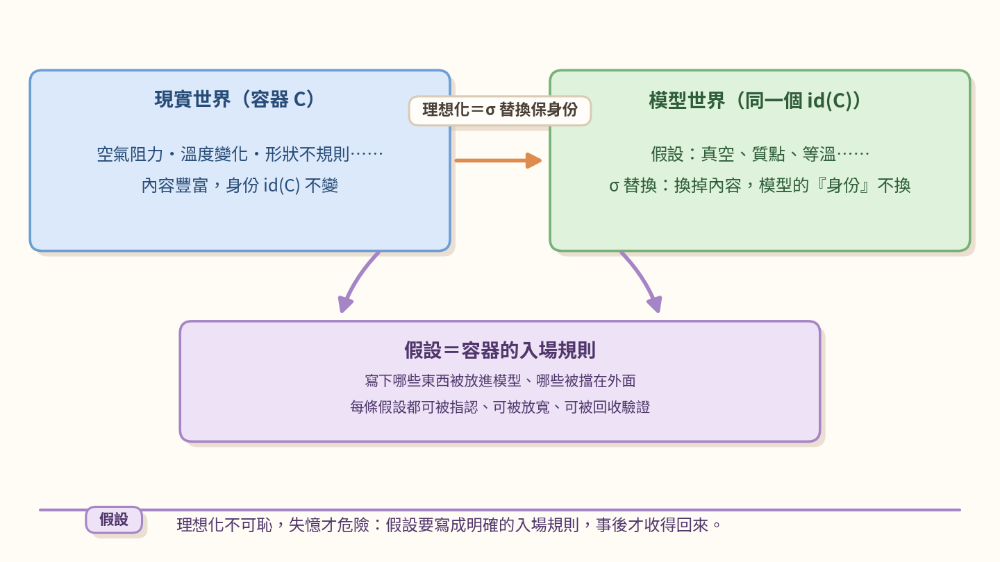

**圖 3-3　假設＝入場規則；理想化＝σ 替換保身份**

**例　可回收的假設**

> **例・假設條號**
>
> H1（封閉）：觀測期內無遷入遷出，人口系統 id(C) 不變。
>
> H2（均勻混合）：任一感染者接觸任一易感者的機率相同。
>
> H3（可放寬）：若出現聚集性疫情，H2 先行解除——條號寫明，回饋時知道拆哪一條。

## 3-4　模型結構：BOM 與 remove 三級

Y 軸 { } 是物料清單：部件不只並列，還有依存結構。判準只問一句——拆下來還認得自己嗎？模型簡化的正確畫法是 remove 三級：必要件（拿掉模型不成立）、功能降級件（拿掉功能變差、形還在，記 ≡M′⊂M）、非必要件（拿掉完全不動）。簡化不是亂刪，是把每一項刪減記在三級裡，刪減的邊界寫得出來。

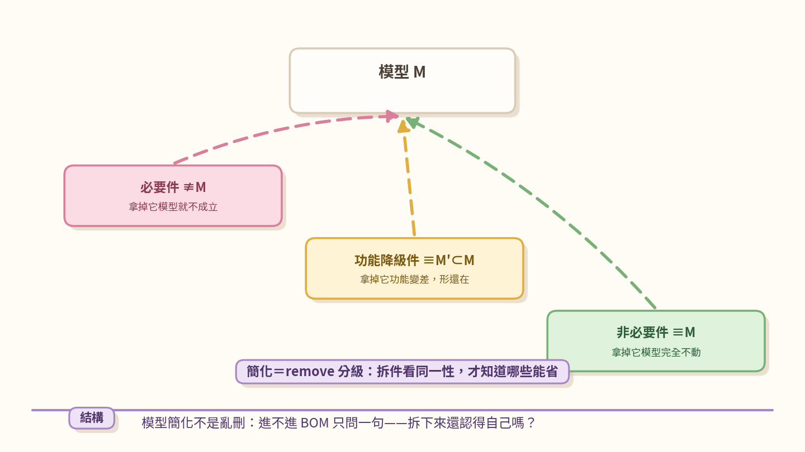

**圖 3-4　remove 三級：簡化的地圖**

**例　一個飛彈彈道模型的分級**

| 部件 | remove 分級 | 記法 |
| --- | --- | --- |
| 推力 | 必要件——拿掉就不是彈道模型 | ≢M |
| 空氣阻力 | 降級件——拿掉仍解得彈道，精度降 | ≡M′⊂M |
| 彈體塗裝 | 非必要件——拿掉模型完全不動 | ≡M |

## 3-5　三層判斷 × 模型分類

模型做完要歸類：它屬於哪個家族？這是一個抽象層的判斷——T = (F(T), ∩(T))，把類別定義寫成特徵清單 F(T)，再逐項驗交集。但歸類不能只走抽象層：容器層驗身份（模型的 id(C) 是什麼）、組成層驗結構（BOM 與分級對不對），三層聯合才下結論。第五篇的六族分類，就是這樣判出來的。

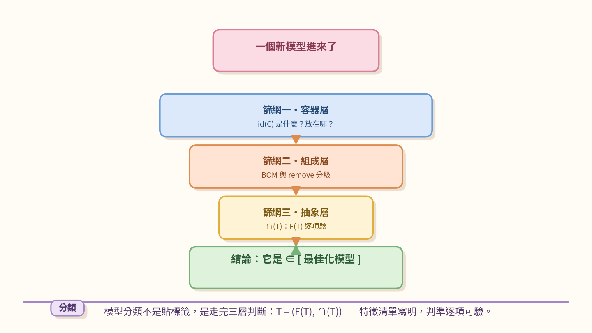

**圖 3-5　∩(T) 三道篩網：模型的歸類是證出來的**

**例　判定「存貨補貨模型」的家族**

> **例・歸類**
>
> F(優化模型)＝{ 有目標函式, 有約束, 求最優解 }。
>
> 補貨模型有目標（總成本最小）✓、有約束（倉容・需求）✓、求最優解（補貨點與批量）✓——∩(T) 全過，它 ∈ [優化模型]。（得證）

## 3-6　本篇小結

> **第三篇要點**
>
> - 立形四步：認明整體（M 是誰）、立變數（[ ] 刻度）、立假設（( ) 入場）、立結構（{ } 分級）。
> - 理想化＝σ 替換保身份；假設要寫成可回收的條號。
> - 模型歸類用三層判斷證出來，不是貼標籤。

> **E05　練習（第三篇・立形）**
>
> （一）以「共享單車潮汐調度」為題：寫出 M 的一句話定義、形集合表記，以及三個關鍵變數的三欄定義。
>
> （二）為這個模型寫三條假設（H1–H3），各標明：擋在外面的是什麼？哪一條可先放寬？
>
> *提示：先認明整體再寫形集合；假設條號要能被逐條回收。答案見附錄 C。*

> **E06　練習（第三篇・分級與歸類）**
>
> （一）把「潮汐調度模型」的部件（車輛、調度卡車、天氣、騎乘需求、App 介面）做 remove 三級分級，各給記法。
>
> （二）用 F(T) 寫出「調度模型」的類別定義，並用 ∩(T) 判定：一個只做預測、不做排程的模型，屬於 [調度模型] 嗎？邊界案例呢？
>
> *提示：分級只問「拆下來認得自己嗎」；歸類要先寫明 F(T) 再逐項驗。答案見附錄 C。*

> **【專業專欄 C3】參數估計與可辨識性**
>
> 參數估計是「把刻度校準到數據上」的學問。1801 年高斯以最小二乘追回穀神星，立下估計的原型；其後費雪在 1920 年代立出最大概似與可辨識性問題：模型的參數能不能從數據裡唯一地認出來？
>
> 形學讀法：參數是 [ ] 的刻度，估計是刻度的校準函式；可辨識性則是「刻度與形是否一一對應」——若兩組參數長出同一條曲線，這兩組刻度其實指同一個形，模型的形還沒立細。
>
> 實務啟示：估計跑不出唯一解時，先回頭修形（合併參數、重立維度），再談演算法——這正是「形沒立好就學數」的典型現場。

# 第四篇　時間本形——建模流程即函式鏈

時間本形是動詞的功夫：建模流程的每一站都是一個函式——輸入一個形，產出一個形。本篇把全流程六站立成函式鏈（4-1、4-2），看方程式怎麼讀成形的轉移規則（4-3），再給出推理五族與思考法的選路器（4-4、4-5），最後收束成形進形出的建模迴圈（4-6）。

## 4-1　全流程六站：問題→假設→建構→求解→驗證→回饋

教科書的建模流程通常是五步：問題、假設、建構、求解、驗證。形學版加一個回饋站，並要求每一站標明輸入形與輸出形——站與站之間交接的不是「文字」，是寫得出來的形。六站串成函式鏈，整條鏈就是一個大函式：op: 世界 → 模型。

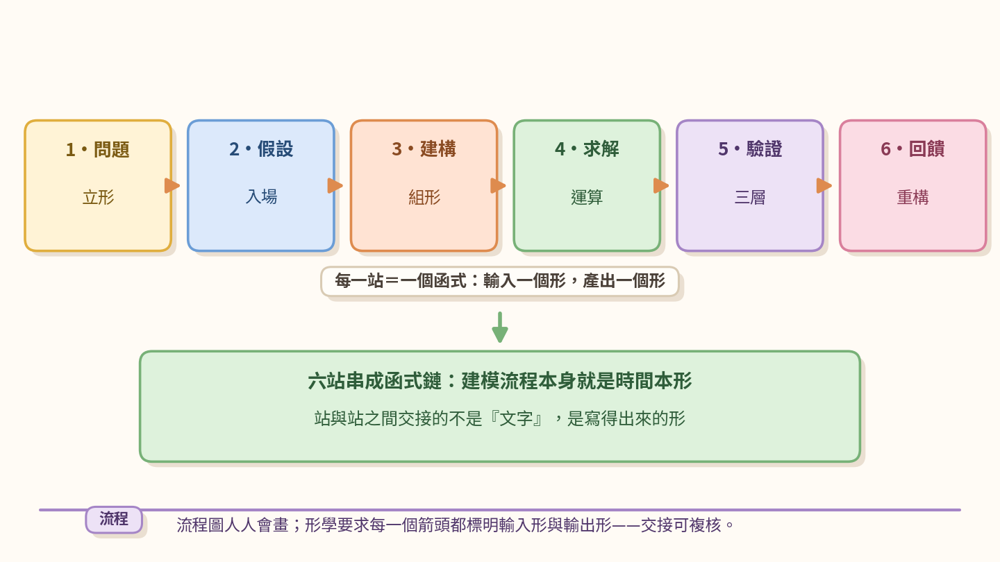

**圖 4-1　建模全流程六站：每一站都是一個函式**

**例　交接要交形，不交口號**

> **例・交接**
>
> 壞交接：「這個問題很重要，先建個模型看看。」——沒有形，下一站接不到東西。
>
> 好交接：「M 已認明（城市疫情），形集合已寫妥，假設 H1–H3 已列——請建構站接手。」——每一站的產出都是可指認的形。

## 4-2　六張函式四問卡

函式四問——名稱、輸入形、輸出形、判準——是時間本形的標準卡片。把六站各寫成一張四問卡，整條流程就變成可接手、可替換、可複核的函式清單。判準欄尤其關鍵：它寫明「這一站在什麼條件下算做完」。

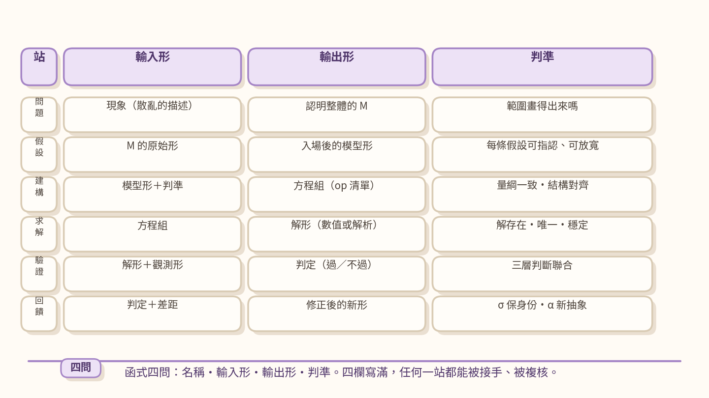

**圖 4-2　六站的函式四問卡：輸入形・輸出形・判準**

**例　驗證站的四問卡**

> **例・驗證函式**
>
> 名稱：模型驗證；輸入形：解形＋觀測形；輸出形：判定（過／不過）＋差距報告；
>
> 判準：三層判斷聯合——容器（資料來源 id 一致）、組成（關鍵變數全在）、抽象（殘差在容許刻度內）。

## 4-3　方程式＝形的轉移規則：op: Type → Type

把方程讀成形的運算：左邊是現在的形，右邊是下一刻的形，等號是身份的保證。離散系統的一步更新是 σ 替換——狀態容器換內容、id(C) 不變；連續系統的微分方程是 σ 鏈的連續版——狀態沿時間流動，每一瞬間都是一個形。演化中保持不變的量（守恆律）是不變性公理的時間軸版：它保證模型的身份從頭到尾是同一個。

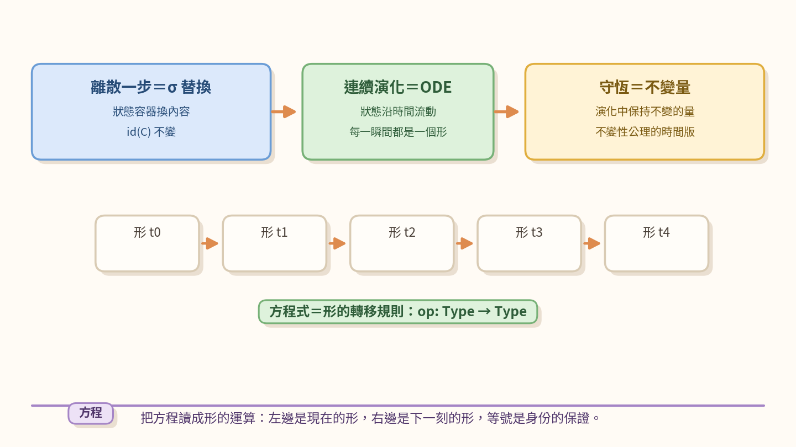

**圖 4-3　方程式＝形的轉移規則**

**例　人口方程的形學讀法**

> **例・dP/dt = rP**
>
> P(t) 是人口系統的內容形；rP 是形的轉移規則（op）；r 是 [成長率] 維度上的刻度。
>
> 解出 P(t) = P0·exp(rt)：一族解形。若加入「資源上限」，解形換族（邏斯蒂）——模型升級是 α 新抽象，不是 σ。

## 4-4　推理五族：式子從哪裡長出來

原著推理函式含五族：因果推理（由機理建式）、果因推理（由結果反推成因）、模擬推理（由模型推演情節）、統計推理（由樣本推總體）、逆向推理（由答案倒推結構）。同一個問題走不同族，長出的模型形完全不同——選推理族，等於選「式子從哪裡長出來」。

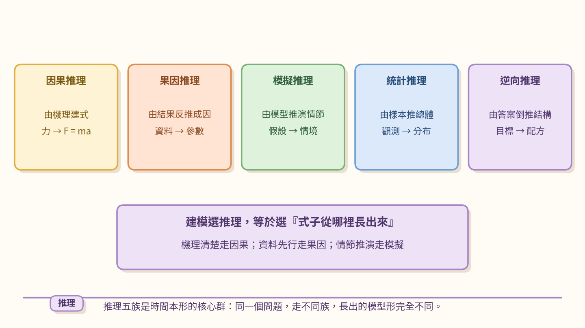

**圖 4-4　推理五族 × 建模**

**例　同一個傳染病，三族三模**

| 推理族 | 模型形 | 判準 |
| --- | --- | --- |
| 因果（機理） | SIR 微分方程組 | 機理假設成立、守恆不破 |
| 統計（資料） | 傳染率的時間序列模型 | 殘差白噪、預測區間覆蓋 |
| 模擬（推演） | 個體隨機模擬 | 重複斂放、情境覆蓋 |

## 4-5　思考法選路：卡住的時候走哪條

原著思考法五式——正向、逆向、水準、垂直、第一性原理——是建模的選路器。卡住時先問自己卡在哪一問：有公理可依就走第一性原理；條件清楚就正向推；目標明確就逆向倒推；要跨域借鏡走水準；要深挖一層走垂直。選路靠問句，不靠靈感。

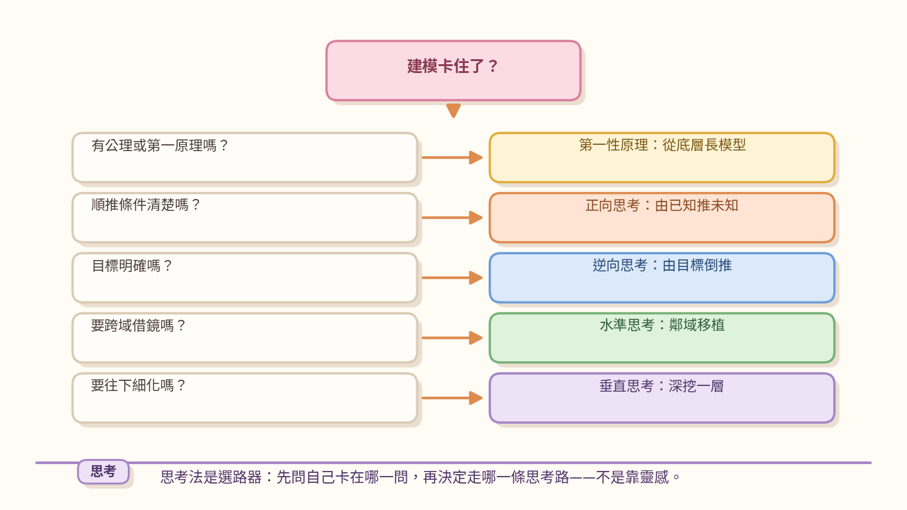

**圖 4-5　思考法選路決策樹**

**例　第一性原理長出的模型**

> **例・從底層長式**
>
> 問題：這條輸送帶的節拍怎麼定？不必找類似產線抄參數——從「產出 = 瓶頸節拍的倒數」這條第一原理長出模型，瓶頸站就是形的必要件（≢M）。
>
> 式子從原理長出來，參數才有意義；式子從抄襲長出來，參數永遠說不出口。

## 4-6　形進形出：建模迴圈

建模不是一錘子買賣。每一次回饋都在做兩件事：改形（σ 修正內容、α 提出新抽象）與改函式（重構重組求解與驗證方法）。模型形長大，函式跟著長大；函式變強，又產出更好的形——形與函式互相長大，這就是原著所說的學習與自我演化在建模現場的樣子。

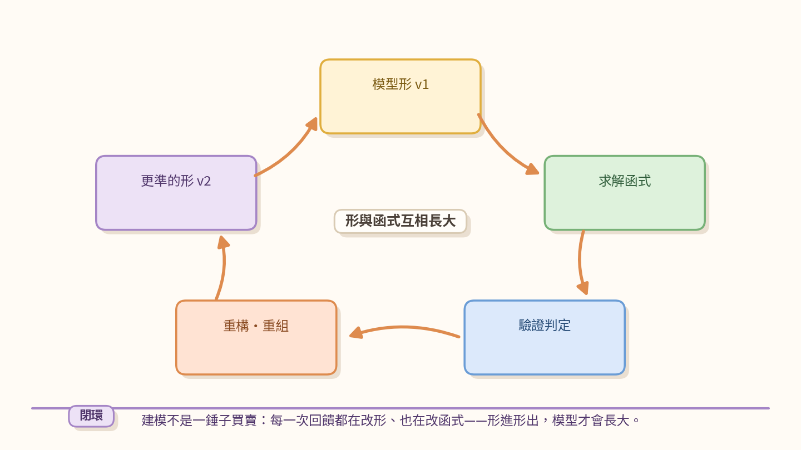

**圖 4-6　形進形出閉環：形與函式互相長大**

**例　v1 到 v2 的帳**

> **例・改版記錄**
>
> v1：SIR 均勻混合，預測峰值提前 5 天（驗證不過）。
>
> 回饋：拆 H2（均勻混合）→ 引入分群接觸矩陣（α 新抽象：接觸結構維度）→ v2 峰值誤差縮到 1 天。
>
> 帳要記：改的是哪條假設、換的是哪個運算、身份（同一個城市疫情問題）不變。

## 4-7　本篇小結

> **第四篇要點**
>
> - 六站流程＝函式鏈；每站一張四問卡，交接交形不交口號。
> - 方程式是形的轉移規則；守恆量是不變性公理的時間版。
> - 推理五族選式子的來源，思考法選卡住的出路；回饋讓形與函式互相長大。

> **E07　練習（第四篇・函式鏈）**
>
> （一）把「共享單車潮汐調度」的六站流程各寫一張函式四問卡（名稱、輸入形、輸出形、判準）。
>
> （二）六站中哪一站的判準最難寫？為什麼？（用「三層判斷」說明它需要哪幾層的檢查）
>
> *提示：判準欄要寫「什麼條件下算做完」，不是寫工作內容。答案見附錄 C。*

> **E08　練習（第四篇・運算與推理）**
>
> （一）「把模型的日粒度改成小時粒度」是 σ、α 還是新立形？分情況作答。
>
> （二）給定問題「這批退貨是運送損壞還是產品瑕疵」：應該走哪個推理族？寫出你的模型形與判準。
>
> *提示：粒度若只是內容替換且身份不變是 σ；若逼出新的維度就是 α。答案見附錄 C。*

> **【專業專欄 C4】敏感度分析與穩健性**
>
> 敏感度分析回答「參數動一動，結果動多少」，是 remove 三級的連續版：逐個參數做思想實驗——把它拿掉或擾動，模型是不成立（必要件）、變差（降級件）還是不動（非必要件）？
>
> 方法分兩層：局部敏感度（一次動一個參數的梯度法）對應逐件 remove 檢驗；全域敏感度（如 Sobol 指數、蒙地卡羅掃描）對應整張 BOM 的聯合體檢。Sobol 指數把輸出變異分解到各參數與交互項，本質是「形裡小形・次比較」——數每個參數貢獻的變異出現幾份。
>
> 建模啟示：穩健性不是玄學，是分級表的數字版——必要件加冗餘、降級件備預案、非必要件放心砍。第六篇的「簡化有邊界」在這裡得到驗證工具。

# 第五篇　模型家族形化——六族對讀

模型家族是形的家族：每族有自己的輸入形、核心方程、判準與產出形。本篇把六大經典家族逐一形化——優化、微分方程、統計機率、圖網路、排隊系統、模擬——每族一概念、一圖、一例、一練習，最後給選族決策樹與對讀總表。

## 5-1　六族總覽

六族不是孤島：實際模型常是幾族的合形 ⊕。傳染病模型是微分方程（演化）＋統計（估參）＋模擬（推演）的合形；調度模型是優化（排程）＋圖網路（路徑）＋排隊（等待）的合形。認得每一族的形，才組得動合形。

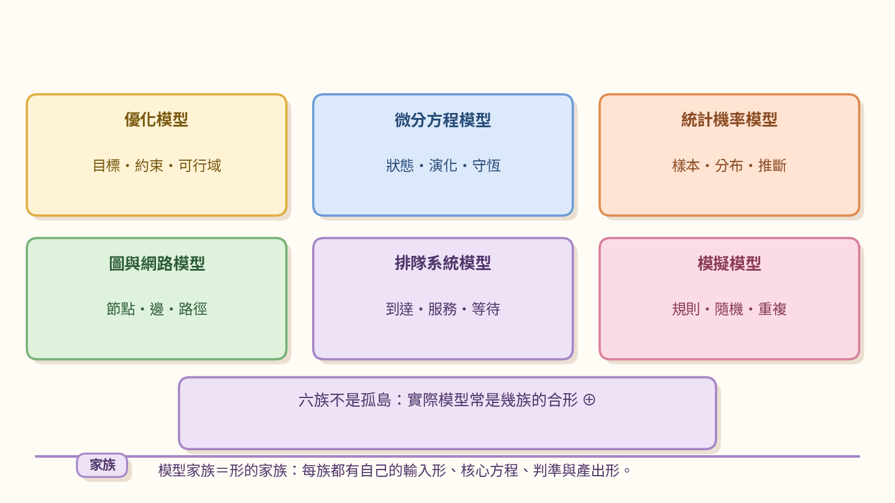

**圖 5-1　六大模型家族總覽**

**例　一個模型，三族合形**

> **例・電商配送**
>
> 路徑規劃（圖網路）⊕ 車隊排班（優化）⊕ 站點等待（排隊）＝一個配送模型。
>
> 合形時先各族立形、再 ⊕ 組裝：部件的依存結構寫清楚，之後 remove 分級才做得動。

## 5-2　優化模型：目標是判準，約束是入場規則

優化模型的三件套：目標函式（判準 [ ]——要什麼、刻度是什麼）、約束（容器的入場規則 ( )——可行域是容器的內部空間）、解（產出形）。形學提醒：目標函式是判準不是數學遊戲——寫歪的目標函式會忠實地解出一個錯答案。

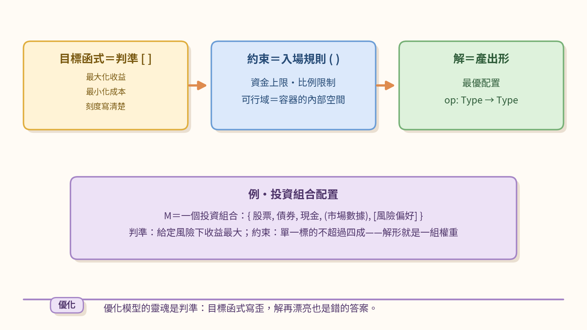

**圖 5-2　優化模型形化：目標・約束・解**

**例　投資組合配置**

> **例・配置**
>
> M = { 股票, 債券, 現金, (市場數據), [風險偏好] }；判準：給定風險下收益最大；約束：單一標的不超過四成。
>
> 驗收：解出的權重落在可行域內（容器層）、對風險刻度不敏感（組成層 remove 檢驗）、符合風險偏好的 F(T)（抽象層）——三層過，解形才交付。

## 5-3　微分方程模型：狀態是內容，守恆是身份

微分方程是形的連續演化：狀態向量是容器的內容形 ( e )，d x/dt = F(x) 是轉移規則，守恆量是不變性公理的時間軸版。初值問題的「初值」就是內容的初始形；解的穩定性對應「身份不被數值噪聲帶走」。

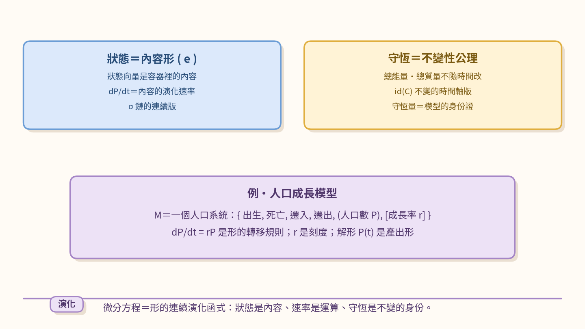

**圖 5-3　微分方程形化：狀態・演化・守恆**

**例　人口成長模型**

> **例・人口**
>
> M = { 出生, 死亡, 遷入, 遷出, (人口數 P), [成長率 r] }；dP/dt = rP。
>
> 解形 P(t) = P0·exp(rt)；守恆檢驗：封閉假設下總人口帳「出生 − 死亡 = 增量」必須記得平——記不平就是假設漏了（入場規則有洞）。

## 5-4　統計機率模型：資料是形裡小形，檢定是三層判斷

統計建模的形學讀法最密：資料＝形裡小形・次比較（樣本是子形的重複出現）；參數估計＝刻度校準；假設檢定＝∩(T) 的分類判斷（H0 是一張類別卡，p 值是判準上的刻度，拒絕域是 F(T) 的邊界）；信賴區間＝刻度的不確定刻痕。先辨識形，再談數——統計學家說的「先定義好隨機變數」就是這句話。

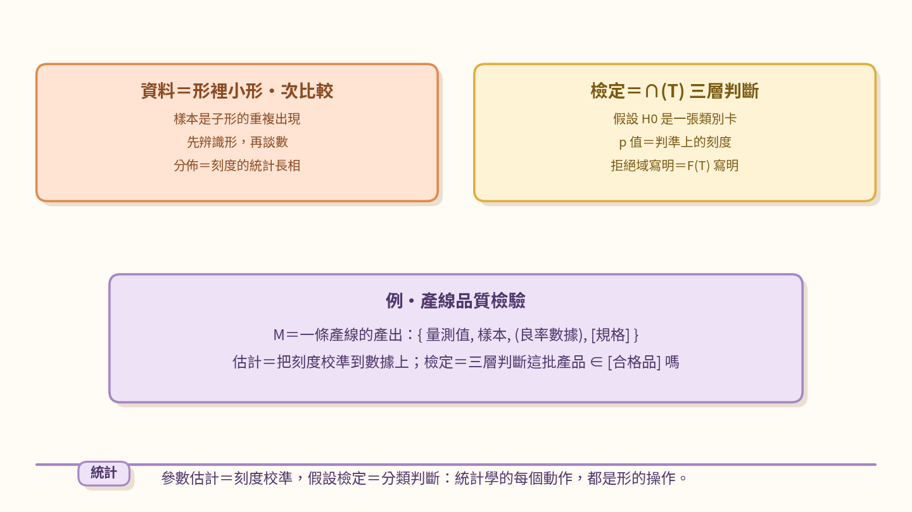

**圖 5-4　統計機率形化：估計・檢定・判斷**

**例　產線品質檢驗**

> **例・品質**
>
> M = { 量測值, 樣本, (良率數據), [規格] }；H0：這批產品 ∈ [合格品]。
>
> 檢定＝三層判斷：容器（樣本來源 id 一致）→ 組成（量測項目齊全）→ 抽象（規格 F(T) 逐項驗）；p < 刻度（如 0.05）只是第三層的一格刻度，不是真理。

## 5-5　圖與網路模型：節點立形，邊掛關係

圖網路把「關係」寫成一等公民：節點是形、邊是形關係、路徑是形鏈。ι 嵌套運算對應層級網路（子網路嵌進大網路，層層各持身份）；最短路、最大流都是「在圖容器裡求一條判準最優的形鏈」。

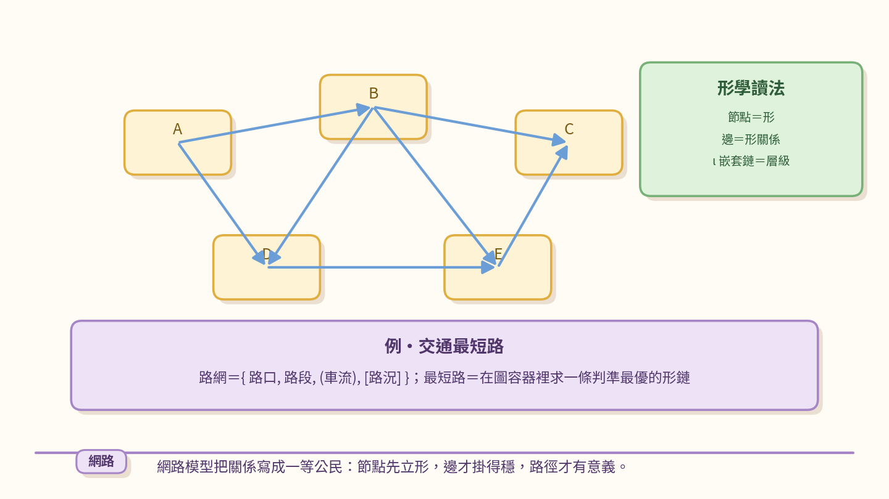

**圖 5-5　圖與網路形化：節點・邊・形鏈**

**例　交通最短路**

> **例・路網**
>
> 路網 = { 路口, 路段, (車流), [路況] }；求 A 到 F 的最短路。
>
> ι 鏈不可壓平：把「市區路網」嵌進「全國路網」時，兩層各有各的 id(C)——壓平層次會把過路費、限速的判準一起壓沒。

## 5-6　排隊系統模型：容器、服務、降級

排隊模型是容器的模型：( ) 是排隊空間與服務台，入場規則決定誰進得來，服務函式是時間本形（輸入待服務形、產出已服務形），等待時間是容器裡的計量。remove 三級在這裡變身故障降級地圖：少一台服務台是必要件（爆隊）還是降級件（變慢）？

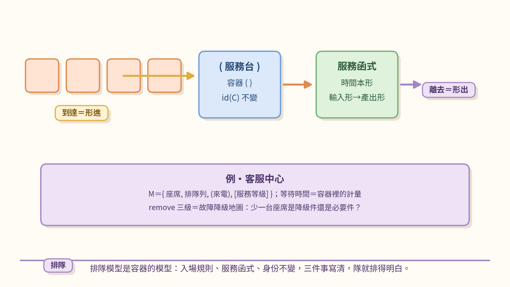

**圖 5-6　排隊系統形化：到達・服務・離去**

**例　客服中心容量**

> **例・客服**
>
> M = { 座席, 排隊列, (來電), [服務等級] }；服務等級 SLA ＝判準 [ ]：80% 來電 20 秒內接通。
>
> 降級演練：移除 1 台座席（remove）→ 平均等待 +12 秒 → SLA 仍過，記 ≡M′⊂M；再移除 1 台 → SLA 破線，這台記 ≢M。分級表就是容量預案。

## 5-7　模擬模型：規則、隨機、重複

當解析解推不出來、系統又充滿隨機與交互時，走模擬推理：寫下微觀規則（每個個體的形與函式）、注入隨機源、大量重複、統計巨觀長相。模擬的判準不是「跑出一個漂亮數字」，而是「重複斂放」（結果分布穩定）與「情境覆蓋」（邊界案例都被跑過）。蒙地卡羅一詞，指的就是這種以重複換精度的推理族。

**例　以模擬代求解**

> **例・模擬**
>
> 問題：颱風天電網的停電風險。解析解寫不出——用元件故障隨機模型＋網路連通規則模擬一萬場颱風。
>
> 產出形：停電戶數的分布（形裡小形・次比較的分布長相），不是單點數字——輸出分布比輸出均值誠實。

## 5-8　選族決策樹與六族對讀總表

選族是選判準：答案的長相決定模型的家族。要「怎麼做最好」走優化；要「會怎麼變」走微分方程或模擬；要「從數據推什麼」走統計；要「關係與路徑」走圖網路；要「等待與容量」走排隊。先選對族，再談式子。

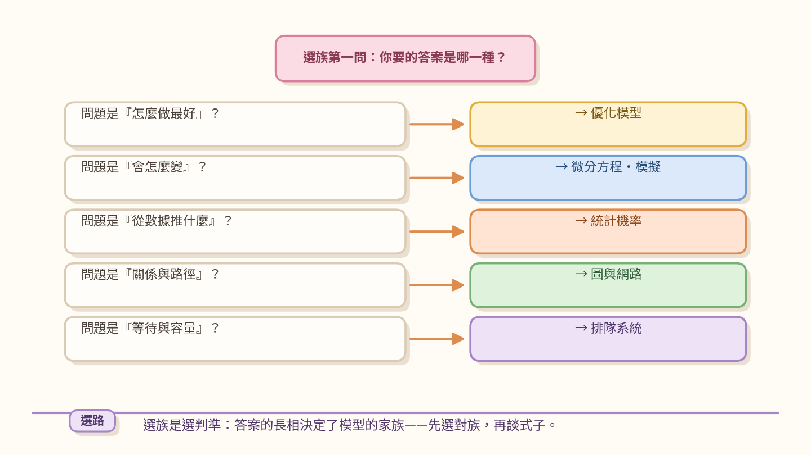

**圖 5-7　模型家族選路決策樹**

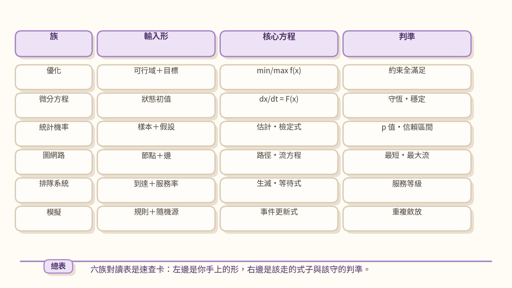

**圖 5-8　六族對讀總表：輸入形・核心方程・判準**

**例　選族三問**

> **例・選族**
>
> 「這批客訴該派幾個人處理？」——第一問：答案是「怎麼做最好」→ 優化（人力配置）＋排隊（等待）。
>
> 選族不是單選題：先用決策樹認主族，再看要不要 ⊕ 合形加副族。

## 5-9　本篇小結

> **第五篇要點**
>
> - 六族六形：優化（目標・約束）、微分方程（狀態・守恆）、統計（估計・檢定）、圖網路（節點・邊）、排隊（容器・服務）、模擬（規則・重複）。
> - 實際模型常是合形 ⊕：先各族立形，再組裝。
> - 選族是選判準：答案的長相決定了模型的家族。

> **E09　練習（第五篇・家族歸類）**
>
> （一）把下列問題各配主族（可加副族）：① 三個倉庫該各備多少貨；② 這波疫情峰值何時到；③ 新版疫苗有效率多少；④ 物流網哪裡是瓶頸；⑤ 門診幾位醫師夠用。
>
> （二）任選一題寫出它的形集合表記與判準。
>
> *提示：用 5-8 的選路決策樹五問導向。答案見附錄 C。*

> **E10　練習（第五篇・合形）**
>
> （一）「校園機車充電排隊與調度」要同時優化充電樁數量與排班：寫出它由哪幾族 ⊕ 合形，並標明每族貢獻的部件。
>
> （二）合形後用 remove 三級給「充電樁數量」分級：它是必要件、降級件還是非必要件？分情境作答。
>
> *提示：合形時先各族立形、再 ⊕；分級只問「拆下來認得自己嗎」。答案見附錄 C。*

> **【專業專欄 C5】模型選擇：AIC・BIC・交叉驗證**
>
> 模型選擇回答「幾個候選模型，選哪個」。1974 年赤池立下 AIC（赤池資訊準則），1978 年 Schwarz 立下 BIC——兩者都是「擬合好壞 + 複雜度懲罰」的判準刻度；交叉驗證（Stone 1974、Geisser 1975）則以「留出資料的預測力」作判準。
>
> 形學讀法：模型選擇是抽象層的 ∩(T) 判斷——候選模型們排在類別卡前逐項驗；複雜度懲罰就是對「部件數」（{ } 的 BOM 規模）收稅，防過度合形。
>
> 實務警語：AIC 與 BIC 會選出不同的模型（懲罰力度不同），選哪個要看判準本身——「預測」用 AIC 類、「解釋」用 BIC 類。判準先行，指標隨後：這是「目標函式是判準不是數學遊戲」在模型選擇現場的翻版。

# 第六篇　準確使用方法完整架構

前面立了形、立了式，本篇把「準」立起來。準確使用方法是本形學的收束器——三種補足（體）、六步驟（用）、八問（準）——本篇全部裝進建模現場，並給出全程示範、誤用對照與驗收標準。

## 6-1　體—用—準

體，是三軸三括號：把對象立成形，帳立清楚。用，是六步驟流程：把形推成模型，式子走得動。準，是八問驗收：把模型驗回去，別人複核得了。三者是循環不是單行道：驗不過，多半要回到立形——體用準，再回頭修體。

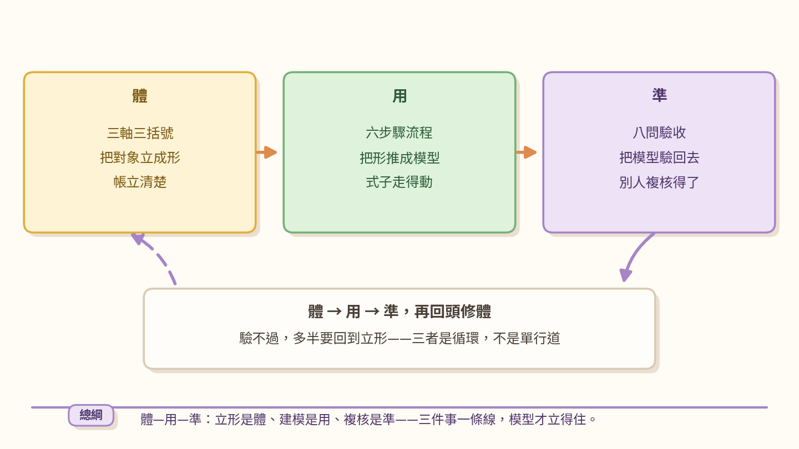

**圖 6-1　體—用—準：一條線，一個循環**

**例　循環的樣子**

> **例・回頭修體**
>
> 驗證發現「尖峰時段」的誤差特別大——不是調參能救的：[時段] 維度太粗（刻度只有尖峰／離峰兩格）。
>
> 修體：把 [時段] 刻度細化成六格 → 重跑流程 → 驗證過。準確的路徑是循環：用不動，回體。

## 6-2　三種補足・建模版

三種補足回答三處缺口：[ ] 補規則（變數定義表——維度、刻度、單位、入場規則）、( ) 補身份（假設清單與 id——哪些內容被替換、身份憑什麼不變）、{ } 補結構（BOM 分級表——簡化的邊界在哪）。三本書合起來，就是模型的身家清冊：缺口在哪，括號就補到哪。

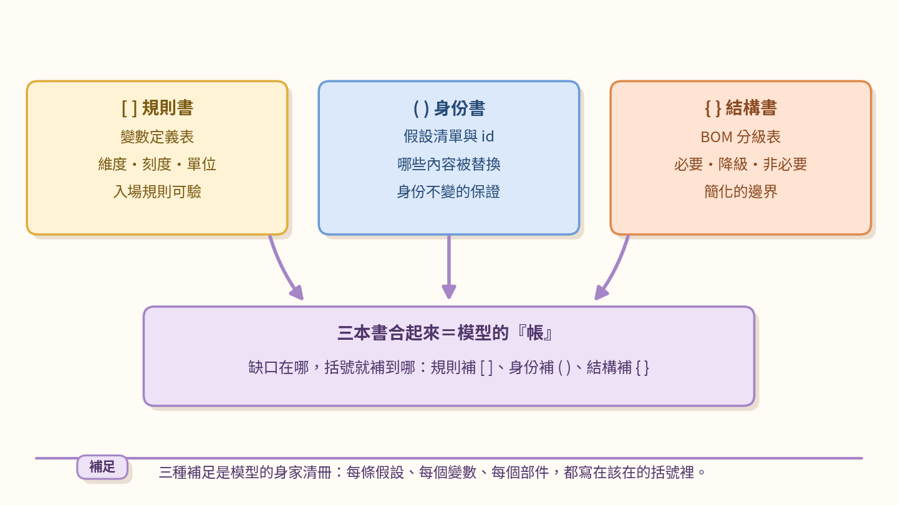

**圖 6-2　三種補足・建模版：三本書**

**例　三本書長什麼樣**

| 書 | 內容 | 驗收句 |
| --- | --- | --- |
| [ ] 規則書 | 變數定義表：形・維度・刻度・單位 | 每個變數三欄齊全嗎？ |
| ( ) 身份書 | 假設清單 H1…Hn：擋什麼、可否放寬 | 每條假設可指認、可回收嗎？ |
| { } 結構書 | BOM 分級表：必要・降級・非必要 | 每項刪減都有級別記法嗎？ |

## 6-3　建模六步驟

六步驟是把三件套（定義在前、判準居中、推理在後）在一個對象上按順序做完：① 認明整體——一句話說出 M 是什麼；② 分軸描述——X 屬性、Y 組成、Z 容器各寫一次；③ 寫形集合——{ 部件, (內容), [類別] } 完整表記；④ 選定命題——要證的是歸屬、不變還是分級；⑤ 判準推理——對應判準（∩(T)、id(C)、remove）一步步走；⑥ 三層檢查——容器、組成、抽象聯合驗證後收結論。

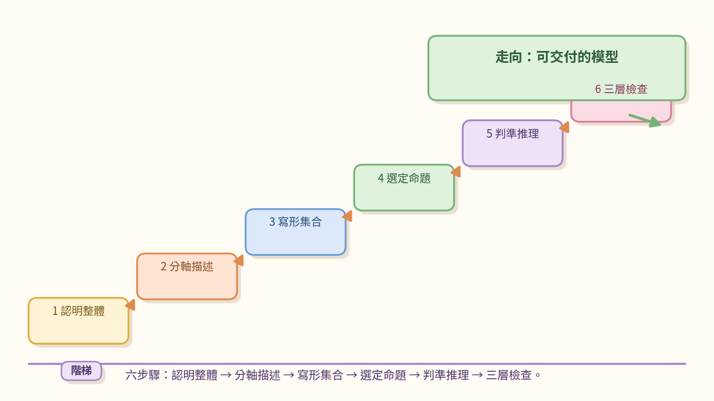

**圖 6-3　建模六步驟：走向可交付的模型**

**例　六步驟的產出物**

| 步驟 | 操作 | 產出 | 常用工具 |
| --- | --- | --- | --- |
| 1 認明整體 | 指認判斷對象 | 一句話：M 是什麼 | —— |
| 2 分軸描述 | 三條軸各寫一次 | 屬性表・BOM・容器 | 三括號 |
| 3 寫形集合 | 完整表記 | { 部件, (內容), [類別] } | 形集合 |
| 4 選定命題 | 歸屬／不變／分級 | 命題一句 | —— |
| 5 判準推理 | 對應判準逐步推理 | 推理正文 | ∩(T)・id(C)・remove |
| 6 三層檢查 | 三層聯合檢查 | 結論（得證） | 三層判斷 |

## 6-4　全程示範：SIR 疫情模型走六步

用一個完整案例把六步驟走完。題目：為一座城市建立流感疫情的 SIR 模型，估計峰值與總感染人數。這個案例同時示範空間本形（立形三件）與時間本形（流程函式鏈）怎麼在同一個問題上合流。

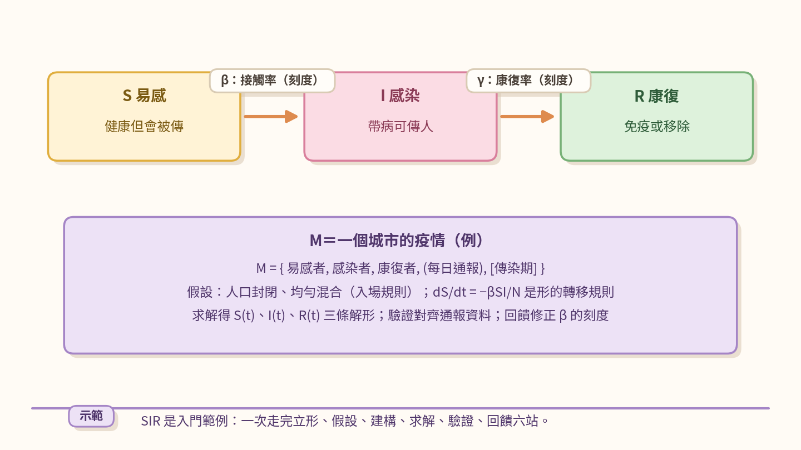

**圖 6-4　SIR 全程示範：六站走完一個模型**

> **六步驟全程**
>
> （1）認明整體：M ＝ 一個城市的流感疫情（觀測期 90 天）。
>
> （2）分軸描述：X＝[ 傳染期・接觸率 β・康復率 γ ]，Y＝{ 易感者, 感染者, 康復者, (每日通報), [流感季] }，Z＝城市（封閉假設 H1）。
>
> （3）寫形集合：M = { S, I, R, (通報資料), [SIR 傳染病模型] }。
>
> （4）選定命題：本題證「歸屬」——SIR 是否 ∈ [ 傳染病模型 ]，並估 I(t) 峰值。
>
> （5）判準推理：dS/dt = −βSI/N、dI/dt = βSI/N − γI、dR/dt = γI 為轉移規則；β、γ 由通報資料校準刻度（果因推理）；解出 S(t)、I(t)、R(t)。
>
> （6）三層檢查：容器層 ✓（換通報來源不換城市 id）；組成層 ✓（β 為必要件、疫苗為降級件、通報格式為非必要件）；抽象層 ✓（可傳染・有感染期・可康復逐項過）——SIR ∈ [ 傳染病模型 ]。（得證）

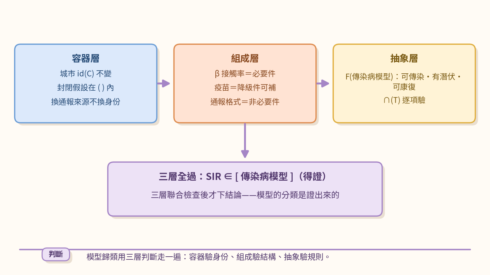

**圖 6-5　SIR 三層判斷：模型的歸類是證出來的**

## 6-5　八問・建模版

八問是三種補足的驗收標準：八個問題全過，模型才算「寫準」。它不是格式清單，是把每一個誤用擋在門外的關卡。

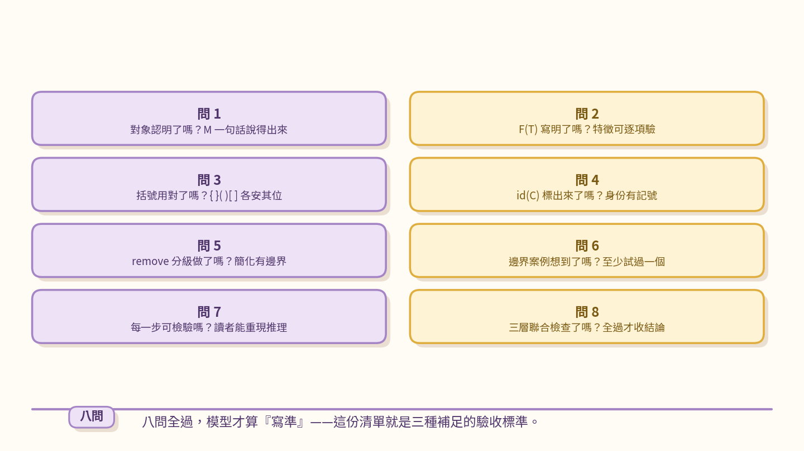

**圖 6-6　八問・建模版：交出模型前的檢查**

**例　八問卡實戰**

> **例・自查**
>
> 問 5「remove 分級做了嗎」常被跳過——簡化時順手刪掉的東西，要補記級別才算過。
>
> 問 6「邊界案例想到了嗎」最便宜也最有效：把 β 推到 0（無傳染）與 1（全員接觸）看看模型動不動得合理。

## 6-6　誤用 16 種・四組對照

誤用分四組：層次誤用（括號與運算的層次沒寫清）、身份誤用（容器與內容混為一談）、判準誤用（F(T) 不寫明、單層判斷下結論）、流程誤用（跳過認明整體、假設不可回收）。共同根源只有兩件事沒做：層次寫清、身份標明。

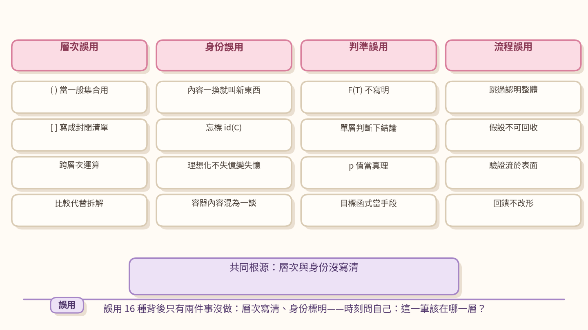

**圖 6-7　誤用 16 種：四組，一個根源**

**例　兩則典型的誤用**

> **例・誤用對照**
>
> 「模型 A 的 R² 比 B 高，所以 A 對」——判準誤用：R² 只是第三層的一格刻度，容器層（資料同源嗎）與組成層（變數齊嗎）還沒驗。
>
> 「這個參數調到 0.8 效果最好，就定 0.8」——流程誤用：0.8 對應哪個形、哪條維度、什麼單位？沒有帳，下個人接手只能重猜。

## 6-7　可複核的準

準確的定義只有一條：可複核的準。判斷不靠直覺靠流程——∩(T) 逐項驗、id(C) 前後比、remove 三級分；三層聯合檢查後才下結論。讀者能逐句打勾重現你的推理，這才是「準確」兩個字的意思。

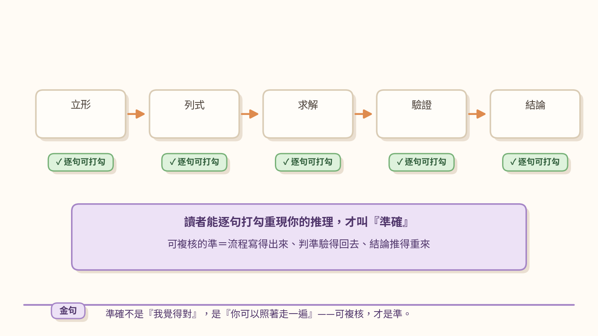

**圖 6-8　可複核的準：逐句打勾的推理鏈**

**例　同一個結論，兩種寫法**

> **例・複核**
>
> 寫法甲：「經過充分驗證，模型可用。」——『充分』是誰判定的？複核不了。
>
> 寫法乙：「三層檢查逐項通過（表 6-x），邊界案例兩則通過，殘差在容許刻度內——模型可交付。」——逐句可打勾。

## 6-8　本篇小結

> **第六篇要點**
>
> - 體—用—準一條線：立形、立式、立準，驗不過回頭修體。
> - 三種補足是三本書：規則書、身份書、結構書；六步驟一條流程；八問一道驗收。
> - 誤用 16 種的共同根源：層次與身份沒寫清。準確＝可複核的準。

> **E11　練習（第六篇・三本書）**
>
> （一）為「共享單車潮汐調度」寫三本書各一段：[ ] 規則書（三個變數的三欄定義）、( ) 身份書（三條假設）、{ } 結構書（部件三級各一例）。
>
> （二）三本書中哪一本最容易被省略？省略後最先出什麼事？
>
> *提示：缺口在哪，括號就補到哪。答案見附錄 C。*

> **E12　練習（第六篇・六步驟實作）**
>
> （一）以「宿舍洗衣機排隊」為題，走完六步驟：寫出 M、形集合、命題、判準推理大要與三層檢查結果。
>
> （二）在第（5）步你用的是哪個推理族？為什麼不是別族？
>
> *提示：命題可選「歸屬」——判定它 ∈ [排隊系統模型]。答案見附錄 C。*

> **E13　練習（第六篇・誤用辨識）**
>
> （一）指出下列各犯了哪組誤用：①「假設無摩擦」寫進附錄、正文再沒提過；② 模型換了三個資料集，符號 t 在每個資料集定義不同；③ 只用 R² 就宣稱模型最好。
>
> （二）把 ① 改寫成可回收的假設條號。
>
> *提示：對照 6-6 四組——層次、身份、判準、流程。答案見附錄 C。*

> **【專業專欄 C6】驗證與可信度 V&V**
>
> 系統模擬界的 V&V（Verification & Validation）分兩問：Verification「模型做對了嗎」（式子解得對）、Validation「做的模型對嗎」（模型與現實對得上）。Sargent 2013 年的綜述把評估歸為三道：概念模型驗證、電腦模型驗證、運作驗證。
>
> 形學讀法：Verification 對應求解站的判準（解存在・唯一・穩定）；Validation 對應三層判斷——特別是抽象層的 ∩(T)：模型的 F(T) 與現實的 F(T) 對得上嗎。NASA 的「可信度評估」再加一層資料品質與不確定性——那是把刻度的誤差也記進帳裡。
>
> 對讀結論：V&V 的整套流程，就是八問的專業版。八問把它濃縮成八個能在一頁紙上打勾的問題——簡，但不缺。

# 第七篇　總架構——兩庫一中樞一迴路

方法要長久，靠架構。本篇把建模能力收進「兩庫一中樞一迴路」的總架構，給出四條驗收線，把常見建模工具對讀到形操作，最後指出這條路通往 Mind AI 的三統一。

## 7-1　建模的兩庫一中樞一迴路

形庫存資產：模型庫（立好形的模型）與知識庫（立好形的領域知識）。函式庫存方法：建模流程六站、推理五族、思考法五式都在其中。判準中樞守品質：三層判斷與八問在這裡運作。建模迴圈讓一切長大：每次建模都沉澱新形與新函式，形進形出。

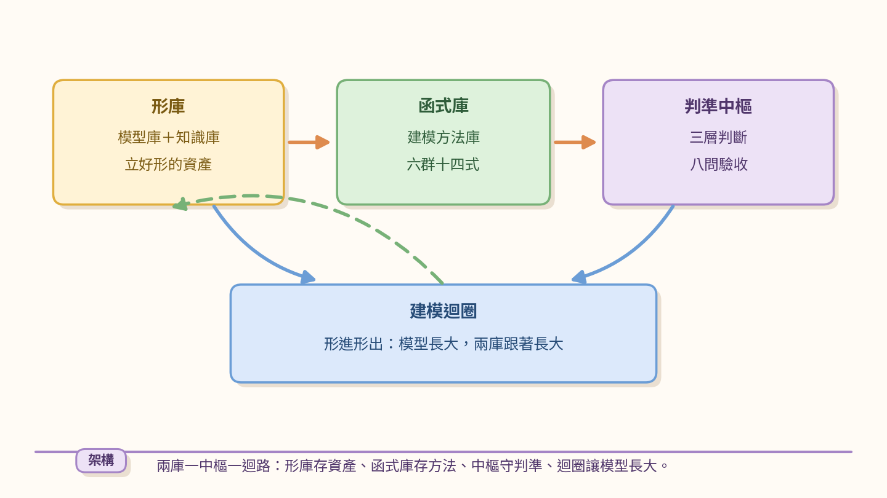

**圖 7-1　兩庫一中樞一迴路 × 建模**

**例　一次建模的沉澱**

> **例・沉澱**
>
> 做完 SIR：形庫多一個 [SIR 傳染病模型] 模板（含形集合與三層判斷記錄）；函式庫多一張「果因估參」四問卡；
>
> 下次做登革熱，不是從零開始——搜形庫拿模板、換刻度、重跑迴圈。建模能力複利成長，靠的是這條迴圈。

## 7-2　四條驗收線

模型交付前過四條線：可複核（每一步寫得出來、驗得回去）、可重現（同一資料跑兩遍結果一致）、可遷移（換一個場景形立得住）、可長大（新資料進來模型能長）。四線全過，模型才准交付——這是把「準確」擴展成組織級的品質語言。

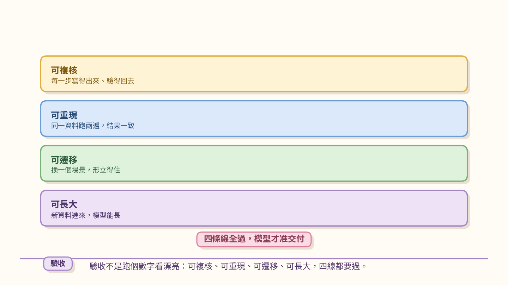

**圖 7-2　四條驗收線**

**例　可遷移的檢驗**

> **例・遷移**
>
> 校園調度模型搬到科技園區：先不改式子，先重走 3-1——新場景的 M 是誰？形立得住，模型才搬得動。
>
> 遷移失敗多半是形的失敗：舊場景的「尖峰」維度在新場景對不上（對照失敗）——開新維度，不是硬套舊式。

## 7-3　建模工具 ↔ 形學對讀

建模工具箱裡的每一樣工具，都能在形學裡找到它的形操作。對讀不是為了改名，是為了讓工具之間共用同一套帳：量綱分析管刻度、參數估計校刻度、敏感度分析做 remove、模型選擇走 ∩(T)、假設管理守 ( )、驗證走三層判斷。

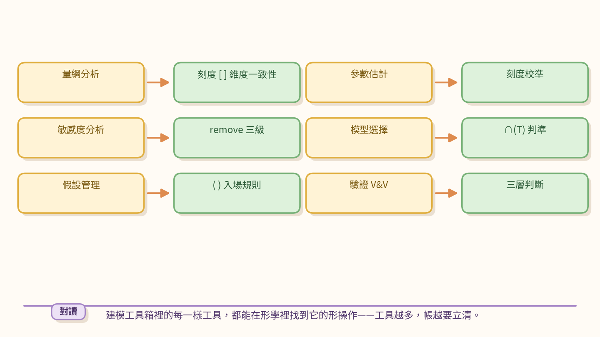

**圖 7-3　工具 ↔ 形操作：對讀總圖**

**例　工具共帳**

> **例・共用一本帳**
>
> 敏感度分析說「θ2 不敏感」＝remove 說「θ2 是非必要件」——同一個事實，兩種語言。
>
> 帳只記一本：結構書的分級欄直接引用敏感度報告的指數，驗收時兩邊對得上，不會各說各話。

## 7-4　通往 Mind AI：知識統一 → 思維統一 → 智慧統一

本形學的願景是把形看清楚、轉成顯學、實踐化為 Mind AI。落在數學建模上：知識統一——所有領域的模型都用同一套形語言立帳；思維統一——推理五族與思考法成為可調用的函式庫；智慧統一——建模迴圈自主長大，人守判準中樞。數學建模是這條路上最先落地的試驗場：它同時要求「立得清、算得動、驗得準」，正好把三統一全壓上場。

**例　三統一的階段**

| 階段 | 在建模現場的樣子 | 驗收 |
| --- | --- | --- |
| 知識統一 | 模型庫全用形集合表記，跨域可搜 | 找得到、讀得懂 |
| 思維統一 | 推理族與思考法成為選路器 | 選路有判準、可複核 |
| 智慧統一 | 迴圈自動沉澱模板、自動初稿 | 人只守判準中樞 |

## 7-5　本篇小結

> **第七篇要點**
>
> - 兩庫一中樞一迴路：形庫存資產、函式庫存方法、中樞守判準、迴圈長大。
> - 四條驗收線：可複核、可重現、可遷移、可長大。
> - 工具共用一本帳；三統一從建模現場開始落地。

> **E14　練習（第七篇・架構）**
>
> （一）把你自己（或你的團隊）做過的三個模型，寫成形庫的三筆條目（形集合＋判準＋版本）。
>
> （二）三個模型中有沒有一條「可長大」的迴圈在運作？沒有的話，缺的是兩庫、中樞還是迴圈？
>
> *提示：條目就是形：有 id、有結構、有類別。答案見附錄 C。*

> **【專業專欄 C7】不確定性量化 UQ**
>
> 不確定性量化回答「結果的可信範圍有多大」。蒙地卡羅方法（Ulam 與 von Neumann 在 1940 年代為核子計算立下）以隨機抽樣把不確定性一格格量出來；其後的傳播分析、信賴區間、貝葉斯更新都是同一族功夫：把「不知道」寫成刻度上的分布。
>
> 形學讀法：UQ 是「形裡小形・次比較」的分布長相——一次估計值只是刻度的一格，分布才是刻度的完整形。觀測 ≠ 狀態（內容 ≠ 身份）：資料裡的噪聲是內容的擾動，形的身份不隨之起舞。
>
> 建模啟示：交付分布，不交付單點。四條驗收線的「可重現」在 UQ 語言裡就是：分布的置信帶要蓋得住重跑結果。

> **【專業專欄 C8】從數模到 Mind AI：世界模型**
>
> AI 界的「世界模型」（World Model）指智能體對環境動態學出的內部模型——1945 年 Craik 立下概念，1990 年 Schmidhuber、2018 年 Ha 與 Schmidhuber 逐步做出可訓練的版本，近年以神經網路重建「可推演的世界」。
>
> 形學對讀：世界模型就是「世界的形庫＋轉移規則庫」——狀態是內容形、動態是 op: Type → Type、推演是模擬推理。AI 缺的不是算力，是可複核的形帳：LLM 的世界知識多但邊界模糊，正是「自然語言有餘、形語言不足」。
>
> 本書的建模迴圈是世界模型的可複核版本：先用形語言把世界立清，再談自主推演。這是「知識統一 → 思維統一 → 智慧統一」在 AI 現場的同一條路。

# 第八篇　內容完整方案——學練用教建

最後一篇把整本書收成可執行的方案：怎麼學（八週路線）、怎麼用（四讀者選路）、怎麼教（學練用教建五步）、怎麼建庫（四階段＋試點擴點量產），並以五領域並列總結收束全書。

## 8-1　學練用教建＋八週路線

學習循環五步：學（讀骨幹）、練（做練習）、用（建真模）、教（講給人聽）、建（擴建形庫）。八週路線把五步排進時間：前四週打地基（立形、三軸、運算、函式鏈），後四週上戰場（家族選族、六步驟實戰、八問驗收、建庫交付）。

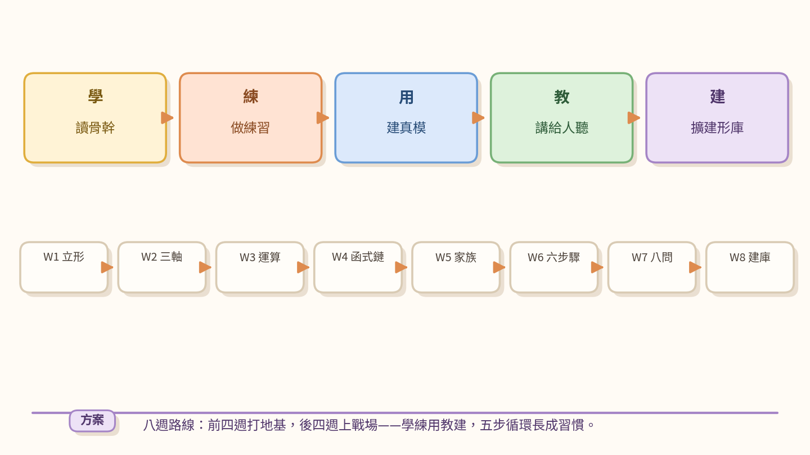

**圖 8-1　學練用教建＋八週路線**

**例　一週的節奏**

> **例・W6**
>
> W6（六步驟週）：讀 6-3、6-4 → 做 E12 → 拿手邊一個真問題走六步驟 → 把步驟講給同事聽 → 把模板存進形庫。
>
> 一週五個動作，剛好繞學練用教建一圈。

## 8-2　四讀者選路＋建庫四階段

不同讀者走不同路：學生跟主文加練習；教師加教學示範；工程師加專業專欄與案例；決策者讀定位、總架構與方案。建庫四階段：盤點（手上有哪些形）、立形（三軸寫清）、分級（remove 三級）、上架（入形庫可搜），以「試點 → 擴點 → 量產」推進。

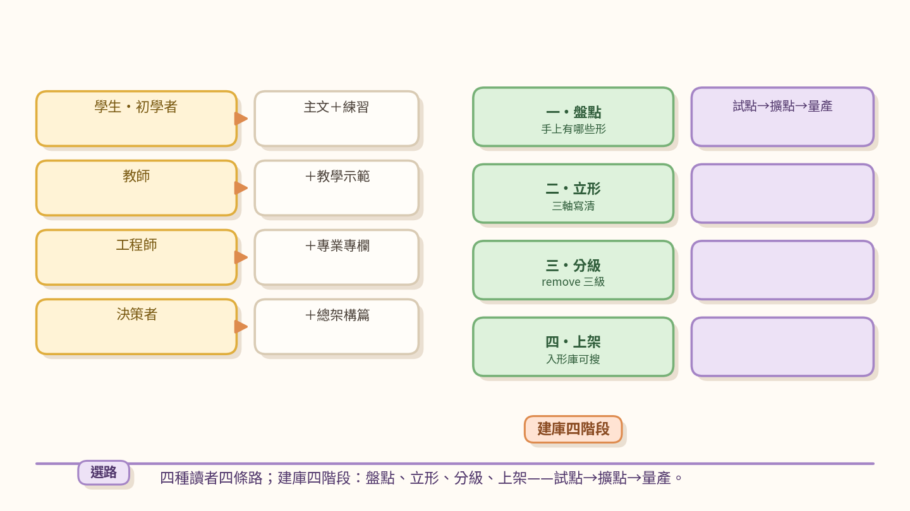

**圖 8-2　四讀者選路＋建庫四階段**

**例　試點的挑法**

> **例・試點**
>
> 試點要選「小而完整」的問題：範圍小（立形快）、閉環全（六步驟走得完）、痛點真（驗收有人在意）。
>
> 一個試點走完，形庫裡就有第一組模板——擴點只是換形重跑，量產才是複製流程。

## 8-3　五領域並列總結

準確使用方法不分文理：只要現場可以立形，它就走得進去。哲學的共相之爭是類別形的判準之爭；生物的族群模型是微分方程與統計的合形；語言的詞義漂移是刻度沒有掛回形；程式的型別即形，是 Type-Driven 的建模；組織的流程優化是約束下的排隊與調度。領域換了，形的操作不換——這就是方法的通用性。

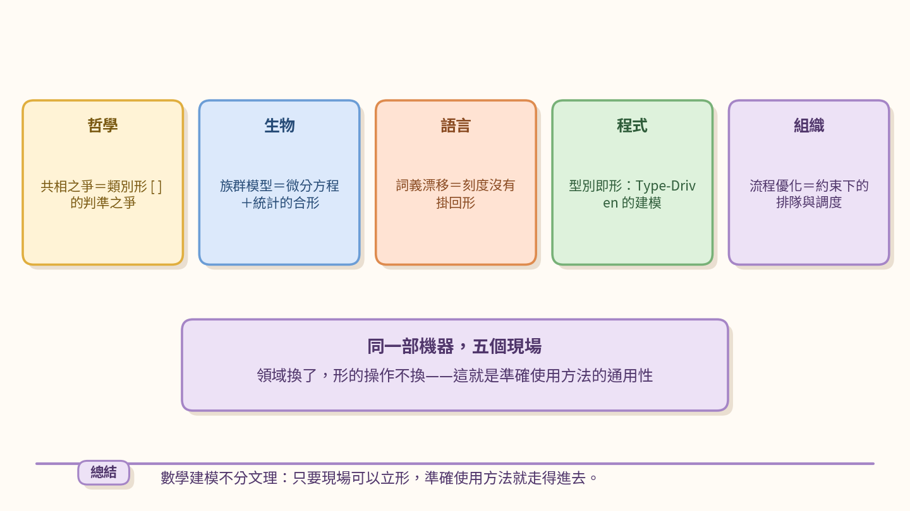

**圖 8-3　五領域並列：同一部機器，五個現場**

**例　五領域各一句**

| 領域 | 一句話 | 形學落點 |
| --- | --- | --- |
| 哲學 | 共相之爭＝類別形的判準之爭 | [ ]・∩(T) |
| 生物 | 族群模型＝演化＋推斷的合形 | op・⊕ |
| 語言 | 詞義漂移＝刻度沒掛回形 | [ ] 刻度 |
| 程式 | 型別即形：Type-Driven Design | 單位形・契約 |
| 組織 | 流程優化＝約束下的排隊與調度 | ( )・remove |

## 8-4　總結：把形立好，把式立準，把驗做實

全書一條主線：先有形，才有數。把形立好——三軸三括號、變數假設結構三本書；把式立準——函式鏈、推理族、模型家族六形；把驗做實——三層判斷、八問、四條驗收線。模型的準，是可以複核的準。這本小書從「立」開始，到「準」收束——剩下的，是回到你的現場，把第一個形立起來。

**圖 8-4　全書收束：立形・立式・立準**

> **S01　練習（第八篇・方案設計）**
>
> （一）為你的團隊排一份八週路線：每週的「用」落在哪個真問題上？
>
> （二）寫出第一個試點的入選理由（小而完整的三條件各一句）。
>
> *提示：方案要能落地到週次與問題。答案見附錄 C。*

> **S02　練習（第八篇・建庫）**
>
> （一）以「盤點→立形→分級→上架」四階段，為你手上的一個模型寫四行工作清單。
>
> （二）上架的條目要有哪些欄位，才能讓三個月後的自己搜得到、讀得懂？
>
> *提示：條目即形：id、結構、類別、判準、版本。答案見附錄 C。*

> **S03　練習（第八篇・五領域）**
>
> （一）五領域中選一個你不熟的，找一個它的建模問題，用六步驟走前四步（到選定命題為止）。
>
> （二）跨域時最難的是哪一步？它需要的是領域知識，還是形的操作？（用「對照失敗」回答）
>
> *提示：跨域的卡點多半在「認明整體」與「命名維度」。答案見附錄 C。*

# 附錄 A　術語與記號速查

| 術語 | 英文／記號 | 一句話定義 |
| --- | --- | --- |
| 形 | Type | 一個被完整描述的對象 |
| 單位形 | Unit Type | 三種集合的合體：{ 部件, (內容), [類別] } |
| 形集合 | Type Set | 單位形的完整表記 |
| 空間本形 | Space Type | 形的名詞面：三軸・靜態結構 |
| 時間本形 | Time Type | 形的動詞面：函式・動態運作 |
| 類別形 | T = (F(T), ∩(T)) | 特徵清單加交集判準的開放規則 |
| 容器 | C = (id(C), S(C)) | 身份加內部空間；內容可換，身份不動 |
| 不變性公理 | id(C) 不變 | 替換內容 e1 → e2，容器身份不變 |
| remove 三級 | ≢M／≡M′⊂M／≡M | 必要件／功能降級件／非必要件 |
| 合形 | ⊕ | 把部件合成一個形，層次保留 |
| 拆形 | remove(p, M) | 移除部件，看同一性存續 |
| 替換 | σ | 換內容，身份不動 |
| 歸類・抽象 | ∩(T)・α | 判準交集・抽象生成 |
| 嵌套 | ι | 形入容器，層層各持身份 |
| 比較 | ≡／≢／⊂ | 哪一層的同一；降級記 ⊂ |
| 運算總律 | op: Type → Type | 吃進一個形，吐出一個形 |
| 函式四問 | 名稱・輸入形・輸出形・判準 | 時間本形的標準卡片 |
| 三層判斷 | 容器・組成・抽象 | 三層聯合，缺一不可 |
| 三種補足 | [ ] 規則・( ) 身份・{ } 結構 | 缺口在哪，括號補到哪 |
| 六步驟 | 認明整體→…→三層檢查 | 建模與證明共用的流程 |
| 八問 | 檢查清單八題 | 三種補足的驗收標準 |
| 數＝形裡小形 | 次比較 | 數依附在已被辨識的形之上 |

*（形的英文為 Type，全書統一用字。）*

# 附錄 B　速查卡

### B-1　建模六步驟速查

| 步驟 | 一句話 | 產出 |
| --- | --- | --- |
| 1 認明整體 | M 是哪一個整體？ | M 一句話 |
| 2 分軸描述 | 三條軸各寫一次 | 屬性表・BOM・容器 |
| 3 寫形集合 | 完整表記 | { 部件, (內容), [類別] } |
| 4 選定命題 | 歸屬・不變・分級？ | 命題一句 |
| 5 判準推理 | 對應判準逐步走 | 推理正文 |
| 6 三層檢查 | 三層聯合後收結論 | （得證） |

### B-2　八問速查

| # | 檢查問題 | 通過標準 |
| --- | --- | --- |
| 1 | 對象認明了嗎？ | M 一句話說得出來 |
| 2 | F(T) 寫明了嗎？ | 特徵可逐項驗證 |
| 3 | 括號用對了嗎？ | { }( )[ ] 各安其位 |
| 4 | id(C) 標出來了嗎？ | 身份標記明確 |
| 5 | remove 分級做了嗎？ | 三級各有歸屬 |
| 6 | 邊界案例想到了嗎？ | 至少一例被正確判決 |
| 7 | 每一步可檢驗嗎？ | 讀者能逐句打勾重現 |
| 8 | 三層聯合檢查了嗎？ | 三層全過才收結論 |

### B-3　可複印：空白建模卡（影印本頁直接填寫）

| 欄位 | 填寫內容 |
| --- | --- |
| M（認明整體） |  |
| X 屬性 [ ]（維度×刻度） |  |
| Y BOM { }（remove 分級） |  |
| Z 容器 ( )（id(C)・假設） |  |
| 形集合表記 | { 　　　, (　　　), [　　　] } |
| 命題（歸屬／不變／分級） |  |
| 判準推理大要 |  |
| 三層檢查（容器／組成／抽象） | □ 過　□ 過　□ 過 |
| 八問勾選 | □1 □2 □3 □4 □5 □6 □7 □8 |
| 版本與備註 | v　　　／　 |

# 附錄 C　練習參考答案

*示範答案僅供參考：練習的答案不是唯一寫法，重點是「先辨識形，再談數」這條思路走穩了沒有。*

| 題號 | 示範答案 |
| --- | --- |
| E01 | （一）例：中了「變數漂移」「驗證流於表面」兩項——同一符號兩義、拿訓練資料自證。（二）變數漂移＝[ ] 的規則帳沒立：維度與刻度未寫明。 |
| E02 | （一）本體論：校園裡有什麼在充電？本形學：充電系統這個形長什麼樣（{ 充電樁, 排隊列, (騎乘需求), [時段] }）？建模：排隊長度怎麼算、樁數怎麼配？（二）本形學先答——先有形，才有數。 |
| E03 | （一）初值 ( )、目標函式 [ ]、決策變數 [ ]（或部件 { } 視模型而定，寫明理由即可）、觀測誤差 ( )、可行域 ( )、模型版本號 id。（二）{ 股票, 債券, 現金, (市場數據), [風險偏好] }；id(C)＝組合的策略身份（如「穩健型組合 A」）。 |
| E04 | （一）remove 拆形；σ 替換（若人口是內容）；∩(T) 歸類；ι 嵌套。（二）若模型移除摩擦後仍解得彈道（形在功能缺）記 ≡M′⊂M；若摩擦是該問題的核心機制（拿掉不成立）記 ≢M；若問題與摩擦無關記 ≡M。 |
| E05 | （一）M＝一個城市的共享單車潮汐調度；M = { 單車, 調度車, (騎乘需求), [潮汐時段] }；變數例：需求量（需求形・需求量維度・輛／小時）、潮汐刻度（時段形・時段維度・尖峰／離峰）、車齡（車隊形・車齡維度・月）。（二）H1 封閉（觀測期車隊總量不變）、H2 需求已知（以歷史需求為入場）、H3 可先放寬（天氣影響併入需求——回饋時先拆 H3）。 |
| E06 | （一）車輛 ≢M（無車不成調度）、調度卡車 ≡M′⊂M（可降級為人工調度）、天氣 ≡M′⊂M 或 ≡M（視是否入需求）、騎乘需求 ≢M、App 介面 ≡M（移除形不動）。（二）F(調度模型)＝{ 有資源指派, 有時空約束, 產出排程 }；只預測不排程者不全過 ∩(T)——不屬於；邊界案例：只做「次日數量預報」→ 缺「產出排程」特徵，∉，可記為 [預測模型]。 |
| E07 | （一）例：建構站——名稱：調度模型建構；輸入形：M 的原始形＋假設；輸出形：方程組（分配＋路徑）；判準：量綱一致、約束齊全。（二）驗證站：判準要同時過容器（資料同源）、組成（指標齊）、抽象（服務水準達標）三層，最難寫——所以要三層判斷而非單指標。 |
| E08 | （一）若只是把同一個量的時間解析度換細（身份不變）＝σ；若逼出「時段結構」新維度（對照失敗）＝α；若問題本體換了（從日調度變即時調度）＝新立形。（二）果因推理：由退貨件的損傷形反推成因；模型形＝{ 包裝, 商品, (損傷紀錄), [退貨類別] }；判準：損傷特徵與成因機理的 ∩(T) 全過。 |
| E09 | （一）① 優化（＋排隊）② 微分方程（＋模擬）③ 統計 ④ 圖網路 ⑤ 排隊（＋優化）。（二）例③：M = { 受試者, 對照組, (試驗數據), [族群] }；判準：信賴區間收斂、殘差過檢驗。 |
| E10 | （一）優化（樁數與排班的目標・約束）＋排隊（等待與容量）⊕ 合形；優化貢獻{ 決策變數, 約束 }、排隊貢獻{ 排隊列, 服務台 }。（二）尖峰情境：樁數 ≢M（拿掉排隊爆表）；離峰情境：≡M′⊂M（拿掉仍服務得完、等待變長）——分級要標情境。 |
| E11 | （一）[ ]：需求量（需求形・時段維度・輛／時）、潮汐刻度、調度成本（成本形・金額維度・元）；( )：H1 車隊封閉、H2 需求已知、H3 天氣併入需求；{ }：車輛 ≢M、調度車 ≡M′⊂M、App ≡M。（二）結構書最易省略——最先出的事是「簡化沒有邊界」：刪了什麼沒人知道，驗證失敗也無從追。 |
| E12 | （一）M＝一棟宿舍的洗衣排隊；{ 洗衣機, 排隊列, (衣物量), [時段] }；命題：判定 ∈ [排隊系統模型]；判準：到達（衣物）→ 服務（洗程）→ 離去三段俱全；三層：容器（宿舍 id 不變）✓、組成（洗衣機 ≢M）✓、抽象（排隊特徵 ∩(T) 全過）✓。（二）統計推理（由洗衣量紀錄估到達率）＋模擬（推演尖峰）；不走因果——衣物到達無機理方程。 |
| E13 | （一）① 流程誤用（假設不可回收）② 身份誤用（t 的定義漂移）③ 判準誤用（單層指標下結論）。（二）「H3（無摩擦）：將摩擦自 BOM 移除，記 ≡M′⊂M；若驗證殘差超刻度，先行解除 H3。」 |
| E14 | （一）例：條目 1＝{ S, I, R, (通報), [SIR] } v1.0、判準＝三層過＋殘差刻度內；條目 2…3 類推。（二）缺迴圈最常見——模型做完就封存，沒有沉澱模板（形庫）也沒有改版記錄（迴圈）。 |
| S01 | （一）例：W1 立形盤點三個舊模型、W2 補三本書、W3 運算與比較、W4 函式鏈、W5 族對讀、W6 六步驟實戰、W7 八問＋四線驗收、W8 上架交付。（二）小而完整：範圍小（兩週做得完）、閉環全（六步驟走得到驗證）、痛點真（主管要的月報用得上）。 |
| S02 | （一）盤點：列出三個舊模型的形集合雛形；立形：三軸各補全；分級：部件三級表；上架：條目入庫＋搜尋標籤。（二）欄位：id（名稱＋版本）、形集合、判準、案例出處、最後驗證日期、關鍵詞。 |
| S03 | （一）例：選「生物」的「藥物代謝模型」——M＝一個人體的藥物處置（{ 吸收, 分佈, 代謝, 排泄, (血藥濃度), [給藥方案] }），命題：判定 ∈ [微分方程模型]。（二）最難在「認明整體」與「命名維度」——它需要的不是公式，是把領域差異變成維度的「對照失敗」功夫：對不上就開新維度，對得上就掛刻度。 |

# 附錄 D　圖表索引

| 圖檔 | 所在 | 圖名 |
| --- | --- | --- |
| f00_cover | 封面 | 本形學應用系列・定位框 |
| f01_langs | 導讀 | 兩種語言疊加 |
| f02_chain | 導讀 | 認知鏈 × 建模鏈 |
| f03_pain | 1-1 | 五痛點・形沒立好 |
| f04_layers | 1-2 | 三層定位：根・幹・果 |
| f05_axes | 2-1 | 三軸三括號 |
| f06_judge | 2-2 | 三層判斷 |
| f07_frame4 | 2-3 | 空間框架四步驟 |
| f08_ops | 2-4 | 五大運算 |
| f09_fnlib | 2-5 | 時間本形函式庫 |
| f10_map | 2-6 | 建模↔形學映射 |
| f11_method | 2-7 | 準確使用方法總覽 |
| f12_whole | 3-1 | 認明整體 |
| f13_var | 3-2 | 變數＝維度×刻度 |
| f14_hypo | 3-3 | 假設＝入場規則 |
| f15_bom | 3-4 | remove 三級 |
| f16_classify | 3-5 | ∩(T) 模型分類 |
| f17_flow6 | 4-1 | 建模全流程六站 |
| f18_cards4q | 4-2 | 六站函式四問卡 |
| f19_op | 4-3 | 方程式＝轉移規則 |
| f20_reason | 4-4 | 推理五族 |
| f21_think | 4-5 | 思考法選路 |
| f22_loop | 4-6 | 形進形出閉環 |
| f23_families | 5-1 | 六大模型家族 |
| f24_opt | 5-2 | 優化模型形化 |
| f25_ode | 5-3 | 微分方程形化 |
| f26_stat | 5-4 | 統計機率形化 |
| f27_graph | 5-5 | 圖與網路形化 |
| f28_queue | 5-6 | 排隊系統形化 |
| f29_route | 5-8 | 選族決策樹 |
| f30_table6 | 5-8 | 六族對讀總表 |
| f31_tiyun | 6-1 | 體—用—準 |
| f32_supply | 6-2 | 三種補足・建模版 |
| f33_steps6 | 6-3 | 建模六步驟 |
| f34_sir | 6-4 | SIR 全程示範 |
| f35_sir3L | 6-4 | SIR 三層判斷 |
| f36_eight8 | 6-5 | 八問・建模版 |
| f37_miss16 | 6-6 | 誤用 16 種 |
| f38_recheck | 6-7 | 可複核的準 |
| f39_mind | 7-1 | 兩庫一中樞一迴路 |
| f40_lines4 | 7-2 | 四條驗收線 |
| f41_tools | 7-3 | 工具↔形學對讀 |
| f42_plan8 | 8-1 | 學練用教建＋八週 |
| f43_readers | 8-2 | 讀者選路＋建庫 |
| f44_five | 8-3 | 五領域並列 |
| f45_end | 8-4 | 全書收束 |

> **全書終**
>
> 把形立好，把式立準，把驗做實——模型的準，是可以複核的準。
