# 本體論與本形學的關係

**準確使用方法與架構・內容完整方案**

*Ontology × Ontypology*

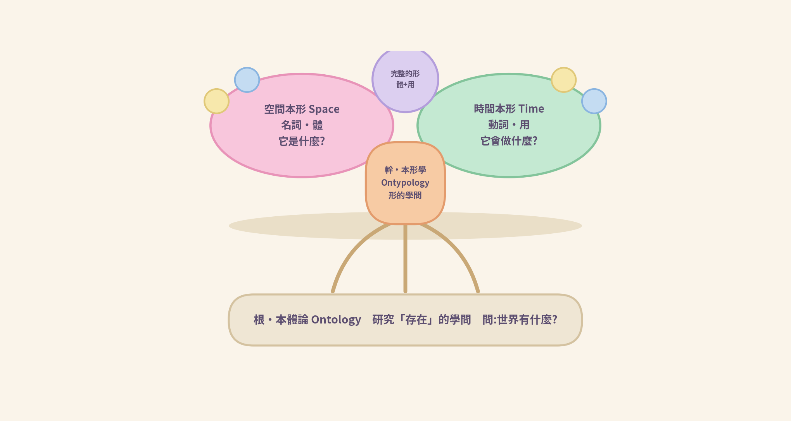

❖ ────── ✦ ────── ❖

> **一句話定位**
>
> **本體論回答「有什麼」;本形學回答「形是什麼、怎麼用」。**
>
> **前者是根,後者是幹——把「存在」看清楚,才能把「形」用準確。**

# 目　錄

| 章節 | 主題 |
| --- | --- |
| 導讀 | 三個問題與本篇範圍 |
| 第一章　認識兩門學問 | 本體論是什麼?本形學是什麼?形從何而來? |
| 第二章　兩者的關係 | 根與幹:六面對照、三層讀法 |
| 第三章　一形兩面 | 空間本形(體)與時間本形(用) |
| 第四章　準確使用方法 | 提問分流・五步法・用語準則・誤用修正・檢核清單 |
| 第五章　總架構 | 哲學層、方法層、實踐層與介接規則 |
| 第六章　內容完整方案 | 目標、模組規劃、學習路徑、教學建議 |
| 第七章　總結 | 三句話收束 |
| 附錄 A | 名詞對照表 |
| 附錄 B | 一頁速查卡 |

# 導讀——三個問題與本篇範圍

本講義聚焦一個主題:「本體論與本形學的關係」,並進一步給出可操作的「準確使用方法」與「整體架構」。讀完本講義,你將能回答三個問題:

- 本體論與本形學,是什麼關係?
- 如何準確地使用這套概念——什麼問題問誰、按什麼步驟走、避開哪些常見誤用?
- 整體架構長什麼樣——分成哪幾層、各層負責什麼、彼此如何交接?

> **本篇範圍**
>
> ◆ 本講義以〈緒論〉為基礎,聚焦「關係、用法、架構」三件事。
>
> ◆ 本形學各篇專書(空間本形、時間本形)的深入內容,以及系統實作層面的主題,不在本講義範圍內——先在概念層把關係與用法立穩,再進專書。

閱讀方式很簡單:先看圖建立直覺,再讀文字定義;每章末尾的粉彩框是精華摘記,可當作複習卡使用。

# 第一章　認識兩門學問

## 1.1　本體論:研究「存在」的學問

本體論(Ontology)是哲學中最根本的一門學問,問的是:「世界有什麼?」「萬物如何『是其所是』?」把桌上的東西一樣樣認出來——杯子、水、桌子——就是最日常的本體論動作:先承認「有什麼」,才談得上其他一切。

但只列「有什麼」還不夠。清單告訴你桌上有一隻杯子,卻沒有告訴你:這隻杯子是什麼樣子、由什麼組成、水裝在哪裡、它能拿來做什麼。要回答這些問題,需要下一門學問。

## 1.2　本形學:研究「形」的學問

本形學(Ontypology)＝ ont(存在)＋ typology(類形學)——把「存在」整理成「形」的學問。

什麼是「形」?形,是分合所畫出的邊界,是我們認得出來、並能命名的「東西」。

本形學的任務:把「形」看清楚,從哲學轉成顯學——可教、可練、可複核。正如邏輯學百年前是哲學,看清楚後成了顯學;本形學要為「形」走同一條路。

## 1.3　形的誕生:認知鏈

形的誕生有一條固定的認知鏈:先有「異同」的感受,才產生「分」與「合」的動作,最後才生出「形」,而形必有名。

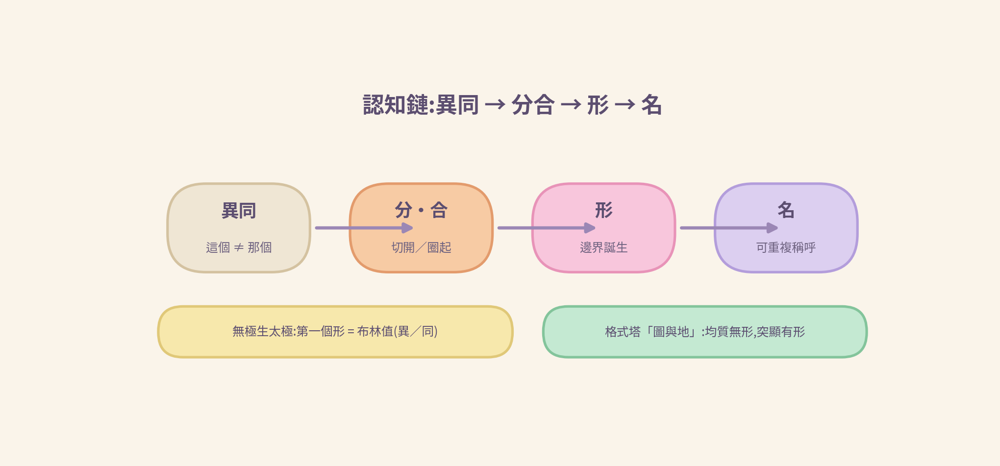

**圖 1-1　認知鏈:異同 → 分合 → 形 → 名**

- 異同:先感覺到「這個≠那個」——認知的第一個形,像布林值(異／同)。
- 分合:把「不同」切開,把「相同」圈起。
- 形:邊界誕生——圈出來的東西,我們認得出來。
- 名:形必有名——名字讓形可以被再次指認、被交談。

## 1.4　小結:兩門學問,各管什麼

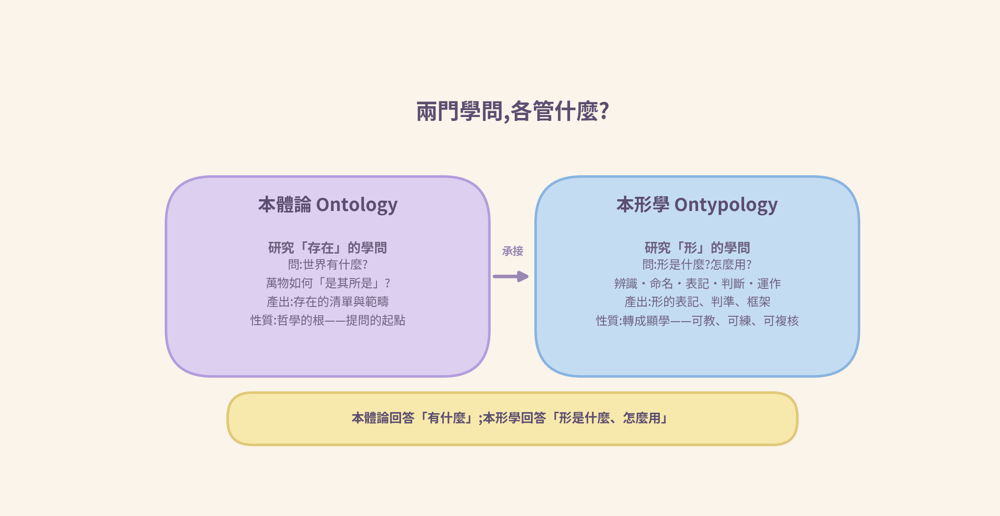

**圖 1-2　兩門學問的對比:本體論與本形學**

# 第二章　兩者的關係:本體論是根,本形學是幹

## 2.1　關係定位

一句話說清關係:本體論是根,本形學是幹。根提供養分——存在的清單與範疇;幹把養分長成形——可指認、可命名、可判斷、可運作的方法。

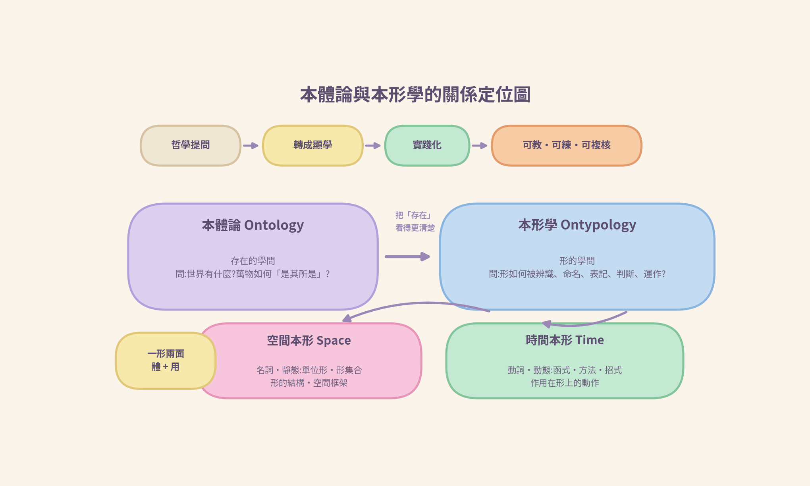

**圖 2-1　本體論與本形學的關係定位圖**

## 2.2　六面向對照表

| 面向 | 本體論 Ontology | 本形學 Ontypology |
| --- | --- | --- |
| 核心問題 | 世界有什麼?萬物如何「是其所是」? | 形是什麼?怎麼辨識、命名、表記、判斷、運作? |
| 基本單位 | 存在・實體 | 形 Type・單位形 Unit Type |
| 主要產出 | 存在的清單與範疇 | 形的表記、判準、框架 |
| 使用的語言 | 是什麼、有什麼、屬於什麼範疇 | 形集合 {部件,(內容),[類別]} 等形的語言 |
| 性質 | 哲學的根——提問的起點 | 轉成顯學——可教、可練、可複核 |
| 實踐方向 | 理解世界 | 把「形」用出來:辨識、命名、判斷、運作 |

## 2.3　關係三層讀法

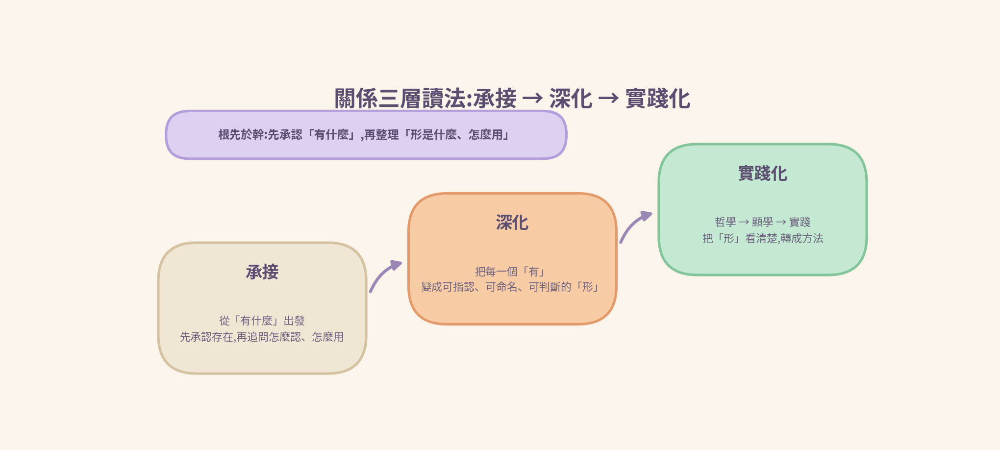

**圖 2-2　關係三層讀法:承接 → 深化 → 實踐化**

- 承接:本形學從本體論的提問出發——先承認「有什麼」,再追問「怎麼認出、怎麼命名、怎麼用」。
- 深化:本體論列出「有什麼」;本形學把每一個「有」變成可指認、可命名、可判斷、可運作的「形」。
- 實踐化:沿著「哲學 → 顯學 → 實踐」這條路,把「形」看清楚,轉成方法,走向應用。

> **本章金句**
>
> **本體論回答「有什麼」;本形學回答「形是什麼、怎麼用」。**
>
> **前者是根,後者是幹——把「存在」看清楚,才能把「形」用準確。**

# 第三章　一形兩面:空間本形與時間本形

## 3.1　為什麼是兩面

一個完整的形,同時有「是什麼」和「會做什麼」兩面——就像語法裡的名詞與動詞,缺一不可。本形學把前者稱為空間本形,把後者稱為時間本形。

## 3.2　空間 × 時間對照表

| 面向 | 空間本形 Space | 時間本形 Time |
| --- | --- | --- |
| 語法角色 | 名詞 | 動詞 |
| 性質 | 靜態結構(體) | 動態運作(用) |
| 回答 | 它是什麼? | 它會做什麼?怎麼做? |
| 包含 | 形的結構:部件、內容、類別 | 作用在形上的動作與方法 |
| 例子 | 杯子:{杯把, 杯身, 杯蓋, 杯底}＋(咖啡)＋[白色] | 裝水、倒水、清洗 |

## 3.3　關係三句話

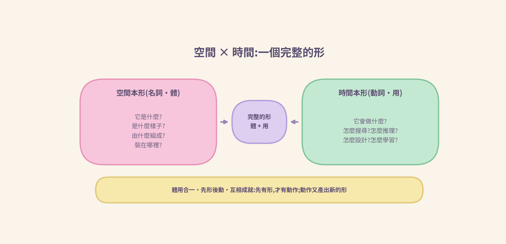

**圖 3-1　空間 × 時間:一個完整的形**

- 體用合一:空間本形是形的「體」,時間本形是形的「用」——一個完整的形,兩面俱足。
- 先形後動:先有形,才有動作。時間本形依附在空間本形之上——就像數依附在形之上。
- 互相成就:動作(設計、生成、重構)會產出新的形;形支撐更豐富的動作——兩者互相長大。

## 3.4　小劇場・杯子的一天

> **小劇場・杯子的一天**
>
> 早上,杯子(空間本形)靜靜立在桌上;「裝水 → 倒水 → 清洗」(時間本形)一一作用在它身上。
>
> 杯子不會因為裝水或裝咖啡變成別的杯子——變的是內容物,不變的是形。
>
> 而每一次「裝、倒、洗」,都是一個動詞(函式):輸入一個形,產出一個形。

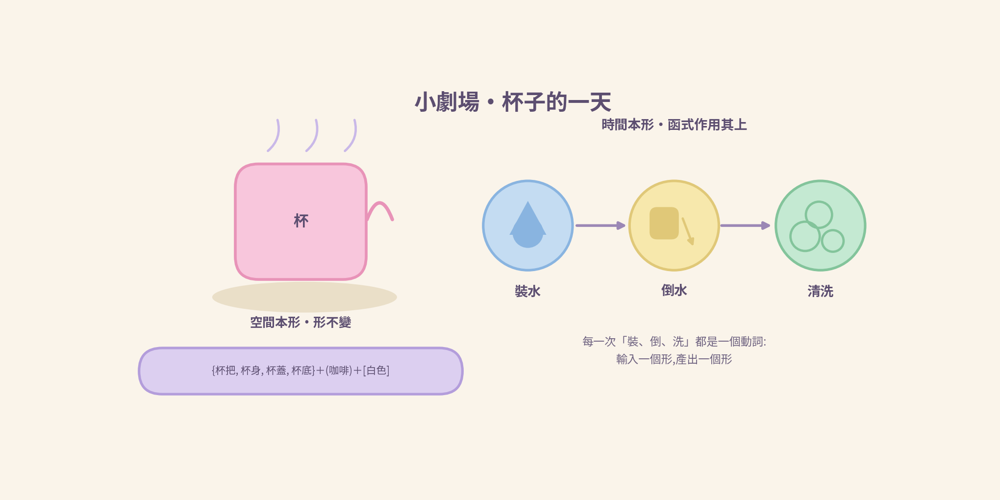

**圖 3-2　杯子的一天:形不變,函式作用其上**

# 第四章　準確使用方法

認識概念之後,最重要的是「用得準確」。本章給出一套可操作的方法:先分流、再五步、守住用語準則、避開常見誤用,最後用檢核清單把關。

## 4.1　提問分流:先決定「問誰」

使用這套概念的第一步,是把問題分流。三種典型問題,各有各的歸宿:

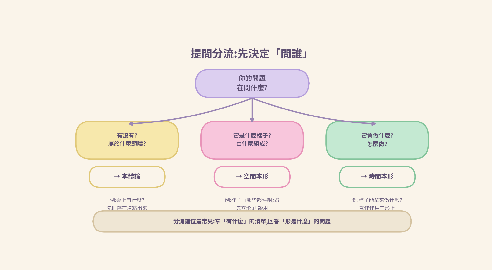

**圖 4-1　提問分流:先決定「問誰」**

- 「有沒有?屬於什麼範疇?」→ 本體論。例:「桌上有什麼?」——先把存在清點出來。
- 「它是什麼樣子?由什麼組成?」→ 空間本形。例:「這隻杯子由哪些部件組成?」
- 「它會做什麼?怎麼做?」→ 時間本形。例:「杯子能拿來做什麼?」

> **提醒・分流錯位最常見**
>
> 拿「有什麼」的清單,回答「形是什麼」的問題——列出「有杯子」,卻說不清杯子的形。
>
> 分流決定後面的一切:分流對了,方法才站得穩。

## 4.2　準確使用五步法

分流之後,沿著認知鏈走五步。步驟固定、次序不顛倒:

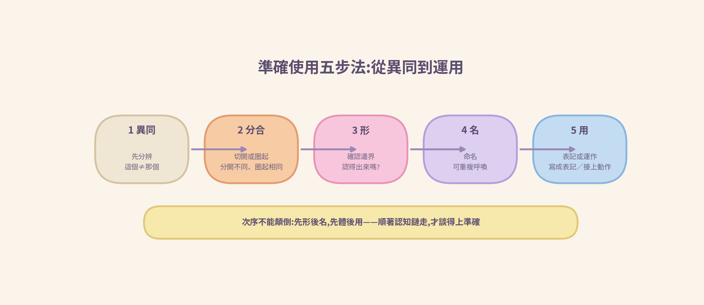

**圖 4-2　準確使用五步法:從異同到運用**

- 第一步・異同:先分辨「這個≠那個」。
- 第二步・分合:切開或圈起——把不同分開,把相同圈起。
- 第三步・形:確認邊界——圈出來的東西,認得出來嗎?
- 第四步・名:命名——給它一個可重複呼喚的名。
- 第五步・用:表記或運作——把形寫成表記,或讓動作作用其上。

> **提醒・次序不能顛倒**
>
> **先形後名,先體後用——順著認知鏈走,才談得上準確。**

## 4.3　語言與表記的準確用法

兩門學問各有各的語言,混用是誤用的源頭。

- 本體論的語言:「是什麼」「有什麼」「屬於什麼範疇」——說的是存在。
- 本形學的語言:形的表記與判準——例如以形集合 {部件,(內容),[類別]} 描述一個形。

三條用語準則:

- 準則一・先定指稱:說「杯子」時,先確定你指的是桌上的「物」(本體論的有),還是「杯子這個形」(本形學的形)。
- 準則二・體用分開:描述形,說部件、內容與類別;描述用,只說作用在形上的動作。
- 準則三・內容可變,形不變:裝水或裝咖啡,杯子還是杯子——內容物與形要分清。

> **表記示例・杯子**
>
> 杯子 = {杯把, 杯身, 杯蓋, 杯底} ＋ (咖啡) ＋ [白色]
>
> 大括號是部件、圓括號是內容、方括號是類別——這是空間本形的表記;
>
> 「裝水 → 倒水 → 清洗」則是作用其上的時間本形。

## 4.4　常見誤用與修正

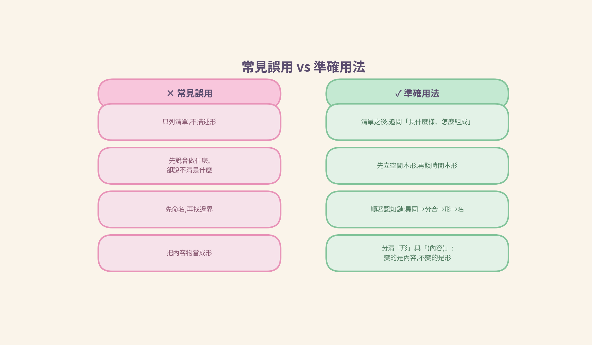

**圖 4-3　常見誤用 vs 準確用法**

| 常見誤用 | 症狀 | 修正 |
| --- | --- | --- |
| 清單代替形 | 只回答「有什麼」,就以為說完了 | 清單之後,追問「長什麼樣、怎麼組成、能做什麼」 |
| 先用後體 | 先說「會做什麼」,卻說不清「是什麼」 | 先立空間本形,再談時間本形 |
| 名先於形 | 先命名,再找邊界 | 順著認知鏈:異同 → 分合 → 形 → 名 |
| 內容物混淆 | 把裝的東西當成形本身 | 分清「形」與「(內容)」——變的是內容,不變的是形 |

## 4.5　準確使用檢核清單

> **檢核清單・每次使用前問自己**
>
> □ 這個問題分流對了嗎?(有什麼 / 是什麼 / 會做什麼)
>
> □ 有沒有先問「有什麼」,再問「形是什麼」?
>
> □ 形的邊界找出來了嗎?名與形相符嗎?
>
> □ 是不是先形後動、先體後用?
>
> □ 有沒有把內容物誤當成形?

# 第五章　總架構:哲學層、方法層、實踐層

## 5.1　三層架構圖

把前面的關係與用法收攏成一張架構圖:整體架構分三層,由上而下就是「根 → 幹 → 果」的路。

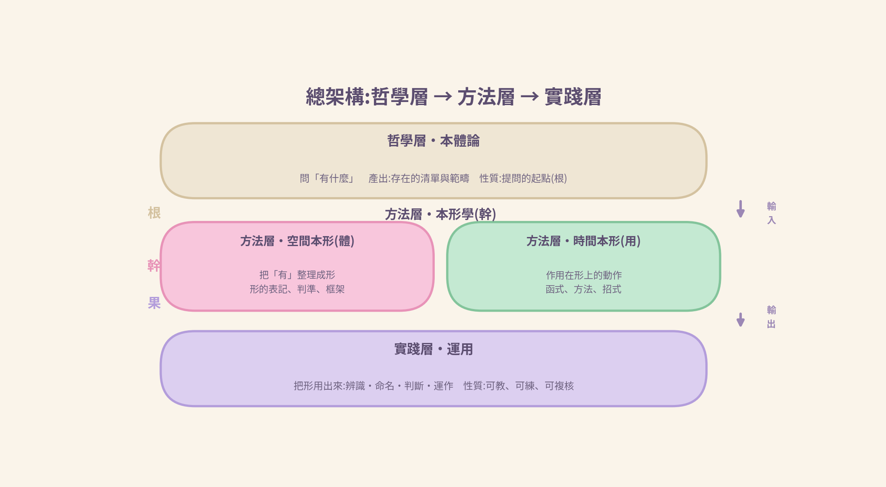

**圖 5-1　總架構:哲學層 → 方法層 → 實踐層**

- 哲學層(本體論・根):提問的起點。問「有什麼」,產出「存在的清單與範疇」。
- 方法層(本形學・幹):形的學問。以清單為輸入,把每一個「有」整理成形,產出「形的表記、判準、框架」;內部分空間本形(體)與時間本形(用)兩面。
- 實踐層(運用・果):把形用出來——辨識、命名、判斷、運作。

## 5.2　架構職責對照表

| 層 | 核心問題 | 主要產出 | 使用的語言 |
| --- | --- | --- | --- |
| 哲學層・本體論 | 有什麼? | 存在的清單與範疇 | 是什麼、有什麼、屬於什麼範疇 |
| 方法層・本形學 | 形是什麼?怎麼用? | 形的表記、判準、框架 | 形集合 {部件,(內容),[類別]} 等 |
| 實踐層・運用 | 怎麼用出來? | 可執行的辨識、命名、判斷、運作 | 動作與方法的語言 |

## 5.3　介接規則:根與幹如何交接

架構要能運作,靠的是三條介接規則,加上一條回饋路徑:

- 輸入介接:本體論的產出(存在的清單與範疇),是本形學的輸入。
- 次序介接:先承認「有什麼」,再整理「形是什麼」——根先於幹,不可顛倒。
- 輸出介接:本形學的產出(形的表記與判準),是實踐層的依據。
- 回饋:實踐中發現的新「有」,回到哲學層重新清點——架構是活的,不是單行道。

# 第六章　內容完整方案

## 6.1　方案目標與適用讀者

- 目標:用最短的路,把「本體論與本形學的關係」講清楚,並給出可操作的準確使用方法與架構。
- 讀者:想掌握本形學定位的學習者;想以本套概念教學、整理知識的教師與作者。
- 前提:不需要任何系統或程式背景——本講義止於概念與方法,不涉系統實作。

## 6.2　內容模組規劃

| 模組 | 主題 | 學習目標 | 核心圖文 | 建議時數 |
| --- | --- | --- | --- | --- |
| M1 | 認識兩門學問 | 能一句話說出兩者的核心提問 | 認知鏈、對比卡 | 1 小時 |
| M2 | 根與幹 | 能說明承接、深化、實踐化三層 | 關係定位圖、三層讀法 | 1 小時 |
| M3 | 一形兩面 | 能分辨體與用,並舉例說明 | 一形兩面、杯子的一天 | 1 小時 |
| M4 | 準確使用 | 能正確分流、走五步、避開誤用 | 分流決策樹、五步法 | 2 小時 |
| M5 | 總架構 | 能畫出並說明三層架構與介接 | 三層架構圖 | 1 小時 |
| M6 | 練習與檢核 | 通過檢核清單,完成綜合練習 | 速查卡 | 1 小時 |

## 6.3　建議學習路徑

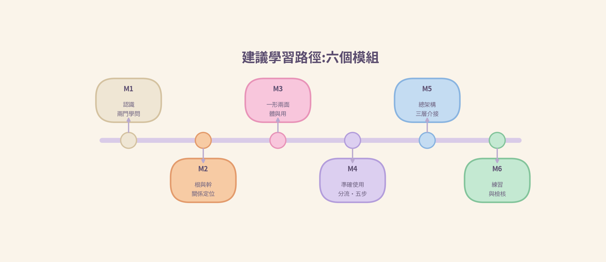

**圖 6-1　建議學習路徑:六個模組**

建議依 M1 → M6 順序學習:先建立共同語言(M1–M3),再練方法(M4–M5),最後綜合檢核(M6)。若已有基礎,可直接從 M4「準確使用」進入手冊用法。

## 6.4　教學建議(粉彩教學法)

- 圖先於文:先看圖建立直覺,再讀文字定義。
- 例先於則:先用杯子等日常例子,再收斂成規則。
- 做中學:每學完一模組,用自己的例子走一次五步法。
- 常回速查卡:附錄 B 一頁速查,隨時對照。

# 第七章　總結

三句話,收束整份講義:

- 關係:本體論問「有什麼」,本形學問「形是什麼、怎麼用」——根與幹。
- 兩面:空間本形 = 名詞(體),時間本形 = 動詞(用);完整的形 = 體 + 用。
- 用法與架構:用法走「分流 → 五步 → 檢核」;架構走「哲學層 → 方法層 → 實踐層」。

> **本篇金句**
>
> **把「存在」看清楚,才能把「形」用準確——**
>
> **這就是本體論與本形學的關係。**

❖ ────── ✦ ────── ❖

想繼續深入「形」的內部結構與「動詞」的展開,請接續本形學系列專書;想開始動手,請帶著第 4 章的分流決策樹與五步法,用你身邊的例子練習一輪。

# 附錄 A　名詞對照表

| 名詞 | English | 一句話說明 |
| --- | --- | --- |
| 本體論 | Ontology | 研究「存在」的學問:世界有什麼? |
| 本形學 | Ontypology | 研究「形」的學問:ont(存在)＋ typology(類形學) |
| 形 | Type | 分合畫出的邊界、認得出來並能命名的「東西」 |
| 單位形 | Unit Type | 形的基本單位 |
| 空間本形 | Space Type | 形的「體」——名詞,回答「它是什麼」 |
| 時間本形 | Time Type | 形的「用」——動詞,回答「它會做什麼」 |
| 認知鏈 | Cognitive Chain | 異同 → 分合 → 形 → 名:形誕生的固定路徑 |
| 體用合一 | Body–Use Unity | 完整的形 = 空間本形(體) + 時間本形(用) |
| 先形後動 | Type before Action | 先有形,才有動作;順序不可顛倒 |
| 形集合 | Type Set | {部件,(內容),[類別]}:形的表記方式 |

# 附錄 B　一頁速查卡

把整份講義壓成一頁。建議列印或截圖,貼在書桌前隨時對照。

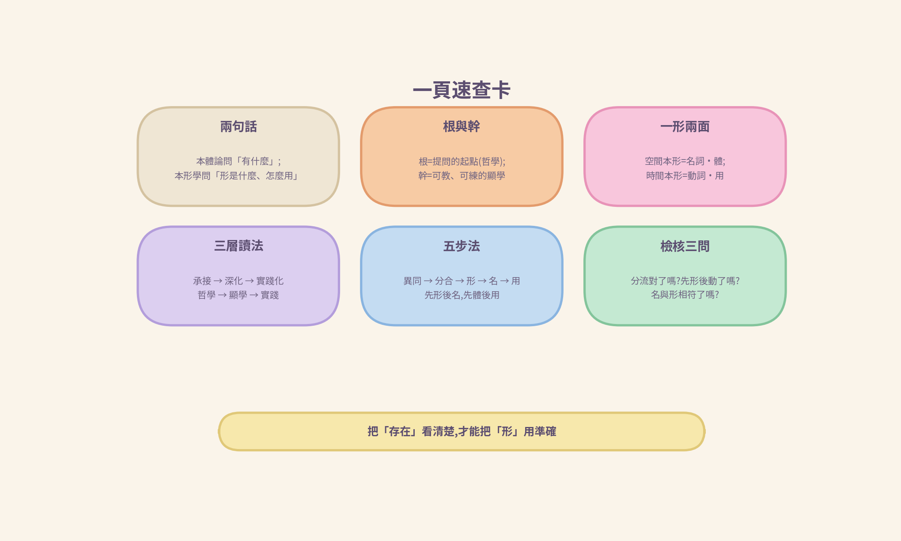

**圖 B-1　一頁速查卡**

[www.longreat.net](http://www.longreat.net)

张长丰[gamma@livemail.tw](mailto:gamma@livemail.tw)

张楟颍[mindaiworks@gmail.com](mailto:mindaiworks@gmail.com)
