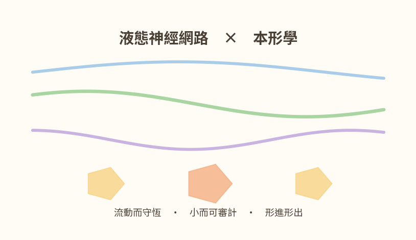

# 液態神經網路與本形學

關係・準確使用方法與架構・內容完整方案

以空間本形與時間本形為理論基礎

> **❖　一句話**
>
> **液態神經網路流動而守恆，本形學把這份「流動中的穩定」寫成可複核的形——**
>
> 結構是空間本形，動態是時間本形，準確使用方法讓每一次判斷都可逐步書寫、可逐項複核。

本形學 Ontypology　·　LonGreat / Mind AI 系列

张长丰　张楟颍　著

# 目　錄

- 寫在前面　本冊的任務
- 第一篇　為何需要形：液態網路的崛起
  - 1-1　從離散步到連續時間
  - 1-2　三件新事：液態、閉式、可審計
  - 1-3　為什麼用本形學來讀液態網路
- 第二篇　骨幹速覽：本形學對讀地圖
  - 2-1　骨幹四件套
  - 2-2　對讀地圖
  - 2-3　【專業專欄 C1】RNN → LSTM → Neural ODE：每一代補什麼缺口
- 第三篇　空間本形：液態網路的形
  - 3-1　網路是形：拆開來看
  - 3-2　它是什麼樣子：屬性與刻度
  - 3-3　東西放在哪裡：容器與身份
  - 3-4　液態的形學意義：合而不散
  - 3-5　三層判斷：把網路審計一遍
  - 3-6　【專業專欄 C2】LTC 的數學細節：液態 τ 與穩定有界
- 第四篇　時間本形：液態的時間
  - 4-1　形進形出：時間本形的定義
  - 4-2　液態 τ(t)：時間會呼吸
  - 4-3　閉式解：每一步寫得出來
  - 4-4　持續學習：形與函式互相長大
  - 4-5　兩庫對照：基本款與高階款
  - 4-6　【專業專欄 C3】Neural ODE 與連續深度的形學位置
- 第五篇　準確使用方法整合版
  - 5-1　體—用—準：三字訣
  - 5-2　三種補足：把被省略的裝回來
  - 5-3　六步驟：把判斷寫到可複核
  - 5-4　八問檢查清單
  - 5-5　誤用對照：十六種偏差
  - 5-6　完整示範：一個自駕決策網路走完六步驟
  - 5-7　情境選路：什麼時候用液態網路
  - 5-8　【專業專欄 C4】NCP 可審計自治與形學三層
  - 5-9　【專業專欄 C5】Liquid AI：把液態帶到邊緣
- 第六篇　總架構
  - 6-1　兩庫一中樞一迴路 × 液態網路
  - 6-2　對讀總表
  - 6-3　四問卡：為你的液態任務定形
  - 6-4　通往 Mind AI：三統一
  - 6-5　【專業專欄 C6】連續深度與形學：形先於數
  - 6-6　【專業專欄 C7】可解釋性的工程落地
  - 6-7　【專業專欄 C8】與 Mind AI 接軌：三統一的形學基礎
- 第七篇　內容完整方案
  - 7-1　五段路線：學・練・用・教・建
  - 7-2　八週學習路線
  - 7-3　建庫四階段
  - 7-4　綜合案例：一條時間序列的形鏈
  - 7-5　驗收標準
- 第八篇　總結
- 練習篇
  - 練習 E07–E12
  - 綜整練習 S01–S02
- 附錄 A　術語與記號對照
- 附錄 B　速查卡
- 附錄 C　練習參考答案
- 附錄 D　圖表索引
- 編後記

# 寫在前面　本冊的任務

這本冊子只做一件事：把「液態神經網路」與「本形學」接上軌，並把對讀的成果收束成一套準確使用方法與完整的內容方案。

液態神經網路（Liquid Neural Networks）是近年人工智慧裡最耐人尋問的一支：它的時間常數會「流動」，隨輸入與狀態改變節律；它的行為被證明穩定有界，液體會流，卻不會漫出杯子；它的成員可以小到十幾個神經元，小到每一條連線都可以被人工逐一檢視。流動、守恆、可審計——這三個詞，聽起來不像在形容一個神經網路，倒像在形容一個「形」。

本形學正是研究「形」的學問：空間本形描述形是什麼樣子、由什麼組成、東西放在哪裡；時間本形描述形怎麼運作、怎麼變化、怎麼形進形出。兩相對照，液態神經網路幾乎是時間本形的一件活標本，而本形學則給了它一套描述、判斷與驗收的語言。

> **【約定】本冊三約定**
>
> ◆ 約定一：本冊以本形學（空間本形與時間本形）為理論基礎，但不逐章重抄原書理論——只以架構圖與圖文摘要立起骨幹。
>
> ◆ 約定二：「形」的英文一律用 Type。三種括號各有專屬職務：{ } 組成、[ ] 屬性、( ) 容器。
>
> ◆ 約定三：本冊不做系統實作——我們談的是對讀、方法與方案；寫程式留給實作者，寫準留給本書。

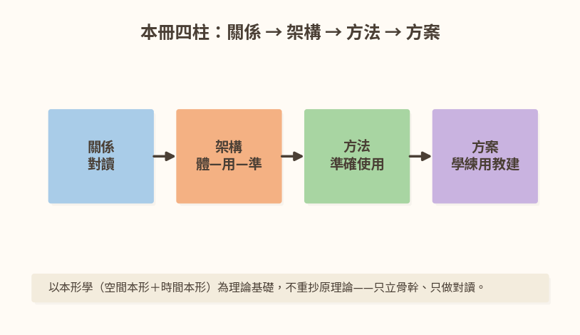

**圖 D-1　本冊四柱：關係 → 架構 → 方法 → 方案**

全書分八篇。上篇立關係：先看液態網路的崛起與系譜（第一篇），再以本形學骨幹立起對讀地圖（第二篇）；中篇做對讀：空間本形對讀結構（第三篇），時間本形對讀動態（第四篇）；下篇收成果：準確使用方法整合版（第五篇）、總架構（第六篇）、內容完整方案（第七篇）、總結（第八篇）。三個附錄收齊術語對照、速查卡與練習答案。

閱讀方式有兩條：想快讀的人，讀每篇的重點框與圖說就能掌握骨架；想走到底的人，跟著專業專欄與練習一步步把式子寫出來。

# 第一篇　為何需要形：液態網路的崛起

一切從「時間」說起。過去半世紀的神經網路史，可以讀成一場把時間「寫對」的長征：從踩著固定拍子前進的離散步網路，到讓時間連續流動的微分方程網路，再到讓時間常數隨形而動的液態網路。這條路走到今天，留下的問題不再是「能不能預測」，而是「能不能說清楚」——而說清楚，正是形的工作。

## 1-1　從離散步到連續時間

循環神經網路（RNN）與它的門控後裔 LSTM，用固定時間步長處理序列：每一個 Δt 踩點一次，狀態跳一格。這種做法簡潔有效，卻把時間拍成了階梯——真實世界的訊號明明是連續流動的。

2018 年興起的神經微分方程（Neural ODE）把深度網路重新寫成連續動態系統，時間終於重新流動起來；但它的推論依賴數值求解器一步一步疊代，慢，而且黑箱。2021 年的液態時間常數網路（LTC）更進一步：時間常數本身隨輸入與狀態「流動」，仿若生物神經元的膜時間常數；2022 年的閉式連續時間模型（CfC）再給出閉式解，把逐步求解變成一步寫出，訓練與推論比微分方程對照組快一到五個數量級。

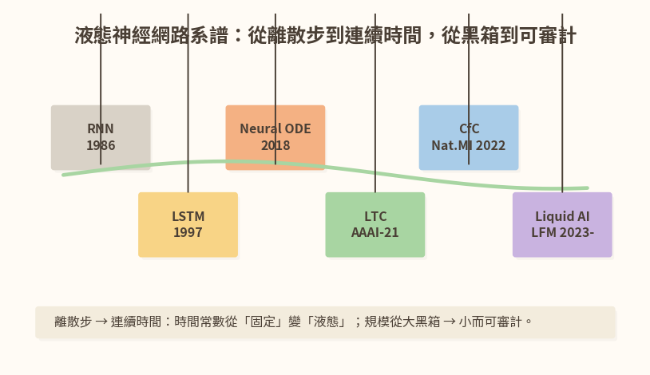

**圖 1-1　液態神經網路系譜：從離散步到連續時間，從黑箱到可審計**

> **【考據】系譜三站**
>
> ◆ LTC：Hasani、Lechner、Amini、Rus、Grosu，〈Liquid Time-constant Networks〉，AAAI-21（arXiv:2006.04439）。
>
> ◆ CfC：Hasani 等，〈Closed-form Continuous-time Neural Models〉，Nature Machine Intelligence 4, 992–1003 (2022)。
>
> ◆ Liquid AI：2023 年由 MIT CSAIL 孵化創立，創辦人 Ramin Hasani（CEO）、Mathias Lechner（CTO）、Alexander Amini（CSO）、Daniela Rus。

## 1-2　三件新事：液態、閉式、可審計

把液態網路的創新攤開來看，其實是三件事。

- **液態（時間常數會呼吸）：**每個神經元的時間常數 τ 不是固定參數，而是隨輸入與狀態改變的函數。記憶的節律因形制宜——訊號來得急，它反應得快；訊號平緩，它記得住。

- **閉式（每一步寫得出來）：**CfC 把原本只能數值逼近的動態寫成閉式解，時間顯式出現在式子裡——任何人拿到式子，都能逐步書寫、逐項複核。

- **可審計（小到看得清）：**以神經電路政策（NCP）為代表，十幾個神經元就能完成可審計的自治控制。小，不是能力不足，是為了看得清。

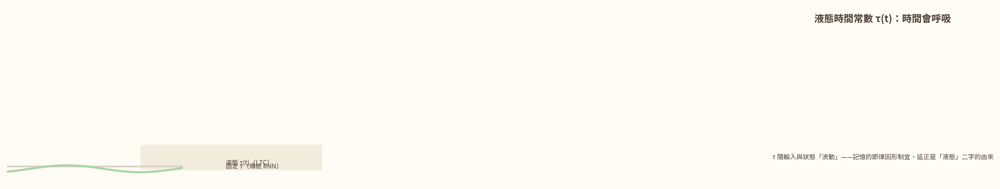

**圖 1-2　液態時間常數 τ(t)：時間會呼吸**

> **【重點】問題的轉向**
>
> 液態網路把人工智慧的問題從「能不能」轉向「說不說得清楚」。說清楚一個東西——它是什麼樣子、由什麼組成、放在哪裡、怎麼運作——這正是本形學的本業。

## 1-3　為什麼用本形學來讀液態網路

本形學的兩大分支恰好各對應一面。空間本形（名詞、靜態）回答「形是什麼」：三條軸——屬性 [ ]、物料清單 { }、空間容器 ( )——把一個對象完整描述；時間本形（動詞、動態）回答「形怎麼運作」：函式吃進一個形、吐出一個形，形進形出。

拿這兩面照向液態網路，映射幾乎是嚴絲合縫的：網路的結構——神經元、突觸、層——是空間本形的形；網路的動態——液態 τ、狀態演化、決策輸出——是時間本形的函式；網路的穩健與可審計，則對應不變性公理與三層判斷。本冊接下來的路線，就是把這三組映射逐一推開，再收束成方法。

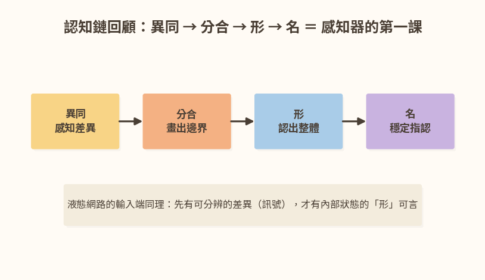

**圖 1-3　認知鏈回顧：異同 → 分合 → 形 → 名，也是感知器的第一課**

# 第二篇　骨幹速覽：本形學對讀地圖

這一篇不重講本形學理論，只把「對讀要作用在什麼東西上」立起來。一頁認知鏈、一頁三軸三括號、一頁形集合表記，加上一張對讀地圖——四頁立骨幹，後面六篇都在這副骨架上長肉。

## 2-1　骨幹四件套

本形學的骨幹可以收成四件套。第一，認知鏈：異同 → 分合 → 形 → 名——先有可分辨的差異，才有畫邊界的動作，才有認得出的整體，才有可指認的名字。第二，三條軸：X 屬性 [ ] 回答「它是什麼樣子」，Y 物料清單 { } 回答「它由什麼組成」，Z 容器 ( ) 回答「東西放在哪裡」。第三，形集合表記：單位形 ＝ { 部件, ( 內容 ), [ 類別 ] }——三種括號各司其職，一個形被完整表記。第四，時間本形：op: Type → Type——一切運算都是形進形出。

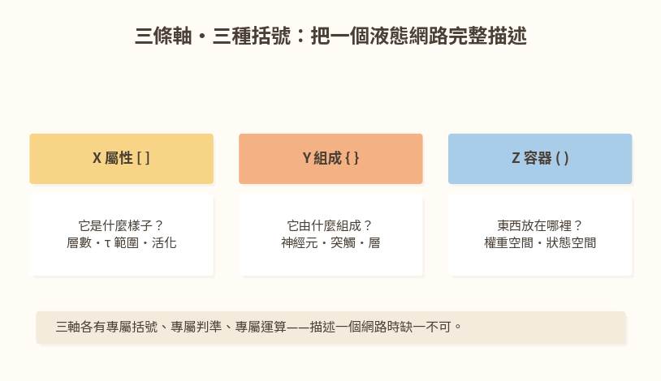

**圖 2-1　三條軸・三種括號：把一個液態網路完整描述**

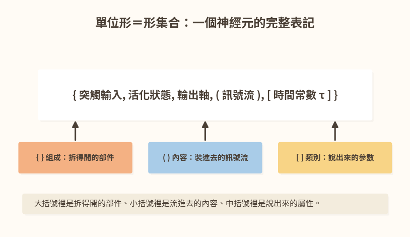

**圖 2-2　單位形＝形集合：一個神經元的完整表記**

## 2-2　對讀地圖

把兩造並排，對讀地圖有四條主幹道。結構對結構：網路的組成對空間本形；動態對動態：液態 τ 與 ODE 對時間本形；穩健對守恆：穩定有界與抗干擾對不變性公理；可審計對可複核：小電路的逐一檢視對三層判斷與準確使用方法。

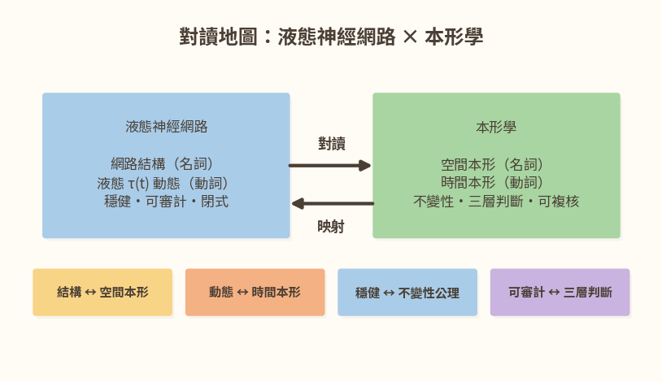

**圖 2-3　對讀地圖：液態神經網路 × 本形學**

| 對讀主幹道 | 液態神經網路這側 | 本形學那側 |
| --- | --- | --- |
| 結構 ↔ 空間本形 | 神經元・突觸・層・讀出頭 | { } BOM、[ ] 屬性、( ) 容器 |
| 動態 ↔ 時間本形 | 液態 τ(t)、ODE、形進形出 | op: Type → Type、函式庫 |
| 穩健 ↔ 守恆 | 穩定有界、抗干擾、可遷移 | 不變性公理：換內容，id(C) 不變 |
| 可審計 ↔ 可複核 | NCP 小電路、閉式解 | 三層判斷、六步驟、八問 |

> **【重點】對讀不是比附**
>
> 對讀的目的不是把新名詞貼上舊標籤，而是借本形學的判準回答四個實務問題：怎麼描述一個液態網路、怎麼判斷它、怎麼用準它、怎麼把方法傳下去。這四個問題，正是第五到七篇的主題。

> **【練習】E01（對讀暖身）**
>
> 任選一個你熟悉的神經網路，用形集合表記 { 部件, ( 內容 ), [ 類別 ] } 寫出它的最小描述，並指出哪一項屬於 X 軸、哪一項屬於 Y 軸、哪一項屬於 Z 軸。

## 2-3　【專業專欄 C1】RNN → LSTM → Neural ODE：每一代補什麼缺口

這條系譜用本形學的眼睛看格外清楚：每一代都在補上一代在「時間本形」上的缺口。RNN 把序列壓成固定步長，長程依賴在梯度消失中流失——時間被切碎了；LSTM 用門控守住記憶，但仍是離散步——時間仍踩著階梯；Neural ODE 讓時間連續流動，卻把演化交給數值求解器——時間流動了，但每一步說不出來；LTC 讓時間常數隨形而動，CfC 則把演化寫成閉式——時間既流動，每一步又寫得出來。

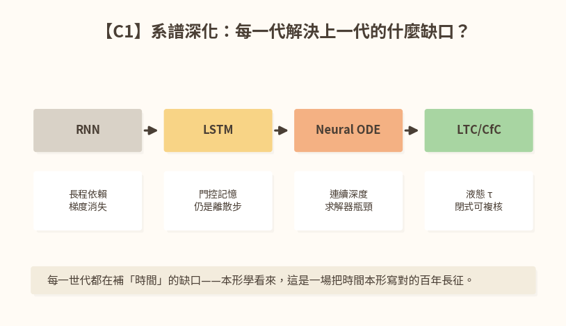

**圖 2-4　【C1】系譜深化：每一代解決上一代的什麼缺口**

從形學立場看，這場百年長征的終點已經可見：一個「時間本形」必須同時滿足三件事——流動（能表達連續動態）、守恆（身份不因流動而散）、可寫（每一步可複核）。液態網路是目前離這三件事同時最近的工程實踐。

# 第三篇　空間本形：液態網路的形

這一篇把液態網路當作一個「形」來解剖。方法只有一條：照本形學的三條軸走——先看它由什麼組成（Y 軸），再看它是什麼樣子（X 軸），再看東西放在哪裡（Z 軸），最後用三層判斷收攏。整個過程不談訓練、不談程式，只談形。

## 3-1　網路是形：拆開來看

先問第一個問題：一個液態網路由什麼組成？把它「拆開來看」，答案是一份物料清單（BOM）：輸入層、隱藏層（液態核心）、輸出層、讀出頭，每一層裡面又是神經元與突觸的群落。BOM 判準只有一條——「拆下來之後，它還認得自己嗎？」突觸拆下來仍是一個突觸、層拆下來仍是一層，所以它們進 BOM；τ 的範圍拆下來什麼都不是，它是屬性。

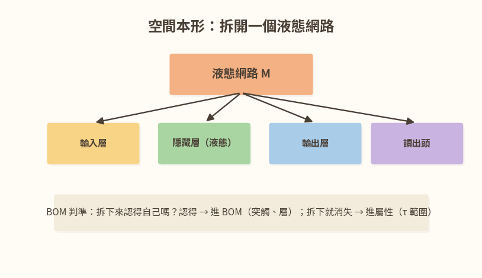

**圖 3-1　空間本形：拆開一個液態網路**

接著用 remove 判準給部件分級：把部件 p 從網路 M 移除，看同一性是否存續。移除主幹層，網路不成網路——必要件，remove(p,M) ≢ M；移除一個注意力頭或旁路，功能缺了但網路還是那個網路——功能降級件，≡ M′ ⊂ M；移除冗餘節點或裝飾性正則，完全不影響——非必要件，≡ M。這三級分級正是模型剪枝與消融實驗的形學語言：剪枝就是 remove，消融就是三級判準的實作。

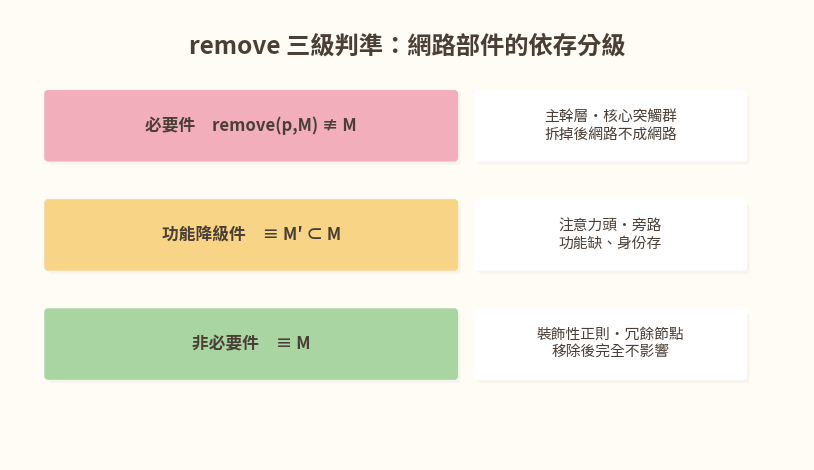

**圖 3-2　remove 三級判準：網路部件的依存分級**

## 3-2　它是什麼樣子：屬性與刻度

第二個問題：它是什麼樣子？屬性是維度，屬性值是刻度。一個液態網路的屬性表自然長出：層數、每層神經元數、τ 的範圍、閘門型式、讀出頭結構。屬性是被差異逼出來的——當兩種網路在「時間常數是否流動」上對不上時，「τ 型式」就被迫立成一條新維度，並回填到所有已出現的網路上。這正是空間框架四步驟：分辨異同 → 對照失敗觸發抽象 → 命名維度 → 判斷歸屬。

## 3-3　東西放在哪裡：容器與身份

第三個問題：東西放在哪裡？容器 C = ( id(C), S(C) )——身份識別加內部空間。權重空間是容器，訓練資料流是內容；狀態空間是容器，隨時間流過的訊號是內容。不變性公理說：換內容，id(C) 不變。這正是液態網路「穩健」的形學本義——雨天的視訊流換掉了晴天的視訊流，網路還是同一個網路；內容流動，身份不動。

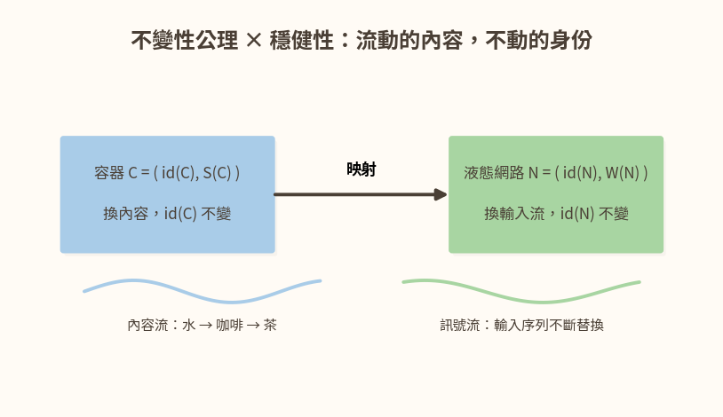

**圖 3-3　不變性公理 × 穩健性：流動的內容，不動的身份**

> **【重點】穩健的形學定義**
>
> 穩健不是「什麼都打得過」，而是「在內容替換之下身份存續」——id(C) 不變，就是不變性公理。液態網路被反覆驗證的抗干擾與可遷移性，在形學裡就是一條公理的工程化身。

## 3-4　液態的形學意義：合而不散

「液態」二字值得用形學重讀一次。液體的特性是流動：狀態不斷改寫、時間常數不斷調制；但整團網路始終是一個可指認的形——有合必有形，合的動作不因流動而散。這對應形集合運算的兩條基本律：σ 替換運算保身份（內容換了，容器還是同一個容器），ι 嵌套運算持層次（神經元在層裡、層在網路裡，層層各持身份，不可壓平）。

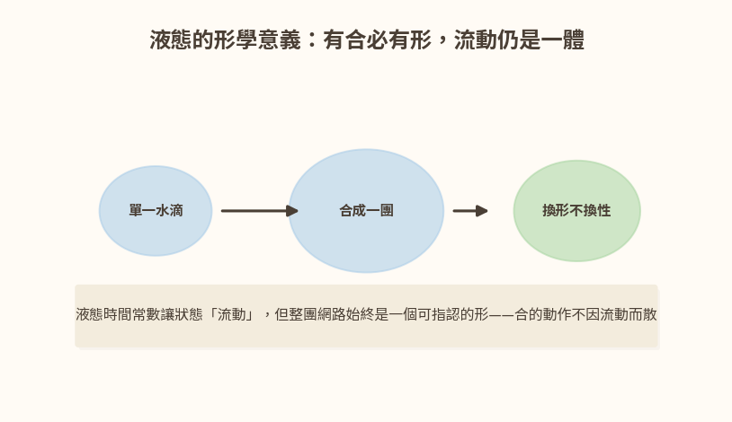

**圖 3-4　液態的形學意義：有合必有形，流動仍是一體**

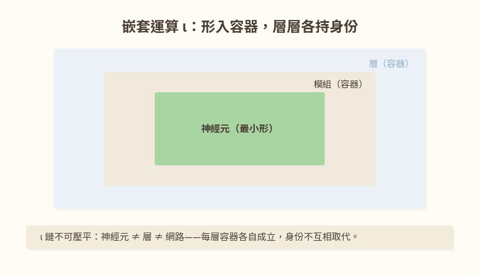

**圖 3-5　嵌套運算 ι：形入容器，層層各持身份**

## 3-5　三層判斷：把網路審計一遍

形邏輯的三層判斷——容器判斷、BOM 判斷、抽象判斷——是驗收一個形的聯合關卡。容器判斷問：身份獨立於內容嗎？（換輸入流，id(N) 不變——過。）BOM 判斷問：拆件後同一性存續嗎？（remove 三級分級明確——過。）抽象判斷問：特徵全數通過嗎？（∩(T) 逐項檢驗網路是否屬於「液態網路」類別——時間常數隨狀態調制、連續時間演化、穩定有界，全過。）三層聯合 J = 容器 ∧ BOM ∧ 抽象，缺一不可，才下結論。

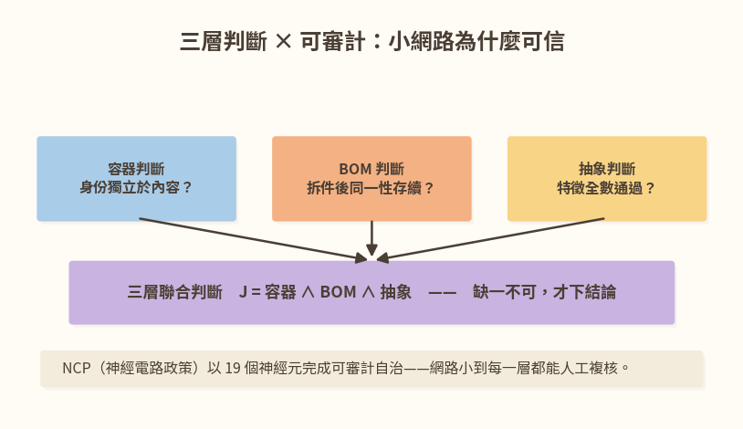

**圖 3-6　三層判斷 × 可審計：小網路為什麼可信**

這個結構解釋了為什麼小網路才可審計：三層判斷要求每一層都能人工複核。NCP 用十九個神經元完成可審計的自治駕駛，正因為它小到每條連線都可以被逐一檢視——可審計不是附加功能，是規模與表記共同的產物。

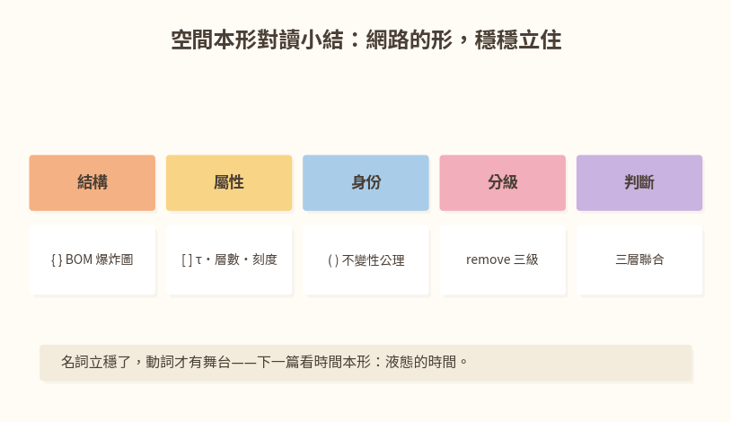

**圖 3-7　空間本形對讀小結：網路的形，穩穩立住**

## 3-6　【專業專欄 C2】LTC 的數學細節：液態 τ 與穩定有界

LTC 的每個神經元是一個線性一階動力系統，由非線性互連閘門調制：dx/dt = −x/τ(x, I) + f(x, I)。關鍵在 τ 不是常數而是狀態與輸入的函數——時間常數「掛」在隱狀態上，所以叫液態時間常數。論文以軌跡長度（trajectory length）度量表達力：在潛在軌跡空間裡，LTC 的軌跡長度上界優於同族模型，同時動態被證明穩定有界——液體會流，但不會漫出杯子。

用運算式的語言重述：LTC 神經元本身就是一個形進形出 op: Type → Type 的實作——吃進訊號形，經液態動態，吐出狀態形。它的運算律可查：封閉性成立（狀態仍在狀態空間裡）、結合律成立（串接的網路仍是網路）、交換律不成立（層的次序就是依存結構，這正是 BOM 樹狀不可交換的動態版本）。

> **【練習】E02（remove 實作）**
>
> 對一個你熟悉的網路做 remove 三級分級：各舉一個必要件、功能降級件、非必要件，並寫出你的判斷依據（remove(p,M) 的三種結果各是哪一種）。

# 第四篇　時間本形：液態的時間

上一篇把形立穩了，這一篇看它怎麼動。時間本形的定義只有一條：op: Type → Type——吃進一個形，吐出一個形。液態網路把這條定義活生生地實作了連續版本：訊號形流進來，經過液態時間常數的呼吸，決策形流出去。

## 4-1　形進形出：時間本形的定義

本形學說：時間本形（動詞、函式、方法）依附空間本形——函式吃進、吐出的都是形，沒有形，函式無物可動。液態網路正是這句話的寫照：ODE 的右端 f(x, I) 是一個函式，輸入是狀態形 x 與訊號形 I，輸出是狀態的變化率；一步演化之後，又是一個新的狀態形。整個網路的推論，就是一串形進形出。

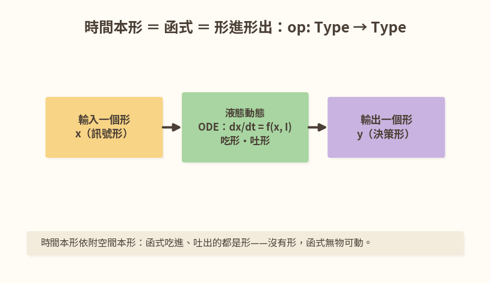

**圖 4-1　時間本形 ＝ 函式 ＝ 形進形出：op: Type → Type**

## 4-2　液態 τ(t)：時間會呼吸

傳統 RNN 的時間常數是固定的——節律寫死，無論訊號緩急。液態網路的 τ(t) 隨輸入與狀態調制：訊號來得急，τ 縮短，反應加快；訊號平緩，τ 拉長，記憶保留。這是時間本形最動人的畫面——函式的節律因形制宜。用空間框架的語言說，τ 的調制就是「判斷歸屬」的動態版：新差異來了，對得上既有節律就掛進去，對不上就調出新節律。

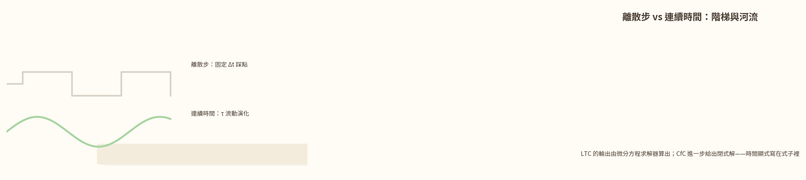

**圖 4-2　離散步 vs 連續時間：階梯與河流**

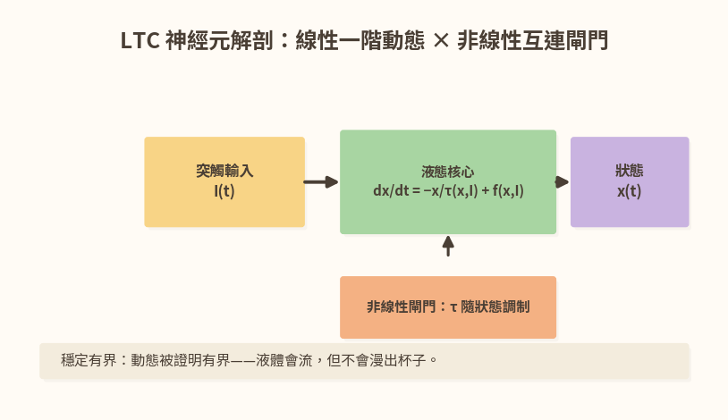

**圖 4-3　LTC 神經元解剖：線性一階動態 × 非線性互連閘門**

## 4-3　閉式解：每一步寫得出來

CfC 的突破是把液態動態寫成閉式解——時間顯式出現在式子裡，不再需要數值求解器一步步疊代。這一步在工程上帶來一到五個數量級的加速；在形學上，它帶來的卻是「準確」：準確＝可複核的準，可複核的前提是每一步寫得出來。數值求解器的疊代像一個只給答案不給過程的學生；閉式解像一個每步都寫在紙上的學生——後者才過得了八問檢查。

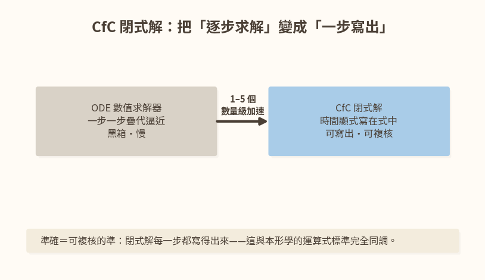

**圖 4-4　CfC 閉式解：把「逐步求解」變成「一步寫出」**

> **【考據】CfC 加速倍數**
>
> Hasani 等（Nature Machine Intelligence, 2022）原文：closed-form networks 在訓練與推論上比微分方程對照組快「一到五個數量級」，且可擴展性顯著優於 ODE 型連續網路。本冊引述為「1–5 個數量級」，不加碼、不縮水。

## 4-4　持續學習：形與函式互相長大

時間本形函式庫裡有一組招式叫持續學習：輸入一個形、產出一個形，世界因產出而改變，新差異又逼出新的形。液態網路的訓練迴圈正是這組招式：資料形流進網路，決策形流出，部署後的新情境再以新差異回饋，網路在微調中長出新的節律——而身份始終不變（id(N) 不變，不變性公理守著）。這就是「形與函式互相長大」：空間本形在時間本形的運轉中擴充，時間本形在新形上學到新招。

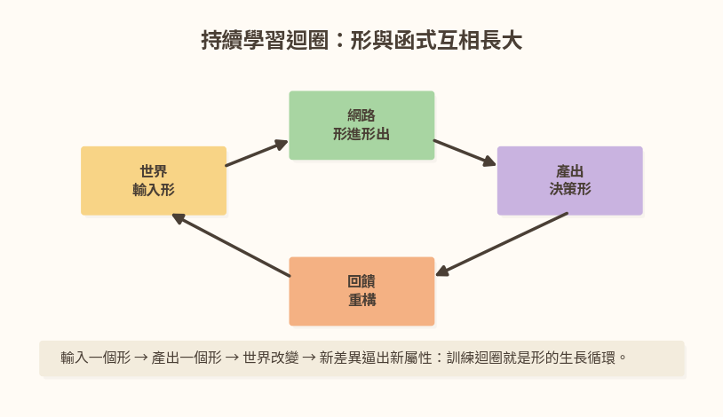

**圖 4-5　持續學習迴圈：形與函式互相長大**

## 4-5　兩庫對照：基本款與高階款

形集合的五大運算——⊕ 合形、remove 拆形、σ 替換、∩(T) 归類、ι 嵌套——是形進形出的「基本款」：一進一出、語法單純、運算律可查。時間本形函式庫的高階函式——推理、思考法、設計、分析、解題——則是「複合款」：一條推理鏈就是 remove ＋ σ ＋ ι ＋ ≡ 比較的複合。液態網路在這個對照表上的位置很清楚：它的單一神經元是基本款的連續實作，它的整體推論是高階複合鏈。

| 角度 | 五大運算（基本款） | 液態網路的連續實作 |
| --- | --- | --- |
| 定義 | op: Type → Type | dx/dt = f(x, I)：形進形出 |
| 封閉性 | 合形仍是一個形 | 狀態仍在狀態空間 |
| 層次 | 括號即層次，不可越界 | ι 鏈層層各持身份 |
| 保身份 | σ 替換，id(C) 不變 | 換輸入流，id(N) 不變 |
| 可複核 | 式子逐步書寫 | CfC 閉式逐步寫出 |

> **【練習】E03（形進形出）**
>
> 用 op: Type → Type 的形式寫出「時間序列分類器」的輸入形與輸出形各是什麼，並說明這個函式依附在哪些空間本形之上（吃的是誰、吐的是誰）。

## 4-6　【專業專欄 C3】Neural ODE 與連續深度的形學位置

Neural ODE 把深度從「層數」重新定義為「時間」——網路的深度是連續的演化軌跡。這個轉向在形學上有清楚的回聲：數先於形還是形先於數？本形學說，先有形，才有數——層數是「形裡面的小形・次比較」，是數出同一個形（層）出現了幾次；Neural ODE 把層數化為連續時間，其實是回到「形」的本源：先有演化這個連續的形，層數只是後設的刻度。

同理，參數量的比較也是次比較：十九個神經元的 NCP 與百萬參數的大網路，比的不是數，是「哪個形」——形的選擇先於數的多寡。這是本形學對「小模型」最深刻的背書：小不是省，小是形立得正。

# 第五篇　準確使用方法整合版

這一篇是全書的心臟。前面兩篇立起對讀，這一篇把對讀收束成一套可以直接上手的準確使用方法：體—用—準三字訣、三種補足、六步驟、八問、誤用對照與完整示範。方法的標準只有一條——準確＝可複核的準。任何人照著走，都能得到同樣的判斷，並檢查你的每一步。

## 5-1　體—用—準：三字訣

準確使用一個液態網路，先記三字訣。體：它是一個形——用三軸三括號把它立穩；用：它在運作——用形進形出描述它的動態；準：它經得起查——用三種補足、六步驟與八問把判斷寫到可複核。三者缺一：有體無用是死模型，有用無準是黑箱，有準無體則無從查起。

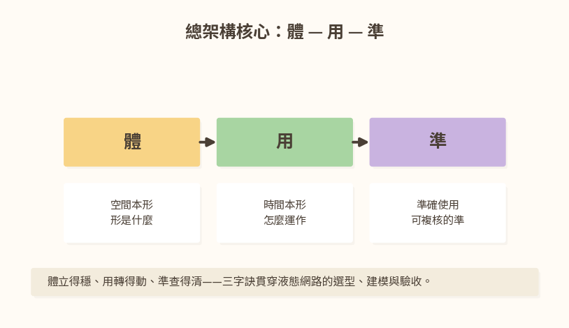

**圖 5-1　總架構核心：體 — 用 — 準**

## 5-2　三種補足：把被省略的裝回來

數學語言精確，但省略得也多。用純集合描述一個網路，會省掉三層資訊——規則、身份、結構。三種補足各補一層：[ ] 把類別寫成開放規則（τ 範圍、閘門規則可逐項驗證）；( ) 把身份寫成不變量（換輸入流、換部署場景，id(N) 不變）；{ } 把結構寫成依存（層與突觸的 remove 三級分級）。缺口在哪，括號就補到哪。

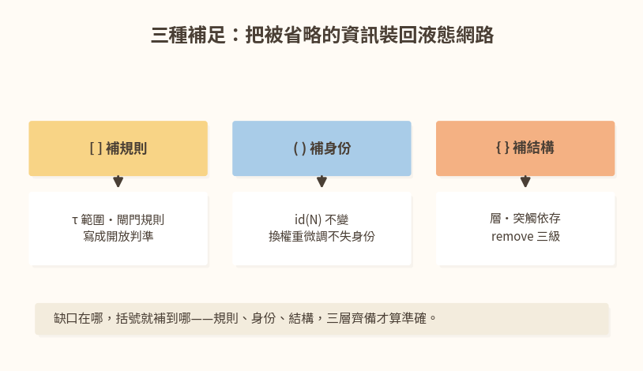

**圖 5-2　三種補足：把被省略的資訊裝回液態網路**

> **【定義】三種補足 × 液態網路**
>
> **[ ] 補規則：**把「什麼算液態網路」寫成 T = (F(T), ∩(T))——特徵集合與交集判準。F(液態網路) = { 時間常數隨狀態調制, 連續時間演化, 穩定有界 }；特徵全數通過才入類。
>
> **( ) 補身份：**C = ( id(N), W(N) )——權重與輸入流是可替換的內容，id(N) 是不變的標記。不變性公理：微調、量化、換設備部署，id(N) 不變。
>
> **{ } 補結構：**BOM 判準加 remove 三級——拆下來認得自己才進 BOM；移除後看同一性存續，分必要件、功能降級件、非必要件。

## 5-3　六步驟：把判斷寫到可複核

面對任何一個「這個網路算不算、是哪個、可不可用」的判斷，固定走六步。

| 步驟 | 操作 | 產出 | 常用工具 |
| --- | --- | --- | --- |
| ① 認明整體 | 指認判斷對象：M 是哪個網路？ | 一句話：M 是什麼 | ------ |
| ② 分軸描述 | X 屬性、Y 組成、Z 容器各寫一次 | 屬性表、BOM、容器 | 三括號 |
| ③ 寫形集合 | 完整表記 | { 部件, ( 內容 ), [ 類別 ] } | 形集合 |
| ④ 選定命題 | 證歸屬、不變，還是分級？ | 定理一句 | ------ |
| ⑤ 判準推理 | 對應判準逐步走 | 推理正文 | ∩(T)、id(N)、remove |
| ⑥ 三層檢查 | 容器・BOM・抽象聯合驗證 | 結論（得證） | 三層判斷 |

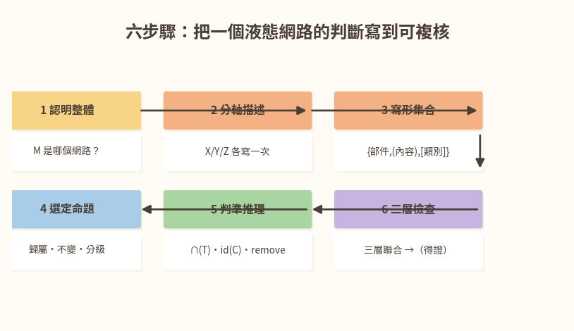

**圖 5-3　六步驟：把一個液態網路的判斷寫到可複核**

## 5-4　八問檢查清單

六步驟走完，用八問驗收。八問全過，才寫（得證）——準確不是感覺，是可複核的流程。

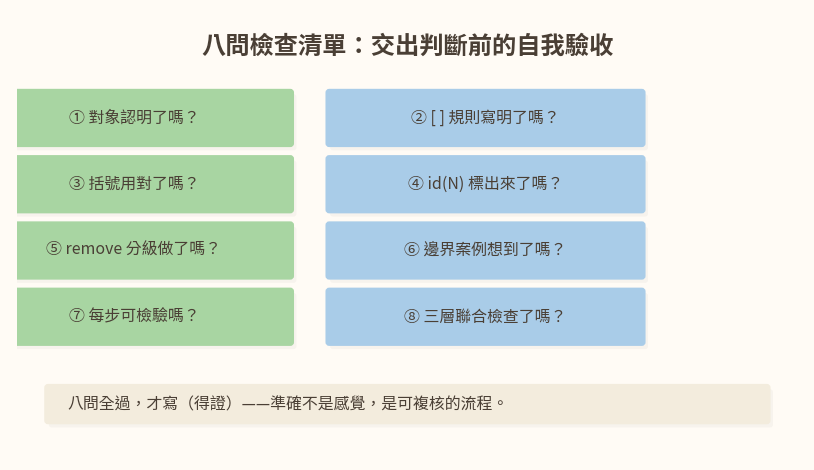

**圖 5-4　八問檢查清單：交出判斷前的自我驗收**

> **【重點】八問就是驗收標準**
>
> 八問不是格式，是三種補足的驗收標準：② 對應 [ ] 規則、④ 對應 ( ) 身份、⑤ 對應 { } 結構、⑧ 對應三層聯合。哪一問答不上來，就回到對應的補足補完再交。

## 5-5　誤用對照：十六種偏差

誤用千百種，根源只一類——層次沒寫清。括號的層次、容器與內容的層次、判斷的層次，混淆任何一層，式子寫得再順也推不出對的結果。下表把液態網路場景最常見的十六種誤用收成六類，每類附正確寫法。

| # | 誤用 | 問題所在 | 正確寫法 |
| --- | --- | --- | --- |
| 1 | 把 ( ) 當一般集合用 | 輸入流寫成 { 訊號 }，身份消失 | 內容物用 ( )，標上 id(N) |
| 2 | 把 [ ] 寫成封閉清單 | 新架構無法歸類 | 用 T = (F(T), ∩(T)) 開放規則 |
| 3 | 用比較代替拆解 | 屬性靠比較、BOM 靠拆解 | 進 BOM 只問「拆下來認得自己嗎」 |
| 4 | 內容一換就說是別的網路 | 混淆容器與內容 | 先定 id(N)，再談輸入流 |
| 5 | 只做一層判斷就下結論 | 三層各有盲點 | 三層聯合後才收結論 |
| 6 | 把動態寫成靜態表 | τ(t) 是函數不是刻度 | 時間本形用 op: Type → Type 寫 |
| 7 | 把層次壓平計參數量 | 十九個不等於輸入維度數 | 先問「哪個形」，再問「幾個」 |
| 8 | 剪枝不分三級 | 必要件被當非必要件剪 | remove 三級逐件分級再動刀 |
| 9 | 換部署就認定新網路 | id(N) 不變性被忽略 | 不變性公理：換場景仍同一個 |
| 10 | 閉式與數值解混談 | 可複核性不同級 | CfC 逐步寫出，數值解只給逼近 |
| 11 | τ 範圍不寫入 F(T) | 「液態」定義浮動 | F(T) 開頭寫明，逐項驗證 |
| 12 | 以精度單一指標定生死 | 判準只挑好驗的 | 判準多元＋邊界案例測試 |
| 13 | 小網路未做逐線審計 | 可審計性白白放棄 | NCP 式逐線檢視並留紀錄 |
| 14 | 嵌套鏈被壓平 | ι 鏈層次消失 | 神經元、層、網路各持身份 |
| 15 | 把對讀當比附 | 術語亂貼 | 對讀四問：描述、判斷、用準、傳承 |
| 16 | 只評結果不看過程 | 黑箱復辟 | 六步驟留痕，每步可打勾重現 |

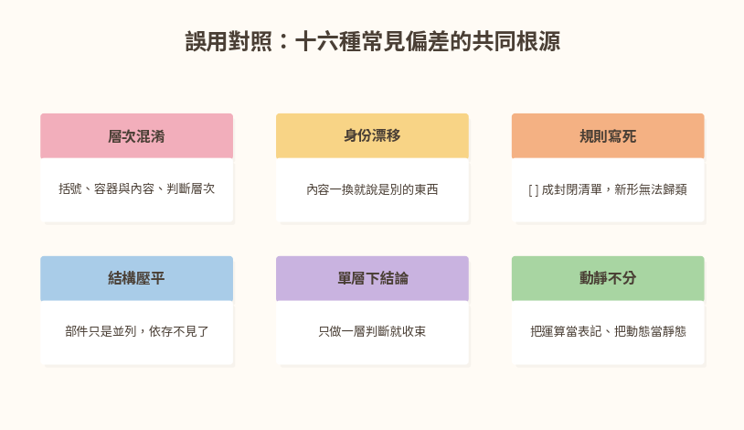

**圖 5-5　誤用對照：十六種常見偏差的共同根源**

## 5-6　完整示範：一個自駕決策網路走完六步驟

把方法走一遍。情境：一個以 NCP 為核心的自駕轉向決策網路 N，部署在多雨地區，要判斷「雨天運作的 N 與晴天的 N 是否同一個 N，且功能分級是否穩定」。

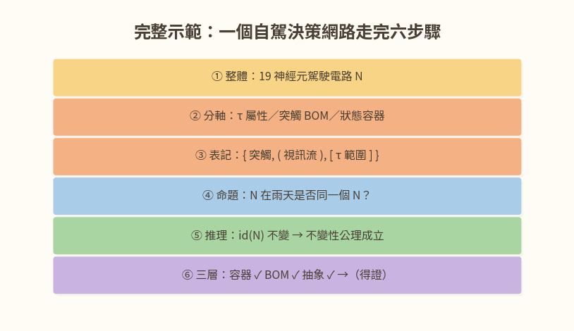

**圖 5-6　完整示範：一個自駕決策網路走完六步驟**

> **【證明示範】雨天的 N 還是 N 嗎？**
>
> （1）認明整體：判斷對象是 N（19 神經元轉向電路）。
>
> （2）分軸描述：X——τ 範圍、響應延遲、攝影機解析度；Y——BOM = { 感測前段, 核心電路, 讀出頭 }；Z——S(N) = ( 視訊流 )，id(N) 為模型簽章。
>
> （3）寫形集合：N = { 感測前段, 核心電路, 讀出頭, ( 視訊流 ), [ τ 範圍, 響應延遲 ] }。
>
> （4）選定命題：本題證「不變」——雨天部署後 id(N) 是否存續，功能分級是否穩定。
>
> （5）判準推理：雨天視訊流是 S(N) 的內容替換（σ_{晴→雨}），由不變性公理，id(N) 不變。remove(讀出頭, N) ≡ M′ ⊂ M——讀出頭是功能降級件，雨天仍成立。
>
> （6）三層檢查：容器 ✓（換內容 id 不變）；BOM ✓（三級分級不因天候改變）；抽象 ✓（∩(T) 三特徵仍全過）。三層全過——雨天的 N 還是 N。（得證）

## 5-7　情境選路：什麼時候用液態網路

方法最後一環是選路。液態網路不是萬靈丹——它在連續時間、序列決策、穩健性要求高的場景裡最能發揮。選路決策樹把常見情境收成兩問：問題是不是連續時間序列決策？求的是不是穩健可審計？

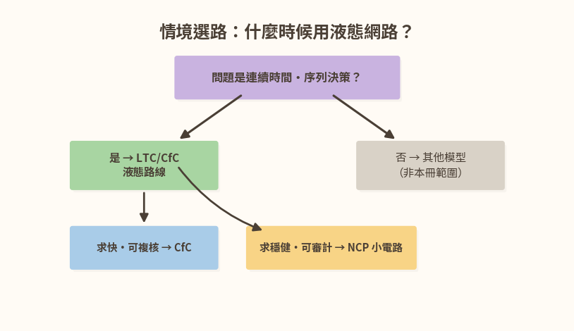

**圖 5-7　情境選路：什麼時候用液態網路？**

> **【例】三個選路示範**
>
> ◆ 場景一：車用轉向控制，連續攝影機串流，要求可審計——液態路線，取 NCP（求穩健可審計）。
>
> ◆ 場景二：工業感測器時序異常偵測，邊緣裝置算力有限——液態路線，取 CfC（求快・可複核）。
>
> ◆ 場景三：靜態圖片分類——不是連續時間序列決策，走其他模型，不必硬套液態。

> **【練習】E04（六步驟實作）**
>
> 選一個你正在做（或熟悉）的序列決策問題，完整走一次六步驟：認明整體 → 分軸描述 → 寫形集合 → 選定命題 → 判準推理 → 三層檢查，寫出你的（得證）或（存疑）。

> **【練習】E05（誤用診斷）**
>
> 從十六種誤用中挑出你在實際工作中最常犯的一種，寫出：誤用情境、問題所在、正確寫法，以及你打算如何在下一個專案裡避免。

## 5-8　【專業專欄 C4】NCP 可審計自治與形學三層

神經電路政策（Neural Circuit Policies）受線蟲神經系統啟發，以極小的遞歸電路完成感知到控制的閉環。它的「可審計」不是事後解釋，是事前可查：每個節點的行為都可以被獨立檢驗、每條連線的貢獻都可以被獨立追蹤。

用三層判斷翻譯：容器層——電路的身份獨立於輸入場景（不變性公理）；BOM 層——每個節點的角色可 remove 分級（核心節點是必要件，調節節點是功能降級件）；抽象層——電路行為可被規則化描述（∩(T) 逐項檢驗）。三層全過，一個「可審計的自治」才算立住。這也是本冊反覆說「小，是為了看得清」的底氣。

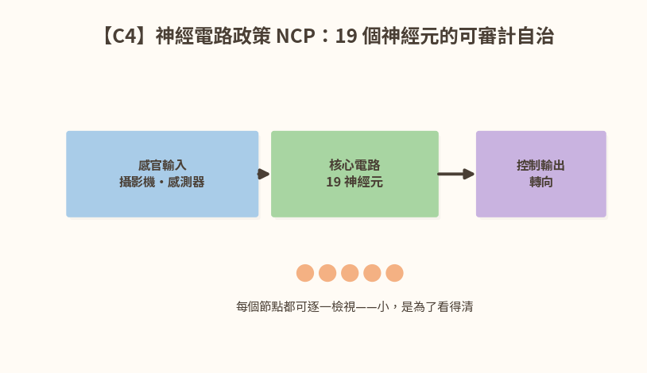

**圖 5-8　【C4】神經電路政策 NCP：19 個神經元的可審計自治**

## 5-9　【專業專欄 C5】Liquid AI：把液態帶到邊緣

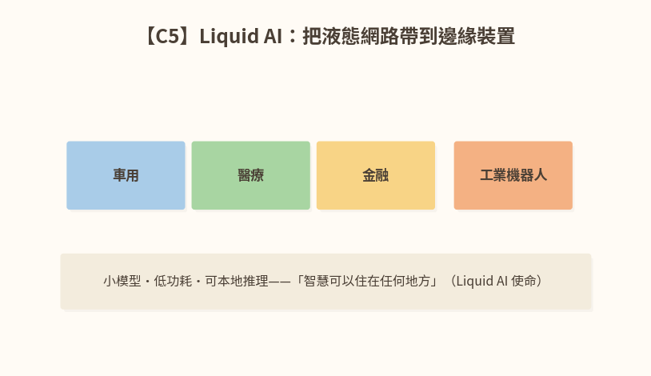

**圖 5-9　【C5】Liquid AI：把液態網路帶到邊緣裝置**

2023 年成立的 Liquid AI 由 MIT CSAIL 孵化，創辦人正是 LTC/CfC 論文的核心作者群：Ramin Hasani（CEO）、Mathias Lechner（CTO）、Alexander Amini（CSO）、Daniela Rus。公司的使命是打造高效、對齊、可信賴的通用人工智慧系統，讓「智慧可以住在任何地方」——車用、消費電子、金融、醫療、工業機器人，都是它的落地場景。

從形學看，Liquid AI 的路線是一場「形的下放」：過去只有資料中心養得起的大黑箱，被壓縮成可以住進邊緣裝置的小形——而小形的可審計性、可複核性，恰好是本形學準確使用方法的用武之地。模型越往邊緣走，「準確＝可複核的準」越是剛需。

# 第六篇　總架構

這一篇把前五篇的零件裝回一部機器。先看體—用—準怎麼在總架構裡各安其位，再看「兩庫一中樞一迴路」怎麼收納液態網路，最後用一張對讀總表與四問卡，把全書的映射一次看齊。

## 6-1　兩庫一中樞一迴路 × 液態網路

本形學的實踐架構是兩庫一中樞一迴路：形庫收空間本形（結構形），函式庫收時間本形（動態招式），中樞做三層判斷與推理，迴路負責學習與演化。液態網路在這個架構裡有雙重身分——它既是形庫裡的一個形（可被表記、分級、審計），也是函式庫裡的一組招式（形進形出、τ 調制、閉式演化）。

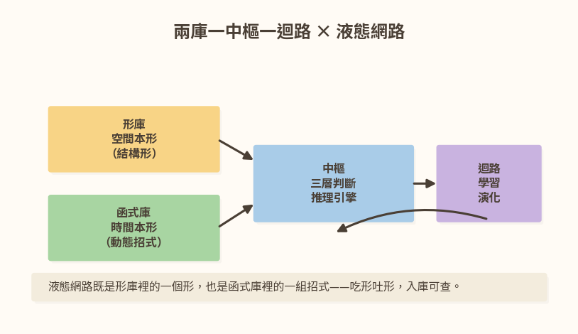

**圖 6-1　兩庫一中樞一迴路 × 液態網路**

> **【重點】入庫的條件**
>
> 一個液態網路要進形庫，必須過三關：形集合表記完整（② 分軸）、remove 三級分級明確（⑤ 推理）、三層檢查全過（⑥ 驗收）。進不了庫的，不是不好，是還說不清楚——說清楚了再入庫。

## 6-2　對讀總表

把全書的映射收成一張表。左邊是液態網路的工程語言，右邊是本形學的形學語言，中間的對應不是比附，是同一個實在的兩種描述。

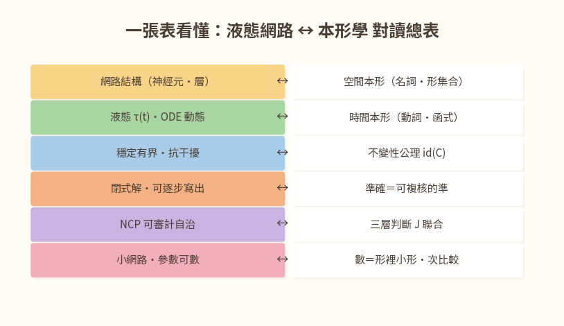

**圖 6-2　一張表看懂：液態網路 ↔ 本形學 對讀總表**

| 液態神經網路 | 本形學 | 對讀語句 |
| --- | --- | --- |
| 網路結構（神經元・層・讀出頭） | 空間本形・形集合 | { 部件, ( 內容 ), [ 類別 ] } |
| 液態 τ(t)・ODE 動態 | 時間本形・函式 | op: Type → Type 形進形出 |
| 穩定有界・抗干擾・可遷移 | 不變性公理 | 換內容，id(C) 不變 |
| CfC 閉式解 | 準確＝可複核的準 | 每一步寫得出來 |
| NCP 小電路可審計 | 三層判斷 | 容器 ∧ BOM ∧ 抽象 |
| 剪枝・消融實驗 | remove 三級 | 必要件／功能降級件／非必要件 |
| 小模型・邊緣部署 | 形先於數 | 數＝形裡小形・次比較 |

## 6-3　四問卡：為你的液態任務定形

實務上最常用的一張卡是四問卡。接到一個液態任務，先填四欄：名稱（它是什麼、身份標記）、輸入形（吃進什麼形）、輸出形（吐出什麼形）、判準（怎麼算對、怎麼複核）。四欄填得出來，任務就立住了形；填不出來，先別寫程式——形還沒立穩。

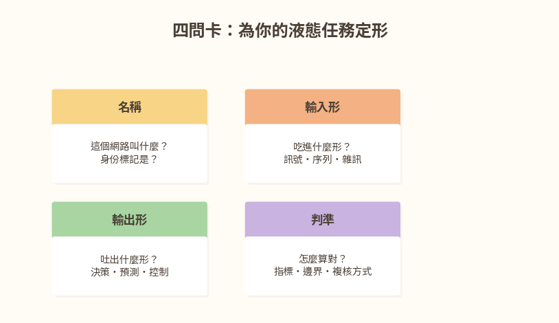

**圖 6-3　四問卡：為你的液態任務定形**

## 6-4　通往 Mind AI：三統一

本形學的遠景是 Mind AI：知識統一（萬物可表記）、思維統一（推理可複核）、智慧統一（自我演化）。液態網路是這條路上的一塊活磚——它示範了動態系統如何既流動又守恆、既小又可審計。當這樣的「形」越聚越多，形庫與函式庫日漸豐滿，三統一便不再是願景而是路線圖。

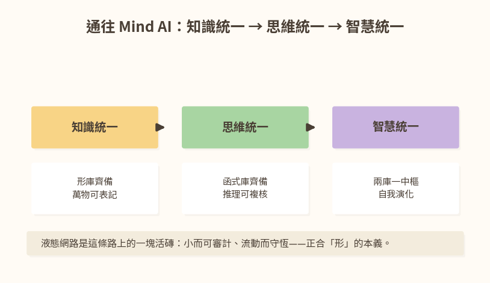

**圖 6-4　通往 Mind AI：知識統一 → 思維統一 → 智慧統一**

## 6-5　【專業專欄 C6】連續深度與形學：形先於數

Neural ODE 把深度重新定義為時間，LTC/CfC 把時間常數重新定義為狀態的函數——這兩次「重新定義」的方向一致：從固定的數，回到流動的形。本形學的核心命題「先有形，才有數」在此得到工程迴響：層數、參數量、步長都是「形裡面的小形・次比較」，是數出來的刻度，不是本質。選模型先選形，再談數——這是對讀給選型實務的一句忠告。

## 6-6　【專業專欄 C7】可解釋性的工程落地

可解釋性在工程上常被當成事後的「說明書」；本形學把它前置成事前的「表記」。一個網路若在建模之初就寫好形集合、分好 remove 三級、標好 id(N)，那麼它的可解釋性不是解釋出來的，是表記裡自帶的。NCP 的逐線可查、CfC 的閉式可寫、三層判斷的聯合驗證，三件配備合起來，就是可解釋性的完整落地路線：事前表記、事中留痕、事後可複核。

## 6-7　【專業專欄 C8】與 Mind AI 接軌：三統一的形學基礎

Mind AI 的三統一——知識統一、思維統一、智慧統一——在本形學裡各有具體的形。知識統一的形是形庫：萬物皆可表記為 { 部件, ( 內容 ), [ 類別 ] }，液態網路示範了連「動態系統」也能入庫；思維統一的形是函式庫加中樞：推理、思考法、設計、分析都是形進形出的複合鏈，而三層判斷保證每條鏈可複核；智慧統一的形是迴路：形與函式互相長大，系統在運轉中自我演化。

液態網路在這三站各留下一塊磚：入庫（它的結構可表記）、可查（它的動態可複核）、會長（它的 τ 隨形而動、持續學習）。把這三塊磚的規格寫清楚——本冊的準確使用方法做的正是這件事——三統一就不再是口號，而是一張可以逐項施工的圖。

# 第七篇　內容完整方案

方法給了「怎麼用準」，方案給「怎麼學會」。這一篇把全書內容收束成可執行的學習與建庫路線：五段路線、八週課表、建庫四階段、綜合案例與驗收標準。

## 7-1　五段路線：學・練・用・教・建

學習這套對讀方法，走五段：學（讀懂對讀）、練（寫式子）、用（進專案）、教（講給人聽）、建（建形庫）。五段不是線性單行道——建庫之後回頭再學，螺旋上升。

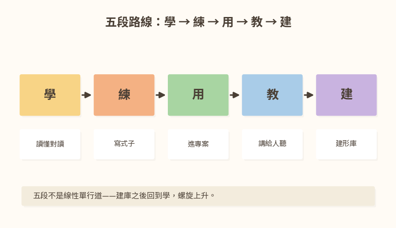

**圖 7-1　五段路線：學 → 練 → 用 → 教 → 建**

## 7-2　八週學習路線

把五段排成八週課表。前兩週立骨幹與對讀，第三、四週做空間本形的拆解練習，第五週攻時間本形與形進形出，第六週練準確使用方法，第七週走完整案例，第八週建庫與驗收。每週都有明確產出物。

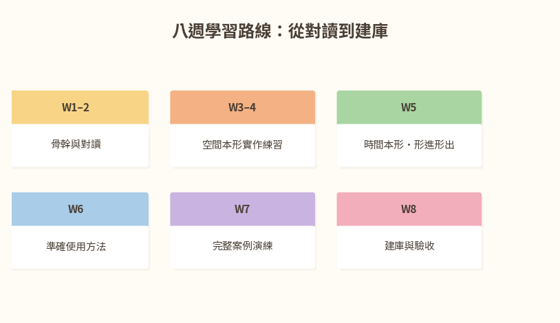

**圖 7-2　八週學習路線：從對讀到建庫**

| 週次 | 主題 | 產出物 |
| --- | --- | --- |
| W1–2 | 骨幹與對讀 | 一張自己的對讀地圖＋E01 完成 |
| W3–4 | 空間本形實作 | 三個網路的形集合＋remove 三級表 |
| W5 | 時間本形・形進形出 | 四問卡填寫三張 |
| W6 | 準確使用方法 | 六步驟演練兩次＋八問自檢 |
| W7 | 完整案例演練 | 一個端到端案例報告 |
| W8 | 建庫與驗收 | 個人形庫初版＋驗收清單 |

## 7-3　建庫四階段

建庫是五段的收成，也是下一輪的起點。四階段：盤點（把既有網路拆成形）、表記（形集合逐件登錄）、驗收（八問過關、三層檢查）、入庫（形庫＋函式庫掛上中樞）。每階段都有產出物與驗收標準——建庫本身也必須可複核。

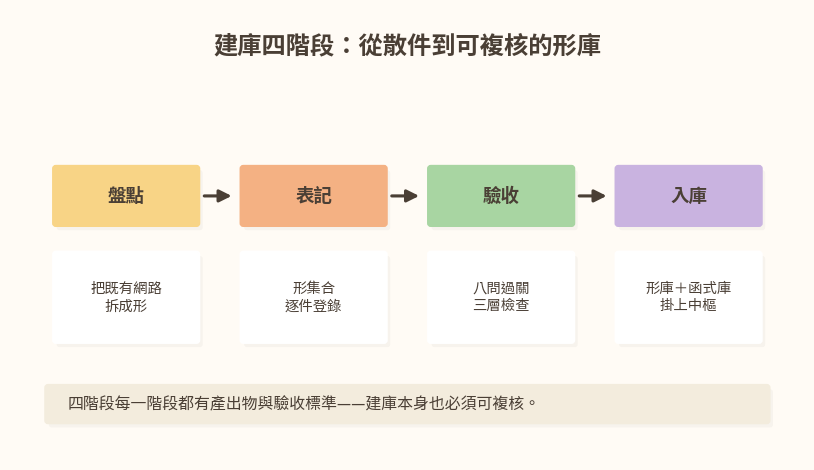

**圖 7-3　建庫四階段：從散件到可複核的形庫**

## 7-4　綜合案例：一條時間序列的形鏈

最後把全書方法串成一條鏈。情境：工業感測器的時序異常偵測。資料流是 ( 訊號 )；形化之後是 { 特徵, [ 刻度 ] }；液態網路吃進訊號形、吐出決策形；產出形回到世界（告警、停機、複檢）。每一站都留下表記與判準——回頭檢查任一步，都能逐項打勾重現。

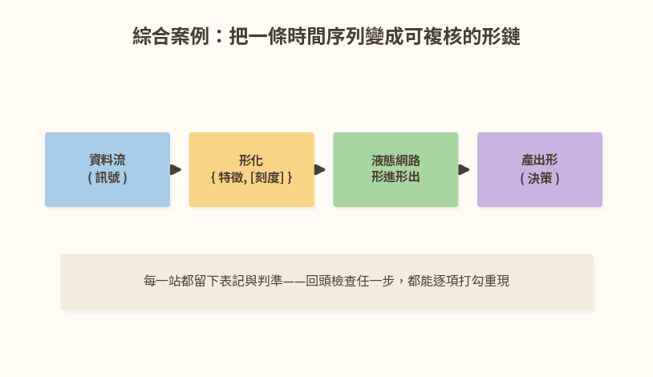

**圖 7-4　綜合案例：把一條時間序列變成可複核的形鏈**

> **【例】案例走讀四問**
>
> ◆ 名稱：Anomaly-LTC-01，id 為模型簽章——( ) 身份立好。
>
> ◆ 輸入形：感測器時序 ( 訊號流 )，含雜訊與缺失——內容可替換，id 不變。
>
> ◆ 輸出形：異常決策形（正常／預警／異常），以 ∩(T) 判準分級。
>
> ◆ 判準：查準率指標＋邊界案例（突波、停機、感測器故障）逐一驗證——準確＝可複核。

## 7-5　驗收標準

方案的最後一頁是驗收。一個人「學會了」這套方法，標準不是考試分數，而是三件可檢查的事：能為任意一個網路寫出完整形集合；能為任意一個判斷走完六步驟並留痕；能用八問自檢並自我修正。三件都過，才算出師。

| 驗收項 | 標準 | 檢查方式 |
| --- | --- | --- |
| 形集合表記 | 任一網路可寫出 { 部件, ( 內容 ), [ 類別 ] } | 隨機抽三個網路現場書寫 |
| 六步驟留痕 | 每步有產出，可逐句打勾重現 | 提交一份完整演練紀錄 |
| 八問自檢 | 八問全過或明確標注存疑項 | 自檢表＋存疑清單 |
| 誤用迴避 | 能指認十六種誤用並給修正 | 誤用診斷報告一份 |
| 建庫能力 | 形庫初版通過三關驗收 | 形庫登錄表＋驗收紀錄 |

> **【練習】E06（方案設計）**
>
> 為你的團隊設計一份兩週濃縮版的學習路線：從五段路線中挑出必修段落，寫出每日主題與產出物，並說明你如何驗收。

# 第八篇　總結

這本冊子從頭到尾只做了一件事：把液態神經網路讀成形，再把形的語言還給工程。收束成三句話。

- **第一句：液態網路是一個形。**它的結構是空間本形——{ 部件, ( 內容 ), [ 類別 ] } 完整表記；它的動態是時間本形——op: Type → Type 形進形出。流動而守恆，正是「形」的本義。

- **第二句：準確＝可複核的準。**三種補足把規則、身份、結構補回來；六步驟把判斷寫出來；八問把關口立起來。閉式解與可審計小電路，是這條標準在工程上的兩個化身。

- **第三句：對讀是為了前進。**本形學給液態網路一套描述、判斷與驗收的語言；液態網路給本形學一個動態、守恆、可審計的活標本。兩者相遇，通往的是 Mind AI 的三統一。

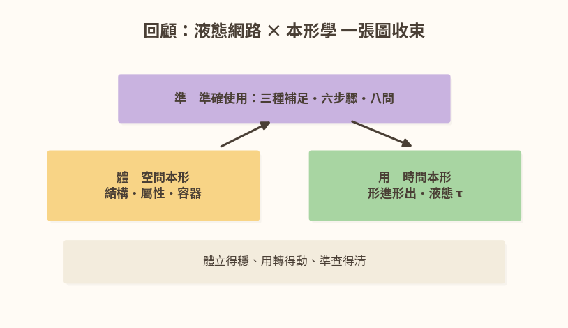

**圖 8-1　回顧：液態網路 × 本形學 一張圖收束**

> **❖　一句話總結**
>
> **液態神經網路流動而守恆，本形學把這份流動中的穩定寫成可複核的形——體立得穩、用轉得動、準查得清。**
>
> 把形看清楚，轉成顯學，實踐化為 Mind AI。

──《液態神經網路與本形學》· 關係・準確使用方法與架構・內容完整方案 ──

# 練習篇

練習共十四題：E01–E06 分佈於各篇內，E07–E12 與 S01–S02 收於此。每題附示範答案（附錄 C）——答案是示範不是標準，你寫出自己的式子才是真正的練習。

**練習 E07–E12**

> **【練習】E07（形集合表記）**
>
> 把 CfC 模型寫成完整形集合表記：列出 BOM（用「拆下來認得自己嗎」判準）、內容、類別，並標出每個部件的 remove 三級歸屬。

> **【練習】E08（不變性公理）**
>
> 一個液態網路經過 INT8 量化後部署到邊緣裝置。用量化的 σ 替換語言寫出這場變動，並判斷 id(N) 是否存續、依據是什麼。

> **【練習】E09（三層判斷）**
>
> 有人說「我們的模型參數只有十萬個，所以它可審計」。用形學三層判斷評論這句話：它在哪一層成立、哪一層不成立？

> **【練習】E10（形進形出）**
>
> 把「因果推理」寫成形進形出的複合鏈：用 remove、σ、ι、≡ 四種基本運算拼出一條推理鏈（提示：果往回推、因往前推）。

> **【練習】E11（選路決策）**
>
> 三個場景選路：① 語音喚醒詞偵測（邊緣、低功耗）② 氣象序列長期預測（資料中心）③ 保險理賠文本分類。各該用什麼模型路線？說明理由與判準。

> **【練習】E12（綜合）**
>
> 用四問卡為一個「醫療時序監測」任務定形：名稱、輸入形、輸出形、判準各寫清楚，並用八問自檢你的四問卡。

**綜整練習 S01–S02**

> **【練習】S01（對讀小論文）**
>
> 以「液態網路的一項特性 × 本形學的一條原理」為題寫一篇千字短文（建議選題：穩定有界 × 不變性公理／閉式解 × 可複核／小電路 × 三層判斷）。要求：用一次六步驟或一張四問卡佐證你的論點。

> **【練習】S02（建庫實作）**
>
> 為你的個人形庫收錄三個形：一個網路形（如 CfC）、一個資料形（如時序資料集）、一個任務形（如異常偵測）。每個形寫完整形集合表記＋四問卡，並用八問自檢後入庫。

# 附錄 A　術語與記號對照

本附錄收齊液態神經網路與本形學兩側的術語對照與記號速查。

## A-1　術語對照表

| 液態網路術語 | 本形學術語 | 一句話 |
| --- | --- | --- |
| Neuron / 神經元 | 單位形（形集合） | { 突觸, ( 訊號流 ), [ τ ] } |
| Layer / 層 | 容器（ι 嵌套鏈一環） | 層層各持身份，不可壓平 |
| Time constant τ(t) | 時間本形（節律） | 時間會呼吸：因形制宜 |
| ODE dynamics | 時間本形（函式） | op: Type → Type |
| Closed-form (CfC) | 可複核的準 | 每一步寫得出來 |
| Robustness / 穩健 | 不變性公理 | 換內容，id(C) 不變 |
| Pruning / 剪枝 | remove 運算 | 移除部件，看同一性 |
| Ablation / 消融 | remove 三級判準 | 必要・降級・非必要 |
| Interpretability | 三層判斷＋表記 | 可審計＝看得清 |
| NCP 神經電路政策 | 可審計自治的形 | 小到每線可查 |
| Continual learning | 形與函式互相長大 | 迴路學習演化 |
| Edge deployment | 形的下放 | 小形入邊緣 |

## A-2　記號速查

| 記號 | 讀法 | 用法 |
| --- | --- | --- |
| { } | 大括號 | 組成集合（部件・BOM） |
| ( ) | 小括號 | 容器集合（內容・身份） |
| [ ] | 中括號 | 抽象集合（類別・屬性） |
| ≡ / ≢ / ⊂ | 同一 / 不同一 / 降級 | remove 三級判準 |
| ∩(T) | 交集判準 | 特徵全數通過才入類 |
| id(C) | 身份識別 | 不隨內容變動的標記 |
| op: Type → Type | 形進形出 | 時間本形一般形式 |
| τ(t) | 液態時間常數 | 隨狀態調制的節律 |

# 附錄 B　速查卡

三面鏡速查卡＋一頁可複印空白模板。建議把 B-3 列印出來隨身帶著，接到任務就填。

## B-1　對讀三面鏡

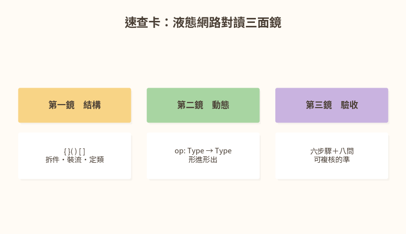

**圖 B-1　速查卡：液態網路對讀三面鏡**

## B-2　六步驟＋八問口袋版

| 六步驟 | 口袋提醒 |
| --- | --- |
| ① 認明整體 | M 是什麼？一句話說得出來嗎？ |
| ② 分軸描述 | X 樣子、Y 組成、Z 位置各寫一次 |
| ③ 寫形集合 | { 部件, ( 內容 ), [ 類別 ] } |
| ④ 選定命題 | 歸屬？不變？分級？ |
| ⑤ 判準推理 | ∩(T) / id(N) / remove 選對再推 |
| ⑥ 三層檢查 | 容器 ∧ BOM ∧ 抽象 →（得證） |

## B-3　可複印空白模板（四問卡＋形集合卡）

（本頁可整頁列印複印使用）

| 欄位 | 填寫處 |
| --- | --- |
| 名稱（它是什麼？id 標記） |  |
| 輸入形（吃進什麼形？） |  |
| 輸出形（吐出什麼形？） |  |
| 判準（怎麼算對？怎麼複核？） |  |
| 形集合 { 部件, ( 內容 ), [ 類別 ] } |  |
| remove 三級：必要件／功能降級件／非必要件 |  |
| 八問自檢結果（✓／×／存疑） |  |

# 附錄 C　練習參考答案

以下為示範答案，按練習編號分四組：E01–E03、E04–E06、E07–E12、S01–S02。示範的是「寫法」不是「唯一解」——你的答案只要走對判準、寫到可複核，就是好答案。

**E01–E03**

> **【答案】E01 對讀暖身**
>
> 示範（以 LSTM 為例）：LSTM = { 輸入門, 遺忘門, 輸出門, 細胞狀態, ( 詞嵌入序列 ), [ 隱藏維度, 層數 ] }。
>
> 分軸：{ } 裡四個部件是 Y 軸（拆下來認得自己）；( 詞嵌入序列 ) 是 Z 軸內容（可替換，id 不變）；[ 隱藏維度, 層數 ] 是 X 軸屬性（維度與刻度）。

> **【答案】E02 remove 實作**
>
> 示範（以 CNN 為例）：必要件——主幹卷積層（remove(p,M) ≢ M，移除後不成網路）；功能降級件——SE 注意力模組（≡ M′ ⊂ M，識別力下降但網路仍成立）；非必要件——權重初始化裝飾（≡ M，移除無影響）。
>
> 判斷依據寫法：每件各寫一次 remove(p,M) 的三種結果對照。

> **【答案】E03 形進形出**
>
> 示範（時間序列分類器）：op: TS → Label。輸入形 TS = ( 時序訊號 )，輸出形 Label = [ 類別 ]（以 ∩(T) 判準分類）。
>
> 依附的空間本形：資料集形（容器裝時序）、特徵形（屬性刻度）、標籤形（抽象類別）。函式吃的是形、吐的也是形——沒有形，函式無物可動。

**E04–E06**

> **【答案】E04 六步驟實作**
>
> 示範骨架：① M =「客服對話分流器」；② X——意圖標籤數、響應延遲；Y——BOM = { 編碼器, 分類頭 }；Z——( 對話流 )；③ 寫形集合；④ 命題：分流器微調後是否同一個？⑤ 微調是 σ 替換權重內容，id 不變（不變性公理）；⑥ 三層檢查後寫（得證）或標注存疑。
>
> 要點：每步留痕——讀者能逐句打勾重現你的推理。

> **【答案】E05 誤用診斷**
>
> 示範：誤用 #4「內容一換就說是別的網路」。情境：模型換了輸入資料源，團隊便另立新模型號。問題：混淆容器與內容的層次。正確寫法：先定 id(N)（模型簽章、架構），內容替換屬 σ 運算，id(N) 不變；另立新號反而切斷了演化鏈。避免方式：每次「換」之前先問——動的是內容，還是身份？

> **【答案】E06 方案設計**
>
> 示範骨架：D1–2 骨幹與對讀（產出：對讀地圖）；D3–5 空間本形（產出：三個形集合）；D6 時間本形（產出：四問卡）；D7–8 準確使用方法（產出：六步驟演練）；D9–10 建庫與驗收（產出：形庫初版＋八問自檢）。驗收：每日產出物過關制，缺件補件再進度。

**E07–E12**

> **【答案】E07 形集合表記**
>
> 示範：CfC = { 輸入映射, 液態閉式核心, 讀出頭, ( 時序輸入 ), [ τ 範圍, 閉式型式 ] }。
>
> remove 三級：液態閉式核心＝必要件（移除後不是 CfC）；讀出頭＝功能降級件（換頭仍可微調）；調試用日誌模組＝非必要件。

> **【答案】E08 不變性公理**
>
> 示範：量化是一場 σ 替換——權重從 FP32 換成 INT8，是 S(N) 的內容替換。若模型簽章（架構、拓撲、語意）不變，id(N) 存續——不變性公理成立；若量化改變了拓撲（如結構化裁剪），則動到 BOM，需重走 remove 三級與三層檢查。

> **【答案】E09 三層判斷**
>
> 示範：這句話在「數」的層次成立（參數少、計量小），但在三層判斷上只沾到一角。容器層未驗（id 不變嗎）；BOM 層未驗（部件可 remove 分級嗎）；抽象層未驗（行為可規則化檢驗嗎）。形學結論：數＝形裡小形・次比較——參數少不等於可審計，三層聯合才算。

> **【答案】E10 形進形出**
>
> 示範推理鏈（果因）：remove（從現象拆出候選因）→ σ（替換情境做對照）→ ι 反查（沿嵌套鏈回溯身位）→ ≡（比對與已知因是否同一）。整條鏈吃進現象形、吐出因果形——形進形出的高階複合。

> **【答案】E11 選路決策**
>
> 示範：① 喚醒詞偵測——連續時序、邊緣低功耗，走液態路線取 CfC（求快・可複核）；② 氣象長期預測——連續時序、求穩健，液態路線可試 LTC，判準用長期預測指標；③ 理賠文本分類——非連續時間序列決策，走其他模型，不必硬套。

> **【答案】E12 綜合四問卡**
>
> 示範：名稱 Med-Seq-01（id＝模型簽章）；輸入形 ( 生理時序流 )（可替換內容）；輸出形 [ 風險分級 ]（∩(T) 判準）；判準——查準查全＋邊界案例（感測器脫落、突波）＋八問自檢。八問若第七問（每步可檢驗）存疑，補記閉式演化軌跡再進。

**S01–S02**

> **【答案】S01 對讀小論文**
>
> 示範題〈穩定有界 × 不變性公理〉要點：液態網路的穩定有界（論文以軌跡長度與動態界證明）與不變性公理（換內容 id 不變）是同一件事的兩種說法——流動不失控、守恆不僵化。佐證可用四問卡：判準欄寫「擾動測試下 id(N) 存續且動態有界」。

> **【答案】S02 建庫實作**
>
> 示範登錄表三行：① 形「CfC」——{ 輸入映射, 液態閉式核心, 讀出頭, ( 時序輸入 ), [ τ 範圍 ] }，四問卡齊；② 形「時序資料集」——{ 特徵表, ( 原始流 ), [ 類別標籤 ] }；③ 形「異常偵測任務」——{ 指標, ( 預測流 ), [ 判準 ] }。三形各過八問後入庫。

# 附錄 D　圖表索引

全書 40 張圖依序索引，方便檢索回查。

| 圖號 | 標題 |
| --- | --- |
| 圖 D-1 | 本冊四柱：關係 → 架構 → 方法 → 方案 |
| 圖 1-1 | 液態神經網路系譜：從離散步到連續時間 |
| 圖 1-2 | 液態時間常數 τ(t)：時間會呼吸 |
| 圖 1-3 | 認知鏈回顧：異同 → 分合 → 形 → 名 |
| 圖 2-1 | 三條軸・三種括號：把一個液態網路完整描述 |
| 圖 2-2 | 單位形＝形集合：一個神經元的完整表記 |
| 圖 2-3 | 對讀地圖：液態神經網路 × 本形學 |
| 圖 2-4 | 【C1】系譜深化：每一代解決上一代的什麼缺口 |
| 圖 3-1 | 空間本形：拆開一個液態網路 |
| 圖 3-2 | remove 三級判準：網路部件的依存分級 |
| 圖 3-3 | 不變性公理 × 穩健性：流動的內容，不動的身份 |
| 圖 3-4 | 液態的形學意義：有合必有形，流動仍是一體 |
| 圖 3-5 | 嵌套運算 ι：形入容器，層層各持身份 |
| 圖 3-6 | 三層判斷 × 可審計：小網路為什麼可信 |
| 圖 3-7 | 空間本形對讀小結：網路的形，穩穩立住 |
| 圖 4-1 | 時間本形 ＝ 函式 ＝ 形進形出 |
| 圖 4-2 | 離散步 vs 連續時間：階梯與河流 |
| 圖 4-3 | LTC 神經元解剖：線性一階動態 × 非線性互連閘門 |
| 圖 4-4 | CfC 閉式解：把「逐步求解」變成「一步寫出」 |
| 圖 4-5 | 持續學習迴圈：形與函式互相長大 |
| 圖 5-1 | 總架構核心：體 — 用 — 準 |
| 圖 5-2 | 三種補足：把被省略的資訊裝回液態網路 |
| 圖 5-3 | 六步驟：把一個液態網路的判斷寫到可複核 |
| 圖 5-4 | 八問檢查清單：交出判斷前的自我驗收 |
| 圖 5-5 | 誤用對照：十六種常見偏差的共同根源 |
| 圖 5-6 | 完整示範：一個自駕決策網路走完六步驟 |
| 圖 5-7 | 情境選路：什麼時候用液態網路？ |
| 圖 5-8 | 【C4】神經電路政策 NCP：19 個神經元的可審計自治 |
| 圖 5-9 | 【C5】Liquid AI：把液態網路帶到邊緣裝置 |
| 圖 6-1 | 兩庫一中樞一迴路 × 液態網路 |
| 圖 6-2 | 一張表看懂：液態網路 ↔ 本形學 對讀總表 |
| 圖 6-3 | 四問卡：為你的液態任務定形 |
| 圖 6-4 | 通往 Mind AI：知識統一 → 思維統一 → 智慧統一 |
| 圖 7-1 | 五段路線：學 → 練 → 用 → 教 → 建 |
| 圖 7-2 | 八週學習路線：從對讀到建庫 |
| 圖 7-3 | 建庫四階段：從散件到可複核的形庫 |
| 圖 7-4 | 綜合案例：把一條時間序列變成可複核的形鏈 |
| 圖 8-1 | 回顧：液態網路 × 本形學 一張圖收束 |
| 圖 B-1 | 速查卡：液態網路對讀三面鏡 |
| 圖 D-2 | 封面意象：液態波 × 形的結晶 |

## 編後記

這本冊子誕生於一個簡單的觀察：2021 年的液態時間常數網路論文裡，「時間常數隨狀態流動」這句話，與本形學「時間本形依附空間本形、形進形出」的定義，說的竟是同一件事——只是兩套語言彼此還不相識。把兩套語言接上軌，就成了這本書。

對讀做得越深，越確認一件事：液態網路的三個關鍵詞——流動、守恆、可審計——恰好就是「形」的三個面相。流動是時間本形的形進形出，守恆是空間本形的不變性公理，可審計是準確使用方法的可複核標準。工程界用微分方程與閉式解把這三件事做出了來，形學用括號、判準與六步驟把這三件事說清楚；做出來與說清楚，本來就該是一對。

留下三件事給讀者繼續走。第一，把四問卡用在你手上的每一個模型——先定形，再動手。第二，把六步驟走成習慣——判斷寫到可複核，是對自己時間的尊重。第三，把你的形收進形庫——形與函式互相長大，一個人的形庫，就是一個人的 Mind AI 起點。

*推導一次，是收穫；把推導變成方法，是讓收穫可以重複發生。*

> **❖　全書終**
>
> **把形看清楚，轉成顯學，實踐化為 Mind AI。**
>
> www.longreat.net　·　本形學 Ontypology 系列
