# 物理證明 Physical proof

**本形學 Ontypology**

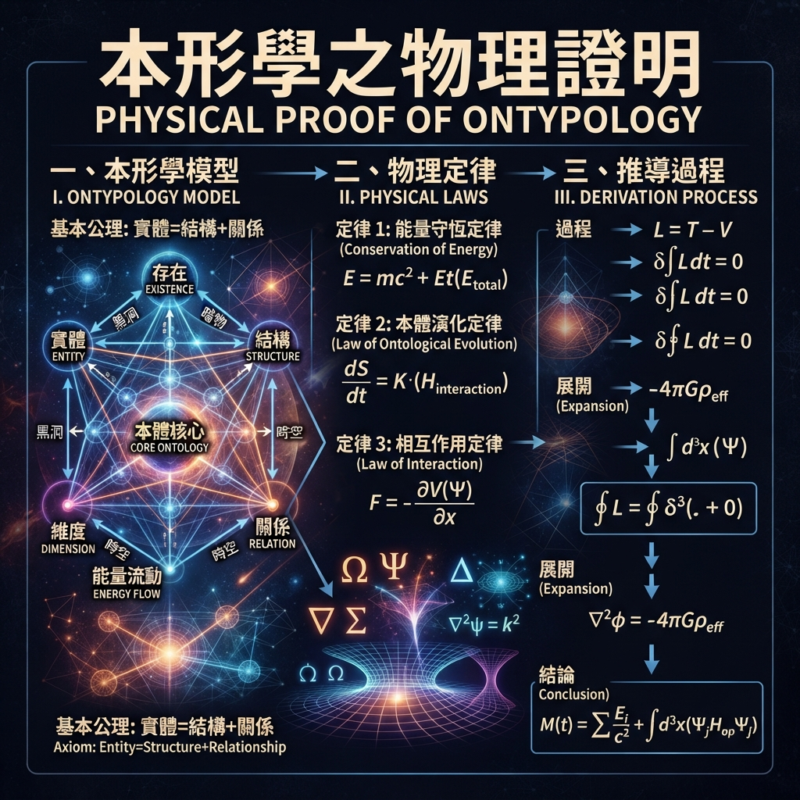

# 目　錄

- 寫在前面——物理證明篇的任務
- 導讀——物理證明的兩種語言
- 第一章　物理證明在方程式裡做什麼
  - 1.1　物理證明的三件套：模型、定律、推導
  - 1.2　方程式語言做得到什麼
  - 1.3　四處缺口：規則、身份、結構、過程
- 第二章　空間本形：替物理系統立形
  - 2.1　[ ] 屬性：物理量＝維度 × 刻度
  - 2.2　( ) 容器：系統邊界＝身份
  - 2.3　{ } 組成：BOM 判準與 remove 三級
  - 2.4　證明示範：形集合與三層判斷
- 第三章　時間本形：把過程寫成函式
  - 3.1　時間本形＝函式：形進形出
  - 3.2　函式四問卡：把定律寫成卡
  - 3.3　守恆律＝時間軸上的不變性公理
  - 3.4　證明示範：自由落體的函式鏈
- 第四章　五大域證明示範
  - 4.1　力學：碰撞中的動量守恆
  - 4.2　熱學：熱平衡中的能量守恆
  - 4.3　電磁：RC 電路的充電過程
  - 4.4　波動光學：雙狹縫干涉的歸類判準
  - 4.5　近代：光電效應的邊界案例
- 第五章　準確使用方法——把補足裝回物理證明
  - 5.1　物理證明六步驟
  - 5.2　完整範例：杯中熱水冷卻
  - 5.3　誤用對照：五種常見錯誤
  - 5.4　交出證明前的檢查清單
- 回顧——要點總整理與自我檢查
- 附錄　術語與記號速查

# 寫在前面——物理證明篇的任務

這本小書是《單位形與集合邏輯》的補足篇，與《數學證明》是姊妹篇。《數學證明》回答的是：用集合論的記號寫數學證明時，這套工具怎麼用才準。本書回答平行的另一個問題：當對象換成物理──力學的碰撞、熱學的平衡、電磁的電路、光的干涉、原子的世界──證明該怎麼立形、怎麼推導、怎麼驗收？

具體地說，本書做三件事。第一，把物理證明的現場看清楚：一個物理推導靠什麼站穩？方程式的語言在哪裡不夠用？第二，把本形學的兩大支柱全部用上：空間本形（名詞）替物理系統立形，三種括號補回規則、身份、結構；時間本形（動詞）把物理過程寫成函式，讓守恆與演化的每一步都有軌道。第三，收攏成完整的「準確使用方法」架構：三種補足、證明六步驟、三層檢查、誤用對照與八問清單──而且五大域各配一則可以照抄格式的證明示範。

> **閱讀本書的三個約定**
>
> ◆　約定一：三種括號各有專屬職務。大括號 { } 是組成集合（物料清單）、中括號 [ ] 是抽象集合（屬性）、小括號 ( ) 是容器集合（空間容器）。
>
> ◆　約定二：形的英文是 Type──一個被完整描述的對象。全書直接用「形」，不另標註。
>
> ◆　約定三：五大域全涵蓋──力學、熱學、電磁、波動光學、近代物理各得一則示範；杯子仍是全書最忠實的標本。

| 證明中的缺口 | 補足工具 | 用到的判準 | 章節 |
| --- | --- | --- | --- |
| 規則被省略──類別寫成死清單 | [ ] 抽象集合 | T = (F(T), ∩(T)) | 第二章 |
| 身份被省略──過程一走就散 | ( ) 容器集合 | C = (id(C), S(C))、不變性公理 | 第二章 |
| 結構被省略──部件只是並列 | { } 組成集合 | BOM 判準、remove 三級 | 第二章 |
| 過程被省略──輸入輸出沒寫 | 時間本形 | op：形 → 形、函式四問 | 第三章 |
| 四者合流──裝回同一個證明 | 六步驟＋三層檢查 | ∩(T)・id(C)・remove 聯合 | 第五章 |

**表 0-1　補足地圖：物理證明的四處缺口與四件工具**

**證明寫得準，是因為每一層資訊都寫在它該在的位置上。**

# 導讀——物理證明的兩種語言

物理證明幾乎都用方程式的語言寫成。這門語言的優點是極精確：F = ma 只說一件事，說到小數點後十位也不含糊。正因為假設得最少，它也省略得最多──系統的邊界、部件的依存、身份的恆定、過程的輸入與輸出，在一行行漂亮的式子裡全部被壓平。

形的語言補的正是這四層。空間本形替系統立形：用 { } 寫下組成結構、用 ( ) 寫下不隨內容改變的身份、用 [ ] 寫下可以自動判斷新成員的生成規則。時間本形替過程立形：每一個物理過程都是一個函式，輸入一個形、產出一個形。兩種語言不是互相取代，而是疊加──證明的骨架用方程式寫，證明的完整度靠形來補。

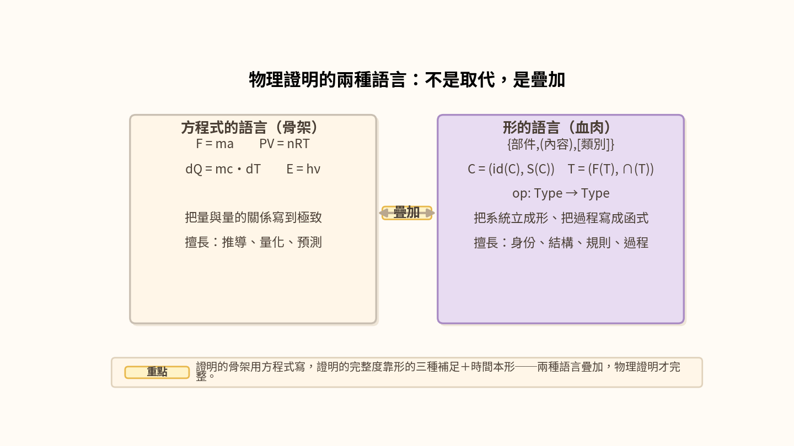

**圖 D-1　物理證明的兩種語言：方程式核心與形的加值**

| 支柱 | 括號／記號 | 職務 | 物理中的化身 |
| --- | --- | --- | --- |
| 空間本形（名詞） | [ ] 屬性 | 維度 × 刻度 | 物理量：長度、溫度、能量 |
| 空間本形（名詞） | { } 組成 | BOM、remove 三級 | 系統部件：電阻、電容、杯蓋 |
| 空間本形（名詞） | ( ) 容器 | id(C)、不變性公理 | 系統邊界：封閉系統、孤立系統 |
| 時間本形（動詞） | op：形 → 形 | 函式四問、形進形出 | 物理定律與過程：F = ma、冷卻、充電 |

**表 D-1　空間本形與時間本形速覽**

> **一句話，拆四層**
>
> ◆　「杯裡的熱水冷卻了」應拆成四層：規則（∩(T) 判定）、身份（id 不變）、結構（部件依存）、過程（冷卻函式轉換形）。
>
> ◆　方程式只寫下一角；四層都補上，物理證明才算完整。

# 第一章　物理證明在方程式裡做什麼

寫一個物理證明之前，先弄清楚它靠什麼站穩。這一章拆解物理證明的三件套，看看方程式語言做得到什麼、又在哪四處留下缺口──缺口在哪，補足就往哪去。

## 1.1　物理證明的三件套：模型、定律、推導

任何一個物理證明，翻開來都是三樣東西的組合。模型：先立形，說清楚你談的對象是誰、邊界在哪、做了哪些理想化──「光滑平面」「理想氣體」「質點」都是形的入場規則。定律：給出可以逐項驗證的判準──F = ma、能量守恆、理想氣體方程，每條都是一把尺。推導：從模型與定律出發一步步走向結論，每一步都能被檢驗。

三件套缺一不可。沒有模型，證明沒有對象；沒有定律，證明只能靠感覺；沒有推導，只有結論沒有過程。物理與純數學還有一點不同：推導得證之後，還有實驗這一關──結論要拿回去跟世界對帳，這正是「可複核的準」在物理裡的完整含義。

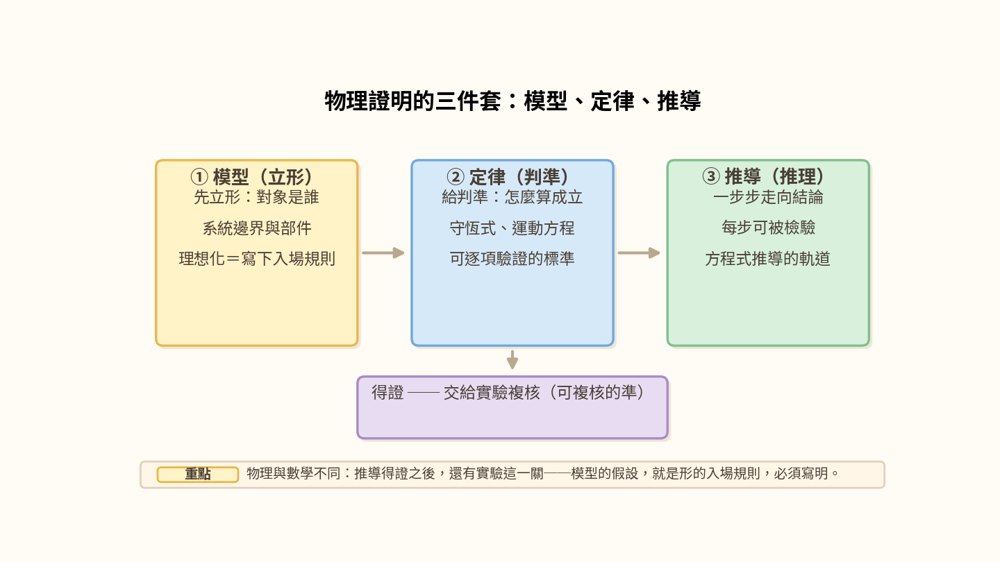

**圖 1-1　物理證明的三件套：模型、定律、推導**

## 1.2　方程式語言做得到什麼

方程式語言的核心是等號兩邊的量與關係。「F = ma」把力、質量、加速度鎖進一個等式；「PV = nRT」把四個狀態量綁在一起。它可以精確地陳述比例、守恆、演化──大部分物理推導的骨架，都用這幾個式子搭起來。

| 式子 | 讀法 | 在證明中的用途 |
| --- | --- | --- |
| F = ma | 力與加速度的等式 | 推導運動（過程的骨架） |
| PV = nRT | 狀態量的約束 | 約束可能的狀態（規則的骨架） |
| Q = mc·ΔT | 熱量與溫度 | 推導能量轉移（內容的變化） |
| E = hν | 能量與頻率 | 判斷量子事件（判準的骨架） |

**表 1-1　常見方程式與它在證明中的能力**

對物理推導來說，這已經夠用──前提是，你只需要回答「量等不等」。一旦證明裡需要追問「這系統由什麼組成」「換了內容還是同一個嗎」「這條定律吃什麼吐什麼」「新情況算不算這一類」，方程式就開始省略。

## 1.3　四處缺口：規則、身份、結構、過程

方程式把四層資訊省略掉了，落在物理證明上，就是四處具體的缺口。

缺口一，規則。{ 馬克杯, 玻璃杯, 紙杯 } 是一份寫死的清單──新出現的保溫杯算不算「杯子」？同理，「什麼算理想氣體」「什麼算簡諧運動」，都需要一條開放的生成規則，而不是幾個背熟的例子。

缺口二，身份。杯子裡的水從 80°C 降到室溫，內容變了、溫度變了，杯子還是那只杯子、系統還是那個系統。方程式寫下 T(t) 的曲線，卻不回答「沿途是不是同一個」──證明裡凡是需要「在變動中保持同一」的地方，都需要一個不隨內容改變的身份。

缺口三，結構。{ 電源, 電阻, 電容, 導線 } 四個元件並列，看不出誰依存於誰──拆掉電源和拆掉裝飾燈，後果完全不同。凡是需要「分清主次」的地方，都需要部件的依存結構。

缺口四，過程。方程式寫下狀態之間的關係，但「這個過程吃進什麼形、吐出什麼形」被壓平了──推導跳步，往往就是輸入形與輸出形沒有寫明。凡是需要「過程可複核」的地方，都需要時間本形。

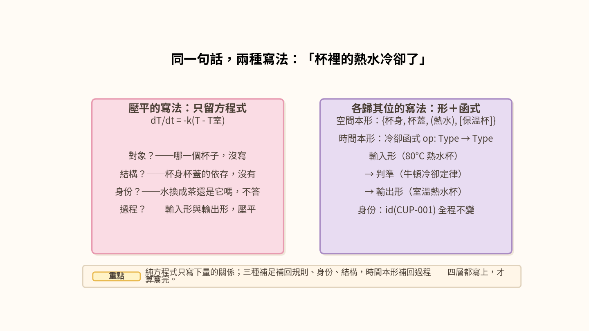

**圖 1-2　同一句話，兩種寫法：層次被壓平與各歸其位**

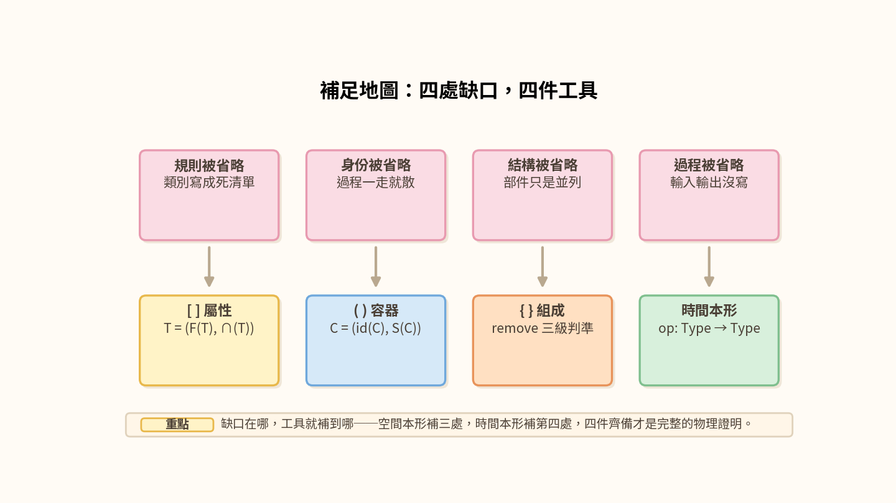

**圖 1-3　補足地圖：四處缺口各有專屬的補法**

| 缺口 | 方程式式的寫法 | 補足後的寫法 | 工具 |
| --- | --- | --- | --- |
| 規則 | 例子清單（封閉） | [ x｜x 通過 ∩(T) ]（開放規則） | [ ] |
| 身份 | T(t) 曲線（過程散了） | (熱水) → (冷水)，id(C) 不變 | ( ) |
| 結構 | 元件並列（不分主次） | remove(p, M) 三級分類 | { } |
| 過程 | 直接跳到結論 | op：輸入形 → 輸出形，逐步寫明 | 時間本形 |

**表 1-2　四處缺口與四件工具**

> **本章重點**
>
> ◆　三件套：模型（立形）、定律（判準）、推導（推理）──得證之後還有實驗複核。
>
> ◆　方程式語言精確回答「量等不等」，其餘四層全部省略。
>
> ◆　四處缺口──規則、身份、結構、過程──各由 [ ]、( )、{ }、時間本形補足。

> **練習（P1）**
>
> P1-1　把「一顆蘋果從樹上落下」寫成一句話，指出這句話裡被省略的四層資訊各是什麼。
>
> P1-2　「理想氣體」為什麼是一條規則而不是一份清單？試舉一個邊界案例（提示：低溫高壓的氣體）。
>
> P1-3　在 dT/dt = -k(T - T室) 這個式子裡，哪一部分回答了「身份」？哪一部分沒有？
>
> 提示：先問自己──這句話談的是哪一個整體？

# 第二章　空間本形：替物理系統立形

空間本形是名詞的形──描述一個物理系統「是什麼」。三條軸各配一種括號：X 屬性用 [ ]，把物理量寫成維度與刻度；Y 物料清單用 { }，把部件寫成依存結構；Z 容器用 ( )，把系統邊界寫成不變的身份。三軸立齊，一個物理系統才立得住。

## 2.1　[ ] 屬性：物理量＝維度 × 刻度

每個物理量都可以拆成兩半：維度問「量的是什麼」──長度、質量、時間、溫度；刻度問「讀到哪一格」──單位與讀數，例如攝氏 100 度。維度是屬性的欄位，刻度是欄位上的格子。[ ] 裡裝的，正是這組「欄位 × 格子」的規則。

這裡接上本形學的一條核心命題：數，是形裡面的小形、次比較。100°C 不是一個孤零零的數字，而是「溫度這個形」裡、刻度 100 上的一次比較結果。測量就是讀取刻度，計算就是刻度之間的比較──先有形，才有數。

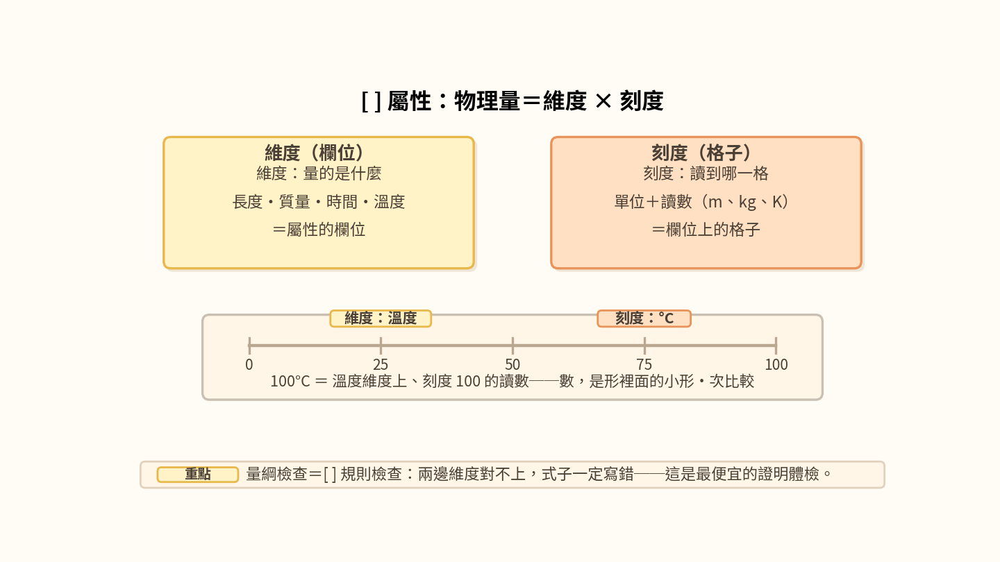

**圖 2-1　[ ] 屬性：物理量＝維度 × 刻度**

| 物理量 | 維度（欄位） | 刻度（格子） | 形學讀法 |
| --- | --- | --- | --- |
| 長度 2.4 m | 長度 | 公尺 | 長度形上的刻度讀數 |
| 溫度 100°C | 溫度 | 攝氏度 | 溫度形上的刻度讀數 |
| 能量 5 J | 能量 | 焦耳 | 能量形上的刻度讀數 |

**表 2-1　物理量的維度與刻度**

實用上，[ ] 規則還送你一件免費的體檢工具：量綱檢查。等號兩邊的維度對不上，式子一定寫錯──這是最便宜、也最難騙過的證明檢查。

## 2.2　( ) 容器：系統邊界＝身份

把容器寫成二元組：C = ( 身份識別 id(C), 內部空間 S(C) )。id(C) 是不隨 S(C) 內容變動而改變的標記；S(C) 是可以容納、可以替換內容的空間。不變性公理說：對任意 e1、e2 屬於 S(C)，替換 e1 為 e2，不改變 id(C)。

物理系統首先是個容器問題：邊界畫在哪、什麼可以進出、什麼必須隔絕。開放系統在 ( ) 的入場規則裡寫明交換項；封閉系統隔絕物質交換；孤立系統連能量都隔絕──寫法都是同一種：先寫 id(C)，再寫 S(C) 能收什麼。杯子是練習容器最好的標本：水換成茶，id(CUP-001) 不變；杯子摔了，身份才終結。

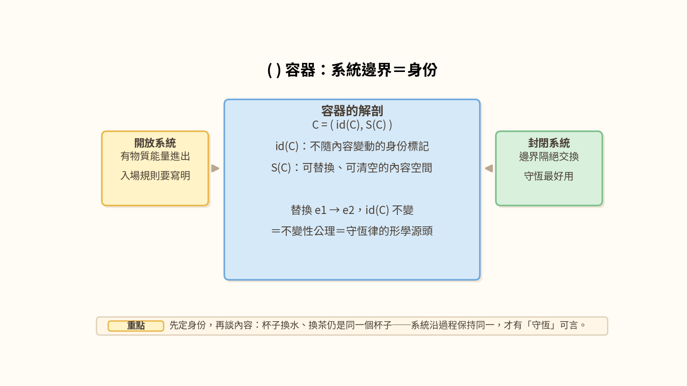

**圖 2-2　( ) 容器：系統邊界＝身份**

> **定義（容器・物理版）**
>
> ◆　容器 C = ( id(C), S(C) )；id(C) 不隨內容變動而改變。
>
> ◆　不變性公理：對任意 e1, e2 ∈ S(C)，替換 e1 為 e2 不改變 id(C)。
>
> ◆　入場規則：開放／封閉／孤立，差別只在 ( ) 允許進出的項目清單──規則要寫明。

## 2.3　{ } 組成：BOM 判準與 remove 三級

部件清單人人會列，證明要的是依存。先過 BOM 判準：拆下來認得自己嗎？電阻拆下來仍是一個電阻，進 BOM；「導電性」拆下來什麼都不是，進屬性。再用 remove 判準分級：把部件 p 從整體 M 移除，看結果落在哪一級。

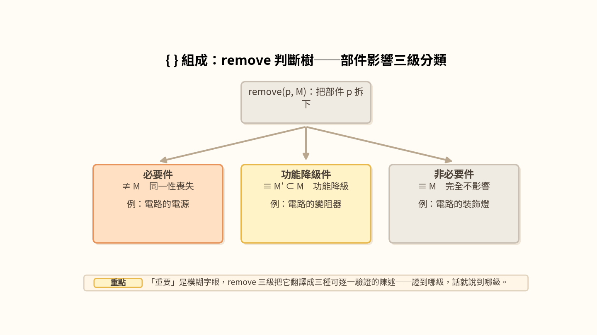

**圖 2-3　{ } 組成：remove 判斷樹──部件影響三級分類**

| 等級 | 判斷結果 | 電路範例 | 證明中的用法 |
| --- | --- | --- | --- |
| 必要件 | remove(p,M) ≢ M | 電源 | 證「少了它就不成整體」 |
| 功能降級件 | remove(p,M) ≡ M′ ⊂ M | 變阻器 | 證「功能缺、身份存」 |
| 非必要件 | remove(p,M) ≡ M | 裝飾燈 | 證「移除後完全不影響」 |

**表 2-2　remove 三級判準（物理系統版）**

與 2.2 對照：不變性公理守的是容器的內容替換，remove 判準守的是整體的部件移除──一內一外，層次分明。「重要」這個模糊的字眼，就此翻譯成三種可以逐一驗證的陳述。

## 2.4　證明示範：形集合與三層判斷

三軸立齊後，一個物理系統可以寫成完整的單位形：{ 部件, (內容), [類別] }。寫得出來，才判得下去──判斷用三層：容器層驗身份、BOM 層驗結構、抽象層驗歸類，三層聯合 J = J_C ∧ J_B ∧ J_T，缺一不可。

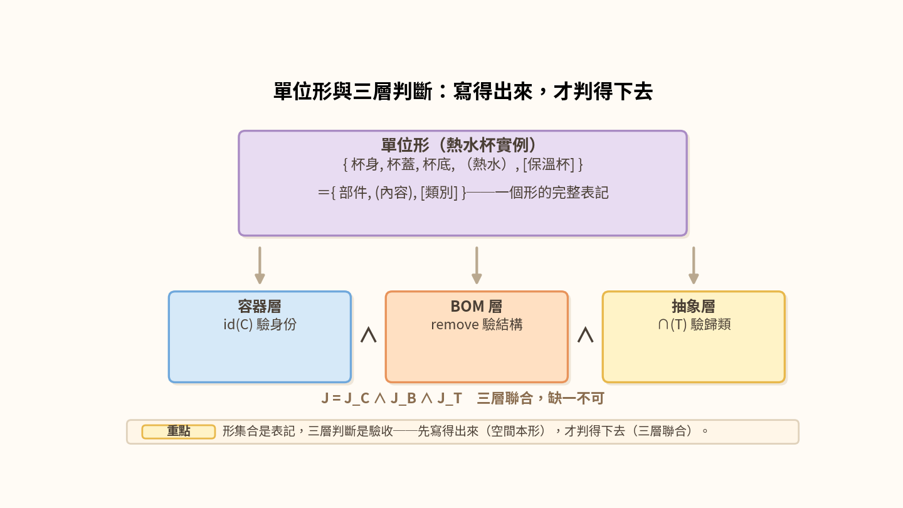

**圖 2-4　單位形與三層判斷：寫得出來，才判得下去**

> **證明示範**
>
> 【定理】杯中熱水可以寫成合格的單位形，且換水後系統仍是同一個系統。
>
> 【證明】
>
> (1) 認明整體：M ＝ 這只杯子（CUP-001）。
>
> (2) 分軸描述：[ ] 溫度 80°C（維度＝溫度、刻度＝°C）；{ } BOM ＝ {杯身, 杯底, 杯蓋}（各過「拆下來認得自己」檢核）；( ) S(M) ＝ (熱水)。
>
> (3) 寫形集合：M ＝ { {杯身, 杯底, 杯蓋}, (熱水), [保溫杯] }。
>
> (4) 三層判斷：容器層──倒掉水換茶，id(CUP-001) 不變，✓；BOM 層──remove(杯蓋, M) ≡ M′ ⊂ M（降級件）、remove(杯底, M) ≢ M（必要件），分級明確，✓；抽象層──F(保溫杯) ＝ {能盛裝液體, 能被手持飲用, 能減緩熱散失} 逐項通過 ∩(T)，✓。
>
> (5) 三層全過：J = J_C ∧ J_B ∧ J_T 成立。（得證）
>
> 【對照】{熱水} 換成 {茶} 是另一個集合；(熱水) 換成 (茶) 還是同一個容器──差別不在內容，在身份。

> **本章重點**
>
> ◆　[ ] 物理量＝維度 × 刻度──數是形裡的小形・次比較，量綱檢查是最便宜的體檢。
>
> ◆　( ) 容器 C = (id(C), S(C))──先定身份再談內容，入場規則寫明開放／封閉。
>
> ◆　{ } 組成──BOM 判準分內外，remove 三級分主次；單位形寫全，三層判斷才走得完。

> **練習（P2）**
>
> P2-1　把「一盞亮著的檯燈」寫成單位形 {部件, (內容), [類別]}，並標出 id(C)。
>
> P2-2　對你的檯燈做 remove 分級：燈泡、電線、燈罩、裝飾貼紙各屬哪一級？說出每一級的判斷理由。
>
> P2-3　用 ∩(T) 判斷：頭燈（戴在頭上的燈）算不算 [檯燈]？你的 F(T) 要不要加特徵？
>
> 提示：先寫 F(T)，再讓每個候選物件過篩網──特徵清單的選擇，就是你對「燈」的立場。

# 第三章　時間本形：把過程寫成函式

時間本形是動詞的形──描述一個物理過程「怎麼運作」。在本形學裡，時間本形就是函式：輸入一個形、產出一個形，寫作 op：形 → 形。物理定律正是時間本形的基本款：每條定律都是一張把系統形轉成系統形的轉換卡。時間本形依附空間本形而存在──先有系統的形，才有過程可言。

## 3.1　時間本形＝函式：形進形出

把「過程」立成形，第一件事是寫明輸入形與輸出形。蘋果落下：輸入形是「高處放開的蘋果」，經過重力定律與牛頓第二定律兩張轉換卡，輸出形是「等加速落下的蘋果」。冷卻：輸入形是「80°C 的熱水杯」，輸出形是「室溫的熱水杯」。形進形出，過程才有了可以檢查的兩端。

時間本形不止是單條函式。本形學的時間本形函式庫收納了十二群方法──函式搜尋、設計搜尋與萃取、設計模式、邏輯生成與應用、持續學習、重構重組、解題、分析、設計、推理（因果、果因、模擬、統計、逆向）、思考法、研發探索、自我演化。物理學家日常用的正是這個庫：解題群對應解方程、推理群對應從結果回推原因（果因）、模擬群對應思想實驗。

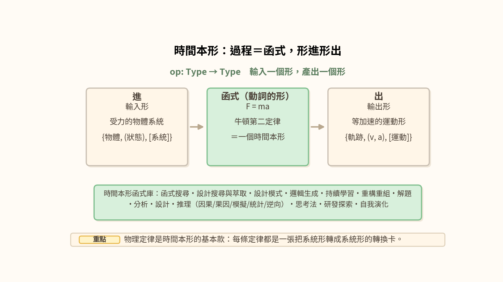

**圖 3-1　時間本形：過程＝函式，形進形出**

## 3.2　函式四問卡：把定律寫成卡

一條定律要用得準，先寫成一張函式四問卡：名稱是什麼、輸入形是什麼、輸出形是什麼、判準是什麼。四問答齊，定律才算「可以拿來用」的函式──特別是判準欄：它寫明這張卡成立的條件與刻度。

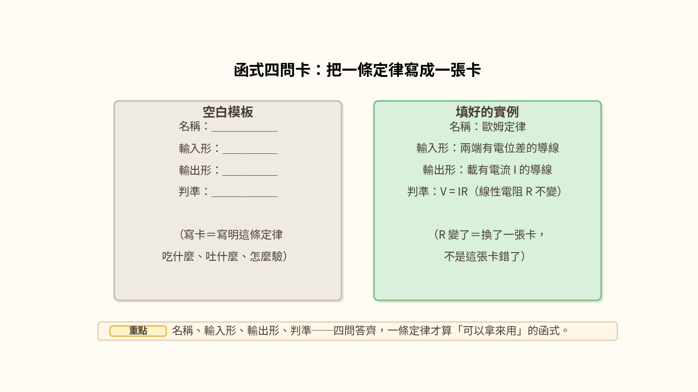

**圖 3-2　函式四問卡：空白模板與填好的實例**

| 定律（名稱） | 輸入形 | 輸出形 | 判準 |
| --- | --- | --- | --- |
| 牛頓第二定律 | 受合力的物體 | 有加速度的物體 | F = ma |
| 歐姆定律 | 兩端有電位差的導線 | 載有電流的導線 | V = IR（R 不變） |
| 熱傳導定律 | 兩側有溫差的壁面 | 傳遞熱量的壁面 | Q/t = kA·ΔT/L |

**表 3-1　三張函式四問卡**

用卡有一個要領：參數變了是換卡，不是卡錯。導線的 R 變了，就換一張「非線性電阻」的卡──而不是硬套原來那張卡再怪世界不聽話。

## 3.3　守恆律＝時間軸上的不變性公理

空間本形的不變性公理說：內容替換，id(C) 不變。把同一條公理放到時間軸上，就得到守恆律：過程走完、內容全換，撐住身份的那個量不變──能量守恆、動量守恆、電荷守恆，都是系統在時間軸上「還是同一個」的憑據。

在證明裡，它的化身叫不變量：一個在某類變動下保持成立的性質。寫進證明固定走五步：定身份、列可變內容、寫不變式、逐步替換檢查、下結論。反過來用也成立：要證明「兩個狀態屬於同一個系統」，最省力的路徑是找到撐住身份的不變量，而不是逐一比對內容。

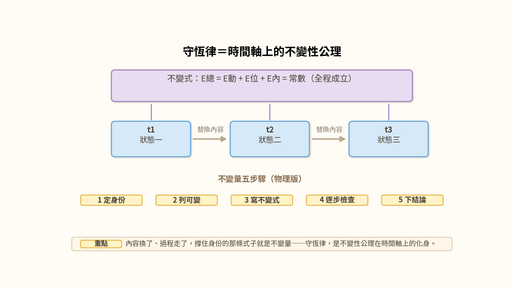

**圖 3-3　守恆律＝時間軸上的不變性公理**

## 3.4　證明示範：自由落體的函式鏈

> **證明示範**
>
> 【定理】初速為零的自由落體，其速度 v = g·t、位移 h = ½g·t²。
>
> 【證明】
>
> (1) 寫出輸入形：M ＝ 高處放開的蘋果（初速 0、受重力）。
>
> (2) 函式①（重力定律卡）：輸入形 M → 輸出形「受力 F = mg 的蘋果」。
>
> (3) 函式②（牛頓第二定律卡）：輸入形「受力 F = mg」→ 輸出形「加速度 a = g 的蘋果」。
>
> (4) 對 a = g 逐步積分（每次積分都是一張「積分卡」，輸入形進、輸出形出）：v = g·t，h = ½g·t²。
>
> (5) 三層檢查：容器──空氣阻力列入 S(M) 的入場規則後 id(M) 不變；BOM──地球引力場為必要件；抽象──全程通過 [自由落體] 的 ∩(T)。（得證）
>
> 【對照】直接寫 h = ½g·t² 是跳步；函式鏈把每一環的輸入形與輸出形寫明，推導才可複核。

把 3.1 到 3.3 的配備，裝進一個最小的推導。

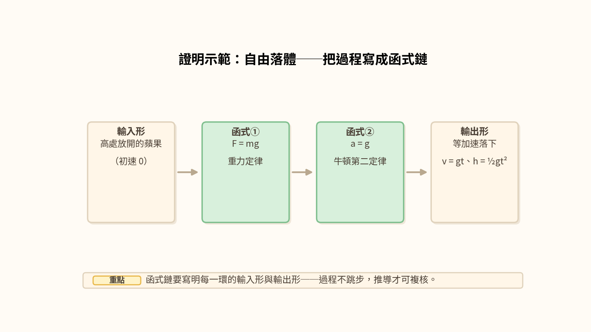

**圖 3-4　證明示範：自由落體──把過程寫成函式鏈**

> **本章重點**
>
> ◆　時間本形＝函式：op：形 → 形──物理定律是基本款，函式庫十二群是全套工具。
>
> ◆　函式四問卡：名稱、輸入形、輸出形、判準──參數變了是換卡，不是卡錯。
>
> ◆　守恆律＝時間軸上的不變性公理──不變量五步驟：定身份、列可變、寫不變式、逐步查、下結論。

> **練習（P3）**
>
> P3-1　替「歐姆定律」與「牛頓冷卻定律」各填一張函式四問卡。
>
> P3-2　鐘擺從一側盪到另一側：寫出輸入形、輸出形，並指出守恆的不變量是哪個量。
>
> P3-3　為什麼說「參數變了是換卡，不是卡錯」？試舉一個物理例子。
>
> 提示：輸入形與輸出形都要寫「形」──系統＋狀態，而不只是數值。

# 第四章　五大域證明示範

工具都已就位。這一章把同一套方法推上五大域的現場──力學、熱學、電磁、波動光學、近代物理各一則。每則都按同一格式：寫定理、立形、選判準、推導、三層收束。讀者可以照著格式，換上自己的題目。先看路線圖：

| 領域 | 命題 | 主要判準 | 形學落點 |
| --- | --- | --- | --- |
| 力學 | 動量守恆 | dP/dt = F外 = 0 | ( ) 入場規則＋不變量 |
| 熱學 | 能量守恆 | Q失 = Q得 | 不變性公理（時間版） |
| 電磁 | RC 充電解 | V0 = iR + q/C | 時間本形函式鏈 |
| 波動光學 | 亮暗紋判準 | d·sinθ = m·λ | ∩(T) 归類漏斗 |
| 近代 | 光電效應 | h·ν = W + Ek | 邊界案例＋刻度離散 |

**表 4-1　五大域示範總表**

## 4.1　力學：碰撞中的動量守恆

> **證明示範・力學**
>
> 【定理】外力和為零的兩球碰撞，總動量守恆。
>
> 【證明】(1) 立形：M ＝ {球1, 球2}，( ) 入場規則＝外力和為零；(2) 不變式候選：P = m1·u1 + m2·u2；(3) 由牛頓第二定律 dP/dt = F外 = 0，P 對時間不變；(4) 代入碰撞前後狀態：m1·u1 + m2·u2 = m1·v1 + m2·v2；(5) 三層檢查：容器──id(M) 不變；BOM──兩球皆必要件；抽象──通過 [碰撞] 的 ∩(T)。（得證）

兩球在光滑水平面上碰撞。系統取兩球為一體，( ) 的入場規則寫明「系統外力和為零」──這是守恆的立足點。

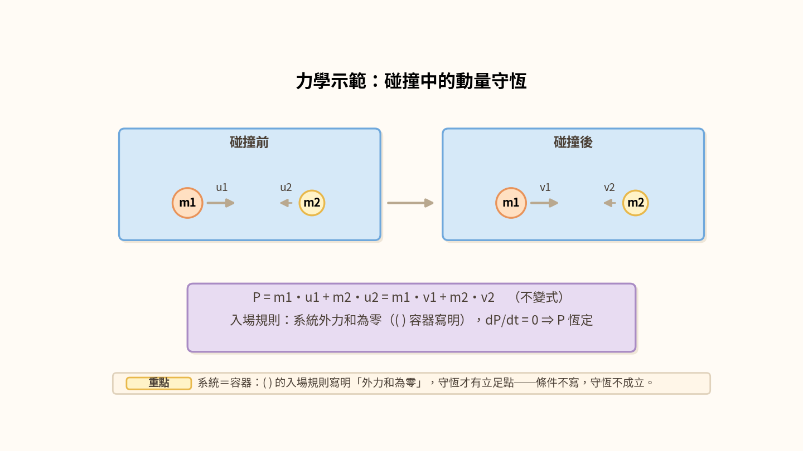

**圖 4-1　力學示範：碰撞中的動量守恆**

## 4.2　熱學：熱平衡中的能量守恆

冰塊投入熱水，隔水絕熱──( ) 的入場規則寫明「與外界無熱交換」。熱量從高溫側流向低溫側，直到同溫。

> **證明示範・熱學**
>
> 【定理】絕熱容器內冰水混合，達平衡時 Q失 = Q得，總能量守恆。
>
> 【證明】(1) 立形：M ＝ {杯, 熱水, 冰}，S(M) 內容可替換、id(M) 不變；(2) 不變式候選：E總；(3) 由能量守恆（不變性公理的時間版）：熱量只是換了口袋，m1·c·(T1 - Tf) = m2·c·(Tf - T2)；(4) 解出平衡溫度 Tf；(5) 三層檢查：容器──絕熱入場規則成立；BOM──杯為必要件；抽象──通過 [熱平衡] 的 ∩(T)。（得證）

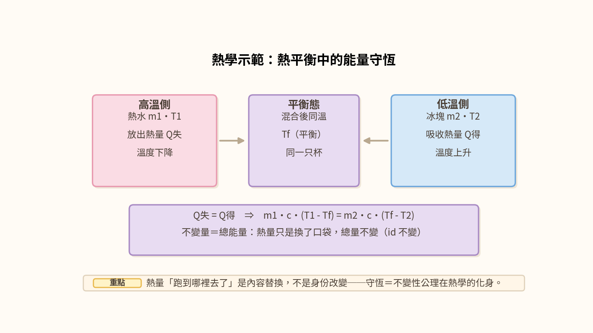

**圖 4-2　熱學示範：熱平衡中的能量守恆**

## 4.3　電磁：RC 電路的充電過程

電源經電阻對電容充電。電容是個標準的容器：電荷是內容、可進出可替換，id(C) 不變；充電曲線是這條電路的時間本形。

> **證明示範・電磁**
>
> 【定理】RC 串聯電路充電，電容電壓 V(t) = V0(1 - e^(-t/RC))。
>
> 【證明】(1) 立形：M ＝ {電源, 電阻, 電容}，電容 ( ) 內 S(C) ＝ (電荷)；(2) 選判準：基爾霍夫電壓定律 V0 = iR + q/C；(3) 以 i = dq/dt 代入得一階微分方程，逐步求解（函式鏈不跳步）：q(t) = C·V0(1 - e^(-t/RC))，故 V(t) = q/C；(4) 三層檢查：容器──電荷進出 id(C) 不變；BOM──電源為必要件；抽象──通過 [RC 充電] 的 ∩(T)。（得證）

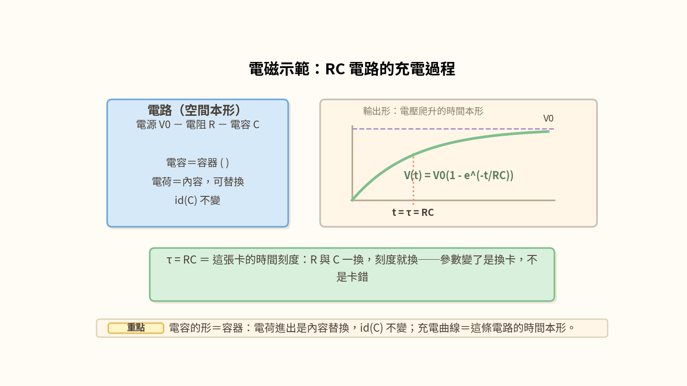

**圖 4-3　電磁示範：RC 電路的充電過程**

## 4.4　波動光學：雙狹縫干涉的歸類判準

> **證明示範・波動光學**
>
> 【定理】屏上一點為亮紋，若且唯若其路徑差 d·sinθ = m·λ。
>
> 【證明】(1) 立形：待判對象＝屏上各點；(2) 定義類別 [亮紋]：F ＝{兩束光相位差為 2π 的整數倍}，判準 ∩(T)；(3) 路徑差 d·sinθ 換算相位差 2π·d·sinθ/λ，令其等於 2πm 得 d·sinθ = m·λ；(4) 對照 [暗紋]：d·sinθ = (m+½)·λ 不過 [亮紋] 的篩網，判入另一類；(5) 三層檢查：容器──屏為 ( ) 邊界；BOM──雙狹縫為必要件；抽象──兩類別互斥且窮盡。（得證）

光通過雙狹縫，屏上出現明暗相間的條紋。哪一點是亮、哪一點是暗，是一道標準的歸類題──把 ∩(T) 漏斗放到屏上。

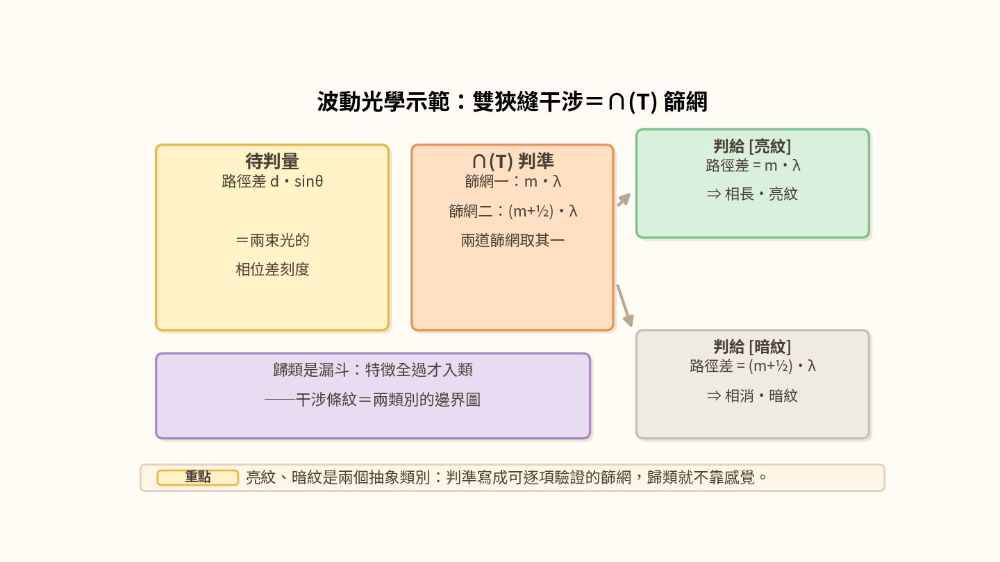

**圖 4-4　波動光學示範：雙狹縫干涉＝∩(T) 篩網**

## 4.5　近代：光電效應的邊界案例

光照射金屬，電子逸出與否取決於頻率而非強度──這是把「光是什麼形」重新立形的關鍵實驗。

> **證明示範・近代**
>
> 【定理】光電效應中電子逸出，若且唯若入射頻率 ν ≥ ν0（截止頻率）。
>
> 【證明】(1) 立形：光＝一群光子，每個光子 E = h·ν（量子化＝刻度離散化）；(2) 定義類別 [光電效應]：F ＝{入射光子能量 ≥ 逸出功 W}；(3) 由愛因斯坦方程 h·ν = W + Ek(max)，Ek ≥ 0 推得 h·ν ≥ W，即 ν ≥ ν0 = W/h；(4) 邊界案例：ν < ν0 時光強再大也不逸出──強度是內容（光子數）、頻率是身份（光子能量），層次分明；(5) 三層檢查：容器──金屬表面為 ( )；BOM──電子為必要件；抽象──通過 ∩(T)。（得證）

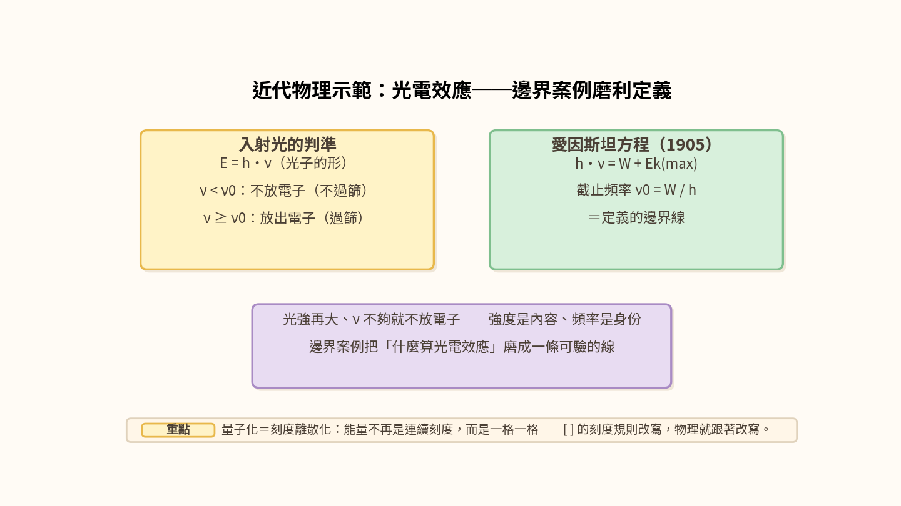

**圖 4-5　近代物理示範：光電效應──邊界案例磨利定義**

> **練習（P4）**
>
> P4-1　仿 4.1 格式，證明「單擺小角度擺動週期 T = 2π√(L/g) 與擺錘質量無關」。
>
> P4-2　4.3 的 RC 電路電阻換成兩倍：這是換卡還是卡錯？τ 怎麼變？
>
> P4-3　用 ∩(T) 語言重寫 4.5 的判準並給一個邊界案例（先立形、再選判準、三層收束）。

# 第五章　準確使用方法——把補足裝回物理證明

四件工具都已就位。最後一章把它們裝回同一個流程：物理證明六步驟、一個走完全程的範例、五種誤用對照，以及交出證明前的八問清單──這就是本書標題所說的「準確使用方法完整架構」。

## 5.1　物理證明六步驟

面對一個要寫成證明的物理命題，固定走六步。第一步認明整體──先問「我證明的對象是哪一個整體」，同一個物理場景往往有好幾個判斷對象。第二步分軸描述──X 屬性、Y 組成、Z 容器各寫一次。第三步寫形集合──用 {部件, (內容), [類別]} 把對象表記下來。第四步選定命題──要證的是歸屬、不變、分級，還是過程？第五步判準推理──對應的判準（∩(T)、不變性公理、remove、op）一步步走。第六步三層檢查──容器、組成、抽象三層聯合驗證後，收攏結論。

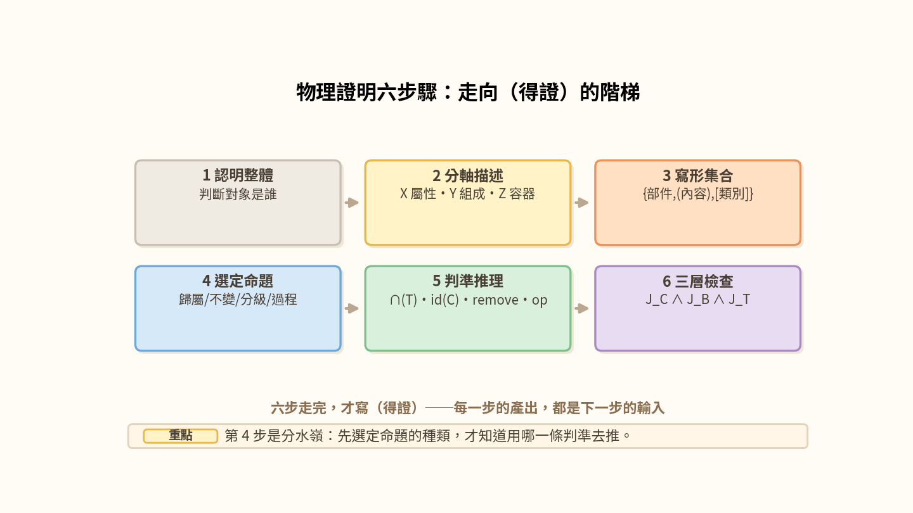

**圖 5-1　物理證明六步驟：走向（得證）的階梯**

| 步驟 | 操作 | 產出 | 常用工具 |
| --- | --- | --- | --- |
| 1 認明整體 | 指認判斷對象 | 一句話：M 是什麼 | ── |
| 2 分軸描述 | 三條軸各描述一次 | 屬性表、BOM、容器 | 三括號 |
| 3 寫形集合 | 完整表記 | {部件, (內容), [類別]} | 形集合 |
| 4 選定命題 | 歸屬／不變／分級／過程 | 定理一句 | ── |
| 5 判準推理 | 用對判準逐步推理 | 推導正文 | ∩(T)・id(C)・remove・op |
| 6 三層檢查 | 三層聯合檢查 | 結論（得證） | 三層判斷 |

**表 5-1　證明六步驟操作表**

## 5.2　完整範例：杯中熱水冷卻

用全書最忠實的標本，把六步驟走完整。

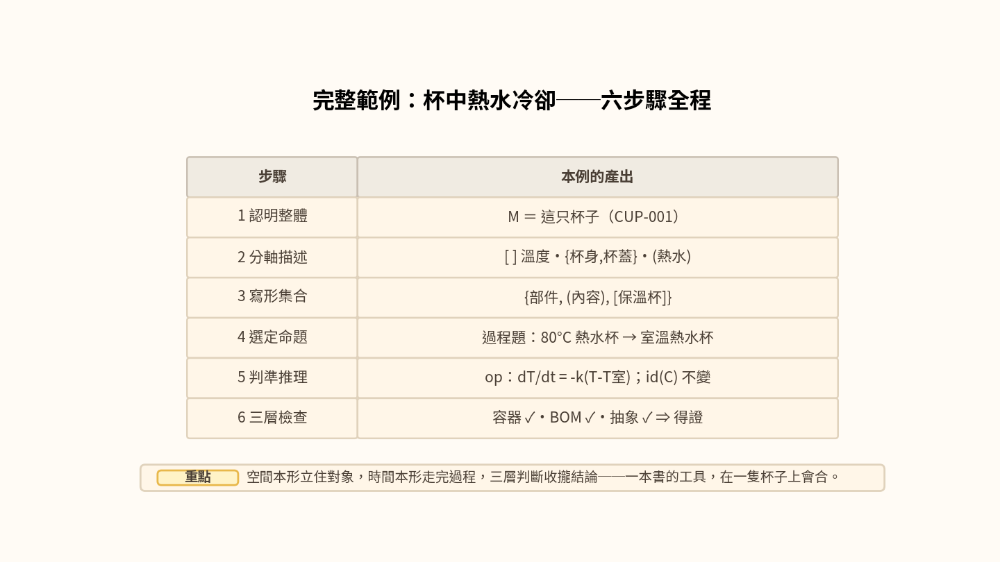

> **證明示範・全程**
>
> 【定理】保溫杯中 80°C 熱水冷卻至室溫，杯子與系統全程是同一個。
>
> 【證明】
>
> (1) 認明整體：M ＝ 這只杯子（CUP-001）。
>
> (2) 分軸描述：[ ] 溫度（維度＝溫度、刻度＝°C）；{ } BOM ＝ {杯身, 杯底, 杯蓋}；( ) S(M) ＝ (熱水)，id(CUP-001)。
>
> (3) 寫形集合：M ＝ { {杯身, 杯底, 杯蓋}, (熱水), [保溫杯] }。
>
> (4) 選定命題：過程題──輸入形（80°C 熱水杯）→ 輸出形（室溫熱水杯），且 id 不變。
>
> (5) 判準推理：冷卻卡 op：dT/dt = -k(T - T室)；逐步求解 T(t) = T室 + (T0 - T室)·e^(-kt)；全程內容替換、id(CUP-001) 不變（不變性公理）。
>
> (6) 三層檢查：容器──換茶、降溫皆 id 不變，✓；BOM──remove(杯底) ≢ M（必要件）、remove(杯蓋) ≡ M′ ⊂ M（降級件），✓；抽象──通過 [保溫杯] 的 ∩(T)（保溫性隨降溫速率驗證），✓。三層全過。（得證）

**圖 5-2　完整範例：杯中熱水冷卻──六步驟全程**

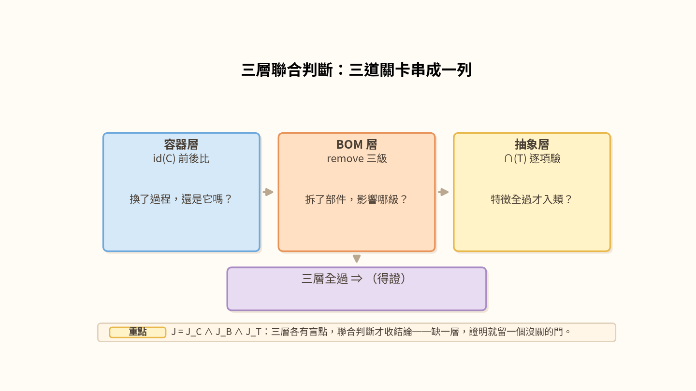

**圖 5-3　三層聯合判斷：三道關卡串成一列**

## 5.3　誤用對照：五種常見錯誤

| # | 誤用 | 問題所在 | 正確寫法 |
| --- | --- | --- | --- |
| 1 | 把 ( ) 當一般集合用 | (熱水) 被寫成 {熱水}，身份消失 | 內容物用 ( )，標上 id(C) |
| 2 | 把 [ ] 寫成封閉清單 | 新情況無法歸類 | 用 T = (F(T), ∩(T)) 開放規則 |
| 3 | 數值不帶維度 | 數脫離形，刻度失去意義 | 先寫維度，再寫刻度讀數 |
| 4 | 推導跳步 | 輸入形與輸出形沒寫明 | 用函式鏈逐步寫 op：形 → 形 |
| 5 | 只做一層判斷就下結論 | 三層各有盲點 | 三層聯合 J = J_C ∧ J_B ∧ J_T |

**表 5-2　五種常見誤用與正確寫法**

五種誤用的共同根源，都是「層次」沒寫清楚：括號的層次、容器與內容的層次、數與形的層次、過程的層次。寫證明時時刻刻問自己一句話──這一筆資訊，該在哪一層？

## 5.4　交出證明前的檢查清單

| # | 檢查問題 | 通過標準 |
| --- | --- | --- |
| 1 | 對象認明了嗎？ | 「我證的是哪個整體」一句話說得出來 |
| 2 | 入場規則寫明了嗎？ | 模型的理想化與 ( ) 的交換項列清楚 |
| 3 | 括號用對了嗎？ | { } 部件、( ) 內容、[ ] 類別，各安其位 |
| 4 | id(C) 標出來了嗎？ | 涉及過程時，身份標記明確 |
| 5 | remove 分級做了嗎？ | 談部件影響時，三級各有歸屬 |
| 6 | 函式四問齊了嗎？ | 每條定律有名稱、輸入形、輸出形、判準 |
| 7 | 每一步可檢驗嗎？ | 讀者能逐句打勾重現推理 |
| 8 | 三層聯合檢查了嗎？ | 容器・組成・抽象三層都過，才寫（得證） |

**表 5-3　檢查清單：交出證明前的八個問題**

**八個問題全過，證明才算「寫準」。這份清單不只是格式──它就是四件工具的驗收標準。**

> **本章重點**
>
> ◆　六步驟：認明整體 → 分軸描述 → 寫形集合 → 選定命題 → 判準推理 → 三層檢查。
>
> ◆　誤用五種的共同根源：層次沒寫清。
>
> ◆　八問檢查清單，就是準確使用方法的驗收標準。

> **練習（P5）**
>
> P5-1　用六步驟完整證明：「裝著熱咖啡的保溫杯，放到明天早上仍是同一個系統」。
>
> P5-2　對照表 5-2，檢查你 P5-1 的證明有沒有犯任何一種誤用，逐條回答。
>
> P5-3　把表 5-3 的八問套用在你物理課本上的任一條例題，指出它缺了哪幾層。
>
> 提示：第 4 步先選定命題種類，再選判準──順序反了就會跳步。

# 回顧——要點總整理與自我檢查

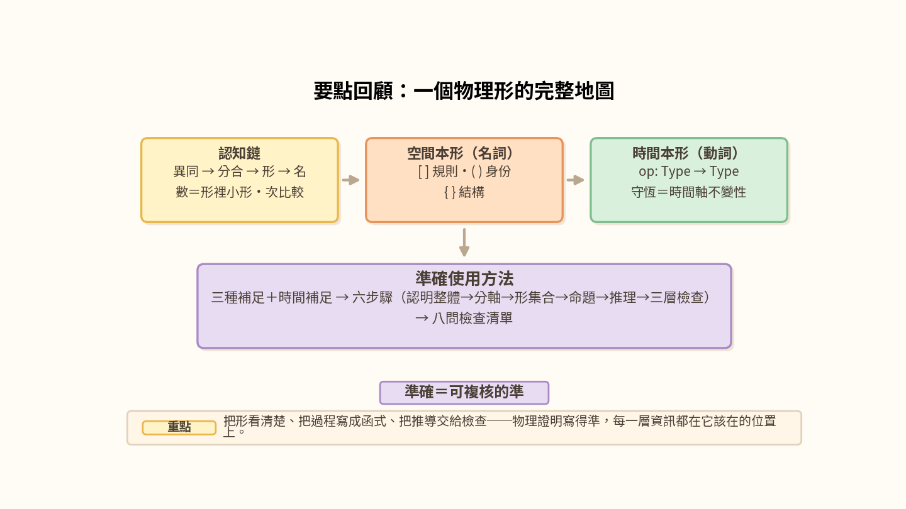

**圖 R-1　要點回顧：一個物理形的完整地圖**

### R-1　四種補足，四處缺口

[ ] 把寫死的清單換成開放規則──T = (F(T), ∩(T))；( ) 把散掉的內容收在不變身份之下──C = (id(C), S(C)) 與不變性公理；{ } 把並列的部件排成依存結構──remove 三級；時間本形把壓平的過程展開成函式鏈──op：形 → 形。缺口在哪，工具就補到哪。

### R-2　三件套，兩種語言，一條主軸

模型在前、定律居中、推導在後；方程式是骨架，形的補足是血肉。空間本形立住對象，時間本形走完過程──兩種語言疊加，物理證明才完整。

### R-3　準確，是可複核的準

判斷不靠直覺靠流程：∩(T) 逐項驗、id(C) 前後比、remove 三級分、函式鏈逐步走；三層聯合檢查後才下結論。讀者能逐句打勾重現你的推導，實驗能照著你的結論複測──這才是「準確」兩個字在物理裡的意思。

| 自我檢查問題 | 你應該能回答的內容 |
| --- | --- |
| 系統怎麼立形？ | 寫出 {部件, (內容), [類別]}，三軸各有歸屬 |
| 物理量怎麼讀？ | 維度 × 刻度──數是形裡的小形・次比較 |
| 過程怎麼寫？ | 函式四問卡：名稱、輸入形、輸出形、判準 |
| 守恆怎麼用？ | 不變量五步驟，守恆＝時間軸的不變性公理 |
| 證明怎麼起步？ | 六步驟走一遍：從認明整體到（得證） |
| 誤用怎麼避開？ | 對照五種誤用逐一自查，層次寫清 |

**表 R-1　自我檢查清單**

**證明寫得準，是因為每一層資訊都寫在它該在的位置上。**

# 附錄　術語與記號速查

| 術語 | 英文／記號 | 一句話定義 |
| --- | --- | --- |
| 形 | Type | 一個被完整描述的對象 |
| 單位形 | Unit Type | 三種集合的合體：{ 部件, (內容), [類別] } |
| 形集合 | Type Set | 單位形的完整表記 |
| 屬性・維度・刻度 | [ ] | 物理量＝維度（欄位）× 刻度（格子） |
| 抽象類別 | T = (F(T), ∩(T)) | 由特徵與判準決定的開放類別 |
| 交集判準 | ∩(T) | 特徵全數通過才算屬於 |
| 容器 | C = (id(C), S(C)) | 系統邊界＋不變的身份 |
| 身份識別 | id(C) | 不隨內容變動的標記 |
| 內部空間 | S(C) | 可容納・可替換的內容集合 |
| 不變性公理 | ∀ e1, e2 ∈ S(C) | 替換內容不改變 id(C) |
| 物料清單 | BOM | 拆開來看的組成清單 |
| remove 判準 | remove(p,M) | 三級：必要件 ≢M／降級件 ≡M′⊂M／非必要件 ≡M |
| 時間本形 | Time Type | 動詞的形＝函式：op：形 → 形 |
| 函式四問卡 | 名稱/輸入形/輸出形/判準 | 把一條定律寫成一張可用的卡 |
| 不變量 | invariant | 在某類變動下保持成立的性質 |
| 三層判斷 | J = J_C ∧ J_B ∧ J_T | 容器層・BOM 層・抽象層聯合檢查 |
| 證明六步驟 | 六步 | 認明整體→分軸→形集合→命題→推理→三層檢查 |

**表 A-1　術語與記號速查**

### 練習參考答案

| 題號 | 答案要點 |
| --- | --- |
| P1-1 | 規則（什麼算「蘋果」）；身份（落下過程中的同一顆）；結構（果、梗、葉的依存）；過程（重力把靜止形轉成運動形）。四層在句中都被省略。 |
| P1-2 | 因為「理想氣體」由 F(T)＝{分子間無作用力, 分子體積可忽略} 等特徵＋∩(T) 決定；低溫高壓時特徵不成立，氣體被判出類──清單答不了這種新情況，規則才答得了。 |
| P1-3 | -k(T - T室) 中「T室」以環境容器的身份恆定來定錨；式子回答了溫度的變化率，卻沒有回答「冷卻的是哪一個系統」──身份要靠 id(C) 補。 |
| P2-1 | M ＝ { {燈座, 燈泡, 燈罩}, (電流), [檯燈] }，id(C) 自訂如 LAMP-007。 |
| P2-2 | 燈泡──必要件（remove ≢ M，拆了不亮不成燈）；電線──必要件（供電迴路）；燈罩──功能降級件（≡ M′ ⊂ M，仍亮但失去遮光）；貼紙──非必要件（≡ M）。 |
| P2-3 | 頭燈若 F(T) 只有 {能發光, 能置於桌面} 則不過篩；要收頭燈就得改寫特徵（如「能提供照明」），特徵清單的改寫就是立場的改寫。 |
| P3-1 | 歐姆定律：名稱＝歐姆定律；輸入形＝兩端有電位差的導線；輸出形＝載電流的導線；判準＝V = IR。牛頓冷卻：名稱＝牛頓冷卻定律；輸入形＝與環境有溫差的物體；輸出形＝趨向室溫的物體；判準＝dT/dt = -k(T - T室)。 |
| P3-2 | 輸入形＝拉到一側的鐘擺；輸出形＝盪到另一側的鐘擺；不變量＝機械能 E = 力能互換中守恆（理想情形）＋擺長 L 不變。 |
| P3-3 | 例：導線溫度改變使 R 改變，V = IR 的線性卡不再適用──要換「電阻隨溫度變化」的卡；若硬套原卡會得出錯誤電流，錯的是卡的選擇，不是世界。 |
| P4-1 | 立形：M ＝ {擺錘, 擺線, 地球引力場}；小角度 [簡諧運動] 判準通過；由 T = 2π√(L/g) 推導中質量約掉──remove(擺錘質量, 條件式) ≡ M（非必要件），故週期與質量無關。 |
| P4-2 | 換卡：判準 V0 = iR + q/C 中 R 是卡的參數；R 加倍則 τ = 2RC，充電變慢──同一張卡換參數，或視為另一張刻度不同的卡，兩種說法都成立，重點是刻度要重新標。 |
| P4-3 | ∩(T) 版：[光電效應] 的 F ＝{入射光子能量 ≥ W}；邊界案例：ν = ν0 時 Ek = 0，電子恰好逸出──定義在邊界上被磨利。 |
| P5-1 | 六步驟照 5.2 格式：(1) M＝杯子；(2) [ ] 溫度・{杯身,杯蓋,杯底}・(咖啡)；(3) 形集合；(4) 過程題；(5) 冷卻卡＋id 不變；(6) 三層檢查全過──系統是同一個。 |
| P5-2 | 逐條對照五種誤用：內容有沒有寫成 {熱水}？類別有沒有寫死？數值有沒有帶維度？推導有沒有跳步？有沒有只查一層？ |
| P5-3 | 課本例題通常只給第 5 步的方程式推導──缺第 1–3 步的立形與第 6 步的三層檢查；八問逐條打勾即知。 |

**表 A-2　練習參考答案**

> **全書終**
>
> ◆　空間本形把系統立成形，時間本形把過程寫成函式，準確使用方法把證明交給檢查。
>
> ◆　把形看清楚，把每一層資訊放在它該在的位置上──物理證明，就寫準了。
