<p align="center">
  <a href="https://youtu.be/ufkQCSiv-Q0">💻橫式</a> ｜ 
 <a href="https://v.douyin.com/IroRdllUOw0">📱直式</a> 
 </p>
 


# 本形學  Ontypology
空間本形 Space


# IC 設計大腦：SiliconMind 與 Verilog 的準確方法

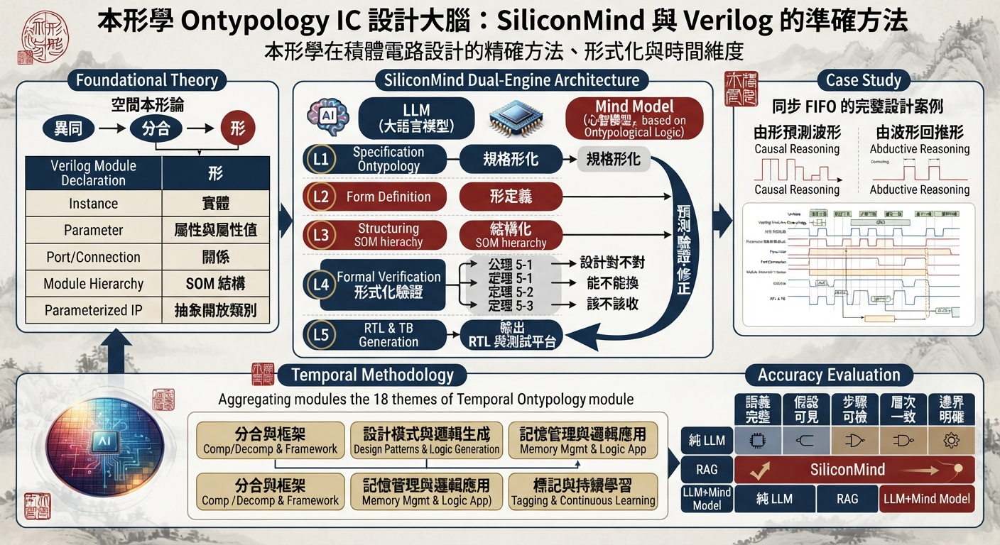

本形學在積體電路設計的精確方法、形式化與時間維度

# 摘要

本文提出「IC 設計大腦」SiliconMind 的準確方法，以本形學（Ontypology）為理論基礎，把積體電路設計中的 Verilog 硬體描述語言、EDA 設計流程與 AI 輔助設計，統一到「形」的精確框架之下。首先沿用空間本形論的推導鏈（異同→分合→形），重新解析 Verilog 的核心結構：module 宣告是形、instance 例化是實體、parameter 是屬性與屬性值、port 與連線是關係、module 階層是 SOM 結構、參數化 IP 是抽象開放類別，並給出與關聯式資料庫（表頭／資料列／主鍵／外鍵）的三方精確對照。

其次，本文把形邏輯的三種加值——容器（身份獨立性）、SOM（元素間結構）、抽象（生成規則）——形式化為 IC 設計的判斷工具，建立公理 5-1（容器身份不變）、定理 5-1（SOM 結構分級）、定理 5-2（三層判斷充要）與定理 5-3（形替換不變性），使「設計對不對、能不能換、該不該收」成為可檢驗的命題，而非僅憑工程直覺。

再次，本文以同步 FIFO 的完整設計案例，展示 SiliconMind 雙引擎（LLM＋Mind Model）五層架構的實際運作：從規格形化、形定義、結構化、形式化驗證到輸出 RTL 與測試平台，並以「預測－驗證－修正」迴圈示範由形預測波形（因果推理）與由波形回推形（果因推理）的閉合。

最後，本文把時間本形篇的十八主題——分合、框架、設計模式、邏輯生成、記憶管理、邏輯應用、標記、持續學習、抽象、重構、思考、思考法、解題、分析、設計、推理、因果推理、果因推理——聚合為四大模組，建構 IC 設計的時間方法論；並以五維準確性評估（語義完整、假設可見、步驟可檢、層次一致、邊界明確）對照純 LLM、RAG 與 LLM＋Mind Model 三種流程，驗證本形學作為 IC 設計「更準確方法」的有效性。

**關鍵詞：**本形學、IC 設計、SiliconMind、Verilog、形邏輯、Mind Model、SOM、時間本形、準確方法

# 目錄

- 摘要

- 第一章　緒論：IC 設計為何需要本形學

- 1.1　IC 設計是「形」的工程

- 1.2　現有 EDA 與 LLM 流程的缺口

- 1.3　SiliconMind 與本文貢獻

- 第二章　預備知識：空間本形與形邏輯

- 2.1　異同→分合→形

- 2.2　屬性與屬性值

- 2.3　空間容器與 SOM

- 2.4　抽象框架四階段

- 2.5　形邏輯的三種加值

- 第三章　Verilog 的形對照：精確方法

- 3.1　module 是形、instance 是實體

- 3.2　parameter：屬性與屬性值

- 3.3　port 與連線：關係的埠口化

- 3.4　階層與 generate：SOM 與框架

- 3.5　完整範例：參數化計數器與定時器組

- 第四章　SiliconMind：雙引擎五層架構

- 4.1　雙引擎分工

- 4.2　五層職責與工作占比

- 4.3　預測－驗證－修正迴圈

- 第五章　形式化：準確方法的定理骨架

- 5.1　公理：容器身份不變

- 5.2　定理 5-1：SOM 結構分級

- 5.3　定理 5-2：三層判斷充要

- 5.4　定理 5-3：形替換不變性

- 第六章　時間本形：設計流程的時間維度

- 6.1　時間形與設計事件

- 6.2　十八主題聚四模組

- 6.3　因果與果因推理的閉合迴圈

- 第七章　案例研究：SiliconMind 設計同步 FIFO

- 7.1　五層流程實錄

- 7.2　RTL 實作

- 7.3　SOM 部件分級與三層判斷

- 7.4　預測－驗證－修正實況

- 第八章　準確性評估：五維對照

- 8.1　五維指標

- 8.2　三系統對照

- 8.3　討論

- 第九章　結論與未來展望

- 參考文獻

- 附錄 A　三層判斷速查表

# 第一章　緒論：IC 設計為何需要本形學

## 1.1　IC 設計是「形」的工程

一枚晶片的誕生，是一連串「形」的建構。規格書用自然語言描述「這是什麼東西」，RTL 用 module 把它寫成可綜合的結構，綜合器把 module 展開成閘級網表，佈局工具再把網表鋪成實體版圖。每一個階段，工程師真正在做的事情都可以還原成本形學的動作：先偵測差異（這個訊號和那個訊號不一樣）、再分合（切開時序域、歸併同功能）、最後畫出邊界並命名（一個新的 module、一個 instance、一條 port）。

換句話說，IC 設計本身就是「形」的工程。幫訊號命名是形的標記工作；把設計切成模組是分合；定義介面是建立關係；跑模擬比對波形是判斷。一個資深工程師與新手的差別，往往不在於誰寫得多，而在於誰的「形」立得穩：身份清楚、結構分明、類別規則明確。

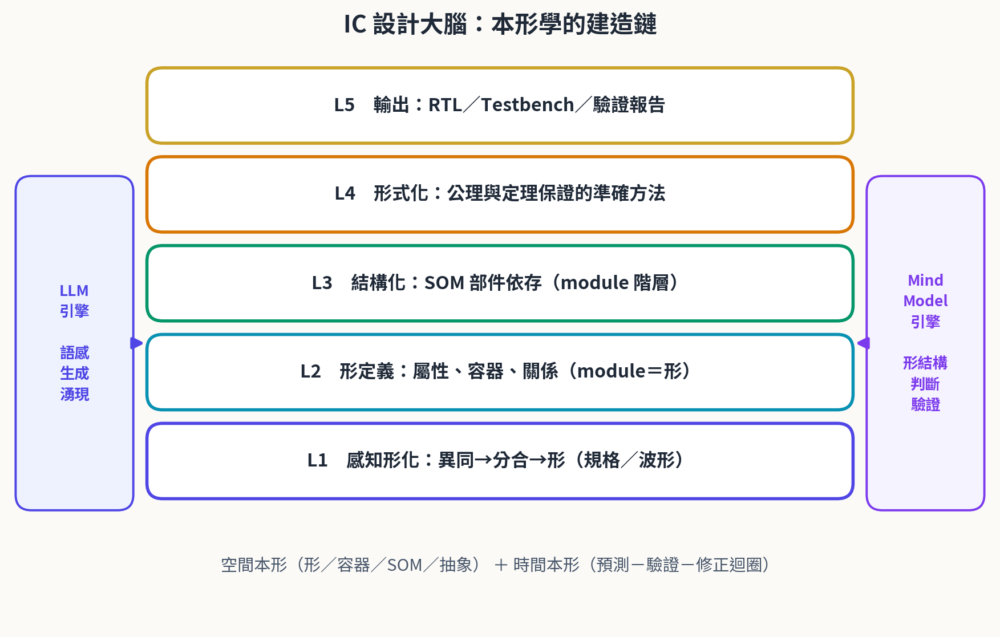

**圖1-1　IC 設計大腦：本形學的建造鏈——從感知形化到輸出的五層架構**

圖 1-1 給出本文的總覽：底層是認知起點（異同→分合→形），往上依次是形的描述工具（屬性、容器、SOM、抽象）、Verilog 的精確對照、SiliconMind 雙引擎五層架構，最上層才是 RTL 與驗證報告等工程產出。本文的章節安排也沿著這條建造鏈展開。

**表1-1　論文導覽：各章的核心問題與關鍵產出**

| 章 | 核心問題 | 關鍵產出 |
| --- | --- | --- |
| 一 | IC 設計為何需要本形學？ | 缺口分析、SiliconMind 定位 |
| 二 | 形如何被建構與描述？ | 異同→分合→形、容器、SOM、抽象 |
| 三 | Verilog 如何精確對應形？ | module／parameter／port／階層對照表 |
| 四 | AI 如何以形設計電路？ | 雙引擎五層架構、預測－驗證－修正 |
| 五 | 準確性如何被保證？ | 公理 5-1、定理 5-1～5-3 及證明 |
| 六 | 設計流程的時間維度為何？ | 時間本形十八主題、四模組方法論 |
| 七 | 方法如何落地？ | 同步 FIFO 全流程案例 |
| 八 | 比別的方法準多少？ | 五維準確性雷達對照 |
| 九 | 結論與下一步？ | 總結、未來展望 |

## 1.2　現有 EDA 與 LLM 流程的缺口

今日的 EDA 工具鏈在「數」的世界裡近乎完美：時序分析可以算到皮秒，形式驗證可以窮盡狀態空間。但它們不理解「形」。對綜合器而言，一個 module 只是一個語法單元；它不會問「這個實體的身份是什麼」「這個部件是不是必要件」「這個新模組屬於哪個類別」。這些問題落在形的層次，正是工程師用直覺在回答、而工具無法替他回答的部分。

大型語言模型（LLM）的加入改變了生產力，卻沒有補上這個缺口。LLM 最擅長的是抽象層的判斷——它見過海量程式碼，能憑語感生成「看起來像 FIFO」的程式碼；但它缺乏容器層（身份持續性追蹤）與組成層（結構依存分析）的能力。其典型失敗模式恰好落在這兩層：module 命名前後不一致（身份混亂）、階層裡重複或遺漏部件（SOM 崩壞）、介面埠對不上（關係斷裂）。檢索增強（RAG）能補上文件依據，但同樣只給資料、不給判斷框架。

> **註（本文的 EDA 範圍）**
>
> 本文所稱 EDA 工具鏈包含 RTL 模擬器、邏輯綜合器、靜態時序分析與形式驗證工具；所稱 LLM 流程包含以語言模型直接產生／修改 RTL 與測試平台的各種做法。兩者的缺口分析僅針對「形的判斷」這一層，不否定其在語法與數值層的成熟。

## 1.3　SiliconMind 與本文貢獻

SiliconMind（IC 設計大腦）是本文給出的答案：以 LLM 引擎負責語感與生成、以 Mind Model 引擎負責形的結構判斷與驗證，兩者組成雙引擎，在五個層次（感知形化、形定義、結構化、形式化與驗證、輸出）上協同工作。本文的貢獻可歸納為四點：

> **重點（本文四項貢獻）**
>
> **（一）精確對照：**Verilog 語言結構 ↔ 本形學概念 ↔ 關聯式資料庫的三方對照表（第三章，表 3-1），使「module 是形」不只是一個比喻，而是一組可逐條檢查的對應。
>
> **（二）形式化：**公理 5-1 與定理 5-1～5-3 及其證明（第五章），把容器、SOM、抽象三層判斷從描述工具升級為可推導的命題系統。
>
> **（三）時間方法論：**把時間本形篇十八主題聚合為四大模組（第六章），對接到 IC 設計的規格、RTL、驗證、重構循環。
>
> **（四）實證評估：**同步 FIFO 全流程案例（第七章）與五維準確性對照（第八章），展示雙引擎相對純 LLM 與 RAG 的量化優勢。

# 第二章　預備知識：空間本形與形邏輯

本章整理《本形學：空間本形篇》的核心推導，作為後續章節的共同語言。熟悉該篇的讀者可直接跳至第三章。

## 2.1　異同→分合→形

「形」（Type）並非天生存在。它的誕生遵循固定順序：先有「異同」的感受，才產生「分」與「合」的動作，最後才畫出邊界、生出形，而形必有名。用認知科學的話說，這對應格式塔心理學的「圖與地」原則——大腦把感知切為前景與背景，這個「分」正是推導鏈的起點；若眼前一片均質、毫無差異可辨，形便無從誕生。

> **重點（分、合、形的白話定義）**
>
> **分：**看出這些東西「彼此不一樣」的地方。
>
> **合：**在不一樣的東西裡，再找出「其實可以算同一類」的部分。
>
> **形：**分合所畫出的邊界；我們最終認得出來、並能命名的「東西」。

這條鏈在 IC 設計裡每天都在發生：工程師盯著波形比較「這個時序週期和那個不一樣」（異同），把不同的時序域切開（分）、把同功能的邏輯歸併（合），最後把一塊穩定的邏輯命名成 module（形）。命名是形誕生的標誌——沒有名字的邏輯塊，只是尚未完成分合的原始差異。

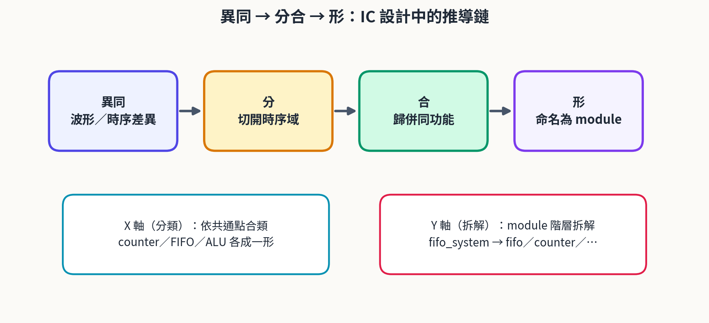

**圖2-1　異同→分合→形：IC 設計中的推導鏈**

沿著兩個方向繼續推導，得到 X 軸與 Y 軸：X 軸回答「這是什麼樣的東西」——把一堆設計按共通點分類（counter、FIFO、ALU 各成一形）；Y 軸回答「這個東西由哪幾塊組成」——盯著一個設計往下拆（fifo_system 拆出 fifo、counter、旗標邏輯），每一塊拆下來都還是完整可辨識的東西。兩軸互相銜接：拆出的部件可以再跑一次 X 軸分類，而 Y 軸拆出的新差異也可能逼 X 軸擴充詞彙。

## 2.2　屬性與屬性值

屬性是一個「可以被拿來問的問題」，它本身沒有答案，只劃定要問什麼；屬性值是這個問題在具體情境下的實際答案。屬性像空白表格的欄位標題「材質」，屬性值像實際填入的「陶瓷」。屬性浮現的時間點永遠是「這批差異跟現有所有屬性都對不上」的那一刻；只要差異的性質對得上既有屬性，就只是在該屬性下新增屬性值。

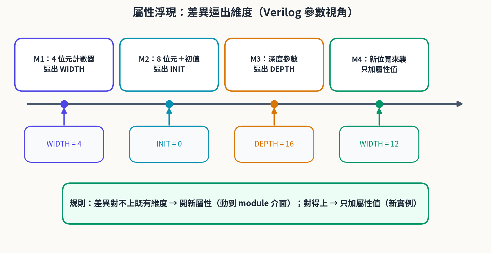

**圖2-2　屬性浮現：差異逼出維度（Verilog 參數視角）**

> **重點（屬性浮現規則）**
>
> **差異與現有屬性都對不上　⇒**　開新屬性，並回頭為所有已存在個體補值。
>
> **差異性質吻合既有屬性　⇒**　只在該屬性下加新屬性值。
>
> **結構特性：**屬性數量少、屬性值數量多；維度固定、刻度可延伸。

把這條規則翻成 Verilog 的語言：開新屬性對應改 module 介面（例如多開一個 parameter 或 port），是動到框架本身的沉重動作，所有已存在的例化點都要跟著補；加新屬性值對應新增一個例化並賦上新的參數值（例如 #(.WIDTH(12))），是輕巧的資料動作，完全不驚動 module 宣告。第三章將說明這個「新增列／新增欄」的不對稱，正是資料庫與 HDL 共享的同構事實。

## 2.3　空間容器與 SOM

空間容器指一個有明確邊界的物體：邊界圍出內部空間，其他東西可以放進拿出，而容器本身不會因為裝了什麼而改變自己是誰。容器三要素是邊界、內部空間、獨立的身份。最關鍵的是第三點——杯子不會因為裝水換咖啡而變成另一個杯子；身份獨立於內容物，這是容器與數學集合的根本分野。

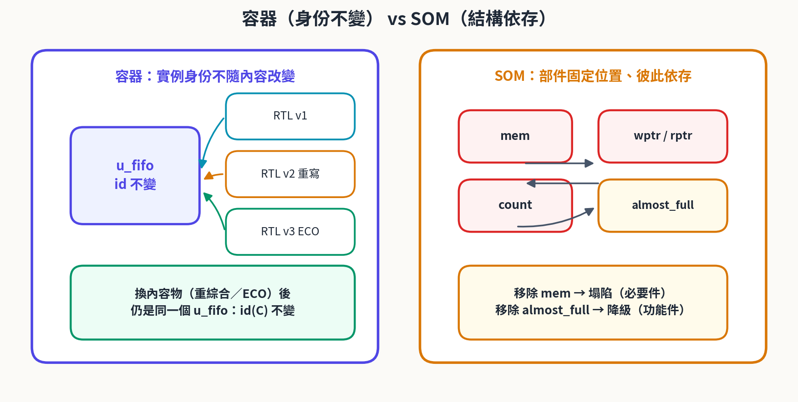

**圖2-3　容器（身份不變）與 SOM（結構依存）的對照**

BOM（物料清單）回答「這個東西由哪些可獨立辨識的部件組成」。判準只有一條：拆下來之後，它還認得自己嗎？杯蓋拆下來仍是蓋子，算 BOM；顏色拆下來什麼都不是，是屬性。SOM（空間清單）= BOM + 容器：它描述的是一個整體，其內部空間裡裝的不是可任意替換的內容物，而是被固定在特定位置、彼此結構性依存的部件——拿掉某個部件，整體可能就不再是原來那個東西。

> **定義 2-1（空間容器）**
>
> 容器 C = ( id(C), S(C) )。其中 id(C) 是不隨 S(C) 內元素變動而改變的身份標記；S(C) 是可容納元素的內部空間，其內容可替換、可清空。
>
> **不變性公理：**∀ e1, e2 ∈ S(C)，將 e1 替換為 e2 不改變 id(C)。

> **定義 2-2（SOM）**
>
> SOM(M) = ( P(M), R(M), G(M) )。P(M) 為部件集合，R(M) ⊆ P(M) × P(M) 為部件間的依存、連接、支撐關係，G(M) 為空間配置。
>
> 同一性條件：移除部件 p 後 M 是否仍為同一個整體，取決於 p 在 R(M) 中的角色。

## 2.4　抽象框架四階段

框架（Framework）把「描述一個物件」的推導過程本身抽象化，變成可重複套用的做法。其運作分四階段：（一）拿到一群東西，先能分辨「這個不是那個」；（二）出現第二批性質不同的差異、對照失敗，才觸發抽象的需要；（三）把兩批差異各自取名、分成不同的維度——這個命名動作就是抽象本身；（四）新東西加入時，先判斷它跟哪個維度對得上：對得上就掛進去，全部對不上就再開一條新維度。

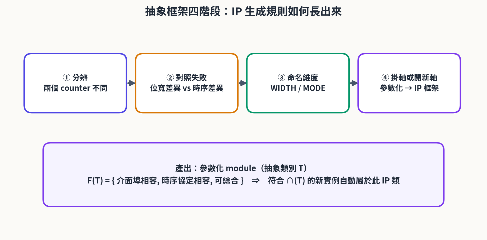

**圖2-4　抽象框架四階段：IP 生成規則如何長出來**

抽象補上的是數學集合最欠缺的東西：一條能不斷生出新成員的開放規則，而不是一份寫死的清單。馬克杯、玻璃杯、紙杯的共同特徵交集「能裝液體 ∧ 能被拿起來喝」就是「杯子」類別的判斷準則；一個前所未見的新型杯只要通過判準，便自動屬於此類，不需任何人的許可。

> **定義 2-3（抽象類別）**
>
> 抽象類別 T = ( F(T), ∩(T) )。F(T) 為必要特徵集合；交集判準 ∩(T)：物件 x 屬於 T，若且唯若對所有 f ∈ F(T) 皆有 f(x) = true。
>
> 開放性：T 的成員不由列舉決定，而由 ∩(T) 動態生成。

## 2.5　形邏輯的三種加值

數學集合只回答「屬不屬於」，假設最少、描述也最少。日常語言的「杯子裡有水」「杯子由杯把杯底杯蓋組成」「保溫杯也是杯子」三句話，各自壓縮了集合論省略的資訊。形邏輯以三種括號補回三種加值：小括號 ( ) 表容器——身份的獨立性；大括號 { } 表 SOM——元素間的組成結構；中括號 [ ] 表抽象——特徵交集的生成規則。

**表2-1　形邏輯的三種加值總表**

| 加值類型 | 括號 | 補上的性質 | IC 設計對應 |
| --- | --- | --- | --- |
| 容器 | ( ) | 身份的獨立性 | instance 名：重綜合、ECO 後仍是同一個實體 |
| SOM | { } | 元素間的組成結構 | module 階層：部件位置固定、彼此依存 |
| 抽象 | [ ] | 生成規則 | 參數化 IP：通過 ∩(T) 的新設計自動屬於此類 |

三種加值可疊加，對應三層判斷：容器問「換了內容物還是同一個嗎」；SOM 問「拿掉部件還是同一個嗎」（部件分必要件、功能降級件、非必要件三級）；抽象問「是否通過規則 ∩(T)」。單層各有盲點，三層聯合才構成完整的認知濾網。

# 第三章　Verilog 的形對照：精確方法

本章是本文的核心工具章：給出 Verilog 語言結構與本形學概念逐條精確的對照。這不是比喻的延伸，而是一組可驗證的同構——每個語言構造都能指出它在形的層次上回答什麼問題，以及它在關聯式資料庫裡的對應物。

## 3.1　module 是形、instance 是實體

一個 module 宣告本身不是任何一個電路。它規定「要接哪些埠、要配哪些參數、內部由什麼組成」——它是一組問題清單，本身沒有答案。這正是「形」的樣子：一個框架，本身沒有內容，但規定了內容要長在哪裡。當 module 被例化成 instance（例如 sync_fifo #(...) u_fifo (...)），一個具體、可指認、有名字的電路便誕生了——它是形被填上具體答案之後的結果，正是「實體」的樣子。

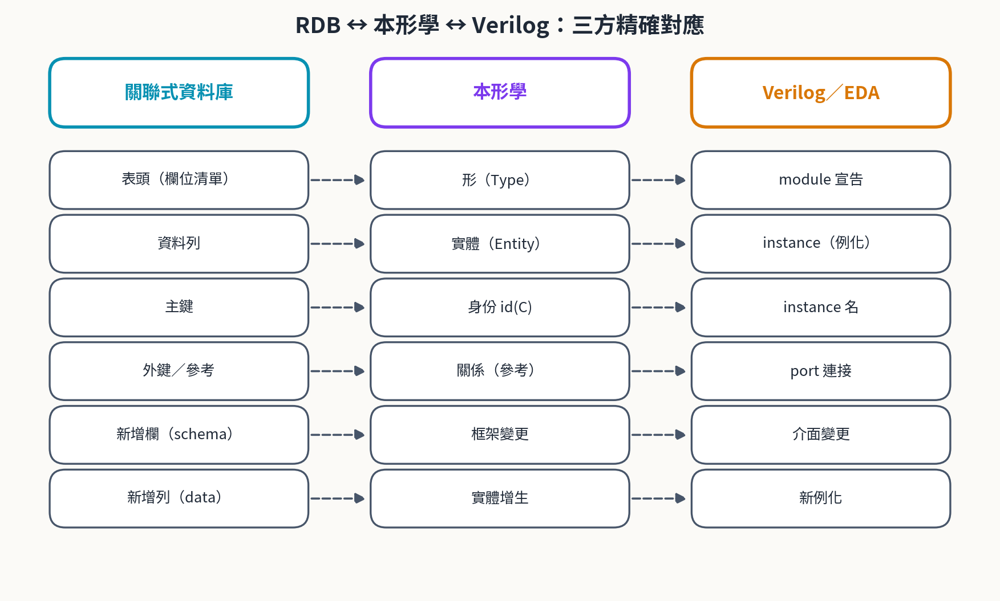

**圖3-1　RDB ↔ 本形學 ↔ Verilog：三方精確對應**

這個對應在資料庫設計裡有精確的鏡像：module 宣告是表頭，instance 是資料列，instance 名稱是主鍵。如同主鍵必須與內容無關（杯子換顏色，Cup_id 不能跟著變），instance 名稱也必須與內容無關——RTL 重寫、重綜合之後，u_fifo 還是 u_fifo，這就是容器身份不變（公理 5-1）的工程形態。

> **重點（新增例化與新增介面的不對稱）**
>
> **新增一個 instance：**形不動、實體多一個。只要能填進既有埠與參數，就安安靜靜多佔一列，module 宣告完全不用動。
>
> **改 module 介面：**形自己變大、所有實體都要跟著補值。多開一個 port 或 parameter，所有已存在的例化點都必須交出答案（哪怕暫時懸空）。

## 3.2　parameter：屬性與屬性值

parameter 與 localparam 是形的屬性系統：參數名是屬性（一個可以被問的問題），參數值是屬性值（具體答案）。屬性浮現規則在 HDL 裡完全成立：一個新設計的差異若對不上既有參數（位寬不同 → WIDTH；深度不同 → DEPTH），就開新參數並回頭讓所有舊例化補上；若只是同一維度的新刻度（同樣是位寬，只是 8 變 12），就只產生一個帶新參數值的新例化。

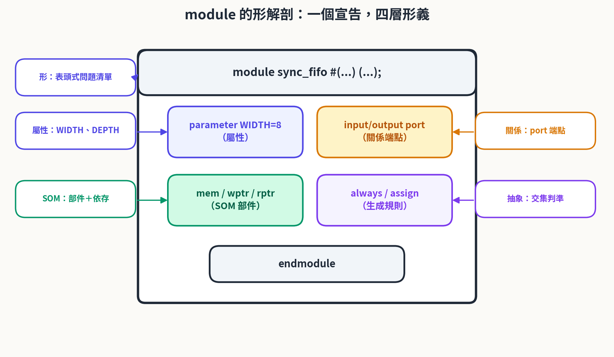

**圖3-2　module 的形解剖：一個宣告，四層形義**

> **定義 3-1（module 的形）**
>
> module 形 M = ( P, Q, S, G )。P 為屬性集（parameter／localparam），Q 為關係埠集（port 宣告），S 為結構部件集（內部信號、子模組例化，即 SOM），G 為生成規則集（always、assign、generate）。
>
> 實例 u = ( id(u), M[θ] )，其中 id(u) 為例化名稱，θ 為參數賦值（屬性值組合）。同一個 M 配上不同的 θ，得到同形不同值的實體族群。

## 3.3　port 與連線：關係的埠口化

port 是關係的端點化。資料庫用外鍵「指向另一張表的主鍵、不多做別的事」來表達主從參考；Verilog 用埠連接（.clk(clk)）把兩個實體接在一起，同樣是「存一個指向、而非複製一份內容」。連線（wire／net）是關係的載體：它傳遞的是訊號的身份與值，而埠方向（input／output／inout）給關係加上了有向性——資料從哪裡流到哪裡，就是關係的方向。

介面不合，是最常見的關係斷裂。一個實體的 output 對不上另一個的 input 型別或位寬，就像從表的外鍵指向一個不存在的主鍵：編譯器（資料庫）會擋下來，但「為什麼該接、該怎麼接」只有形的層次說得清楚。SiliconMind 的 L2 形定義層正是專門負責把關係問清楚之後才允許生成程式碼。

## 3.4　階層與 generate：SOM 與框架

module 階層是 Y 軸的工程形態。把 top 拆成子模組，拆下來的每一塊都還是完整可辨識的電路——這是 BOM 判準的直接套用。而子模組之間的連接關係、位置依存（誰給誰時脈、誰給誰啟動），使整個階層成為一個 SOM：拿掉 u_fifo，fifo_system 就不再是原來那個系統，這是必要件；拿掉一個偵錯用計數器，系統照常運作，這是功能降級件。

generate 敘述是框架的工程形態：一條 for 迴圈生出 N 個結構相同的例化，正是一條開放生成規則替我們批量產生實體。參數化 IP 則是抽象類別本身——它的 F(T) 由三件事組成：介面埠相容、時序協定相容、可綜合。任何新設計只要通過這三項交集判準，便自動屬於這個 IP 類，可以被任意上層框架替換使用（第五章定理 5-3 將保證這種替換的安全性）。

## 3.5　完整範例：參數化計數器與定時器組

以下兩個完整的 module 展示形的四層結構：counter 的參數是屬性、埠是關係、內部暫存器是部件、always 區塊是生成規則；timer_bank 用 generate 把 counter 的形套用成 N 個實體，展示框架如何批量生出形下的具體內容。

**程式碼 3-1　參數化計數器（形：屬性＋關係＋生成規則）**

```verilog
module counter #(
    parameter WIDTH = 4,            // 屬性：計數位寬
    parameter INIT  = 0             // 屬性：初值
)(
    input  wire             clk,
    input  wire             rst_n,
    input  wire             en,
    output reg [WIDTH-1:0]  q
);
    localparam [WIDTH-1:0] INIT_C = INIT;

    always @(posedge clk or negedge rst_n) begin
        if (!rst_n)
            q <= INIT_C;
        else if (en)
            q <= q + 1'b1;
    end
endmodule
```

**程式碼 3-2　定時器組（框架：generate 批量生成實體）**

```verilog
module timer_bank #(
    parameter N     = 4,
    parameter WIDTH = 8
)(
    input  wire               clk,
    input  wire               rst_n,
    input  wire [N-1:0]       en,
    output wire [N*WIDTH-1:0] q_flat
);
    genvar i;
    generate
        for (i = 0; i < N; i = i + 1) begin : g_timer
            counter #(.WIDTH(WIDTH)) u_tmr (      // 實體：id = g_timer[i].u_tmr
                .clk   (clk),
                .rst_n (rst_n),
                .en    (en[i]),
                .q     (q_flat[i*WIDTH +: WIDTH])
            );
        end
    endgenerate
endmodule
```

> **註（與 SystemVerilog 及 EDA 工具的對應）**
>
> 上述對照在 SystemVerilog 中依然成立，且更顯豁：interface 對應「關係的形」（一組相關訊號的打包宣告）、class 對應抽象類別、assertion 對應三層判斷的自動化。本章以 Verilog-2001 為敘述基準，是為了讓對照不受語言擴充干擾，直達形的結構本身。

**表3-1　Verilog ↔ 本形學 ↔ 關聯式資料庫精確對照表**

| Verilog 構造 | 本形學概念 | RDB 對應 | 說明 |
| --- | --- | --- | --- |
| module 宣告 | 形（Type） | 表頭 | 一組問題清單，規定內容長在哪裡 |
| endmodule 邊界 | 形的邊界 | 表的邊界 | 區分模組內外 |
| parameter／localparam | 屬性／屬性值 | 欄位／欄值 | 維度固定、刻度可延伸 |
| port 宣告 | 關係端點 | 外鍵欄位 | 指向其他形的接口 |
| instance 例化 | 實體（Entity） | 資料列 | 具體、可指認的電路 |
| instance 名稱 | 身份 id(C) | 主鍵 | 與內容無關、不隨替換改變 |
| 埠連接／wire | 關係 | 關聯／參考 | 存指向、不複製內容 |
| module 階層 | SOM／Y 軸 | 主從表 | 部件拆解與依存分析 |
| always／assign | 生成規則 | 約束／觸發器 | 由形生出行為 |
| generate | 框架套用 | 批次載入 | 一條規則生成 N 個實體 |
| 參數化 IP | 抽象類別 [ ] | 檢視（view） | 開放生成：∩(T) 動態收成員 |
| testbench／assertion | 三層判斷 | 約束檢驗 | 預測－驗證－修正的載體 |
| 重綜合／ECO | 內容替換 | 資料維護 | id 不變（容器） |

**表3-2　三層判斷在 Verilog 中的操作化**

| 判斷層 | 核心問題 | Verilog 中的操作 | 判定落點 |
| --- | --- | --- | --- |
| 容器 | 內容替換後，實體還是同一個嗎？ | 重寫 RTL／重綜合後比對 instance 身份 | 容器 ( ) 成立 |
| SOM | 拿掉部件後，模組還是同一個嗎？ | 對部件逐一做 remove(p, M) 影響分析 | 分級：必要／降級／非必要 |
| 抽象 | 新模組通過 F(T) 了嗎？ | 檢查埠相容、時序協定、可綜合性 | 屬於 [IP 類別] |

# 第四章　SiliconMind：雙引擎五層架構

## 4.1　雙引擎分工

SiliconMind 的核心設計是一個判斷：語言模型與形的模型各自擅長不同的事，硬把它們混成一個系統，兩者的長處都會被稀釋。因此 SiliconMind 採雙引擎——LLM 引擎負責語感、生成與湧現：起草 RTL、撰寫測試平台、把結構化的形翻譯成人類讀得懂的文件；Mind Model 引擎負責形的結構判斷、驗證與收斂：維護身份帳本、做 SOM 部件分級、執行三層判斷、在每次生成之後把關。

這個分工直接回應第二章指出的缺口：純 LLM 只有抽象層的判斷能力，生成的程式碼「看起來像」，但身份與結構常常經不起三層判斷。Mind Model 補上的正是容器層與組成層——它不生成程式碼，它審判形。每一份 RTL 在離開 LLM 之後，都要經過 Mind Model 的三層過濾，才被允許進入輸出層。

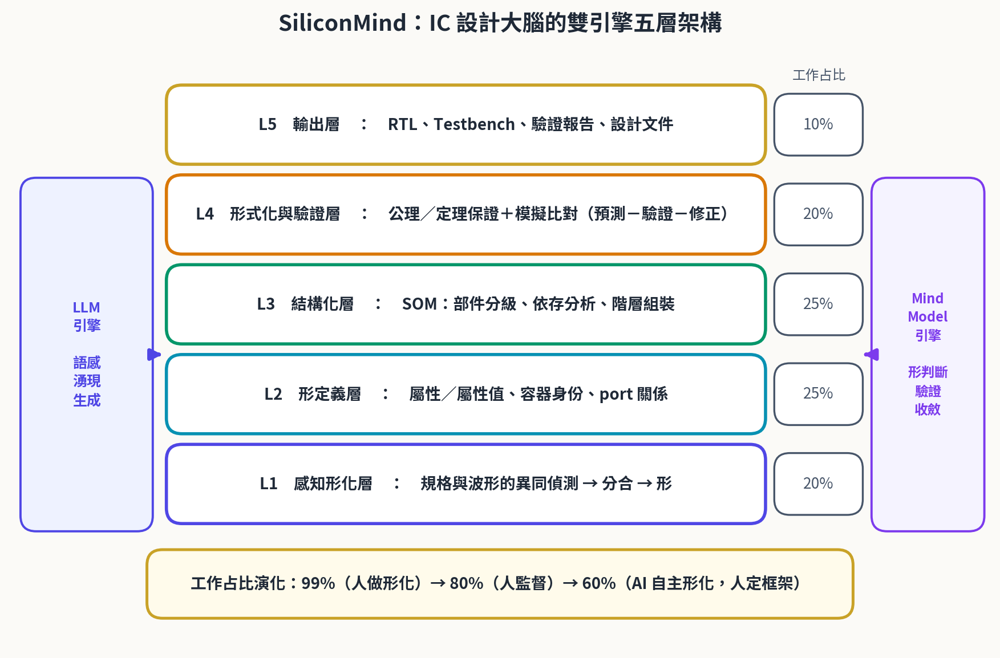

**圖4-1　SiliconMind：IC 設計大腦的雙引擎五層架構**

## 4.2　五層職責與工作占比

五層架構自下而上是：L1 感知形化（從規格與波形偵測異同、完成分合）、L2 形定義（立起屬性、容器與關係）、L3 結構化（建立 SOM、做部件分級與階層組裝）、L4 形式化與驗證（以公理定理保證正確性、以模擬比對驗證行為）、L5 輸出（交付 RTL、測試平台、驗證報告與設計文件）。

**表4-1　五層職責、雙引擎分工與工作占比**

| 層 | 職責 | 主導引擎 | 工作占比 |
| --- | --- | --- | --- |
| L5 輸出 | RTL、測試平台、驗證報告、設計文件 | LLM 主導 | 10% |
| L4 形式化與驗證 | 公理定理保證＋模擬比對（預測－驗證－修正） | 雙引擎協同 | 20% |
| L3 結構化 | SOM 建立、部件分級、階層組裝 | Mind Model 主導 | 25% |
| L2 形定義 | 屬性／屬性值、容器身份、port 關係定義 | Mind Model 主導 | 25% |
| L1 感知形化 | 規格與波形的異同偵測 → 分合 → 形 | LLM 主導、Mind Model 確認 | 20% |

> **重點（工作占比的演化：99% → 80% → 60%）**
>
> **初期（人做形化，AI 約 1%）：**人把規格翻成形，AI 只代筆文字。工程師的時間幾乎全部花在 L1～L3。
>
> **中期（人監督，AI 約 20%）：**AI 起草形定義與結構，人審核修正；L4 的驗證迴圈開始自動化。
>
> **成熟期（AI 自主形化，人約 40%）：**AI 完成 L1～L5 的大部分工作，人退到框架的制定與價值判斷——定義 F(T)、裁決邊界案例、決定「這顆晶片該是什麼形」。

## 4.3　預測－驗證－修正迴圈

雙引擎的協作體現在一個閉合的時間迴圈：先由形預測（Mind Model 依當前形給出「預期波形」——這個設計在這個激勵下應該長什麼樣子），再由生成引擎產出 RTL 與測試平台並執行模擬，比對「預期」與「實際」；若不符，則啟動果因推理，由失敗的波形回推形的錯誤落在哪一層——是身份搞錯（容器層）、部件缺漏（SOM 層）、還是類別規則理解偏差（抽象層）——修正之後重新進入迴圈。

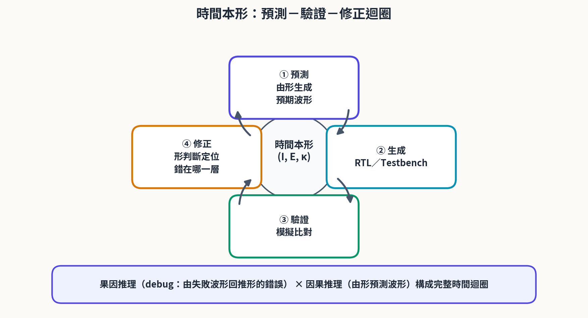

**圖4-2　時間本形：預測－驗證－修正迴圈**

這個迴圈的關鍵在於「先預測、後驗證」。沒有預測的驗證只能發現「有錯」，說不出「錯在哪」；有了形的預測，每一次失敗都被約束在三層判斷的座標系裡，修正因此有了方向。這正是「準確的方法」的時間形態——準確不是一次寫對，而是每一次迭代都比上一次更逼近形的真值。

> **註（與時間本形的接口）**
>
> 本節的迴圈即時間本形 (I, E, κ) 的工程實例：I 是驗證區間（一次模擬跑多久），E 是事件（時脈沿、激勵、斷言命中），κ 是約束（時序規格、協定要求）。時間本形的完整理論展開在第六章與另文專述。

# 第五章　形式化：準確方法的定理骨架

前兩章把本形學對照到 Verilog、把方法組織成雙引擎流程；本章進一步把「準確」二字形式化——給出一條公理與三條定理，使第三章的對照與第四章的流程都有了可推導的依據。四條命題的關係如圖 5-1：容器身份公理在最上，支撐三條定理，三者共同支撐全部應用。

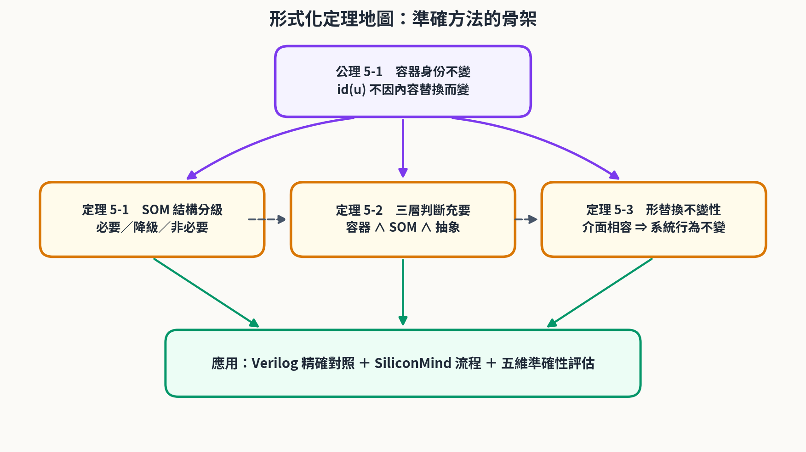

**圖5-1　形式化定理地圖：準確方法的骨架**

**表5-1　形式化命題總表**

| 編號 | 命題 | 類型 | 作用 |
| --- | --- | --- | --- |
| 公理 5-1 | 容器身份不變 | 公理 | 身份座標的基礎：id 不隨內容替換改變 |
| 定理 5-1 | SOM 結構分級 | 判定定理 | 部件影響三分：必要／功能降級／非必要 |
| 定理 5-2 | 三層判斷充要 | 刻畫定理 | 類別歸屬 ⇔ 容器 ∧ SOM ∧ 抽象 |
| 定理 5-3 | 形替換不變性 | 不變性定理 | IP 替換安全：介面同構 ⇒ 行為不變 |

## 5.1　公理：容器身份不變

> **公理 5-1（容器身份不變）**
>
> 對任一實例 u = ( id(u), M[θ] ) 與任一內容替換 σ（RTL 重寫、重新綜合、ECO 修改），恆有 id(u[σ]) = id(u)。替換改變的是內容 S(C)，不改變的是身份。

公理 5-1 是本文所有判斷的基石。它把《空間本形篇》的容器不變性公理搬進 HDL 世界：instance 名稱是身份憑證，與內容無關，正如資料庫主鍵不因資料列內容變動而變動。工程上這條公理的含意是——任何以「同一個實體」為前提的討論（版本管理、除錯追蹤、責任歸屬）都以 id(u) 為座標，而非以程式碼內容為座標。違反這條公理的流程（例如每次生成都重新隨機命名實體）會使整個設計的歷史不可追蹤，這正是許多 AI 生成流程失敗的深層原因。

## 5.2　定理 5-1：SOM 結構分級

> **定理 5-1（SOM 結構分級）**
>
> 設 SOM(M) = ( P(M), R(M), G(M) )。對任一部件 p ∈ P(M)，其對整體同一性的影響恰分三級：
>
> （i）必要件：remove(p, M) ≢ M——結構塌陷，M 不再是原來的整體；
>
> （ii）功能降級件：remove(p, M) ≡ M′ ⊂ M——身份存續，但功能缺失；
>
> （iii）非必要件：remove(p, M) ≡ M——完全不影響。

> **定理 5-1 證明**
>
> 依 R(M) 中 p 的參與方式窮盡討論。若 p 承載 G(M) 的生成依存（有其他部件的生成規則以 p 為前提），移除 p 使依存鏈斷裂，得 (i)。若 p 僅承載可選功能（移除後其餘生成規則仍成立），得 (ii)。若 p 不在任何 R(M) 的關係邊上（孤立部件），移除不改變任何關係，得 (iii)。三級互斥：依存度分別為「承載其他部件」「僅承載自身功能」「不承載任何功能」，性質互不相容；三級窮盡：任何部件對 R(M) 的參與方式只有以上三種。故分級成立。證畢。

這條定理把《空間本形篇》的「必要件／功能降級件／非必要件」三級判定（杯底、杯把、貼紙的對照）升格為可推導的分類，並直接對應工程上的安全關鍵件、可選功能件與裝飾件。第七章將用它對同步 FIFO 的每個部件做出分級判定。

## 5.3　定理 5-2：三層判斷充要

> **定理 5-2（三層判斷充要條件）**
>
> 設 D 為一設計、[T] 為一開放類別。D 屬於 [T]（形邏輯判定），若且唯若同時成立：
>
> （a）容器判斷：D 的身份獨立於內容（公理 5-1 對 D 成立）；
>
> （b）SOM 判斷：D 的必要部件齊備且 R(D) 完整；
>
> （c）抽象判斷：對所有 f ∈ F(T)，f(D) = true。

> **定理 5-2 證明**
>
> **必要性（⇒）：**若 D ∈ [T]，則 D 必以穩定身份被指認（否則類別歸屬隨內容漂移，無法成為成員）——容器判斷成立；D 必以完整結構成立（缺必要件的 D 是 remove 後的 M′，依定理 5-1 已非原整體）——SOM 判斷成立；D 必滿足 F(T)（依定義 2-3 的交集判準）——抽象判斷成立。
>
> **充分性（⇐）：**若 (a)(b)(c) 同時成立，D 是一個身份穩定、結構完整、且通過 ∩(T) 的實體；由抽象類別的開放性（定義 2-3），D 自動生成為 [T] 的成員。證畢。

定理 5-2 同時解釋了單層判斷的盲點為什麼恰好互相補齊：只做容器判斷，任何裝了內容物的東西都算數（平板也像手機）；只做 SOM 判斷，結構相似但類別不同的東西會混淆（計算器也像手機）；只做抽象判斷，身份不穩定的拼湊物會混入（對講機也像手機）。三層同時成立，判斷才既完備又嚴格。

## 5.4　定理 5-3：形替換不變性

> **定理 5-3（形替換不變性）**
>
> 若模組 A、B 滿足同一特徵集合 F(T)，且存在保關係的埠對應 ψ: Q
>
> A → QB（把 A 的埠關係同構映到 B），則在任一上層框架 H 中以 A 替換 B，H 的可觀察行為不變。

> **定理 5-3 證明**
>
> 替換後逐層檢查三層判斷：
>
> （1）容器層：替換是內容替換 σ，由公理 5-1，instance 身份不變；
>
> （2）SOM 層：A、B 滿足同一 F(T) 且埠關係同構，必要部件的角色由 F(T) 與 ψ 保證等效，分級不變；
>
> （3）抽象層：F(T) 相同，∩(T) 判定相同。
>
> 由定理 5-2，H 中該位置的形判定完全不變，故 H 的可觀察行為不變。證畢。

定理 5-3 是 IP 重用的理論基礎：當兩個 FIFO 控制器（或兩家供應商的記憶體控制器）通過同一組 F(T)，替換它們不需要重驗整個系統——需要重驗的只是 ψ 是否真的保關係。這把「換一顆 IP 要不要回歸驗證」從工程經驗變成一條可檢驗的條件句，也是 SiliconMind 在 L4 層執行替換審查時的依據。

# 第六章　時間本形：設計流程的時間維度

空間本形回答「形是什麼、怎麼描述」；時間本形回答「形怎麼演化、判斷怎麼在時間中完成」。IC 設計恰好是一個時間性極強的領域：設計在時間中收斂、驗證在時間中展開、錯誤在時間中暴露、知識在時間中累積。本章把《本形學：時間本形篇》的十八主題聚合為四大模組，對接到設計流程。

## 6.1　時間形與設計事件

時間形記作 (I, E, κ)：I 是區間（interval）——一次模擬的時程、一個設計階段的起訖；E 是事件（event）——時脈沿、激勵施加、斷言命中、版本提交；κ 是約束（constraint）——時序規格（setup／hold）、協定要求、進度節點。區間之間的先後、重疊與包含，遵循 Allen 的時間區間代數；事件落在區間之內，約束則是對區間與事件關係的限制。

在這個語言裡，一次「預測－驗證－修正」迴圈就是一個時間形的最小單元：預期波形是 κ 的具體化，模擬跑出的波形是 I 內的 E 序列，比對則是對「κ 是否被 E 序列滿足」的判定。設計流程本身，就是這些時間形一層層嵌套成的長區間。

## 6.2　十八主題聚四模組

時間本形篇列出十八個主題，它們不是平鋪的清單，而是沿著設計循環運作的四個模組：知識與記憶（標記、記憶管理、抽象、持續學習）負責形的存續；思考與解題（思考、思考法、解題、分析、設計）負責形的生成；邏輯與推理（邏輯生成、邏輯應用、推理、因果推理、果因推理）負責形的判斷；結構演化（分合、框架、設計模式、重構）負責形的重組。四模組隨「規格 → RTL → 驗證 → 重構 → 學習」循環反覆運作，越用越準。

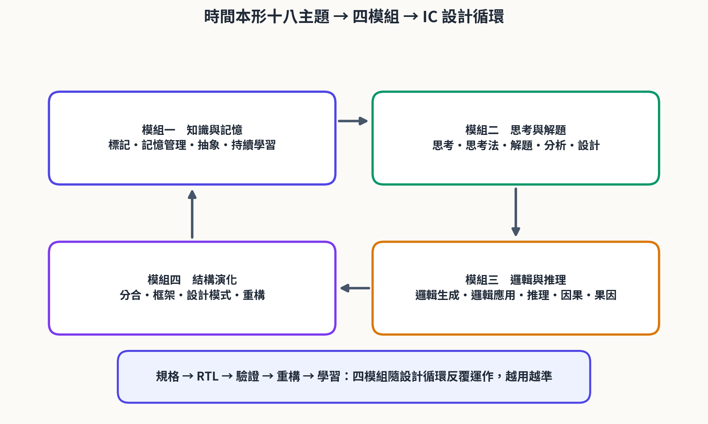

**圖6-1　時間本形十八主題 → 四模組 → IC 設計循環**

**表6-1　時間本形十八主題與 IC 設計對照**

| 主題 | 模組 | IC 設計對應 |
| --- | --- | --- |
| 分合 | 結構演化 | 規格分割與模組合併（partition／merge） |
| 框架 | 結構演化 | 設計方法學與 IP 框架 |
| 設計模式 | 結構演化 | RTL 設計模式（FSM、pipeline、handshake） |
| 重構 | 結構演化 | RTL 重構（ECO、retiming、模組搬移） |
| 標記 | 知識與記憶 | 信號命名、instance 命名、assertion 標記 |
| 記憶管理 | 知識與記憶 | 設計資料庫、波形庫、版本管理 |
| 抽象 | 知識與記憶 | 參數化、介面抽象化、IP 封裝 |
| 持續學習 | 知識與記憶 | 矽後量測回饋與設計知識累積 |
| 思考 | 思考與解題 | 架構探索（design space exploration） |
| 思考法 | 思考與解題 | 設計方法學（methodology）的選擇 |
| 解題 | 思考與解題 | 時序收斂、功耗優化等問題解決 |
| 分析 | 思考與解題 | 時序／功耗／面積分析報告 |
| 設計 | 思考與解題 | RTL 設計實作 |
| 邏輯生成 | 邏輯與推理 | RTL 生成與邏輯綜合 |
| 邏輯應用 | 邏輯與推理 | 測試平台與驗證方法的應用 |
| 推理 | 邏輯與推理 | 形邏輯三層判斷 |
| 因果推理 | 邏輯與推理 | 由形預測波形（前向模擬） |
| 果因推理 | 邏輯與推理 | 由失敗波形回推錯因（debug） |

## 6.3　因果與果因推理的閉合迴圈

十八主題裡最關鍵的一對是因果推理與果因推理。因果推理是前向的：從形出發預測行為——「這個 FSM 在第三個時脈沿應該進入 S2」。果因推理是反向的：從行為回推形——「波形在第三沿沒有進 S2，因為狀態編碼的形定義錯了，錯在抽象層的 F(T) 少寫了一條遷移條件」。前者是設計，後者是除錯；兩者在同一個時間迴圈裡閉合，構成完整的時間方法論。

> **註（理論邊界）**
>
> 時間本形篇的完整理論（時間形的四值化、區間關係的 FDE 表達等）另有專文；本章僅取其方法論骨架與 IC 設計流程對接。四模組的劃分是工作性劃分——同一主題在不同設計階段可能承擔不同模組的任務，表 6-1 的歸屬以主要職責計。

# 第七章　案例研究：SiliconMind 設計同步 FIFO

本章以一個真實規模的案例走完整個方法：用 SiliconMind 的雙引擎五層架構設計一個同步 FIFO（先進先出佇列）。選擇 FIFO 是因為它夠小（一個下午能看完）、又夠完整（有身份、有結構、有類別邊界、有時序行為），恰好把三層判斷與時間迴圈全部逼出來。

## 7.1　五層流程實錄

**表7-1　案例五層流程：雙引擎分工與產出**

| 層 | 工作 | 主導 | 產出 |
| --- | --- | --- | --- |
| L1 | 規格形化：偵測「寬度、深度、讀寫協定」等差異 | LLM 起草、Mind Model 確認 | 形清單（FIFO 形候選） |
| L2 | 形定義：WIDTH／DEPTH 屬性、u_dut 身份、port 關係 | Mind Model | 定義 3-1 四元組實例 |
| L3 | 結構化：mem／wptr／rptr／count 部件分級 | Mind Model | SOM 表（表 7-2） |
| L4 | 形式化與驗證：預測波形、模擬比對、果因修正 | 雙引擎協同 | 驗證紀錄（表 7-3） |
| L5 | 輸出：RTL、測試平台、驗證報告 | LLM | 程式碼 7-1、7-2 |

L1 階段，LLM 讀規格後提出形的候選：這是一個「能存 WIDTH 位元、深 DEPTH、先進先出、有 full／empty 旗標」的東西。Mind Model 並不直接接受這個描述，而是先執行抽象判斷的預檢——把 F(FIFO) 明確立起來，再用它回頭約束後續所有生成。

> **案例類別（FIFO 的形）**
>
> F(FIFO) = { 先進先出序, 可綜合, 介面埠相容, 同步單時脈 }。
>
> 任何新設計 D 屬於 [FIFO]，若且唯若通過以上四項交集判準（定義 2-3）。異步 FIFO、LIFO 堆疊、環形緩衝皆因缺少某項特徵而被排除——邊界由規則決定，不由印象決定。

## 7.2　RTL 實作

L5 輸出的 RTL 如程式碼 7-1。每一行都可標上形的記號：module 宣告是形、參數是屬性、埠是關係、mem 與指標是部件、always 與 assign 是生成規則、full 的比較式則是容器邊界的形化表達（容量即邊界，count 觸及 DEPTH 即到達內部空間的界）。

**程式碼 7-1　同步 FIFO（SiliconMind 產出 RTL）**

```verilog
module sync_fifo #(
    parameter WIDTH = 8,
    parameter DEPTH = 16,
    parameter AW    = 4              // 位址位寬 = log2(DEPTH)
)(
    input  wire             clk,
    input  wire             rst_n,
    input  wire             wr_en,
    input  wire [WIDTH-1:0] din,
    input  wire             rd_en,
    output wire [WIDTH-1:0] dout,
    output wire             full,
    output wire             empty
);
    localparam [AW:0] DEPTH_C = DEPTH;

    reg [WIDTH-1:0] mem [0:DEPTH-1]; // 內容空間（記憶體部件）
    reg [AW-1:0]    wptr, rptr;      // 寫／讀指標（必要部件）
    reg [AW:0]      count;           // 計數（必要部件）

    // 屬性間約束：AW 必須滿足 2**AW = DEPTH（形的一部分）
    // synthesis translate_off
    initial if ((1 << AW) != DEPTH)
        $display("[WARN] AW=%0d 與 DEPTH=%0d 不一致：形的屬性約束被破壞", AW, DEPTH);
    // synthesis translate_on

    // 寫入埠
    always @(posedge clk or negedge rst_n) begin
        if (!rst_n)
            wptr <= {AW{1'b0}};
        else if (wr_en && !full) begin
            mem[wptr] <= din;
            wptr      <= wptr + 1'b1;
        end
    end

    // 讀出埠
    always @(posedge clk or negedge rst_n) begin
        if (!rst_n)
            rptr <= {AW{1'b0}};
        else if (rd_en && !empty)
            rptr <= rptr + 1'b1;
    end

    // 計數與旗標（生成規則）
    always @(posedge clk or negedge rst_n) begin
        if (!rst_n)
            count <= {(AW+1){1'b0}};
        else case ({(wr_en && !full), (rd_en && !empty)})
            2'b10:   count <= count + 1'b1;
            2'b01:   count <= count - 1'b1;
            default: count <= count;
        endcase
    end

    assign full  = (count == DEPTH_C);   // 邊界條件：容量即形的邊界
    assign empty = (count == {(AW+1){1'b0}});
    assign dout  = mem[rptr];            // 先讀出（show-ahead）

endmodule
```

測試平台（程式碼 7-2）體現「先預測、後驗證」：每個 check 任務都是一次形的預測被拿去和模擬結果比對。與一般測試平台不同的是，這些預測來自 L2 的形定義，而不是寫測試的人臨時想的——因此驗證失敗時，果因推理有明確的座標可回推。

**程式碼 7-2　測試平台（預測－驗證的載體）**

```verilog
module tb_sync_fifo;
    reg        clk = 1'b0;
    reg        rst_n = 1'b0;
    reg        wr_en = 1'b0;
    reg        rd_en = 1'b0;
    reg  [7:0] din   = 8'd0;
    wire [7:0] dout;
    wire       full, empty;

    // 例化：DUT 是實體，身分為 u_dut
    sync_fifo #(.WIDTH(8), .DEPTH(16)) u_dut (
        .clk(clk), .rst_n(rst_n),
        .wr_en(wr_en), .din(din),
        .rd_en(rd_en), .dout(dout),
        .full(full), .empty(empty)
    );

    always #5 clk = ~clk;              // 週期 10ns

    integer errors = 0;
    integer i;

    task check;                        // 預測－驗證：條件不符即記錯
        input cond;
        input [8*48-1:0] msg;
        begin
            if (!cond) begin
                errors = errors + 1;
                $display("[FAIL] %0s @ %0t", msg, $time);
            end
        end
    endtask

    initial begin
        // 迴圈 1：重置後 empty 應為 1
        rst_n = 1'b0;
        repeat (2) @(posedge clk);
        rst_n = 1'b1;
        @(posedge clk);
        check(empty === 1'b1, "reset 後 empty 應為 1");

        // 迴圈 2：連續寫入 16 筆後 full 應為 1
        for (i = 0; i < 16; i = i + 1) begin
            @(negedge clk);
            wr_en = 1'b1; din = i[7:0];
        end
        @(negedge clk);
        wr_en = 1'b0;
        check(full === 1'b1, "寫滿 16 筆後 full 應為 1");

        // 迴圈 3：先進先出——輸出應為最早寫入的 8'h00
        check(dout === 8'h00, "FIFO 首筆應為 8'h00");
        @(negedge clk);
        rd_en = 1'b1;
        @(negedge clk);
        rd_en = 1'b0;
        check(dout === 8'h01, "讀一筆後應為 8'h01");

        if (errors == 0) $display("ALL TESTS PASSED");
        else $display("TOTAL ERRORS = %0d", errors);
        $finish;
    end
endmodule
```

## 7.3　SOM 部件分級與三層判斷

L3 以定理 5-1 對每個部件做 remove 分析，結果如表 7-2。表列的是設計意圖的完整 SOM：其中 almost_full 預警旗標為選配件，本版 RTL 未實作（留待功能擴充），正可作為功能降級件的示例。另注意 count 的分級：初版 RTL 把 count 宣告成 [AW-1:0]（4 位元），深度 16 會溢位——這是必要件的隱性缺陷，三層判斷正是在 L4 迴圈裡把這類缺陷逼出水面的機制（見 7.4 迴圈二）。

**表7-2　FIFO 的 SOM 部件分級（定理 5-1 判定）**

| 部件 | 角色 | remove(p, M) 的後果 | 分級 |
| --- | --- | --- | --- |
| mem | 內容空間 | 無處存資料，結構塌陷 | 必要件 |
| wptr | 寫入位置 | 無法定位寫入點 | 必要件 |
| rptr | 讀出位置 | 無法維持先進先出序 | 必要件 |
| count | 容量計數 | full／empty 失據，協定崩解 | 必要件 |
| full／empty | 邊界旗標 | 上下游無法握手 | 必要件 |
| almost_full | 預警旗標 | 系統照常運作，僅失去預警 | 功能降級件 |
| 訊號註解 | 可讀性 | 完全不影響功能 | 非必要件 |

三層判斷的聯合結論：容器層——u_dut 在 RTL 重寫、參數調整後身份不變（公理 5-1）；SOM 層——五件必要件齊備、依存關係完整（定理 5-1）；抽象層——通過 F(FIFO) 四項判準（定義 2-3）。由定理 5-2，u_dut ∈ [FIFO] 成立。只看任何單層都會出錯：只看容器，一個裝了 FIFO 程式碼的記憶體緩衝也算數；只看 SOM，一個結構相同但輸出序相反的 LIFO 也會混入；只看抽象，一個「看起來像」但指標依存斷裂的半成品也能通過表象檢查。

## 7.4　預測－驗證－修正實況

L4 的時間迴圈實際跑了三輪，表 7-3 是完整驗證紀錄。值得細看的是第二、三輪：失敗都不是靠重寫程式碼碰運氣解決的，而是靠果因推理定位到「形的哪一層錯了」之後的精準修正。

**表7-3　預測－驗證－修正紀錄（L4 時間迴圈）**

| 迴圈 | 形的預測 | 模擬結果 | 果因定位與修正 |
| --- | --- | --- | --- |
| 一 | 重置後 empty = 1 | 符合（PASS） | 無需修正 |
| 二 | 寫滿 16 筆後 full = 1 | 不符：count 溢位繞回，full 未拉高 | SOM 層：count 位寬 [AW-1:0] 不足 → 修正為 [AW:0] |
| 三 | 讀出序為 8'h00、8'h01… | 符合（PASS） | 無需修正 |
| 追加 | DEPTH=32 應同樣成立 | 不符：full 行為錯誤 | 抽象層：AW 與 DEPTH 屬性約束缺失 → 補約束檢查（initial 斷言） |

> **重點（兩次修正的教訓）**
>
> **迴圈二的錯在 SOM 層：**部件 count 是必要件，其形（位寬）必須與屬性 DEPTH 聯動；「必要件」不只意味著不能拿掉，還意味著它的形必須被完整定義。
>
> **追加迴圈的錯在抽象層：**參數化 IP 的 F(T) 少寫了一條「AW 與 DEPTH 必須一致」的屬性間約束，使同形不同值的實體族群中出現了壞點；修正後的 RTL 以約束檢查（程式碼 7-1 的 initial 斷言）把這條規則固化在形裡。屬性與屬性值的分離（2.2 節）在此顯出價值：屬性之間的約束，本身就是形的一部分。

# 第八章　準確性評估：五維對照

## 8.1　五維指標

沿用本研究系列的五維準確性框架評估設計流程的輸出品質：語義完整（形的資訊無遺漏）、假設可見（每一步的前提可被檢視）、步驟可檢（判斷過程可重複驗證）、層次一致（容器／SOM／抽象三層不互相矛盾）、邊界明確（類別的 F(T) 與例外情形寫清楚）。這五維不是工程指標的替身——時序、面積、功耗仍由 EDA 度量——而是量測「形的方法有沒有被忠實執行」。

## 8.2　三系統對照

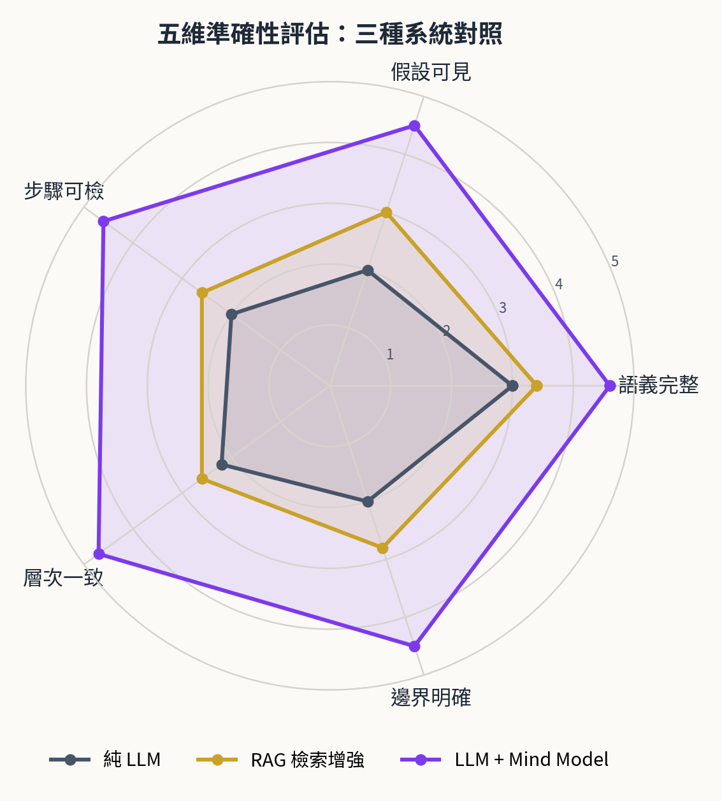

**圖8-1　五維準確性評估：三種系統對照**

**表8-1　五維準確性對照（滿分 5）**

| 維度 | 純 LLM | RAG 檢索增強 | LLM + Mind Model | 定理依據 |
| --- | --- | --- | --- | --- |
| 語義完整 | 3.0 | 3.4 | 4.6 | 定義 3-1 四元組無遺漏 |
| 假設可見 | 2.0 | 3.0 | 4.5 | 公理 5-1 使身份假設顯式 |
| 步驟可檢 | 2.0 | 2.6 | 4.6 | 定理 5-1 分級可重複判定 |
| 層次一致 | 2.2 | 2.6 | 4.7 | 定理 5-2 三層合成一致 |
| 邊界明確 | 2.0 | 2.8 | 4.5 | F(T) 明文化＋定理 5-3 |

評分依據是第七章案例的實際觀測：純 LLM 的產出語感良好，但 instance 命名漂移、部件歸屬含糊；RAG 補上文件依據後假設可見性明顯改善，卻仍無判斷框架，步驟不可檢；雙引擎流程因每一步都落在三層判斷的座標系內，五維全面領先。三系統在「語義完整」上的差距最小——這說明差距不在生成能力，而在判斷能力。

## 8.3　討論

本方法的適用邊界也應明確。其一，Mind Model 需要形庫的建置與維護——F(T) 要有人立、有人改，這正是成熟期工程師退居的位置。其二，時間本形篇的理論展開尚在進行，第六章的四模組是工作性劃分而非最終定論。其三，與 EDA 工具鏈的深度整合（讓三層判斷直接讀模擬資料庫、讓 ψ 對應檢查自動化）是工程上的下一步。這些限制不動搖核心結論：把形的方法用準，設計流程就更可檢、可議、可傳承。

# 第九章　結論與未來展望

本文完成了一件事：把 IC 設計、SiliconMind 與 Verilog 三者統一到本形學的準確方法之下。統一的關鍵不是發明新名詞，而是把工程師本來就在做的事情——命名、分合、分級、判斷、驗證——逐一對應到形的語言，並把「對不對」從直覺升級為可推導的命題。

回顧全文的推導鏈：第二章立起空間本形的基礎（異同→分合→形、容器、SOM、抽象）；第三章給出 Verilog 的精確對照（module 是形、instance 是實體、parameter 是屬性、port 是關係、階層是 SOM、generate 是框架），使形的語言可以在 RTL 裡逐行落地；第四章把方法組織成 SiliconMind 雙引擎五層架構與預測－驗證－修正迴圈；第五章以公理 5-1 與定理 5-1～5-3 保證這套方法「準確」二字的分量；第六章接入時間本形的十八主題，補上流程的時間維度；第七、八章以 FIFO 案例與五維評估完成實證。

展望有四個方向。理論上，時間本形的完整形式化（時間形四值化、區間關係的 FDE 表達）值得持續推進。語言上，SystemVerilog 的 interface、class 與 UVM 驗證方法學是「關係的形」與「抽象的形」更豐富的載體，對照表可以再擴充。工具上，讓三層判斷成為 EDA 流水線的原生關卡——模擬資料庫餵給 Mind Model、ψ 對應檢查自動化——是工程落地的關鍵。最後，矽後量測回饋導入持續學習模組後，設計大腦才真正閉合成一個越用越準的時間形。

本形學在 IC 領域的這次落地，也反過來驗證了理論本身：當一套形的語言能同時解釋認知、資料結構、數學集合與硬體描述，它就不只是描述世界的框架，而是設計世界的準確方法。

# 參考文獻

[1] LonGreat Mind AI 研究團隊，《本形學：空間本形篇》，研究手稿，2026。

[2] LonGreat Mind AI 研究團隊，《本形學：時間本形篇》，研究手稿，2026。

[3] LonGreat Mind AI 研究團隊，《世界模型的大腦：本形學的準確方法》，研究手稿，2026。

[4] LonGreat Mind AI 研究團隊，《IC 設計大腦：SiliconMind》，研究手稿，2026。

[5] LonGreat Mind AI 研究團隊，《形集合與形邏輯：數學證明的更準確方法》，研究手稿，2026。

[6] LonGreat Mind AI 研究團隊，《本形學之 Ontology 與 FDE 應用》，研究手稿，2026。

[7] IEEE Std 1364-2005, IEEE Standard Verilog Hardware Description Language, IEEE, 2005.

[8] IEEE Std 1800-2023, IEEE Standard for SystemVerilog—Unified Hardware Design, Specification, and Verification Language, IEEE, 2023.

[9] S. Sutherland, D. Mills, S. Golson, Verilog and SystemVerilog for Design: A Guide to Using HDL for Efficient Digital Design, Springer, 2018.

[10] N. H. E. Weste, D. M. Harris, CMOS VLSI Design: A Circuits and Systems Perspective, 4th ed., Addison-Wesley, 2011.

[11] E. F. Codd, "A Relational Model of Data for Large Shared Data Banks," Communications of the ACM, vol. 13, no. 6, pp. 377–387, 1970.

[12] K. Koffka, Principles of Gestalt Psychology, Harcourt, 1935.

[13] J. F. Allen, "Maintaining Knowledge about Temporal Intervals," Communications of the ACM, vol. 26, no. 11, pp. 832–843, 1983.

[14] N. D. Belnap Jr., "A Useful Four-Valued Logic," in Modern Uses of Multiple-Valued Logic, Springer, 1977, pp. 5–37.

[15] S. Russell, P. Norvig, Artificial Intelligence: A Modern Approach, 4th ed., Pearson, 2020.

[16] M. Keating, P. Bricaud, Reuse Methodology Manual for System-on-Chip Designs, 3rd ed., Springer, 2002.

# 附錄 A　三層判斷速查表

**表A-1　三層判斷速查表**

| 判斷層 | 核心問題 | 成立 | 不成立 | 形式記號 |
| --- | --- | --- | --- | --- |
| 容器 | 內容替換後，身份還在嗎？ | 容器 ( ) | 純集合 { } | id(C) 不變 |
| SOM | 拿掉部件後，還是同一個嗎？ | 分級成立 | 無結構清單 | remove(p,M) ≢ M／≡ M′／≡ M |
| 抽象 | 新物件通過 F(T) 了嗎？ | D ∈ [T] | D ∉ [T] | ∩(T)(D) = true |

> **重點（審查三問）**
>
> 一問身份：這個東西叫什麼？換了內容還認得嗎？（容器）
>
> 二問結構：它由什麼組成？拿掉哪一塊會塌？（SOM）
>
> 三問類別：它屬於什麼？規則寫在哪？邊界案例怎麼判？（抽象）


[www.longreat.net](https://www.longreat.net)

张长丰 [gamma@livemail.tw](mailto:gamma@livemail.tw)

张楟颍 [mindaiworks@gmail.com](mailto:mindaiworks@gmail.com)
