

  <a href="https://youtu.be/27_DodMKORs">🎞️youtube</a> ｜ 
 <a href="https://v.douyin.com/n1XlkcaPF6A">📽️抖音</a> 
 

 
# 本形學之 Ontology 與 FDE 應用

*形的本體化建構與一階蘊含（FDE）四值邏輯的判斷應用*

## 摘要

本文提出本形學（Ontypology）的形式化路線：先以「異同→分合→形」的認知鏈為基礎，把《空間本形篇》所建立的形、屬性、空間容器、BOM／SOM、框架與抽象，系統性地建構為一套可機器處理的形本體（Ontology of 形）；再引入一階蘊含（First-Degree Entailment, FDE）四值邏輯，把形邏輯的三層判斷（容器、SOM、抽象）擴充到「知識不完整」與「知識互相矛盾」的真實情境。

在本體層，本文給出核心類別階層、物件屬性關係與兩條關鍵公理（容器身份不變、結構依存可檢），並驗證本體與關聯式資料庫 schema 之間的精確映射；在邏輯層，以 Belnap-Dunn 四值語義（t／b／n／f）與證據對（支援、反對）定義形判斷，把「不知道」與「又真又假」從錯誤提升為可運算的資訊，並建立三層判斷四值化、形替換不變性、以及對經典二值邏輯的保守性三項結果。

進一步，本文把《時間本形篇》的綱要（分合、框架、邏輯生成、記憶管理、因果與果因推理等）落實為時間區間與事件本體，示範因果推理與果因推理的 FDE 化；最後描繪 LLM＋Mind Model 雙引擎生態中的應用願景，涵蓋世界模型、GraphRAG 時間區間查詢與持續學習。本文結論是：形的本體化回答「世界由哪些可辨識的東西構成」，FDE 回答「在證據不足或衝突時如何仍能判斷」——兩者合流，正是 Mind Model 邁向可推理世界模型的關鍵一塊拼圖。

**關鍵詞：**本形學、Ontology、知識本體、一階蘊含、FDE、四值邏輯、形邏輯、時間本形、矛盾寬容

## 目錄

- 摘要
- 第一章　緒論：從形到本體，從二值到四值
  - 1.1　形的旅程：認知、描述與形式化
  - 1.2　兩個缺口：知識的不完整與矛盾
  - 1.3　FDE：一階蘊含的四值答案
  - 1.4　本文架構與閱讀方式
- 第二章　形的 Ontology 建構
  - 2.1　形作為本體：核心類別
  - 2.2　三層加值的本體化
  - 2.3　物件屬性與關係設計
  - 2.4　公理化：容器身份與結構依存
- 第三章　Ontology 的映射與驗證：框架與 RDB
  - 3.1　框架四步驟與本體演化
  - 3.2　RDB 與 Ontology 的精確映射
  - 3.3　普遍性的再驗證
- 第四章　FDE 邏輯基礎
  - 4.1　二值的困境
  - 4.2　四值語義：Belnap 菱形格
  - 4.3　聯結詞與直接蘊含
  - 4.4　寬容而不混亂：FDE 的性質
- 第五章　FDE 應用於形邏輯判斷
  - 5.1　三層判斷的四值化
  - 5.2　邊界案例的語義定位
  - 5.3　矛盾寬容與爆炸律失效
  - 5.4　不變性與保守性定理
- 第六章　時間本形與延伸應用
  - 6.1　時間本形的綱要地圖
  - 6.2　時間區間與事件本體
  - 6.3　因果與果因推理的 FDE 化
  - 6.4　應用願景：雙引擎生態
- 第七章　結論
- 參考文獻
- 附錄 A　FDE 判斷速查表
## 第一章　緒論：從形到本體，從二值到四值

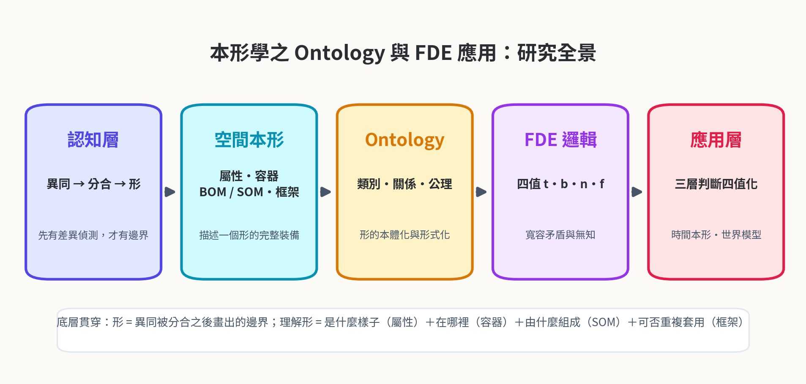

**圖1-1　本形學之 Ontology 與 FDE 應用：研究全景**

**表1-1　章節導覽：每章的核心問題與關鍵產出**

| 章節 | 核心問題 | 關鍵產出 |
| --- | --- | --- |
| 第一章    | 為何需要本體與四值？   | 認知鏈回顧、兩個缺口、FDE 契合性      |
| 第二章    | 形如何成為本體？     | 核心類別、三層加值本體化、公理 2-1／2-2 |
| 第三章    | 本體對得上工程現實嗎？  | 框架演化、RDB↔Ontology 映射    |
| 第四章    | 四值邏輯如何運作？    | Belnap 菱形格、證據對、定理 4-1   |
| 第五章    | 形判斷如何四值化？    | 定義 5-1、定理 5-1／5-2、邊界案例  |
| 第六章    | 時間維度與應用長什麼樣？ | 時間本體、因果／果因 FDE 化、雙引擎    |
| 第七章    | 結論與展望        | 三大貢獻、未來工作               |

### 1.1　形的旅程：認知、描述與形式化

《空間本形篇》確立了一條認知鏈：大腦先偵測「異同」，再以「分」與「合」的動作畫出邊界，「形」（Type）才誕生，而且形必有名。沿著這條鏈，該篇發展出一套完整的描述裝備——屬性與屬性值回答「這個東西是什麼樣子」，空間容器（Space Collections）回答「東西在哪裡」，BOM 與 SOM 回答「這個東西由哪些部件組成、彼此如何依存」，框架（Framework）則把整個推導過程抽象成可重複套用的方法。最後，形邏輯以容器、SOM、抽象三種加值，把數學集合論省略掉的「身份獨立性」「元素間結構」「生成規則」逐一補回。

然而，這套理論目前是以人類讀者為對象的敘述性文本：它說得清楚「杯子不會因為裝了水就變成另一個東西」，卻沒有給出機器可檢查的形式；它告訴我們「屬性一旦被抽出來，就要回填所有個體」，卻沒有說明當知識不完整或互相衝突時，判斷該如何進行。若要讓 Mind Model 的判斷引擎真正「以形思考」，形必須再往前走兩步：第一步是本體化（ontologization）——把形的類別、關係與公理寫成明確的形式規格，使機器可以共享、檢驗與推理；第二步是邏輯化（logicalization）——為形的判斷配上一套能在不確定知識下運作的推理語義。

> **一句話總結**
>
> 本體化回答「世界由哪些可辨識的東西構成」；邏輯化回答「證據不足或衝突時，如何仍能判斷」。本文的任務，就是把形同時推進到這兩步。

### 1.2　兩個缺口：知識的不完整與矛盾

真實世界的形判斷，幾乎從來不是「證據齊全且一致」的理想狀態。第一個缺口是不完整：當「注射器」出現在「∈ \[杯子\]？」的判斷裡，特徵集合 F(杯子)＝{能裝液體, 能被手持喝} 並沒有交代「用於飲用」是否必要，於是一筆「既不能算滿足、也不能算不滿足」的懸案就出現了。第二個缺口是矛盾：當兩個來源對同一個對象給出相反的證據——甲說「FAQ 機器人能對話」、乙說「FAQ 機器人只是查表，不算對話」——我們拿到的是同一命題的正反證據並存，而不是可以隨意丟棄其一的噪音。

經典二值邏輯在這兩個缺口前都會失效。面對矛盾，爆炸律（ex falso quodlibet）讓整個知識庫瞬間癱瘓——由 p 與 ¬p 可以推出任何結論，於是一顆壞資料污染全部判斷；面對無知，二值強迫我們在「真」與「假」之間選邊站，把「還不知道」偽裝成「是」或「否」。對人類認知而言這是日常，對機器而言這是深淵：一個誠實的判斷系統，必須能把「不知道」與「又真又假」說出口。

### 1.3　FDE：一階蘊含的四值答案

一階蘊含（First-Degree Entailment, FDE）是 Anderson 與 Belnap 開創、Dunn 給予組合語義的相關邏輯家族中最精簡的一員。它的做法出人意料地樸素：每個命題的值不由「世界唯一真相」決定，而由一對證據集合決定——支援它的證據（E＋）與反對它的證據（E－）。四種組合恰好產生四個值：只有支援是 t（真），只有反對是 f（假），兩者都有是 b（both，亦真亦假），兩者皆無是 n（neither，非真非假）。b 專門收容矛盾，n 專門表達無知；而且兩者互不傳染，局部衝突不會癱瘓整體推理。

FDE 與形邏輯的契合，遠不只是「剛好能處理壞資料」。回想三層判斷的本質：容器判斷問「內容物替換後，身份是否恆定」，SOM 判斷問「拿掉部件後，整體是否仍是同一個東西」，抽象判斷問「新物件是否通過特徵交集」——每一層都是「以證據裁決一個形的歸屬」。把證據對語義接到三層判斷上，形判斷自然獲得四值輸出：t 接受、f 排除、b 標記衝突、n 標記待查。這正是本文第五章要建立的「三層判斷四值化」。

### 1.4　本文架構與閱讀方式

本文沿著「本體 → 邏輯 → 應用」三段推進。第二章建構形本體：核心類別、三層加值的本體化、物件屬性與公理。第三章以框架四步驟與關聯式資料庫為試金石，驗證本體的映射精度。第四章鋪設 FDE 的四值語義。第五章完成三層判斷四值化，並建立不變性與保守性定理。第六章把《時間本形篇》的綱要落實為時間本體與因果／果因推理的 FDE 化，收束於雙引擎應用願景。第七章總結。

## 第二章　形的 Ontology 建構

### 2.1　形作為本體：核心類別

本體（Ontology）在資訊科學中的經典定義是「概念化的明確形式規格」（Gruber, 1993）：它把一個領域裡「有哪些東西、它們之間有什麼關係」寫成機器可共享、可檢驗的結構。本形學恰好為此準備好了材料——形本身就有清晰的邊界語義（分合畫出的邊界），屬性維度有天然的正規化性質（維度貫穿所有個體），主鍵思想有現成的身份概念（身份獨立於內容）。把《空間本形篇》的術語一一提升為本體類別，就得到形本體 Ontypology-O。

> **定義2-1（形本體 Ontypology-O）**
>
> 形本體是一個四元組 O ＝ (C, P, I, Γ)：C 為核心類別集合；P 為物件屬性（Object Property）與資料屬性（Data Property）集合；I 為個體（Named Individual）集合；Γ 為公理與約束集合。
>
> 核心類別 C 至少包含：形 Type、實體 Entity、屬性 Attribute、屬性值 Value、部件 Part、內容物 Content、框架 Framework、關係 Relation。

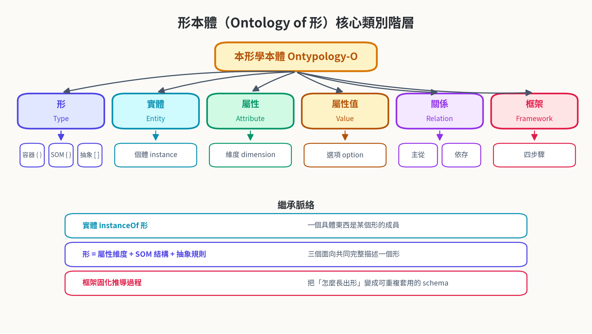

**圖2-1　形本體（Ontology of 形）核心類別階層**

表2-1 羅列核心類別與其在本形學術語中的來源。值得注意的是「形」與「實體」的分工：形是懸在所有個體之上的問題清單，實體是被清單具體回答後的產物——這正是《空間本形篇》「表頭是形、資料列是實體」的本體學重述。實體以 instanceOf 歸屬於形；形本身則由三個面向共同構成：屬性維度（是什麼樣子）、SOM 結構（由什麼組成）、抽象規則（如何生成新成員）。

**表2-1　形本體核心類別清單**

| 類別 | 本體角色 | 對應術語 | 說明 |
| --- | --- | --- | --- |
| 形 Type       | Class    | 形、類別、表頭   | 被分合畫出的邊界；問題清單與生成規則的載體 |
| 實體 Entity    | Class    | 實體、個體、資料列 | 形被具體回答後的產物，有獨立身份（主鍵）  |
| 屬性 Attribute | Class    | 屬性、維度     | 可以被拿來問的問題；維度必須貫穿所有個體  |
| 屬性值 Value    | Class    | 屬性值、選項、刻度 | 問題在具體情境下的答案           |
| 部件 Part      | Class    | BOM 項目    | 可拆下且拆下後仍可獨立辨識的組成件     |
| 內容物 Content  | Class    | 容器的內容物    | 可替換、不定義容器身份的東西        |
| 框架 Framework | Class    | 框架四步驟     | 把形的推導過程固化為可重複套用的方法    |
| 關係 Relation  | Class    | 主從、參考、依存  | 形與形、部件與部件之間的連接        |

### 2.2　三層加值的本體化

形邏輯的三種加值——容器的身份獨立性、SOM 的元素間結構、抽象的生成規則——在本體層各有精確的落點。容器加值對應「內容物可替換而身份恆定」的建模：內容物是與部件完全不同的類別，前者經 contains 掛在容器下，後者經 hasPart 掛在 SOM 形下，兩者的本體地位絕不混淆。SOM 加值對應「部件之間有依存關係」的建模：組成關係 R 是部件集合上的二元關係，必要件、功能降級件、非必要件三級分類直接成為 R 的角色標註。抽象加值對應「開放類別」的建模：類別的成員資格由特徵交集判準給出，恰可用本體語言中的等價類別（equivalentClass）表達。

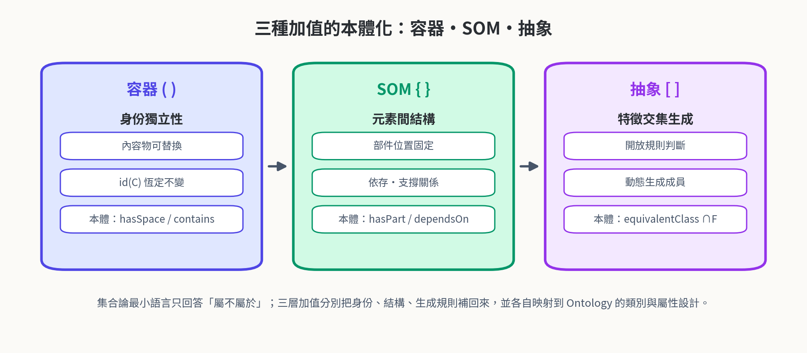

**圖2-2　三種加值的本體化：容器・SOM・抽象**

**表2-2　三層加值 → 本體化對照**

| 加值 | 補上的性質 | 括號 | 本體模組 | OWL 表達 |
| --- | --- | --- | --- | --- |
| 容器     | 身份的獨立性    | ( )    | contains / id(C)    | ObjectProperty + 不變公理 |
| SOM    | 元素間的結構    | { }    | hasPart / dependsOn | ObjectProperty + 角色標註 |
| 抽象     | 特徵交集生成    | \[ \]  | memberOf / ∩F(T)    | equivalentClass 特徵交集  |

> **定義2-2（SOM 的本體結構）**
>
> SOM(M) ＝ (P(M), R(M), G(M))：P(M) 為部件集合；R(M) ⊆ P(M) × P(M) 為組成關係（依存、連接、支撐）；G(M) 為空間配置（每個部件佔據的空間位置）。
>
> R(M) 的角色值域為 {必要件, 功能降級件, 非必要件}，以 remove(p, M) 與 M 的同一性比較判定。

### 2.3　物件屬性與關係設計

形本體的物件屬性（圖2-3）刻意保持精簡而對稱。instanceOf 連接實體與形；hasAttribute 與 hasValue 連接形與其屬性維度、實體與其具體取值；hasPart 與 contains 嚴格區分「骨架」與「客人」；generatedBy 標記抽象形由框架生成；references 對應主鍵→外鍵的指向；dependsOn 表達部件依存；memberOf 表達抽象類別的開放成員資格。資料屬性方面，每個屬性 Attribute 對應一條 DataProperty，其值域即該屬性的屬性值集合——這正是「表頭欄位」的本體學形態。

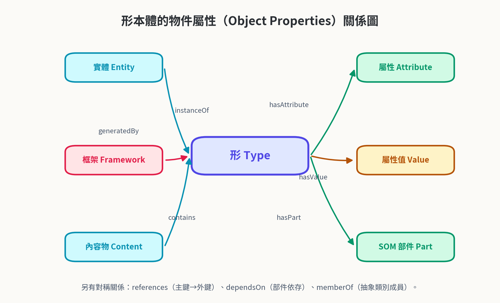

**圖2-3　形本體的物件屬性（Object Properties）關係圖**

> **設計警示：三條不可違反的界線**
>
> 其一，contains 與 hasPart 不可混用——杯子裡的咖啡是內容物，杯把是部件；前者換掉杯子還是同一個杯子，後者拿掉可能動搖同一性。
>
> 其二，屬性維度必須貫穿所有個體——任何實體不得在任何維度上「缺席」，缺資料以 n 值標記，而非省略欄位。
>
> 其三，身份標記（主鍵）不得由屬性值組成——屬性可換、身份不可換。

### 2.4　公理化：容器身份與結構依存

> **公理2-1（容器身份不變）**
>
> 對任意容器 C 與任意內容物 e1, e2：以 e2 替換 S(C) 中的 e1，不改變 id(C)。形式化：∀C ∀e1 e2 ∈ S(C)：id(C) 在 replace(e1, e2) 前後相等。

> **公理2-2（結構依存可檢）**
>
> 對 SOM(M) 與部件 p ∈ P(M)：remove(p, M) 與 M 的同一性比較是可判定的，且判定結果恰有三種——同一性喪失（必要件）、功能降級而身份存續（功能降級件）、完全不影響（非必要件）。

公理2-1 把「杯子裡裝水還是咖啡」這句日常語感提升為不可違約的模型約束：任何違反它的建模（例如把內容物當成身份的一部分）都視為建模錯誤。公理2-2 則把「拿掉杯底杯子就垮了」的直覺提升為可判定程序：它保證 SOM 判斷不是品味問題，而是可重複、可檢驗的機械程序。這兩條公理與《空間本形篇》的容器三要素、SOM 三級分類一一對應，構成本體的承重牆。

> **本章小結**
>
> 形本體 O ＝ (C, P, I, Γ) 把形、實體、屬性、部件、內容物、框架、關係全部提升為可檢驗的本體類別；三層加值各有本體落點；兩條公理守住身份與結構的底線。下一步：把它放回工程現實裡驗證。

## 第三章　Ontology 的映射與驗證：框架與 RDB

### 3.1　框架四步驟與本體演化

框架四步驟——分辨異同、對照失敗、抽象命名、判斷掛入——描述了一個形的誕生過程。把它翻成本體演化（ontology evolution）的語言，四步驟正好對應兩種輕重完全不對稱的變動。當新物件的差異「對得上」既有維度，只需要在對應屬性下新增一個屬性值（新增個體），schema 完全不動；當差異「跟所有既有維度都對不上」，才觸發抽象、開出新維度——這對應新增 DataProperty 並為所有已存在個體回填取值，是一次真正的 schema change（圖3-1）。

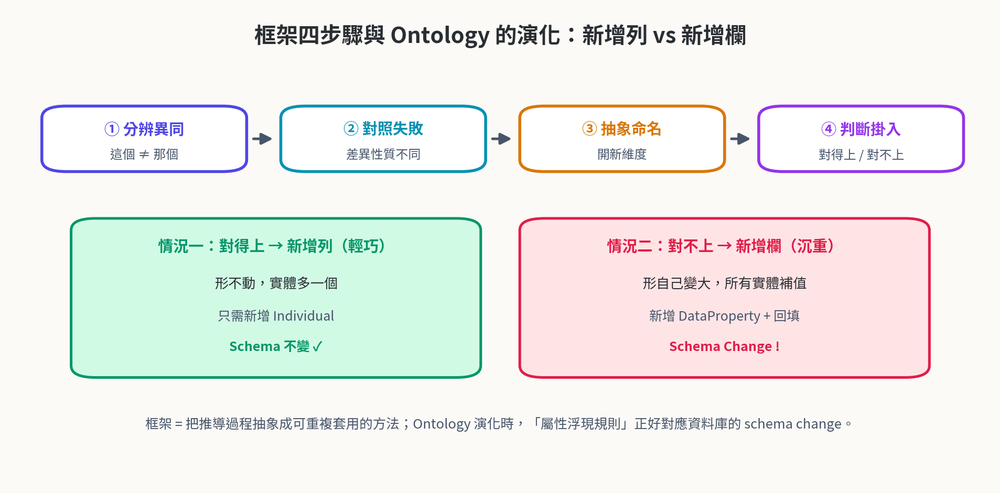

**圖3-1　框架四步驟與 Ontology 的演化：新增列 vs 新增欄**

這個不對稱性在本體工程中有深刻的對應：新增個體是保守擴充（conservative extension），舊結論全部保持有效；新增屬性維度則可能動搖既有分類的邊界——原本「無法區分」的兩個實體，多了「隔熱層」維度後就分得開了。因此本體演化策略應該與《空間本形篇》的屬性浮現規則一致：能沿用既有維度就絕不開新維度，開新維度必須回填全體。

### 3.2　RDB 與 Ontology 的精確映射

《空間本形篇》指出「表頭是形、資料列是實體、主鍵撐住身份、主從參考連接形與形」。在本體層，這組對應可以逐條翻譯（圖3-2、表3-1）：表頭（欄位集合）映射為 Class 的屬性約束；每一資料列映射為 NamedIndividual；主鍵映射為個體的身份標記（在 OWL 實作中即 IRI）；外鍵映射為 ObjectProperty 的具體斷言；表結構變更映射為 schema evolution。

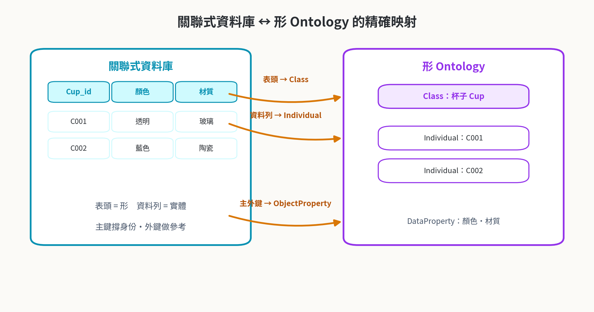

**圖3-2　關聯式資料庫 ↔ 形 Ontology 的精確映射**

**表3-1　RDB ↔ 形本體 ↔ Ontology 術語對應**

| RDB 概念 | 本形學術語 | Ontology 對應 |
| --- | --- | --- |
| 表頭（欄位集合）   | 形（問題清單）    | Class + DataProperty 約束 |
| 資料列        | 實體         | NamedIndividual         |
| 主鍵         | 身份標記 id(C) | 個體 IRI / key 斷言         |
| 外鍵         | 主從參考       | ObjectProperty 斷言       |
| 新增一列       | 新增實體（形不動）  | 新增 Individual（保守擴充）     |
| 新增一欄       | 新屬性維度（形變大） | 新增 DataProperty + 回填    |
| 正規化 1NF    | 維度貫穿所有個體   | 屬性約束：單值且必填              |

映射的教訓是雙向的。一方面，RDB 證明了形本體不是空中樓閣——每天運作的資料庫就是形本體的實作現場；另一方面，本體補上了 RDB 說不出口的東西：資料庫可以存「部件表」，卻表達不了「拿掉杯底會塌陷」的依存語義；資料庫可以設 NOT NULL，卻表達不了「這筆資料目前不知道，但不是沒有」的 n 狀態。後者正是下一章 FDE 要補的缺口。

### 3.3　普遍性的再驗證

《空間本形篇》以生物分類（界門綱目科屬種）驗證了框架的普遍性：具體個體必須先存在，抽象階層才推得出來。這條「種先於界」的原理在本體層原樣成立——Ontology 的 TBox（概念層）永遠從 ABox（個體層）的觀察中被抽象出來，而非相反。世界模型的建模六步驟（形偵測→形定義→結構化→框架化→形式化→驗證修正）同樣是這條原理的展開：偵測對應異同，定義對應抽象命名，結構化對應 SOM，框架化對應可重複套用，形式化對應本體化，驗證修正對應判斷迴圈。

> **本章小結**
>
> 框架四步驟＝本體演化的兩種變動；RDB↔︎Ontology 逐條映射成立；「種先於界」的原理在本體工程中原樣有效。形本體通過工程試金石——現在輪到邏輯。

## 第四章　FDE 邏輯基礎

### 4.1　二值的困境

經典命題邏輯建立在兩個隱含承諾上：每個命題非真即假（排中律），矛盾不可容忍（矛盾律＋爆炸律）。這兩個承諾在封閉世界裡代價極低——數學證明的世界裡，證據可以窮盡、矛盾意味著錯誤。但形的判斷運作在開放世界：新的杯子會帶來從未見過的維度，新的資料源會帶來彼此衝突的證詞。在開放世界裡堅持二值，只有兩條路：要麼拒絕承認矛盾（丟資料），要麼讓矛盾爆炸（癱瘓系統）。兩者都是把「知識狀態」誤認為「世界真相」。

### 4.2　四值語義：Belnap 菱形格

> **定義4-1（FDE 四值語義）**
>
> 設命題 p 的證據對為 (E＋, E－)，E＋ 為支援 p 的證據集合，E－ 為反對 p 的證據集合。p 的值 val(p) ∈ {t, b, n, f} 由證據對決定：
>
> val(p) ＝ t，若 E＋ ≠ ∅ 且 E－ ＝ ∅（只有支援）；val(p) ＝ f，若 E＋ ＝ ∅ 且 E－ ≠ ∅（只有反對）；val(p) ＝ b，若 E＋ ≠ ∅ 且 E－ ≠ ∅（亦真亦假）；val(p) ＝ n，若 E＋ ＝ ∅ 且 E－ ＝ ∅（非真非假）。
>
> 四值集合配備兩個序：真值序（t 最真、f 最假、b 與 n 之間無關）與資訊序（b 與 n 各為「資訊過多」與「資訊不足」，t 與 f 為資訊恰好）。

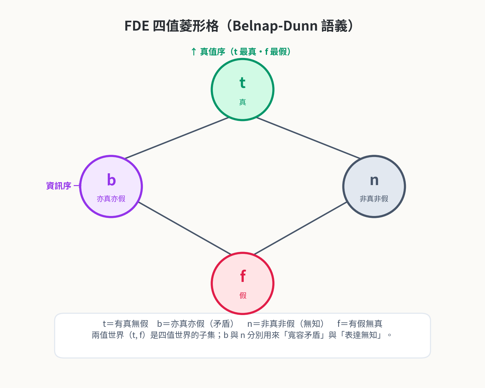

**圖4-1　FDE 四值菱形格（Belnap-Dunn 語義）**

菱形格的幾何把兩個序一次說清：沿垂直方向是「有多真」，沿水平方向是「知道多少」。b 站在左端——知道得太多、多到自相矛盾；n 站在右端——知道得太少、少到無法裁決。t 與 f 分踞上下，是知識恰好足夠的兩個典範。這個幾何不是裝飾：下一節的聯結詞，正是格上的交集與聯集。

### 4.3　聯結詞與直接蘊含

FDE 的聯結詞用格運算定義（圖4-2）：合取 ∧ 取真值序的下界（infimum），析取 ∨ 取上界（supremum），否定 ¬ 交換 t 與 f、保持 b 與 n——「亦真亦假」否定後仍是「亦真亦假」，「非真非假」否定後仍「非真非假」，這正符合直覺：無知不會因為加了否定就變成有知。表4-1 給出四值的知識解讀。

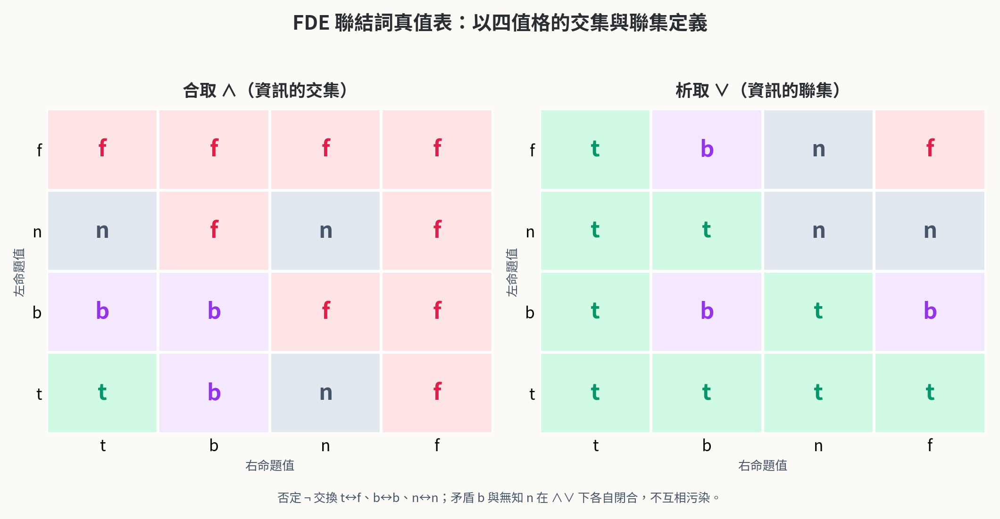

**圖4-2　FDE 聯結詞真值表：以四值格的交集與聯集定義**

**表4-1　四值的證據狀態與知識解讀**

| 值 | 證據對 (E＋, E－) | 知識解讀 | 日常對應 |
| --- | --- | --- | --- |
| t     | (有, 無)           | 被支援、未被反對 | 「馬克杯是杯子」——眾證一詞      |
| b     | (有, 有)           | 被支援也被反對  | 「FAQ 能對話」——甲說能、乙說不能 |
| n     | (無, 無)           | 無人提及     | 「注射器是杯子嗎」——規則未定義    |
| f     | (無, 有)           | 被反對、未被支援 | 「碗是杯子」——特徵明確不合      |

「一階」（first-degree）之名，來自 FDE 只處理「一次性的」複合命題：命題變元的布爾組合，不含量詞嵌套、不模態疊加。而「蘊含」在 FDE 中取最直接的語義：Γ ⊨ φ 當且唯若「對每個變元指派每個證據對，只要 Γ 中所有式子的值為 t（或至少不是 f，依版本而定），φ 的值就不為 f」。這種直接蘊含保留了古典邏輯的大部分好習慣，只把矛盾與無知的處理改了——這是它最迷人的地方：改動最小，收益最大。

### 4.4　寬容而不混亂：FDE 的性質

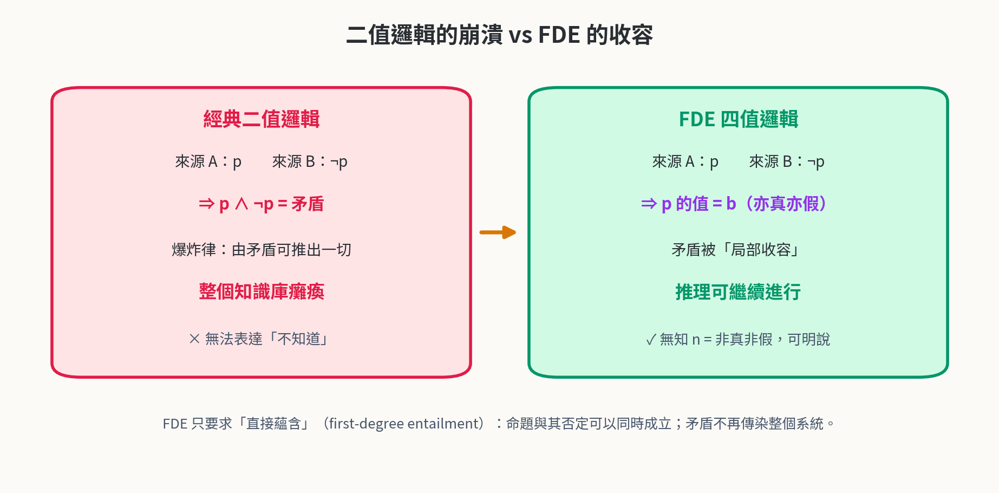

**圖4-3　二值邏輯的崩潰 vs FDE 的收容**

> **定理4-1（雙寬容性）**
>
> FDE 同時滿足：(i) 矛盾寬容——對任意命題 p，p 與 ¬p 同時成立（值為 b）時，不能推出任意命題 q；(ii) 無知寬容——存在命題 p 使 val(p) ＝ n，且由 n 不可推出 t 或 f。
>
> 此外，De Morgan 定律在四值下保持成立，且 FDE 對二值語義是保守的：當所有變元的值只取 t、f 時，所有聯結詞的計算結果與經典邏輯完全一致。

> **證明**
>
> (i) 設 val(p) ＝ b，val(q) ＝ n。p ∧ ¬p 的值為 b ∧ b ＝ b，非 t；而 q 的值為 n，非 t。直接蘊含只要求「前提為 t 時結論不為 f」，故由 p ∧ ¬p 推不出 q——爆炸律失效。
>
> (ii) 依定義4-1，證據對 (∅, ∅) 恰給出 n，且 ¬n ＝ n，∧、∨ 皆無法把 n 變成 t 或 f（菱形格中 n 與 t、f 之間只有序關係、沒有等式推導），故無知不可被偽裝。
>
> 保守性：t、f 的子格恰是二值格，∧、∨、¬ 在其上的運算表與經典一致，故證畢。

**表4-2　二值邏輯與 FDE 的對照**

| 面向 | 經典二值 | FDE 四值 |
| --- | --- | --- |
| 值域        | 真、假       | t、b、n、f      |
| 矛盾 p ∧ ¬p | 不可容忍 → 爆炸 | 值為 b，局部收容    |
| 無知        | 強迫二選一     | 值為 n，明說「不知道」 |
| 否定        | 真 ↔ 假     | t ↔ f，b、n 保持 |
| De Morgan | 成立        | 成立           |
| 對二值的關係    | —         | 保守包含         |

> **本章小結**
>
> 四值不是「把二值搞複雜」，而是把「證據狀態」誠實地放進值域：b 收容矛盾、n 表達無知、t/f 保持古典好習慣。定理4-1 保證寬容不等於混亂。

## 第五章　FDE 應用於形邏輯判斷

### 5.1　三層判斷的四值化

> **定義5-1（形判斷的四值化函數）**
>
> 設知識庫 K 為有限組帶來源標記的證據集合。對三層判斷 J ∈ {容器判斷 Vc, SOM 判斷 Vs, 抽象判斷 Va}，定義證據對 (E＋(J), E－(J))：E＋ 為 K 中支援「判斷成立」的證據，E－ 為反對的證據。
>
> 判斷值 val(J) ＝ f(證據對) 依定義4-1 取值；聯合判斷 val(J*) ＝ inf{val(Vc), val(Vs), val(Va)}（真值序下界）。

四值化的關鍵設計是：每個判斷值都必須能指出它的證據對——這就是公理5-1（關係可檢性）的精神。以智慧型手機為例，容器層的證據是「App 可安裝／移除而手機身份不變」（支援 Vc，無反對）→ t；SOM 層對「相機模組」的判斷是「移除後無法拍照但通話正常」→ 功能降級件，其必要性判斷值為 f（不是必要件）；抽象層若 F(T) 明確（能通訊、能運算、可攜帶）→ 對 iPhone 為 t。表5-1 以四值重新裁決第三層聯合判斷的每個項目。

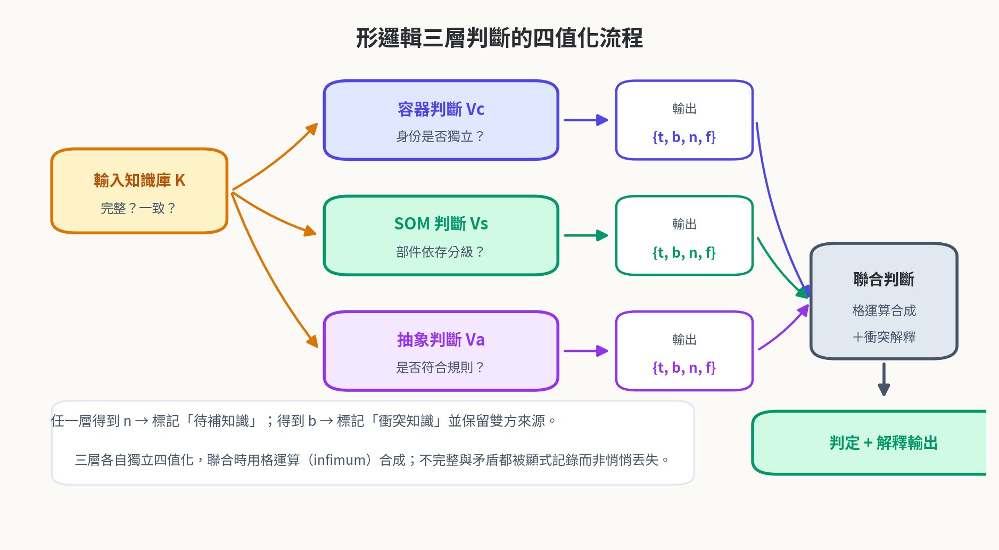

**圖5-1　形邏輯三層判斷的四值化流程**

**表5-1　智慧型手機案例的三層判斷四值化**

| 層 | 判斷命題 | 證據對 | 值 |
| --- | --- | --- | --- |
| 容器 Vc  | 手機＝容器(App)         | 支援：裝卸 App 身份不變；反對：無 | t     |
| SOM Vs | 主機板＝必要件            | 支援：移除即無法開機；反對：無     | t     |
| SOM Vs | 相機＝必要件             | 支援：無；反對：移除後通話上網正常   | f     |
| 抽象 Va  | iPhone ∈ \[智慧型手機\] | 支援：三特徵全過；反對：無       | t     |
| 抽象 Va  | 平板 ∈ \[智慧型手機\]     | 支援：能運算、可攜帶；反對：不能通訊  | f     |
| 聯合 J\* | 整體歸屬               | inf{t, t, t}        | t     |

### 5.2　邊界案例的語義定位

《空間本形篇》留下一批耐人尋味的邊界案例：注射器算不算杯子？FAQ 機器人算不算對話系統？二值時代，這些案例只能以「取決於 F(T) 的完備度」一語帶過；四值時代，它們終於有了精確的座標（圖5-2、表5-2）。注射器問題的本質是特徵集合「未定義用途維度」——正反證據皆無，落點 n；FAQ 問題的本質是來源對「對話」一詞各執一詞——正反證據並存，落點 b。同是「說不清」，n 與 b 的處方完全不同：n 要補證據（把 F(T) 寫完整），b 要裁衝突（讓來源對齊定義）。

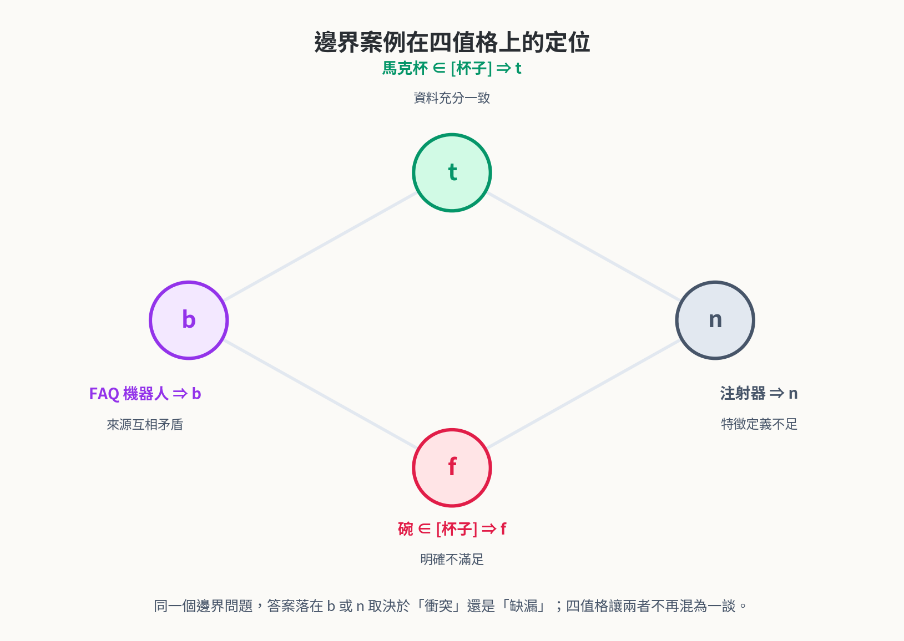

**圖5-2　邊界案例在四值格上的定位**

**表5-2　邊界案例四值判斷表**

| 案例 | 情境 | 值 | 處方 |
| --- | --- | --- | --- |
| 馬克杯 ∈ \[杯子\]   | F(T) 齊全、來源一致     | t     | 接受歸類           |
| 碗 ∈ \[杯子\]     | 不能被手持喝，證據明確      | f     | 排除             |
| 注射器 ∈ \[杯子\]   | F(T) 未定義「用於飲用」   | n     | 補充特徵維度再判       |
| FAQ ∈ \[對話系統\] | 甲證「能對話」、乙證「只是查表」 | b     | 標記衝突、來源對齊定義    |
| 運動水壺 ∈ \[杯子\]  | 吸管口可手持喝，證據充分     | t     | 接受，並記錄 F(T) 解釋 |
| 保溫壺 ∈ \[杯子\]   | 需倒出才能喝，反對明確      | f     | 排除但 ∈ \[容器\]   |

### 5.3　矛盾寬容與爆炸律失效

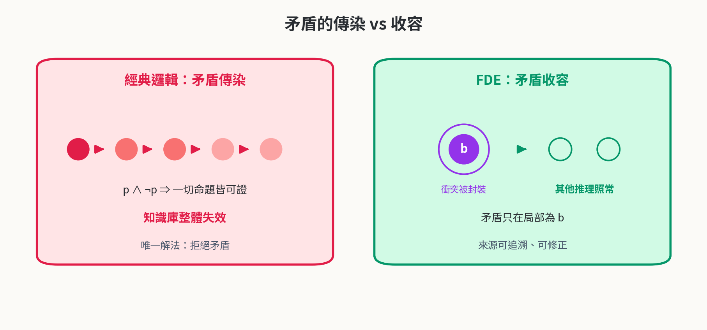

**圖5-3　矛盾的傳染 vs 收容**

把 FDE 接到形判斷上的最大紅利，是矛盾被封裝在命題局部（圖5-3）。設知識庫 K 中「某型機器人 ∈ \[對話系統\]」被兩個來源同時支持與反對，其值為 b；此時其他判斷——它是不是容器、它的部件分級——完全不受影響，照常得到 t 或 f。只有在聯合判斷取下界時，b 才會把整體判定壓到「需要人工裁決」的等級，而且壓低的原因可追溯：b 值附帶的證據對直接指出「哪兩個來源、對哪個特徵」衝突。

> **公理5-1（關係可檢性）**
>
> 每個形判斷值都必須附帶可追溯的有限證據對 (E＋, E－)；任一判斷值若無法指出證據對，視為無效判斷。
>
> 推論：n 與 b 都是「可操作的狀態」——n 觸發補證據任務，b 觸發衝突溯源任務。

### 5.4　不變性與保守性定理

《空間本形篇》與《形集合與形邏輯》曾建立替換不變性與三層判斷充要條件。在 FDE 框架下，這兩項結果不僅保持，而且更加完整：不變性現在覆蓋「證據不完整或衝突」的開放情境，保守性則保證四值化在理想情形退化回二值。

> **定理5-1（三層合成的四值一致性）**
>
> 設 K 為知識庫，val(Vc)、val(Vs)、val(Va) 為三層判斷值，val(J*) ＝ inf{val(Vc), val(Vs), val(Va)}。則：(i) val(J*) ＝ t 若且唯若三層皆為 t；(ii) 任一層為 f 則 val(J*) ＝ f；(iii) 無 f 而有 b／n 時，val(J*) 反映資訊缺陷（b 或 n），且缺陷可歸因到具體層級。

> **證明**
>
> 真值序為 t &gt; b &gt; n &gt; f 的菱形序（b、n 之間無關，皆 &gt; f、&lt; t）。infimum 的計算逐點檢驗即得：三層全 t 才有 inf ＝ t；含 f 則 inf ＝ f；其餘情形 inf ＝ 缺陷值中「最弱」者，且因三層值獨立計算、證據對分層標記，缺陷可歸因。證畢。

> **定理5-2（形替換不變性於 FDE 保持）**
>
> 對容器 C 與內容物替換 replace(e1, e2)：id(C) 不變（公理2-1），且以 C 為對象的三層判斷值在替換前後相等——只要替換操作本身不新增關於 C 的證據。
>
> 更一般地：抽象類別的開放生成在四值化下保持——新個體通過 ∩F(T) 的判斷只取決於其特徵證據，與既有個體的判斷值無關。

> **證明**
>
> 容器層：替換內容物不觸及 id(C)（公理2-1），亦不改變 hasAttribute、hasPart 的既有證據，故 (E＋, E－) 不變，val 不變。
>
> 抽象層：∩F(T) 的判定是逐特徵的證據檢查，個體之間無證據交互（開放類別不以列舉裁決成員），故判斷值相互獨立。證畢。

> **對 AI 分類系統的意義**
>
> 現代 AI 分類器只做抽象層的二值（或機率）裁決：它會告訴你「93% 是杯子」，卻說不出「這是無知的 93% 還是衝突的 93%」。四值化的形判斷把「置信度」拆成兩根軸——真值與資訊量——n 走補資料、b 走裁衝突、t/f 才是真正的分類結果。這是世界模型在開放環境中不可缺的判斷維度。

> **本章小結**
>
> 三層判斷四值化＝證據對＋菱形格下界；邊界案例從「說不清」變成「座標明確」；定理5-1／5-2 保證合成一致與替換不變；公理5-1 讓每個判斷可追溯。

## 第六章　時間本形與延伸應用

### 6.1　時間本形的綱要地圖

《時間本形篇》以綱要形式立下十八個主題：分合、框架、設計模式、邏輯生成、記憶管理、邏輯應用、標記、持續學習、抽象、重構、思考、思考法、解題、分析、設計、推理、因果推理、果因推理。空間本形回答「是什麼樣子」，時間本形要回答的是「如何生成、演化與推理」。以本體的觀點重新安放這十八個主題，它們自然聚成四個模組（圖6-1、表6-1）：分合與框架（形的誕生與重構）、生成與管理（邏輯生成、記憶、標記、設計模式）、學習與思考（持續學習、思考法、解題）、分析與推理（設計、推理、因果與果因）。

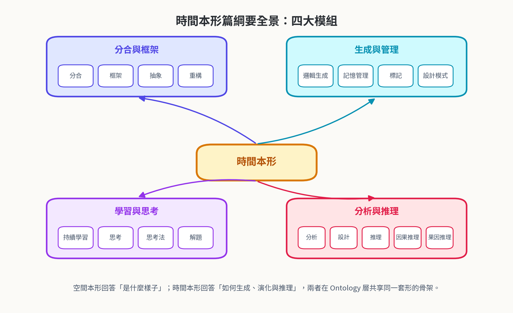

**圖6-1　時間本形篇綱要全景：四大模組**

**表6-1　時間本形主題 → 本體模組對應**

| 模組 | 綱要主題 | 本體模組 | FDE 角色 |
| --- | --- | --- | --- |
| 分合與框架  | 分合、框架、抽象、重構        | 形的生成與 schema 演化 | 演化決策的四值裁決     |
| 生成與管理  | 邏輯生成、記憶管理、標記、設計模式  | 事件生成、記憶庫、標記語言   | 記憶缺漏標 n、衝突標 b |
| 學習與思考  | 持續學習、思考、思考法、解題     | 學習迴圈、策略庫        | 學習訊號的四值分類     |
| 分析與推理  | 分析、設計、推理、因果推理、果因推理 | 因果本體、推理引擎       | 因果／果因結論四值化    |

### 6.2　時間區間與事件本體

時間維度的第一個本體決策，是把「形」延伸到時間區間：一個時間形由區間（起訖）、事件形（類別）與因果角色（因／果）三要素構成（定義6-1）。區間之間的基本關係沿用 Allen 的區間代數（before、meets、overlaps、during 等）；而當區間的邊界知識不完整時——例如「會議從 14 點開始，何時結束還不清楚」——邊界直接標記為 n，待記憶回填後再判定（圖6-2）。這讓時間區間查詢獲得四值答案：「A 在 B 之前嗎？」可以誠實地回答 t、f、b（兩個來源各說各話）或 n（資料未到），而不是被強行猜一個二值。

> **定義6-1（時間形）**
>
> 時間形 Tt ＝ (I, E, κ)：I ＝ (s, e) 為時間區間，s、e 的確定性各自取 FDE 值；E 為事件形（歸屬的形類別）；κ ∈ {因, 果, 無} 為因果角色。
>
> 區間關係 R(I1, I2) 依 Allen 代數取值；當 I1 或 I2 的邊界含 n 標記時，R 的值以四值保守推得：資訊不足時 R(I1, I2) ＝ n。

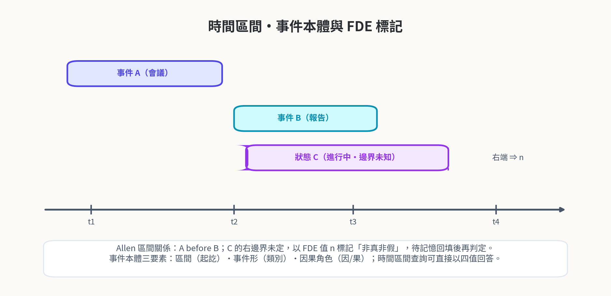

**圖6-2　時間區間・事件本體與 FDE 標記**

### 6.3　因果與果因推理的 FDE 化

因果推理（由因推果，預測）與果因推理（由果溯因，溯因）是時間本形的兩台推理主機。把它們四值化的收益立竿見影：預測的結論可以是 b（模型與感測器衝突）而不需要整套模型推倒重來；溯因的假設可以是 n（證據未到）而不需要硬選一個原因。兩台推理機圍著同一個「預測－驗證－修正」迴圈運轉（圖6-3）：b 值觸發衝突溯源與來源對齊，n 值觸發主動補證據（這正是記憶管理與標記模組的工作），t 值流入長期記憶，f 值排除假設但保留審計軌跡。

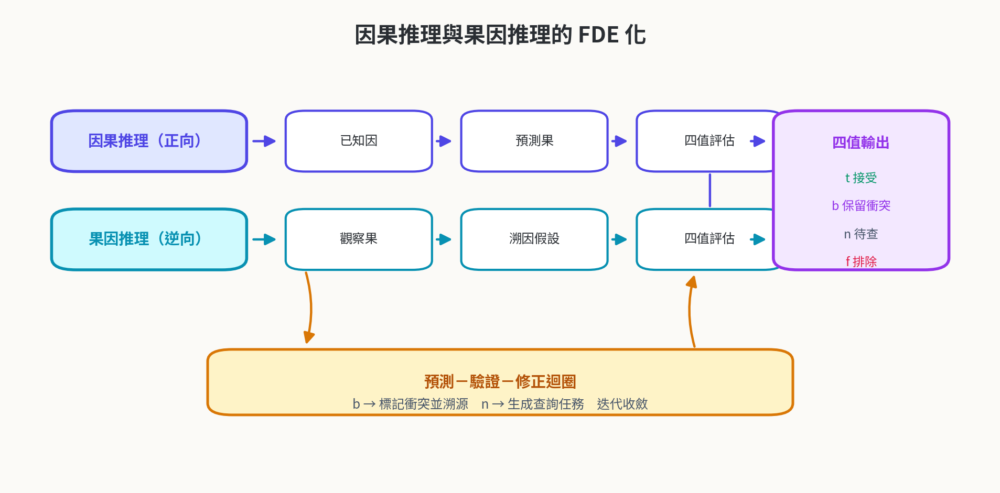

**圖6-3　因果推理與果因推理的 FDE 化**

值得強調的是「果因推理」在傳統 AI 中長期被當成非演繹的權宜之計；在四值框架下，它與因果推理地位對稱——兩者都是「以證據對裁決一個命題」，只是一個面向未來的命題、一個面向過去的命題。這種對稱性正是《時間本形篇》把「因果推理／果因推理」並列為綱要終章的深意。

### 6.4　應用願景：雙引擎生態

把形本體與 FDE 判斷放回 Mind AI 的總體架構，就得到 LLM＋Mind Model 雙引擎的完整分工（圖6-4）：LLM 引擎負責語言的生成、理解與候選提出；Mind Model 引擎持形本體與四值判斷器，負責身份追蹤、結構分析、規則裁決與衝突治理。GraphRAG 的時間區間查詢可以直接以四值回答並附證據對；世界模型（WorldMind）以形偵測→定義→結構化→框架化→形式化→驗證修正六步驟運轉；ProofMind 與 SiliconMind 等領域大腦在上層重用同一判斷內核。

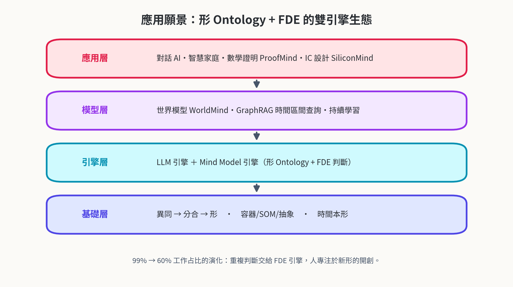

**圖6-4　應用願景：形 Ontology + FDE 的雙引擎生態**

工作占比的演化曲線——從 99% 人力投入重複判斷，到 60% 甚至更低——正是由這套內核推動的：能被形式化的判斷交給 FDE 引擎，引擎判定 n 與 b 的部分交給人裁決，人裁決的結果再成為新證據、新公理、新 F(T)。這條迴路，就是「持續學習」與「重構」在本體層的具體形態。

> **本章小結**
>
> 時間本形十八主題聚成四模組；時間形 (I, E, κ) 讓區間查詢四值化；因果／果因兩台推理機圍繞預測－驗證－修正迴圈，由 b／n 值驅動溯源與補證；雙引擎生態把一切收束為可運轉的判斷內核。

## 第七章　結論

本文完成了本形學的兩級推進。第一級是本體化：以「異同→分合→形」為地基，把形、實體、屬性、部件、內容物、框架、關係提升為形本體 Ontypology-O 的核心類別，以三層加值定出三個本體模組，以兩條公理守住身份與結構的底線，並以框架演化與 RDB 映射完成工程驗證。第二級是邏輯化：以 FDE 的證據對語義與 Belnap 菱形格，把形邏輯三層判斷擴充為四值判斷，讓「不知道」與「又真又假」成為一等公民，並建立三層合成一致性（定理5-1）、形替換不變性（定理5-2）與對二值的保守性三項理論結果。

綜合而言，本文的三個貢獻是：其一，給出形的第一套完整形式本體，讓《空間本形篇》的理論從可讀走向可判定；其二，給出形判斷的四值化框架，把邊界案例從「取決於定義完備度」的模糊語，提升為 b／n 座標明確、處方不同的可操作狀態；其三，把《時間本形篇》的綱要落實為時間本體與因果／果因推理的 FDE 化，鋪好通往世界模型與持續學習的接口。

展望有三。其一，《時間本形篇》的十八主題值得各自發展為專章正文，特別是記憶管理與標記語言如何與證據對共構。其二，形本體可望與既有本體工具鏈（OWL 2 描述邏輯推理器）接軌，讓四值判斷器成為可部署的中間件。其三，在 GraphRAG 與時間區間查詢的真實負載上驗證四值判斷的效益——衡量 n／b 的觸發率、裁決成本與最終準確率的改善。形的旅程從認知出發，經由描述與形式化，終將回到認知：讓機器像人一樣，既能辨識萬物的邊界，也能誠實地說出「我不知道」與「這裡有爭議」。

## 參考文獻

[1] Anderson, A. R., & Belnap, N. D. (1975). Entailment: The Logic of Relevance and Necessity (Vol. I). Princeton University Press.

[2] Belnap, N. D. (1977). A useful four-valued logic. In J. M. Dunn & G. Epstein (Eds.), Modern Uses of Multiple-Valued Logic (pp. 5–37). Reidel.

[3] Belnap, N. D. (1977). How a computer should think. In G. Ryle (Ed.), Contemporary Aspects of Philosophy (pp. 30–55). Oriel Press.

[4] Dunn, J. M. (1976). Intuitive semantics for first-degree entailment and “coupled trees”. Philosophical Studies, 29(3), 149–168.

[5] Priest, G. (1979). The logic of paradox. Journal of Philosophical Logic, 8(1), 219–241.

[6] Priest, G. (2008). An Introduction to Non-Classical Logic: From If to Is (2nd ed.). Cambridge University Press.

[7] Shramko, Y., & Wansing, H. (2011). Truth and Falsehood: An Inquiry into Generalized Logical Values. Springer.

[8] Ginsberg, M. L. (1988). Multivalued logics: A uniform approach to reasoning in artificial intelligence. Computational Intelligence, 4(3), 265–316.

[9] Fitting, M. (1991). Bilattices and four-valued logic. Contemporary Mathematics, 114, 49–73.

[10] Gruber, T. R. (1993). A translation approach to portable ontology specifications. Knowledge Acquisition, 5(2), 199–220.

[11] Guarino, N., Oberle, D., & Staab, S. (2009). What is an ontology? In S. Staab & R. Studer (Eds.), Handbook on Ontologies (2nd ed., pp. 1–17). Springer.

[12] Baader, F., Calvanese, D., McGuinness, D. L., Nardi, D., & Patel-Schneider, P. F. (Eds.). (2003). The Description Logic Handbook. Cambridge University Press.

[13] W3C. (2012). OWL 2 Web Ontology Language: Primer (2nd ed.). W3C Recommendation.

[14] Lenzerini, M. (2002). Data integration: A theoretical perspective. In Proc. PODS 2002 (pp. 233–246). ACM.

[15] Allen, J. F. (1983). Maintaining knowledge about temporal intervals. Communications of the ACM, 26(11), 832–843.

[16] van Benthem, J. (1983). The Logic of Time. Reidel.

[17] Arieli, O., Avron, A., & Zamansky, A. (2011). Maximally paraconsistent logics. Artificial Intelligence, 175(1), 297–326.

[18] LonGreat Mind AI 研究團隊. (2026). 本形學-空間本形篇. 內部研究手稿.

[19] LonGreat Mind AI 研究團隊. (2026). 本形學-時間本形篇. 內部研究手稿.

## 附錄 A　FDE 判斷速查表

表A-1 彙整證據對到判斷動作的完整對應，供實作 Mind Model 判斷器時逐列查表；表A-2 為三層判斷的實作檢查清單。

**表A-1　證據對 → 值 → 後續動作速查表**

| 證據對 (E＋, E－) | 值 | 知識狀態 | 後續動作 |
| --- | --- | --- | --- |
| (有, 無)           | t     | 明確成立     | 接受；證據存入長期記憶         |
| (無, 有)           | f     | 明確不成立    | 排除；保留審計軌跡           |
| (有, 有)           | b     | 衝突       | 標記衝突；溯源雙方來源；觸發定義對齊  |
| (無, 無)           | n     | 缺漏       | 標記待查；觸發補證據任務（查詢／感知） |

**表A-2　三層判斷實作檢查清單**

| 層 | 檢查項目 | 判定要點 |
| --- | --- | --- |
| 容器 Vc  | 內容物可替換？身份恆定？   | 公理2-1；contains 與 hasPart 嚴格分開 |
| SOM Vs | 部件可拆？移除後同一性？   | 公理2-2；三級分類必要／降級／非必要           |
| 抽象 Va  | F(T) 完備？逐特徵檢驗？ | 交集判準 ∩F(T)；缺維度先補維度            |
| 聯合 J\* | 取真值下界；缺陷可歸因？   | 定理5-1；n 補證、b 裁衝               |
| 通用     | 判斷附證據對？        | 公理5-1；無證據對即無效判斷               |
