

  <a href="https://youtu.be/cCGDbikHbYQ">💻橫式</a> ｜ 
 <a href="https://v.douyin.com/XicukGs_pII">📱直式</a> 
 

# 機械設計與 PLM 的應用

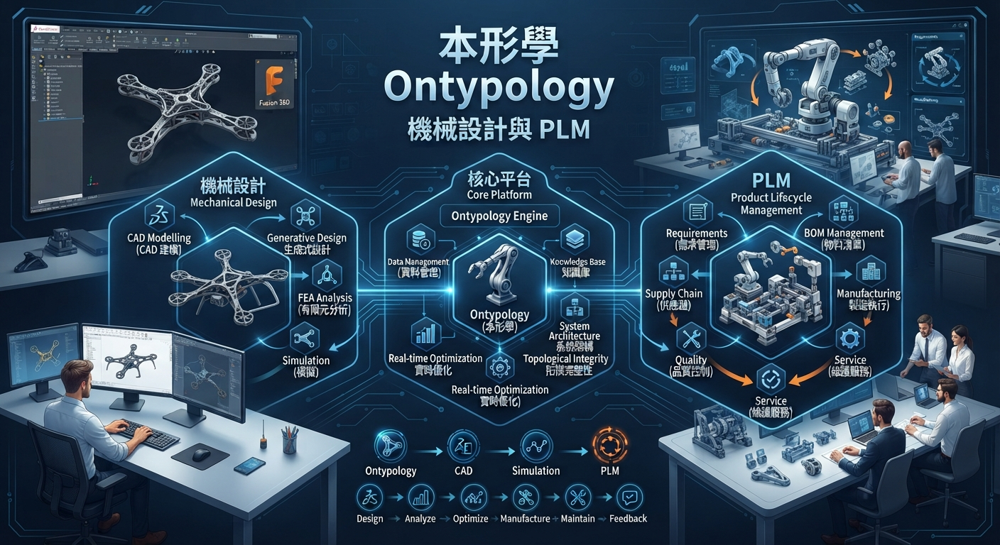

**關鍵詞：**機械設計・產品生命週期管理（PLM）・本形學（Ontypology）・Mind Model・物料清單（BOM）・變更管理・知識管理・人工智慧

# 摘要

本研究以「本形學（Ontypology）」與 Mind Model（知識統一模型）為理論基礎，重新詮釋機械設計與產品生命週期管理（Product Lifecycle Management, PLM）的知識結構與運作機制。研究首先指出：機械設計中的產品結構（BOM）、參數表、零件分類體系，與關聯式資料庫的「表頭—資料列—主鍵」結構，實際上共享同一套「形」的底層邏輯——表頭是形、資料列是實體、主鍵撐住身份、主從參考連接形與形。在此基礎上，本文提出融合空間本形與時間本形的 PLM 總體架構：將 EBOM／MBOM／SBOM 視為同一形體的多重框架展開，將變更管理對應為「新增列」與「新增欄」兩種不對稱的形變動，並將版本演化納入因果推理與果因推理的雙向軌道。

進一步地，本文建構 Mind AI × PLM 智慧化平台架構，以大型語言模型（LLM）承擔語言能力、Mind Model 承擔智慧能力，並以三層形邏輯判斷（容器層、SOM 層、抽象層）作為工程決策的認知濾網，支援設計智慧助手、變更影響分析、失效診斷推理等應用。最後以一級減速機開發為案例，完整推演從需求定義、框架建構、Y 軸拆解、SOM 分級、ECO 變更到升版學習的端到端流程。研究表明：以「形」統一描述機械設計與 PLM，可為工程知識管理提供一致的認知基礎，解決資訊孤島與知識流失問題，並為邁向工程 AGI 奠定可行路徑。

> **核心主張**
>
> 機械設計與 PLM 共享同一套「形」的底層邏輯：形，是異同被分合之後畫出的邊界；理解一個形，就是理解它「是什麼樣子」（屬性）、「在哪裡」（容器）、「由什麼組成」（SOM），以及「這套描述方法能不能被重複套用」（框架）。

# 目錄

- 摘要
- 第一章 緒論
  - 1.1 研究背景與動機
  - 1.2 問題意識
  - 1.3 研究目的與貢獻
  - 1.4 論文架構
- 第二章 文獻回顧與背景
  - 2.1 機械設計流程與方法學
  - 2.2 PLM 的發展與核心功能
  - 2.3 BOM 與配置管理
  - 2.4 工程知識管理與 AI 應用
  - 2.5 傳統方法的限制
- 第三章 理論基礎：本形學與 Mind Model
  - 3.1 形的起源：異同 分合 形
  - 3.2 X 軸與 Y 軸：分類與拆解
  - 3.3 單位形：屬性、容器、BOM 與 SOM
  - 3.4 空間框架：可重複套用的描述方法
  - 3.5 RDB 對應：表頭是形，資料列是實體
  - 3.6 形邏輯：三種加值
  - 3.7 時間本形：演化與推理
  - 3.8 Mind Model 與 Mind AI
- 第四章 機械設計的本形學詮釋
  - 4.1 設計流程的形學對應
  - 4.2 Y 軸拆解與產品結構
  - 4.3 設計參數的浮現機制
  - 4.4 設計模式與框架複用
  - 4.5 SOM 依存與部件必要性分級
- 第五章 PLM 的本形學架構
  - 5.1 總體架構：空間本形 時間本形
  - 5.2 產品主檔：表頭即形
  - 5.3 EBOM／MBOM／SBOM：多重框架展開
  - 5.4 變更管理：新增列與新增欄
  - 5.5 時間本形與版本演化
  - 5.6 配置管理即空間容器
- 第六章 Mind AI × PLM：智慧化應用體系
  - 6.1 平台架構
  - 6.2 三層形邏輯判斷：工程決策的認知濾網
  - 6.3 變更影響分析
  - 6.4 失效診斷與雙向推理
  - 6.5 知識推薦與設計助手
  - 6.6 與傳統知識圖譜的差異
- 第七章 案例分析：一級減速機開發
  - 7.1 案例背景
  - 7.2 端到端流程推演
  - 7.3 產品結構與 SOM 分級
  - 7.4 變更案例：大齒輪材質升級
  - 7.5 案例小結
- 第八章 效益評估與討論
  - 8.1 效益評估
  - 8.2 導入路徑
  - 8.3 限制與挑戰
  - 8.4 討論
- 第九章 結論與展望
  - 9.1 結論
  - 9.2 展望：通往工程 AGI 的三階段
- 參考文獻

# 第一章　緒論

## 1.1　研究背景與動機

機械設計是製造業的源頭，一項產品從需求定義、概念設計、參數化設計、結構分析到量產試作，累積出龐大的工程知識：圖面、BOM、參數表、設計規範、失效案例、變更紀錄。為管理這些知識，產品生命週期管理（PLM）系統自 1990 年代起逐步成為企業的資訊骨幹，串接 CAD／CAE／CAM／ERP／MES，肩負「單一事實來源（Single Source of Truth）」的使命。然而，多數 PLM 導入仍停留在「資料管理」層次：資料被妥善保存，卻未被真正理解；跨系統的資料格式不一、設計理由隨人員流動而流失、變更影響依賴資深工程師的直覺——資訊孤島並未因 PLM 的存在而消失，只是換了一種形式。

與此同時，人工智慧技術快速發展。大型語言模型（LLM）具備優異的語言理解與生成能力，知識圖譜（Knowledge Graph）提供了結構化的知識表示，Graph RAG 等方法更試圖將兩者結合。然而，現行 AI 的分類與推理多停留在「抽象層」的判斷，缺乏對身份持續性的追蹤與對結構依存的分析能力；傳統知識圖譜雖能描述實體與關係，卻存在關係表達能力有限、缺乏深層推理、難以表示抽象概念、缺乏思維結構、難以統一跨領域知識、難以支持持續演化學習等限制。工程領域需要的，不只是更大的參數規模，而是一套能夠統一知識、理解世界、進行推理、持續學習與自主思考的智慧架構。

## 1.2　問題意識

本研究的問題意識源於一個觀察：機械設計師每天都在使用的四種工具——產品結構樹、參數表、零件分類、資料庫主檔——看似分屬不同領域，實則共享同一套深層邏輯。當我們在 PLM 中建立一張「零件主檔」時，我們實際上是在定義一個「形」；當我們拆解 BOM 時，我們在做 Y 軸的組成分析；當我們建立零件族時，我們在做 X 軸的抽象分類；當我們執行 ECO 變更時，我們面對的正是「形要不要變」的根本問題。若能揭示這套共同的底層邏輯，並以一套認知理論將其形式化，PLM 就能從「資料管理工具」升級為「知識理解系統」。

## 1.3　研究目的與貢獻

- 理論貢獻：以本形學（空間本形＋時間本形）詮釋機械設計與 PLM，建立兩者與「形」概念的完整對應體系，證明其共享同一套底層邏輯。
- 架構貢獻：提出融合空間本形與時間本形的 PLM 總體架構，以及 Mind AI × PLM 智慧化平台，明確定義資料層、知識層與應用層的職責分工。
- 實踐貢獻：以一級減速機開發為案例進行端到端推演，驗證本方法在設計重用、變更效率、錯誤預防與知識留存上的效益，並提出可行的導入路徑。

## 1.4　論文架構

本論文共分九章。第二章回顧機械設計、PLM 與工程知識管理的相關文獻；第三章闡述本形學與 Mind Model 的理論基礎；第四章以本形學詮釋機械設計；第五章建構 PLM 的本形學架構；第六章提出 Mind AI × PLM 智慧化應用體系；第七章以一級減速機進行案例分析；第八章評估效益並討論限制；第九章提出結論與展望。

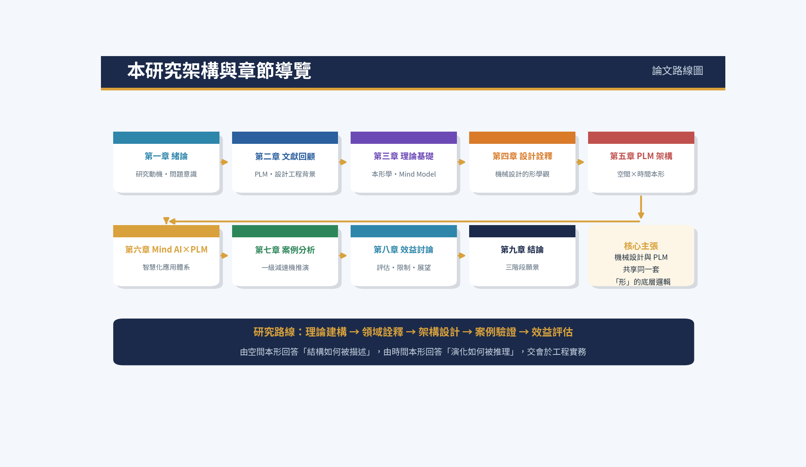

# 第二章　文獻回顧與背景

## 2.1　機械設計流程與方法學

機械設計方法學的經典體系以 Pahl 與 Beitz 的《Engineering Design》為代表，將設計流程劃分為釐清任務、概念設計、具體化設計與詳細設計四個階段，強調「功能分解」與「由需求到結構」的映射；Ullman 則以設計流程模型描述問題定義、概念生成、產品生成與產品交付的迭代循環。功能基（Functional Basis）研究進一步標準化了功能與載流的詞彙，使「功能結構」得以跨產品比較與重用。這些方法學共同揭示：設計的本質，是把模糊的需求逐步畫出邊界、分出層次、定義參數的過程——正是「分合」與「框架」的運作。

## 2.2　PLM 的發展與核心功能

PLM 管理產品自需求至回收的全生命週期資訊與流程。Sudarsan 等人提出產品資訊建模框架，強調產品資料的統一表示；Stark 將 PLM 定義為「21 世紀產品實現的範式」，涵蓋文件管理、BOM 管理、變更管理、配置管理、流程協同與系統整合。國際標準 STEP（ISO 10303）則定義了產品資料交換的中立格式。PLM 的核心承諾是「單一事實來源」——所有部門在相同的產品事實上協作。然而，「事實」的統一不等於「理解」的統一：資料模型決定了資料怎麼存，卻未回答知識如何被推理、被重用、被演化。

## 2.3　BOM 與配置管理

BOM（Bill of Materials，物料清單）是機械設計最核心的知識載體。依切入角度不同，同一產品可展開為 EBOM（設計視圖）、MBOM（製造視圖）與 SBOM（服務視圖）；配置管理則負責在選配、系列化、客戶訂製的情境下維護產品結構的一致性。BOM 的父子關係、位階結構與版本關聯，構成了一張巨大的「結構之網」——這正是空間本形所說的 SOM（空間清單）：部件不僅被列舉，更佔據固定的位置、彼此結構性依存。

## 2.4　工程知識管理與 AI 應用

工程知識管理旨在把設計經驗、失效案例與決策理由組織成可重用的資產。近年知識圖譜技術被廣泛應用於工程知識表示，Graph RAG 方法更結合圖結構檢索與大型語言模型，提升問答品質。然而，Hogan 等人的綜述指出知識圖譜在抽象概念表示與演化學習上仍有瓶頸；Mind AI 研究進一步指出：傳統知識圖譜缺乏思維結構，難以承載「怎麼想」而不只是「是什麼」。要讓 AI 真正理解工程知識，必須補上身份獨立性、元素間結構與生成規則三種性質。

## 2.5　傳統方法的限制

綜合上述文獻，現行機械設計與 PLM 資訊化方案存在五項結構性限制，整理如表2-1。

| 面向 | 傳統方案 | 結構性限制 |
| --- | --- | --- |
| 知識表示 | 資料表、BOM、文件 | 只存結論，不存「為什麼」；設計理由流失 |
| 分類體系 | 零件族、產品族清單 | 封閉清單式管理，新零件需人工歸類 |
| 變更管理 | ECR／ECO 流程 | 影響分析依賴經驗，缺乏系統化判斷框架 |
| 跨系統整合 | ERP／MES／CAD 介接 | 格式不一、語意落差，資訊孤島林立 |
| AI 應用 | 知識圖譜、LLM 應用 | 缺乏身份追蹤與結構依存分析，幻覺難防 |

**表2-1　傳統機械設計與 PLM 方案的結構性限制**

這些限制的共同根源，在於缺乏一套統一的認知理論來描述「形」——一個物件是什麼樣子、在哪裡、由什麼組成、如何演化。下一章即以本形學補上這塊拼圖。

# 第三章　理論基礎：本形學與 Mind Model

## 3.1　形的起源：異同 → 分合 → 形

本形學（Ontypology）主張：「形」並非天生存在，而是大腦先偵測到「異同」，再透過「分」與「合」的動作畫出邊界之後才產生的結果。用白話來說，大腦必須先感覺到「這個和那個不一樣」，才會把相同的部分圈起來（合）、把不同的部分切開來（分）；「圈起來／切開來」所畫出的邊界，就是「形」，而形必有名。這條認知鏈——異同、分合、形、命名、類別——呼應格式塔心理學的「圖與地」原則：均勻背景上突顯的前景讓大腦輕易畫界；眼前一片均質時，「形」無從誕生。

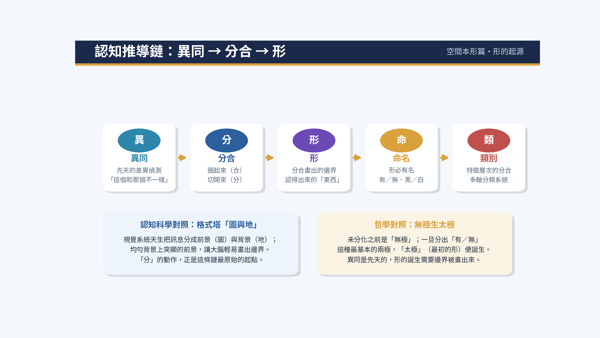

「分」是看出東西彼此不一樣的地方；「合」是在不一樣的東西裡找出「其實可以算同一類」的部分。當第三個東西出現、逼出「顏色」與「形狀」兩條獨立的分類軸時，人類便開始用多軸描述世界。大腦思考 ＝ 形 ＋ 數：數學描述數量、關係與規律；形學描述結構、組成、關聯、演化與本質。

## 3.2　X 軸與 Y 軸：分類與拆解

把一堆東西按共通點分組，同一堆東西可同時用好幾種共通點去分，稱為 X 軸——它回答「這是什麼樣的東西」。盯著一個東西看它能不能被切成幾塊、每塊自己仍是完整獨立的東西，稱為 Y 軸——它回答「這個東西由哪幾塊組成」。兩軸各自獨立運作，卻能透過部件互相銜接：拆出來的部件可以再跑一次 X 軸分類；拆解中發現的新性質，又會逼 X 軸的詞彙擴充。

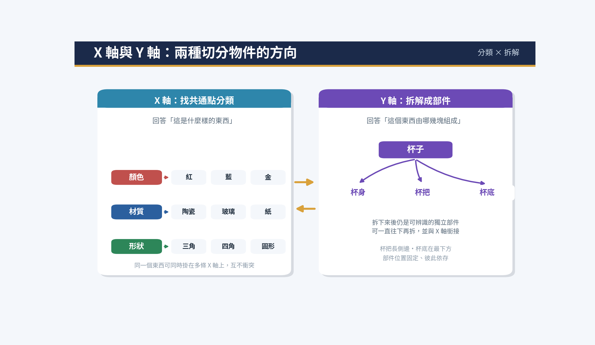

## 3.3　單位形：屬性、容器、BOM 與 SOM

完整描述一個具體物件，需要四個面向：屬性與屬性值回答「是什麼樣子」；空間容器（Space Collections）回答「東西在哪裡」；BOM 回答「由什麼組成」；SOM 回答「部件如何依存」。屬性是「可以被拿來問的問題」（維度），屬性值是具體答案（刻度）；屬性浮現的時機，永遠是「這批差異跟現有所有屬性都對不上」的那一刻——開新維度並回頭為所有個體補值；對得上時，只在該維度下加新刻度。空間容器具備邊界、內部空間與獨立身份三要素：杯子不會因為裝水或裝咖啡而變成別的東西。

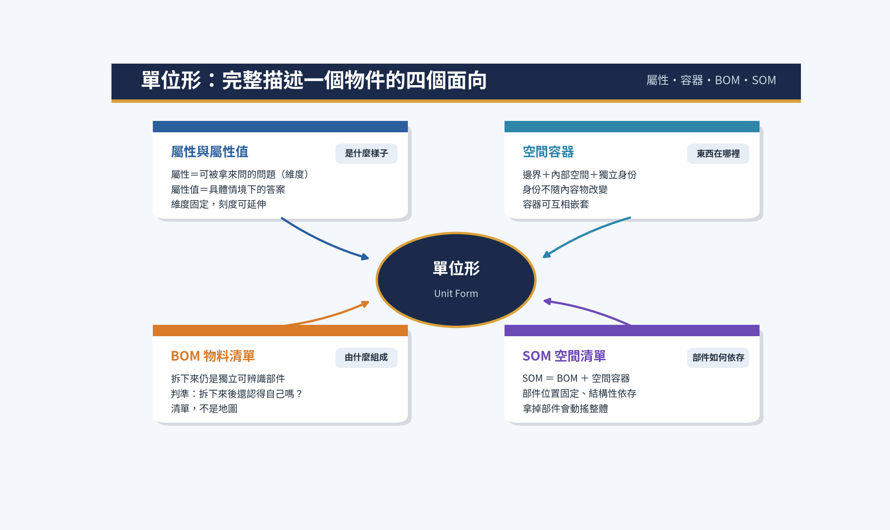

| 屬性（維度） | 屬性值（刻度） |
| --- | --- |
| 材質 | 不鏽鋼、陶瓷、紙、玻璃 |
| 顏色 | 透明、藍色、金色、銀色、米色、卡其色、白色 |
| 手把 | Y／N |
| 蓋子 | Y／N |

**表3-1　屬性—屬性值總表（杯子範例）：維度固定，刻度可延伸**

BOM 的判準只有一個：「拆下來之後，它還認得自己嗎？」能拆下來、拆下來後仍是獨立個體的（杯蓋、杯耳）進 BOM；拆不下來、只能描述樣貌的（顏色、材質）進屬性。SOM ＝ BOM ＋ 空間容器：容器裡裝的不是可任意替換的內容物，而是被固定在特定空間位置、彼此結構性依存、共同構成整體的骨架部件。

## 3.4　空間框架：可重複套用的描述方法

框架（Framework）把「描述一個物件」這件事本身抽象化，成為可重複套用的方法，運作分四步驟：一、拿到一群東西，先能分辨「這個不是那個」；二、出現第二批性質不同的差異、對照失敗時，觸發抽象的需要；三、把兩批差異各自取名，分成不同的維度；四、新東西加入時判斷它對得上哪個維度——對得上就掛進既有軸，對不上就開新維度並回填。這套方法的普遍性可由生物分類驗證：界門綱目科屬種的階層，正是「具體個體先存在，抽象階層才推得出來」的展現。

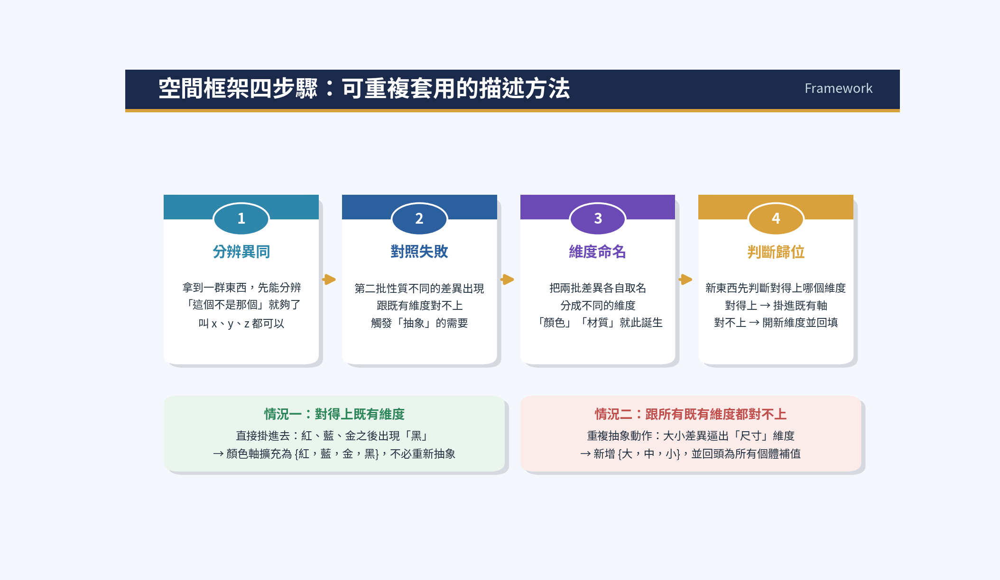

## 3.5　RDB 對應：表頭是形，資料列是實體

這套理論在關聯式資料庫中有精確對應：表頭（欄位名稱）是形——所有資料列共用的問題清單；資料列是實體——形被填上具體答案後的可指認對象；主鍵是身份憑證——與內容無關、支撐「同一個形」的存在；外鍵與主從參考，則讓形與形之間靠鍵值連接而非靠內容綁在一起。新增一列是「形不動、實體多一個」，輕巧；新增一欄是「形自己變大、所有實體都要跟著補值」，沉重——這種不對稱性，正是變更管理必須慎重對待「形變動」的理論依據。

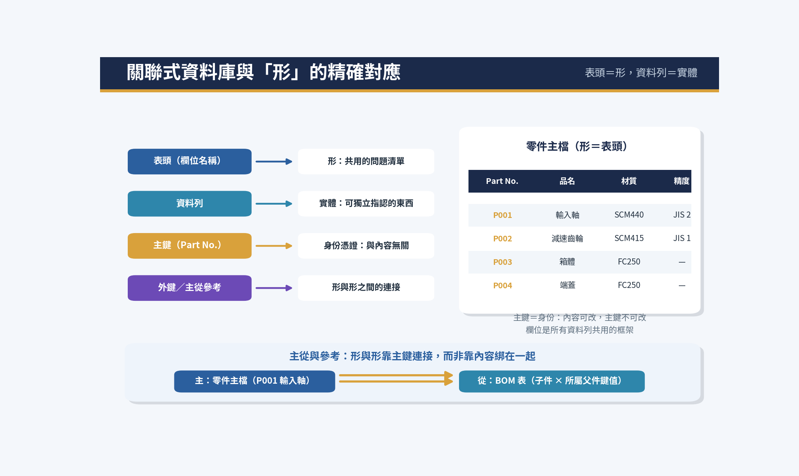

## 3.6　形邏輯：三種加值

數學集合只回答一個問題：「屬不屬於」。它假設得最少，因此也描述得最少——身份的獨立性、元素之間的結構、生成規則三層資訊全被省略。形邏輯以三種括號系統把這三層逐一補回來：容器集合（小括號）補上身份獨立性；組成集合（大括號）補上元素間結構；抽象集合（中括號）補上特徵交集生成規則，讓集合從「封閉的清單」變成「開放、能自動判斷新成員的規則」。

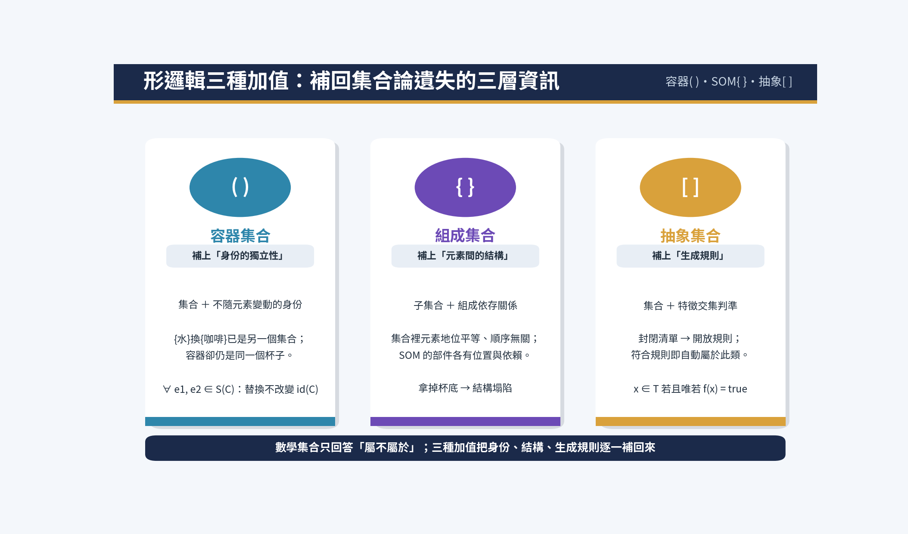

| 加值類型 | 括號 | 補上的性質 | 工程對應 |
| --- | --- | --- | --- |
| 容器 | ( ) | 身份的獨立性 | 選配件管理、配置變更、可換件 |
| SOM | { } | 元素間的結構 | 產品結構、必要件分級、FMEA |
| 抽象 | [ ] | 生成規則 | 零件族／產品族、模組重用 |

**表3-2　三種加值對照表**

## 3.7　時間本形：演化與推理

空間本形回答「結構如何被描述」，時間本形回答「演化如何被推理」。時間本形涵蓋分合、框架、設計模式、邏輯生成、記憶管理、邏輯應用、標記、持續學習、抽象、重構、思考、思考法、解題、分析、設計、推理、因果推理與果因推理等範疇。其中與工程實務最密切的三組概念是：設計模式——把成功的解法萃取為可重複套用的模式；記憶管理——讓每一個決策連同其理由被標記、留存、檢索；因果與果因雙向推理——因果推理由「果」溯「因」（失效事件回溯原因），果因推理由「因」推「果」（設計方案預測後果），兩者共同構成工程判斷的完整循環。

## 3.8　Mind Model 與 Mind AI

Mind Model 是形學理論的實踐架構，目標並非建立傳統知識圖譜，而是建立能夠模擬人類認知方式的統一知識模型：單一模型同時容納語言、數學、物理、工程、商業、經驗與隱性知識，並實踐邏輯推理、歸納演繹、類比因果推理、問題分析、模式萃取、決策分析、記憶管理與持續學習等統一思維能力。Mind AI 則是形學與 Mind Model 的實踐平台——結合形學理論、Mind Model、LLM、推理引擎、記憶系統、學習系統與規劃系統；LLM 負責語言能力，Mind Model 負責智慧能力，共同形成完整的 AGI 系統。

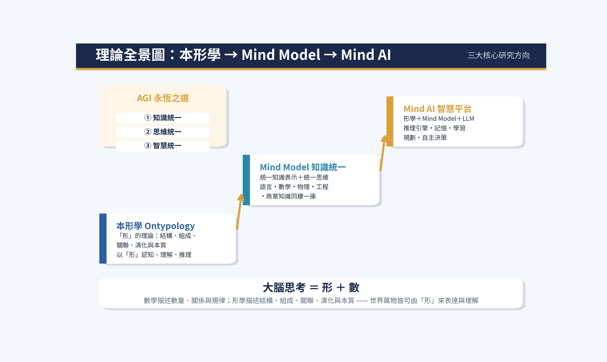

# 第四章　機械設計的本形學詮釋

## 4.1　設計流程的形學對應

機械設計的每一項活動，都能在本形學中找到對應的運作：需求分析是異同偵測；功能分解是 Y 軸拆解；概念設計是抽象與類比；參數化設計是屬性—屬性值的定義與回填；結構佈局是 SOM 依存分析；詳細設計則把框架定版為圖面與零件主檔——表頭是形，零件是實體。設計即「形」的展開：先有具體需求與樣機，抽象階層與參數框架才推得出來，不會是先有抽象階層才生出具體產品。

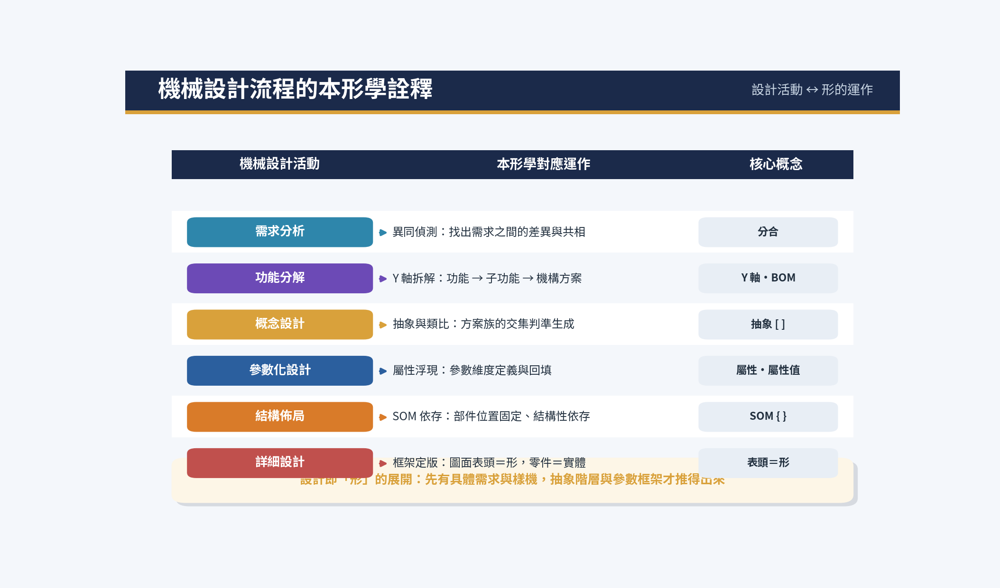

| 設計階段 | 本形學運作 | 關鍵產出 |
| --- | --- | --- |
| 需求分析 | 異同偵測與分合 | 需求維度清單 |
| 功能分解 | Y 軸拆解（BOM 生成） | 功能結構樹 |
| 概念設計 | 抽象與類比推理 | 方案族與交集判準 |
| 參數化設計 | 屬性浮現與回填 | 參數表（表頭＝形） |
| 結構佈局 | SOM 結構依存分析 | 部件配置與依存關係 |
| 詳細設計 | 框架定版 | 圖面、零件主檔、EBOM |

**表4-1　機械設計活動與本形學運作對應表**

## 4.2　Y 軸拆解與產品結構

以一級減速機為例，Y 軸拆解將整機分解為輸入軸系、齒輪系、箱體系與密封潤滑四大模組，各模組下再細分為輸入軸、鍵、深溝球軸承、減速大齒輪、上箱、下箱、油封等部件。拆解的判準始終是「拆下來之後，它還認得自己嗎」——油封拆下來仍是一個油封，是 BOM 項目；「承載能力」拆不下來，是屬性。BOM 決定樹狀結構往下分幾支，屬性決定每一支、每一個節點自己的樣貌，兩者合在一起才能把一個個體完整、無遺漏地描述出來。

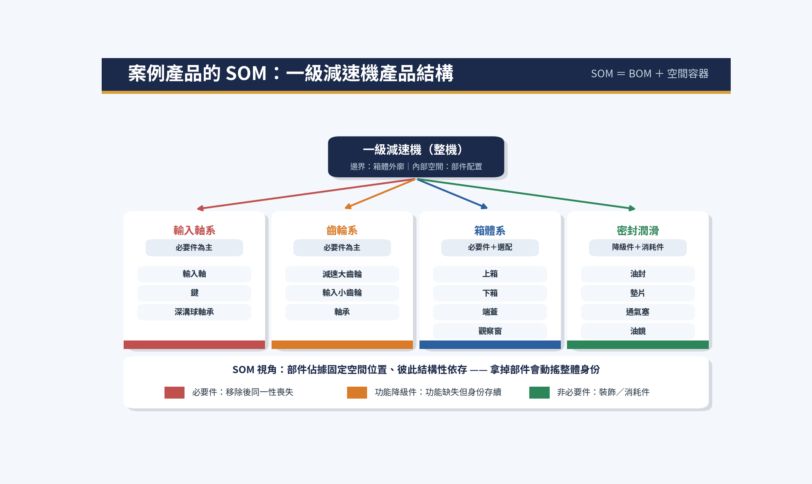

## 4.3　設計參數的浮現機制

設計參數的成長完全遵循「屬性浮現規則」：概念設計階段只有模數、齒數兩個維度；強度校核引入的材質與熱處理差異與既有維度對不上，逼出新屬性並回頭為所有齒輪補值；精度設計再逼出精度等級與齒隙維度；量產準備階段的表面處理與塗裝差異則對得上「表面」相關維度，只需新增屬性值。維度固定、刻度可延伸——屬性數量遠少於屬性值數量，正如座標軸的數量固定，但每條軸上的刻度可以無限延伸。

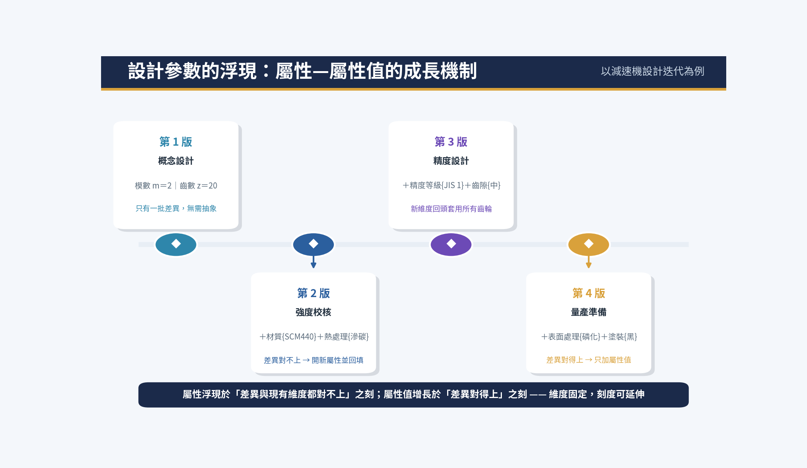

## 4.4　設計模式與框架複用

框架的力量在於可重複套用：同一套「描述方法」抽象化之後，不論產品是減速機、馬達或泵，都能跑同一套四步驟建立參數維度。成功的解法則被萃取為設計模式——例如「模組化箱體」模式、「密封冗餘」模式——存入記憶管理，供新專案以類比推理套用。設計模式是時間本形送給空間本形的禮物：過去的演化經驗，化為未來結構生成的規則。

## 4.5　SOM 依存與部件必要性分級

SOM 的核心提問是「拿掉一個部件之後，這還是不是原來那個東西」。依此可把部件分為三級：必要件（移除後同一性喪失，如箱體、主軸）、功能降級件（功能缺失但身份存續，如油封、觀察窗）與非必要件（裝飾、消耗件）。這套分級在工程上有直接對應：必要件對應安全關鍵件與 FMEA 嚴重度分級，功能降級件對應可選功能件，非必要件對應裝飾件與消耗件——形學判斷與品質工具，在此合流。

| 部件 | 層級 | 移除後影響 | 工程分級 |
| --- | --- | --- | --- |
| 上箱／下箱 | 必要件 | 結構塌陷，機體不成機體 | 安全關鍵件 |
| 減速大齒輪 | 必要件 | 無法減速，功能本質喪失 | 安全關鍵件 |
| 輸入軸 | 必要件 | 動力無法輸入 | 安全關鍵件 |
| 油封 | 功能降級件 | 漏油但可短期運轉 | 可選功能件／耗材 |
| 觀察窗 | 功能降級件 | 無法觀測油位，運轉無礙 | 可選功能件 |
| 銘牌 | 非必要件 | 完全不影響功能 | 裝飾件 |

**表4-2　一級減速機部件必要性分級表**

# 第五章　PLM 的本形學架構

## 5.1　總體架構：空間本形 × 時間本形

PLM 的本質，是在時間軸上管理「形」。空間本形回答「產品是什麼、在哪裡、由什麼組成」，構成產品主檔、產品結構、配置管理、部件依存與零件族；時間本形回答「產品如何演化、如何被推理與決策」，構成版本演化、變更管理、因果／果因推理、設計模式萃取與記憶管理。兩者交會於中央的 PLM 核心——產品資料主檔，並以 Mind Model 為知識底座，形成「空間 × 時間」的完整描述能力。

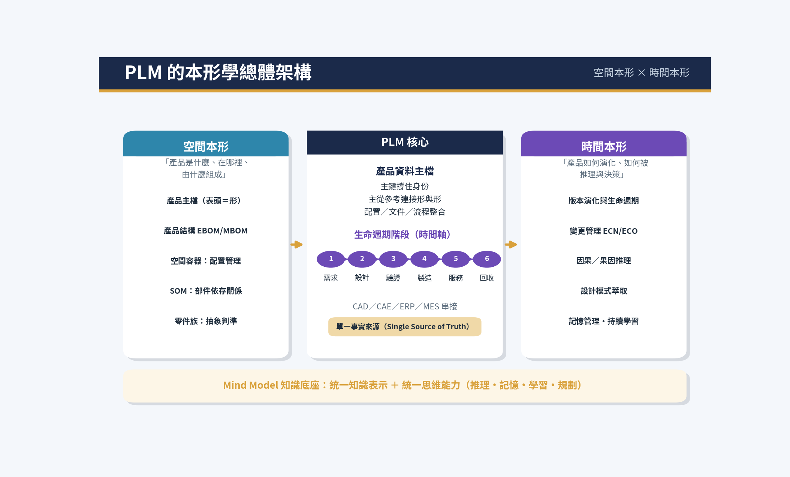

## 5.2　產品主檔：表頭即形

PLM 的零件主檔就是「形」的資料化身：欄位定義（Part No.、品名、材質、精度）是所有零件共用的問題清單；每一筆零件資料是可獨立指認的實體；Part Number 是與內容無關的身份憑證——零件可以換材質、改精度，主鍵不能動，否則整個關聯網路隨之斷裂。這解釋了為什麼 PLM 實務上堅持「料號不可重用、不可修改」的鐵律：主鍵是實體身份最底層的憑證。

## 5.3　EBOM／MBOM／SBOM：多重框架展開

同一份產品結構事實，依切入角度不同可展開為三種清單：EBOM 按「功能結構」展開，是設計變更的基準；MBOM 按「工藝路線」展開，含毛坯、標準件與耗材；SBOM 按「維修更換」展開，是備件與耗材清單。這正是「框架的多種展開方式」：框架提供「有哪些維度」這件事實本身，排列方式由應用者依目的選擇。三張 BOM 不是三份獨立的資料，而是同一個形體的三種投影——統一於同一產品主檔，才是「單一事事來源」的真正含義。

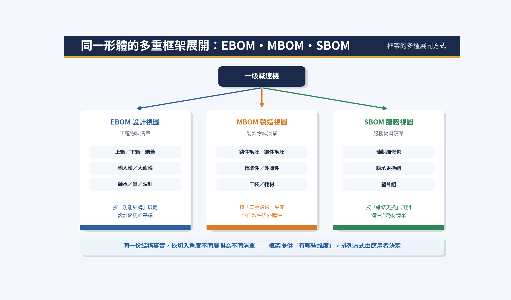

| 面向 | EBOM 設計視圖 | MBOM 製造視圖 | SBOM 服務視圖 |
| --- | --- | --- | --- |
| 展開依據 | 功能結構 | 工藝路線 | 維修更換 |
| 主要使用者 | 研發工程師 | 生技／製造 | 服務／備件 |
| 典型內容 | 設計件、標準件 | 毛坯、工裝、耗材 | 維修包、更換組 |
| 變更基準 | 設計變更 ECO | 工藝變更 | 備件政策 |
| 形學對應 | Y 軸拆解基準 | 製造框架展開 | 服務框架展開 |

**表5-1　EBOM／MBOM／SBOM 三視圖比較表**

## 5.4　變更管理：新增列與新增欄

變更管理是 PLM 中最能體現「形的不對稱變動」的流程。ECR 提出差異與動機、影響分析判斷變動層次、ECO 跨部門會簽、執行變更、版本升版並把理由寫入記憶管理。關鍵在於分辨兩種變動：新增列——形不動、實體多一個（新增同型機種、新供應料號），輕巧；新增欄——形變大、所有實體補值（出現既有欄位解釋不了的差異，如「有無隔熱層」），動到框架本身，成本高、影響全廠、需縝密評審。

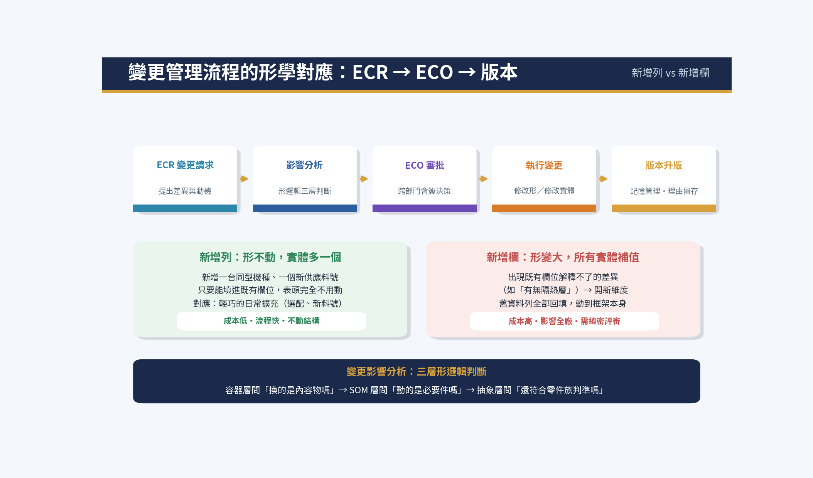

| 變動類型 | 形的狀態 | 影響範圍 | 作業成本 | 管理對策 |
| --- | --- | --- | --- | --- |
| 新增列（新實體） | 不動 | 單筆資料 | 低 | 標準申請流程即可 |
| 新增欄（新維度） | 擴大 | 全部實體回填 | 高 | 縝密評審＋全廠溝通 |
| 修改屬性值 | 不動 | 單筆資料 | 低 | 版本記錄留存 |
| 修改欄位定義 | 變異 | 全部實體 | 最高 | 視為形的改版，需升級框架 |

**表5-2　形的變動類型與管理對策**

## 5.5　時間本形與版本演化

每一個版本節點，都是「形」在時間軸上的一次定格。以減速機為例：v1.0 初版量產、v1.1 斷齒失效改善、v2.0 結構改型、v2.2 成本優化——演化鏈本身成為可推理、可學習的知識。因果推理由「果」溯「因」：v1.1 斷齒的失效事件，回溯至材質熱處理不足，變更理由寫入記憶管理；果因推理由「因」推「果」：v2.2 軸承降規的設計方案，先經壽命預測校核，驗證通過才准升版。版本庫因此不只是檔案櫃，而是工程推理的案例庫。

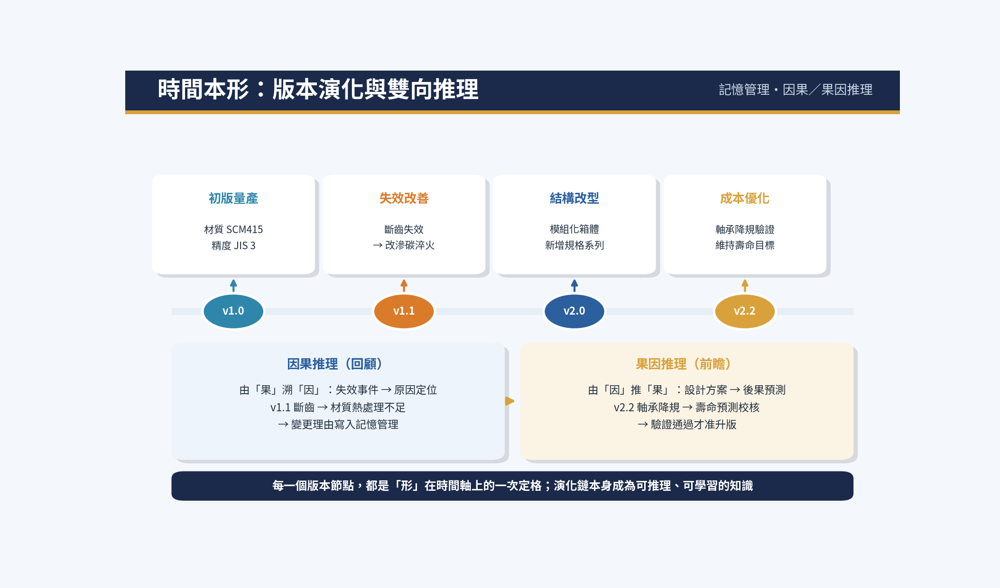

## 5.6　配置管理即空間容器

配置管理的理論原型，正是空間容器三要素：邊界（機型範圍）、內部空間（可容納的選配項）、獨立身份（不管裝了哪些選配，同一機型仍是同一機型）。內容物是可替換的——換油、換軸承供應商，機台仍是同一台；這與「拿掉箱體就不再是同一台機器」形成鮮明對比：前者是容器層的內容物替換，後者是 SOM 層的結構部件移除。分清這兩層，是配置管理與變更管理正確分流的前提。

# 第六章　Mind AI × PLM：智慧化應用體系

## 6.1　平台架構

Mind AI × PLM 平台分為四層：資料來源層匯聚 PLM 主檔、CAD／CAE 模型、ERP／MES 現場數據、IoT／數位孿生與文件經驗知識；Mind Model 統一知識層以形庫統一表示知識、以推理引擎承載因果／果因與類比推理、以記憶系統留存設計理由與失效案例、以學習系統萃取設計模式；智慧應用層提供設計智慧助手、變更影響分析、失效診斷推理、知識推薦檢索與自動設計探索。LLM 負責語言理解、生成與知識召回，Mind Model 負責知識統一、深度推理、長期記憶與自主學習——語言能力＋智慧能力，缺一不可。

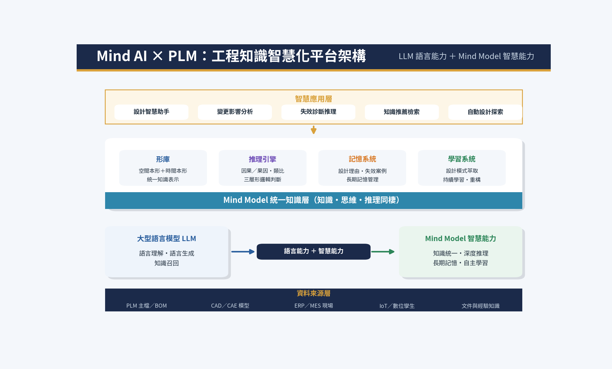

## 6.2　三層形邏輯判斷：工程決策的認知濾網

工程決策的每一個判斷，都可以放進三層形邏輯的濾網中檢驗。容器層問「內容物改變後，身份是否不變」，對應選配件與可換件管理；SOM 層問「移除部件後，整體還是同一個東西嗎」，對應必要件分級與安全關鍵件判定；抽象層問「新物件是否通過交集判準 F(T)」，對應零件族歸類與模組重用。三層各有盲點：只看容器層，選配件也成關鍵件；只看 SOM 層，換型即成新產品；只看抽象層，無法追蹤身份——聯合使用，才能精確界定產品。

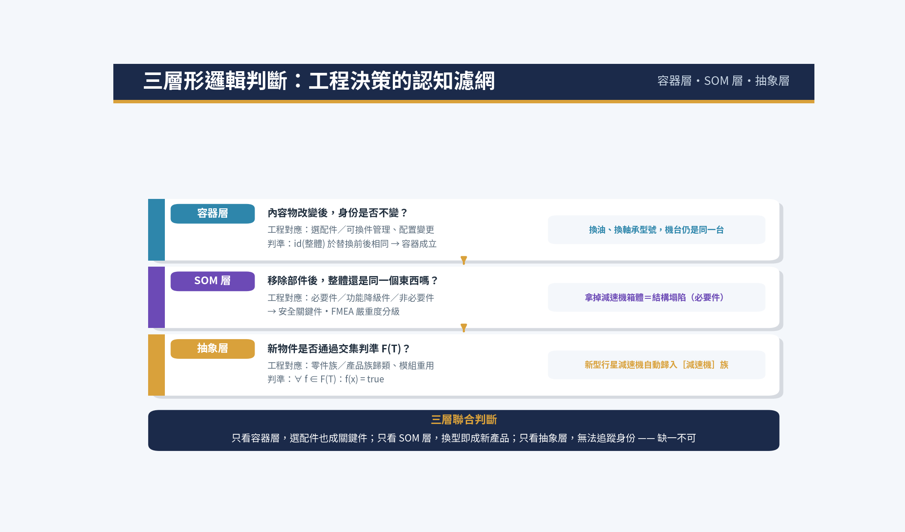

| 判斷層 | 核心提問 | 工程對應 | 判準 |
| --- | --- | --- | --- |
| 容器層 | 換內容物後身份不變？ | 選配件、可換件、配置變更 | id(整體) 替換前後相同 |
| SOM 層 | 移除部件後仍是同一物？ | 必要件分級、FMEA 嚴重度 | remove(p, M) 是否等於 M |
| 抽象層 | 新物通過交集判準？ | 零件族歸類、模組重用 | ∀f ∈ F(T)：f(x) = true |

**表6-1　三層形邏輯判斷的工程對應**

## 6.3　變更影響分析

傳統 ECO 的影響分析依賴資深工程師的直覺；三層判斷使之系統化：容器層先判斷「這次換的是內容物嗎」——若只是選配替換，影響限於配置；SOM 層再判斷「動的是必要件嗎」——若動到箱體或主軸，觸發全機重驗證；抽象層最後判斷「改完還符合零件族判準嗎」——若材質升級後脫離原零件族，需同步更新採購與庫存策略。三層過濾之後，變更影響的範圍與層次一目了然。

## 6.4　失效診斷與雙向推理

失效診斷是因果推理的典型場景：斷齒（果）回溯至熱處理不足（因）；設計審查則是果因推理的場景：降規方案（因）預測壽命縮短（果）。Mind Model 的推理引擎把雙向推理與版本演化鏈接軌——每一次失效都成為案例記憶，每一次設計決策都附帶「果因預測」的驗證紀錄，形成工程師個人與組織共同成長的記憶管理體系。

## 6.5　知識推薦與設計助手

設計智慧助手以 Graph RAG 式的檢索增強為基礎，但更進一步：檢索的不只是相似文件，而是「形」的關聯——當工程師建立新齒輪時，系統推薦同零件族的既有設計（抽象層）、關聯的失效案例（記憶管理）、適用的設計模式（時間本形），並以交集判準自動判定新件歸屬。知識不再是被動存放，而是主動參與設計推理。

## 6.6　與傳統知識圖譜的差異

Mind Model 與傳統知識圖譜的根本差異，在於三種加值：知識圖譜記錄實體與關係，Mind Model 額外維護身份獨立性（容器）、元素間結構（SOM）與生成規則（抽象），並承載思維結構與演化學習能力。

| 能力面向 | 傳統知識圖譜 | LLM 單獨應用 | Mind Model |
| --- | --- | --- | --- |
| 關係表達 | 結構化但有限 | 隱含於參數 | 形＋三種加值，完整 |
| 深層推理 | 規則外推有限 | 易幻覺 | 因果／果因＋三層判斷 |
| 抽象概念 | 難以表示 | 可生成但不穩定 | 交集判準形式化 |
| 思維結構 | 缺乏 | 缺乏 | 思考法・設計模式內建 |
| 持續演化 | 靜態為主 | 無記憶 | 記憶管理＋持續學習 |
| 跨域統一 | schema 不一 | 語意漂移 | 單一形語言 |

**表6-2　傳統知識圖譜、LLM 與 Mind Model 能力比較**

# 第七章　案例分析：一級減速機開發

## 7.1　案例背景

本章以一級減速機的開發為案例，完整推演本形學方法在真實機械設計與 PLM 作業中的運作。產品需求為：減速比 i＝10、輸出扭力 T＝500 Nm、連續運轉壽命 20,000 小時、系列化三規格。開發任務橫跨概念設計、詳細設計、量產準備與一次設計變更，適合作為端到端驗證的標的。

## 7.2　端到端流程推演

流程分六步：需求定義確立減速比與扭力邊界；框架建構以四步驟建立參數維度（模數、齒數、材質、精度）；Y 軸拆解生成產品結構；SOM 分級判定必要件與降級件；ECO 變更執行大齒輪材質升級並以三層判斷分析影響；升版學習把模式萃取入記憶庫。整個流程可重複套用於任何機種——這就是「框架」：把描述過程抽象成可複用的方法。

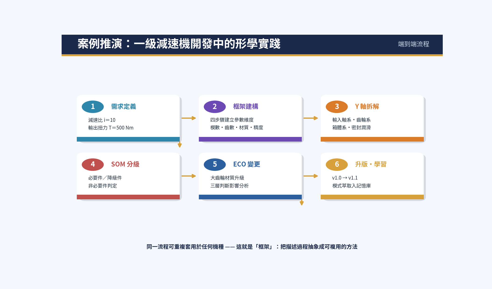

## 7.3　產品結構與 SOM 分級

拆解結果如表7-1：整機具備明確的邊界（箱體外廓）與內部空間（部件配置），四大模組的部件佔據固定空間位置、彼此結構性依存——箱體是必要件，拿掉即結構塌陷；油封是功能降級件，漏油仍可短期運轉；銘牌是非必要件。此分級直接匯出 FMEA 嚴重度初判與試驗計畫的資源配置。

| 模組 | 部件 | SOM 分級 | 空間位置 | 設計參數（節錄） |
| --- | --- | --- | --- | --- |
| 輸入軸系 | 輸入軸／鍵／深溝球軸承 | 必要件為主 | 箱體左側軸承座 | 軸徑 35mm、SCM440 |
| 齒輪系 | 減速大齒輪／輸入小齒輪 | 必要件 | 箱體中央嚙合區 | 模數 2、齒數 20／100 |
| 箱體系 | 上箱／下箱／端蓋 | 必要件＋選配 | 整機外廓 | FC250 鑄鐵 |
| 密封潤滑 | 油封／墊片／通氣塞／油鏡 | 降級件＋消耗件 | 軸伸端／結合面 | 氟膠油封、紙墊片 |

**表7-1　一級減速機產品結構（SOM）表**

## 7.4　變更案例：大齒輪材質升級

量產前夕，現場回饋 v1.0 大齒輪（SCM415、JIS 3 精度）出現早期點蝕。ECR-001 提出材質升級與熱處理強化，三層判斷的影響分析如下：容器層——更換的是部件本身而非內容物，配置不變，機型身份不變；SOM 層——大齒輪為必要件，動到必要件觸發全機疲勞再驗證；抽象層——材質升級後仍通過［減速齒輪］族判準（能傳遞扭力、能嚙合傳動），零件族歸屬不變，但供應商認證需更新。決議執行：材質升級為 SCM440＋滲碳淬火、精度提升至 JIS 1，升版 v1.1，變更理由連同點蝕案例寫入記憶管理。

| 項目 | v1.0 | v1.1 | 形學判定 |
| --- | --- | --- | --- |
| 大齒輪材質 | SCM415 | SCM440＋滲碳淬火 | 屬性值變更（形不動） |
| 精度等級 | JIS 3 | JIS 1 | 屬性值變更 |
| 零件族 | ［減速齒輪］ | ［減速齒輪］ | 交集判準仍通過 |
| 驗證要求 | — | 全機疲勞再驗證 | 必要件變更觸發 |
| 版本 | v1.0 | v1.1 | 時間本形定格 |

**表7-2　ECR-001 變更紀錄與形學判定**

## 7.5　案例小結

案例顯示：三層判斷讓影響分析從「直覺」變成「可重複、可檢驗、可辯論」的流程；必要件分級直接對接 FMEA；變更理由的留存使 v2.0 的模組化改型得以類比套用 v1.1 的教訓。整個過程裡，PLM 系統保存的不只是結果，而是「形」的完整演化史。

# 第八章　效益評估與討論

## 8.1　效益評估

以六個面向評估本形學賦能 PLM 與傳統 PLM 的差異（示意評分，滿分 10）。設計重用率因零件族與設計模式的開放規則而提升；變更週期效率因三層判斷系統化影響分析而改善；知識留存度因記憶管理留住設計理由；跨部門協同因單一形語言而降低語意落差；錯誤預防因必要件分級與果因推理前置校核而強化；決策透明度因判斷流程可重複、可檢驗而提高。

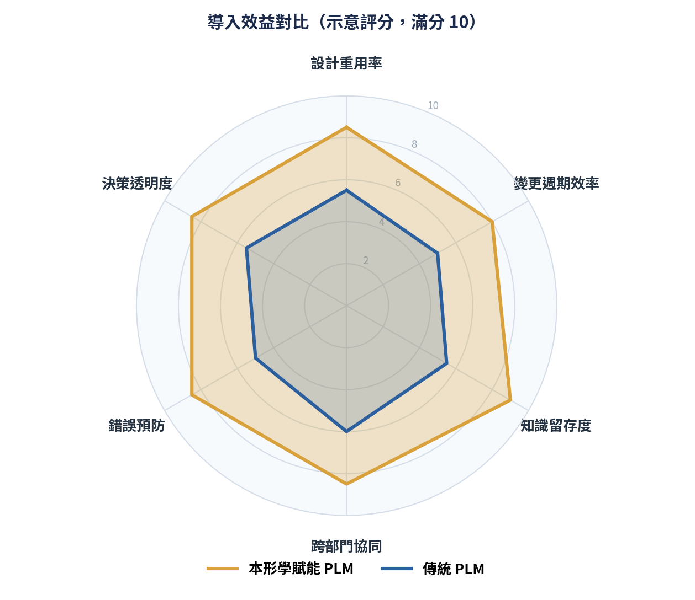

| 效益面向 | 傳統 PLM | 本形學賦能 PLM | 改善機制 |
| --- | --- | --- | --- |
| 設計重用率 | 5.5 | 8.5 | 零件族開放判準＋設計模式庫 |
| 變更週期效率 | 5.0 | 8.0 | 三層判斷系統化影響分析 |
| 知識留存度 | 5.5 | 9.0 | 記憶管理留存決策理由 |
| 跨部門協同 | 6.0 | 8.5 | 單一形語言降低語意落差 |
| 錯誤預防 | 5.0 | 8.5 | 必要件分級＋果因前置校核 |
| 決策透明度 | 5.5 | 8.5 | 可重複、可檢驗的判斷流程 |

**表8-1　效益對比表（示意評分，滿分 10）**

## 8.2　導入路徑

- 第一階段（知識統一，3–6 個月）：以「表頭＝形」重整零件主檔與 EBOM，打通 EBOM／MBOM／SBOM，建立單一事實來源。
- 第二階段（思維統一，6–12 個月）：導入三層形邏輯判斷於 ECO 影響分析與 FMEA 分級，建立因果／果因推理的變更與失效案例庫。
- 第三階段（智慧統一，12–24 個月）：上線 Mind AI × PLM 智慧應用——設計助手、變更影響分析、失效診斷，並以持續學習機制讓系統隨專案成長。

## 8.3　限制與挑戰

本研究的限制在於：效益評分為案例推演之示意值，尚待多產業實證；形學術語體系與既有 PLM 行業用語的翻譯對照仍需標準化；Mind AI 平台的落地依賴企業既有資料品質——「形」的邊界畫得不好，智慧化便無從谈起；此外，組織變革管理（尤其設計理由的書寫紀律）是記憶管理能否成功的先決條件。

## 8.4　討論

值得強調的是，本形學並非要取代既有 PLM 系統，而是為其提供缺失的認知基礎。主流 PLM 軟體的資料模型已具備表頭、主鍵、主從參考的骨架——它們只缺一套語言，來說明「為什麼這樣建模是對的」，以及一套推理機制，讓資料變成知識。從這個意義說，本研究是對既有工程實務的「再發現」：機械設計師的直覺（拆解、分類、分級、留理由）原本就是形的運作，本形學只是把這套直覺寫成理論，讓機器也能學會。

# 第九章　結論與展望

## 9.1　結論

本研究以本形學與 Mind Model 為理論基礎，完成了機械設計與 PLM 的形學對應、架構設計、智慧化應用與案例驗證。主要結論有三：其一，機械設計的產品結構（BOM）、參數表、零件分類與資料庫主檔，共享同一套「形」的底層邏輯——表頭是形、資料列是實體、主鍵撐住身份、主從參考連接形與形，此對應是精確且可操作的；其二，融合空間本形與時間本形的 PLM 架構，能把 EBOM／MBOM／SBOM 統一為同一形體的多重展開，把變更管理明辨為新增列與新增欄兩種不對稱變動，把版本演化轉化為因果／果因雙向推理的知識資產；其三，Mind AI × PLM 以 LLM 承擔語言能力、Mind Model 承擔智慧能力，三層形邏輯判斷為工程決策提供了可重複、可檢驗、可辯論的認知濾網，案例推演驗證了其在設計重用、變更效率與知識留存上的效益。

## 9.2　展望：通往工程 AGI 的三階段

展望未來，PLM 的智慧化將循三階段演進，呼應 AGI 的永恆之道：第一階段「知識統一」——打通 EBOM／MBOM／SBOM，建立統一產品主檔，解決資訊孤島；第二階段「思維統一」——設計、變更、失效推理整合於同一推理架構，具備真正的理解能力；第三階段「智慧統一」——知識、思維、記憶、學習與創造形成完整系統，達成自主設計助理與創新方案生成。

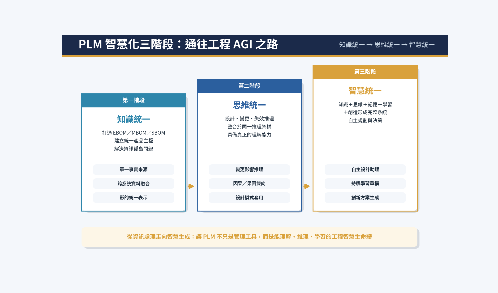

屆時，PLM 將不再只是管理工具，而是能理解、推理、學習的工程智慧生命體——從資訊處理走向智慧生成。這正是本形學的願景：讓人工智慧真正具備理解世界本質的能力，讓「形」的智慧，在機械設計與製造業的土壤中開花結果。

# 參考文獻

[1]　Stark, J. (2015). Product Lifecycle Management (Volume 1): 21st Century Paradigm for Product Realisation (3rd ed.). Springer.

[2]　Sudarsan, R., Fenves, S. J., Sriram, R. D., & Wang, F. (2005). A product information modeling framework for product lifecycle management. Computer-Aided Design, 37(13), 1399–1411.

[3]　Ameri, F., & Dutta, D. (2005). Product lifecycle management: closing the knowledge loops. Computer-Aided Design and Applications, 2(5), 577–590.

[4]　Pahl, G., Beitz, W., Feldhusen, J., & Grote, K.-H. (2007). Engineering Design: A Systematic Approach (3rd ed.). Springer.

[5]　Ullman, D. G. (2010). The Mechanical Design Process (4th ed.). McGraw-Hill.

[6]　Hirtz, J., Stone, R., McAdams, D., Szykman, S., & Wood, K. (2002). A functional basis for engineering design: revising the literature. Design Studies, 23(2), 137–159.

[7]　Wertheimer, M. (1923). Untersuchungen zur Lehre von der Gestalt II. Psychologische Forschung, 4, 301–350.

[8]　Newell, A., & Simon, H. A. (1972). Human Problem Solving. Prentice-Hall.

[9]　Hogan, A., Blomqvist, E., Cochez, M., et al. (2021). Knowledge Graphs. ACM Computing Surveys, 54(4), 1–37.

[10]　Edge, D., Trinh, H., Cheng, N., et al. (2024). From Local to Global: A Graph RAG Approach to Query-Focused Summarization. arXiv:2404.16130.

[11]　ISO 10303-1:2023. Industrial automation systems and integration — Product data representation and exchange (STEP). International Organization for Standardization.

[12]　CIMdata. (2023). PLM Market Analysis Report. CIMdata Inc.

[13]　LonGeat 研究團隊. (2025). 本形學：空間本形篇／時間本形篇；Mind AI 簡介（內部理論文稿）.
