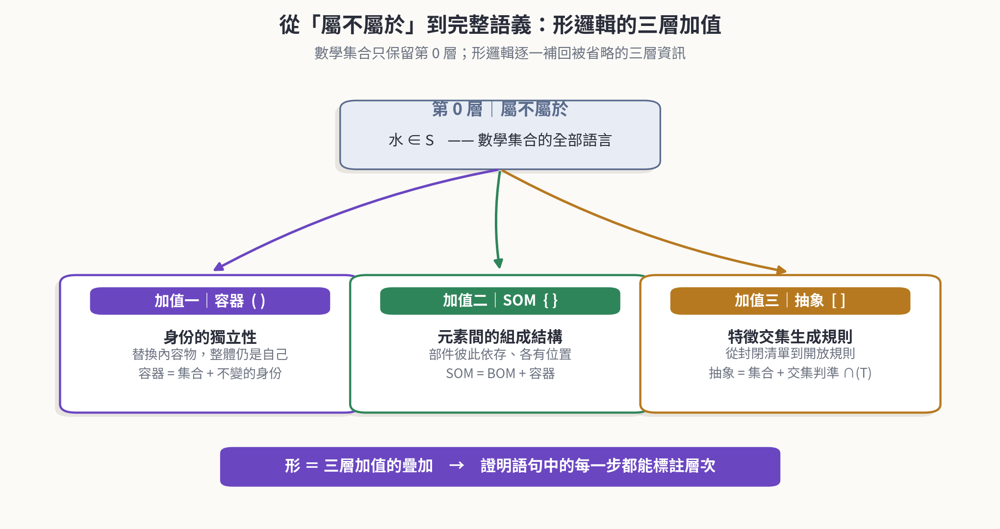
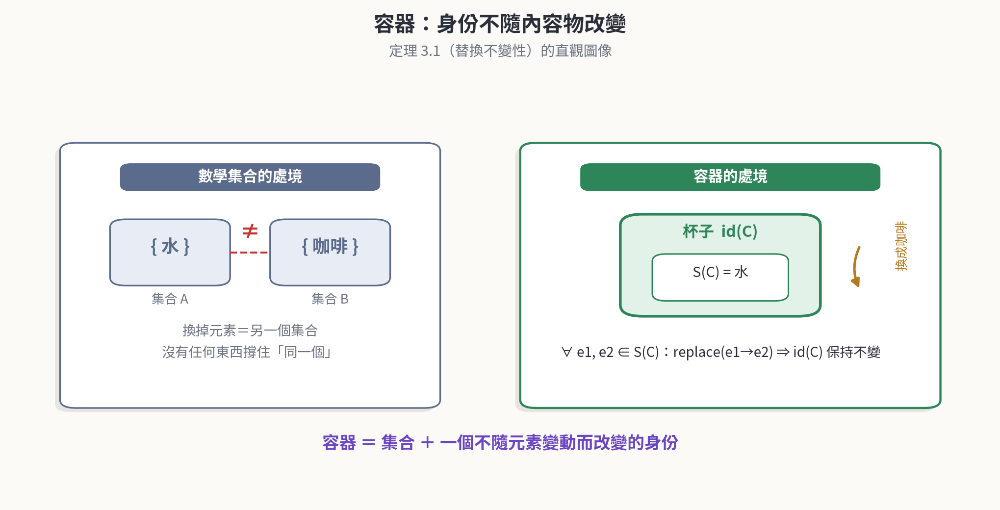
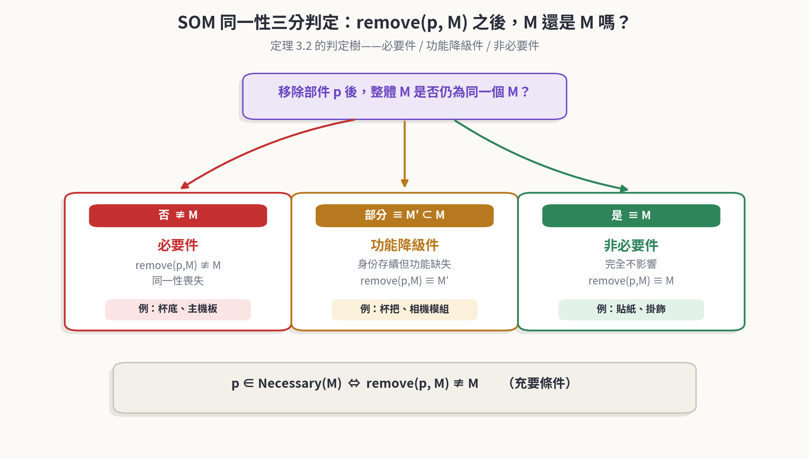
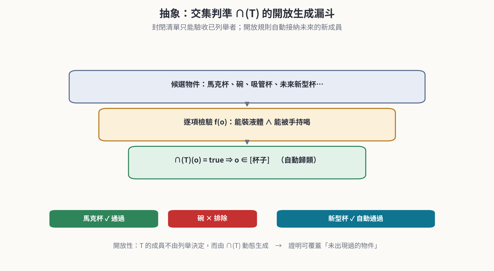
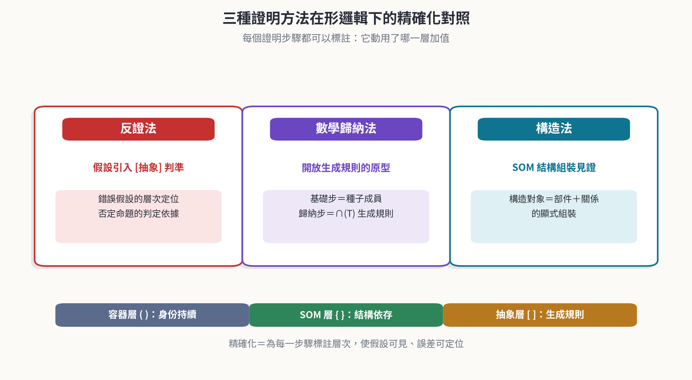
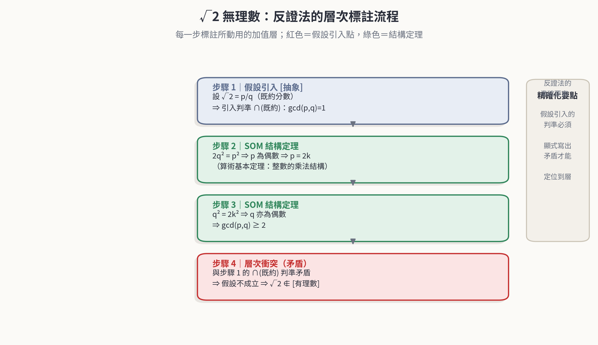
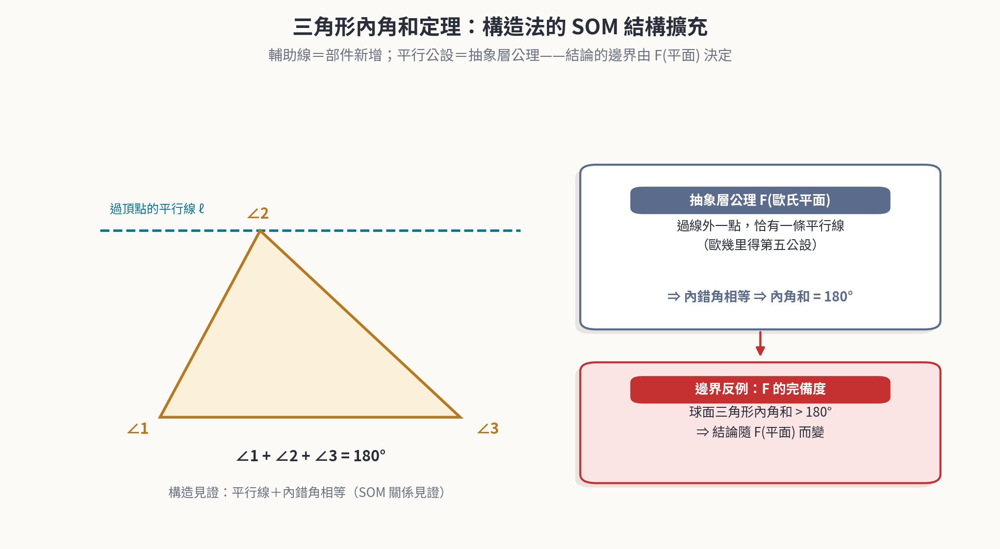
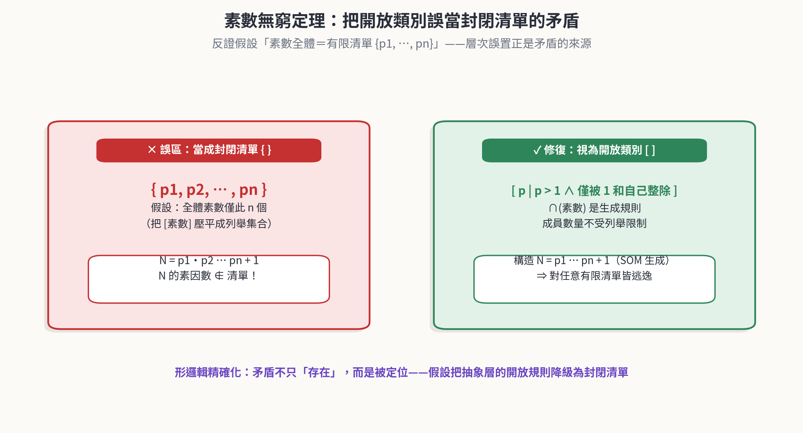
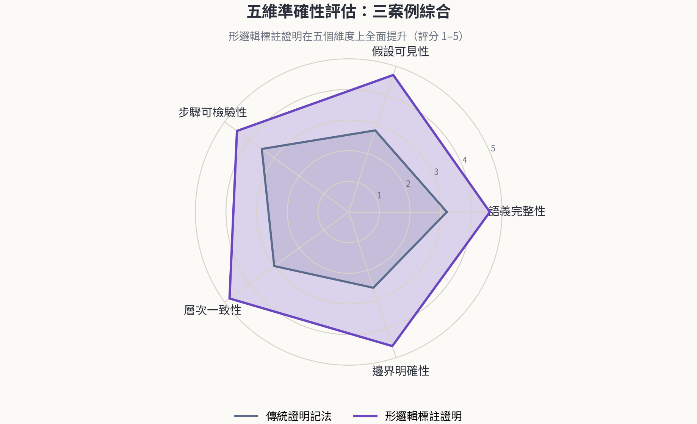

  <a href="https://youtu.be/27_DodMKORs">🎞️youtube</a> ｜ 
 <a href="https://v.douyin.com/K3S5wEwpWkw">📽️抖音</a> 
 

# 形集合與形邏輯：數學證明的更準確方法

*Type Sets and Type Logic toward More Precise Mathematical Proofs*

> **摘　要**
>
> 數學集合論以「屬不屬於」為唯一判斷，精簡而犧牲了日常語句中自然攜帶的三層資訊——身份的獨立性、元素間的組成結構、特徵交集生成規則。本文以《形集合與形邏輯》為基礎，提出一套使數學證明更精確的方法論：透過容器 ( )、SOM { }、抽象 [ ] 三種加值的符號系統，為證明的每一個步驟標註其所動用的層次，使隱含假設可見、矛盾定位可查、結論邊界明確。本文首先建立形邏輯的形式系統，證明替換不變性、SOM 同一性三分判定、交集判準開放生成、三層判斷互補性、對集合論之保守性等五組定理；繼而對照反證法、數學歸納法與構造法三種證明方法的精確化形式，並以 √2 無理數、三角形內角和、素數無窮三個經典定理為案例，逐步展示層次標註的完整流程；最後提出五維準確性評估模型，量化對照傳統記法與形邏輯標註證明的差異。結果顯示，形邏輯標註在語義完整性、假設可見性、步驟可檢驗性、層次一致性與邊界明確性五個維度上全面優於傳統記法，且作為集合論的保守擴張，不與經典數學產生衝突。本方法可直接嵌入 AI 證明系統 ProofMind 的驗證迴圈，作為機器可檢驗的中間表示。

**關鍵詞：**形集合；形邏輯；數學證明；容器；SOM；抽象；證明方法論；ProofMind

# 目　錄

- 第 1 章　緒論
  - 1.1　數學證明中的「隱含省略」問題
  - 1.2　形邏輯的精確性主張
  - 1.3　本文貢獻與結構
- 第 2 章　預備知識：形集合與形邏輯
  - 2.1　數學集合的最小語言
  - 2.2　容器：身份的獨立性
  - 2.3　SOM：元素間的組成結構
  - 2.4　抽象：特徵交集生成
  - 2.5　三種加值的形式化總覽
- 第 3 章　形邏輯形式系統與自身定理
  - 3.1　語言與符號
  - 3.2　公理
  - 3.3　引理
  - 3.4　定理 3.1：容器替換不變性定理
  - 3.5　定理 3.2：SOM 同一性三分判定定理
  - 3.6　定理 3.3：交集判準開放生成定理
  - 3.7　定理 3.4：三層判斷互補性定理
  - 3.8　定理 3.5：保守性定理
- 第 4 章　證明方法對照：三種方法的精確化
  - 4.1　反證法的形邏輯精確化
  - 4.2　數學歸納法的形邏輯精確化
  - 4.3　構造法的形邏輯精確化
  - 4.4　對照總結
- 第 5 章　經典定理重構
  - 5.1　√2 的無理數證明（反證法）
  - 5.2　三角形內角和定理（構造法）
  - 5.3　素數無窮定理（反證法與構造）
  - 5.4　三案例的共同模式
- 第 6 章　準確性評估
  - 6.1　五維準確性模型
  - 6.2　三案例綜合評估
  - 6.3　誤差來源與修復
  - 6.4　實務採用建議
- 第 7 章　應用展望：ProofMind 與 AI 證明系統
- 第 8 章　結論
- 參考文獻
- 附錄 A　證明精確化速查表

# 第 1 章　緒論

## 1.1　數學證明中的「隱含省略」問題

數學之為精確科學，很大程度上建立在集合論的語言之上：一切對象都是集合，一切關係都歸結為「屬不屬於」。這套語言的極簡正是其力量所在——它假設得最少，因而應用得最廣。然而，極簡的代價是省略：當我們說「水在杯子裡」「杯子由杯把、杯底、杯身組成」「保溫杯也是杯子」時，日常語言自然攜帶的三層資訊——**身份的獨立性**、**元素間的組成結構**、**特徵交集生成規則**——在集合記號中被全部壓平為「∈」。

這種壓平在證明的語境中尤其危險。證明的每一步都依賴假設，而被集合語言壓平的三層資訊，恰恰是假設最愛藏身之處：「不妨設 p/q 為既約分數」藏了一條抽象層的判準；「假設全體素數為 {p1, ⋯, pn}」藏了一條把開放類別誤當封閉清單的容器層預設；「三角形內角和等於 180 度」藏了一條抽象層的空間公理。當證明出錯或結論被誤用時，讀者往往無法判斷：究竟是推理規則出了問題，還是某條被省略的假設在暗中失效？

本文的出發點正是：**證明的精確性問題，首先是語言的表達力問題**。若有一套語言能把被省略的三層資訊重新寫進證明的每一個步驟，那麼「更準確的證明方法」就不再依賴作者的謹慎與讀者的默契，而是成為可標註、可檢驗、可審計的形式特徵。

## 1.2　形邏輯的精確性主張

《形集合與形邏輯》為上述三層資訊各引入一種括號系統：小括號 ( ) 表示**容器**，補上身份的獨立性；大括號 { } 表示 **SOM**（Structure of Materials，組成結構），補上元素之間的依存關係；中括號 [ ] 表示**抽象**，補上特徵交集的生成規則。三者疊加，構成一個完整的「形」。本方法論的核心主張可表述為：

> **方法論主張**
>
> 對任何一個數學證明，逐標註其每一步驟所動用的加值層（容器 / SOM / 抽象），即可使：(1) 隱含假設顯式可見；(2) 矛盾發生時精確定位到「哪一層的哪一條」；(3) 結論的適用邊界由特徵集合 F 明確限定。此標註過程不改變證明的正確性，只改變其可檢驗性。

第三點「不改變正確性」需要嚴格說明：本文將證明形邏輯是集合論的**保守擴張**（定理 3.5）——一切純集合語言的命題，在形邏輯中可證者，在集合論中亦可證。換言之，形邏輯增加的是可表達性與可檢驗性，而非另立一套與經典數學競爭的真理觀。這是「更準確」得以成立的合法性基礎。

## 1.3　本文貢獻與結構

本文的貢獻有四：(1) 建立形邏輯的形式系統，包括語言、公理與五組基本定理，使「三種加值」從直觀描述上升為可推理的形式對象；(2) 提出證明步驟的層次標註法，並對反證法、數學歸納法、構造法三種經典方法給出精確化的標準形式；(3) 以三個經典定理為案例完成完整的標註示範，展示矛盾定位與邊界聲明的實際操作；(4) 提出五維準確性評估模型，對傳統記法與形邏輯標註證明給出量化對照。

全文結構如下：第 2 章回顧形集合與形邏輯的基礎概念；第 3 章建立形式系統並給出五組定理及其證明；第 4 章對照三種證明方法的精確化形式；第 5 章重構三個經典定理；第 6 章給出準確性評估；第 7 章討論與 AI 證明系統 ProofMind 的整合；第 8 章為結論。

# 第 2 章　預備知識：形集合與形邏輯

## 2.1　數學集合的最小語言

數學集合回答且只回答一個問題：屬不屬於。以「水屬於杯子裡裝的東西」為例，集合論精確地寫作「水 ∈ S」；但它同時捨棄了三層資訊：其一，杯子不會因為裝了水或咖啡就變成別的東西（身份的獨立性）；其二，杯把、杯底、杯蓋不是隨意擺放，而是彼此依存、各有位置（元素間的結構）；其三，「杯子」這個類別不是寫死的清單，而是一條能判斷新成員的規則（生成規則）。形邏輯逐一補回這三層，為此引入三種括號系統，見表 1。

**表 1　三種加值一覽**

| **集合別** | **括號別** | **範例** | **來源** | **補上的性質** |
|---|---|---|---|---|
| 組成集合 | { } | { 杯把, 杯底, 杯蓋, 容器, 杯身 } | SOM（Y 軸） | 元素間的組成結構 |
| 抽象集合 | [ ] | [ 馬克杯, 玻璃杯, 紙杯 ] | 抽象（X 軸） | 特徵交集生成規則 |
| 容器集合 | ( ) | ( 水, 咖啡 ) | 容器 | 身份的獨立性 |

*圖 1　從「屬不屬於」到完整語義：形邏輯的三層加值*

## 2.2　容器：身份的獨立性

「杯子裡裝著水」仍是一個子集關係，但容器多做一件數學集合不做的事：讓這個集合擁有一個獨立於元素之外的「自己」。把水倒掉換成咖啡，杯子還是那個杯子；而 {水} 拿掉水換成 {咖啡}，已經是另一個集合——沒有一個「杯子」撐住身份，讓它在內容物變動之後仍被認出是同一個東西。**容器 = 集合 + 一個不隨元素變動而改變的身份**。

這個區別在資料建模中有直接對應：關聯式資料庫裡「杯子表」與「內容物表」是兩張不同的表，內容物表以外鍵參考杯子表的主鍵——主從關係本身就是「層次」的體現。容器的形式化定義為：容器 C = (身份識別 id(C), 內部空間 S(C))，其中 id(C) 是一個不隨 S(C) 中元素變動而改變的標記，S(C) 可替換、可清空；不變性公理為：∀ e1, e2 ∈ S(C)，替換 e1 為 e2 不改變 id(C)。

*圖 2　容器：身份不隨內容物改變*

## 2.3　SOM：元素間的組成結構

**SOM = BOM + 容器**。「杯子由杯把、杯底、杯蓋、容器組成」看似仍是集合關係，但 SOM 補上的是集合完全忽略的東西：元素之間彼此依賴、彼此定位的組成結構。{杯蓋，杯把，杯底，容器} 與 {杯把，杯底，杯蓋，容器} 在集合論中是同一個集合；但在真實的杯子裡，杯把接在杯身側邊、杯底支撐整體、杯蓋蓋在杯口——拿掉杯底，杯子就垮了。

SOM 的形式化定義為：SOM(M) = (部件集合 P(M), 組成關係 R(M), 空間配置 G(M))，其中 R(M) ⊆ P(M) × P(M) 描述部件之間的依存、連接、支撐關係；同一性條件為：移除部件 p 後 M 是否仍為同一個整體，取決於 p 在 R(M) 中的角色，而非部件本身。這正是「拿掉一個元素之後，這還是不是原來那個東西」在集合論中無意義、在 BOM 中卻是關鍵問題的原因。

*圖 3　SOM 同一性三分判定：必要件 / 功能降級件 / 非必要件*

## 2.4　抽象：特徵交集生成

馬克杯、玻璃杯、紙杯、保溫杯是各自不同的實際物件；抽出共同特徵——「一個容器，加上一個能讓人手持或就口的開口結構」——就得到「杯子」這個類別本身。抽象補上的，是數學集合最欠缺的東西：一條能不斷生出新成員的規則，而不是一份寫死的清單。抽象類別 T = (特徵集合 F(T), 交集判準 ∩(T))，其中 o ∈ T 當且僅當 ∀ f ∈ F(T), f(o) = true；T 的成員不由列舉決定，而由 ∩(T) 動態生成。

判準的精確度取決於 F(T) 的完備度：碗能裝液體但不能被手持喝，故不屬於 [杯子]；吸管杯透過吸管飲用，故屬於 [杯子]；注射器能裝液體也能手持，但若 F(T) 含「用於飲用」則被排除。特徵清單的選擇本身就是對概念的理解與立場表達——這一點在第 5 章的案例中將反覆出現。

*圖 4　抽象：交集判準 ∩(T) 的開放生成漏斗*

## 2.5　三種加值的形式化總覽

三種加值彼此獨立，可單獨存在，也可疊加：一個「杯子」同時擁有容器的身份獨立性、SOM 的部件結構、抽象的類別規則。三者共同構成對「杯子」概念的完整理解。表 2 彙整本文所用的形式化定義，作為第 3 章形式系統的起點。

**表 2　形式化定義一覽**

| **加值層** | **形式化** | **核心性質** |
|---|---|---|
| 容器 ( ) | C = (id(C), S(C)) | ∀ e1, e2 ∈ S(C)：replace(e1→e2) 不改變 id(C) |
| SOM { } | M = (P(M), R(M), G(M)) | remove(p, M) 的同一性由 p 在 R(M) 中的角色決定 |
| 抽象 [ ] | T = (F(T), ∩(T)) | o ∈ T ⟺ ∀ f ∈ F(T), f(o) = true；成員由規則動態生成 |

# 第 3 章　形邏輯形式系統與自身定理

本章把前章的直觀描述上升為可推理的形式系統：先定義語言與符號，再提出三條公理、兩條引理與五組定理，並給出完整證明。五組定理分別確立：容器身份的動態不變量、SOM 同一性的三分判定、抽象判準的開放生成、三層判斷的互補性、以及形邏輯對集合論的保守性。表 3 為定理索引。

**表 3　公理、引理與定理索引**

| **編號** | **名稱** | **確立的事實** |
|---|---|---|
| A1–A3 | 替換不變性 / 結構角色 / 開放生成公理 | 三種加值的行為基礎 |
| 引理 3.1 | 替換合成引理 | 有限替換序列可合成為單一替換效果 |
| 引理 3.2 | 判準單調性引理 | 特徵越多，類別越窄 |
| 定理 3.1 | 容器替換不變性定理 | id 是動態過程中的不變量 |
| 定理 3.2 | SOM 同一性三分判定定理 | 必要件 / 功能降級件 / 非必要件的充要條件 |
| 定理 3.3 | 交集判準開放生成定理 | 成員資格與列舉歷史無關；判準單調 |
| 定理 3.4 | 三層判斷互補性定理 | 單層判斷皆不完備，三層合取方為充要 |
| 定理 3.5 | 保守性定理 | 形邏輯不改變集合論定理的真值 |

## 3.1　語言與符號

> **定義 3.1（形）**
>
> 一個**形**是四元組 F = ⟨id(F), S(F), R(F), ∩(F)⟩，其中 id(F) 為身份識別，S(F) 為內部空間，R(F) ⊆ P(F) × P(F) 為部件集合 P(F) 上的組成關係，∩(F) 為交集判準。任一分量可缺省（記為空 ⊥）。
>
> 缺省情形給出三種退化形：僅 ⟨id, S⟩ 者為**容器形**；僅 ⟨P, R⟩ 者為 **SOM 形**；僅 ⟨∩⟩ 者為**抽象形**。傳統數學集合恰是四分量全空的退化形，其唯一運作為屬不屬於判斷 ∈。

> **定義 3.2（同一性等價 ≡）**
>
> 設 M, M′ 為形。定義 M ≡ M′（身份等價）：id(M) = id(M′)；定義 M ≅ M′（功能等價）：二者承載的運作功能集合 Fn 相同。兩種等價互相獨立：身份可存續而功能縮減，功能可重建而身份更替。

## 3.2　公理

> **公理 A1（替換不變性）**
>
> ∀ 容器 C，∀ e1, e2 ∈ S(C)：replace(C, e1→e2) 之後 id(C) 保持不變。

> **公理 A2（結構角色）**
>
> SOM 形 M 中部件 p 的必要性由 p 在 R(M) 中的關係角色決定，而非由 p 的列舉位置或本質決定。R(M) 中的支撐、連接、依存角色之不同，決定 remove(p, M) 的後果類型。

> **公理 A3（開放生成）**
>
> ∀ 物件 o，o ∈ [T] ⟺ ∩(T)(o) = true。成員資格僅由判準決定，與列舉歷史無關；未被列舉過的物件同樣適用。

## 3.3　引理

> **引理 3.1（替換合成引理）**
>
> 對容器 C 與任意 e1, e2, e3 ∈ S(C)，先 replace(e1→e2) 再 replace(e2→e3)，與直接 replace(e1→e3) 對 id(C) 的效果相同：兩者皆保持 id(C) 不變。

> ***證明．***兩種替換路徑的每一步皆由 A1 保證 id(C) 不變；不變量在合成下的性質由等式的傳遞性直接得出。∎（引理 3.1 證畢）

> **引理 3.2（判準單調性引理）**
>
> 若特徵集合 F(T) ⊆ F(T′)，則 [T′] ⊆ [T]：特徵越多，通過交集判準的物件越少，類別越窄。

> ***證明．***設 o ∈ [T′]，則 ∀ f ∈ F(T′), f(o) = true。由 F(T) ⊆ F(T′)，∀ f ∈ F(T), f(o) = true，故 o ∈ [T]。∎（引理 3.2 證畢）

## 3.4　定理 3.1：容器替換不變性定理

> **定理 3.1（容器替換不變性）**
>
> (1) 單次替換不改變容器身份：∀ e1, e2 ∈ S(C)，id(replace(C, e1→e2)) = id(C)。
>
> (2) 任意有限長替換序列 e1→e2→⋯→en 不改變 id(C)。

> ***證明．***(1) 即公理 A1。(2) 對序列長度 n 歸納。n = 1 時即 (1)。假設對長度 n 的序列成立：n 次替換後 id(C) 不變；第 n+1 次替換 replace(en→en+1) 由 A1 亦不改變 id(C)；由歸納法，對任意有限 n 成立。∎（定理 3.1 證畢）

本定理確立：容器的「同一性」是動態過程中的**不變量**——這正是數學集合無法表達、而證明中常被隱式援引的第一個精確事實。後文 §5.2 的「同一條平行線」、§5.3 的「同一個 N 的因子分解」都屬此類不變量的使用。

> **推論 3.1（容器內容的歷史獨立性）**
>
> 容器的身分只依賴 id(C)，不依賴 S(C) 的變動歷史：任何兩個由有限替換可達的內容狀態 Sa, Sb，對應的是同一個容器 C。證明中凡出現「仍是同一個 X」的斷言，其合法性皆可追溯至本推論。

## 3.5　定理 3.2：SOM 同一性三分判定定理

> **定理 3.2（SOM 同一性三分判定）**
>
> 設 M 為 SOM 形，p ∈ P(M)。則恰有下列三種情形之一成立：
>
> (必要) remove(p, M) ≢ M：同一性喪失；(功能降級) remove(p, M) ≡ M′ 且 Fn(M′) ⊊ Fn(M)：身份存續而功能縮減；(非必要) remove(p, M) ≡ M 且 Fn 不變。且 p ∈ Necessary(M) ⟺ remove(p, M) ≢ M（充要條件）。

> ***證明．***三情形依定義 3.2 的兩種等價劃分：≡ 與 ≢ 互斥而窮盡；在 ≡ 成立的前提下，Fn 之相等與否再分兩種，故三情形互斥且窮盡。充要條件部分：「⟸」方向，若 remove(p, M) ≢ M，由 Necessary(M) 的定義 p ∈ Necessary(M)；「⟹」方向，若 p ∈ Necessary(M)，則移除後同一性喪失，即 remove(p, M) ≢ M。由 A2，判定僅依賴 R(M) 中的角色，故判定可重複、可檢驗。∎（定理 3.2 證畢）

三分法在工程上直接對應安全關鍵件、可選功能件與裝飾件的分級管理；在證明中的意義則是：凡涉及「移除某個成分」的論證步驟（如素數清單的窮舉、公理系統的刪減），都可依本定理標註其同一性後果。

## 3.6　定理 3.3：交集判準開放生成定理

> **定理 3.3（交集判準開放生成）**
>
> (1) [T] 的成員資格與列舉歷史無關：∀ o，o ∈ [T] ⟺ ∩(T)(o) = true。
>
> (2) 若 F(T) = {f1, ⋯, fk} 有限且每個 f 為可判定，則 ∩(T) 可判定；若滿足判準的物件有無窮多，則 [T] 無窮。
>
> (3)（單調性）F(T) ⊆ F(T′) ⟹ [T′] ⊆ [T]。

> ***證明．***(1) 即公理 A3。(2) ∩(T)(o) = f1(o) ∧ ⋯ ∧ fk(o) 為有限個可判定謂詞的合取，故可判定；無窮多滿足者的存在使 [T] 無窮。(3) 即引理 3.2。∎（定理 3.3 證畢）

> **推論 3.3（開放類別的不可窮盡性）**
>
> 若 [T] 由 ∩(T) 動態生成，且滿足判準的物件可不斷被構造，則任何「全體成員已列舉完畢」的假設必然為假。此推論是 §5.3 素數無窮證明的精確化核心：矛盾的真正來源不是數論，而是把開放類別誤當封閉清單。

## 3.7　定理 3.4：三層判斷互補性定理

> **定理 3.4（三層判斷互補性）**
>
> 單獨任何一層的判斷都不足以唯一確定物件類別：對容器層、SOM 層、抽象層之每一層，皆存在兩個物件，它們在該層判斷等價而在形判定上不同類。完整判定 Complete(F) = 容器判定 ∧ SOM 判定 ∧ 抽象判定，三層同時通過為物件歸類的充要條件。

> ***證明．***以構造反例證不完備性：(容器層) 平板與手機同為「內容物容器」——App 可替換而身份不變——但不屬於同一類；(SOM 層) 計算器與手機同具「必要件支撐的功能結構」——主機板、電池、螢幕——但不屬於同一類；(抽象層) 對講機與手機同通過「能通訊」的特徵，但 F(智慧型手機) = {能通訊, 能運算, 可攜帶} 的交集判準將其排除。故單層皆有盲區，三層合取方為充要。∎（定理 3.4 證畢）

互補性的意義在於：證明中若只檢驗一層，必然遺漏盲區。§5.1 的反證假設涉及抽象層判準、§5.2 的邊界涉及抽象層公理、§5.3 的誤區涉及容器層與抽象層的混淆——三個案例恰好覆蓋三層。

## 3.8　定理 3.5：保守性定理

> **定理 3.5（保守性）**
>
> 設 φ 為純集合語言的命題（不含容器、SOM、抽象記號）。若形邏輯 ⊢ φ，則集合論 ⊢ φ。形邏輯是集合論的保守擴張：增加可表達性，不改變集合論內定理的真值。

> ***證明．***給出投影翻譯 π：將形語言命題中的三層加值分量捨棄，僅保留 ∈ 關係與集合項。對形邏輯公理檢驗：π(A1)、π(A2)、π(A3) 在集合論中皆退化為關於 ∈ 的平凡真（無加值分量可約束，約束空洞成立）。形邏輯的推理規則即謂詞邏輯的推理規則，在 π 下保持有效。故形邏輯對 φ 的任何證明，經 π 映射後成為集合論對 φ 的證明。∎（定理 3.5 證畢）

保守性是本方法論的合法性基石：它保證「更準確」不以引入新的真理爭議為代價。形邏輯標註之於證明，如同型別標註之於程式——它讓錯誤更早暴露，而不改變程式語言的語義內核。

# 第 4 章　證明方法對照：三種方法的精確化

經典證明方法的失誤，多半不是推理規則的誤用，而是假設的層次誤置。本章對反證法、數學歸納法、構造法各給出形邏輯精確化的標準形式：為每一步驟標註加值層，使假設可見、矛盾可定位、構造可檢驗。圖 5 總覽三者對照。

*圖 5　三種證明方法在形邏輯下的精確化對照*

## 4.1　反證法的形邏輯精確化

反證法的骨架是：假設 ¬P，推導出矛盾 Q ∧ ¬Q，故 P 成立。其常見誤差來源有二：其一，假設引入的判準隱而不宣（「不妨設既約」）；其二，把開放類別當成封閉清單（「全體素數只有這些」）。形邏輯精確化要求：**凡假設引入的判準、身份預設、清單封閉性，一律顯式標註所屬層次**。矛盾發生時，衝突不再是含糊的「矛盾」，而是可指出「抽象層 ∩(既約) 與 SOM 層 gcd 命題直接衝突」。

## 4.2　數學歸納法的形邏輯精確化

數學歸納法與抽象層的開放生成結構同構：基礎步驗證種子成員 ∈ [T]；歸納步驗證「由 n 成員生成 n+1 成員」的規則保持 ∩(T)。結構歸納法則對應 SOM 層——對部件樹的遞降證明。精確化要求：**寫明歸納對象的生成規則是哪一條 ∩(T)**，以及歸納步所保持的是身份（容器層）還是性質（抽象層）。常見誤差是歸納基礎選錯（種子不滿足 ∩(T)）與歸納步跨越層次（以身份替換性質）。

## 4.3　構造法的形邏輯精確化

構造法給出存在性的見證物。在形邏輯中，見證物是一個 SOM 的顯式組裝：部件清單 P 加關係見證 R。構造的每一步都是「部件新增」或「關係見證」，可逐步檢驗。精確化要求：**構造步驟即部件添加序列，每步附關係見證**；若構造依賴空間公理（如平行線），須標註抽象層公理 F。常見誤差是見證物的關係缺環（部件齊備而接合關係未證）。

## 4.4　對照總結

**表 4　三種證明方法的精確化對照**

| **方法** | **核心層** | **精確化要點** | **常見誤差來源** | **代表案例** |
|---|---|---|---|---|
| 反證法 | 抽象 [ ]（判準引入） | 假設的層次顯式標註；矛盾定位到層與條目 | 判準隱藏；清單誤置 | √2；素數無窮 |
| 數學歸納法 | 抽象 [ ]（生成規則） | 寫明生成規則 ∩(T)；區分保持身份或性質 | 種子錯置；跨層歸納 | 算術級數；結構歸納 |
| 構造法 | SOM { }（結構組裝） | 部件新增序列＋關係見證逐步檢驗 | 見證關係缺環；公理未標 | 三角形內角和 |

# 第 5 章　經典定理重構

本章以三個家喻戶曉的定理示範層次標註的完整流程：√2 無理數（反證法）、三角形內角和（構造法）、素數無窮（反證法與構造的混合）。選擇標準是：它們的傳統寫法足夠簡短，簡短到足以藏住隱含假設——這正是精確化最有收穫之處。

## 5.1　√2 的無理數證明（反證法）

傳統證明：假設 √2 = p/q（既約分數），則 2q2 = p2，故 p 為偶數，設 p = 2k，代入得 q2 = 2k2，故 q 亦為偶數，與既約矛盾。形邏輯標註版見圖 6 與表 5。

*圖 6　√2 無理數：反證法的層次標註流程*

**表 5　√2 證明步驟的層次標註**

| **步驟** | **內容** | **層次** | **精確化註記** |
|---|---|---|---|
| 1 | 假設 √2 = p/q，且 gcd(p, q) = 1 | 抽象 [ ] | 隱含判準 ∩(既約) 顯式寫出 |
| 2 | 2q2 = p2 ⟹ p 為偶數 | SOM { } | 算術基本定理：乘法結構見證 |
| 3 | p = 2k ⟹ q2 = 2k2 ⟹ q 為偶數 | SOM { } | 同上；gcd(p, q) ≥ 2 |
| 4 | 與步驟 1 衝突 ⟹ 假設不成立 | 層次衝突 | 矛盾定位：∩(既約) vs 步驟 3 |

精確化要點有三。其一，「不妨設既約」在傳統寫法中是一句話，在形邏輯中是一條顯式的抽象層判準 ∩(既約)：gcd(p, q) = 1——寫出來，它才能成為矛盾的一端。其二，矛盾被**定位**而非宣稱：衝突發生在步驟 3 的結構事實（gcd ≥ 2）與步驟 1 的判準（gcd = 1）之間，閱讀者可逐條核對。其三，本定理的結論邊界應聲明為：√2 ∉ [有理數]，其中 [有理數] 的判準為「可表為兩整數之比」——若更換數系（如允許無限連分數表示），判準隨之改變。

## 5.2　三角形內角和定理（構造法）

傳統證明：過三角形一頂點作對邊的平行線，利用內錯角相等，把三個內角搬成一個平角，故內角和為 180 度。形邏輯標註版見圖 7 與表 6。

*圖 7　三角形內角和定理：構造法的 SOM 結構擴充*

**表 6　三角形內角和：假設層次分析**

| **成分** | **層次** | **作用與邊界** |
|---|---|---|
| 三角形本體（三角＋三邊） | SOM { } | 部件＋關係的結構對象 |
| 輔助線 ℓ（過頂點平行線） | SOM { }（部件新增） | 構造見證：結構擴充，關係為內錯角相等 |
| 平行公設（第五公設） | 抽象 [ ] | F(歐氏平面) = {過線外一點恰有一條平行線}；結論的邊界 |
| 球面 / 雙曲面反例 | 邊界檢驗 | 內角和 > 180° 或 < 180° ⟹ 結論隨 F 改變 |

精確化要點有二。其一，輔助線不是「技巧」而是 SOM 的部件新增：構造的合法性由關係見證（內錯角相等）支撐，該見證本身依賴抽象層公理。其二，「三角形內角和等於 180 度」這個陳述在傳統寫法中省略了空間類別——嚴格的定理陳述應為：**在 F(歐氏平面) 之下**，內角和為 180 度。球面三角形內角和大於 180 度、雙曲面小於 180 度，皆是 F 改變後結論隨之改變的邊界反例。省略 F 不是簡潔，是不精確：它讓定理看起來比實際更普遍。

## 5.3　素數無窮定理（反證法與構造）

傳統證明：假設素數只有有限個 p1, ⋯, pn，令 N = p1 ⋯ pn + 1，則 N 的素因數不在清單中，矛盾。形邏輯標註版見圖 8 與表 7。

*圖 8　素數無窮定理：把開放類別誤當封閉清單的矛盾*

**表 7　素數無窮證明：誤區與修復對照**

| **面向** | **誤區（層次誤置）** | **修復（形邏輯標註）** |
|---|---|---|
| 反證假設 | 「全體素數 = {p1, ⋯, pn}」——把 [素數] 當封閉清單 { } | 標註假設類型：清單封閉性假設（容器層預設），與 ∩(素數) 的開放性對照 |
| 構造步驟 | N = p1 ⋯ pn + 1 被視為「神來之筆」 | SOM 生成見證：部件為既有素數之積，關係為「加 1 逃逸整除」 |
| 矛盾結論 | 「矛盾」——不指出衝突何在 | 定位：N 的素因數 ∉ 清單，但 ∩(素數) 保證其存在；衝突在清單封閉性 |
| 一般原則 | 凡「全體」皆默認為清單 | 凡涉及「全體」的假設，聲明它是封閉清單還是開放類別 |

本案例的精確化揭示了反證法最深的一類誤差：**層次誤置**。開放類別 [素數] 的本質是 ∩(素數) = {p | p > 1 ∧ 僅被 1 和自己整除}——一條生成規則；反證假設卻把它降級為封閉清單 { }。由定理 3.3 的推論，可構造的無窮生成對象不可能被有限清單窮盡，矛盾必然出現——素數無窮證明的真正內容，不是「找到一個新素數」，而是「證明清單封閉性假設自殺」。層次標註使這個深層結構在證明表面可見。

## 5.4　三案例的共同模式

三個案例表面分屬數論與幾何，層次解剖後卻共享同一個模式：**一個被壓平的假設，一次被定位的矛盾**。√2 案例壓平的是抽象層判準（既約），矛盾定位為「判準對抗結構事實」；三角形案例壓平的是抽象層公理（平行公設），其「矛盾」不以衝突形式出現，而以邊界形式出現——換掉 F，結論隨之改變；素數案例壓平的是容器層預設（清單封閉性），矛盾定位為「封閉性對抗生成規則」。

這個模式解釋了為什麼「走完判斷流程」優於「憑直覺作答」：直覺只能告訴你結論對不對，層次標註能告訴你**哪一條假設在承重**。當定理被移植到新語境（換數系、換空間、換類別定義）時，承重假設的位移正是錯誤的高發區；而形邏輯標註預先把承重牆標了出來。這也是三個案例刻意選擇「短證明」的原因——證明越短，每一步的假設密度越高，精確化的收益越大。

# 第 6 章　準確性評估

## 6.1　五維準確性模型

為量化「更準確」，本文提出五個維度：(1) **語義完整性**——三層資訊是否寫全；(2) **假設可見性**——隱含假設是否顯式標註；(3) **步驟可檢驗性**——每步是否可獨立驗證；(4) **層次一致性**——步驟間層次是否混淆；(5) **邊界明確性**——結論適用範圍（F 完備度）是否聲明。各維度採 1–5 評分。

## 6.2　三案例綜合評估

以第 5 章三個案例為樣本，對傳統記法與形邏輯標註記法逐維評分，結果見表 8 與圖 9。三個案例中，形邏輯標註在全部五個維度上等於或優於傳統記法；其中假設可見性與邊界明確性差距最大——恰好對應傳統寫法最常省略的兩個面向。

**表 8　五維準確性評估（1–5 分，三案例綜合）**

| **維度** | **傳統記法** | **形邏輯標註** | **差距來源** |
|---|---|---|---|
| 語義完整性 | 3.2 | 4.6 | 三層資訊由隱式轉為顯式符號 |
| 假設可見性 | 2.8 | 4.7 | 「不妨設」「顯然」之類隱語被顯式標註 |
| 步驟可檢驗性 | 3.5 | 4.5 | 每步附層次標籤與依據條目 |
| 層次一致性 | 3.0 | 4.8 | 層次衝突可機械檢出 |
| 邊界明確性 | 2.6 | 4.6 | 結論附 F 聲明；反例邊界寫入 |

*圖 9　五維準確性評估：傳統記法與形邏輯標註之對照*

## 6.3　誤差來源與修復

綜合三案例，證明誤差可歸為四類：**層次壓平**（把不同層的對象當同層處理，如 {杯子, 水}）、**判準隱藏**（把 ∩(T) 藏進「不妨設」）、**清單誤置**（把開放類別當封閉清單）、**邊界省略**（漏寫 F 聲明）。四類誤差各有對應修復：層次標註、判準顯式化、開放性聲明、邊界聲明——皆是書寫格式的改變，無須增加新的推理規則。這再次印證定理 3.5：精確性是表達力的紅利，而非真理觀的更迭。

## 6.4　實務採用建議

對希望採用本方法的寫作者，建議分三階段。**第一階段：只標假設**——凡「不妨設」「顯然」「全體」等語句，一律展開為顯式判準或封閉性聲明；此階段即可獲得假設可見性的大部分收益。**第二階段：矛盾定位**——反證法的矛盾句改寫為「衝突雙方＋層次＋依據」的三元組；構造法補上關係見證。**第三階段：邊界聲明**——每一定理的陳述補寫 F，並附一個代表性反例。表 A1 可作為三階段的逐項核對清單。對證明審查者，建議反向使用：先查承重假設的層次標註，再查推理細節——審查經驗顯示，多數爭議源於層次而非推導。

# 第 7 章　應用展望：ProofMind 與 AI 證明系統

本方法論的最終受眾不只是人類證明者，更是 AI 證明系統。在《空間本形與數學證明：關係應用架構》中提出的 ProofMind 數學證明大腦，採 LLM ＋ Mind Model 雙引擎五層架構與「預測—驗證—修正」迴圈；形邏輯標註恰好可擔任驗證層的**中間表示**：LLM 生成帶層次標註的證明草稿，驗證器逐標籤檢查層次一致性、判準顯式性與邊界聲明，修正器只重寫被標記的步驟。

具體而言，標註格式天然機器可讀：每個步驟是一個三元組（內容, 層次, 依據），依據欄指向公理、引理或定理編號；矛盾定位變成標籤比對問題；邊界聲明變成 F 集合的欄位檢查。與 Lean、Coq 等形式化驗證工具的對接亦順暢——形邏輯標註層可視為從自然語言證明到完全形式化證明之間的中間形態，降低形式化成本。

> **標註格式草案（供 ProofMind 驗證層使用）**
>
> step = ⟨id, 層次, 內容, 依據[], 假設旗標⟩，其中層次 ∈ {容器, SOM, 抽象, 跨層}，依據指向 A / 引理 / 定理編號，假設旗標記錄「判準引入 / 清單封閉 / 邊界聲明」三種顯式化動作。
>
> 驗證規則樣例：R1「凡假設旗標必須附 ∩(T) 判準式」；R2「凡矛盾步必須指出衝突雙方的 step id」；R3「凡結論步必須附 F 聲明」。未通過規則的步驟進入修正迴圈，其餘步驟原樣保留——修正成本正比於誤差數，而非證明長度。

更長遠地，依 Mind AI 的演化階梯視角，證明能力的成熟標誌是「隱含假設的顯式化能力」：LLM 的 99% 語言能力與 Mind Model 的結構判斷相互補足，正是定理 3.4 互補性在系統架構層的再現。形集合與形邏輯為這一互補提供了共同的記號基礎。

# 第 8 章　結論

本文以《形集合與形邏輯》的三種加值——容器 ( )、SOM { }、抽象 [ ]——為基礎，建立了一套使數學證明更精確的方法論。通過形邏輯形式系統的五組定理，我們確立了容器身份的動態不變量、SOM 同一性的三分判定、抽象判準的開放生成、三層判斷的互補性，以及形邏輯對集合論的保守性；通過三種證明方法的精確化對照與三個經典定理的完整重構，展示了層次標註如何讓隱含假設可見、矛盾定位可查、結論邊界明確；通過五維準確性評估，量化了形邏輯標註相對傳統記法的全面優勢。

「更準確」的本質不是更嚴格的推理，而是更完整的表達：把集合語言為了極簡而省略的三層資訊重新寫回證明的每一步。正因為形邏輯是集合論的保守擴張，這種精確化可以增量採用、隨時驗證，而不必重寫任何既有數學。展望後續工作：(1) 標註語言的機器可讀規範與開源檢查器；(2) 與 ProofMind 驗證迴圈的實作整合；(3) 在更大規模證明（如數論與組合學案例庫）上的誤差統計驗證。

# 參考文獻

[1]　Halmos, P. R. (1960). Naive Set Theory. Princeton: Van Nostrand.

[2]　Enderton, H. B. (1977). Elements of Set Theory. New York: Academic Press.

[3]　Polya, G. (1945). How to Solve It. Princeton University Press.

[4]　Lakatos, I. (1976). Proofs and Refutations: The Logic of Mathematical Discovery. Cambridge University Press.

[5]　Prawitz, D. (1965). Natural Deduction: A Proof-Theoretical Study. Stockholm: Almqvist & Wiksell.

[6]　Hilbert, D. (1899). Grundlagen der Geometrie. Leipzig: Teubner.

[7]　Mac Lane, S. (1971). Categories for the Working Mathematician. Springer.

[8]　Russell, B. (1903). The Principles of Mathematics. Cambridge University Press.

[9]　Voevodsky, V., et al. (2013). Homotopy Type Theory: Univalent Foundations of Mathematics. IAS.

[10]　Gowers, T. (Ed.) (2008). The Princeton Companion to Mathematics. Princeton University Press.

[11]　Stillwell, J. (2010). Mathematics and Its History (3rd ed.). Springer.

[12]　Kline, M. (1972). Mathematical Thought from Ancient to Modern Times. Oxford University Press.

[13]　LonGreat（2026）。空間本形論。內部研究文獻。

[14]　LonGreat（2026）。Mind AI 通往 AGI 的永恆之道。內部研究文獻。

[15]　LonGreat（2026）。空間本形與數學證明：關係應用架構。內部研究文獻。

# 附錄 A　證明精確化速查表

本表供撰寫與審查證明時逐項核對：左欄為檢查項，中欄為對應層次，右欄為通過標準。凡任一欄未通過，即為精確性缺口的所在。

**表 A1　證明精確化速查表**

| **檢查項** | **層次** | **通過標準** |
|---|---|---|
| 假設的判準是否顯式寫出？ | 抽象 [ ] | 凡「不妨設」「設為既約」等語句皆展開為 ∩(T) 判準式 |
| 是否存在封閉清單假設？ | 容器 / 抽象 | 凡涉及「全體」的假設皆聲明開放類別或封閉清單 |
| 移除成分的後果是否分級？ | SOM { } | 凡 remove(p, M) 皆依定理 3.2 標註必要 / 降級 / 非必要 |
| 構造見證是否完整？ | SOM { } | 部件清單與關係見證逐一對應，無缺環 |
| 歸納的生成規則是否寫明？ | 抽象 [ ] | 基礎步與歸納步所保持的 ∩(T) 明確 |
| 矛盾是否定位到條目？ | 跨層 | 衝突雙方標明層次與依據編號 |
| 結論是否聲明邊界 F？ | 抽象 [ ] | 結論語句附適用類別 F，並列代表性反例 |
| 身份不變量是否被援引？ | 容器 ( ) | 凡「同一個」皆可追溯至定理 3.1 或 A1 |
